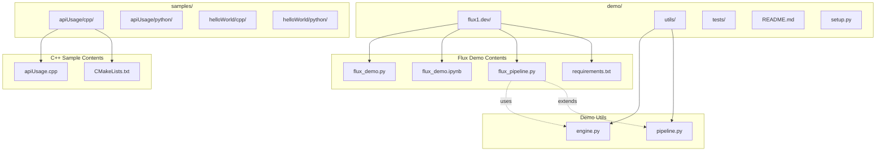
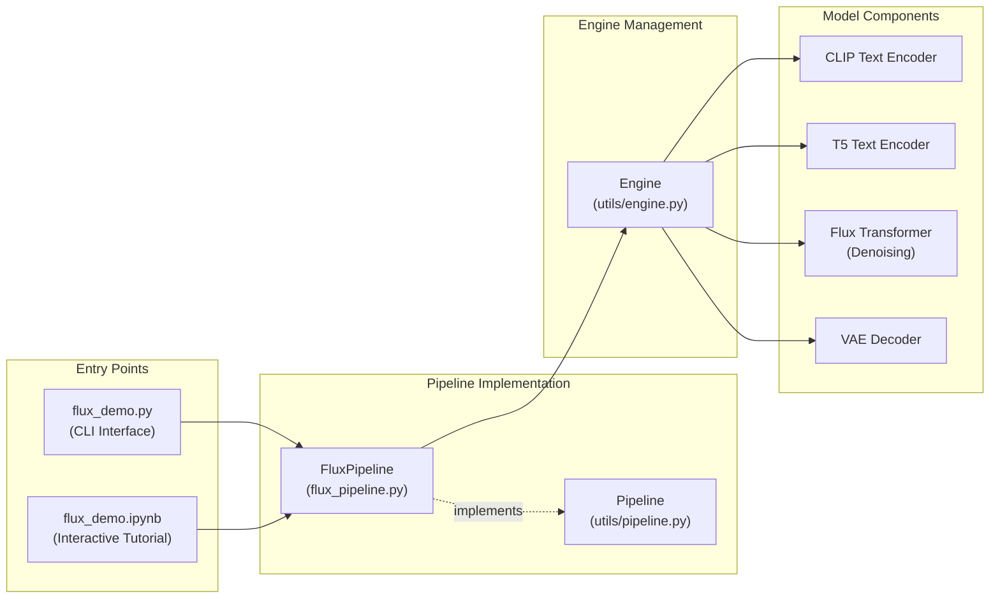
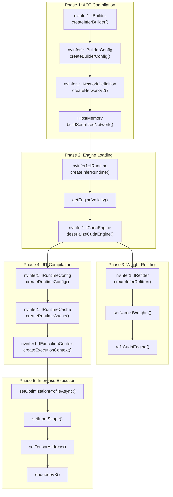
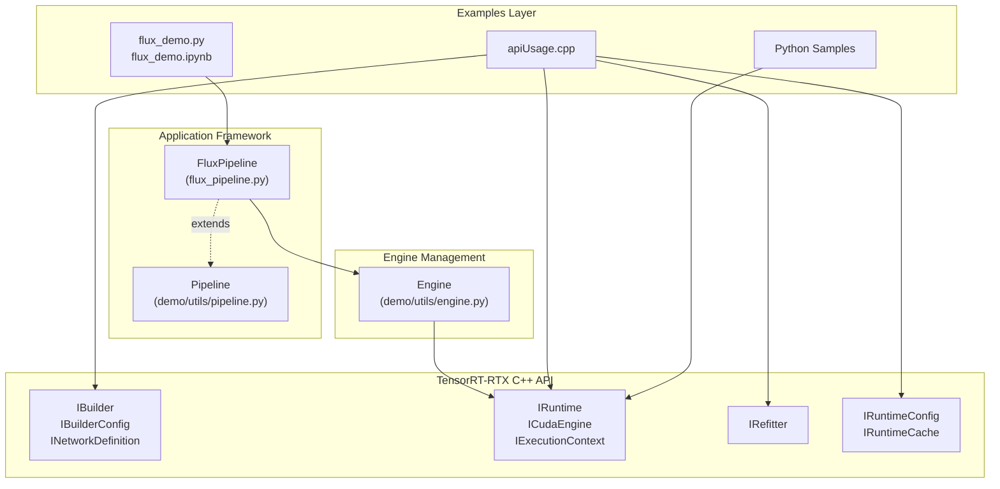
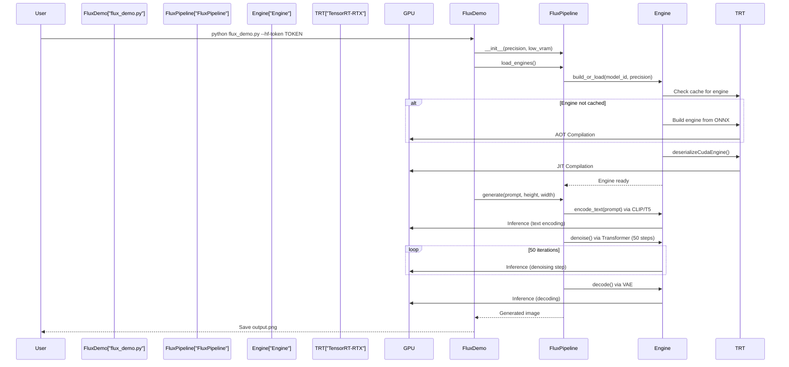
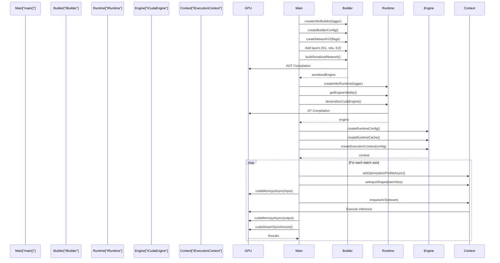

<!-- source: DeepWiki mcp.deepwiki.com · repo NVIDIA/TensorRT-RTX · page 4 Demonstrations and Examples · fetched 2026-10-26 -->

# Demonstrations and Examples

<details>
<summary>Relevant source files</summary>

The following files were used as context for generating this wiki page:

- [demo/README.md](demo/README.md)
- [demo/setup.py](demo/setup.py)
- [samples/apiUsage/cpp/apiUsage.cpp](samples/apiUsage/cpp/apiUsage.cpp)

</details>


## Purpose and Scope

This document provides an overview of the demonstration applications and sample code included in the TensorRT-RTX repository. These examples serve two primary purposes: (1) showcasing real-world applications of TensorRT-RTX capabilities through the Flux.1 text-to-image generation demo, and (2) providing minimal reference implementations that demonstrate core API usage patterns in both C++ and Python.

For detailed information about specific examples, see:
- Flux.1 demo features and usage: [Flux.1 Text-to-Image Demo](#4.1)
- Minimal API samples: [Sample Applications](#4.2)
- Core framework classes used by examples: [Core Framework](#5)

**Sources:** [demo/README.md:1-230]()

## Available Examples

The repository provides three categories of examples, each targeting different use cases:

| Category | Location | Language | Complexity | Purpose |
|----------|----------|----------|------------|---------|
| **Flux.1 Text-to-Image Demo** | `demo/flux1.dev/` | Python | Full Application | Production-ready pipeline demonstrating image generation with advanced features (precision modes, caching, memory management) |
| **C++ API Usage Sample** | `samples/apiUsage/cpp/` | C++ | Minimal | Reference implementation showing engine building, refitting, dynamic shapes, and inference execution |
| **Python API Usage Sample** | `samples/apiUsage/python/` | Python | Minimal | Reference implementation demonstrating Python API for engine management and inference |

**Sources:** [demo/README.md:1-33](), [samples/apiUsage/cpp/apiUsage.cpp:1-654]()

## Repository Structure



**Sources:** [demo/README.md:1-33](), [samples/apiUsage/cpp/apiUsage.cpp:1-17]()

## Flux.1 Text-to-Image Demonstration

The Flux.1 demo is a complete text-to-image generation application built on the `black-forest-labs/FLUX.1-dev` model from Hugging Face. It demonstrates TensorRT-RTX capabilities in a production-ready pipeline.

### Key Components



**Sources:** [demo/README.md:24-32](), [demo/README.md:111-183]()

### Feature Highlights

The Flux demo showcases advanced TensorRT-RTX features:

- **Precision Modes**: Supports `bf16`, `fp8`, and `fp4` quantization with GPU architecture-specific optimization
- **Dynamic Shapes**: Runtime flexibility for different image resolutions without recompilation
- **Memory Management**: Low-VRAM mode reduces peak memory usage by 9-11 GB
- **Caching System**: Two-tier caching (disk and runtime) for ONNX models, TensorRT engines, and JIT-compiled kernels
- **Cross-Platform**: Works on Windows and Linux with CUDA 12.9+

For complete configuration details, see [Flux Demo Configuration](#4.1.1). For implementation details, see [Flux Pipeline Architecture](#4.1.2).

**Sources:** [demo/README.md:111-118](), [demo/README.md:120-183]()

## Sample Applications

The repository includes minimal sample applications demonstrating fundamental TensorRT-RTX API patterns. Unlike the Flux demo which showcases a complete pipeline, these samples focus on individual API operations.

### C++ API Usage Sample

The C++ sample demonstrates the complete TensorRT-RTX workflow:



**Key APIs Demonstrated:**

| API Category | Classes/Functions | Lines |
|--------------|-------------------|-------|
| Network Building | `IBuilder`, `IBuilderConfig`, `INetworkDefinition` | [samples/apiUsage/cpp/apiUsage.cpp:72-196]() |
| Optimization Profiles | `IOptimizationProfile::setDimensions()` | [samples/apiUsage/cpp/apiUsage.cpp:79-85]() |
| Compute Capabilities | `setNbComputeCapabilities()`, `setComputeCapability()` | [samples/apiUsage/cpp/apiUsage.cpp:88-121]() |
| Engine Serialization | `buildSerializedNetwork()` | [samples/apiUsage/cpp/apiUsage.cpp:236-238]() |
| Weight Refitting | `IRefitter::setNamedWeights()`, `refitCudaEngine()` | [samples/apiUsage/cpp/apiUsage.cpp:517-539]() |
| Runtime Configuration | `IRuntimeConfig`, `IRuntimeCache` | [samples/apiUsage/cpp/apiUsage.cpp:543-565]() |
| Dynamic Shapes | `setInputShape()`, `inferShapes()` | [samples/apiUsage/cpp/apiUsage.cpp:300-316]() |
| CUDA Graphs | `setCudaGraphStrategy()` | [samples/apiUsage/cpp/apiUsage.cpp:567-583]() |
| Inference Execution | `enqueueV3()` | [samples/apiUsage/cpp/apiUsage.cpp:381]() |

The sample builds a simple two-layer fully connected network with dynamic batch size, demonstrating both AOT (ahead-of-time) and JIT (just-in-time) compilation phases. For detailed walkthrough, see [C++ API Usage Sample](#4.2.1).

**Sources:** [samples/apiUsage/cpp/apiUsage.cpp:1-654]()

### Python API Usage Sample

The Python samples demonstrate equivalent functionality using the `tensorrt_rtx` Python bindings. These samples show how to integrate TensorRT-RTX into Python applications and scientific computing workflows.

For detailed Python examples, see [Python API Usage Sample](#4.2.2).

**Sources:** [demo/setup.py:23-38]()

## Relationship to Core Framework

All examples build upon the core framework components documented in [Core Framework](#5). The following diagram shows how demonstration and sample code depends on framework classes:



**Framework Usage Patterns:**

| Example | Uses `Pipeline` | Uses `Engine` | Direct TensorRT-RTX API |
|---------|----------------|---------------|------------------------|
| **Flux Demo** | Yes (extends `Pipeline` base class) | Yes (via `FluxPipeline`) | Indirect |
| **C++ Sample** | No | No | Yes (demonstrates all core APIs) |
| **Python Sample** | No | No | Yes (Python bindings) |

The `Pipeline` base class ([demo/utils/pipeline.py]()) provides a high-level abstraction for multi-model inference workflows, while the `Engine` class ([demo/utils/engine.py]()) manages individual TensorRT engine lifecycle. Samples demonstrate direct API usage for applications that need fine-grained control.

For `Engine` class documentation, see [Engine Management](#5.1). For `Pipeline` class documentation, see [Pipeline Architecture](#5.2).

**Sources:** [demo/README.md:1-230](), [samples/apiUsage/cpp/apiUsage.cpp:1-654]()

## Getting Started with Examples

### Quick Start Matrix

Choose an example based on your goals:

| Goal | Recommended Example | Run Command |
|------|-------------------|-------------|
| **Generate images quickly** | Flux.1 demo script | `python demo/flux1.dev/flux_demo.py --hf-token TOKEN` |
| **Learn interactively** | Flux.1 Jupyter notebook | `jupyter notebook demo/flux1.dev/flux_demo.ipynb` |
| **Understand C++ API** | C++ API usage sample | Build with CMake, run `apiUsage` binary |
| **Integrate into Python app** | Python API usage sample | Run Python sample scripts |

**Sources:** [demo/README.md:24-32]()

### Installation Prerequisites

All examples require TensorRT-RTX to be installed. The installation process differs by example type:

**For Flux Demo:**
```bash
# Install TensorRT-RTX wheel (customize for your Python version)
python -m pip install /path/to/tensorrt_rtx-1.3.0.35-cp312-none-linux_x86_64.whl

# Install demo-specific dependencies
python -m pip install -r demo/flux1.dev/requirements.txt
```

**For C++ Samples:**
```bash
# TensorRT-RTX libraries must be installed at /opt/tensorrt_rtx
# CMake will automatically find and link against TensorRT-RTX
cmake -B build -S samples/apiUsage/cpp
cmake --build build
```

For complete installation instructions, see [Installation](#2.1).

**Sources:** [demo/README.md:7-22](), [demo/setup.py:23-38]()

### GPU Compatibility

Different examples have different GPU requirements:

| Example | Minimum GPU Architecture | Precision Support |
|---------|-------------------------|-------------------|
| **Flux Demo (bf16)** | Ampere (SM80+) | bf16 on Ampere/Ada/Blackwell |
| **Flux Demo (fp8)** | Ada (SM89+) | fp8 on Ada/Blackwell |
| **Flux Demo (fp4)** | Blackwell (SM120+) | fp4 on Blackwell only |
| **C++ Sample** | Ampere (SM80+) | Configurable via `setComputeCapability()` |
| **Python Sample** | Ampere (SM80+) | Configurable programmatically |

The Flux demo provides hardware-specific optimizations through precision selection. See [Flux Demo Configuration](#4.1.1) for VRAM usage by precision mode.

**Sources:** [demo/README.md:38-157](), [samples/apiUsage/cpp/apiUsage.cpp:88-121]()

## Example Execution Flow

### Flux Demo Execution



**Sources:** [demo/README.md:34-109]()

### C++ Sample Execution



**Sources:** [samples/apiUsage/cpp/apiUsage.cpp:444-653]()

## Dependencies and Requirements

### Flux Demo Dependencies

The Flux demo requires the following Python packages (specified in [demo/setup.py:23-38]()):

| Package | Version | Purpose |
|---------|---------|---------|
| `tensorrt-rtx` | ≥1.3.0 | TensorRT-RTX runtime |
| `torch` | ≥2.7.0 | PyTorch backend for model loading |
| `transformers` | ≥4.52.4 | Hugging Face model implementations |
| `diffusers` | ≥0.33.1 | Diffusion pipeline components |
| `huggingface-hub` | ≥0.32.4 | Model download and caching |
| `polygraphy` | ≥0.49.24 | ONNX to TensorRT conversion |
| `cuda-python` | <13.0.0 | CUDA runtime bindings |
| `pillow` | - | Image I/O |
| `numpy` | - | Numerical operations |

### C++ Sample Dependencies

The C++ samples link against:
- TensorRT-RTX libraries (libnvinfer, libnvinfer_plugin)
- CUDA runtime libraries
- C++17 standard library

Build requirements are specified via CMake. The build system expects TensorRT-RTX to be installed at `/opt/tensorrt_rtx`.

**Sources:** [demo/setup.py:23-38]()

## Troubleshooting Examples

Common issues and solutions when running examples:

| Issue | Example Affected | Solution |
|-------|-----------------|----------|
| **Out of Memory** | Flux Demo | Enable `--low-vram` or use lower precision (`--precision fp8` or `fp4`) |
| **Build Errors** | C++ Sample | Verify TensorRT-RTX installation at `/opt/tensorrt_rtx` |
| **Slow Compilation** | All | Enable runtime caching (`--enable-runtime-cache` for Flux, `IRuntimeCache` for samples) |
| **Image Quality Issues** | Flux Demo | Ensure dimensions are multiples of 16, adjust `--seed` and `--guidance-scale` |
| **Disk Space Issues** | Flux Demo | Use `--cache-mode lean` to auto-cleanup unused models |
| **Unsupported Precision** | All | Check GPU architecture supports precision mode (see [GPU Compatibility](#gpu-compatibility)) |

For Flux-specific troubleshooting, see [Flux.1 Text-to-Image Demo](#4.1). For build system issues, see [Build Process](#3.2).

**Sources:** [demo/README.md:202-225]()

## Testing Examples

Both the Flux demo and sample applications are validated through the CI/CD system. To run tests locally:

**Flux Demo Tests:**
```bash
pytest demo/tests/
```

**C++ Sample Tests:**
```bash
# After building with CMake
./build/apiUsage
```

For complete testing documentation, see [Testing Infrastructure](#3.3) and [Testing Guide](#6.3).

**Sources:** [demo/README.md:227-229]()

---

