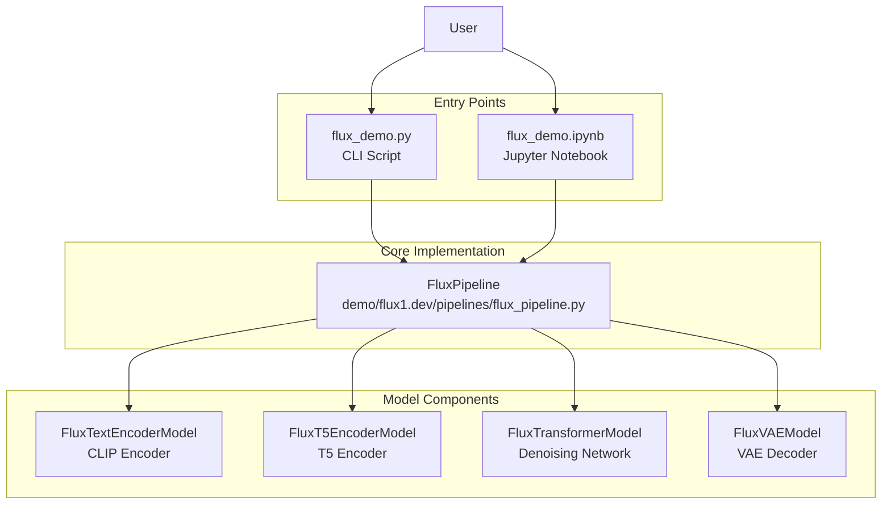
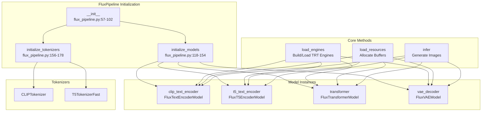
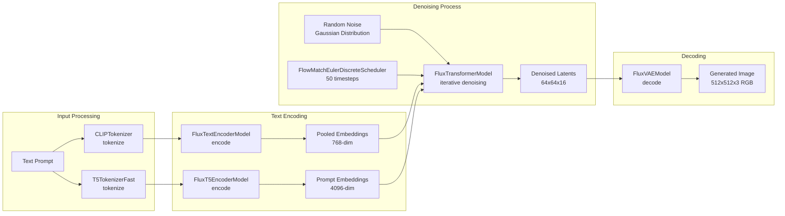
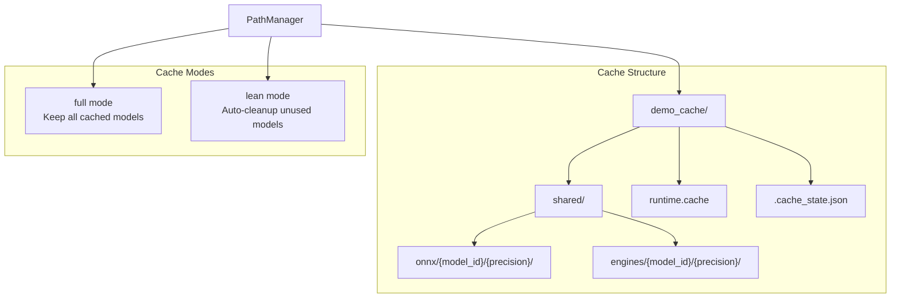

<!-- source: DeepWiki mcp.deepwiki.com · repo NVIDIA/TensorRT-RTX · page 4.1 Flux.1 Text-to-Image Demo · fetched 2026-10-26 -->

# Flux.1 Text-to-Image Demo

<details>
<summary>Relevant source files</summary>

The following files were used as context for generating this wiki page:

- [demo/README.md](demo/README.md)
- [demo/flux1.dev/flux_demo.ipynb](demo/flux1.dev/flux_demo.ipynb)
- [demo/flux1.dev/pipelines/flux_pipeline.py](demo/flux1.dev/pipelines/flux_pipeline.py)

</details>


## Purpose and Scope

The Flux.1 Text-to-Image Demo is a complete demonstration application showcasing the capabilities of TensorRT-RTX for accelerating text-to-image generation using the FLUX.1 [dev] model from Black Forest Labs. This demo illustrates key features including JIT compilation, quantization (FP8/FP4), runtime caching, dynamic shape specialization, CUDA graphs, and low-VRAM memory management.

**Related Pages:**
- For detailed configuration options, see [Flux Demo Configuration](#4.1.1)
- For deep technical details on the pipeline implementation, see [Flux Pipeline Architecture](#4.1.2)
- For information on contributing code to the demo, see [Contributing to TensorRT-RTX](#6.1)

This page focuses on understanding what the demo does, how to run it, and the overall system architecture.

## Demo Entry Points

The Flux demo provides two primary interfaces for users:



**Sources:** [demo/README.md:24-32](), [demo/flux1.dev/pipelines/flux_pipeline.py:54-102]()

### CLI Script

The standalone Python script `flux_demo.py` provides command-line access to image generation:

```bash
python demo/flux1.dev/flux_demo.py --hf-token YOUR_TOKEN --prompt "A cat in space"
```

Key CLI parameters include:
- `--hf-token`: Required HuggingFace token for model access
- `--prompt`: Text description for image generation
- `--height`, `--width`: Output image dimensions (default: 512x512)
- `--precision`: Transformer precision (bf16, fp8, fp4)
- `--dynamic-shape`: Enable dynamic shape engines
- `--low-vram`: Enable low VRAM mode
- `--enable-runtime-cache`: Enable JIT compilation caching

**Sources:** [demo/README.md:40-108]()

### Jupyter Notebook

The interactive notebook `flux_demo.ipynb` provides a guided walkthrough with:
- Step-by-step explanations of each feature
- Interactive parameter exploration
- Detailed performance comparisons
- Visual output display

**Sources:** [demo/README.md:31-32](), [demo/flux1.dev/flux_demo.ipynb:1-235]()

## Pipeline Architecture Overview

The `FluxPipeline` class orchestrates the complete text-to-image generation workflow:



**Sources:** [demo/flux1.dev/pipelines/flux_pipeline.py:54-178]()

### Key Pipeline Methods

| Method | Purpose | Location |
|--------|---------|----------|
| `__init__` | Initialize pipeline configuration and components | [flux_pipeline.py:57-102]() |
| `initialize_models` | Create model instances for all components | [flux_pipeline.py:118-154]() |
| `initialize_tokenizers` | Load CLIP and T5 tokenizers | [flux_pipeline.py:156-178]() |
| `load_engines` | Build/load TensorRT engines with specified configuration | [flux_pipeline.py:194-290]() |
| `load_resources` | Allocate input/output buffers and workspace | Referenced in usage |
| `infer` | Execute complete generation pipeline | Referenced in usage |

## Text-to-Image Data Flow

The complete data flow from text prompt to generated image follows this sequence:



**Sources:** [demo/flux1.dev/pipelines/flux_pipeline.py:54-290]()

## Model Components

The pipeline utilizes four distinct neural network components, each optimized as a separate TensorRT engine:

### Component Table

| Component | Model Class | Input | Output | Precision Options |
|-----------|------------|-------|--------|------------------|
| CLIP Text Encoder | `FluxTextEncoderModel` | Tokenized text | 768-dim pooled embeddings | BF16 (default) |
| T5 Text Encoder | `FluxT5EncoderModel` | Tokenized text | 4096-dim prompt embeddings | BF16 (default) |
| Transformer | `FluxTransformerModel` | Noise + embeddings | Denoised latents | BF16, FP8, FP4 |
| VAE Decoder | `FluxVAEModel` | Latents 64×64×16 | Image 512×512×3 | BF16 (default) |

**Sources:** [demo/flux1.dev/pipelines/flux_pipeline.py:124-154](), [demo/README.md:122-162]()

### Model Initialization

Each model component is instantiated through the `initialize_models` method:

```python
self.model_instances = {
    "clip_text_encoder": FluxTextEncoderModel(...),
    "t5_text_encoder": FluxT5EncoderModel(...),
    "transformer": FluxTransformerModel(...),
    "vae_decoder": FluxVAEModel(...),
}
```

**Sources:** [demo/flux1.dev/pipelines/flux_pipeline.py:125-154]()

## TensorRT-RTX Features Demonstrated

The demo showcases several key TensorRT-RTX capabilities:

```mermaid
graph TB
    subgraph "Performance Optimizations"
        JIT["JIT Compilation<br/>GPU-specific optimization"]
        Cache["Runtime Cache<br/>Faster subsequent runs"]
        CudaG["CUDA Graphs<br/>Reduced kernel overhead"]
    end
    
    subgraph "Memory Management"
        LowVRAM["Low-VRAM Mode<br/>CPU offloading"]
        DiskCache["Disk Cache<br/>ONNX + Engine storage"]
    end
    
    subgraph "Shape Handling"
        Static["Static Shapes<br/>Fixed dimensions"]
        Dynamic["Dynamic Shapes<br/>Runtime specialization"]
    end
    
    subgraph "Quantization"
        FP8["FP8 Precision<br/>Ada/Blackwell GPUs"]
        FP4["FP4 Precision<br/>Blackwell GPUs only"]
        BF16["BF16 Precision<br/>All supported GPUs"]
    end
    
    Pipeline["FluxPipeline"] --> JIT
    Pipeline --> Cache
    Pipeline --> CudaG
    Pipeline --> LowVRAM
    Pipeline --> DiskCache
    Pipeline --> Static
    Pipeline --> Dynamic
    Pipeline --> FP8
    Pipeline --> FP4
    Pipeline --> BF16
```



**Sources:** [demo/README.md:111-118](), [demo/flux1.dev/flux_demo.ipynb:186-234]()

### Precision and Memory Trade-offs

Different precision modes offer varying performance and memory characteristics:

| Precision | GPU Support | Max VRAM (Default) | Max VRAM (Low-VRAM) |
|-----------|-------------|-------------------|---------------------|
| BF16 | Ampere, Ada, Blackwell | 32.1 GB | 23.1 GB |
| FP8 | Ada, Blackwell | 21.6 GB | 12.0 GB |
| FP4 | Blackwell | 20.5 GB | 11.0 GB |

**Sources:** [demo/README.md:122-162]()

## Cache Management

The demo implements a sophisticated caching system to optimize disk space and reduce rebuild times:



**Sources:** [demo/README.md:184-200]()

### Cache Directory Structure

The cache is organized as follows:

```
demo_cache/
├── shared/
│   ├── onnx/{model_id}/{precision}/    # ONNX models
│   └── engines/{model_id}/{precision}/ # TensorRT engines  
├── runtime.cache                       # JIT compilation cache
└── .cache_state.json                   # Usage tracking
```

**Sources:** [demo/README.md:189-200]()

## Configuration Examples

### Basic Image Generation

```bash
# Default parameters (512x512, FP8, static shapes)
python demo/flux1.dev/flux_demo.py --hf-token YOUR_TOKEN
```

### High Resolution with Runtime Caching

```bash
# 1024x1024 with faster JIT compilation
python demo/flux1.dev/flux_demo.py \
    --hf-token YOUR_TOKEN \
    --height 1024 \
    --width 1024 \
    --enable-runtime-cache \
    --prompt "A detailed cityscape at golden hour"
```

### Dynamic Shapes with Shape Specialization

```bash
# Enable dynamic shape engines for flexible resolutions
python demo/flux1.dev/flux_demo.py \
    --hf-token YOUR_TOKEN \
    --dynamic-shape \
    --prompt "A dramatic cityscape from a dazzling angle"
```

### Low VRAM Configuration

```bash
# Optimize for GPUs with limited memory (Blackwell with FP4)
python demo/flux1.dev/flux_demo.py \
    --hf-token YOUR_TOKEN \
    --low-vram \
    --precision fp4 \
    --prompt "A serene forest scene"
```

**Sources:** [demo/README.md:77-108]()

## Troubleshooting

Common issues and solutions:

| Issue | Solution | Reference |
|-------|----------|-----------|
| GPU Out of Memory | Use `--low-vram` flag, reduce resolution/batch size, or use lower precision (fp8/fp4) | [demo/README.md:210-215]() |
| Slow JIT Compilation | Enable `--enable-runtime-cache` to cache kernel compilations | [demo/README.md:91-95]() |
| Image Quality Issues | Ensure dimensions are multiples of 16, adjust seed and guidance_scale | [demo/README.md:204-208]() |
| Disk Space Issues | Use `--cache-mode lean` for automatic cleanup of unused models | [demo/README.md:217-220]() |
| Build Errors | Verify TensorRT-RTX installation and GPU architecture compatibility | [demo/README.md:222-225]() |

**Sources:** [demo/README.md:202-225]()

## Next Steps

For detailed information on:
- **Configuration parameters and their effects:** See [Flux Demo Configuration](#4.1.1)
- **Pipeline implementation details:** See [Flux Pipeline Architecture](#4.1.2)
- **Core framework utilities:** See [Engine Management](#5.1) and [Pipeline Architecture](#5.2)
- **Running tests:** See [Testing Guide](#6.3)

**Sources:** [demo/README.md:1-230](), [demo/flux1.dev/pipelines/flux_pipeline.py:1-290]()

---

