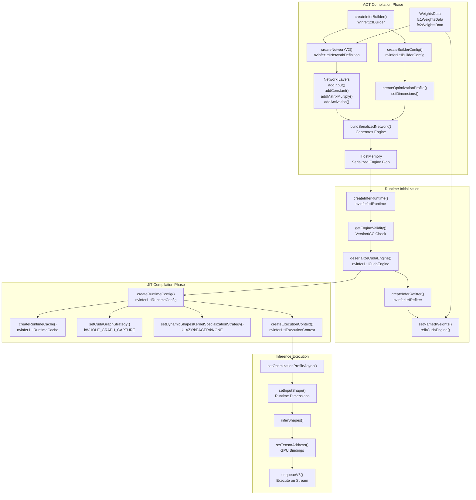
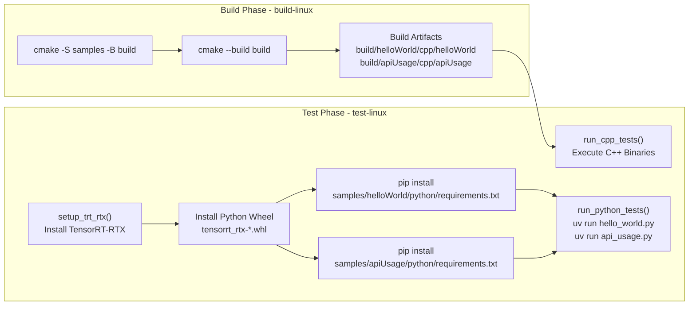
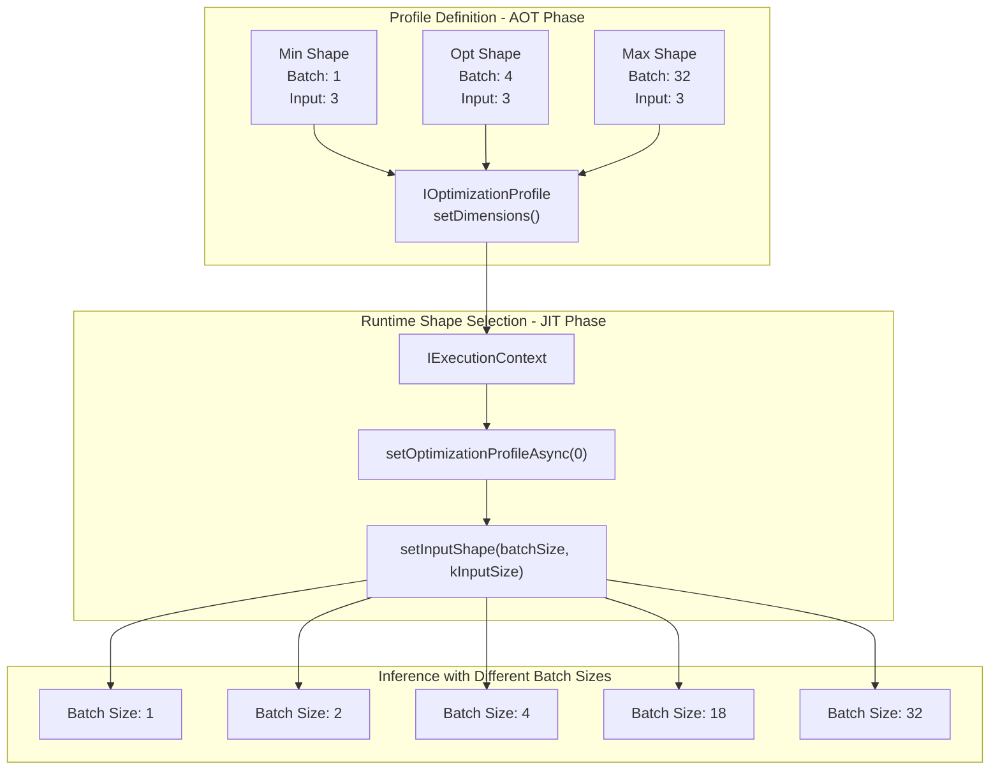
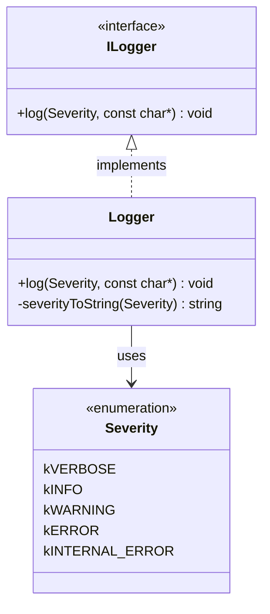
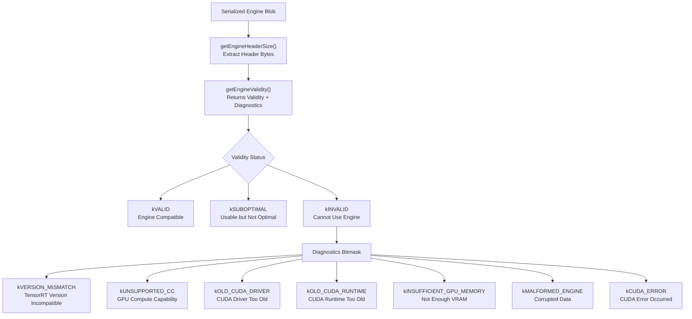
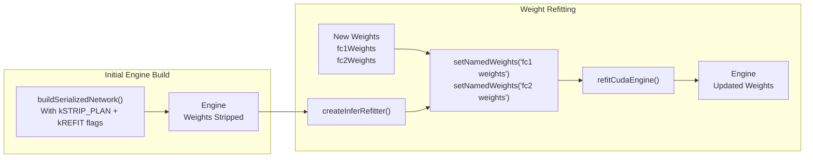
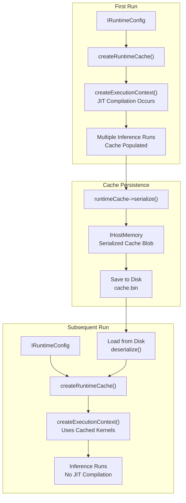
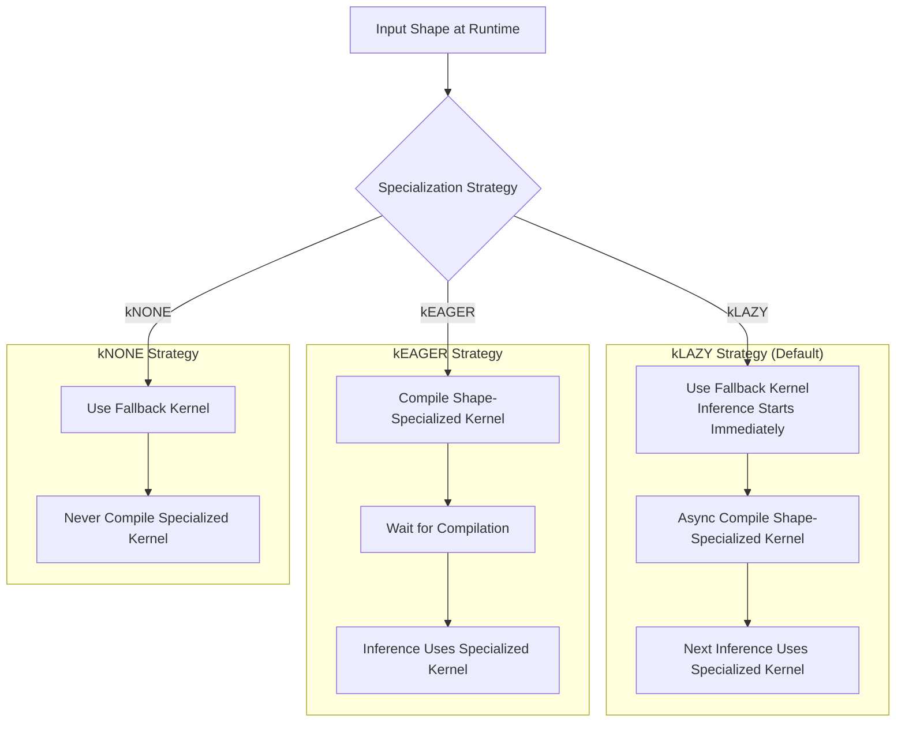
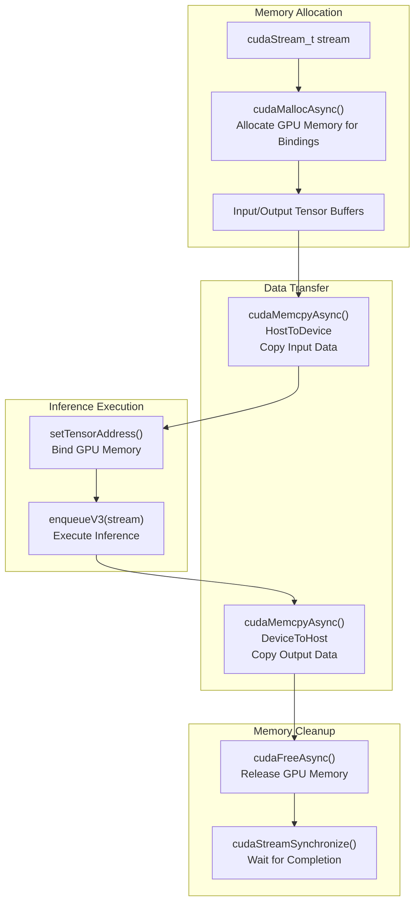

<!-- source: DeepWiki mcp.deepwiki.com · repo NVIDIA/TensorRT-RTX · page 4.2 Sample Applications · fetched 2026-10-26 -->

# Sample Applications

<details>
<summary>Relevant source files</summary>

The following files were used as context for generating this wiki page:

- [.github/workflows/test.py](.github/workflows/test.py)
- [demo/tests/README.md](demo/tests/README.md)
- [samples/apiUsage/cpp/apiUsage.cpp](samples/apiUsage/cpp/apiUsage.cpp)

</details>


## Purpose and Scope

This document describes the minimal sample applications provided in the TensorRT-RTX repository to demonstrate core API usage patterns. The samples are located in the `samples/` directory and include both C++ and Python implementations of two example types: `helloWorld` and `apiUsage`.

These samples serve as entry points for developers who want to understand how to integrate TensorRT-RTX into their applications. They demonstrate the fundamental workflow: building TensorRT engines from network definitions, serializing and deserializing engines, and executing inference.

For a complete, production-ready demonstration of TensorRT-RTX capabilities in a real-world application, see [Flux.1 Text-to-Image Demo](#4.1). For detailed framework classes that abstract these APIs, see [Core Framework](#5).

Sources: [.github/workflows/test.py:39-60](), [samples/apiUsage/cpp/apiUsage.cpp:1-653]()

## Sample Structure and Organization

The sample applications are organized into two categories, each available in both C++ and Python implementations:

| Sample Name | Purpose | Complexity | Key Concepts |
|-------------|---------|------------|--------------|
| `helloWorld` | Minimal "hello world" example | Basic | Engine creation, basic inference |
| `apiUsage` | Comprehensive API demonstration | Advanced | Dynamic shapes, refitting, runtime cache, CUDA graphs |

Each sample type is structured as follows:

```
samples/
├── helloWorld/
│   ├── cpp/
│   │   └── (C++ source files)
│   └── python/
│       ├── hello_world.py
│       └── requirements.txt
└── apiUsage/
    ├── cpp/
    │   └── apiUsage.cpp
    └── python/
        ├── api_usage.py
        └── requirements.txt
```

Sources: [.github/workflows/test.py:33-34](), [.github/workflows/test.py:42](), [.github/workflows/test.py:57-58]()

## Sample Application Workflow

The following diagram illustrates the complete workflow implemented in the samples, from network definition through inference execution:



This workflow is fully demonstrated in the `apiUsage` C++ sample. The AOT (Ahead-of-Time) compilation phase occurs once, typically at installation time or first run, and produces a serialized engine that can be reused. The JIT (Just-in-Time) compilation phase happens when creating an execution context and targets the specific GPU on which the application is running. Inference execution is performed repeatedly with different input data and batch sizes.

Sources: [samples/apiUsage/cpp/apiUsage.cpp:198-239](), [samples/apiUsage/cpp/apiUsage.cpp:444-653]()

## Key API Components in Samples

The samples demonstrate the following core TensorRT-RTX API components:

### Builder Infrastructure

| Class/Function | Purpose | Used In |
|----------------|---------|---------|
| `nvinfer1::createInferBuilder()` | Creates builder for network definition | `apiUsage.cpp:212` |
| `nvinfer1::IBuilderConfig` | Configures optimization settings | `apiUsage.cpp:72-133` |
| `nvinfer1::IOptimizationProfile` | Defines min/opt/max shapes for dynamic dimensions | `apiUsage.cpp:79-85` |
| `buildSerializedNetwork()` | Performs AOT compilation to generate engine | `apiUsage.cpp:236` |

### Network Definition

| Class/Function | Purpose | Used In |
|----------------|---------|---------|
| `createNetworkV2()` | Creates empty network graph | `apiUsage.cpp:159` |
| `addInput()` | Adds input tensor with dynamic dimensions | `apiUsage.cpp:163-164` |
| `addConstant()` | Creates constant layer for weights | `apiUsage.cpp:167-171` |
| `addMatrixMultiply()` | Adds fully connected layer | `apiUsage.cpp:178-189` |
| `addActivation()` | Adds activation function (ReLU) | `apiUsage.cpp:183` |
| `markOutput()` | Marks tensor as network output | `apiUsage.cpp:193` |

### Runtime and Execution

| Class/Function | Purpose | Used In |
|----------------|---------|---------|
| `nvinfer1::createInferRuntime()` | Creates runtime for engine deserialization | `apiUsage.cpp:465` |
| `getEngineValidity()` | Validates engine compatibility | `apiUsage.cpp:484` |
| `deserializeCudaEngine()` | Loads engine from serialized blob | `apiUsage.cpp:510` |
| `createExecutionContext()` | Creates context for inference (JIT phase) | `apiUsage.cpp:589` |
| `setInputShape()` | Sets runtime tensor dimensions | `apiUsage.cpp:300` |
| `setTensorAddress()` | Binds GPU memory to tensors | `apiUsage.cpp:368` |
| `enqueueV3()` | Executes inference on CUDA stream | `apiUsage.cpp:381` |

### Advanced Features

| Class/Function | Purpose | Used In |
|----------------|---------|---------|
| `nvinfer1::IRefitter` | Updates weights in existing engine | `apiUsage.cpp:518-540` |
| `nvinfer1::IRuntimeCache` | Caches JIT-compiled kernels | `apiUsage.cpp:550-564` |
| `setCudaGraphStrategy()` | Enables CUDA graph capture | `apiUsage.cpp:575` |
| `setDynamicShapesKernelSpecializationStrategy()` | Configures shape-specialized kernel compilation | `apiUsage.cpp:437-438` |

Sources: [samples/apiUsage/cpp/apiUsage.cpp:18-653]()

## Sample Execution in CI/CD Pipeline

The samples are automatically built and tested as part of the CI/CD pipeline to ensure API compatibility and correctness:



The build phase compiles C++ samples using CMake, producing standalone executables. The test phase installs the TensorRT-RTX Python wheel, installs sample-specific dependencies, and executes both C++ and Python samples to validate their functionality on GPU hardware.

Sources: [.github/workflows/test.py:39-60]()

## Sample Dependencies

### C++ Samples

The C++ samples link against the following libraries:
- TensorRT-RTX core library (`libnvinfer.so`)
- CUDA runtime (`libcudart.so`)

Include directories:
- `${TRTRTX_INSTALL_DIR}/include` - TensorRT-RTX headers
- `/usr/local/cuda/include` - CUDA headers

### Python Samples

Both Python samples have their dependencies specified in `requirements.txt` files:
- [samples/helloWorld/python/requirements.txt]() - Dependencies for the hello world sample
- [samples/apiUsage/python/requirements.txt]() - Dependencies for the API usage sample

The primary dependency is the TensorRT-RTX Python wheel:
```
tensorrt_rtx-*-cp39-none-linux_x86_64.whl
```

Additional dependencies typically include:
- NumPy for array operations
- CUDA Python bindings for GPU memory management

Sources: [.github/workflows/test.py:23-36]()

## Dynamic Shapes and Optimization Profiles

The `apiUsage` sample demonstrates a key TensorRT-RTX feature: dynamic batch dimensions using optimization profiles. This allows a single engine to handle multiple batch sizes efficiently:



The optimization profile specifies three shape configurations:
- **Minimum**: Smallest dimensions the engine must support (batch=1)
- **Optimum**: Shape optimized for best performance (batch=4)
- **Maximum**: Largest dimensions the engine must support (batch=32)

At runtime, any batch size within this range can be used. The sample demonstrates inference with batch sizes {1, 2, 4, 18, 32} to validate this capability.

Sources: [samples/apiUsage/cpp/apiUsage.cpp:60-68](), [samples/apiUsage/cpp/apiUsage.cpp:78-85](), [samples/apiUsage/cpp/apiUsage.cpp:599-631]()

## Logger Implementation

TensorRT-RTX requires applications to implement the `nvinfer1::ILogger` interface for diagnostic messages. The samples provide a minimal implementation:



The `Logger` class implements `nvinfer1::ILogger::log()` to output messages to `std::cout` with severity prefixes. This logger is passed to all TensorRT-RTX API calls that require logging capability.

Sources: [samples/apiUsage/cpp/apiUsage.cpp:34-58]()

## Engine Validation and Diagnostics

The `apiUsage` sample demonstrates engine validity checking before deserialization, which helps diagnose compatibility issues:



The diagnostics bitmask provides detailed failure reasons when an engine is invalid, enabling applications to provide informative error messages to users.

Sources: [samples/apiUsage/cpp/apiUsage.cpp:472-506]()

## Weight Refitting

The samples demonstrate weight refitting, which allows updating model weights in an existing engine without rebuilding the entire engine:



This feature is essential for applications that need to update model weights (e.g., fine-tuning, quantization) without re-running the expensive AOT compilation phase. The engine must be built with `kSTRIP_PLAN` and `kREFIT` flags to support refitting.

Sources: [samples/apiUsage/cpp/apiUsage.cpp:123-130](), [samples/apiUsage/cpp/apiUsage.cpp:517-540]()

## Runtime Cache Serialization

The samples show how to serialize and persist the runtime cache, which stores JIT-compiled kernels and CUDA graphs:



Persisting the runtime cache eliminates JIT compilation overhead on subsequent application runs, significantly reducing startup time. The cache is GPU-specific and should be regenerated if the GPU changes.

Sources: [samples/apiUsage/cpp/apiUsage.cpp:550-564](), [samples/apiUsage/cpp/apiUsage.cpp:642-650]()

## CUDA Graph Strategy

The `apiUsage` sample demonstrates CUDA graph configuration for optimized inference:

| Strategy | Behavior | Use Case |
|----------|----------|----------|
| `kDISABLED` | No graph capture, kernels launched directly | Debugging, profiling individual kernels |
| `kWHOLE_GRAPH_CAPTURE` | Captures complete computation graph after shape-specialized kernels compile | Production inference with dynamic shapes |

The `kWHOLE_GRAPH_CAPTURE` strategy captures the entire model's computational graph and executes it atomically on the GPU stream. For dynamic shapes, the graph is captured after shape-specialized kernels are compiled for a given input shape. This reduces kernel launch overhead and improves inference throughput.

Sources: [samples/apiUsage/cpp/apiUsage.cpp:567-583]()

## Dynamic Shapes Kernel Specialization

The sample demonstrates three kernel specialization strategies for handling dynamic shapes:



- **kLAZY** (default): Balances latency and performance. First inference uses a fallback kernel while a shape-specialized kernel compiles asynchronously in the background.
- **kEAGER**: Prioritizes performance. Waits for shape-specialized kernel compilation before running inference.
- **kNONE**: Prioritizes consistent latency. Always uses fallback kernels, never compiles shape-specialized versions.

Sources: [samples/apiUsage/cpp/apiUsage.cpp:426-441]()

## Memory Management Pattern

The samples demonstrate proper CUDA memory management for inference:



The pattern uses asynchronous CUDA operations on a stream for maximum GPU utilization. Memory is allocated with `cudaMallocAsync()`, bound to tensors with `setTensorAddress()`, and freed with `cudaFreeAsync()`. All operations are synchronized at the end with `cudaStreamSynchronize()`.

Sources: [samples/apiUsage/cpp/apiUsage.cpp:355-398](), [samples/apiUsage/cpp/apiUsage.cpp:604-606]()

## Next Steps

For detailed walkthroughs of individual samples:
- [C++ API Usage Sample](#4.2.1) - Complete analysis of the C++ `apiUsage` implementation
- [Python API Usage Sample](#4.2.2) - Python equivalents and bindings

For understanding how these samples integrate into larger applications:
- [Flux.1 Text-to-Image Demo](#4.1) - Production application built on these concepts
- [Core Framework](#5) - Higher-level abstractions built on top of the sample APIs

---

