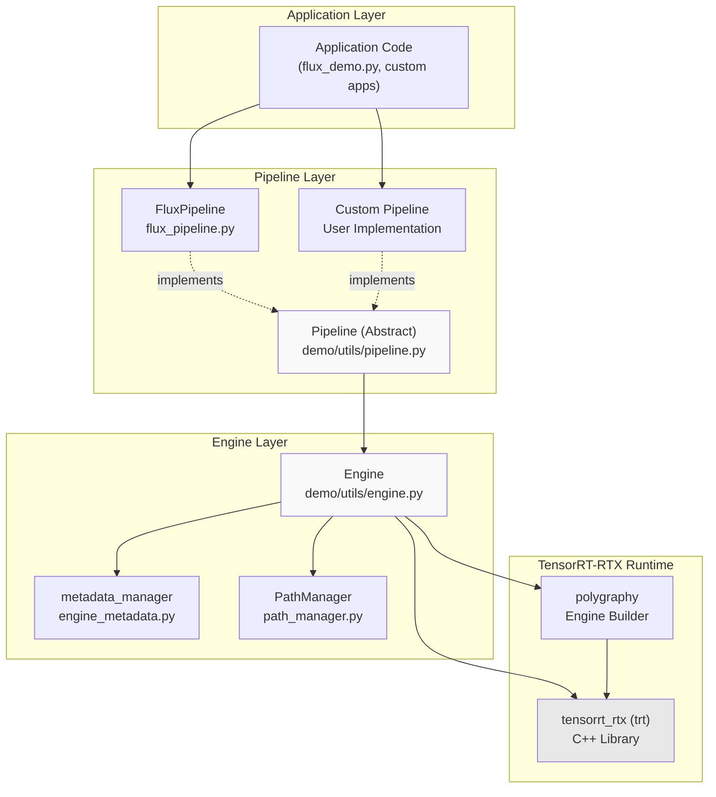
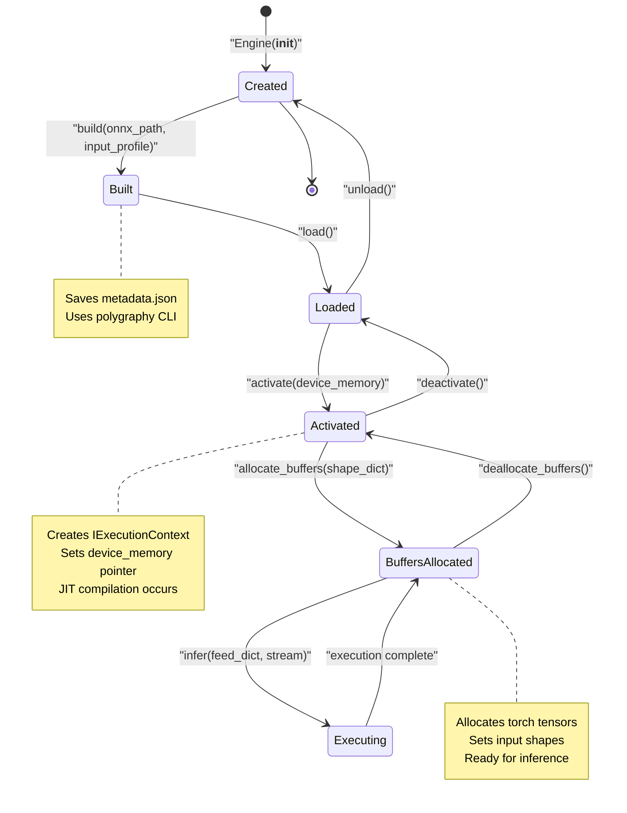
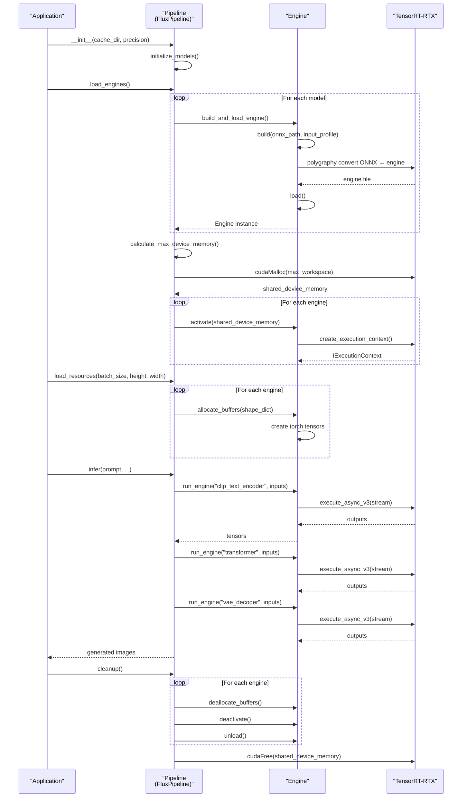
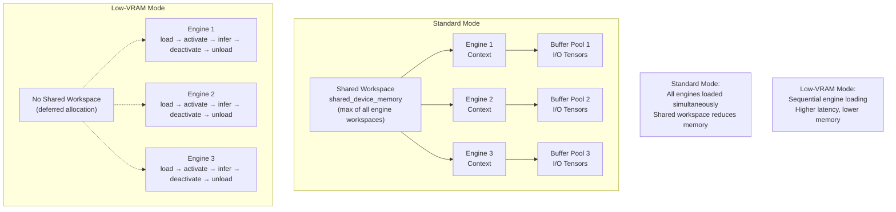
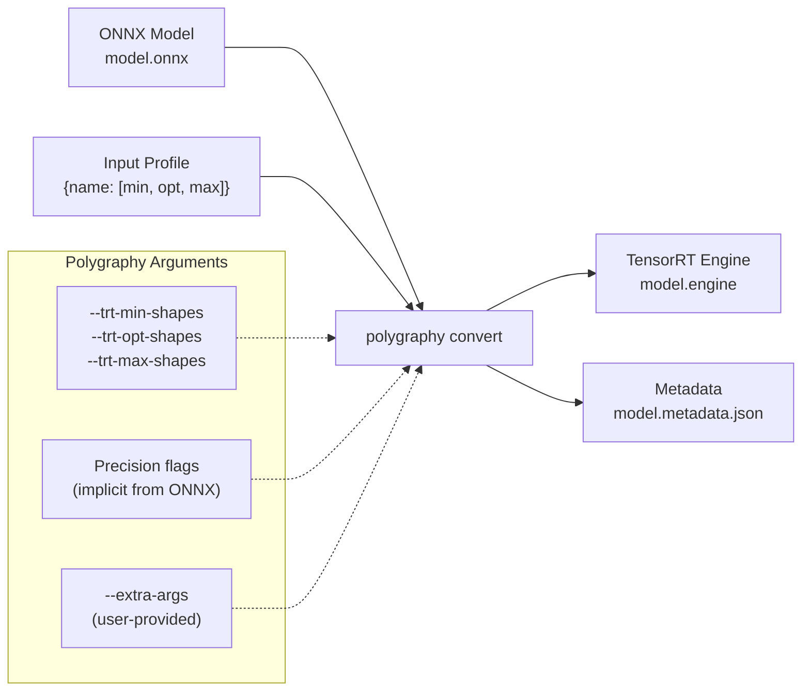
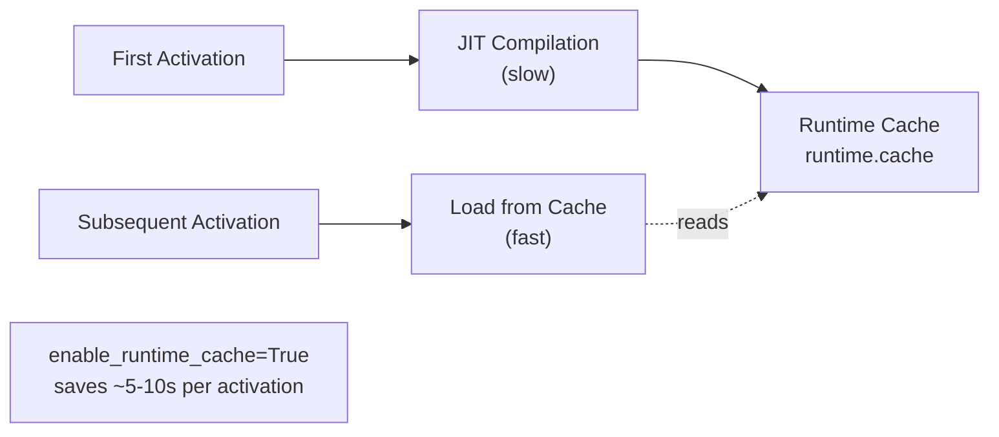

<!-- source: DeepWiki mcp.deepwiki.com · repo NVIDIA/TensorRT-RTX · page 5 Core Framework · fetched 2026-10-26 -->

# Core Framework

<details>
<summary>Relevant source files</summary>

The following files were used as context for generating this wiki page:

- [demo/flux1.dev/pipelines/flux_pipeline.py](demo/flux1.dev/pipelines/flux_pipeline.py)
- [demo/utils/engine.py](demo/utils/engine.py)
- [demo/utils/pipeline.py](demo/utils/pipeline.py)

</details>


This document describes the foundational classes and utilities that power TensorRT-RTX applications in this repository. The Core Framework consists of two primary abstractions: the `Engine` class for managing TensorRT-RTX engine lifecycle and the `Pipeline` abstract base class for orchestrating multi-model inference workflows.

For detailed API reference and implementation specifics:
- Engine lifecycle management: see [Engine Management](#5.1)
- Custom pipeline implementation: see [Pipeline Architecture](#5.2)
- Flux.1 demonstration example: see [Flux Pipeline Architecture](#4.1.2)

## Architecture Overview

The Core Framework implements a two-layer architecture where the `Engine` class provides low-level TensorRT operations, and the `Pipeline` class provides high-level workflow orchestration.



**Sources:** [demo/utils/pipeline.py:1-400](), [demo/utils/engine.py:1-407](), [demo/flux1.dev/pipelines/flux_pipeline.py:1-929]()

## Core Classes

### Engine Class

The `Engine` class ([demo/utils/engine.py:78-407]()) manages the complete lifecycle of TensorRT-RTX engines:

| Lifecycle Stage | Method | Description |
|----------------|--------|-------------|
| **Build** | `build()` | Converts ONNX to TensorRT engine using polygraphy |
| **Load** | `load()` | Deserializes engine from disk into memory |
| **Activate** | `activate()` | Creates execution context and allocates device memory |
| **Allocate** | `allocate_buffers()` | Allocates input/output tensors |
| **Execute** | `infer()` | Runs inference on GPU |
| **Deallocate** | `deallocate_buffers()` | Frees tensor memory |
| **Deactivate** | `deactivate()` | Destroys execution context |
| **Unload** | `unload()` | Frees engine from memory |

**Key Attributes:**
- `engine_path`: Path to serialized TensorRT engine file
- `engine`: TensorRT `ICudaEngine` object ([demo/utils/engine.py:88]())
- `context`: TensorRT `IExecutionContext` object ([demo/utils/engine.py:89]())
- `tensors`: OrderedDict of allocated input/output buffers ([demo/utils/engine.py:90]())
- `precision`: Precision mode (e.g., "fp8", "fp16", "bf16") ([demo/utils/engine.py:91]())

**Sources:** [demo/utils/engine.py:78-407]()

### Pipeline Class

The `Pipeline` abstract base class ([demo/utils/pipeline.py:39-400]()) provides infrastructure for multi-model inference workflows:

| Component | Attribute/Method | Description |
|-----------|------------------|-------------|
| **Configuration** | `precision_config` | Per-model precision settings ([demo/utils/pipeline.py:117]()) |
| **State Management** | `engines` | Dictionary of loaded Engine instances ([demo/utils/pipeline.py:108]()) |
| **Memory Management** | `shared_device_memory` | Shared workspace across engines ([demo/utils/pipeline.py:114]()) |
| **Timing** | `timing_data` | Performance metrics ([demo/utils/pipeline.py:121]()) |
| **Execution** | `run_engine()` | Execute specific engine ([demo/utils/pipeline.py:285-288]()) |

**Abstract Methods (must be implemented by subclasses):**
- `load_engines()`: Build and load all required engines ([demo/utils/pipeline.py:220-222]())
- `load_resources()`: Allocate buffers for inference ([demo/utils/pipeline.py:253-260]())
- `infer()`: Execute full pipeline ([demo/utils/pipeline.py:290-292]())
- `initialize_models()`: Create model instances ([demo/utils/pipeline.py:215-217]())
- `get_model_names()`: Return model identifiers ([demo/utils/pipeline.py:211-213]())

**Sources:** [demo/utils/pipeline.py:39-400]()

## Engine Lifecycle

The Engine class implements a state machine that manages TensorRT engine resources:



**Key State Transitions:**

1. **Build** ([demo/utils/engine.py:140-213]()): Invokes `polygraphy convert` to transform ONNX to TensorRT engine with specified precision and shapes
2. **Load** ([demo/utils/engine.py:214-240]()): Deserializes engine file using `engine_from_bytes()`
3. **Activate** ([demo/utils/engine.py:254-305]()): Creates `IExecutionContext` with optional shared device memory and runtime cache
4. **Allocate Buffers** ([demo/utils/engine.py:330-369]()): Creates torch tensors for all engine I/O bindings
5. **Infer** ([demo/utils/engine.py:391-406]()): Copies input data, sets tensor addresses, executes asynchronously

**Sources:** [demo/utils/engine.py:78-407]()

## Pipeline Workflow

The Pipeline class orchestrates multi-model workflows with shared resources:



**Sources:** [demo/utils/pipeline.py:39-400](), [demo/flux1.dev/pipelines/flux_pipeline.py:54-929]()

## Memory Management Architecture

The framework implements sophisticated memory management with shared workspace and optional low-VRAM mode:



### Standard Mode Memory Layout

In standard mode, the Pipeline calculates the maximum workspace requirement across all engines and allocates a single shared buffer:

```python
# Pseudocode from Pipeline.calculate_max_device_memory()
max_workspace = 0
for engine in engines:
    max_workspace = max(max_workspace, engine.device_memory_size_v2)

shared_device_memory = cudaMalloc(max_workspace)

# All engines share this workspace
for engine in engines:
    engine.activate(device_memory=shared_device_memory)
```

**Memory Formula:** `Total VRAM = Weights + max(Workspaces) + Buffers`

**Sources:** [demo/utils/pipeline.py:262-283](), [demo/utils/pipeline.py:224-250]()

### Low-VRAM Mode

When `low_vram=True`, engines are dynamically loaded/unloaded during inference using the `ModelMemoryManager` context manager:

```python
# Example from FluxPipeline.infer()
with self.model_memory_manager("t5_text_encoder", self.low_vram):
    t5_embeds = self.encode_prompt(prompt, "t5_text_encoder")
# Engine automatically unloaded after context exit
```

The `ModelMemoryManager` ([demo/utils/memory_manager.py]()) calls:
- `engine.load()` on context entry
- `engine.activate()` with deferred memory allocation
- `engine.allocate_buffers()` for I/O tensors
- `engine.deallocate_buffers()`, `engine.deactivate()`, `engine.unload()` on context exit

**Sources:** [demo/flux1.dev/pipelines/flux_pipeline.py:179-192](), [demo/flux1.dev/pipelines/flux_pipeline.py:813-819]()

## Precision Configuration

The framework supports per-model precision configuration through the `precision_config` dictionary:

| Precision | Description | Compute Capability | Use Case |
|-----------|-------------|-------------------|----------|
| `fp32` | 32-bit floating point | All GPUs | Maximum accuracy |
| `fp16` | 16-bit floating point | ≥ 6.1 | Balanced performance/accuracy |
| `bf16` | Brain float 16 | ≥ 8.0 | Default for most models |
| `fp8` | 8-bit floating point | ≥ 8.9 (Ada/Hopper) | 2x performance, good accuracy |
| `fp4` | 4-bit floating point | ≥ 12.0 (Blackwell) | Maximum performance |

**Configuration Example:**

```python
# From FluxPipeline initialization
self.precision_config = {
    "clip_text_encoder": "bf16",
    "t5_text_encoder": "bf16", 
    "transformer": "fp8",  # User-configurable
    "vae_decoder": "bf16"
}
```

The precision is validated during engine build ([demo/flux1.dev/pipelines/flux_pipeline.py:326-336]()) and passed to polygraphy for compilation.

**Sources:** [demo/utils/pipeline.py:117](), [demo/flux1.dev/pipelines/flux_pipeline.py:306-397]()

## Engine Building with Polygraphy

The `Engine.build()` method uses polygraphy as a subprocess to convert ONNX models to TensorRT engines:



### Build Command Construction

The build process ([demo/utils/engine.py:140-213]()) constructs a polygraphy command:

```bash
polygraphy convert model.onnx \
    --convert-to trt \
    --use-gpu \
    --output model.engine \
    --trt-min-shapes input:[1,3,512,512] \
    --trt-opt-shapes input:[1,3,1024,1024] \
    --trt-max-shapes input:[4,3,2048,2048] \
    --verbosity error
```

### Static vs Dynamic Shapes

The `input_profile` parameter determines shape mode:

**Static Shape:**
```python
input_profile = {
    "hidden_states": [1, 4096, 3072],
    "timestep": [1]
}
```

**Dynamic Shape:**
```python
input_profile = {
    "hidden_states": [
        [1, 256, 3072],   # min
        [1, 4096, 3072],  # opt
        [1, 16384, 3072]  # max
    ],
    "timestep": [[1], [1], [1]]
}
```

**Sources:** [demo/utils/engine.py:140-213](), [demo/utils/engine.py:105-138]()

## Runtime Caching

The framework supports JIT compilation result caching to accelerate subsequent activations:



**Implementation:**

```python
# In Engine.activate()
if self.runtime_cache_path:
    self.runtime_cache = self.runtime_config.create_runtime_cache()
    if os.path.exists(self.runtime_cache_path):
        cache_bytes = load_file(self.runtime_cache_path)
        self.runtime_cache.deserialize(cache_bytes)
    self.runtime_config.set_runtime_cache(self.runtime_cache)
```

The cache is saved during `engine.deactivate()` ([demo/utils/engine.py:312-328]()).

**Sources:** [demo/utils/engine.py:262-281](), [demo/utils/engine.py:312-328](), [demo/utils/pipeline.py:102-105]()

## CUDA Graphs

The framework supports CUDA graph capture for reduced kernel launch overhead:

```python
# Configure during Pipeline initialization
cuda_graph_strategy = "whole_graph_capture"

# Applied in Engine.activate()
if self.cuda_graph_strategy == "whole_graph_capture":
    self.runtime_config.cuda_graph_strategy = trt.CudaGraphStrategy.WHOLE_GRAPH_CAPTURE
```

**Performance Impact:** CUDA graphs can reduce inference latency by 10-20% for small batch sizes by capturing the entire execution graph.

**Sources:** [demo/utils/pipeline.py:96-100](), [demo/utils/engine.py:259-260]()

## Integration Example

The following code demonstrates how `Engine` and `Pipeline` work together in the Flux demo:

```python
# FluxPipeline extends Pipeline
class FluxPipeline(Pipeline):
    def load_engines(self, transformer_precision="fp8", ...):
        # Build each model's engine
        for role, (model_id, precision, shape_mode) in model_configs.items():
            self.build_and_load_engine(
                role, model_id, precision, shape_mode,
                opt_batch_size, opt_height, opt_width
            )
        
        # Activate all engines with shared memory
        self.activate_engines()
    
    def build_and_load_engine(self, role, model_id, precision, shape_mode, ...):
        # Create Engine instance
        engine = Engine(engine_path, precision, model_id, 
                       self.runtime_cache_path, self.cuda_graph_strategy)
        
        # Build if needed
        if not engine_path.exists():
            engine.build(onnx_path=onnx_path, input_profile=input_profile, ...)
        
        # Load and store
        if not self.low_vram:
            engine.load()
        self.engines[role] = engine
    
    def infer(self, prompt, ...):
        # Use engines through Pipeline.run_engine()
        clip_embeds = self.run_engine("clip_text_encoder", inputs)
        transformer_output = self.run_engine("transformer", inputs)
        images = self.run_engine("vae_decoder", inputs)
```

**Sources:** [demo/flux1.dev/pipelines/flux_pipeline.py:194-304](), [demo/flux1.dev/pipelines/flux_pipeline.py:306-397](), [demo/flux1.dev/pipelines/flux_pipeline.py:759-881]()

## Supporting Components

### PathManager

The `PathManager` class ([demo/utils/path_manager.py]()) manages cache directory structure and ONNX/engine file locations:

```
demo_cache/
├── onnx/
│   ├── flux_clip_text_encoder_bf16.onnx
│   ├── flux_t5_text_encoder_bf16.onnx
│   ├── flux_transformer_fp8.onnx
│   └── flux_vae_decoder_bf16.onnx
├── engines/
│   ├── flux_clip_text_encoder/
│   │   └── bf16/
│   │       ├── static/
│   │       │   ├── flux_clip_text_encoder_bf16.engine
│   │       │   └── flux_clip_text_encoder_bf16.metadata.json
│   │       └── dynamic/
│   └── ...
└── runtime.cache
```

**Key Methods:**
- `get_onnx_path(model_id, precision)`: Returns ONNX file path
- `get_engine_path(model_id, precision, shape_mode)`: Returns engine file path
- `acquire_onnx_file()`: Downloads ONNX from Hugging Face if needed

**Sources:** [demo/utils/path_manager.py]()

### Engine Metadata Manager

The `metadata_manager` ([demo/utils/engine_metadata.py]()) saves and validates engine build configurations:

```json
{
  "model_name": "flux_transformer",
  "precision": "fp8",
  "onnx_path": "demo_cache/onnx/flux_transformer_fp8.onnx",
  "input_shapes": {
    "hidden_states": [[1, 256, 3072], [1, 4096, 3072], [1, 16384, 3072]],
    "timestep": [[1], [1], [1]]
  },
  "extra_args": [],
  "build_timestamp": "2025-01-15T10:30:45.123456"
}
```

**Key Functions:**
- `save_metadata(engine_path, ...)`: Saves build configuration after successful compilation
- `check_engine_compatibility(engine_path, target_shapes, ...)`: Validates whether cached engine can be reused

This prevents unnecessary rebuilds and detects when shape changes require recompilation.

**Sources:** [demo/utils/engine_metadata.py](), [demo/flux1.dev/pipelines/flux_pipeline.py:247-265]()

### Model Registry

The `registry` ([demo/utils/model_registry.py]()) centralizes model configuration including ONNX repositories, default precisions, and pipeline compositions:

```python
registry = {
    "flux_1_dev": {
        "clip_text_encoder": "flux_clip_text_encoder",
        "t5_text_encoder": "flux_t5_text_encoder",
        "transformer": "flux_transformer",
        "vae_decoder": "flux_vae_decoder"
    }
}
```

This enables consistent model identification across the codebase.

**Sources:** [demo/utils/model_registry.py]()

## Error Handling

The framework implements validation at multiple levels:

### Engine Build Validation

```python
# Input profile validation
is_static = self._validate_input_profile(input_profile)
assert is_static == static_shape, "Profile and shape mode mismatch"

# Compute capability checks
compute_capability = torch.cuda.get_device_capability()
if transformer_precision == "fp8" and compute_capability < (8, 9):
    logger.error("fp8 requires compute capability >= 8.9")
```

**Sources:** [demo/utils/engine.py:105-138](), [demo/flux1.dev/pipelines/flux_pipeline.py:326-336]()

### Engine Load Validation

```python
# Check engine compatibility before loading
is_compatible, reason = metadata_manager.check_engine_compatibility(
    engine_path, target_shapes, static_shape, extra_args
)

if not is_compatible:
    logger.debug(f"Recompiling: {reason}")
    self.path_manager.delete_cached_engine_files(...)
```

**Sources:** [demo/flux1.dev/pipelines/flux_pipeline.py:247-265]()

### Inference Validation

```python
# Resolution validation
if height % 16 != 0 or width % 16 != 0:
    raise ValueError("Height and width must be multiples of 16")

# Execute with error checking
noerror = self.context.execute_async_v3(stream)
if not noerror:
    raise ValueError(f"ERROR: Inference with {self.engine_path} failed.")
```

**Sources:** [demo/flux1.dev/pipelines/flux_pipeline.py:784-785](), [demo/utils/engine.py:402-404]()

---

