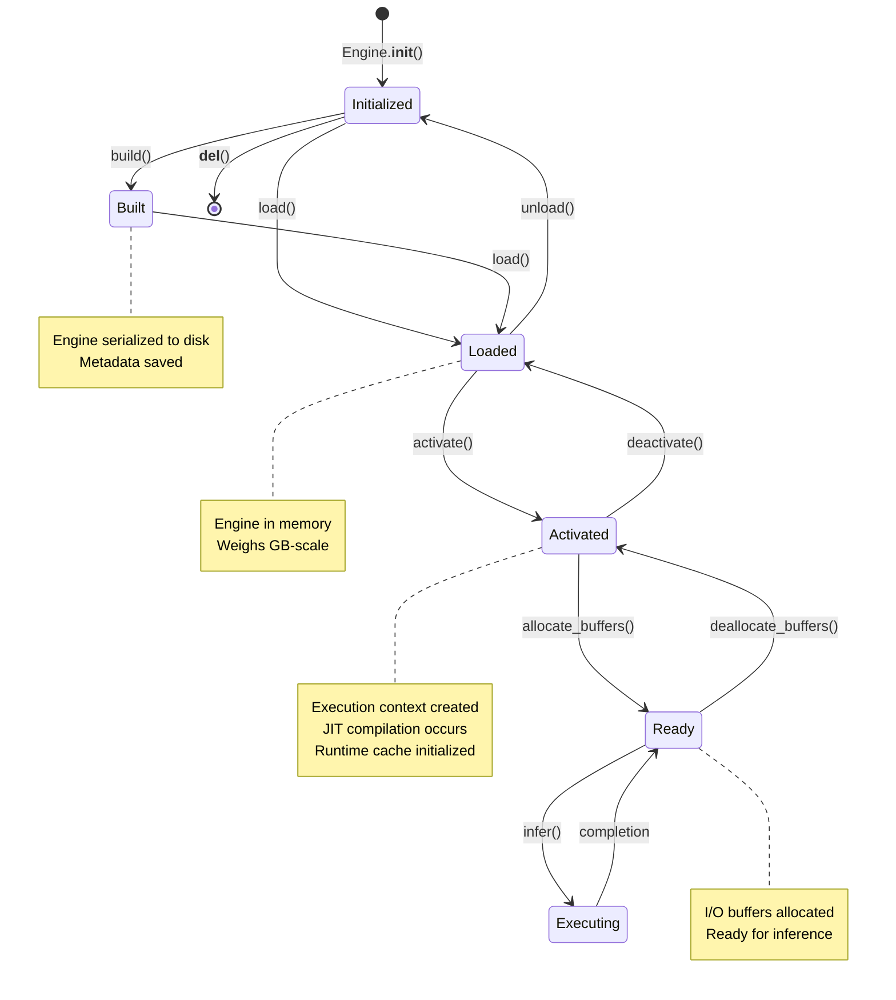
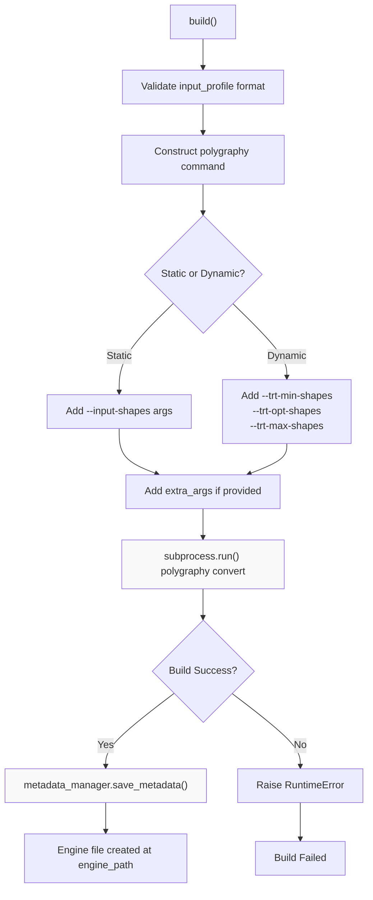
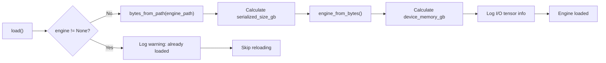
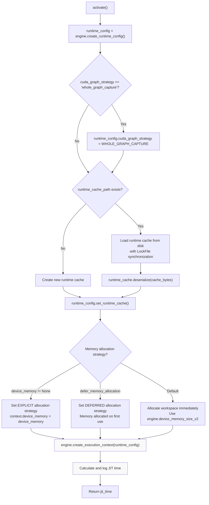
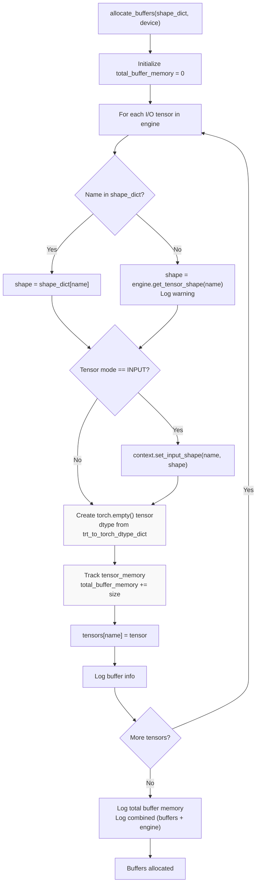

<!-- source: DeepWiki mcp.deepwiki.com · repo NVIDIA/TensorRT-RTX · page 5.1 Engine Management · fetched 2026-10-26 -->

# Engine Management

<details>
<summary>Relevant source files</summary>

The following files were used as context for generating this wiki page:

- [.github/workflows/utils.py](.github/workflows/utils.py)
- [demo/utils/engine.py](demo/utils/engine.py)
- [samples/apiUsage/cpp/apiUsage.cpp](samples/apiUsage/cpp/apiUsage.cpp)

</details>


## Purpose and Scope

This document provides a complete reference for the `Engine` class ([demo/utils/engine.py:78-407]()), which manages the complete lifecycle of TensorRT engines in the TensorRT-RTX framework. The `Engine` class abstracts TensorRT-RTX operations including engine building from ONNX models, loading serialized engines, creating execution contexts, managing memory allocation, and executing inference.

For information about how the `Engine` class is used within inference pipelines, see [Pipeline Architecture](#5.2). For concrete usage examples, see [Flux Pipeline Architecture](#4.1.2).

**Sources:** [demo/utils/engine.py:1-407]()

---

## Engine Class Overview

The `Engine` class is the central abstraction for TensorRT engine management in Python applications. It encapsulates all operations required to convert ONNX models to optimized TensorRT engines and execute inference on NVIDIA GPUs.

### Core Attributes

| Attribute | Type | Purpose |
|-----------|------|---------|
| `engine_path` | `Path` | File path to the serialized TensorRT engine |
| `engine` | `trt.ICudaEngine` | TensorRT engine object (loaded) |
| `context` | `trt.IExecutionContext` | Execution context for running inference |
| `tensors` | `OrderedDict` | I/O tensor buffers for inference |
| `precision` | `str` | Precision mode (e.g., "fp8", "fp16", "bf16") |
| `model_name` | `str` | Identifier for the model |
| `runtime_config` | `trt.IRuntimeConfig` | Runtime configuration settings |
| `runtime_cache` | `trt.IRuntimeCache` | JIT-compiled kernel cache |
| `cuda_graph_strategy` | `str` | CUDA graph capture strategy |

**Sources:** [demo/utils/engine.py:78-96]()

---

## Engine Lifecycle State Machine

The `Engine` class manages engines through distinct lifecycle phases. Understanding these phases is critical for proper memory management and performance optimization.



**Sources:** [demo/utils/engine.py:78-407]()

---

## Building Engines from ONNX Models

The `build()` method converts ONNX models to optimized TensorRT engines using the Polygraphy tool. This is typically performed once at installation or first run and saved for reuse.

### Build Method Signature

```python
def build(
    self,
    onnx_path: str,
    input_profile: dict[str, Any],
    static_shape: bool = True,
    verbose: bool = False,
    extra_args: Optional[set[str]] = None,
)
```

**Sources:** [demo/utils/engine.py:140-212]()

### Input Profile Formats

The `input_profile` parameter specifies tensor shapes for engine optimization. Two formats are supported:

**Static Shape Profile (single shape per input):**
```python
input_profile = {
    "input": [1, 3, 224, 224],  # Fixed NCHW dimensions
    "timestep": [1],
}
```

**Dynamic Shape Profile (min/opt/max ranges):**
```python
input_profile = {
    "input": [
        [1, 3, 224, 224],   # minimum shape
        [4, 3, 512, 512],   # optimal shape
        [8, 3, 1024, 1024], # maximum shape
    ],
}
```

**Sources:** [demo/utils/engine.py:105-138](), [demo/utils/engine.py:164-182]()

### Build Process Flow



### Example Polygraphy Command

The `build()` method constructs and executes commands similar to:

```bash
polygraphy convert model.onnx --convert-to trt --use-gpu \
  --output model.engine \
  --input-shapes input:[1,3,512,512] timestep:[1] \
  --verbosity error
```

**Sources:** [demo/utils/engine.py:158-212]()

---

## Loading Engines into Memory

The `load()` method deserializes a TensorRT engine from disk into GPU memory. This operation is memory-intensive, as engines can be several gigabytes in size.

### Load Process



### Memory Calculation

The loader calculates total VRAM requirements:

| Memory Component | Formula | Logged As |
|-----------------|---------|-----------|
| Serialized Weights | `len(engine_bytes) / (1024³)` | `serialized_size_gb` |
| Device Memory | `engine.device_memory_size_v2 / (1024³)` | `device_memory_gb` |
| Total Estimate | `serialized_size_gb + device_memory_gb` | "Total VRAM estimate" |

**Sources:** [demo/utils/engine.py:214-240]()

### Unloading Engines

The `unload()` method releases engine memory:

```python
def unload(self):
    if self.engine is not None:
        del self.engine
        self.engine = None
        del self.runtime_cache
        self.runtime_cache = None
        gc.collect()
        torch.cuda.empty_cache()
```

This triggers Python garbage collection and clears the PyTorch CUDA cache to reclaim VRAM.

**Sources:** [demo/utils/engine.py:241-252]()

---

## Activation and Execution Context Management

The `activate()` method creates a TensorRT execution context, which performs Just-in-Time (JIT) compilation for the target GPU. This is the stage where hardware-specific optimizations occur.

### Activation Method Signature

```python
def activate(
    self, 
    device_memory: Optional[int] = None, 
    defer_memory_allocation: bool = False
) -> float:  # Returns JIT compilation time in seconds
```

**Sources:** [demo/utils/engine.py:254-305]()

### Activation Configuration Flow



### Runtime Cache Management

The runtime cache stores JIT-compiled GPU kernels for reuse across runs:

- **Location**: Specified by `runtime_cache_path` parameter
- **Serialization**: Saved to disk during `deactivate()`
- **Deserialization**: Loaded during `activate()` if cache file exists
- **Synchronization**: Uses `LockFile` for thread-safe access

**Sources:** [demo/utils/engine.py:262-281](), [demo/utils/engine.py:314-319]()

### CUDA Graph Strategy

When `cuda_graph_strategy` is set to `"whole_graph_capture"`, TensorRT captures the entire inference graph into a CUDA graph, reducing kernel launch overhead:

```python
self.runtime_config.cuda_graph_strategy = trt.CudaGraphStrategy.WHOLE_GRAPH_CAPTURE
```

**Sources:** [demo/utils/engine.py:259-260]()

### Deactivation

The `deactivate()` method serializes the runtime cache and releases the execution context:

```python
def deactivate(self):
    # Save runtime cache to disk with file locking
    if self.runtime_cache_path and self.runtime_cache is not None:
        with LockFile(self.runtime_cache_path), self.runtime_cache.serialize() as buffer:
            save_file(buffer, self.runtime_cache_path, description="Runtime cache")
    
    # Release resources
    del self.runtime_cache
    del self.runtime_config
    del self.context
```

**Sources:** [demo/utils/engine.py:312-328]()

---

## Buffer Allocation and Memory Management

The `allocate_buffers()` method creates GPU tensors for all engine inputs and outputs. This separates memory allocation from inference execution.

### Buffer Allocation Process



### Tensor Data Type Mapping

TensorRT data types are mapped to PyTorch data types via `trt_to_torch_dtype_dict`:

| TensorRT Type | PyTorch Type | Typical Use Case |
|--------------|--------------|------------------|
| `trt.DataType.BOOL` | `torch.bool` | Masks, flags |
| `trt.DataType.UINT8` | `torch.uint8` | Image data |
| `trt.DataType.INT8` | `torch.int8` | Quantized weights |
| `trt.DataType.INT32` | `torch.int32` | Indices, tokens |
| `trt.DataType.INT64` | `torch.int64` | Large indices |
| `trt.DataType.HALF` | `torch.float16` | FP16 inference |
| `trt.DataType.FLOAT` | `torch.float32` | FP32 inference |
| `trt.DataType.BF16` | `torch.bfloat16` | BF16 inference |

**Sources:** [demo/utils/engine.py:54-64](), [demo/utils/engine.py:351]()

### Memory Tracking and Logging

The allocator logs detailed memory information:

```
[MEMORY] Allocating buffers for model_name:
[MEMORY]   input (INPUT): [1, 3, 512, 512] torch.float16 = 1.50 MB
[MEMORY]   output (OUTPUT): [1, 1000] torch.float32 = 0.00 MB
[MEMORY] Total buffers: 1.503 GB
[MEMORY] Combined (buffers + engine): 3.821 GB
```

**Sources:** [demo/utils/engine.py:330-369]()

### Buffer Deallocation

The `deallocate_buffers()` method releases all I/O buffers:

```python
def deallocate_buffers(self):
    for idx in range(self.engine.num_io_tensors):
        binding = self.engine[idx]
        if binding in self.tensors:
            del self.tensors[binding]
    
    gc.collect()
    torch.cuda.empty_cache()
```

**Sources:** [demo/utils/engine.py:371-389]()

---

## Inference Execution

The `infer()` method executes a forward pass through the engine using provided input tensors.

### Inference Flow

```mermaid
sequenceDiagram
    participant Caller
    participant Engine.infer()
    participant tensors["self.tensors<br/>(OrderedDict)"]
    participant context["self.context<br/>(IExecutionContext)"]
    participant stream["torch.cuda.Stream"]
    
    Caller->>Engine.infer(): feed_dict, stream
    
    Note over Engine.infer(),tensors: Copy input data
    loop For each input in feed_dict
        Engine.infer()->>tensors: tensors[name].copy_(buf)
    end
    
    Note over Engine.infer(),context: Set tensor addresses
    loop For each tensor
        Engine.infer()->>context: set_tensor_address(name, tensor.data_ptr())
    end
    
    Note over Engine.infer(),context: Execute inference
    Engine.infer()->>context: execute_async_v3(stream)
    context-->>Engine.infer(): success/failure
    
    alt Inference failed
        Engine.infer()->>Caller: Raise ValueError
    else Inference succeeded
        Engine.infer()->>Caller: Return self.tensors
    end
```

### Inference Method Implementation

```python
def infer(self, feed_dict: dict[str, Any], stream: torch.cuda.Stream):
    # Copy input data to pre-allocated tensors
    for name, buf in feed_dict.items():
        self.tensors[name].copy_(buf)
    
    # Set tensor addresses in execution context
    for name, tensor in self.tensors.items():
        self.context.set_tensor_address(name, tensor.data_ptr())
    
    # Execute inference asynchronously on stream
    noerror = self.context.execute_async_v3(stream)
    if not noerror:
        raise ValueError(f"ERROR: Inference with {self.engine_path} failed.")
    
    return self.tensors
```

**Sources:** [demo/utils/engine.py:391-406]()

### Feed Dictionary Format

The `feed_dict` parameter maps input tensor names to PyTorch tensors:

```python
feed_dict = {
    "input": torch.randn(1, 3, 512, 512, device="cuda"),
    "timestep": torch.tensor([10], device="cuda"),
}

output_tensors = engine.infer(feed_dict, cuda_stream)
output = output_tensors["output"]  # Access output tensor
```

**Sources:** [demo/utils/engine.py:393-395]()

---

## C++ API Comparison

The TensorRT-RTX C++ API provides similar engine management capabilities with lower-level control. Key parallels between Python and C++ APIs:

### Lifecycle Mapping

| Python `Engine` Method | C++ Equivalent | Description |
|----------------------|----------------|-------------|
| `build()` | `IBuilder::buildSerializedNetwork()` | AOT engine building |
| `load()` | `IRuntime::deserializeCudaEngine()` | Deserialize engine |
| `activate()` | `ICudaEngine::createExecutionContext()` | JIT compilation |
| `infer()` | `IExecutionContext::enqueueV3()` | Async inference |
| Runtime cache | `IRuntimeConfig::setRuntimeCache()` | Cache management |

**Sources:** [samples/apiUsage/cpp/apiUsage.cpp:208-238](), [samples/apiUsage/cpp/apiUsage.cpp:508-515](), [samples/apiUsage/cpp/apiUsage.cpp:585-594](), [samples/apiUsage/cpp/apiUsage.cpp:380-382]()

### C++ Engine Building Example

```cpp
// Create builder and configuration
auto builder = createInferBuilder(logger);
auto builderConfig = createBuilderConfig(builder);

// Create network with weights
auto network = createNetwork(builder, fc1Weights, fc2Weights);

// Build serialized engine (AOT compilation)
auto serializedEngine = builder->buildSerializedNetwork(*network, *builderConfig);
```

**Sources:** [samples/apiUsage/cpp/apiUsage.cpp:208-238]()

### C++ Runtime Configuration

```cpp
// Create runtime and deserialize engine
auto runtime = createInferRuntime(logger);
auto inferenceEngine = runtime->deserializeCudaEngine(
    serializedEngine->data(), serializedEngine->size());

// Create runtime config with cache
auto runtimeConfig = inferenceEngine->createRuntimeConfig();
auto runtimeCache = runtimeConfig->createRuntimeCache();
runtimeConfig->setRuntimeCache(*runtimeCache);

// Enable CUDA graphs
runtimeConfig->setCudaGraphStrategy(
    nvinfer1::CudaGraphStrategy::kWHOLE_GRAPH_CAPTURE);

// Create execution context (JIT compilation)
auto context = inferenceEngine->createExecutionContext(runtimeConfig);
```

**Sources:** [samples/apiUsage/cpp/apiUsage.cpp:543-594]()

### C++ Inference Execution

```cpp
// Set optimization profile and input shapes
context->setOptimizationProfileAsync(0, stream);
context->setInputShape("input", Dims2{batchSize, kInputSize});

// Allocate device memory for I/O tensors
cudaMallocAsync(&inputBuffer, inputSize * sizeof(float), stream);
cudaMallocAsync(&outputBuffer, outputSize * sizeof(float), stream);

// Set tensor addresses
context->setTensorAddress("input", inputBuffer);
context->setTensorAddress("output", outputBuffer);

// Copy input data and execute inference
cudaMemcpyAsync(inputBuffer, hostInput, size, cudaMemcpyHostToDevice, stream);
context->enqueueV3(stream);
cudaMemcpyAsync(hostOutput, outputBuffer, size, cudaMemcpyDeviceToHost, stream);
```

**Sources:** [samples/apiUsage/cpp/apiUsage.cpp:293-397]()

---

## Integration with Polygraphy

The `Engine` class uses Polygraphy as a high-level tool for ONNX-to-TensorRT conversion. Polygraphy provides a command-line interface and Python API for engine building.

### Polygraphy Environment Setup

The engine module ensures Polygraphy uses TensorRT-RTX features:

```python
if os.environ.get("POLYGRAPHY_USE_TENSORRT_RTX") != "1":
    os.environ["POLYGRAPHY_USE_TENSORRT_RTX"] = "1"
```

**Sources:** [demo/utils/engine.py:38-41]()

### Polygraphy Version Requirements

```python
import polygraphy
from packaging import version

if version.parse(polygraphy.__version__) < version.parse("0.49.24"):
    raise ImportError(f"polygraphy version {polygraphy.__version__} is too old")
```

**Sources:** [demo/utils/engine.py:44-48]()

### Polygraphy Imports

The engine uses these Polygraphy utilities:

| Import | Purpose |
|--------|---------|
| `bytes_from_path` | Read engine file as bytes |
| `engine_from_bytes` | Deserialize TensorRT engine |
| `LockFile` | Thread-safe file locking |
| `load_file`, `save_file` | File I/O with error handling |

**Sources:** [demo/utils/engine.py:50-52]()

---

## Engine Metadata Management

The `Engine` class integrates with `metadata_manager` to track build parameters and enable reproducibility.

### Saved Metadata

After successful engine builds, the following metadata is persisted:

```python
metadata_manager.save_metadata(
    engine_path=self.engine_path,
    model_name=self.model_name,
    precision=self.precision,
    onnx_path=onnx_path,
    input_shapes=input_profile,
    extra_args=extra_args,
)
```

This metadata enables:
- **Reproducibility**: Rebuild engines with identical parameters
- **Debugging**: Trace engine configurations
- **Cache validation**: Verify engine compatibility

**Sources:** [demo/utils/engine.py:201-208](), [demo/utils/engine.py:32]()

---

## Complete Usage Example

Typical engine usage follows this pattern:

```python
from pathlib import Path
import torch

# 1. Initialize Engine
engine = Engine(
    engine_path=Path("model.engine"),
    precision="fp16",
    model_name="my_model",
    runtime_cache_path="model_runtime_cache.bin",
    cuda_graph_strategy="whole_graph_capture",
)

# 2. Build or load engine
if not engine.engine_path.exists():
    engine.build(
        onnx_path="model.onnx",
        input_profile={"input": [1, 3, 512, 512]},
        static_shape=True,
    )

engine.load()

# 3. Activate and allocate
cuda_stream = torch.cuda.Stream()
engine.activate()
engine.allocate_buffers(shape_dict={"input": [1, 3, 512, 512]})

# 4. Run inference
input_tensor = torch.randn(1, 3, 512, 512, device="cuda")
output_tensors = engine.infer({"input": input_tensor}, cuda_stream)
cuda_stream.synchronize()

result = output_tensors["output"].cpu()

# 5. Cleanup
engine.deallocate_buffers()
engine.deactivate()
engine.unload()
```

This pattern ensures proper resource management and optimal performance.

**Sources:** [demo/utils/engine.py:78-407]()

---

