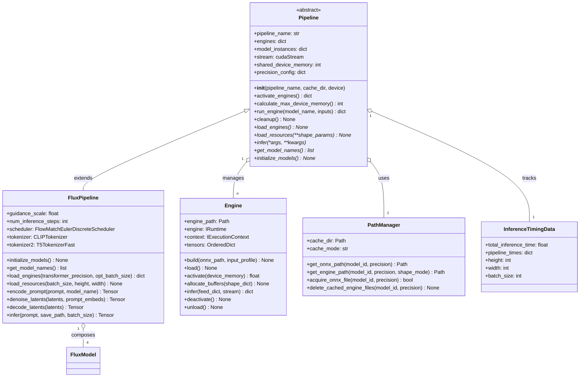
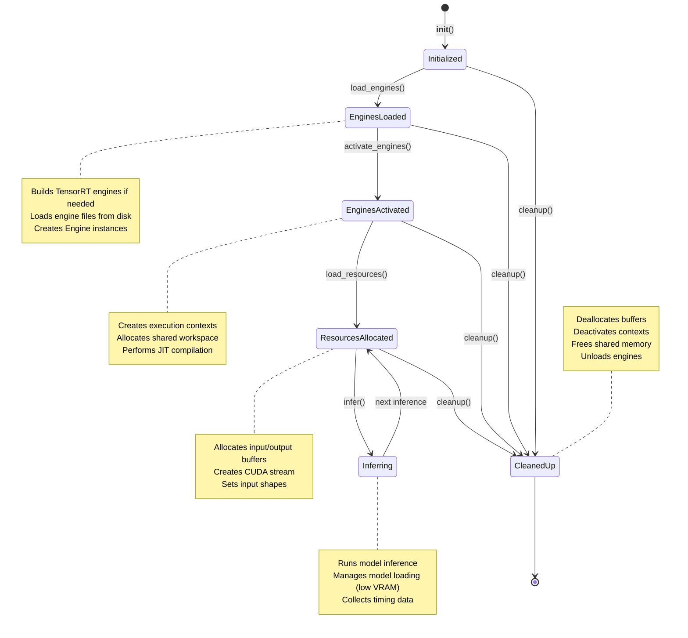
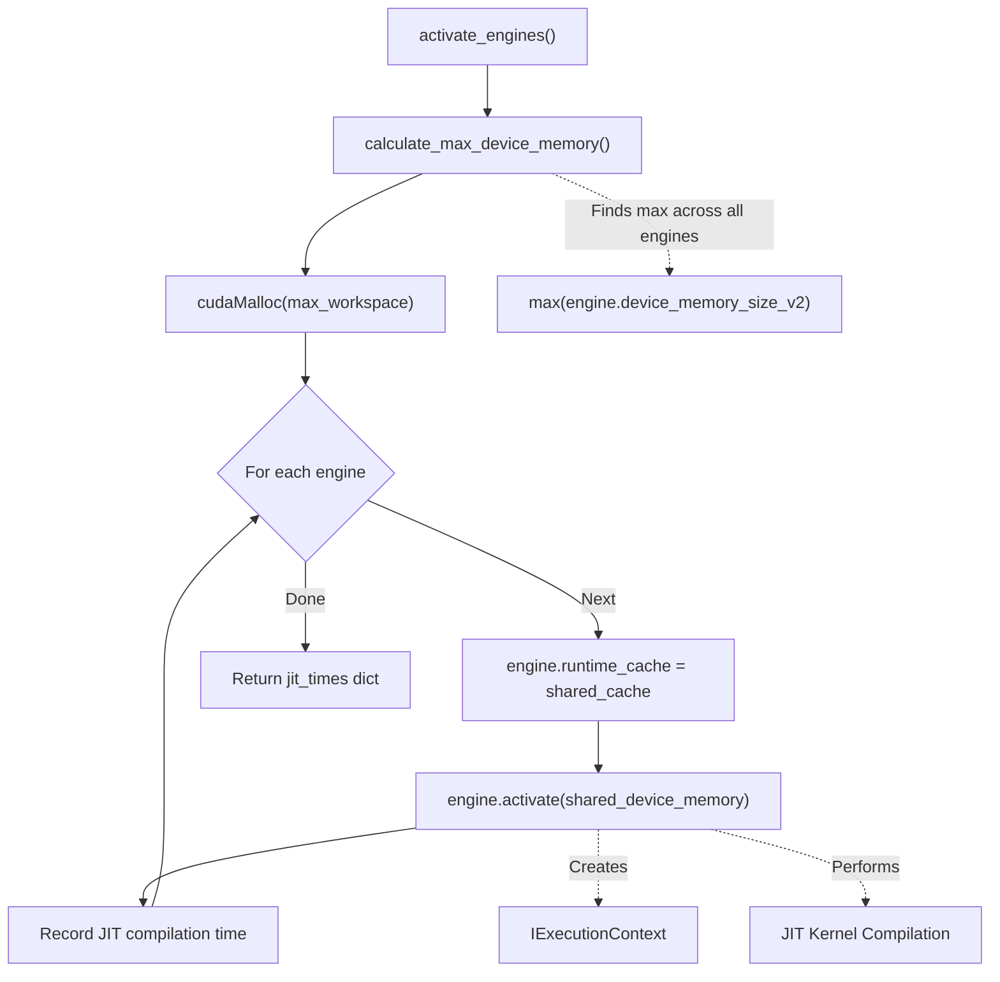
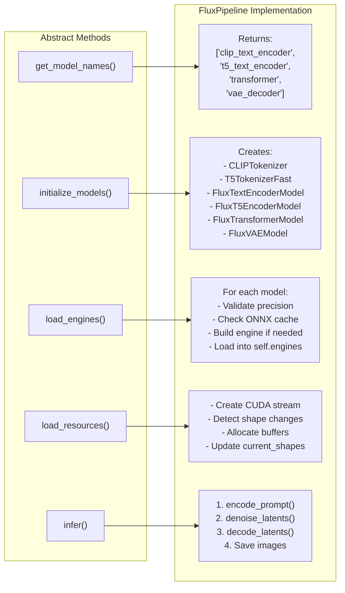
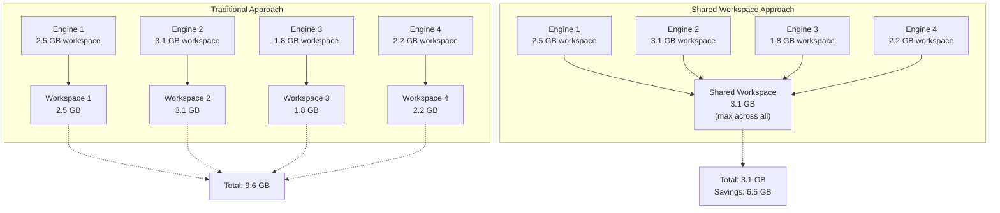
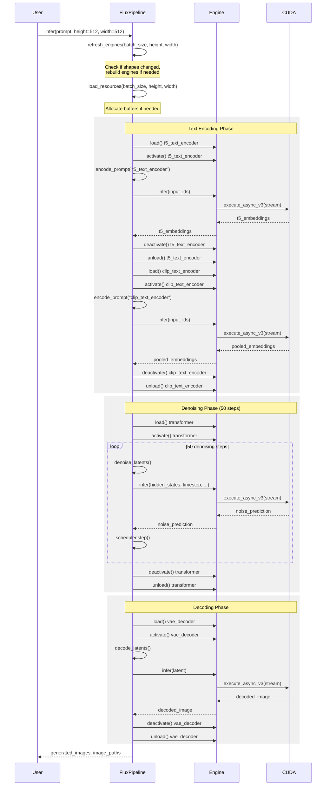

<!-- source: DeepWiki mcp.deepwiki.com · repo NVIDIA/TensorRT-RTX · page 5.2 Pipeline Architecture · fetched 2026-10-26 -->

# Pipeline Architecture

<details>
<summary>Relevant source files</summary>

The following files were used as context for generating this wiki page:

- [demo/flux1.dev/pipelines/flux_pipeline.py](demo/flux1.dev/pipelines/flux_pipeline.py)
- [demo/utils/engine.py](demo/utils/engine.py)
- [demo/utils/pipeline.py](demo/utils/pipeline.py)

</details>


## Purpose and Scope

This document describes the `Pipeline` abstract base class and its role as the foundational framework for orchestrating TensorRT-RTX inference workflows. The Pipeline architecture provides a standardized pattern for managing the complete lifecycle of model execution, from engine building to resource cleanup.

For information about the `Engine` class that manages individual TensorRT engines, see [Engine Management](#5.1). For specific implementation details of the Flux.1 demonstration pipeline, see [Flux Pipeline Architecture](#4.1.2).

## Overview

The Pipeline architecture implements a template method pattern that standardizes the execution flow for TensorRT-RTX applications. The abstract `Pipeline` class ([demo/utils/pipeline.py:39-400]()) defines the common infrastructure and lifecycle management, while concrete implementations like `FluxPipeline` ([demo/flux1.dev/pipelines/flux_pipeline.py:54-929]()) provide model-specific logic.

**Key Responsibilities:**
- Managing TensorRT engine lifecycle (building, loading, activation)
- Coordinating memory allocation and deallocation
- Providing standardized inference execution flow
- Implementing caching and resource optimization strategies
- Collecting performance timing data

**Sources:** [demo/utils/pipeline.py:17-49]()

## Class Hierarchy



**Sources:** [demo/utils/pipeline.py:39-400](), [demo/flux1.dev/pipelines/flux_pipeline.py:54-154](), [demo/utils/engine.py:78-407]()

## Pipeline Lifecycle

The Pipeline follows a well-defined five-stage lifecycle, with each stage building upon the previous:



**Sources:** [demo/utils/pipeline.py:39-49](), [demo/utils/pipeline.py:220-293]()

### Stage 1: Initialization

The `__init__` method ([demo/utils/pipeline.py:51-126]()) establishes the pipeline's configuration:

| Configuration Parameter | Type | Default | Description |
|------------------------|------|---------|-------------|
| `pipeline_name` | `str` | Required | Identifies the pipeline in the model registry |
| `cache_dir` | `str` | `"./demo_cache"` | Directory for ONNX models and TensorRT engines |
| `device` | `str` | `"cuda"` | Target device for inference |
| `cache_mode` | `str` | `"full"` | Cache management strategy (`"full"` or `"lean"`) |
| `low_vram` | `bool` | `False` | Enable dynamic model loading for memory-constrained GPUs |
| `enable_runtime_cache` | `bool` | `False` | Enable JIT kernel cache serialization |
| `cuda_graph_strategy` | `str` | `"disabled"` | CUDA graph capture mode |

**Key initialization steps:**
1. Configure logging ([demo/utils/pipeline.py:127-166]())
2. Create `PathManager` for cache management ([demo/utils/pipeline.py:87]())
3. Load default precision configuration from registry ([demo/utils/pipeline.py:117]())
4. Initialize timing infrastructure ([demo/utils/pipeline.py:119-122]())

**Sources:** [demo/utils/pipeline.py:51-126]()

### Stage 2: Engine Loading

The `load_engines()` abstract method must be implemented by subclasses to build and load TensorRT engines. The `FluxPipeline` implementation ([demo/flux1.dev/pipelines/flux_pipeline.py:306-398]()) demonstrates the pattern:

**Engine Loading Flow:**
1. Validate precision and shape configurations against model registry
2. For each model role (e.g., `"clip_text_encoder"`, `"transformer"`):
   - Check if ONNX file exists, download if necessary ([demo/flux1.dev/pipelines/flux_pipeline.py:217-236]())
   - Check engine cache compatibility using metadata ([demo/flux1.dev/pipelines/flux_pipeline.py:247-253]())
   - Build engine if cache miss or incompatibility ([demo/flux1.dev/pipelines/flux_pipeline.py:268-300]())
   - Create `Engine` instance and store in `self.engines` ([demo/flux1.dev/pipelines/flux_pipeline.py:255-304]())

**Sources:** [demo/flux1.dev/pipelines/flux_pipeline.py:194-305](), [demo/flux1.dev/pipelines/flux_pipeline.py:306-398]()

### Stage 3: Engine Activation

The `activate_engines()` method ([demo/utils/pipeline.py:224-250]()) creates execution contexts and allocates shared workspace memory:



**Memory Optimization:** The shared workspace pattern ([demo/utils/pipeline.py:262-283]()) allocates a single memory region sized to the largest engine's requirement, then shares it across all engines. This reduces total VRAM consumption compared to allocating separate workspace for each engine.

**Sources:** [demo/utils/pipeline.py:224-250](), [demo/utils/pipeline.py:262-283]()

### Stage 4: Resource Allocation

The `load_resources()` abstract method allocates input/output buffers for each engine. The `FluxPipeline` implementation ([demo/flux1.dev/pipelines/flux_pipeline.py:495-552]()) demonstrates:

**Resource Allocation Process:**
1. Create CUDA stream if not exists ([demo/flux1.dev/pipelines/flux_pipeline.py:507-508]())
2. Detect shape changes and trigger reallocation if needed ([demo/flux1.dev/pipelines/flux_pipeline.py:512-524]())
3. For each engine, call `engine.allocate_buffers()` with shape dictionary ([demo/flux1.dev/pipelines/flux_pipeline.py:527-542]())
4. Track current shapes for subsequent inference calls ([demo/flux1.dev/pipelines/flux_pipeline.py:546-551]())

**Low VRAM Mode:** When `low_vram=True`, the pipeline stores shape dictionaries but defers actual buffer allocation until inference time, allowing dynamic loading/unloading of models ([demo/flux1.dev/pipelines/flux_pipeline.py:534-536]()).

**Sources:** [demo/flux1.dev/pipelines/flux_pipeline.py:495-552](), [demo/utils/engine.py:330-390]()

### Stage 5: Inference Execution

The `infer()` abstract method implements the model-specific inference logic. Pipelines use the `run_engine()` helper method ([demo/utils/pipeline.py:285-288]()) to execute individual engines:

```python
# Example from FluxPipeline.denoise_latents
outputs = self.run_engine("transformer", {
    "hidden_states": latents,
    "timestep": timestep_inp / 1000,
    "pooled_projections": pooled_prompt_embeds,
    "encoder_hidden_states": prompt_embeds,
    "txt_ids": txt_ids.float(),
    "img_ids": img_ids.float(),
    "guidance": guidance
})
```

**Sources:** [demo/flux1.dev/pipelines/flux_pipeline.py:711-720](), [demo/utils/pipeline.py:285-288]()

## Extension Points and Abstract Methods

Subclasses must implement five abstract methods to create a concrete pipeline:

| Method | Signature | Purpose |
|--------|-----------|---------|
| `get_model_names()` | `() -> list[str]` | Return list of model identifiers used by the pipeline |
| `initialize_models()` | `() -> None` | Create model instances and tokenizers |
| `load_engines()` | `(**config) -> None` | Build and load TensorRT engines for all models |
| `load_resources()` | `(**shape_params) -> None` | Allocate input/output buffers for the current shapes |
| `infer()` | `(*args, **kwargs) -> Any` | Execute the complete inference workflow |

**FluxPipeline Implementation Example:**



**Sources:** [demo/utils/pipeline.py:211-292](), [demo/flux1.dev/pipelines/flux_pipeline.py:114-154]()

## Memory Management Strategies

The Pipeline architecture implements sophisticated memory management to support both high-performance and memory-constrained scenarios.

### Shared Workspace Memory

All engines share a single workspace allocation sized to the largest requirement:



**Implementation:** The `calculate_max_device_memory()` method ([demo/utils/pipeline.py:262-283]()) iterates through all engines to find the maximum workspace requirement, then `activate_engines()` allocates a single `cudaMalloc()` region that is shared across all engines via `engine.activate(device_memory=shared_device_memory)` ([demo/utils/pipeline.py:242]()).

**Sources:** [demo/utils/pipeline.py:224-250](), [demo/utils/pipeline.py:262-283]()

### Low VRAM Mode

When `low_vram=True`, the pipeline implements dynamic model loading to reduce peak memory usage:

**Key Characteristics:**
- Engines are loaded but not activated during `load_engines()` ([demo/flux1.dev/pipelines/flux_pipeline.py:257-259]())
- Buffers are not pre-allocated during `load_resources()` ([demo/flux1.dev/pipelines/flux_pipeline.py:534-536]())
- Models are loaded on-demand during `infer()` using `ModelMemoryManager` context manager ([demo/flux1.dev/pipelines/flux_pipeline.py:813-818]())

**Example from FluxPipeline:**
```python
# Text encoder loaded only when needed
with self.model_memory_manager("t5_text_encoder", self.low_vram):
    t5_embeds = self.encode_prompt(prompt, "t5_text_encoder")
# t5_text_encoder automatically unloaded after block

# Transformer loaded for denoising loop
with self.model_memory_manager("transformer", self.low_vram):
    latents = self.denoise_latents(latents, t5_embeds, pooled_embeds)
# transformer automatically unloaded after block
```

The `ModelMemoryManager` ([demo/flux1.dev/pipelines/flux_pipeline.py:179-192]()) handles loading engines into GPU memory on entry and unloading on exit, allowing sequential execution with minimal peak memory.

**Sources:** [demo/flux1.dev/pipelines/flux_pipeline.py:179-192](), [demo/flux1.dev/pipelines/flux_pipeline.py:809-856]()

### Dynamic Shape Reallocation

The `refresh_engines()` method ([demo/flux1.dev/pipelines/flux_pipeline.py:399-493]()) handles shape changes during runtime:

**Refresh Process:**
1. Compare target shapes with engine metadata ([demo/flux1.dev/pipelines/flux_pipeline.py:419-434]())
2. Rebuild engines that are incompatible with new shapes ([demo/flux1.dev/pipelines/flux_pipeline.py:443-456]())
3. Reallocate shared workspace if maximum requirement increased ([demo/flux1.dev/pipelines/flux_pipeline.py:461-477]())
4. Reactivate affected engines with new memory ([demo/flux1.dev/pipelines/flux_pipeline.py:479-492]())

**Sources:** [demo/flux1.dev/pipelines/flux_pipeline.py:399-493]()

## Timing Infrastructure

The Pipeline provides built-in performance monitoring through CUDA event-based timing:

### Timing Data Collection

The `InferenceTimingData` class ([demo/utils/timing_data.py]()) tracks:
- Total inference time
- Per-model execution times
- Batch size, height, width
- Number of inference steps
- Guidance scale

**Recording Pattern:**
```python
if self.enable_timing:
    def run_model():
        return self.run_engine("transformer", params)
    
    outputs, elapsed_time = self._record_cuda_timing("transformer", run_model)
else:
    outputs = self.run_engine("transformer", params)
```

The `_record_cuda_timing()` method ([demo/utils/pipeline.py:175-205]()) uses CUDA events to measure GPU kernel execution time, synchronizing the stream and calculating elapsed milliseconds.

**Sources:** [demo/utils/pipeline.py:168-205](), [demo/flux1.dev/pipelines/flux_pipeline.py:712-720]()

### CUDA Event Management

CUDA events are created lazily and cached for reuse ([demo/utils/pipeline.py:168-173]()):
- `_create_cuda_events(name)` creates start/end event pair
- Events stored in `self._cuda_events` dictionary
- Destroyed during cleanup ([demo/utils/pipeline.py:299-303]())

**Sources:** [demo/utils/pipeline.py:168-205](), [demo/utils/pipeline.py:299-303]()

## Configuration Management

Pipelines integrate with the model registry system to manage precision and shape configurations:

### Precision Configuration

The `precision_config` dictionary ([demo/utils/pipeline.py:117]()) maps model roles to precision modes:

```python
# Example FluxPipeline precision config
{
    "clip_text_encoder": "fp16",
    "t5_text_encoder": "fp16", 
    "transformer": "fp8",  # Configurable at runtime
    "vae_decoder": "bf16"
}
```

Precision modes are validated against the model registry during `load_engines()` ([demo/flux1.dev/pipelines/flux_pipeline.py:343-345]()).

**Sources:** [demo/flux1.dev/pipelines/flux_pipeline.py:306-348]()

### Shape Configuration

The `shape_config` dictionary ([demo/utils/pipeline.py:111]()) maps model roles to shape modes:

```python
# Example shape configuration
{
    "clip_text_encoder": "static",
    "t5_text_encoder": "static",
    "transformer": "dynamic",  # Or "static"
    "vae_decoder": "static"    # Always static to reduce VRAM
}
```

**Static vs. Dynamic Shapes:**
- **Static:** Engine built for single fixed shape, optimal performance
- **Dynamic:** Engine supports range of shapes (min/opt/max), flexible but slightly slower

The VAE decoder is always configured for static shapes to reduce VRAM usage ([demo/flux1.dev/pipelines/flux_pipeline.py:362-364]()).

**Sources:** [demo/flux1.dev/pipelines/flux_pipeline.py:349-367]()

## PathManager Integration

The Pipeline delegates file management to `PathManager` ([demo/utils/path_manager.py]()):

**Key PathManager Operations:**
- `get_onnx_path(model_id, precision)` - Resolve ONNX file location
- `get_engine_path(model_id, precision, shape_mode)` - Resolve TensorRT engine location
- `acquire_onnx_file(model_id, precision, ...)` - Download ONNX from registry or HuggingFace
- `delete_cached_engine_files(model_id, precision, shape_mode)` - Clear invalid cache entries
- `print_cache_summary()` - Display cache statistics

**Cache Directory Structure:**
```
demo_cache/
├── onnx/
│   ├── model_id_precision.onnx
│   └── ...
├── engines/
│   ├── model_id/
│   │   ├── precision/
│   │   │   ├── static_shape.plan
│   │   │   ├── static_shape.metadata.json
│   │   │   ├── dynamic_shape.plan
│   │   │   └── dynamic_shape.metadata.json
│   └── ...
└── runtime.cache  (optional)
```

**Sources:** [demo/utils/pipeline.py:87](), [demo/flux1.dev/pipelines/flux_pipeline.py:214-236]()

## Complete FluxPipeline Example

The following diagram shows the complete `FluxPipeline.infer()` execution flow, demonstrating how all pipeline components interact:



**Sources:** [demo/flux1.dev/pipelines/flux_pipeline.py:758-881]()

## Cleanup and Resource Management

The `cleanup()` method ([demo/utils/pipeline.py:294-338]()) ensures proper resource deallocation:

**Cleanup Sequence:**
1. Destroy CUDA timing events ([demo/utils/pipeline.py:299-303]())
2. For each engine:
   - Deallocate buffers ([demo/utils/pipeline.py:308]())
   - Deactivate execution context ([demo/utils/pipeline.py:309]())
   - Unload engine from memory ([demo/utils/pipeline.py:310]())
3. Free shared workspace memory ([demo/utils/pipeline.py:313-316]())
4. Destroy CUDA stream ([demo/utils/pipeline.py:318-321]())
5. Clear Python object references ([demo/utils/pipeline.py:323-333]())
6. Force garbage collection ([demo/utils/pipeline.py:336-338]())

The destructor `__del__()` ([demo/utils/pipeline.py:340-341]()) ensures cleanup is called even if the user forgets to explicitly call it.

**Sources:** [demo/utils/pipeline.py:294-341]()

---

