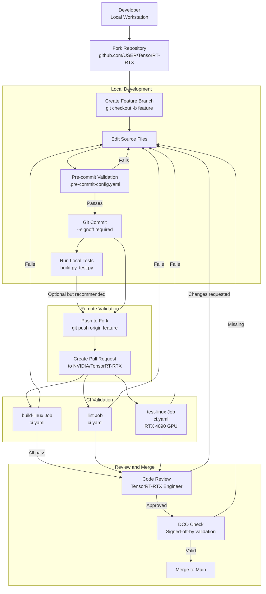
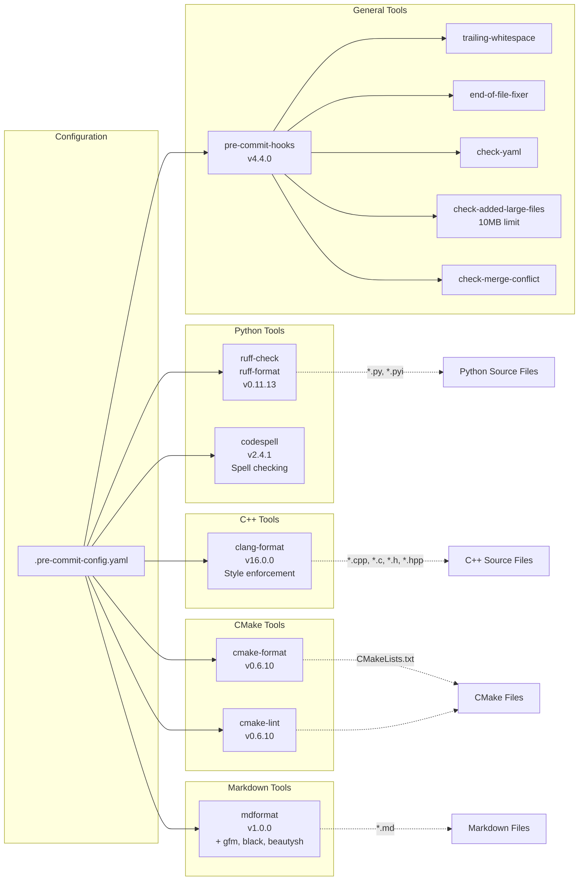
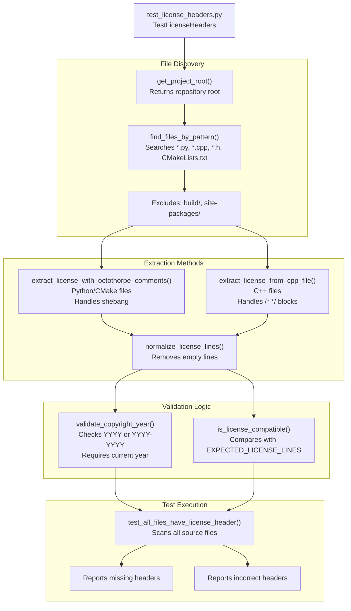
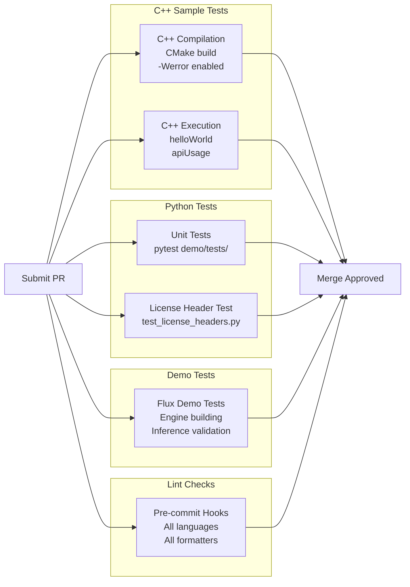

<!-- source: DeepWiki mcp.deepwiki.com · repo NVIDIA/TensorRT-RTX · page 6 Development Guide · fetched 2026-10-26 -->

# Development Guide

<details>
<summary>Relevant source files</summary>

The following files were used as context for generating this wiki page:

- [.pre-commit-config.yaml](.pre-commit-config.yaml)
- [CONTRIBUTING.md](CONTRIBUTING.md)
- [demo/tests/test_license_headers.py](demo/tests/test_license_headers.py)

</details>


## Purpose and Scope

This guide provides essential information for developers contributing to the TensorRT-RTX repository. It covers the development environment setup, code quality tools, automated validation, and the contribution workflow. This document focuses on the technical infrastructure that supports development.

For detailed contribution guidelines including issue tracking and PR submission, see [Contributing to TensorRT-RTX](#6.1). For comprehensive testing procedures, see [Testing Guide](#6.3). For code formatting specifics, see [Code Quality and Formatting](#6.2).

## Development Environment Setup

### Prerequisites

Developers require a standard development environment with the following components:

- **Git**: Version control with commit signing capabilities
- **Python 3.10+**: Required for pre-commit hooks and Python development
- **CMake 3.18+**: For building C++ samples
- **CUDA 12.9**: For GPU-dependent testing
- **Clang-format 16.0**: For C++ code formatting
- **Pre-commit framework**: For automated local validation

### Installing Pre-commit Hooks

The repository uses pre-commit hooks to enforce code quality standards before commits are created. Install and activate the hooks:

```bash
# Install pre-commit framework
pip install pre-commit

# Install hooks from .pre-commit-config.yaml
pre-commit install

# Manually run hooks on all files
pre-commit run --all-files
```

Once installed, pre-commit automatically runs on each `git commit` operation, validating changes before the commit is created.

**Sources:** [.pre-commit-config.yaml:1-59]()

## Development Workflow Overview

The following diagram illustrates the complete development workflow from local changes through to merged contributions:



**Sources:** [CONTRIBUTING.md:79-103](), [.github/workflows/ci.yaml]()

## Code Quality Toolchain

### Pre-commit Hook Configuration

The repository enforces code quality through multiple automated tools configured in `.pre-commit-config.yaml`. Each tool targets specific file types and validation rules:



**Sources:** [.pre-commit-config.yaml:1-59]()

### Tool-Specific Behavior

| Tool | Purpose | Auto-fix | File Types | Key Arguments |
|------|---------|----------|------------|---------------|
| `ruff-check` | Python linting | Yes | `.py`, `.pyi` | `--fix` |
| `ruff-format` | Python formatting | Yes | `.py`, `.pyi` | N/A |
| `clang-format` | C++ formatting | Yes | `.cpp`, `.c`, `.h`, `.hpp` | Style from `.clang-format` |
| `cmake-format` | CMake formatting | Yes | `CMakeLists.txt` | N/A |
| `cmake-lint` | CMake validation | No | `CMakeLists.txt` | N/A |
| `mdformat` | Markdown formatting | Yes | `.md` | Excludes `.github/` |
| `codespell` | Spell checking | No | All text files | Skips `.ipynb` |

**Sources:** [.pre-commit-config.yaml:3-58]()

### Manual Code Formatting

While pre-commit hooks automatically format code during commits, developers can manually format files:

**Python (via Ruff):**
```bash
# Format specific file
ruff format path/to/file.py

# Check and fix linting issues
ruff check --fix path/to/file.py
```

**C++ (via clang-format):**
```bash
# Format specific file
clang-format -style=file -i path/to/file.cpp

# Format staged git changes
git-clang-format --style file

# Format entire samples directory (maintainers only)
find samples -iname "*.h" -o -iname "*.c" -o -iname "*.cpp" -o -iname "*.hpp" \
    | xargs clang-format -style=file -i -fallback-style=none
```

**Sources:** [CONTRIBUTING.md:15-42](), [.pre-commit-config.yaml:24-30]()

## License Header Requirements

### Required Header Format

All source files must include an NVIDIA Apache 2.0 license header. The header format varies by language but contains identical legal text:

**Python files (using `#` comments):**
```python
# SPDX-FileCopyrightText: Copyright (c) 2025 NVIDIA CORPORATION & AFFILIATES. All rights reserved.
# SPDX-License-Identifier: Apache-2.0
#
# Licensed under the Apache License, Version 2.0 (the "License");
# you may not use this file except in compliance with the License.
# You may obtain a copy of the License at
#
# http://www.apache.org/licenses/LICENSE-2.0
#
# Unless required by applicable law or agreed to in writing, software
# distributed under the License is distributed on an "AS IS" BASIS,
# WITHOUT WARRANTIES OR CONDITIONS OF ANY KIND, either express or implied.
# See the License for the specific language governing permissions and
# limitations under the License.
```

**C++ files (using `/* */` block comments):**
```cpp
/*
 * SPDX-FileCopyrightText: Copyright (c) 2025 NVIDIA CORPORATION & AFFILIATES. All rights reserved.
 * SPDX-License-Identifier: Apache-2.0
 *
 * Licensed under the Apache License, Version 2.0 (the "License");
 * ...
 */
```

### License Validation

The test suite automatically validates license headers using `TestLicenseHeaders` class:



**Key validation rules:**

1. **Copyright year**: Must be current year (2025) or range ending in current year (e.g., "2023-2025")
2. **Complete header**: All 14 lines of the Apache 2.0 license text must be present
3. **File coverage**: Python (`.py`, `.pyi`), C++ (`.cpp`, `.c`, `.h`, `.hpp`), CMake (`CMakeLists.txt`)
4. **Exclusions**: Empty `__init__.py` files, build directories, external packages

**Sources:** [demo/tests/test_license_headers.py:21-251]()

### License Header Implementation Details

The `TestLicenseHeaders` class provides three extraction methods for different comment styles:

| Method | Comment Style | Skip Shebang | Line Numbers |
|--------|---------------|--------------|--------------|
| `extract_license_with_octothorpe_comments()` | Python `#` | Yes | [76-98]() |
| `extract_license_with_octothorpe_comments()` | CMake `#` | No | [76-98]() |
| `extract_license_from_cpp_file()` | C++ `/* */` | N/A | [112-137]() |

The validation process normalizes extracted lines and compares them against `EXPECTED_LICENSE_LINES` (defined at [demo/tests/test_license_headers.py:27-42]()), with special handling for the copyright year line.

**Sources:** [demo/tests/test_license_headers.py:76-137](), [demo/tests/test_license_headers.py:140-168]()

## Build and Test Requirements

### Local Build Validation

Before submitting changes, developers should build and test locally to catch issues early:

```bash
# Build C++ samples
python3 scripts/build.py

# Run Python tests
python3 scripts/test.py

# Run specific test file
pytest demo/tests/test_license_headers.py -v
```

The build script compiles C++ samples with strict warning enforcement. The CI system rejects PRs with build warnings.

**Sources:** [CONTRIBUTING.md:59-61]()

### Test Execution Requirements

The following tests must pass before a PR can be merged:



All tests run automatically in CI on GPU-enabled runners (RTX 4090) to validate real-world performance and correctness.

**Sources:** [CONTRIBUTING.md:61-65](), [.github/workflows/ci.yaml]()

## Development Best Practices

### Code Organization

Follow these principles when adding new code:

1. **Consistency**: Match existing conventions in the relevant file, module, and project
2. **Simplicity**: Avoid unnecessary complexity that impacts maintainability
3. **Modularity**: Keep PRs focused on single concerns
4. **Documentation**: All new components require accompanying README files
5. **Testing**: All new functionality requires accompanying tests

**Sources:** [CONTRIBUTING.md:8-66]()

### Commit Guidelines

Commits must follow specific conventions:

**Commit format:**
```
#<Issue Number> - <Imperative Mood Title>

<Detailed description of changes>

Signed-off-by: Your Name <your@email.com>
```

**Commit signing (required):**
```bash
# Sign individual commit
git commit -s -m "Add cool feature."

# Configure automatic signing
git config --global user.name "Your Name"
git config --global user.email "your@email.com"
```

The `-s` flag adds the required `Signed-off-by` trailer, certifying that you have the right to submit the code under the project's license (Developer Certificate of Origin).

**Sources:** [CONTRIBUTING.md:51-121]()

### Issue Tracking Requirement

All contributions must begin with an issue:

1. Create a [TensorRT-RTX Issue Request](https://github.com/nvidia/TensorRT-RTX/issues)
2. Wait for review and approval by TensorRT-RTX engineers
3. Begin development only after issue approval

This ensures alignment with project goals before significant development work.

**Sources:** [CONTRIBUTING.md:3-6]()

## Integration with TensorRT Guidelines

TensorRT-RTX follows the same coding guidelines as TensorRT. All source code contributions must strictly adhere to the [TensorRT Coding Guidelines](https://github.com/NVIDIA/TensorRT/blob/HEAD/CODING-GUIDELINES.md), which cover:

- Class, function/method, and variable/field naming conventions
- Comment style requirements
- Indentation rules
- Line length limits

The `.clang-format` configuration file in the repository root implements these rules automatically.

**Sources:** [CONTRIBUTING.md:8-21]()

## Next Steps

For detailed information on specific aspects of development:

- **Contribution process**: See [Contributing to TensorRT-RTX](#6.1) for PR workflow, review process, and DCO requirements
- **Code quality details**: See [Code Quality and Formatting](#6.2) for tool configuration and formatting standards
- **Testing procedures**: See [Testing Guide](#6.3) for comprehensive testing instructions and test development guidelines

**Sources:** [CONTRIBUTING.md:1-149](), [.pre-commit-config.yaml:1-59](), [demo/tests/test_license_headers.py:1-252]()

---

