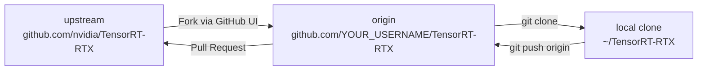
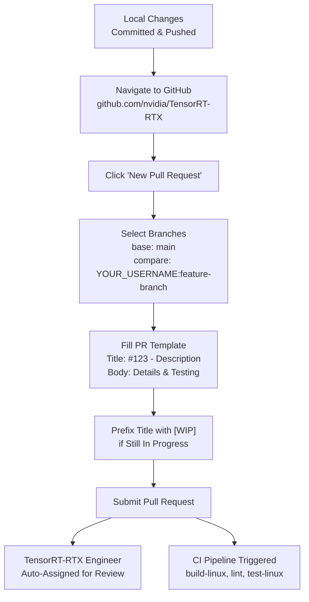
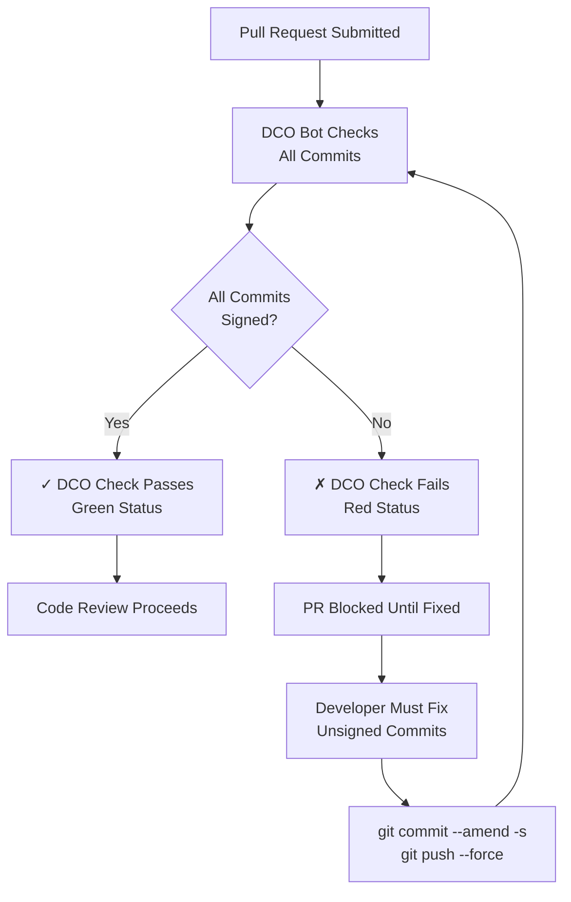
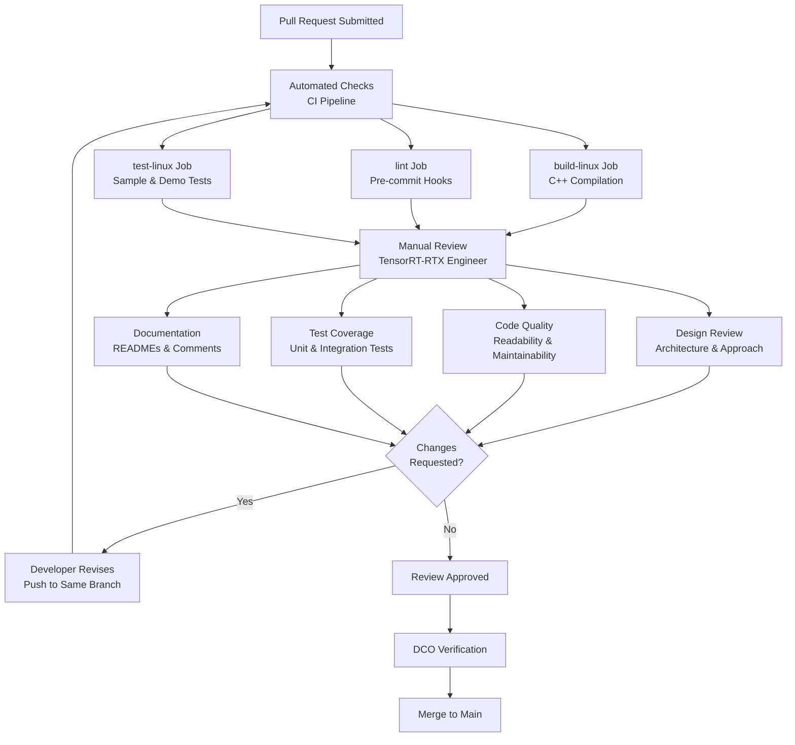

<!-- source: DeepWiki mcp.deepwiki.com · repo NVIDIA/TensorRT-RTX · page 6.1 Contributing to TensorRT-RTX · fetched 2026-10-26 -->

# Contributing to TensorRT-RTX

<details>
<summary>Relevant source files</summary>

The following files were used as context for generating this wiki page:

- [.github/ISSUE_TEMPLATE/bug_report.md](.github/ISSUE_TEMPLATE/bug_report.md)
- [.github/copy-pr-bot.yaml](.github/copy-pr-bot.yaml)
- [CONTRIBUTING.md](CONTRIBUTING.md)

</details>


This document provides the complete guide to contributing code, documentation, and bug reports to the TensorRT-RTX project. It covers the required workflow from issue creation through pull request submission, code review, and merge requirements.

For information about code quality enforcement and automated formatting, see [Code Quality and Formatting](#6.2). For testing requirements and procedures, see [Testing Guide](#6.3). For bug reporting templates, see [Issue Templates and Bug Reporting](#7.3).

## Scope and Purpose

This page documents the mandatory contribution process enforced by the TensorRT-RTX project, including:
- Issue tracking workflow
- Fork and pull request procedures
- Coding guidelines and formatting requirements
- Developer Certificate of Origin (DCO) signing
- Code review expectations

All contributions must follow this process. The TensorRT-RTX team reviews all submissions and provides feedback through GitHub's pull request interface.

**Sources:** [CONTRIBUTING.md:1-149]()

## Contribution Workflow Overview

The following diagram illustrates the complete contribution process from issue creation to merge:

```mermaid
graph TD
    START["Developer Identifies<br/>Bug or Enhancement"]
    
    ISSUE["Create GitHub Issue<br/>github.com/nvidia/TensorRT-RTX/issues"]
    REVIEW_ISSUE["TensorRT-RTX Engineer<br/>Reviews Issue"]
    APPROVE_ISSUE{"Issue<br/>Approved?"}
    
    FORK["Fork Repository<br/>github.com/nvidia/TensorRT-RTX"]
    CLONE["git clone Forked Repo"]
    
    BRANCH["git checkout -b feature-branch"]
    DEVELOP["Implement Changes<br/>Follow Coding Guidelines"]
    
    PRECOMMIT["Run Pre-commit Hooks<br/>clang-format, ruff"]
    
    COMMIT["git commit -s<br/>(DCO Sign-off)"]
    PUSH["git push origin feature-branch"]
    
    PR["Create Pull Request<br/>to upstream/main"]
    WIP["Mark as [WIP]<br/>if In Progress"]
    
    CI["CI Validation<br/>build-linux, test-linux"]
    REVIEW_PR["TensorRT-RTX Engineer<br/>Code Review"]
    
    CHANGES{"Changes<br/>Requested?"}
    APPROVE_PR{"Review<br/>Approved?"}
    
    DCO_CHECK["DCO Verification<br/>All Commits Signed"]
    MERGE["Merge to Main Branch"]
    CLOSE["Close Issue"]
    
    START --> ISSUE
    ISSUE --> REVIEW_ISSUE
    REVIEW_ISSUE --> APPROVE_ISSUE
    APPROVE_ISSUE -->|No| ISSUE
    APPROVE_ISSUE -->|Yes| FORK
    
    FORK --> CLONE
    CLONE --> BRANCH
    BRANCH --> DEVELOP
    
    DEVELOP --> PRECOMMIT
    PRECOMMIT --> COMMIT
    COMMIT --> PUSH
    PUSH --> PR
    
    PR --> WIP
    WIP --> CI
    CI --> REVIEW_PR
    
    REVIEW_PR --> CHANGES
    CHANGES -->|Yes| DEVELOP
    CHANGES -->|No| APPROVE_PR
    
    APPROVE_PR -->|No| DEVELOP
    APPROVE_PR -->|Yes| DCO_CHECK
    
    DCO_CHECK --> MERGE
    MERGE --> CLOSE
```



**Sources:** [CONTRIBUTING.md:3-103]()

## Issue Tracking Requirements

All contributions must begin with an approved GitHub issue. This ensures that proposed changes align with project goals and prevents duplicate or conflicting work.

### Issue Creation Process

1. **Navigate to Issue Tracker:** Create a new issue at `https://github.com/nvidia/TensorRT-RTX/issues`
2. **Select Template:** Choose the appropriate template (Bug Report or Feature Request)
3. **Provide Required Information:** Fill out all sections of the template
4. **Wait for Review:** A TensorRT-RTX engineer will review and approve or request clarification

### Bug Report Template Structure

The bug report template ([.github/ISSUE_TEMPLATE/bug_report.md:1-36]()) requires the following information:

| Section | Required Information |
|---------|---------------------|
| **Describe the bug** | Clear and concise description of the issue |
| **Steps to reproduce** | Numbered list of exact steps to trigger the bug |
| **Expected behavior** | What should have happened |
| **Environment** | TensorRT-RTX version, GPU model, OS, CUDA version, CPU architecture |
| **Screenshots** | Visual evidence if applicable |
| **Additional context** | Logs, stack traces, error messages |

The environment section is critical for reproducibility:
- **TensorRT-RTX version:** Specific version number (e.g., v1.3.0)
- **GPU:** Exact model (e.g., RTX 4090, RTX 6000 Ada)
- **Operating system:** Distribution and version (e.g., Ubuntu 24.04)
- **CUDA version:** Full version string (e.g., 12.9)
- **CPU architecture:** x86_64 or ARM64

**Sources:** [CONTRIBUTING.md:3-6](), [.github/ISSUE_TEMPLATE/bug_report.md:1-36]()

## Repository Fork and Clone Workflow

After issue approval, developers must work from a personal fork of the repository. Direct commits to the upstream repository are not permitted.

### Fork Setup



### Git Configuration Commands

The following commands establish the fork-based workflow:

```bash
# Step 1: Fork via GitHub web interface at github.com/nvidia/TensorRT-RTX

# Step 2: Clone your fork
git clone https://github.com/YOUR_USERNAME/TensorRT-RTX.git TensorRT-RTX
cd TensorRT-RTX

# Step 3: Add upstream remote for syncing
git remote add upstream https://github.com/nvidia/TensorRT-RTX.git

# Step 4: Create feature branch from main
git checkout -b feature/issue-123-add-capability

# Step 5: Make changes and commit with DCO sign-off
git commit -s -m "#123 - Add new capability"

# Step 6: Push to your fork
git push -u origin feature/issue-123-add-capability
```

**Sources:** [CONTRIBUTING.md:81-92]()

## Coding Guidelines

TensorRT-RTX follows the [TensorRT Coding Guidelines](https://github.com/NVIDIA/TensorRT/blob/HEAD/CODING-GUIDELINES.md) with additional formatting requirements enforced through automated tools.

### Code Formatting Requirements

| Language | Tool | Configuration File | Auto-Fix Command |
|----------|------|-------------------|------------------|
| C++ | `clang-format` | `.clang-format` | `git-clang-format --style file` |
| Python | `ruff` | `.pre-commit-config.yaml` | `ruff format` |
| CMake | `cmake-format` | `.pre-commit-config.yaml` | `cmake-format -i` |
| Markdown | `mdformat` | `.pre-commit-config.yaml` | `mdformat` |

### C++ Formatting Commands

Three scopes of formatting are supported:

**Format staged changes only:**
```bash
git-clang-format --style file
```

**Format specific commit:**
```bash
git-clang-format --style file <commit-hash>
```

**Format individual files:**
```bash
clang-format -style=file -i -fallback-style=none samples/apiUsage/apiUsage.cpp
```

### Code Style Requirements

The following style rules apply across all source files ([CONTRIBUTING.md:13-21]()):

1. **Naming Conventions:**
   - Classes: `PascalCase` (e.g., `FluxPipeline`, `Engine`)
   - Functions/methods: `camelCase` (e.g., `buildEngine`, `runInference`)
   - Variables/fields: `camelCase` (e.g., `enginePath`, `inputTensor`)
   - Constants: `UPPER_SNAKE_CASE` (e.g., `MAX_BATCH_SIZE`)

2. **Comment Style:**
   - Use Doxygen-style comments for public APIs
   - Inline comments should explain "why", not "what"
   - Remove commented-out code before submission

3. **Indentation:**
   - Use 4 spaces (no tabs)
   - Consistent brace placement per file conventions

4. **Line Length:**
   - Maximum 120 characters per line
   - Break long function calls across multiple lines

**Sources:** [CONTRIBUTING.md:8-43]()

## Pull Request Submission

Once changes are committed to your fork, create a pull request to merge them into the upstream repository.

### Pull Request Creation



### Pull Request Best Practices

Follow these guidelines to expedite review ([CONTRIBUTING.md:46-49]()):

| Guideline | Rationale | Example |
|-----------|-----------|---------|
| **Single Concern Per PR** | Easier to review and merge | ✅ One PR adds FP4 support<br/>❌ One PR adds FP4 + fixes unrelated bug |
| **Concise Commits** | Clear history and easier bisection | ✅ 3-5 focused commits<br/>❌ 50 micro-commits or 1 huge commit |
| **No Commented Code** | Reduces noise and confusion | ✅ Delete unused code<br/>❌ Leave `// old_function()` blocks |
| **Clean Build Log** | No warnings or errors | ✅ All builds pass `-Werror`<br/>❌ "Warning: unused variable" |
| **Reference Issue Number** | Links PR to approved work | ✅ "#123 - Add feature"<br/>❌ "Add feature" |

### Commit Message Format

Use imperative mood and reference the issue number ([CONTRIBUTING.md:51-57]()):

```
#<Issue Number> - <Commit Title>

<Commit Body>

Signed-off-by: Your Name <your@email.com>
```

**Example:**
```
#456 - Add FP8 precision support to VAE decoder

Implements FP8 quantization for the VAE decoder component of the
Flux pipeline. This reduces VRAM usage by 40% on RTX 4090 while
maintaining image quality within acceptable thresholds.

Testing: Verified on flux_demo.py with --precision fp8

Signed-off-by: Jane Developer <jane@example.com>
```

**Sources:** [CONTRIBUTING.md:79-103]()

## Developer Certificate of Origin (DCO)

All commits must include a DCO sign-off certifying that you have the right to contribute the code under the project's license.

### DCO Signing Process

Every commit must be signed using the `-s` or `--signoff` flag:

```bash
git commit -s -m "#123 - Add feature"
```

This appends the following to the commit message:
```
Signed-off-by: Your Name <your@email.com>
```

The name and email must match your Git configuration:
```bash
git config user.name "Your Name"
git config user.email "your@email.com"
```

### DCO Verification in Pull Requests



### DCO Legal Text

By signing off, you certify the following ([CONTRIBUTING.md:122-148]()):

1. **(a)** The contribution was created by you and you have the right to submit it under the project's open source license
2. **(b)** The contribution is based on previous work covered by an appropriate open source license, and you have the right to submit modifications under the same license
3. **(c)** The contribution was provided to you by someone who certified (a) or (b), and you have not modified it
4. **(d)** You understand the contribution is public and will be maintained indefinitely

**Any pull request with unsigned commits will be rejected** until all commits are properly signed.

**Sources:** [CONTRIBUTING.md:104-148]()

## Code Review Process

After pull request submission, a TensorRT-RTX engineer reviews the code and provides feedback.

### Review Stages and Criteria



### Review Checklist

Engineers evaluate contributions against the following criteria:

| Category | Review Points |
|----------|---------------|
| **Design** | - Aligns with approved issue requirements<br/>- Follows existing architectural patterns<br/>- Avoids unnecessary complexity |
| **Code Quality** | - Adheres to coding guidelines<br/>- Passes all pre-commit hooks<br/>- No compiler warnings or errors<br/>- Readable variable/function names |
| **Testing** | - All sample tests pass ([samples/README.md]())<br/>- All demo tests pass ([demo/tests/README.md]())<br/>- New functionality includes tests |
| **Documentation** | - README files updated for new features<br/>- Public APIs have clear comments<br/>- Complex logic has explanatory comments |
| **Compatibility** | - No breaking changes to existing APIs<br/>- Backward compatibility maintained<br/>- CMake options for new features |

### Testing Requirements

Before review, ensure all tests pass ([CONTRIBUTING.md:61-65]()):

**Build and run C++ samples:**
```bash
# See samples/README.md for detailed instructions
cd samples
mkdir build && cd build
cmake ..
make
./helloWorld/helloWorld
./apiUsage/apiUsage
```

**Run Python demo tests:**
```bash
# See demo/tests/README.md for detailed instructions
cd demo
pytest tests/
```

### Work-in-Progress Pull Requests

Mark incomplete PRs with `[WIP]` prefix in the title ([CONTRIBUTING.md:100]()):
- `[WIP] #123 - Add FP8 support` - Signals reviewers not to merge yet
- Remove `[WIP]` when ready for final review

**Sources:** [CONTRIBUTING.md:59-65](), [CONTRIBUTING.md:99-103]()

## Component-Specific Requirements

Different types of contributions have additional requirements beyond the standard workflow.

### New OSS Components

When adding a new component (e.g., new pipeline, new sample), provide ([CONTRIBUTING.md:63-67]()):

1. **Documentation:** README file describing:
   - Component functionality and purpose
   - Dependencies and system requirements
   - Known issues and limitations
   - Usage examples

2. **Testing:** Test sample demonstrating:
   - Basic functionality verification
   - Integration with existing systems
   - Error handling and edge cases

### Feature Flags and CMake Options

When adding or disabling functionality, use CMake options ([CONTRIBUTING.md:69-73]()):

**Add CMake option with default value:**
```cmake
option(ENABLE_NEW_FEATURE "Enable new feature" ON)
```

**Selective compilation:**
- For entire files: Modify `CMakeLists.txt` to conditionally include files
- For minor changes: Use `#if` guards in existing files

Example pattern:
```cmake
# In CMakeLists.txt
if(ENABLE_FP4_PRECISION)
    target_sources(flux_pipeline PRIVATE fp4_quantizer.cpp)
endif()
```

```cpp
// In existing file
#if defined(ENABLE_FP4_PRECISION)
    // FP4-specific code
#endif
```

**Sources:** [CONTRIBUTING.md:63-73]()

## Contribution Process Summary

The following table summarizes the mandatory steps and their enforcement mechanisms:

| Step | Requirement | Enforcement | Consequence of Non-Compliance |
|------|-------------|-------------|-------------------------------|
| **1. Issue Creation** | Create approved GitHub issue | Manual engineer review | PR rejected if no linked issue |
| **2. Fork & Clone** | Work from personal fork | GitHub permissions | Cannot push to upstream |
| **3. Coding Standards** | Follow TensorRT guidelines | Pre-commit hooks | Commit blocked locally |
| **4. Code Formatting** | Run clang-format/ruff | lint CI job | PR fails CI checks |
| **5. Testing** | All tests pass | test-linux CI job | PR fails CI checks |
| **6. Build Clean** | No warnings or errors | build-linux CI job | PR fails CI checks |
| **7. DCO Sign-off** | All commits signed with `-s` | DCO bot verification | PR blocked from merge |
| **8. Documentation** | READMEs for new components | Manual engineer review | Changes requested in review |
| **9. Code Review** | Engineer approval | Manual review process | PR not merged until approved |

### Quick Reference Commands

**Initial Setup:**
```bash
git clone https://github.com/YOUR_USERNAME/TensorRT-RTX.git
cd TensorRT-RTX
git remote add upstream https://github.com/nvidia/TensorRT-RTX.git
```

**Development Cycle:**
```bash
git checkout main
git pull upstream main
git checkout -b feature/issue-N-description
# Make changes
git add .
git commit -s -m "#N - Description"
git push -u origin feature/issue-N-description
# Create PR via GitHub UI
```

**Addressing Review Feedback:**
```bash
# Make requested changes
git add .
git commit -s -m "#N - Address review feedback"
git push origin feature/issue-N-description
# PR automatically updates
```

**Sources:** [CONTRIBUTING.md:1-149]()

---

