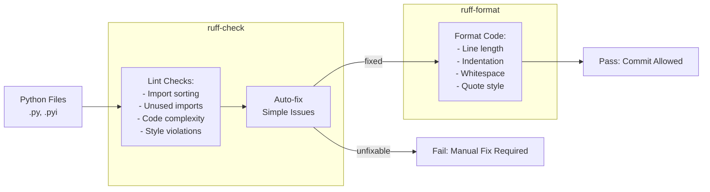
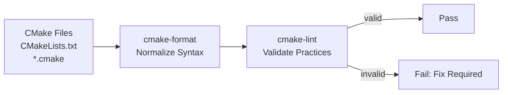
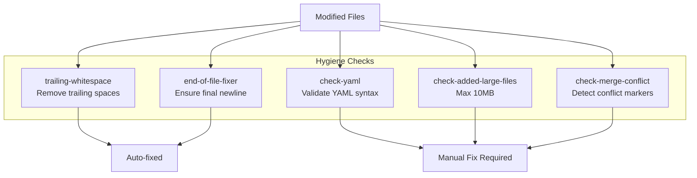
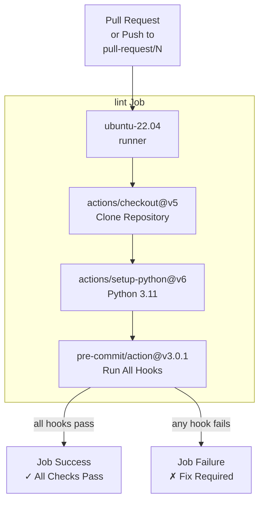
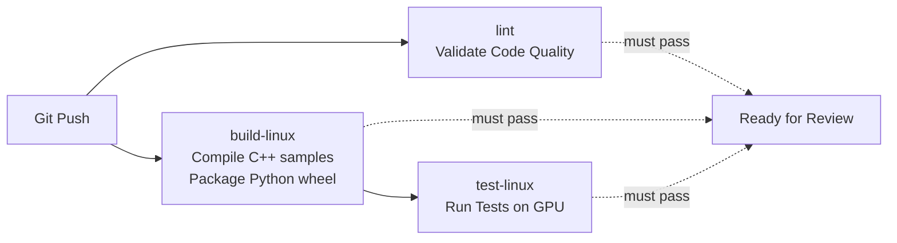
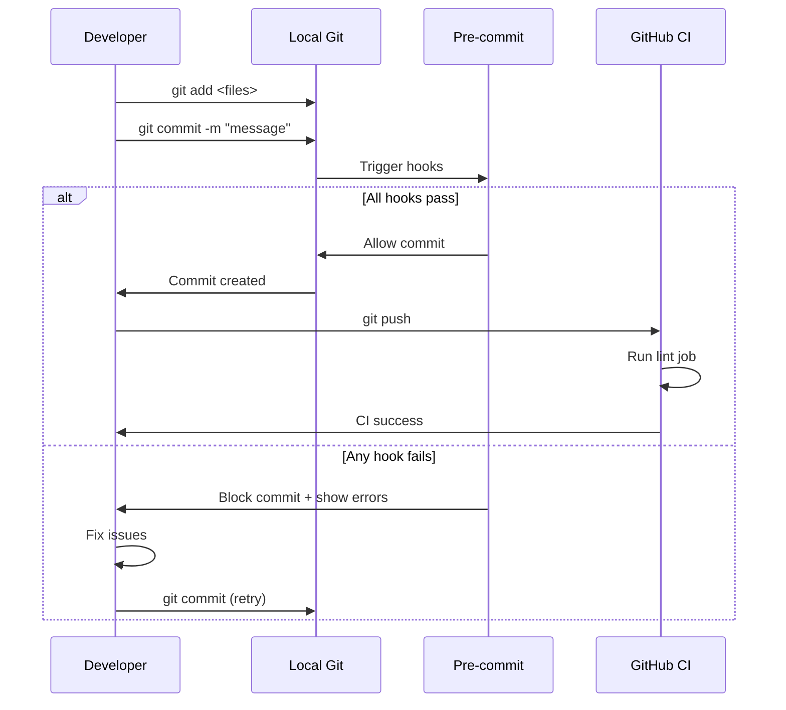

<!-- source: DeepWiki mcp.deepwiki.com · repo NVIDIA/TensorRT-RTX · page 6.2 Code Quality and Formatting · fetched 2026-10-26 -->

# Code Quality and Formatting

<details>
<summary>Relevant source files</summary>

The following files were used as context for generating this wiki page:

- [.github/workflows/ci.yaml](.github/workflows/ci.yaml)
- [.pre-commit-config.yaml](.pre-commit-config.yaml)
- [CONTRIBUTING.md](CONTRIBUTING.md)

</details>


This document describes the automated code quality and formatting enforcement system used in TensorRT-RTX. The repository uses pre-commit hooks to validate code style, formatting, and quality across Python, C++, CMake, and Markdown files before commits are allowed. Additionally, the CI system validates all code submissions through a dedicated lint job.

For information about the overall contribution process, see [Contributing to TensorRT-RTX](#6.1). For testing guidelines, see [Testing Guide](#6.3).

---

## Pre-commit Hook System

The TensorRT-RTX repository uses the `pre-commit` framework to automatically validate code quality before commits are accepted. This provides immediate feedback to developers and prevents non-compliant code from entering the codebase.

### Hook Execution Flow

```mermaid
flowchart TD
    COMMIT["git commit"]
    
    subgraph "Pre-commit Validation"
        RUFF_CHECK["ruff-check<br/>Python linting"]
        RUFF_FMT["ruff-format<br/>Python formatting"]
        CLANG["clang-format<br/>C/C++ formatting"]
        CMAKE_FMT["cmake-format<br/>CMake formatting"]
        CMAKE_LINT["cmake-lint<br/>CMake linting"]
        MDFORMAT["mdformat<br/>Markdown formatting"]
        CODESPELL["codespell<br/>Spell checking"]
        WHITESPACE["trailing-whitespace<br/>Whitespace cleanup"]
        EOF["end-of-file-fixer<br/>File ending normalization"]
        YAML["check-yaml<br/>YAML syntax validation"]
        LARGE["check-added-large-files<br/>Size limit enforcement"]
        MERGE["check-merge-conflict<br/>Conflict detection"]
    end
    
    PASS["Commit Allowed"]
    FAIL["Commit Blocked<br/>Fix Issues and Retry"]
    
    COMMIT --> RUFF_CHECK
    COMMIT --> RUFF_FMT
    COMMIT --> CLANG
    COMMIT --> CMAKE_FMT
    COMMIT --> CMAKE_LINT
    COMMIT --> MDFORMAT
    COMMIT --> CODESPELL
    COMMIT --> WHITESPACE
    COMMIT --> EOF
    COMMIT --> YAML
    COMMIT --> LARGE
    COMMIT --> MERGE
    
    RUFF_CHECK -->|pass| PASS
    RUFF_FMT -->|pass| PASS
    CLANG -->|pass| PASS
    CMAKE_FMT -->|pass| PASS
    CMAKE_LINT -->|pass| PASS
    MDFORMAT -->|pass| PASS
    CODESPELL -->|pass| PASS
    WHITESPACE -->|pass| PASS
    EOF -->|pass| PASS
    YAML -->|pass| PASS
    LARGE -->|pass| PASS
    MERGE -->|pass| PASS
    
    RUFF_CHECK -->|fail| FAIL
    RUFF_FMT -->|fail| FAIL
    CLANG -->|fail| FAIL
    CMAKE_FMT -->|fail| FAIL
    CMAKE_LINT -->|fail| FAIL
    MDFORMAT -->|fail| FAIL
    CODESPELL -->|fail| FAIL
    WHITESPACE -->|fail| FAIL
    EOF -->|fail| FAIL
    YAML -->|fail| FAIL
    LARGE -->|fail| FAIL
    MERGE -->|fail| FAIL
```



**Sources:** [.pre-commit-config.yaml:1-59](), [.github/workflows/ci.yaml:46-54]()

### Installation and Setup

Pre-commit hooks are automatically configured through the `.pre-commit-config.yaml` file. Developers should install the hooks locally:

```bash
# Install pre-commit framework
pip install pre-commit

# Install the configured hooks
pre-commit install
```

Once installed, the hooks run automatically on `git commit`. To manually run hooks on all files:

```bash
pre-commit run --all-files
```

**Sources:** [.pre-commit-config.yaml:1-59]()

---

## Python Code Quality

Python code quality is enforced using **Ruff**, a fast Python linter and formatter that combines the functionality of multiple tools (flake8, black, isort, etc.).

### Ruff Configuration

| Hook | Version | Purpose | Auto-fix |
|------|---------|---------|----------|
| `ruff-check` | v0.11.13 | Linting and style validation | Yes (`--fix`) |
| `ruff-format` | v0.11.13 | Code formatting | Yes (automatic) |

Both hooks apply to Python source files (`.py`) and type stub files (`.pyi`).

**Sources:** [.pre-commit-config.yaml:2-11]()

### Hook Behavior



**Sources:** [.pre-commit-config.yaml:3-11]()

---

## C++ Code Quality

C++ code formatting is enforced using **clang-format** version 16.0.0. TensorRT-RTX follows the [TensorRT Coding Guidelines](https://github.com/NVIDIA/TensorRT/blob/HEAD/CODING-GUIDELINES.md) as referenced in [CONTRIBUTING.md:10-11]().

### Formatting Rules

The `.clang-format` configuration file (not shown in provided files but referenced in [CONTRIBUTING.md:32-34]()) defines formatting rules for:

- Class, function/method, and variable/field naming
- Comment style
- Indentation
- Line length

### Hook Configuration

| Hook | Version | File Types | Purpose |
|------|---------|------------|---------|
| `clang-format` | v16.0.0 | `.c`, `.cpp`, `.h`, `.hpp` | Format C/C++ code |

**Sources:** [.pre-commit-config.yaml:24-29](), [CONTRIBUTING.md:10-42]()

### Manual Formatting

For manual formatting outside of pre-commit hooks:

```bash
# Format git changes (staged or from specific commit)
git-clang-format --style file [commit ID/reference]

# Format specific files in-place
clang-format -style=file -i -fallback-style=none <file(s)>

# Format entire codebase (maintainers only)
find samples -iname *.h -o -iname *.c -o -iname *.cpp -o -iname *.hpp \
    | xargs clang-format -style=file -i -fallback-style=none
```

**Sources:** [CONTRIBUTING.md:22-42]()

---

## CMake Formatting and Linting

CMake files have both formatting and linting enforcement through the `cmake-format-precommit` toolset.

### Configuration

| Hook | Version | Purpose | File Types |
|------|---------|---------|------------|
| `cmake-format` | v0.6.10 | Format CMake syntax | `.cmake`, `CMakeLists.txt` |
| `cmake-lint` | v0.6.10 | Validate CMake best practices | `.cmake`, `CMakeLists.txt` |

Both hooks apply to files identified as CMake type by pre-commit's file type detection.



**Sources:** [.pre-commit-config.yaml:31-38]()

---

## Markdown Formatting

Markdown files are formatted using **mdformat** with additional plugins for enhanced formatting capabilities.

### Configuration

| Component | Version | Purpose |
|-----------|---------|---------|
| `mdformat` | 1.0.0 | Base Markdown formatter |
| `mdformat-gfm` | (dependency) | GitHub Flavored Markdown support |
| `mdformat-black` | (dependency) | Code block formatting (Black style) |
| `mdformat-beautysh` | (dependency) | Shell script formatting in code blocks |

### Exclusions

Markdown files in `.github/` directory are excluded from formatting to preserve issue templates and workflow documentation that may have specific formatting requirements.

**Sources:** [.pre-commit-config.yaml:40-50]()

---

## Spell Checking

The **codespell** tool checks for common spelling errors across all text files in the repository.

### Configuration

| Hook | Version | Additional Dependencies | Arguments |
|------|---------|------------------------|-----------|
| `codespell` | v2.4.1 | `tomli` | `--skip "*.ipynb"` |

Jupyter notebooks (`.ipynb`) are excluded from spell checking due to their JSON structure and potential for false positives.

**Sources:** [.pre-commit-config.yaml:52-58]()

---

## File Hygiene Checks

Several general-purpose hooks from the `pre-commit-hooks` repository ensure basic file quality standards.

### Standard Hooks



### Hook Details

| Hook | Purpose | Action |
|------|---------|--------|
| `trailing-whitespace` | Remove trailing whitespace | Auto-fix |
| `end-of-file-fixer` | Ensure files end with newline | Auto-fix |
| `check-yaml` | Validate YAML file syntax | Validation only |
| `check-added-large-files` | Prevent files >10MB from being committed | Validation only |
| `check-merge-conflict` | Detect unresolved merge conflict markers | Validation only |

**Sources:** [.pre-commit-config.yaml:14-22]()

---

## CI Enforcement

The GitHub Actions CI system enforces code quality through a dedicated `lint` job that runs independently of the build and test jobs.

### Lint Job Architecture



### Job Configuration

| Property | Value | Purpose |
|----------|-------|---------|
| Runner | `ubuntu-22.04` | Standardized Linux environment |
| Python Version | `3.11` | Consistent Python runtime |
| Pre-commit Action | `v3.0.1` | Official pre-commit GitHub Action |

The lint job runs the exact same hooks defined in [.pre-commit-config.yaml:1-59]() but in the CI environment, ensuring that any code pushed to the repository passes all quality checks.

**Sources:** [.github/workflows/ci.yaml:46-54]()

### Workflow Integration



The lint job runs in parallel with the build job, providing fast feedback on code quality issues without waiting for the full build process.

**Sources:** [.github/workflows/ci.yaml:11-54]()

---

## Manual Quality Checks

While pre-commit hooks automate most quality checks, certain standards must be manually verified:

### Build Warnings

As stated in [CONTRIBUTING.md:59]():
> Ensure that the build log is clean, meaning no warnings or errors should be present.

This is validated through the `build-linux` CI job which uses strict compiler flags.

### Testing Requirements

From [CONTRIBUTING.md:61-65]():
- All sample and demo tests must pass before submission
- New components must include accompanying tests

These requirements are enforced through the `test-linux` CI job.

### Documentation Requirements

From [CONTRIBUTING.md:63]():
> All OSS components must contain accompanying documentation (READMEs) describing the functionality, dependencies, and known issues.

This is validated during code review.

**Sources:** [CONTRIBUTING.md:59-77]()

---

## Common Workflow Patterns

### Standard Development Flow



### Hook Bypass (Emergency Only)

Developers can bypass hooks using `--no-verify`, but CI will still enforce all checks:

```bash
# Not recommended: Bypasses local hooks but CI will still fail
git commit --no-verify -m "emergency fix"
```

**Sources:** [.pre-commit-config.yaml:1-59](), [.github/workflows/ci.yaml:46-54]()

---

## Tool Versions and Updates

All tool versions are pinned in [.pre-commit-config.yaml:1-59]() to ensure consistent behavior across all development environments:

| Tool | Current Version | Repository |
|------|----------------|------------|
| ruff | v0.11.13 | `astral-sh/ruff-pre-commit` |
| pre-commit-hooks | v4.4.0 | `pre-commit/pre-commit-hooks` |
| clang-format | v16.0.0 | `pre-commit/mirrors-clang-format` |
| cmake-format | v0.6.10 | `cheshirekow/cmake-format-precommit` |
| mdformat | 1.0.0 | `executablebooks/mdformat` |
| codespell | v2.4.1 | `codespell-project/codespell` |

Updates to these versions should be tested thoroughly to avoid introducing unexpected formatting changes across the codebase.

**Sources:** [.pre-commit-config.yaml:1-59]()

---

