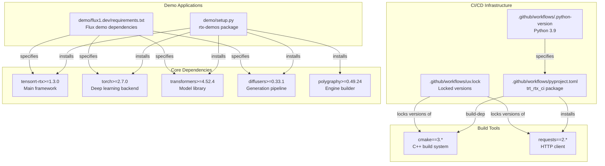
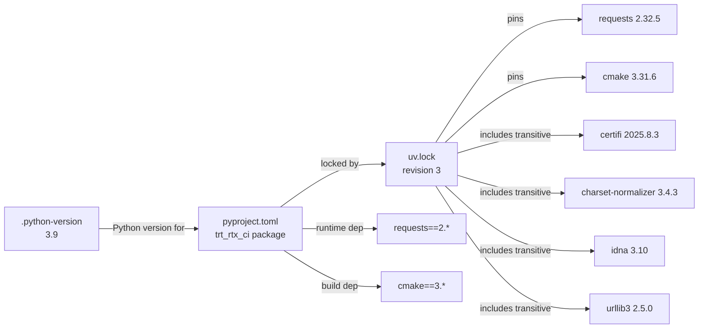
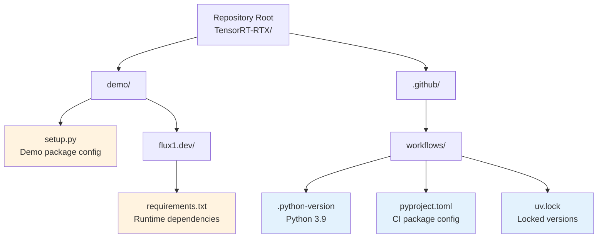
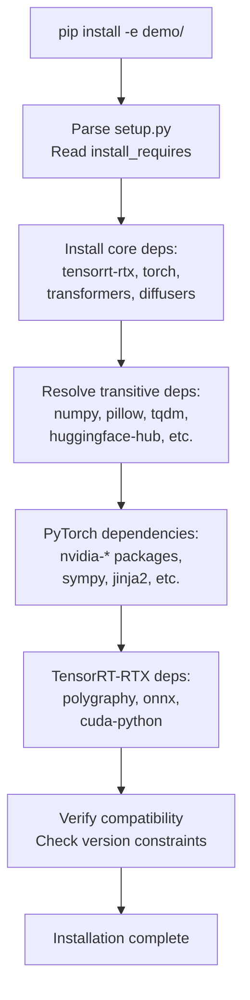

<!-- source: DeepWiki mcp.deepwiki.com · repo NVIDIA/TensorRT-RTX · page 7 Reference · fetched 2026-10-26 -->

# Reference

<details>
<summary>Relevant source files</summary>

The following files were used as context for generating this wiki page:

- [.github/workflows/.python-version](.github/workflows/.python-version)
- [.github/workflows/pyproject.toml](.github/workflows/pyproject.toml)
- [.github/workflows/uv.lock](.github/workflows/uv.lock)
- [demo/flux1.dev/requirements.txt](demo/flux1.dev/requirements.txt)
- [demo/setup.py](demo/setup.py)

</details>


This section provides technical reference material for the TensorRT-RTX repository, including detailed specifications of Python dependencies, package versions, and configuration file formats. Use this reference when troubleshooting environment issues, understanding version requirements, or contributing to the codebase.

For step-by-step installation instructions, see [Installation](#2.1). For development environment setup, see [Contributing to TensorRT-RTX](#6.1). For Python environment configuration details, see [Python Environment and Dependencies](#7.1).

---

## Dependency Overview

The TensorRT-RTX repository maintains dependencies across three distinct scopes: demonstration applications, CI/CD infrastructure, and development tooling. Understanding these dependency boundaries is critical for proper environment setup.



**Sources:** [demo/setup.py:1-55](), [demo/flux1.dev/requirements.txt:1-22](), [.github/workflows/pyproject.toml:1-13](), [.github/workflows/.python-version:1-2]()

---

## Core Package Dependencies

The demonstration framework (`rtx-demos` package) requires a specific set of deep learning and inference libraries. The following table lists all required dependencies with their minimum versions and purposes:

| Package | Version Constraint | Purpose |
|---------|-------------------|---------|
| `tensorrt-rtx` | `>=1.3.0` | TensorRT-RTX inference runtime with FP8/FP4 support |
| `torch` | `>=2.7.0` | PyTorch deep learning framework with CUDA 12.9 support |
| `transformers` | `>=4.52.4` | Hugging Face model loading and tokenization |
| `diffusers` | `>=0.33.1` | Diffusion model pipeline infrastructure |
| `huggingface-hub` | `>=0.32.4` | Model download and caching from Hugging Face Hub |
| `polygraphy` | `>=0.49.24` | ONNX to TensorRT engine conversion utilities |
| `accelerate` | (any) | Multi-GPU and mixed precision training utilities |
| `cuda-python` | `<13.0.0` | Python bindings for CUDA runtime API |
| `tqdm` | `>=4.67.1` | Progress bar visualization |
| `pillow` | (any) | Image loading and saving |
| `numpy` | (any) | Numerical computing arrays |
| `packaging` | (any) | Version parsing utilities |
| `protobuf` | (any) | Protocol buffer serialization |
| `sentencepiece` | (any) | T5 tokenizer implementation |

**Sources:** [demo/setup.py:23-38](), [demo/flux1.dev/requirements.txt:1-15]()

---

## PyTorch CUDA Configuration

The demo applications require PyTorch built with CUDA 12.9 support. This is enforced through the `--extra-index-url` directive in the requirements file:

```text
--extra-index-url https://download.pytorch.org/whl/cu129
torch>=2.7.0
```

This configuration ensures PyTorch is installed from the CUDA 12.9-specific wheel repository rather than the default CPU-only builds. The setup.py file specifies the same constraint but relies on the user to have configured their pip index correctly.

**Sources:** [demo/flux1.dev/requirements.txt:2-3]()

---

## Optional Dependency Groups

The `rtx-demos` package defines two optional dependency groups via `extras_require`:

### Development Tools (`dev`)

```python
"dev": [
    "pre-commit",
    "ruff",
    "flake8",
]
```

Install with: `pip install -e "demo[dev]"`

These tools enable local code quality checks. See [Code Quality and Formatting](#6.2) for usage.

### Jupyter Notebook Support (`jupyter`)

```python
"jupyter": [
    "requests>=2.25.0",
    "ipython>=8.0.0",
    "ipywidgets>=8.0.0",
    "jupyter",
    "notebook",
    "jupyterlab",
]
```

Install with: `pip install -e "demo[jupyter]"`

Required for running the interactive Flux demo notebook. See [Flux.1 Text-to-Image Demo](#4.1) for details.

**Sources:** [demo/setup.py:39-53]()

---

## CI/CD Environment Configuration

The continuous integration system uses a separate, minimal Python environment defined in `.github/workflows/`:



**Sources:** [.github/workflows/.python-version:1-2](), [.github/workflows/pyproject.toml:1-13](), [.github/workflows/uv.lock:1-166]()

---

## Package Metadata

### Demo Package (`rtx-demos`)

The demonstration framework is packaged as `rtx-demos` version `1.3.0`:

```python
setup(
    name="rtx-demos",
    version="1.3.0",
    description="RTX Demos",
    packages=find_packages(),
    python_requires=">=3.9",
)
```

This package is installed in editable mode during development: `pip install -e demo/`

**Key Characteristics:**
- **Minimum Python Version:** 3.9
- **Package Discovery:** Automatic via `find_packages()`
- **License:** Apache 2.0 (specified in file headers)

**Sources:** [demo/setup.py:18-55]()

### CI Utility Package (`trt_rtx_ci`)

The CI system uses a minimal package for build utilities:

```toml
[project]
name = "trt_rtx_ci"
version = "0.1.0"
requires-python = ">=3.9"
dependencies = ["requests==2.*"]

[dependency-groups]
build = ["cmake==3.*"]
```

This package provides HTTP download utilities and CMake for building C++ samples.

**Sources:** [.github/workflows/pyproject.toml:1-13]()

---

## Dependency Lock File Structure

The CI system uses `uv.lock` format (revision 3) to ensure reproducible builds. The lock file contains:

### Package Entry Format

```toml
[[package]]
name = "requests"
version = "2.32.5"
source = { registry = "https://pypi.org/simple" }
dependencies = [
    { name = "certifi" },
    { name = "charset-normalizer" },
    { name = "idna" },
    { name = "urllib3" },
]
sdist = { url = "...", hash = "sha256:...", size = 134517 }
wheels = [
    { url = "...", hash = "sha256:...", size = 64738 },
]
```

Each package entry specifies:
- **Source registry:** PyPI URL
- **Dependencies:** Transitive dependencies with names
- **Source distribution:** Download URL with SHA256 hash
- **Wheel files:** Pre-built binaries for various platforms

### Locked Dependency Tree

The CI lock file pins these versions:

| Package | Version | Purpose |
|---------|---------|---------|
| `requests` | 2.32.5 | HTTP client for downloading TensorRT-RTX binaries |
| `cmake` | 3.31.6 | C++ build system with 17 platform-specific wheels |
| `certifi` | 2025.8.3 | SSL certificate bundle |
| `charset-normalizer` | 3.4.3 | Character encoding detection (73 platform wheels) |
| `idna` | 3.10 | Internationalized domain name support |
| `urllib3` | 2.5.0 | Low-level HTTP implementation |

**Sources:** [.github/workflows/uv.lock:1-166]()

---

## Version Compatibility Matrix

The following table shows tested compatibility between major dependencies:

| TensorRT-RTX | PyTorch | CUDA | Python | Transformers | Diffusers |
|--------------|---------|------|--------|--------------|-----------|
| >=1.3.0 | >=2.7.0 | 12.9 | >=3.9 | >=4.52.4 | >=0.33.1 |

**Hardware Requirements:**
- NVIDIA GPU with Ada Lovelace or Blackwell architecture
- CUDA Compute Capability 8.9+ (for FP8 support)
- Minimum 16GB VRAM recommended for Flux.1 demo

**Operating System:**
- Ubuntu 22.04 or 24.04 (tested in CI)
- Linux x86_64 (primary support)
- Other platforms untested

**Sources:** [demo/setup.py:23-38](), [demo/flux1.dev/requirements.txt:1-15]()

---

## Configuration File Locations



**Configuration File Purposes:**

| File | Scope | Managed By | Used By |
|------|-------|------------|---------|
| `demo/setup.py` | Demo applications | Developers | `pip install` |
| `demo/flux1.dev/requirements.txt` | Flux demo | Developers | `pip install -r` |
| `.github/workflows/.python-version` | CI Python version | CI maintainers | GitHub Actions |
| `.github/workflows/pyproject.toml` | CI utilities | CI maintainers | `uv` package manager |
| `.github/workflows/uv.lock` | CI locked deps | `uv` tool | `uv sync` |

**Sources:** [demo/setup.py:1-55](), [demo/flux1.dev/requirements.txt:1-22](), [.github/workflows/.python-version:1-2](), [.github/workflows/pyproject.toml:1-13](), [.github/workflows/uv.lock:1-166]()

---

## Installing Dependencies

### Demo Application Setup

```bash
# Install core dependencies
cd demo
pip install -e .

# Install with Jupyter support
pip install -e ".[jupyter]"

# Install with development tools
pip install -e ".[dev]"

# Install from requirements file (alternative)
cd flux1.dev
pip install -r requirements.txt
```

### CI Environment Setup

```bash
# Navigate to CI directory
cd .github/workflows

# Install locked dependencies with uv
uv sync

# Install build dependencies only
uv sync --group build
```

**Sources:** [demo/setup.py:18-55](), [demo/flux1.dev/requirements.txt:1-22](), [.github/workflows/pyproject.toml:1-13]()

---

## Dependency Resolution Order

When installing the demo package, pip resolves dependencies in this order:



**Potential Conflicts:**
- `cuda-python` version must be `<13.0.0` to match CUDA 12.9
- PyTorch must be installed from CUDA-specific index
- TensorRT-RTX requires specific polygraphy version

**Sources:** [demo/setup.py:23-38]()

---

## Related Pages

For additional reference material:
- **Python Environment Details:** See [Python Environment and Dependencies](#7.1)
- **Configuration Files:** See [Configuration Files Reference](#7.2)
- **Issue Reporting:** See [Issue Templates and Bug Reporting](#7.3)
- **Installation Guide:** See [Installation](#2.1)
- **Development Setup:** See [Contributing to TensorRT-RTX](#6.1)

---

