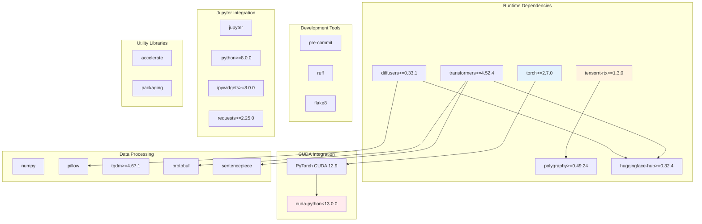
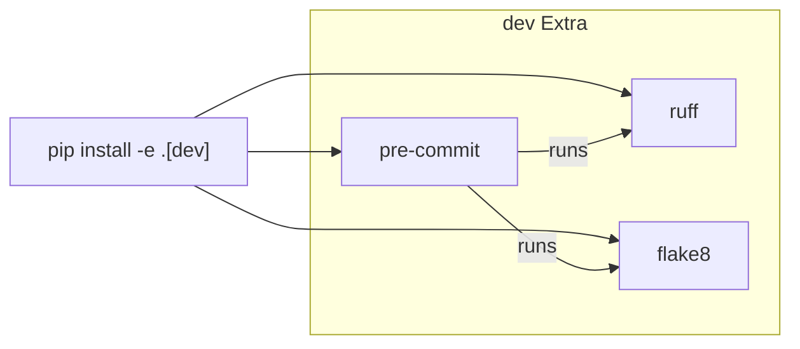
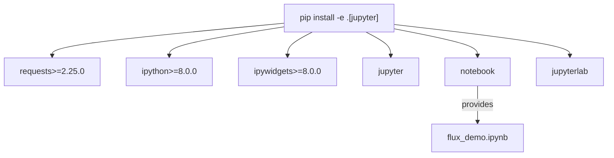
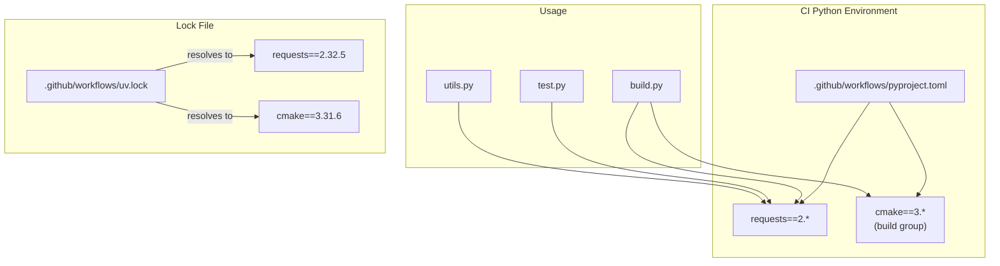
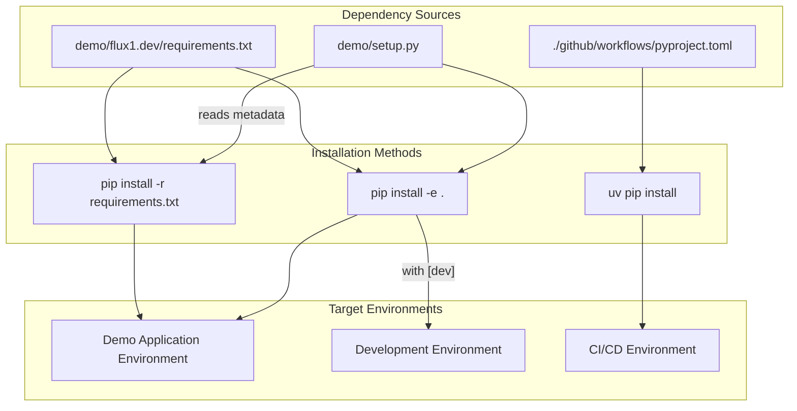
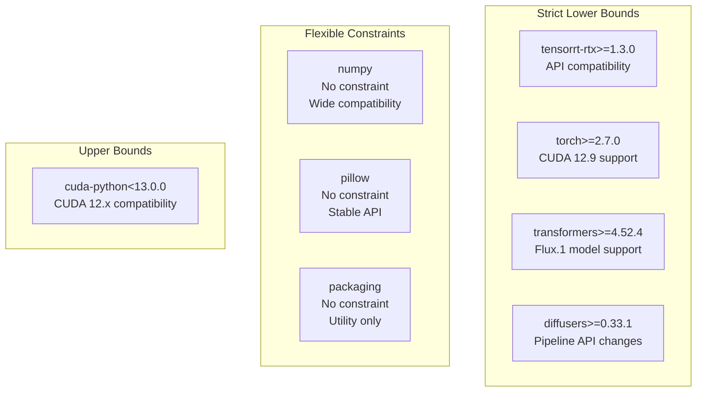

<!-- source: DeepWiki mcp.deepwiki.com · repo NVIDIA/TensorRT-RTX · page 7.1 Python Environment and Dependencies · fetched 2026-10-26 -->

# Python Environment and Dependencies

<details>
<summary>Relevant source files</summary>

The following files were used as context for generating this wiki page:

- [.github/workflows/.python-version](.github/workflows/.python-version)
- [.github/workflows/pyproject.toml](.github/workflows/pyproject.toml)
- [.github/workflows/uv.lock](.github/workflows/uv.lock)
- [demo/flux1.dev/requirements.txt](demo/flux1.dev/requirements.txt)
- [demo/setup.py](demo/setup.py)

</details>


This page documents the Python version requirements and package dependencies for TensorRT-RTX applications. It covers runtime dependencies, development tooling, CI/CD requirements, and the various dependency specification files used throughout the repository.

For information about configuring the Flux demo specifically, see [Flux Demo Configuration](#4.1.1). For details about the development workflow and quality tools, see [Code Quality and Formatting](#6.2).

---

## Python Version Requirements

TensorRT-RTX requires **Python 3.9 or later**.

| Specification Location | Required Version | Purpose |
|------------------------|------------------|---------|
| [demo/setup.py:54]() | `>=3.9` | Demo package installation |
| [.github/workflows/.python-version:1]() | `3.9` | CI/CD baseline version |
| [.github/workflows/pyproject.toml:4]() | `>=3.9` | CI utilities |

The Python 3.9 baseline ensures compatibility with CUDA 12.9 runtime environments and modern PyTorch distributions.

**Sources:** [demo/setup.py:54](), [.github/workflows/.python-version:1](), [.github/workflows/pyproject.toml:4]()

---

## Dependency Hierarchy



**Sources:** [demo/flux1.dev/requirements.txt:1-22](), [demo/setup.py:23-38]()

---

## Core Runtime Dependencies

### TensorRT and Inference Stack

| Package | Version Constraint | Purpose |
|---------|-------------------|---------|
| `tensorrt-rtx` | `>=1.3.0` | Core TensorRT-RTX inference runtime with FP8/FP4 support |
| `torch` | `>=2.7.0` | PyTorch tensor operations and model loading |
| `polygraphy` | `>=0.49.24` | TensorRT engine building and ONNX conversion |
| `cuda-python` | `<13.0.0` | CUDA runtime bindings for memory management |

The PyTorch dependency uses the CUDA 12.9 wheel distribution via the extra index URL specified in [demo/flux1.dev/requirements.txt:2]():

```
--extra-index-url https://download.pytorch.org/whl/cu129
```

**Sources:** [demo/flux1.dev/requirements.txt:2-3,10-11,15](), [demo/setup.py:24,31-32,34]()

### Hugging Face Ecosystem

| Package | Version Constraint | Purpose |
|---------|-------------------|---------|
| `transformers` | `>=4.52.4` | CLIP and T5 text encoder models |
| `diffusers` | `>=0.33.1` | Flux.1 pipeline components and VAE decoder |
| `huggingface-hub` | `>=0.32.4` | Model downloading and caching from Hugging Face Hub |
| `accelerate` | (no constraint) | Model parallelism and memory optimization utilities |

These packages enable integration with pre-trained models hosted on Hugging Face Hub, particularly for the Flux.1 demo application.

**Sources:** [demo/flux1.dev/requirements.txt:1,4-6](), [demo/setup.py:25-27,35]()

### Data Processing and Utilities

| Package | Version Constraint | Purpose |
|---------|-------------------|---------|
| `numpy` | (no constraint) | Array operations and tensor conversions |
| `pillow` | (no constraint) | Image loading, saving, and format conversion |
| `tqdm` | `>=4.67.1` | Progress bars for long-running operations |
| `packaging` | (no constraint) | Version parsing and comparison utilities |
| `protobuf` | (no constraint) | Protocol buffer serialization for model weights |
| `sentencepiece` | (no constraint) | Tokenization for T5 text encoder |

**Sources:** [demo/flux1.dev/requirements.txt:7-9,12-14](), [demo/setup.py:28-30,33,36-37]()

---

## Development Dependencies

Development dependencies are specified as `extras_require` in [demo/setup.py:39-44]():



| Package | Purpose |
|---------|---------|
| `pre-commit` | Git hook framework for automated code quality checks |
| `ruff` | Fast Python linter and formatter (replaces Black, isort, flake8-plugins) |
| `flake8` | Python style guide enforcement |

These tools are automatically configured via [.pre-commit-config.yaml]() and enforce code standards before commits are allowed. See [Code Quality and Formatting](#6.2) for configuration details.

**Sources:** [demo/setup.py:40-44]()

---

## Jupyter Notebook Dependencies

Jupyter support is provided through the `jupyter` extra in [demo/setup.py:45-52]():



| Package | Version Constraint | Purpose |
|---------|-------------------|---------|
| `requests` | `>=2.25.0` | HTTP client for downloading model weights |
| `ipython` | `>=8.0.0` | Enhanced interactive Python shell |
| `ipywidgets` | `>=8.0.0` | Interactive UI widgets for parameter tuning |
| `jupyter` | (no constraint) | Jupyter notebook server |
| `notebook` | (no constraint) | Classic Jupyter Notebook interface |
| `jupyterlab` | (no constraint) | Modern JupyterLab IDE |

The Jupyter dependencies are also listed in [demo/flux1.dev/requirements.txt:17-21]() for standalone installation without the demo package.

**Sources:** [demo/setup.py:45-52](), [demo/flux1.dev/requirements.txt:17-21]()

---

## CI/CD Dependencies

The CI/CD system has minimal Python dependencies specified in [.github/workflows/pyproject.toml:1-12]():



| Package | Version Constraint | Purpose | Dependency Group |
|---------|-------------------|---------|------------------|
| `requests` | `==2.*` | HTTP client for downloading TensorRT-RTX binaries | default |
| `cmake` | `==3.*` | CMake build tool for C++ samples | build |

The [.github/workflows/uv.lock:1-166]() file contains the complete resolved dependency tree managed by `uv`, including transitive dependencies like `certifi`, `charset-normalizer`, `idna`, and `urllib3`.

**Sources:** [.github/workflows/pyproject.toml:1-12](), [.github/workflows/uv.lock:1-166]()

---

## Dependency Specification Files



### requirements.txt Format

The [demo/flux1.dev/requirements.txt:1-22]() file uses the traditional pip requirements format:

- **Direct dependencies:** Package names with version constraints (e.g., `torch>=2.7.0`)
- **Extra index URLs:** Custom PyPI indexes for PyTorch CUDA wheels
- **Comments:** Section headers for organizational clarity

### setup.py Format

The [demo/setup.py:16-55]() file defines the `rtx-demos` package with:

- **name:** `"rtx-demos"` (package identifier)
- **version:** `"1.3.0"` (aligned with TensorRT-RTX version)
- **packages:** Auto-discovered via `find_packages()`
- **install_requires:** Core runtime dependencies
- **extras_require:** Optional dependency groups (`dev`, `jupyter`)
- **python_requires:** Minimum Python version constraint

### pyproject.toml Format

The [.github/workflows/pyproject.toml:1-12]() file uses modern `pyproject.toml` syntax:

- **[project]:** Project metadata and core dependencies
- **[dependency-groups]:** Optional dependency groups (PEP 735 style)
- Locked via `uv` tool to [.github/workflows/uv.lock]()

**Sources:** [demo/flux1.dev/requirements.txt:1-22](), [demo/setup.py:16-55](), [.github/workflows/pyproject.toml:1-12]()

---

## Installation Methods

### Method 1: Using requirements.txt

```bash
cd demo/flux1.dev
pip install -r requirements.txt
```

This installs all dependencies needed to run the Flux.1 demo, including Jupyter support. Suitable for users who want to run the demo without installing the `rtx-demos` package.

**Sources:** [demo/flux1.dev/requirements.txt:1-22]()

### Method 2: Using setup.py (Editable Install)

```bash
cd demo
pip install -e .                    # Core dependencies only
pip install -e .[dev]               # Include development tools
pip install -e .[jupyter]           # Include Jupyter support
pip install -e .[dev,jupyter]       # All dependencies
```

This installs the `rtx-demos` package in editable mode, allowing changes to the source code to take effect immediately without reinstallation. Recommended for development.

**Sources:** [demo/setup.py:16-55]()

### Method 3: CI/CD Environment (uv)

```bash
cd .github/workflows
uv pip install -r pyproject.toml
uv pip install -r pyproject.toml --group build  # Include build tools
```

The CI system uses `uv` for fast dependency resolution and installation, with dependencies locked in [.github/workflows/uv.lock:1-166](). This ensures reproducible builds across CI runs.

**Sources:** [.github/workflows/pyproject.toml:1-12](), [.github/workflows/uv.lock:1-166]()

---

## Version Constraints Rationale



### Strict Lower Bounds

Packages with `>=` constraints require specific features or API changes:

- **tensorrt-rtx>=1.3.0:** Required for FP8/FP4 precision modes introduced in version 1.3.0
- **torch>=2.7.0:** Needed for CUDA 12.9 compatibility and tensor optimizations
- **transformers>=4.52.4:** Required for Flux.1 model architecture support
- **diffusers>=0.33.1:** Pipeline API changes for text-to-image generation

### No Constraints

Packages without version constraints have stable APIs:

- **numpy, pillow, protobuf:** Core data processing libraries with backward compatibility
- **accelerate, sentencepiece:** Utility libraries with minimal version dependencies

### Upper Bounds

- **cuda-python<13.0.0:** Ensures compatibility with CUDA 12.x runtime (excludes CUDA 13.x)

**Sources:** [demo/flux1.dev/requirements.txt:1-22](), [demo/setup.py:23-38]()

---

## Dependency Resolution and Conflicts

### PyTorch CUDA Version

The `--extra-index-url` directive in [demo/flux1.dev/requirements.txt:2]() ensures PyTorch is installed with CUDA 12.9 support:

```
--extra-index-url https://download.pytorch.org/whl/cu129
torch>=2.7.0
```

Without this directive, pip would install the CPU-only version of PyTorch, which lacks GPU acceleration.

### TensorRT-RTX Installation

The `tensorrt-rtx` package is not available on PyPI. It must be downloaded from NVIDIA and installed manually or via the automated installation script used in CI. See [Installation](#2.1) for details.

### CUDA Python Compatibility

The constraint `cuda-python<13.0.0` in [demo/flux1.dev/requirements.txt:10]() prevents installation of incompatible CUDA 13.x bindings, ensuring alignment with the CUDA 12.9 runtime environment.

**Sources:** [demo/flux1.dev/requirements.txt:2,10,15]()

---

