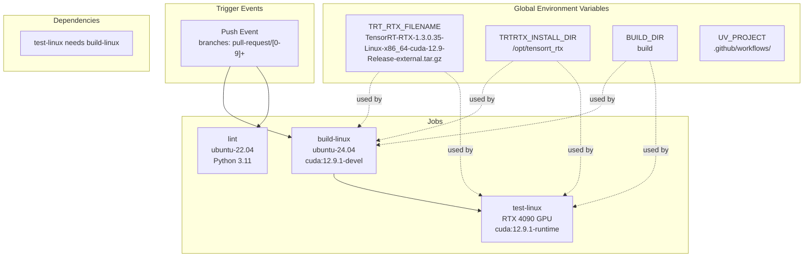
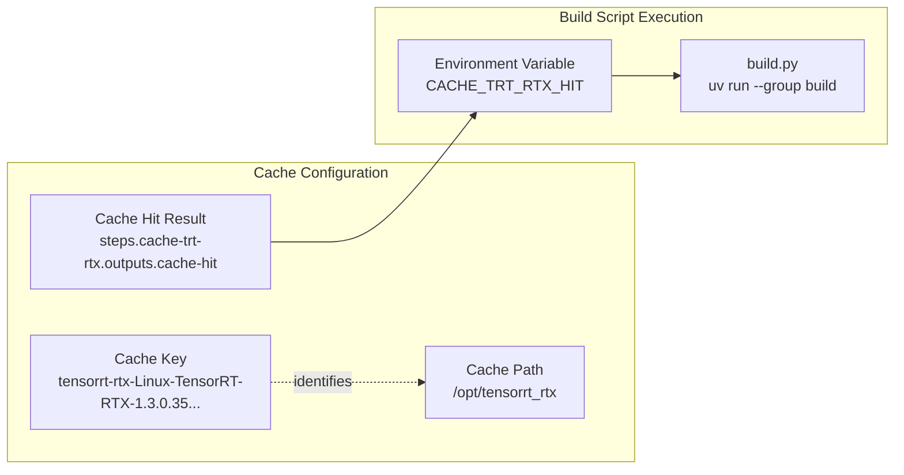
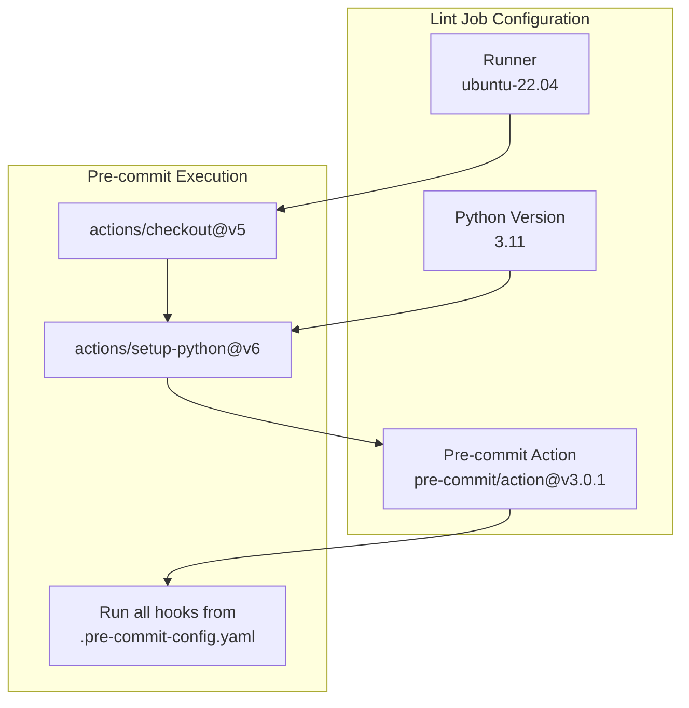
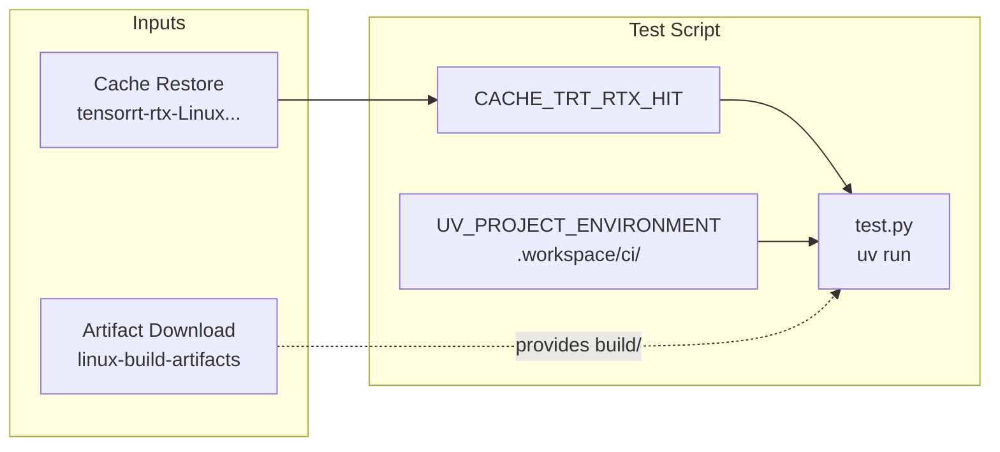
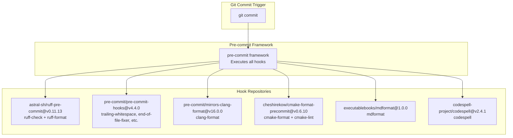
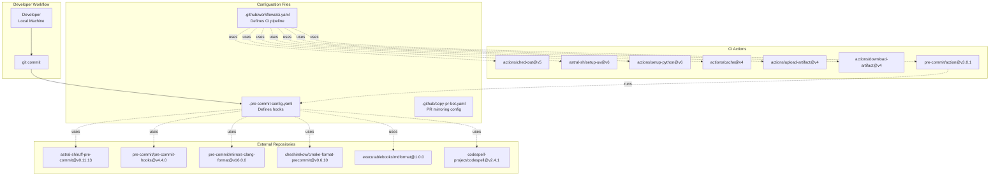

<!-- source: DeepWiki mcp.deepwiki.com · repo NVIDIA/TensorRT-RTX · page 7.2 Configuration Files Reference · fetched 2026-10-26 -->

# Configuration Files Reference

<details>
<summary>Relevant source files</summary>

The following files were used as context for generating this wiki page:

- [.github/copy-pr-bot.yaml](.github/copy-pr-bot.yaml)
- [.github/workflows/ci.yaml](.github/workflows/ci.yaml)
- [.pre-commit-config.yaml](.pre-commit-config.yaml)

</details>


This document provides a detailed reference for all configuration files used in the TensorRT-RTX repository. These files control the CI/CD pipeline, code quality enforcement, and automated workflows. For information about Python package dependencies and environment setup, see [Python Environment and Dependencies](#7.1). For guidance on using these tools during development, see [Code Quality and Formatting](#6.2).

## Overview

The TensorRT-RTX repository uses three primary categories of configuration files:

1. **CI/CD Workflows** - GitHub Actions workflow definitions
2. **Code Quality Tools** - Pre-commit hooks for automated formatting and validation
3. **Automation Bots** - Repository automation configurations

These files define the automated infrastructure that ensures code quality, validates builds, and manages pull requests.

## CI Workflow Configuration

The main CI workflow is defined in `.github/workflows/ci.yaml` and orchestrates the build, lint, and test pipeline.

### Workflow Structure



**Sources:** [.github/workflows/ci.yaml:1-92]()

### Environment Variables

The workflow defines four global environment variables that are available to all jobs:

| Variable | Value | Purpose |
|----------|-------|---------|
| `TRT_RTX_FILENAME` | `TensorRT-RTX-1.3.0.35-Linux-x86_64-cuda-12.9-Release-external.tar.gz` | Specifies the exact TensorRT-RTX binary package version |
| `TRTRTX_INSTALL_DIR` | `/opt/tensorrt_rtx` | Installation directory for TensorRT-RTX binaries |
| `BUILD_DIR` | `build` | Directory for compiled artifacts |
| `UV_PROJECT` | `.github/workflows/` | Project directory for uv dependency management |

These variables ensure consistency across all jobs and simplify version updates.

**Sources:** [.github/workflows/ci.yaml:6-10]()

### Job: build-linux

The `build-linux` job compiles C++ samples and prepares build artifacts.

```yaml
build-linux:
  runs-on: ubuntu-24.04
  container: nvcr.io/nvidia/cuda:12.9.1-devel-ubuntu22.04
```

#### Execution Environment

- **Runner:** `ubuntu-24.04` GitHub-hosted runner
- **Container:** `nvcr.io/nvidia/cuda:12.9.1-devel-ubuntu22.04` (CUDA development image)
- **Python Version:** 3.9 (via uv)
- **uv Version:** 0.8.22

**Sources:** [.github/workflows/ci.yaml:12-25]()

#### Caching Strategy



The job uses GitHub Actions cache to avoid re-downloading TensorRT-RTX binaries:

- **Cache ID:** `cache-trt-rtx`
- **Cache Key:** `tensorrt-rtx-${{ runner.os }}-${{ env.TRT_RTX_FILENAME }}`
- **Cache Path:** Value of `TRTRTX_INSTALL_DIR` environment variable
- **Hit Output:** Available as `steps.cache-trt-rtx.outputs.cache-hit`

**Sources:** [.github/workflows/ci.yaml:27-32]()

#### Build Execution

The build script is executed via uv with the build dependency group:

```yaml
run: uv run --group build .github/workflows/build.py
```

Environment variables passed to the script:
- `CACHE_DEB_HIT` - Result of Debian package cache (referenced but cache step not shown)
- `CACHE_TRT_RTX_HIT` - Result of TensorRT-RTX cache lookup

**Sources:** [.github/workflows/ci.yaml:34-38]()

#### Artifact Upload

Build outputs are uploaded for use by downstream jobs:

```yaml
- name: Upload build artifacts
  uses: actions/upload-artifact@v4
  with:
    name: linux-build-artifacts
    path: ${{ env.BUILD_DIR }}/
```

- **Artifact Name:** `linux-build-artifacts`
- **Contents:** All files in the `build/` directory
- **Action Version:** `actions/upload-artifact@v4`

**Sources:** [.github/workflows/ci.yaml:40-44]()

### Job: lint

The `lint` job validates code quality using pre-commit hooks.



#### Configuration

- **Runner:** `ubuntu-22.04` (older Ubuntu version for compatibility)
- **Python Version:** 3.11
- **Pre-commit Action:** `pre-commit/action@v3.0.1`

This job runs independently of the build and test jobs, providing fast feedback on code quality issues.

**Sources:** [.github/workflows/ci.yaml:46-54]()

### Job: test-linux

The `test-linux` job executes tests on GPU hardware.

#### Execution Environment

```yaml
test-linux:
  needs: build-linux
  runs-on: [linux-amd64-gpu-rtx4090-latest-1]
  container:
    image: nvcr.io/nvidia/cuda:12.9.1-runtime-ubuntu22.04
    options: --gpus all
```

- **Dependencies:** Requires `build-linux` to complete
- **Runner:** Self-hosted runner with RTX 4090 GPU
- **Container:** `nvcr.io/nvidia/cuda:12.9.1-runtime-ubuntu22.04` (CUDA runtime image, not development)
- **GPU Access:** All GPUs exposed via `--gpus all` container option
- **Python Version:** 3.9 (via uv)
- **uv Version:** 0.8.22

**Sources:** [.github/workflows/ci.yaml:56-72]()

#### Cache and Artifact Retrieval



The test job retrieves both cached TensorRT-RTX binaries and build artifacts:

**Cache Configuration:**
- Same cache key as build-linux job
- Cache hit result passed as `CACHE_TRT_RTX_HIT` environment variable

**Sources:** [.github/workflows/ci.yaml:74-79]()

**Artifact Download:**
```yaml
- name: Download build artifacts
  uses: actions/download-artifact@v4
  with:
    name: linux-build-artifacts
    path: ${{ env.BUILD_DIR }}/
```

Downloads artifacts to the `build/` directory, making compiled binaries available for testing.

**Sources:** [.github/workflows/ci.yaml:81-85]()

#### Test Execution

```yaml
- name: Run test script
  env:
    CACHE_TRT_RTX_HIT: ${{ steps.cache-trt-rtx.outputs.cache-hit }}
    UV_PROJECT_ENVIRONMENT: .workspace/ci/
  run: uv run .github/workflows/test.py
```

Environment variables:
- `CACHE_TRT_RTX_HIT` - Indicates whether TensorRT-RTX was cached
- `UV_PROJECT_ENVIRONMENT` - Custom uv project environment directory

**Sources:** [.github/workflows/ci.yaml:87-91]()

## Pre-commit Configuration

The `.pre-commit-config.yaml` file defines automated code quality checks that run before commits.

### Hook Execution Flow



**Sources:** [.pre-commit-config.yaml:1-59]()

### Python Linting: Ruff

```yaml
- repo: https://github.com/astral-sh/ruff-pre-commit
  rev: v0.11.13
  hooks:
    - id: ruff-check
      types_or: [ python, pyi ]
      args: [ --fix ]
    - id: ruff-format
      types_or: [ python, pyi ]
```

#### Configuration Details

| Hook | ID | Purpose | File Types | Arguments |
|------|----|---------| -----------|-----------|
| Linter | `ruff-check` | Checks and auto-fixes Python code issues | `python`, `pyi` | `--fix` (auto-fix violations) |
| Formatter | `ruff-format` | Formats Python code | `python`, `pyi` | None |

- **Repository:** `astral-sh/ruff-pre-commit`
- **Version:** `v0.11.13`
- **Execution Order:** Runs before other Python tools

**Sources:** [.pre-commit-config.yaml:2-11]()

### File Hygiene: Standard Hooks

```yaml
- repo: https://github.com/pre-commit/pre-commit-hooks
  rev: v4.4.0
  hooks:
    - id: trailing-whitespace
    - id: end-of-file-fixer
    - id: check-yaml
    - id: check-added-large-files
      args: [--maxkb=10000]
    - id: check-merge-conflict
```

#### Hook Details

| Hook ID | Purpose | Arguments | Applies To |
|---------|---------|-----------|------------|
| `trailing-whitespace` | Removes trailing whitespace | None | All files |
| `end-of-file-fixer` | Ensures files end with newline | None | All files |
| `check-yaml` | Validates YAML syntax | None | YAML files |
| `check-added-large-files` | Prevents committing large files | `--maxkb=10000` (10MB limit) | All files |
| `check-merge-conflict` | Detects merge conflict markers | None | All files |

- **Repository:** `pre-commit/pre-commit-hooks`
- **Version:** `v4.4.0`

**Sources:** [.pre-commit-config.yaml:14-22]()

### C++ Formatting: clang-format

```yaml
- repo: https://github.com/pre-commit/mirrors-clang-format
  rev: v16.0.0
  hooks:
    - id: clang-format
      types_or: [c++, c]
```

#### Configuration

- **Repository:** `pre-commit/mirrors-clang-format`
- **Version:** `v16.0.0` (LLVM 16)
- **File Types:** `c++`, `c`
- **Style:** Determined by `.clang-format` file in repository root (if present)

**Sources:** [.pre-commit-config.yaml:24-29]()

### CMake Formatting: cmake-format

```yaml
- repo: https://github.com/cheshirekow/cmake-format-precommit
  rev: v0.6.10
  hooks:
    - id: cmake-format
      types_or: [cmake]
    - id: cmake-lint
      types_or: [cmake]
```

#### Hook Details

| Hook ID | Purpose | File Types |
|---------|---------|------------|
| `cmake-format` | Formats CMakeLists.txt and .cmake files | `cmake` |
| `cmake-lint` | Validates CMake code style and best practices | `cmake` |

- **Repository:** `cheshirekow/cmake-format-precommit`
- **Version:** `v0.6.10`
- **Execution:** Both hooks run on all CMake files

**Sources:** [.pre-commit-config.yaml:31-38]()

### Markdown Formatting: mdformat

```yaml
- repo: https://github.com/executablebooks/mdformat
  rev: 1.0.0
  hooks:
    - id: mdformat
      exclude: ^.github/
      additional_dependencies:
      - mdformat-gfm
      - mdformat-black
      - mdformat-beautysh
      types_or: [markdown]
```

#### Configuration

- **Repository:** `executablebooks/mdformat`
- **Version:** `1.0.0`
- **Exclusions:** Files under `.github/` directory (prevents formatting of GitHub-specific markdown)
- **File Types:** `markdown`

#### Additional Dependencies

| Dependency | Purpose |
|------------|---------|
| `mdformat-gfm` | GitHub Flavored Markdown support (tables, task lists, etc.) |
| `mdformat-black` | Code block formatting using Black style |
| `mdformat-beautysh` | Shell script formatting in code blocks |

**Sources:** [.pre-commit-config.yaml:40-50]()

### Spell Checking: codespell

```yaml
- repo: https://github.com/codespell-project/codespell
  rev: v2.4.1
  hooks:
    - id: codespell
      additional_dependencies:
      - tomli
      args: [--skip, "*.ipynb"]
```

#### Configuration

- **Repository:** `codespell-project/codespell`
- **Version:** `v2.4.1`
- **Additional Dependencies:** `tomli` (TOML configuration file support)
- **Exclusions:** Jupyter notebooks (`*.ipynb`) via `--skip` argument
- **Configuration File:** Can use `pyproject.toml` or `.codespellrc` for custom dictionary

**Sources:** [.pre-commit-config.yaml:52-58]()

## PR Bot Configuration

The `.github/copy-pr-bot.yaml` file configures the automated pull request mirroring bot.

```yaml
enabled: true
```

### Configuration

| Setting | Value | Description |
|---------|-------|-------------|
| `enabled` | `true` | Activates the PR copy bot for this repository |

This minimal configuration enables automatic mirroring of pull requests from forks to internal NVIDIA infrastructure. The bot requires no additional settings beyond the enabled flag.

**Sources:** [.github/copy-pr-bot.yaml:1-2]()

## Configuration File Dependencies



This diagram shows how configuration files depend on external repositories and actions. The pre-commit configuration references six external hook repositories, while the CI workflow uses seven different GitHub Actions. The `lint` job in CI executes the same pre-commit hooks defined in `.pre-commit-config.yaml`, ensuring consistency between local development and CI validation.

**Sources:** [.pre-commit-config.yaml:1-59](), [.github/workflows/ci.yaml:1-92](), [.github/copy-pr-bot.yaml:1-2]()

## Version Matrix

The following table summarizes all pinned versions across configuration files:

| Component | Version | Configuration File | Line Reference |
|-----------|---------|-------------------|----------------|
| TensorRT-RTX Binary | 1.3.0.35 | `.github/workflows/ci.yaml` | [7]() |
| CUDA Container (devel) | 12.9.1 | `.github/workflows/ci.yaml` | [14]() |
| CUDA Container (runtime) | 12.9.1 | `.github/workflows/ci.yaml` | [60]() |
| uv | 0.8.22 | `.github/workflows/ci.yaml` | [21, 68]() |
| Python (CI) | 3.9 | `.github/workflows/ci.yaml` | [22, 69]() |
| Python (lint) | 3.11 | `.github/workflows/ci.yaml` | [52]() |
| actions/checkout | v5 | `.github/workflows/ci.yaml` | [16, 49, 63]() |
| astral-sh/setup-uv | v6 | `.github/workflows/ci.yaml` | [19, 66]() |
| actions/setup-python | v6 | `.github/workflows/ci.yaml` | [50]() |
| actions/cache | v4 | `.github/workflows/ci.yaml` | [29, 76]() |
| actions/upload-artifact | v4 | `.github/workflows/ci.yaml` | [41]() |
| actions/download-artifact | v4 | `.github/workflows/ci.yaml` | [82]() |
| pre-commit/action | v3.0.1 | `.github/workflows/ci.yaml` | [54]() |
| ruff-pre-commit | v0.11.13 | `.pre-commit-config.yaml` | [5]() |
| pre-commit-hooks | v4.4.0 | `.pre-commit-config.yaml` | [15]() |
| clang-format | v16.0.0 | `.pre-commit-config.yaml` | [26]() |
| cmake-format-precommit | v0.6.10 | `.pre-commit-config.yaml` | [33]() |
| mdformat | 1.0.0 | `.pre-commit-config.yaml` | [42]() |
| codespell | v2.4.1 | `.pre-commit-config.yaml` | [53]() |

**Sources:** [.github/workflows/ci.yaml:1-92](), [.pre-commit-config.yaml:1-59]()

---

