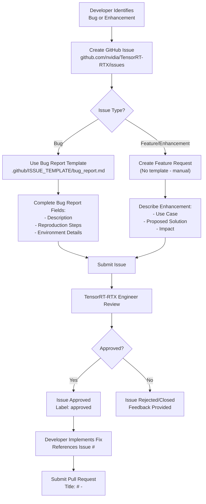
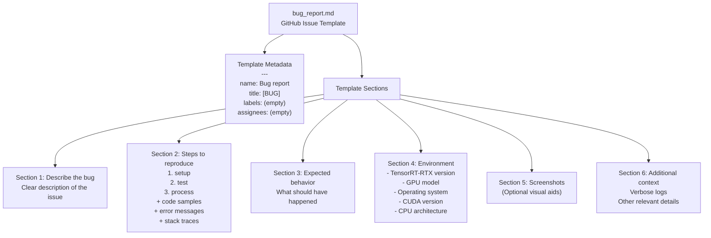
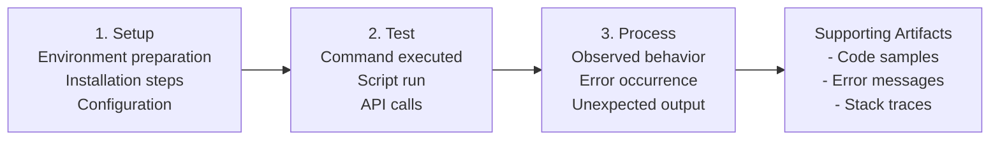
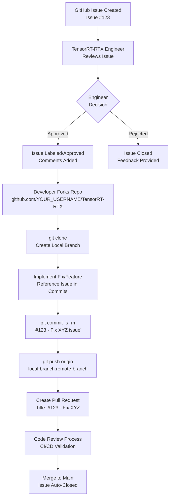

<!-- source: DeepWiki mcp.deepwiki.com · repo NVIDIA/TensorRT-RTX · page 7.3 Issue Templates and Bug Reporting · fetched 2026-10-26 -->

# Issue Templates and Bug Reporting

<details>
<summary>Relevant source files</summary>

The following files were used as context for generating this wiki page:

- [.github/ISSUE_TEMPLATE/bug_report.md](.github/ISSUE_TEMPLATE/bug_report.md)
- [CONTRIBUTING.md](CONTRIBUTING.md)

</details>


## Purpose and Scope

This document explains the issue tracking system for the TensorRT-RTX repository, including bug report templates, feature request processes, and the workflow for issue creation and approval. For information about the overall contribution process and pull request workflow, see [Contributing to TensorRT-RTX](#6.1). For details on code review and DCO requirements, also see [Contributing to TensorRT-RTX](#6.1).

## Overview

The TensorRT-RTX repository uses GitHub Issues as the central mechanism for tracking bugs, feature requests, and enhancement proposals. All code changes—whether bugfixes, enhancements, or new features—must originate from an approved GitHub Issue before proceeding to implementation and pull request submission.

**Sources:** [CONTRIBUTING.md:1-6]()

## Issue Tracking Workflow

The issue tracking process follows a structured workflow that ensures all changes are reviewed and approved before implementation begins.



**Key Requirements:**

- **Mandatory Issue Creation**: All enhancement, bugfix, or change requests must begin with a GitHub Issue ([CONTRIBUTING.md:5]())
- **Pre-Implementation Review**: Issues must be reviewed and approved by TensorRT-RTX engineers before code implementation begins ([CONTRIBUTING.md:6]())
- **Issue Reference in PRs**: Pull request commit titles must reference the corresponding issue number using the format `#<Issue Number> - <Commit Title>` ([CONTRIBUTING.md:51-57]())

**Sources:** [CONTRIBUTING.md:3-6](), [CONTRIBUTING.md:51-57]()

## Bug Report Template Structure

The repository provides a structured bug report template to ensure consistent and complete issue reporting. This template is located at `.github/ISSUE_TEMPLATE/bug_report.md` and is automatically presented when users create a new bug report.



**Sources:** [.github/ISSUE_TEMPLATE/bug_report.md:1-36]()

### Template Fields Reference

| Field | Required | Purpose | Line Reference |
|-------|----------|---------|----------------|
| **Describe the bug** | Yes | Concise description of the issue | [.github/ISSUE_TEMPLATE/bug_report.md:10-11]() |
| **Steps to reproduce** | Yes | Numbered list of reproduction steps, including setup, test execution, and process details | [.github/ISSUE_TEMPLATE/bug_report.md:13-18]() |
| **Expected behavior** | Yes | Clear description of what should have occurred | [.github/ISSUE_TEMPLATE/bug_report.md:20-21]() |
| **TensorRT-RTX version** | Yes | Specific version number or commit hash | [.github/ISSUE_TEMPLATE/bug_report.md:24]() |
| **GPU** | Yes | GPU model (e.g., RTX 4090, RTX 6000 Ada) | [.github/ISSUE_TEMPLATE/bug_report.md:25]() |
| **Operating system** | Yes | OS version (e.g., Ubuntu 24.04, Windows 11) | [.github/ISSUE_TEMPLATE/bug_report.md:26]() |
| **CUDA version** | Yes | CUDA runtime/toolkit version | [.github/ISSUE_TEMPLATE/bug_report.md:27]() |
| **CPU architecture** | Yes | x86_64, ARM64, etc. | [.github/ISSUE_TEMPLATE/bug_report.md:28]() |
| **Screenshots** | Optional | Visual evidence of the issue | [.github/ISSUE_TEMPLATE/bug_report.md:30-31]() |
| **Additional context** | Optional | Verbose logs, related issues, workarounds | [.github/ISSUE_TEMPLATE/bug_report.md:33-35]() |

**Sources:** [.github/ISSUE_TEMPLATE/bug_report.md:10-35]()

## Environment Information Requirements

The bug report template requires comprehensive environment details to ensure reproducibility and efficient debugging. This information is critical for TensorRT-RTX engineers to replicate issues in matching test environments.

### Required Environment Fields

**TensorRT-RTX Version** ([.github/ISSUE_TEMPLATE/bug_report.md:24]()):
- Specify the exact version number (e.g., `v1.3.0`)
- For development builds, provide the commit hash
- Indicate whether using the binary package or building from source

**GPU Model** ([.github/ISSUE_TEMPLATE/bug_report.md:25]()):
- Full GPU name including architecture generation
- Examples: `NVIDIA RTX 4090`, `NVIDIA A100`, `RTX 6000 Ada Generation`
- Include VRAM capacity if relevant to the issue

**Operating System** ([.github/ISSUE_TEMPLATE/bug_report.md:26]()):
- Distribution and version: `Ubuntu 24.04`, `Ubuntu 22.04`, `Windows 11`
- Kernel version for Linux systems (from `uname -r`)

**CUDA Version** ([.github/ISSUE_TEMPLATE/bug_report.md:27]()):
- CUDA toolkit version: `12.9`, `12.6`, etc.
- Driver version (from `nvidia-smi`)
- Both runtime and development versions if applicable

**CPU Architecture** ([.github/ISSUE_TEMPLATE/bug_report.md:28]()):
- Architecture type: `x86_64`, `ARM64`
- Useful for debugging platform-specific issues

**Sources:** [.github/ISSUE_TEMPLATE/bug_report.md:23-28]()

## Reproduction Steps Best Practices

The "Steps to reproduce" section is critical for enabling engineers to replicate and debug issues. The template provides a structured format for documenting reproduction procedures.



**Recommended Content:**

1. **Setup Phase** ([.github/ISSUE_TEMPLATE/bug_report.md:14]()):
   - Installation commands used
   - Configuration file modifications
   - Environment variable settings
   - Model or data preparation steps

2. **Test Execution** ([.github/ISSUE_TEMPLATE/bug_report.md:15]()):
   - Exact command line invocation
   - Script parameters and arguments
   - API calls with parameter values
   - Configuration options selected

3. **Process and Results** ([.github/ISSUE_TEMPLATE/bug_report.md:16]()):
   - What happened when the test executed
   - Error messages displayed
   - Unexpected behavior observed
   - System state changes

4. **Code Samples and Diagnostics** ([.github/ISSUE_TEMPLATE/bug_report.md:18]()):
   - Minimal reproducing code snippet
   - Complete error messages (not truncated)
   - Full stack traces
   - Verbose log output if available

**Sources:** [.github/ISSUE_TEMPLATE/bug_report.md:13-18]()

## Feature Request Process

While the repository provides a structured template for bug reports, feature requests and enhancement proposals are created manually without a predefined template. This allows for flexibility in describing new capabilities and improvements.

**Creating Feature Requests:**

1. Navigate to [TensorRT-RTX Issues](https://github.com/nvidia/TensorRT-RTX/issues)
2. Click "New issue"
3. Choose a blank issue (no template)
4. Include in the description:
   - **Use Case**: The problem or workflow being addressed
   - **Proposed Solution**: Detailed description of the enhancement
   - **Implementation Approach**: Technical considerations if applicable
   - **Impact**: Benefits and potential breaking changes
   - **Alternatives Considered**: Other approaches evaluated

**Review Process:**

Feature requests follow the same approval workflow as bug reports ([CONTRIBUTING.md:5-6]()):
- TensorRT-RTX engineers review the proposal
- Discussion may occur in issue comments
- Issue must be approved before implementation begins
- Approved issues proceed to pull request creation

**Sources:** [CONTRIBUTING.md:3-6]()

## Issue-to-Pull-Request Workflow

The integration between issues and pull requests ensures traceability and proper review sequencing.



**Commit Message Format** ([CONTRIBUTING.md:51-57]()):

```
#<Issue Number> - <Commit Title>

<Commit Body>
```

Example:
```
#123 - Fix memory leak in Engine::activate

The activation method was not properly releasing temporary
buffers. This commit adds explicit cleanup in the destructor.

Signed-off-by: Developer Name <dev@example.com>
```

**Sources:** [CONTRIBUTING.md:51-57](), [CONTRIBUTING.md:83-102]()

## Issue Template Metadata

The bug report template includes YAML frontmatter metadata that controls how GitHub presents the template in the issue creation interface.

**Template Configuration** ([.github/ISSUE_TEMPLATE/bug_report.md:1-8]()):

| Metadata Field | Value | Purpose |
|----------------|-------|---------|
| `name` | `Bug report` | Display name in template selection UI |
| `about` | `Create a report to help us improve` | Description shown to users |
| `title` | `[BUG] ` | Pre-filled title prefix for new issues |
| `labels` | ` ` (empty) | Labels to auto-apply (currently none) |
| `assignees` | ` ` (empty) | Users to auto-assign (currently none) |

The empty `labels` and `assignees` fields indicate that issue triage and assignment is performed manually by TensorRT-RTX engineers during the review process rather than being automated through the template.

**Sources:** [.github/ISSUE_TEMPLATE/bug_report.md:1-8]()

## Best Practices for Issue Reporting

### For Bug Reports

**Complete Environment Details:**
- Always fill all required fields in the Environment section
- Include driver versions from `nvidia-smi` output
- Specify exact package versions (TensorRT-RTX, Python dependencies)

**Reproducible Test Cases:**
- Provide minimal, self-contained code samples ([.github/ISSUE_TEMPLATE/bug_report.md:18]())
- Include complete error output, not just excerpts
- Attach verbose logs when available ([.github/ISSUE_TEMPLATE/bug_report.md:35]())
- Specify exact commands that trigger the issue

**Clear Descriptions:**
- Distinguish between observed behavior and expected behavior
- Use screenshots for UI or visualization issues ([.github/ISSUE_TEMPLATE/bug_report.md:30-31]())
- Include relevant configuration file contents

### For Feature Requests

**Justify the Enhancement:**
- Explain the use case and motivation
- Describe current limitations or gaps
- Provide examples of how the feature would be used

**Technical Detail:**
- Suggest implementation approaches when possible
- Identify potential compatibility concerns
- Reference similar features in other frameworks

**Consider Impact:**
- Describe benefits to the TensorRT-RTX ecosystem
- Identify any breaking changes
- Propose migration strategies if applicable

**Sources:** [.github/ISSUE_TEMPLATE/bug_report.md:10-35](), [CONTRIBUTING.md:46-49]()

## Issue Review and Approval Timeline

The review process follows these general guidelines:

1. **Initial Triage**: TensorRT-RTX engineers review new issues regularly
2. **Clarification**: Engineers may request additional information or reproduction steps
3. **Approval Decision**: Issues are approved, rejected, or marked for further discussion
4. **Implementation**: Once approved, developers may begin work on pull requests

**Note**: The CONTRIBUTING.md document ([CONTRIBUTING.md:102]()) states "there is no CI/CD process in place yet" for automatic validation. While this statement refers to the historical state, the repository now has a complete CI/CD system as documented in [CI/CD System](#3). However, the manual review and approval process for issues remains a requirement regardless of CI automation.

**Sources:** [CONTRIBUTING.md:3-6](), [CONTRIBUTING.md:98-102]()