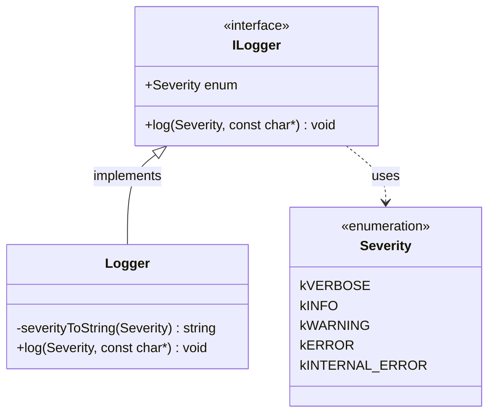
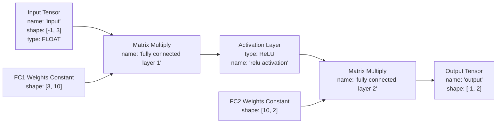
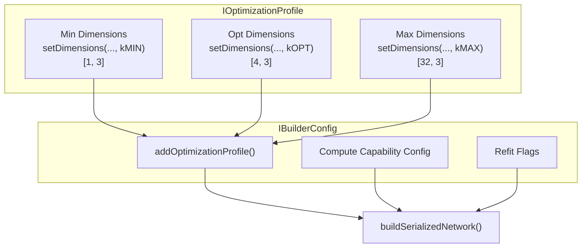
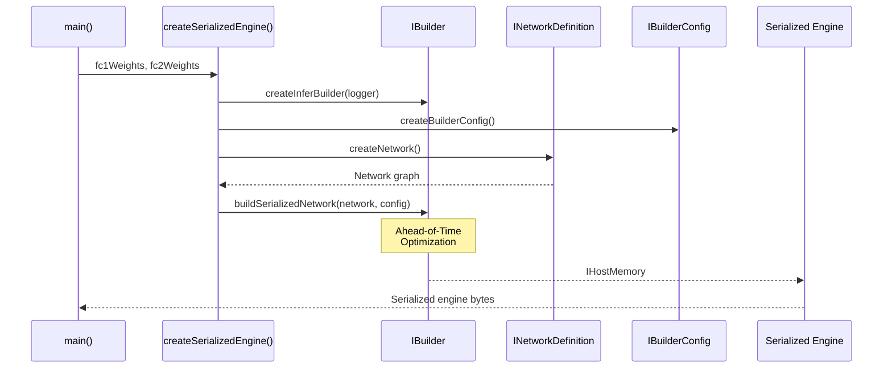
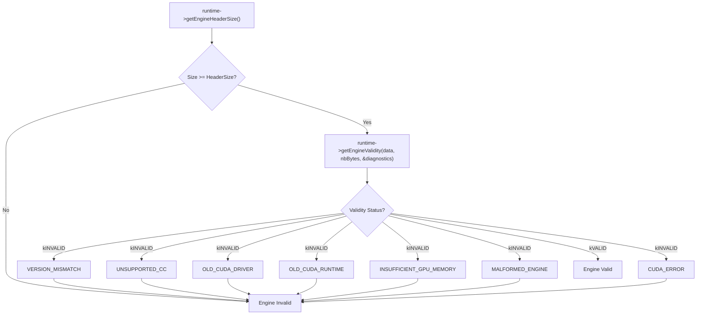
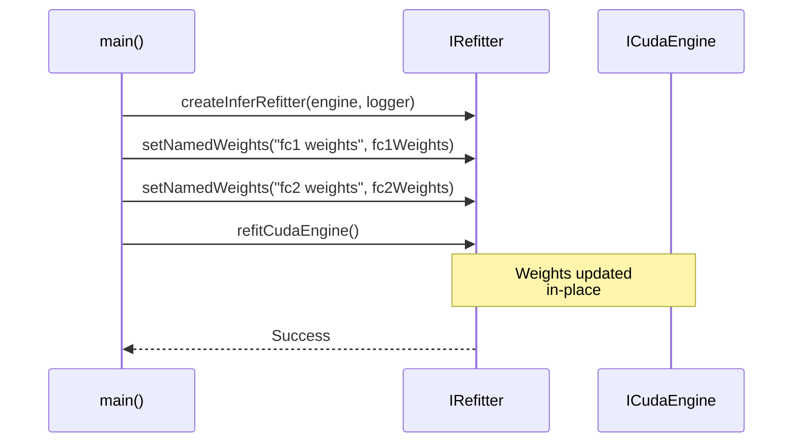
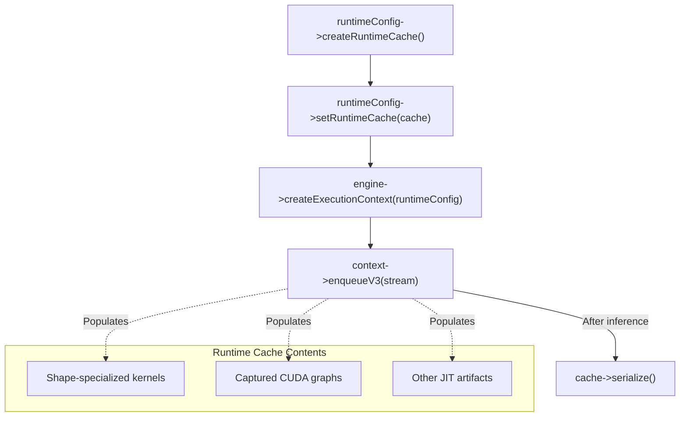
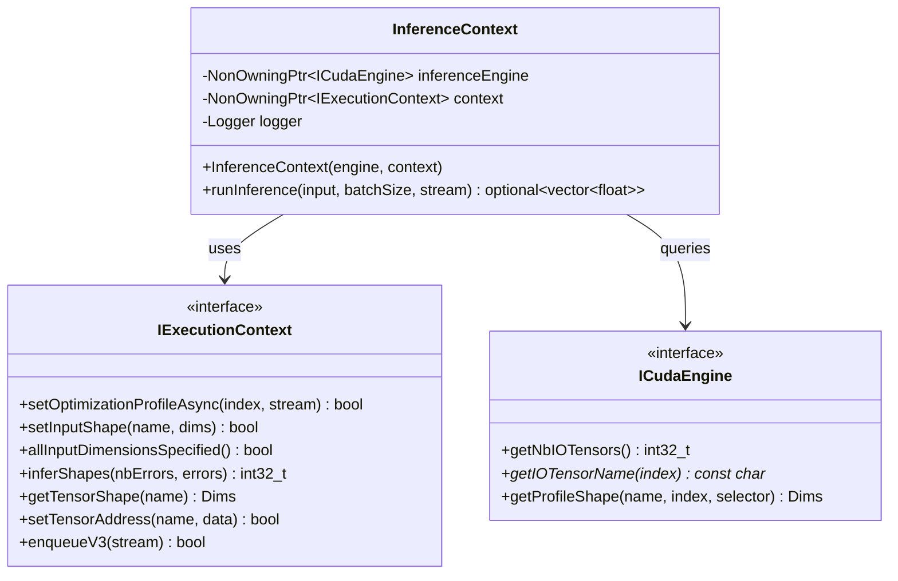
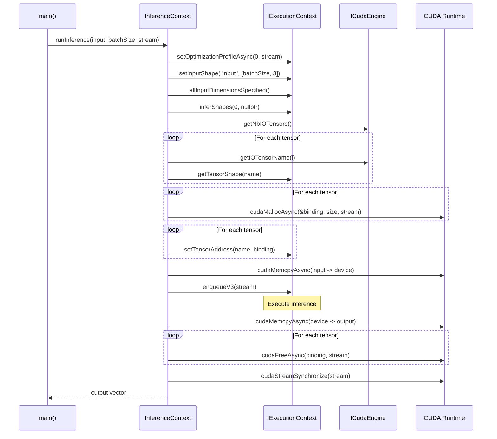

<!-- source: DeepWiki mcp.deepwiki.com · repo NVIDIA/TensorRT-RTX · extra page C++ API Usage Sample · fetched 2026-10-26 -->

# C++ API Usage Sample

<details>
<summary>Relevant source files</summary>

The following files were used as context for generating this wiki page:

- [.github/workflows/build.py](.github/workflows/build.py)
- [samples/apiUsage/cpp/apiUsage.cpp](samples/apiUsage/cpp/apiUsage.cpp)

</details>


## Purpose and Scope

This document provides a detailed walkthrough of the C++ API Usage Sample, which demonstrates the fundamental TensorRT-RTX C++ API patterns for building, optimizing, and executing neural network inference engines. The sample covers the complete engine lifecycle from network definition through inference execution, including advanced features like dynamic shapes, weight refitting, and runtime caching.

This sample is located at [samples/apiUsage/cpp/apiUsage.cpp]() and serves as a practical reference for developers integrating TensorRT-RTX into C++ applications. For information about building this sample, see [3.2](#3.2). For the Python equivalent, see [4.2.2](#4.2.2). For detailed API concepts used in production pipelines, see [5.1](#5.1).

**Sources:** [samples/apiUsage/cpp/apiUsage.cpp:1-654]()

## Sample Overview

The C++ API Usage Sample demonstrates a complete inference workflow using a simple two-layer fully connected neural network with dynamic batch dimensions. The sample creates a network with one hidden layer, builds it into an optimized TensorRT engine, performs weight refitting, and executes inference across multiple batch sizes.

### Network Architecture

The sample implements a minimal neural network with the following structure:

| Component | Input Shape | Output Shape | Description |
|-----------|-------------|--------------|-------------|
| Input Layer | `[batch, 3]` | - | Dynamic batch dimension |
| FC1 (Fully Connected 1) | `[batch, 3]` | `[batch, 10]` | Matrix multiply with weights |
| ReLU Activation | `[batch, 10]` | `[batch, 10]` | Non-linear activation |
| FC2 (Fully Connected 2) | `[batch, 10]` | `[batch, 2]` | Output layer |

The batch dimension is dynamic, supporting sizes from 1 to 32 with an optimum size of 4.

**Sources:** [samples/apiUsage/cpp/apiUsage.cpp:60-68](), [samples/apiUsage/cpp/apiUsage.cpp:149-196]()

## High-Level Workflow

```mermaid
flowchart TB
    subgraph "Ahead-of-Time (AOT) Compilation"
        CreateLogger["Create Logger<br/>Logger class"]
        CreateWeights["Initialize Weights<br/>WeightsData struct"]
        CreateBuilder["Create IBuilder<br/>createInferBuilder()"]
        CreateConfig["Create IBuilderConfig<br/>createBuilderConfig()"]
        DefineNetwork["Define Network<br/>createNetwork()"]
        BuildEngine["Build Serialized Engine<br/>buildSerializedNetwork()"]
        SerializedEngine["IHostMemory<br/>Serialized Engine"]
    end
    
    subgraph "Runtime Initialization"
        CreateRuntime["Create IRuntime<br/>createInferRuntime()"]
        ValidateEngine["Validate Engine<br/>getEngineValidity()"]
        DeserializeEngine["Deserialize Engine<br/>deserializeCudaEngine()"]
        CreateRefitter["Create IRefitter<br/>createInferRefitter()"]
        RefitWeights["Refit Weights<br/>refitCudaEngine()"]
        InferenceEngine["ICudaEngine<br/>Ready for Inference"]
    end
    
    subgraph "Just-in-Time (JIT) Compilation"
        CreateRuntimeConfig["Create IRuntimeConfig<br/>createRuntimeConfig()"]
        CreateRuntimeCache["Create IRuntimeCache<br/>createRuntimeCache()"]
        ConfigureDynamicShapes["Configure Dynamic Shapes<br/>setDynamicShapesKernelSpecializationStrategy()"]
        ConfigureCudaGraphs["Configure CUDA Graphs<br/>setCudaGraphStrategy()"]
        CreateContext["Create IExecutionContext<br/>createExecutionContext()"]
    end
    
    subgraph "Inference Execution"
        SetProfile["Set Optimization Profile<br/>setOptimizationProfileAsync()"]
        SetInputShape["Set Input Shape<br/>setInputShape()"]
        AllocateMemory["Allocate GPU Memory<br/>cudaMallocAsync()"]
        SetTensorAddress["Set Tensor Addresses<br/>setTensorAddress()"]
        CopyToDevice["Copy Input to Device<br/>cudaMemcpyAsync()"]
        EnqueueInference["Execute Inference<br/>enqueueV3()"]
        CopyToHost["Copy Output to Host<br/>cudaMemcpyAsync()"]
    end
    
    CreateLogger --> CreateWeights
    CreateWeights --> CreateBuilder
    CreateBuilder --> CreateConfig
    CreateConfig --> DefineNetwork
    DefineNetwork --> BuildEngine
    BuildEngine --> SerializedEngine
    
    SerializedEngine --> CreateRuntime
    CreateRuntime --> ValidateEngine
    ValidateEngine --> DeserializeEngine
    DeserializeEngine --> CreateRefitter
    CreateRefitter --> RefitWeights
    RefitWeights --> InferenceEngine
    
    InferenceEngine --> CreateRuntimeConfig
    CreateRuntimeConfig --> CreateRuntimeCache
    CreateRuntimeCache --> ConfigureDynamicShapes
    ConfigureDynamicShapes --> ConfigureCudaGraphs
    ConfigureCudaGraphs --> CreateContext
    
    CreateContext --> SetProfile
    SetProfile --> SetInputShape
    SetInputShape --> AllocateMemory
    AllocateMemory --> SetTensorAddress
    SetTensorAddress --> CopyToDevice
    CopyToDevice --> EnqueueInference
    EnqueueInference --> CopyToHost
```



**Diagram: Complete TensorRT-RTX Engine Lifecycle and Inference Pipeline**

This diagram illustrates the three major phases: AOT compilation (network building), runtime initialization (engine loading and refitting), and JIT compilation/execution (context creation and inference).

**Sources:** [samples/apiUsage/cpp/apiUsage.cpp:444-653]()

## Core Components

### Logger Implementation

The `Logger` class is a required implementation of the `nvinfer1::ILogger` interface. All TensorRT-RTX API calls require a logger instance for diagnostic output.



**Diagram: Logger Class Hierarchy**

The sample's `Logger` implementation converts severity levels to human-readable strings and outputs messages to standard output.

**Sources:** [samples/apiUsage/cpp/apiUsage.cpp:31-58]()

### Weights Data Management

The `WeightsData` struct manages the host memory backing for network weights. This data must remain valid throughout the engine build and refit process.

| Member | Type | Size | Initialization |
|--------|------|------|----------------|
| `fc1WeightsData` | `std::vector<float>` | 3 × 10 = 30 | All values 1.0f |
| `fc2WeightsData` | `std::vector<float>` | 10 × 2 = 20 | All values 1.0f |

The `nvinfer1::Weights` structures reference this data without taking ownership.

**Sources:** [samples/apiUsage/cpp/apiUsage.cpp:135-147](), [samples/apiUsage/cpp/apiUsage.cpp:451-455]()

## Network Definition

### Creating the Network Graph

The `createNetwork()` function constructs a strongly-typed network definition using TensorRT's layer API:



**Diagram: Network Graph Structure**

The network uses `-1` for the batch dimension to indicate dynamic sizing.

**Sources:** [samples/apiUsage/cpp/apiUsage.cpp:149-196]()

### Network Creation Flags

The sample explicitly sets the `kSTRONGLY_TYPED` flag when creating the network:

```cpp
nvinfer1::NetworkDefinitionCreationFlags flags = 1U
    << static_cast<uint32_t>(nvinfer1::NetworkDefinitionCreationFlag::kSTRONGLY_TYPED);
```

This flag is required by TensorRT-RTX to ensure type safety and proper precision handling.

**Sources:** [samples/apiUsage/cpp/apiUsage.cpp:154-156]()

### Naming Conventions

The sample demonstrates proper naming for debugging and refitting:

| API Call | Purpose | Example Name |
|----------|---------|--------------|
| `addInput()` | Define tensor binding names | `"input"` |
| `setName()` | Name layers for debugging | `"fully connected layer 1"` |
| `setWeightsName()` | Name weights for refitting | `"fc1 weights"`, `"fc2 weights"` |
| `markOutput()` | Define output tensors | `"output"` |

**Sources:** [samples/apiUsage/cpp/apiUsage.cpp:163-193]()

## Builder Configuration

### Optimization Profiles for Dynamic Shapes

The `createBuilderConfig()` function configures optimization profiles that define the range of valid input shapes:



**Diagram: Builder Configuration Components**

The optimization profile tells TensorRT to optimize primarily for batch size 4 while supporting the range [1, 32].

**Sources:** [samples/apiUsage/cpp/apiUsage.cpp:72-85]()

### Compute Capability Configuration

The sample demonstrates three approaches to compute capability configuration:

| Strategy | Code Flag | Use Case | Compute Capabilities |
|----------|-----------|----------|---------------------|
| Current GPU | `kCURRENT` | Local/AOT compilation | Current GPU only |
| Default | Not set | Cross-platform deployment | Ampere and later (SM80+) |
| Explicit List | `kSM89`, `kSM120` | Targeted deployment | Ada and Blackwell |
| Turing Support | `kSM75` | Legacy GPU support | Turing (SM75) |

The default behavior (when not set explicitly) supports all RTX GPUs from Ampere onwards:

```cpp
// Setting kCURRENT provides fastest AOT compilation
builderConfig->setNbComputeCapabilities(1);
builderConfig->setComputeCapability(nvinfer1::ComputeCapability::kCURRENT, 0);
```

**Sources:** [samples/apiUsage/cpp/apiUsage.cpp:87-121]()

### Refit Flags

The sample enables weight refitting by setting two builder flags:

```cpp
builderConfig->setFlag(nvinfer1::BuilderFlag::kSTRIP_PLAN);
builderConfig->setFlag(nvinfer1::BuilderFlag::kREFIT);
```

- `kSTRIP_PLAN`: Removes weights from the serialized engine, reducing size
- `kREFIT`: Allows weights to be updated after engine creation

**Sources:** [samples/apiUsage/cpp/apiUsage.cpp:123-130]()

## Engine Building and Serialization

### AOT Compilation

The `createSerializedEngine()` function performs ahead-of-time compilation:



**Diagram: Engine Building Sequence**

AOT compilation analyzes the network graph and generates an optimized execution plan but does not perform GPU-specific JIT compilation.

**Sources:** [samples/apiUsage/cpp/apiUsage.cpp:198-239](), [samples/apiUsage/cpp/apiUsage.cpp:456-463]()

### Serialization Format

The serialized engine is returned as an `IHostMemory` object with the following interface:

| Method | Return Type | Purpose |
|--------|-------------|---------|
| `data()` | `void*` | Pointer to serialized bytes |
| `size()` | `size_t` | Total size in bytes |
| `type()` | `DataType` | Memory type (CPU/GPU) |

This can be saved to disk and loaded in subsequent runs to avoid rebuilding.

**Sources:** [samples/apiUsage/cpp/apiUsage.cpp:236-238](), [samples/apiUsage/cpp/apiUsage.cpp:638-650]()

## Runtime and Engine Validation

### Engine Validation

Before deserializing, the sample validates the engine header:



**Diagram: Engine Validation Process**

The `diagnostics` bitmask provides detailed failure reasons using the `nvinfer1::EngineInvalidityDiagnostics` enum.

**Sources:** [samples/apiUsage/cpp/apiUsage.cpp:472-506]()

### Deserialization

Engine deserialization is performed by the runtime:

```cpp
auto inferenceEngine = std::unique_ptr<nvinfer1::ICudaEngine>(
    runtime->deserializeCudaEngine(serializedEngine->data(), serializedEngine->size()));
```

This validates the engine format and prepares it for weight refitting and context creation.

**Sources:** [samples/apiUsage/cpp/apiUsage.cpp:508-515]()

## Weight Refitting

### Refitter API

The sample demonstrates updating weights without rebuilding the engine:



**Diagram: Weight Refitting Sequence**

The refitter uses the names assigned via `setWeightsName()` during network creation to identify which weights to update.

**Sources:** [samples/apiUsage/cpp/apiUsage.cpp:517-540]()

### Refit Requirements

For successful refitting:

1. Engine must be built with `kREFIT` flag
2. Engine built with `kSTRIP_PLAN` contains no weights (must be refitted before use)
3. Weight names must match those specified in network definition
4. Weight dimensions and types must match original network

**Sources:** [samples/apiUsage/cpp/apiUsage.cpp:123-130](), [samples/apiUsage/cpp/apiUsage.cpp:174-175](), [samples/apiUsage/cpp/apiUsage.cpp:526-532]()

## Runtime Configuration

### Runtime Cache

The runtime cache stores JIT-compiled GPU kernels for reuse:



**Diagram: Runtime Cache Lifecycle**

The cache can be serialized and saved to disk to avoid JIT recompilation on subsequent runs.

**Sources:** [samples/apiUsage/cpp/apiUsage.cpp:550-564](), [samples/apiUsage/cpp/apiUsage.cpp:641-650]()

### Dynamic Shapes Kernel Specialization

The sample configures the kernel specialization strategy:

| Strategy | Behavior | Use Case |
|----------|----------|----------|
| `kLAZY` (default) | Run fallback kernel, compile specialized kernel in background | Balance performance and latency |
| `kEAGER` | Always compile specialized kernel before inference | Maximum performance |
| `kNONE` | Always use fallback kernel | Minimize compilation overhead |

```cpp
runtimeConfig->setDynamicShapesKernelSpecializationStrategy(
    nvinfer1::DynamicShapesKernelSpecializationStrategy::kLAZY);
```

**Sources:** [samples/apiUsage/cpp/apiUsage.cpp:426-441]()

### CUDA Graph Strategy

The sample enables whole graph capture for reduced kernel launch overhead:

| Strategy | Behavior | Performance Impact |
|----------|----------|-------------------|
| `kDISABLED` | No graph capture, direct stream execution | Baseline |
| `kWHOLE_GRAPH_CAPTURE` | Capture entire model as CUDA graph | Reduced launch overhead |

```cpp
runtimeConfig->setCudaGraphStrategy(nvinfer1::CudaGraphStrategy::kWHOLE_GRAPH_CAPTURE);
```

CUDA graphs are captured automatically after shape-specialized kernels are ready.

**Sources:** [samples/apiUsage/cpp/apiUsage.cpp:567-583]()

## Execution Context and Inference

### JIT Compilation

Creating the execution context triggers JIT compilation:

```cpp
auto context = std::unique_ptr<nvinfer1::IExecutionContext>(
    inferenceEngine->createExecutionContext(runtimeConfig.get()));
```

This phase is faster than AOT compilation and targets the current GPU specifically.

**Sources:** [samples/apiUsage/cpp/apiUsage.cpp:585-594]()

### Inference Execution Wrapper

The `InferenceContext` struct encapsulates the inference execution logic:



**Diagram: Inference Context Class Structure**

**Sources:** [samples/apiUsage/cpp/apiUsage.cpp:256-268](), [samples/apiUsage/cpp/apiUsage.cpp:282-400]()

### Inference Execution Steps

The `runInference()` method performs the following operations:



**Diagram: Inference Execution Sequence**

**Sources:** [samples/apiUsage/cpp/apiUsage.cpp:289-400]()

### Dynamic Shape Handling

For each inference call, the runtime shape must be configured:

```cpp
// Select optimization profile (index 0)
context->setOptimizationProfileAsync(0, stream);

// Set actual runtime input shape
context->setInputShape("input", nvinfer1::Dims2{batchSize, kInputSize});

// Verify all shapes are specified
if (!context->allInputDimensionsSpecified()) {
    // Error handling
}

// Infer output shapes based on input
context->inferShapes(0, nullptr);
```

The sample runs inference with five different batch sizes: 1, 2, 4, 18, and 32.

**Sources:** [samples/apiUsage/cpp/apiUsage.cpp:292-316](), [samples/apiUsage/cpp/apiUsage.cpp:600-631]()

### Memory Management

The sample uses CUDA stream-ordered memory operations for efficient GPU memory management:

| Operation | API Call | Purpose |
|-----------|----------|---------|
| Allocate | `cudaMallocAsync()` | Allocate GPU memory on stream |
| Copy to device | `cudaMemcpyAsync(..., cudaMemcpyHostToDevice)` | Transfer input data |
| Copy to host | `cudaMemcpyAsync(..., cudaMemcpyDeviceToHost)` | Transfer output data |
| Free | `cudaFreeAsync()` | Release GPU memory on stream |
| Synchronize | `cudaStreamSynchronize()` | Wait for all operations to complete |

All memory operations are asynchronous and ordered by the CUDA stream.

**Sources:** [samples/apiUsage/cpp/apiUsage.cpp:355-397]()

### Tensor Address Binding

Before inference, tensor addresses must be bound:

```cpp
// For each I/O tensor
for (int32_t i = 0; i < nbIOTensors; ++i) {
    context->setTensorAddress(tensorNames[i].c_str(), bindings[i]);
}

// Execute inference
bool success = context->enqueueV3(stream);
```

The `enqueueV3()` method is the primary inference execution API.

**Sources:** [samples/apiUsage/cpp/apiUsage.cpp:364-385]()

## Advanced Features

### Profile Dimension Queries

The sample demonstrates querying optimization profile dimensions:

```cpp
nvinfer1::Dims minShape = inferenceEngine->getProfileShape(
    tensorName, profileIndex, nvinfer1::OptProfileSelector::kMIN);
nvinfer1::Dims optShape = inferenceEngine->getProfileShape(
    tensorName, profileIndex, nvinfer1::OptProfileSelector::kOPT);
nvinfer1::Dims maxShape = inferenceEngine->getProfileShape(
    tensorName, profileIndex, nvinfer1::OptProfileSelector::kMAX);
```

This is useful for validating runtime shapes against the profile constraints.

**Sources:** [samples/apiUsage/cpp/apiUsage.cpp:405-424]()

### Multi-Batch Inference

The sample demonstrates running inference with varying batch sizes:

```cpp
std::vector<int32_t> batchSizes = {
    kMinBatchSize,                           // 1
    (kMinBatchSize + kOptBatchSize) / 2,     // 2
    kOptBatchSize,                           // 4
    (kOptBatchSize + kMaxBatchSize) / 2,     // 18
    kMaxBatchSize                            // 32
};

for (int32_t batchSize : batchSizes) {
    // Run inference with this batch size
}
```

This tests the dynamic shape handling across the full range of the optimization profile.

**Sources:** [samples/apiUsage/cpp/apiUsage.cpp:600-631]()

## Building the Sample

The sample is built using CMake as part of the CI workflow:

```bash
cmake -B build -S samples -DTRTRTX_INSTALL_DIR=/opt/tensorrt_rtx
cmake --build build
```

This generates the `apiUsage` executable in the build directory. For detailed build instructions, see [3.2](#3.2).

**Sources:** [.github/workflows/build.py:20-24]()

## Key Takeaways

The C++ API Usage Sample demonstrates the following essential patterns:

1. **Logger Implementation**: Custom `ILogger` implementation is required for all TensorRT-RTX operations
2. **Strongly-Typed Networks**: Networks must be created with `kSTRONGLY_TYPED` flag
3. **Dynamic Shapes**: Optimization profiles define min/opt/max dimensions for dynamic inputs
4. **Two-Phase Compilation**: AOT phase (build) + JIT phase (context creation)
5. **Weight Refitting**: Enables weight updates without rebuilding the entire engine
6. **Runtime Caching**: JIT-compiled kernels can be cached and reused
7. **Stream-Ordered Operations**: All GPU operations use asynchronous CUDA streams
8. **CUDA Graph Optimization**: Whole-graph capture reduces kernel launch overhead

These patterns form the foundation for production TensorRT-RTX applications. For real-world usage in complex pipelines, see [4.1.2](#4.1.2).

**Sources:** [samples/apiUsage/cpp/apiUsage.cpp:1-654]()

---

