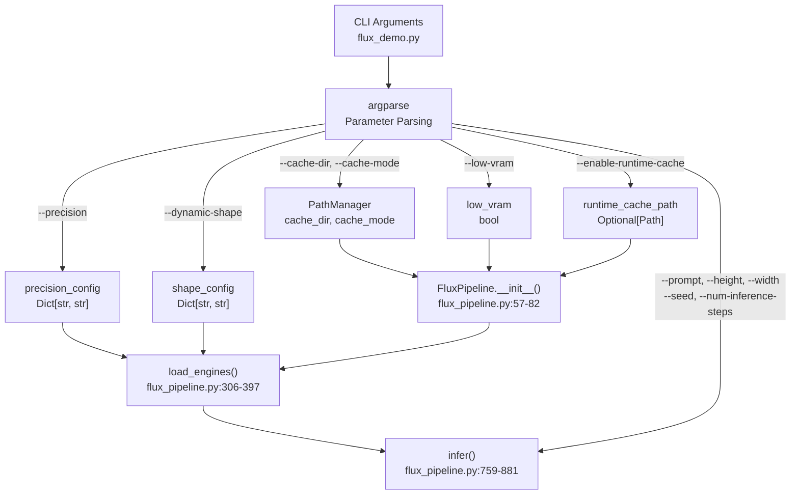
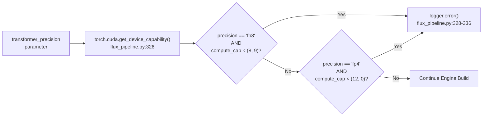
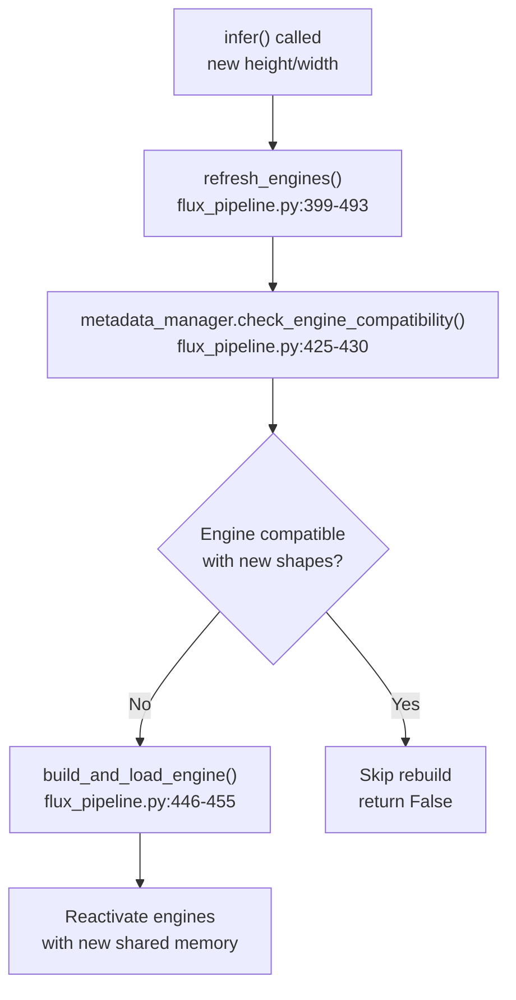
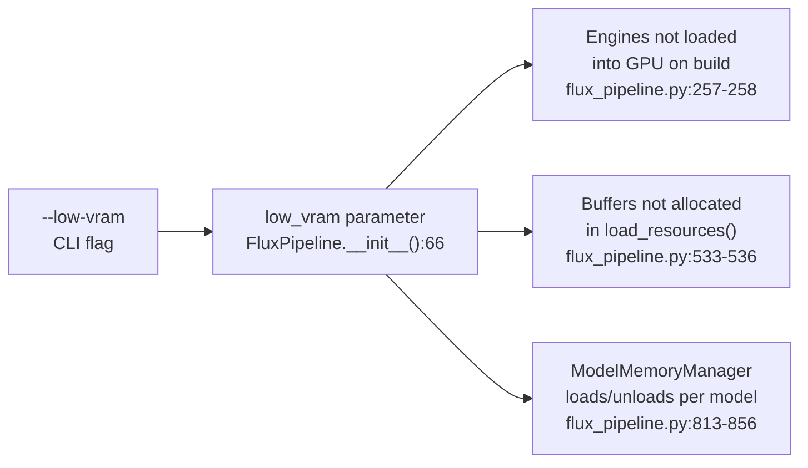
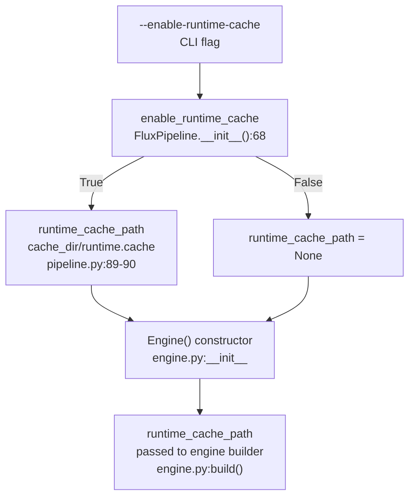

<!-- source: DeepWiki mcp.deepwiki.com · repo NVIDIA/TensorRT-RTX · extra page Flux Demo Configuration · fetched 2026-10-26 -->

# Flux Demo Configuration

<details>
<summary>Relevant source files</summary>

The following files were used as context for generating this wiki page:

- [demo/README.md](demo/README.md)
- [demo/flux1.dev/pipelines/flux_pipeline.py](demo/flux1.dev/pipelines/flux_pipeline.py)
- [demo/flux1.dev/requirements.txt](demo/flux1.dev/requirements.txt)

</details>


This document provides comprehensive documentation of all configuration options available in the Flux.1 text-to-image demo. These settings control precision modes, shape behavior, memory management, caching strategies, and image generation parameters. For information about the internal architecture and implementation of the Flux pipeline, see [Flux Pipeline Architecture](#4.1.2). For general usage and quick start instructions, see [Quick Start Guide](#2.2).

## Configuration Overview

The Flux demo exposes configuration options through three interfaces: CLI arguments, direct Python API parameters, and environment-level settings. These configurations control four primary subsystems: precision and quantization, shape handling, memory management, and runtime optimization.

**Configuration Flow: CLI to Pipeline Initialization**



Sources: [demo/flux1.dev/pipelines/flux_pipeline.py:54-102](), [demo/README.md:40-76]()

## Precision Configuration

Precision modes control the numerical precision used by the Transformer model during inference. The setting directly impacts memory usage, inference speed, and GPU compatibility. Other models (CLIP, T5, VAE) use fixed precisions optimized for their respective architectures.

### Supported Precision Modes

| Precision | Data Type | GPU Architecture | Compute Capability | Default VRAM | Low-VRAM Mode |
|-----------|-----------|------------------|-------------------|--------------|---------------|
| `bf16` | BFloat16 | Ampere, Ada, Blackwell | ≥ 8.0 | 32.1 GB | 23.1 GB |
| `fp8` | Float8 | Ada, Blackwell | ≥ 8.9 | 21.6 GB | 12.0 GB |
| `fp4` | Float4 | Blackwell | ≥ 12.0 | 20.5 GB | 11.0 GB |

**CLI Usage:**
```bash
# FP8 (default, Ada/Blackwell GPUs)
python demo/flux1.dev/flux_demo.py --hf-token TOKEN --precision fp8

# BF16 (compatible with Ampere GPUs)
python demo/flux1.dev/flux_demo.py --hf-token TOKEN --precision bf16

# FP4 (Blackwell GPUs only)
python demo/flux1.dev/flux_demo.py --hf-token TOKEN --precision fp4
```

**Python API:**
```python
from pipelines.flux_pipeline import FluxPipeline

pipeline = FluxPipeline(cache_dir="./demo_cache", hf_token=token)
pipeline.load_engines(transformer_precision="fp8")  # Configures Transformer precision
```

### Precision Validation

The `load_engines()` method validates precision compatibility with the GPU's compute capability:



Sources: [demo/flux1.dev/pipelines/flux_pipeline.py:326-336](), [demo/README.md:122-157]()

### Model-Specific Precision Assignment

While the Transformer precision is configurable, other models use fixed precisions defined in the model registry:

| Model Role | Precision | Rationale |
|------------|-----------|-----------|
| `clip_text_encoder` | bf16 | Text encoding doesn't benefit from quantization |
| `t5_text_encoder` | bf16 | Maintains embedding quality |
| `transformer` | User-configured | Main compute-intensive component |
| `vae_decoder` | bf16 | Preserves image decoding quality |

The `precision_config` dictionary in `FluxPipeline` stores these mappings and is initialized during `load_engines()` at [flux_pipeline.py:347]().

Sources: [demo/flux1.dev/pipelines/flux_pipeline.py:103-112](), [demo/flux1.dev/pipelines/flux_pipeline.py:347]()

## Shape Mode Configuration

Shape modes determine whether TensorRT engines are compiled for specific input dimensions (static) or support variable dimensions (dynamic). This affects compilation time, runtime performance, and flexibility.

### Static vs Dynamic Shapes

**Static Shape Mode (Default):**
- Engines compiled for exact `opt_height` × `opt_width` dimensions
- Fastest inference performance
- Requires recompilation if dimensions change
- Lower VRAM usage during compilation

**Dynamic Shape Mode:**
- Engines support variable dimensions within a range
- More flexibility without recompilation
- Slightly higher VRAM usage
- JIT compilation of shape-specific kernels on first use

```mermaid
graph TD
    subgraph "Static Shape Mode (shape_mode='static')"
        STATIC_BUILD["Engine Build<br/>Fixed shapes only"]
        STATIC_OPT["Optimized for<br/>512×512"]
        STATIC_INFER["Inference at 512×512<br/>Maximum Performance"]
        STATIC_CHANGE["Resolution Change<br/>e.g., 1024×1024"]
        STATIC_REBUILD["Rebuild Required<br/>refresh_engines()"]
        
        STATIC_BUILD --> STATIC_OPT
        STATIC_OPT --> STATIC_INFER
        STATIC_INFER --> STATIC_CHANGE
        STATIC_CHANGE --> STATIC_REBUILD
    end
    
    subgraph "Dynamic Shape Mode (shape_mode='dynamic')"
        DYN_BUILD["Engine Build<br/>Range: 256-1024 per dim"]
        DYN_FIRST["First Inference 512×512<br/>JIT kernel compilation"]
        DYN_INFER["Inference at 512×512<br/>Cached kernel"]
        DYN_CHANGE["Resolution Change<br/>e.g., 1024×1024"]
        DYN_JIT["JIT compile new kernel<br/>No rebuild needed"]
        
        DYN_BUILD --> DYN_FIRST
        DYN_FIRST --> DYN_INFER
        DYN_INFER --> DYN_CHANGE
        DYN_CHANGE --> DYN_JIT
    end
```



**CLI Usage:**
```bash
# Static shapes (default)
python demo/flux1.dev/flux_demo.py --hf-token TOKEN --height 512 --width 512

# Dynamic shapes
python demo/flux1.dev/flux_demo.py --hf-token TOKEN --dynamic-shape --height 512 --width 512
```

**Python API:**
```python
# Static mode
pipeline.load_engines(
    transformer_precision="fp8",
    opt_height=512,
    opt_width=512,
    shape_mode="static"
)

# Dynamic mode
pipeline.load_engines(
    transformer_precision="fp8",
    opt_height=512,
    opt_width=512,
    shape_mode="dynamic"
)
```

### VAE Decoder Shape Optimization

When dynamic shape mode is enabled for the pipeline, the VAE decoder is automatically set to static shape mode to reduce VRAM consumption. This optimization occurs in `load_engines()`:

```python
# VAE Decoder set to static shape to reduce VRAM usage
if shape_mode == "dynamic":
    logger.info("Setting VAE Decoder to static shape to reduce VRAM usage")
    shape_config["vae_decoder"] = "static"
```

Sources: [demo/flux1.dev/pipelines/flux_pipeline.py:362-364](), [demo/README.md:62-68](), [demo/README.md:164-172]()

### Engine Refresh Mechanism

The `refresh_engines()` method detects when input shapes change and triggers selective recompilation:



Sources: [demo/flux1.dev/pipelines/flux_pipeline.py:399-493](), [demo/flux1.dev/pipelines/flux_pipeline.py:805]()

## Memory Management Configuration

Memory management encompasses both GPU VRAM optimization and disk cache management. These settings enable the demo to run on GPUs with varying memory capacities.

### VRAM Management (Low-VRAM Mode)

The `low_vram` flag enables dynamic loading and unloading of models during inference, trading increased inference time for reduced peak VRAM usage.

**Configuration Mapping:**



**Behavior Details:**

| Mode | Default | Low-VRAM |
|------|---------|----------|
| Engine GPU Loading | All engines loaded at `load_engines()` | Engines loaded on-demand via `ModelMemoryManager` |
| Buffer Allocation | Pre-allocated in `load_resources()` | Allocated per-model during inference |
| Workspace Memory | Shared across all models | Per-model allocation |
| Inference Speed | Fastest | ~20-30% slower |
| Peak VRAM (FP8) | 21.6 GB | 12.0 GB |

**Implementation:**

The `ModelMemoryManager` context manager handles dynamic loading:

```python
# In infer() method
with self.model_memory_manager("t5_text_encoder", self.low_vram):
    t5_embeds = self.encode_prompt(prompt, "t5_text_encoder")
# Model automatically unloaded after block if low_vram=True
```

Sources: [demo/flux1.dev/pipelines/flux_pipeline.py:66](), [demo/flux1.dev/pipelines/flux_pipeline.py:179-192](), [demo/flux1.dev/pipelines/flux_pipeline.py:257-258](), [demo/flux1.dev/pipelines/flux_pipeline.py:533-536](), [demo/flux1.dev/pipelines/flux_pipeline.py:813-856](), [demo/README.md:176-182]()

### Disk Cache Management

Cache modes control disk space usage for downloaded models and compiled TensorRT engines.

**Cache Modes:**

| Mode | Behavior | Use Case |
|------|----------|----------|
| `full` (default) | Retains all models, ONNX files, and engines | Development, repeated runs with different configs |
| `lean` | Automatically removes unused models | Limited disk space environments |

**Cache Directory Structure:**

```
demo_cache/
├── shared/
│   ├── onnx/{model_id}/{precision}/           # ONNX model files
│   │   └── model.onnx
│   └── engines/{model_id}/{precision}/        # TensorRT engines
│       ├── {shape_mode}/
│       │   ├── model.engine
│       │   └── model.metadata.json
├── runtime.cache                              # JIT kernel cache (if enabled)
└── .cache_state.json                          # Usage tracking metadata
```

**CLI Usage:**
```bash
# Full cache mode (default)
python demo/flux1.dev/flux_demo.py --hf-token TOKEN --cache-dir ./my_cache --cache-mode full

# Lean cache mode
python demo/flux1.dev/flux_demo.py --hf-token TOKEN --cache-dir ./my_cache --cache-mode lean
```

**Python API:**
```python
pipeline = FluxPipeline(
    cache_dir="./demo_cache",
    cache_mode="lean",
    hf_token=token
)
```

Sources: [demo/README.md:184-200](), [demo/README.md:71-75](), [demo/flux1.dev/pipelines/flux_pipeline.py:59](), [demo/flux1.dev/pipelines/flux_pipeline.py:62]()

## Runtime Cache Configuration

Runtime caching stores JIT-compiled CUDA kernels to disk, reducing compilation time on subsequent runs with the same configuration. This is distinct from the disk cache for models and engines.

**Performance Impact:**

| Configuration | First Run | Subsequent Runs | Cache File Size |
|---------------|-----------|-----------------|-----------------|
| Without runtime cache | ~8-12 min compilation | Same | 0 MB |
| With runtime cache | ~8-12 min compilation + cache write | <1 min (cache load) | ~500 MB - 2 GB |

**Configuration Mapping:**



**CLI Usage:**
```bash
# Without runtime cache (default)
python demo/flux1.dev/flux_demo.py --hf-token TOKEN

# With runtime cache (faster subsequent runs)
python demo/flux1.dev/flux_demo.py --hf-token TOKEN --enable-runtime-cache
```

**Python API:**
```python
pipeline = FluxPipeline(
    cache_dir="./demo_cache",
    enable_runtime_cache=True,  # Enables runtime caching
    hf_token=token
)
```

**Cache Location:**

When enabled, the runtime cache is stored at `{cache_dir}/runtime.cache`. Multiple precision configurations share the same runtime cache file, as the cache is keyed by kernel configurations.

Sources: [demo/README.md:91-95](), [demo/flux1.dev/pipelines/flux_pipeline.py:68](), [demo/README.md:198]()

## Image Generation Parameters

These parameters control the image generation process and do not affect engine compilation.

### Core Generation Parameters

| Parameter | CLI Flag | Python API | Default | Valid Range | Description |
|-----------|----------|------------|---------|-------------|-------------|
| Prompt | `--prompt` | `prompt` | Required | Any string | Text description for generation |
| Height | `--height` | `height` | 512 | Multiple of 16 | Image height in pixels |
| Width | `--width` | `width` | 512 | Multiple of 16 | Image width in pixels |
| Batch Size | `--batch-size` | `batch_size` | 1 | ≥ 1 | Number of images per inference |
| Inference Steps | `--num-inference-steps` | `num_inference_steps` | 50 | 1-100+ | Denoising iterations |
| Guidance Scale | `--guidance-scale` | `guidance_scale` | 3.5 | 1.0-20.0 | Prompt adherence strength |
| Seed | `--seed` | `seed` | 0 | Any integer | Random seed for reproducibility |

### Parameter Validation

The `infer()` method validates resolution constraints:

```python
# Resolution multiples of 16 are supported
if height % 16 != 0 or width % 16 != 0:
    raise ValueError("Height and width must be multiples of 16")
```

This requirement stems from the VAE's spatial compression ratio (8×) and the Transformer's patch-based processing (2× packing), resulting in a 16× grid constraint.

Sources: [demo/flux1.dev/pipelines/flux_pipeline.py:784-785](), [demo/README.md:48-58]()

### Scheduler Configuration

The Flux demo uses `FlowMatchEulerDiscreteScheduler` with dynamic shift parameters calculated per resolution:

```python
def calculate_shift(image_seq_len, base_seq_len=256, max_seq_len=4096, 
                   base_shift=0.5, max_shift=1.16):
    m = (max_shift - base_shift) / (max_seq_len - base_seq_len)
    b = base_shift - m * base_seq_len
    mu = image_seq_len * m + b
    return mu
```

The `mu` parameter adjusts the noise schedule based on image size, improving quality for larger resolutions.

Sources: [demo/flux1.dev/pipelines/flux_pipeline.py:41-51](), [demo/flux1.dev/pipelines/flux_pipeline.py:662-668]()

## Complete Configuration Reference

### FluxPipeline Initialization Parameters

```python
FluxPipeline(
    cache_dir: str = "./demo_cache",           # Base directory for all caches
    device: str = "cuda",                      # CUDA device identifier
    verbose: bool = True,                      # Enable detailed logging
    cache_mode: str = "full",                  # "full" or "lean"
    guidance_scale: float = 3.5,              # Default guidance scale
    num_inference_steps: int = 50,            # Default denoising steps
    hf_token: Optional[str] = None,           # HuggingFace access token
    low_vram: bool = False,                   # Enable low-VRAM mode
    log_level: str = "INFO",                  # Logging verbosity
    enable_runtime_cache: bool = False,       # Enable runtime kernel cache
    cuda_graph_strategy: str = "disabled",    # CUDA graph optimization
)
```

Sources: [demo/flux1.dev/pipelines/flux_pipeline.py:57-82]()

### load_engines() Parameters

```python
pipeline.load_engines(
    transformer_precision: str = "fp8",       # "bf16", "fp8", or "fp4"
    opt_batch_size: int = 1,                  # Optimal batch size
    opt_height: int = 512,                    # Optimal image height
    opt_width: int = 512,                     # Optimal image width
    shape_mode: str = "static",               # "static" or "dynamic"
    extra_args: Optional[dict[str]] = None,   # Additional polygraphy args
)
```

Sources: [demo/flux1.dev/pipelines/flux_pipeline.py:306-325]()

### infer() Parameters

```python
pipeline.infer(
    prompt: str,                               # Text prompt (required)
    save_path: str = None,                    # Output directory path
    batch_size: int = 1,                      # Number of images
    height: int = 512,                        # Image height (multiple of 16)
    width: int = 512,                         # Image width (multiple of 16)
    seed: Optional[int] = None,               # Random seed
    num_inference_steps: Optional[int] = None, # Override default steps
    guidance_scale: Optional[float] = None,    # Override default guidance
)
```

Sources: [demo/flux1.dev/pipelines/flux_pipeline.py:759-782]()

## Configuration Examples

### Memory-Constrained GPU (12 GB VRAM)

```bash
python demo/flux1.dev/flux_demo.py \
    --hf-token TOKEN \
    --precision fp8 \
    --low-vram \
    --height 512 \
    --width 512 \
    --prompt "A serene mountain landscape"
```

**Configuration Analysis:**
- `--precision fp8`: Reduces model size (21.6 GB → 12.0 GB with low-VRAM)
- `--low-vram`: Enables dynamic loading/unloading
- Resolution: 512×512 minimizes memory footprint

Sources: [demo/README.md:104-107]()

### High-Resolution Generation (1024×1024)

```bash
python demo/flux1.dev/flux_demo.py \
    --hf-token TOKEN \
    --precision fp8 \
    --dynamic-shape \
    --height 1024 \
    --width 1024 \
    --enable-runtime-cache \
    --prompt "A detailed cityscape at golden hour"
```

**Configuration Analysis:**
- `--dynamic-shape`: Avoids recompilation for different resolutions
- `--enable-runtime-cache`: Speeds up subsequent runs
- Higher resolution requires more VRAM (check GPU capacity)

Sources: [demo/README.md:85-89](), [demo/README.md:91-95]()

### Fastest Inference (Static Shapes + Runtime Cache)

```bash
python demo/flux1.dev/flux_demo.py \
    --hf-token TOKEN \
    --precision fp8 \
    --enable-runtime-cache \
    --height 512 \
    --width 512 \
    --prompt "A cat exploring a futuristic city"
```

**Configuration Analysis:**
- Static shapes (default): Maximum kernel optimization
- Runtime cache: Eliminates JIT compilation time on subsequent runs
- Standard resolution: Optimal for most GPUs

Sources: [demo/README.md:91-95]()

### Blackwell GPU with FP4 Quantization

```bash
python demo/flux1.dev/flux_demo.py \
    --hf-token TOKEN \
    --precision fp4 \
    --low-vram \
    --height 512 \
    --width 512 \
    --prompt "A serene forest scene"
```

**Configuration Analysis:**
- `--precision fp4`: Leverages Blackwell's FP4 support (20.5 GB → 11.0 GB)
- Lowest memory footprint for Blackwell architecture

Sources: [demo/README.md:104-107](), [demo/README.md:150-155]()

---

