<!-- source: DeepWiki mcp.deepwiki.com · repo NVIDIA/TensorRT-RTX · extra page Flux Pipeline Architecture · fetched 2026-10-26 -->

# Flux Pipeline Architecture

<details>
<summary>Relevant source files</summary>

The following files were used as context for generating this wiki page:

- [demo/flux1.dev/pipelines/flux_pipeline.py](demo/flux1.dev/pipelines/flux_pipeline.py)
- [demo/utils/engine.py](demo/utils/engine.py)
- [demo/utils/pipeline.py](demo/utils/pipeline.py)

</details>


## Purpose and Scope

This document provides a detailed technical explanation of the `FluxPipeline` implementation, covering its internal architecture, model component orchestration, engine management, and inference execution flow. The FluxPipeline extends the abstract `Pipeline` base class to implement a complete text-to-image generation pipeline using the Flux.1-dev model architecture.

For configuration options and usage instructions, see [Flux Demo Configuration](#4.1.1). For details about the base `Pipeline` abstraction and the `Engine` class, see [Pipeline Architecture](#5.2) and [Engine Management](#5.1).

**Sources:** [demo/flux1.dev/pipelines/flux_pipeline.py:1-929]()

---

## Pipeline Class Hierarchy

The `FluxPipeline` inherits from the abstract `Pipeline` base class, which provides common infrastructure for all TensorRT-RTX pipelines.

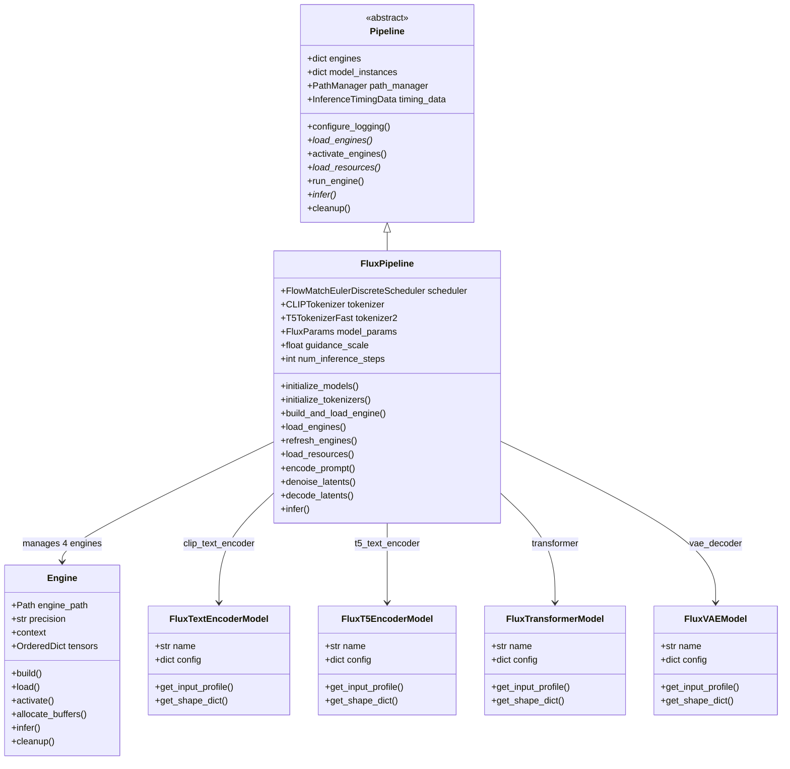

**Key Relationships:**
- `FluxPipeline` extends the abstract `Pipeline` class [demo/flux1.dev/pipelines/flux_pipeline.py:54]()
- `FluxPipeline` manages four `Engine` instances stored in `self.engines` dictionary [demo/flux1.dev/pipelines/flux_pipeline.py:304]()
- Each engine corresponds to a model component with configuration from model classes [demo/flux1.dev/pipelines/flux_pipeline.py:125-154]()

**Sources:** [demo/flux1.dev/pipelines/flux_pipeline.py:54-155](), [demo/utils/pipeline.py:39-50](), [demo/utils/engine.py:78-97]()

---

## Core Pipeline Components

The FluxPipeline orchestrates four distinct model components, each managed through a dedicated `Engine` instance. These components are initialized in the `initialize_models()` method.

### Model Component Overview

| Role | Model Class | Purpose | Input | Output |
|------|-------------|---------|-------|--------|
| `clip_text_encoder` | `FluxTextEncoderModel` | CLIP-based text encoding | Token IDs (77 tokens max) | Pooled embeddings (768-dim) |
| `t5_text_encoder` | `FluxT5EncoderModel` | T5-based text encoding | Token IDs (512 tokens max) | Prompt embeddings (4096-dim) |
| `transformer` | `FluxTransformerModel` | Latent denoising | Noisy latents + text embeddings | Denoised latents |
| `vae_decoder` | `FluxVAEModel` | Latent to image decoding | Latent representation (64×64×16) | RGB image (512×512×3) |

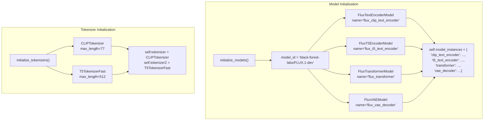

**Model Instance Dictionary Structure:**
The `self.model_instances` dictionary [demo/flux1.dev/pipelines/flux_pipeline.py:125-154]() stores model configuration objects that provide:
- `get_input_profile()`: Returns TensorRT input shapes for static/dynamic engine building
- `get_shape_dict()`: Returns actual tensor shapes for buffer allocation
- `config`: Model-specific configuration parameters (channels, scaling factors, etc.)

**Sources:** [demo/flux1.dev/pipelines/flux_pipeline.py:118-177]()

---

## Engine Management System

The `FluxPipeline` uses the `Engine` class to manage the lifecycle of TensorRT engines for each model component. The engine management flow involves building, loading, activation, and execution.

### Engine Lifecycle

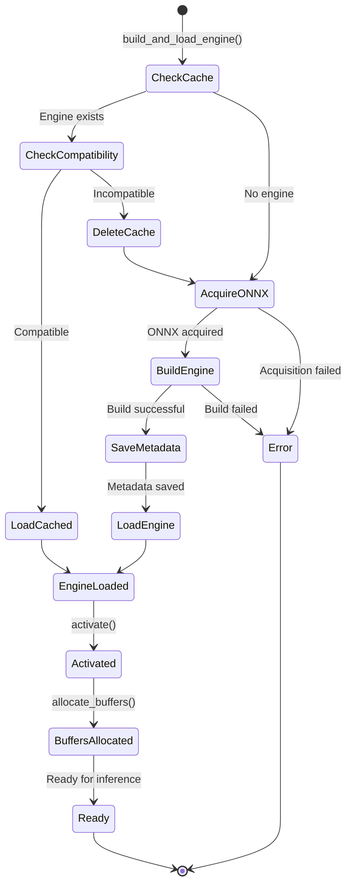

### Build and Load Engine Process

The `build_and_load_engine()` method [demo/flux1.dev/pipelines/flux_pipeline.py:194-304]() handles the complete engine preparation process:

**Step 1: Check Engine Cache**
- Verifies if engine file exists at path [demo/flux1.dev/pipelines/flux_pipeline.py:239]()
- If exists, checks metadata compatibility using `metadata_manager.check_engine_compatibility()` [demo/flux1.dev/pipelines/flux_pipeline.py:247-252]()
- Validates target shapes match current requirements [demo/flux1.dev/pipelines/flux_pipeline.py:242-245]()

**Step 2: Acquire ONNX Model**
- If engine doesn't exist or is incompatible, retrieves ONNX file [demo/flux1.dev/pipelines/flux_pipeline.py:218-235]()
- Uses `path_manager.acquire_onnx_file()` to download from Hugging Face or copy from local path
- ONNX source determined by model registry configuration

**Step 3: Build TensorRT Engine**
- Creates `Engine` instance with path and precision [demo/flux1.dev/pipelines/flux_pipeline.py:290]()
- Calls `engine.build()` with input profile and extra arguments [demo/flux1.dev/pipelines/flux_pipeline.py:291-297]()
- Input profile specifies static or dynamic shapes via `get_input_profile()` [demo/flux1.dev/pipelines/flux_pipeline.py:281-287]()
- Saves metadata after successful build [demo/utils/engine.py:201-208]()

**Step 4: Load and Activate**
- If not in low-VRAM mode, immediately loads engine into memory [demo/flux1.dev/pipelines/flux_pipeline.py:298-299]()
- Stores engine in `self.engines[role]` dictionary [demo/flux1.dev/pipelines/flux_pipeline.py:304]()

### Engine Loading and Activation

The `load_engines()` method [demo/flux1.dev/pipelines/flux_pipeline.py:306-397]() orchestrates engine preparation for all model components:

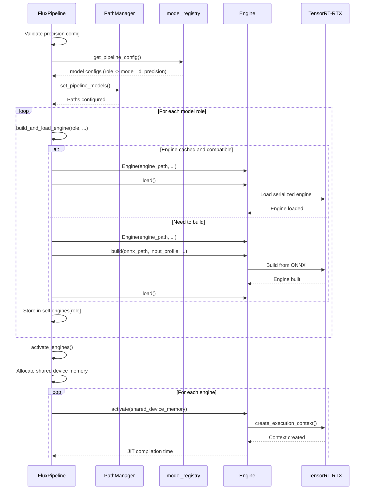

**Shared Device Memory Optimization:**
All engines share a single workspace allocation [demo/utils/pipeline.py:224-232]():
- Calculates maximum workspace required across all engines [demo/utils/pipeline.py:262-283]()
- Allocates once using `cudart.cudaMalloc()` [demo/utils/pipeline.py:230]()
- Each engine's context uses the same shared memory [demo/utils/engine.py:284-287]()
- Saves significant VRAM compared to individual allocations [demo/utils/pipeline.py:279-281]()

**Sources:** [demo/flux1.dev/pipelines/flux_pipeline.py:194-397](), [demo/utils/engine.py:140-213](), [demo/utils/pipeline.py:224-250]()

---

## Inference Execution Flow

The `infer()` method [demo/flux1.dev/pipelines/flux_pipeline.py:758-881]() implements the complete text-to-image generation pipeline.

### High-Level Inference Flow

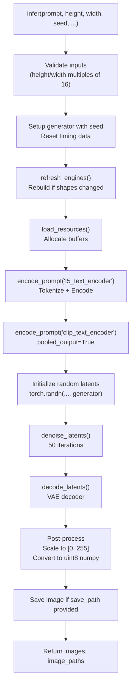

### Detailed Step-by-Step Process

#### Step 1: Text Encoding

The `encode_prompt()` method [demo/flux1.dev/pipelines/flux_pipeline.py:553-644]() handles tokenization and encoding for both CLIP and T5 models:

**Tokenization Process:**
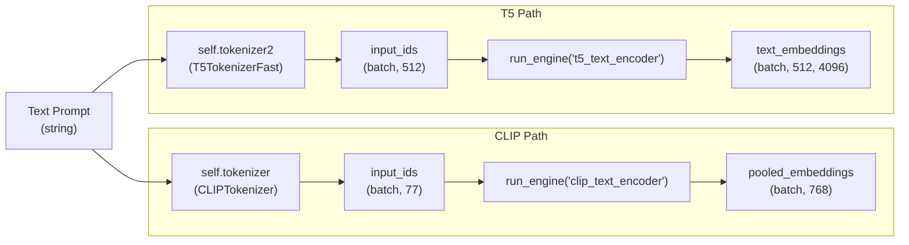

**Key Implementation Details:**
- Maximum sequence lengths defined by `FluxParams` [demo/flux1.dev/pipelines/flux_pipeline.py:569-572]()
- Tokenization with padding to max length and truncation [demo/flux1.dev/pipelines/flux_pipeline.py:580-592]()
- Truncation warning if prompt exceeds limit [demo/flux1.dev/pipelines/flux_pipeline.py:595-608]()
- Engine execution via `run_engine()` [demo/flux1.dev/pipelines/flux_pipeline.py:617-621]()
- Output selection: pooled embeddings for CLIP, text embeddings for T5 [demo/flux1.dev/pipelines/flux_pipeline.py:623-628]()

#### Step 2: Latent Initialization

Random latents are initialized [demo/flux1.dev/pipelines/flux_pipeline.py:839-847]():
- Shape: `(batch_size, num_channels_latents, latent_height, latent_width)`
- Latent dimensions are 1/8 of target image dimensions [demo/flux1.dev/pipelines/flux_pipeline.py:832-835]()
- Uses seeded generator for reproducibility [demo/flux1.dev/pipelines/flux_pipeline.py:846]()
- Data type: `torch.bfloat16` [demo/flux1.dev/pipelines/flux_pipeline.py:845]()

#### Step 3: Denoising Loop

The `denoise_latents()` method [demo/flux1.dev/pipelines/flux_pipeline.py:646-733]() implements the iterative denoising process:

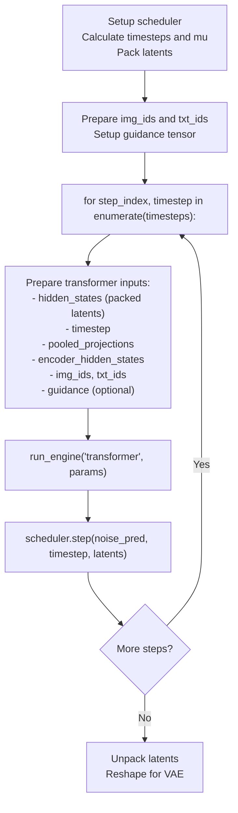

**Latent Packing/Unpacking:**
- Flux uses packed latent representation [demo/flux1.dev/pipelines/flux_pipeline.py:675]()
- `_pack_latents()` reshapes from `(B, C, H, W)` to `(B, H//2 * W//2, C*4)` [demo/flux1.dev/pipelines/flux_pipeline.py:892-897]()
- `_unpack_latents()` reverses the operation [demo/flux1.dev/pipelines/flux_pipeline.py:900-910]()
- Packing matches Flux transformer's expected input format

**Scheduler Configuration:**
- Uses `FlowMatchEulerDiscreteScheduler` [demo/flux1.dev/pipelines/flux_pipeline.py:89-91]()
- Timesteps calculated with shift parameter `mu` [demo/flux1.dev/pipelines/flux_pipeline.py:662-670]()
- Shift adapts to image sequence length [demo/flux1.dev/pipelines/flux_pipeline.py:41-51]()

**Transformer Execution:**
- Input dictionary contains 6-7 tensors [demo/flux1.dev/pipelines/flux_pipeline.py:698-708]()
- Autocast enabled for FP16 precision [demo/flux1.dev/pipelines/flux_pipeline.py:688-691]()
- Optional timing via CUDA events [demo/flux1.dev/pipelines/flux_pipeline.py:712-718]()
- Scheduler updates latents each step [demo/flux1.dev/pipelines/flux_pipeline.py:725]()

#### Step 4: VAE Decoding

The `decode_latents()` method [demo/flux1.dev/pipelines/flux_pipeline.py:735-756]() converts latents to images:

**Decoding Process:**
1. Apply scaling and shift factors [demo/flux1.dev/pipelines/flux_pipeline.py:738-740]()
2. Execute VAE decoder engine [demo/flux1.dev/pipelines/flux_pipeline.py:743-751]()
3. Output shape: `(batch, 3, height, width)` in range `[-1, 1]`

**Post-Processing:**
- Scale from `[-1, 1]` to `[0, 255]` [demo/flux1.dev/pipelines/flux_pipeline.py:864]()
- Clamp values and convert to uint8 [demo/flux1.dev/pipelines/flux_pipeline.py:864]()
- Permute to `(batch, height, width, channels)` for PIL [demo/flux1.dev/pipelines/flux_pipeline.py:864]()
- Save as PNG files [demo/flux1.dev/pipelines/flux_pipeline.py:870-877]()

**Sources:** [demo/flux1.dev/pipelines/flux_pipeline.py:553-881](), [demo/utils/pipeline.py:285-288]()

---

## Memory Management

The FluxPipeline implements sophisticated memory management to support both standard and low-VRAM modes.

### Standard Memory Mode

In standard mode, all models remain loaded in GPU memory throughout the inference process:

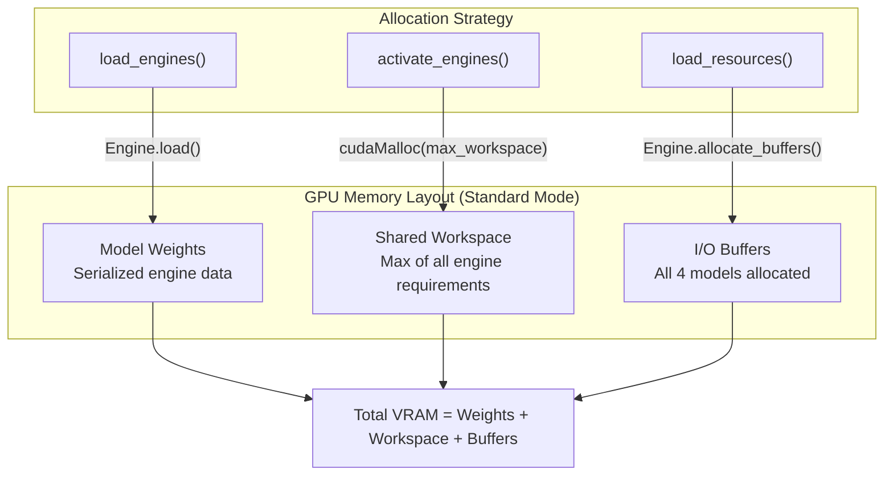

**Memory Allocation Details:**

| Component | Method | Size Calculation |
|-----------|--------|------------------|
| Weights | `Engine.load()` | Size of serialized `.engine` file |
| Workspace | `activate_engines()` | `max(engine.device_memory_size_v2 for all engines)` |
| Buffers | `allocate_buffers()` | Sum of all input/output tensor sizes |

**Workspace Sharing Implementation:**
The shared workspace optimization [demo/utils/pipeline.py:262-283]() works as follows:
1. Calculate maximum workspace across all engines [demo/utils/pipeline.py:267-275]()
2. Allocate once with `cudaMalloc()` [demo/utils/pipeline.py:230]()
3. Pass same memory pointer to all engines [demo/utils/pipeline.py:242]()
4. Engines share workspace sequentially (never execute simultaneously)

**Sources:** [demo/utils/pipeline.py:224-250](), [demo/flux1.dev/pipelines/flux_pipeline.py:495-551]()

### Low-VRAM Mode

The low-VRAM mode (`low_vram=True`) dynamically loads and unloads models during inference using the `ModelMemoryManager` context manager.

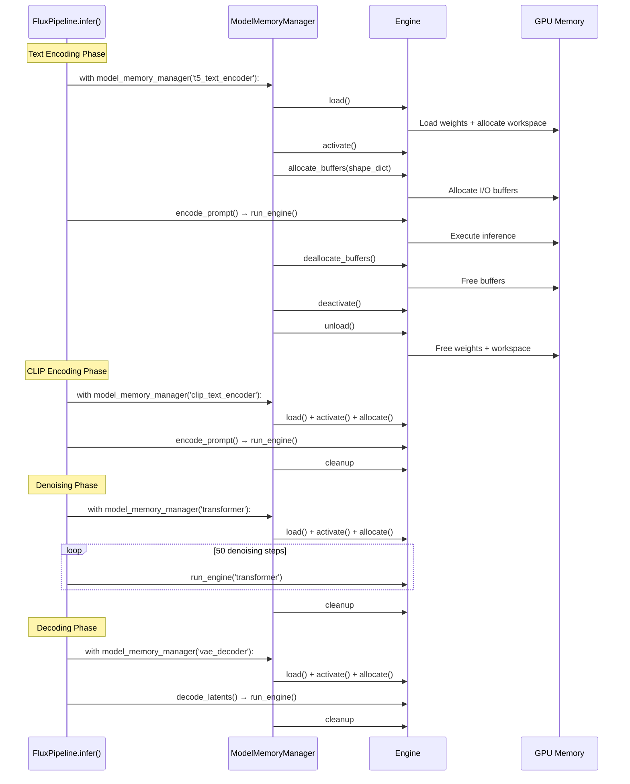

**ModelMemoryManager Implementation:**

The context manager [demo/utils/memory_manager.py]() handles the complete load/unload cycle:

```python
# Usage in infer() method
with self.model_memory_manager("t5_text_encoder", self.low_vram):
    t5_embeds = self.encode_prompt(prompt, "t5_text_encoder")
# Model automatically unloaded after this block
```

**Key Methods:**
- `__enter__()`: Loads engine, activates context, allocates buffers
- `__exit__()`: Deallocates buffers, deactivates context, unloads engine
- Used for each model sequentially [demo/flux1.dev/pipelines/flux_pipeline.py:813-856]()

**Low-VRAM Mode Characteristics:**
- Only one model loaded at a time
- Significantly reduces peak VRAM usage
- Increases inference time due to load/unload overhead
- Shape dictionaries stored but buffers not pre-allocated [demo/flux1.dev/pipelines/flux_pipeline.py:533-536]()
- Workspace memory allocation deferred [demo/utils/engine.py:288-291]()

**Memory Footprint Comparison:**

| Mode | Peak VRAM | Inference Time | Use Case |
|------|-----------|----------------|----------|
| Standard | ~24 GB (4 models loaded) | Fastest | GPUs with ≥24GB VRAM |
| Low-VRAM | ~8 GB (1 model at a time) | ~2-3x slower | GPUs with 8-12GB VRAM |

**Sources:** [demo/flux1.dev/pipelines/flux_pipeline.py:179-192](), [demo/flux1.dev/pipelines/flux_pipeline.py:813-856](), [demo/utils/memory_manager.py]()

---

## Resource Allocation and Buffer Management

The `load_resources()` method [demo/flux1.dev/pipelines/flux_pipeline.py:495-551]() handles buffer allocation and CUDA stream initialization.

### Resource Allocation Flow

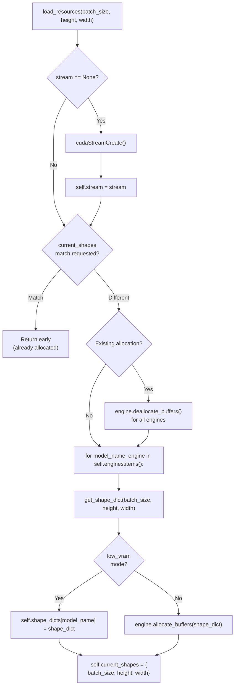

### Buffer Allocation Process

For each engine, `allocate_buffers()` [demo/utils/engine.py:330-369]() performs the following:

**Step 1: Iterate Through All Tensors**
- Get tensor count from `engine.num_io_tensors` [demo/utils/engine.py:336]()
- Retrieve tensor name, shape, dtype, and mode [demo/utils/engine.py:337-342]()

**Step 2: Determine Tensor Shape**
- Use shape from `shape_dict` if available [demo/utils/engine.py:340-342]()
- Fall back to engine's tensor shape for missing entries [demo/utils/engine.py:343-344]()
- Set input shape in context for dynamic inputs [demo/utils/engine.py:347-348]()

**Step 3: Allocate Tensor**
- Convert TensorRT dtype to PyTorch dtype [demo/utils/engine.py:351]()
- Create empty tensor on device [demo/utils/engine.py:355]()
- Track memory usage [demo/utils/engine.py:358-362]()
- Store in `self.tensors` OrderedDict [demo/utils/engine.py:364]()

**Buffer Memory Calculation:**
```python
# Total buffer memory per model
for binding in range(engine.num_io_tensors):
    tensor = torch.empty(shape, dtype=dtype, device=device)
    tensor_memory = tensor.numel() * tensor.element_size()
    total_buffer_memory += tensor_memory
```

### Shape Change Handling

The `refresh_engines()` method [demo/flux1.dev/pipelines/flux_pipeline.py:399-493]() handles dynamic shape changes:

**Refresh Trigger Conditions:**
1. Static shape mode: Any dimension change requires rebuild
2. Dynamic shape mode: Only changes outside min/max range require rebuild

**Refresh Process:**
1. Check each engine's metadata compatibility [demo/flux1.dev/pipelines/flux_pipeline.py:425-430]()
2. Rebuild incompatible engines [demo/flux1.dev/pipelines/flux_pipeline.py:443-455]()
3. Reallocate shared workspace if needed [demo/flux1.dev/pipelines/flux_pipeline.py:461-476]()
4. Reactivate all engines with new workspace [demo/flux1.dev/pipelines/flux_pipeline.py:479-486]()

**Workspace Reallocation Logic:**
```python
new_max_workspace = calculate_max_device_memory()
if new_max_workspace > current_max_workspace:
    cudart.cudaFree(shared_device_memory)  # Free old
    _, shared_device_memory = cudart.cudaMalloc(new_max_workspace)  # Allocate new
    
    # Update all engines
    for engine in engines.values():
        engine.reactivate(shared_device_memory)
```

**Sources:** [demo/flux1.dev/pipelines/flux_pipeline.py:495-551](), [demo/utils/engine.py:330-389](), [demo/flux1.dev/pipelines/flux_pipeline.py:399-493]()

---

## Engine Execution

The `run_engine()` method [demo/utils/pipeline.py:285-288]() provides a unified interface for executing any engine:

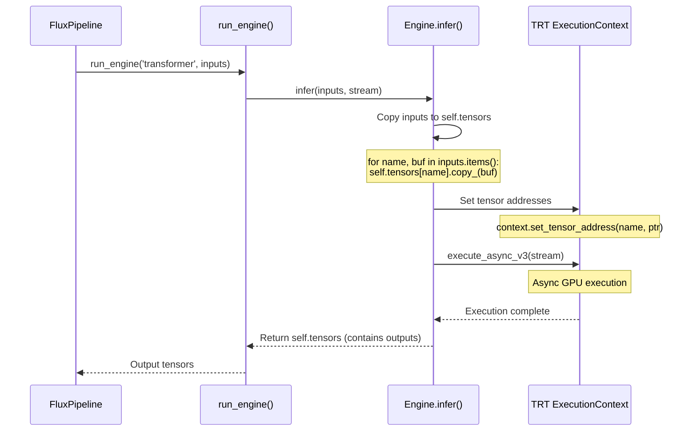

**Engine Inference Implementation [demo/utils/engine.py:391-406]():**

1. **Input Copying:** Inputs copied to pre-allocated tensors [demo/utils/engine.py:394-395]()
2. **Address Setting:** Tensor addresses set in context [demo/utils/engine.py:398-399]()
3. **Async Execution:** Non-blocking GPU execution [demo/utils/engine.py:402]()
4. **Output Return:** Returns full tensor dictionary [demo/utils/engine.py:406]()

**Timing Integration:**
When `enable_timing=True`, the pipeline wraps engine calls with CUDA event timing [demo/flux1.dev/pipelines/flux_pipeline.py:614-619]():
```python
def run_model():
    return self.run_engine(model_name, engine_inputs)

outputs, elapsed_ms = self._record_cuda_timing(model_name, run_model)
```

**CUDA Event Timing [demo/utils/pipeline.py:168-205]():**
- Creates start/end events per engine [demo/utils/pipeline.py:170-173]()
- Records events before/after execution [demo/utils/pipeline.py:193-197]()
- Calculates elapsed time [demo/utils/pipeline.py:200]()
- Stores in `timing_data.pipeline_times` [demo/utils/pipeline.py:203]()

**Sources:** [demo/utils/pipeline.py:285-288](), [demo/utils/engine.py:391-406](), [demo/utils/pipeline.py:168-205]()

---

