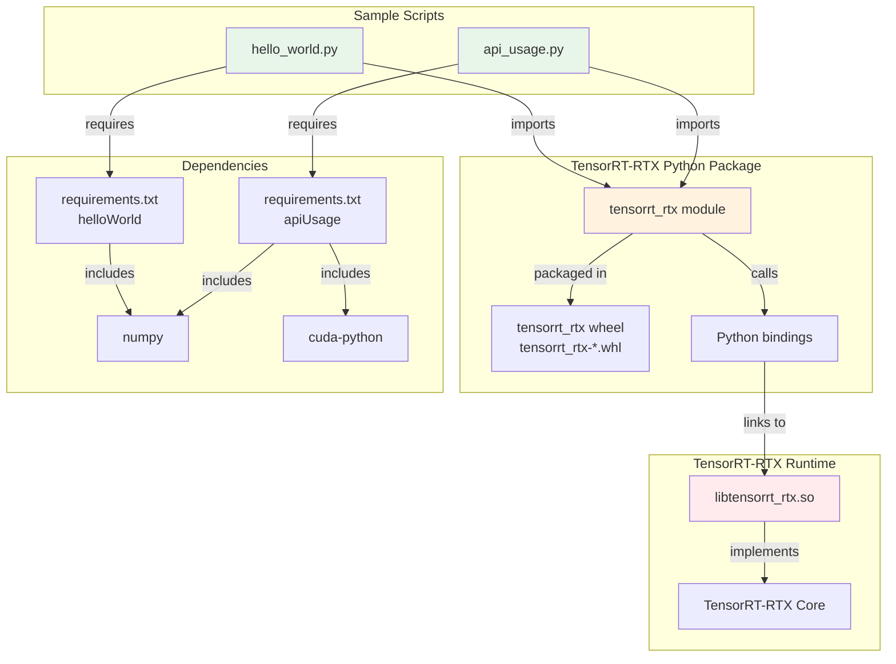
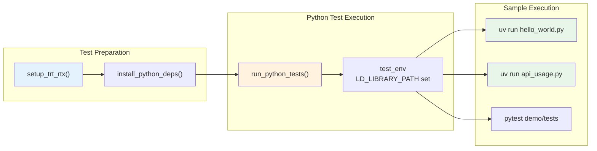
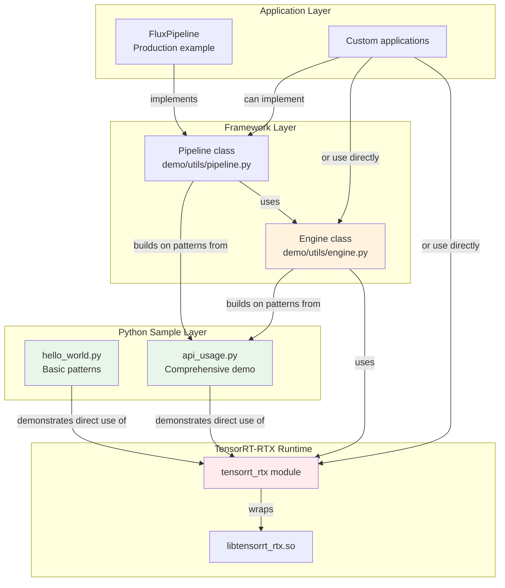

<!-- source: DeepWiki mcp.deepwiki.com · repo NVIDIA/TensorRT-RTX · extra page Python API Usage Sample · fetched 2026-10-26 -->

# Python API Usage Sample

<details>
<summary>Relevant source files</summary>

The following files were used as context for generating this wiki page:

- [.github/workflows/test.py](.github/workflows/test.py)
- [demo/flux1.dev/requirements.txt](demo/flux1.dev/requirements.txt)
- [demo/tests/README.md](demo/tests/README.md)

</details>


## Purpose and Scope

This page documents the Python sample applications that demonstrate how to use the TensorRT-RTX API from Python code. These samples provide minimal, focused examples of core API patterns for building, loading, and executing TensorRT engines using TensorRT-RTX.

The repository provides two Python samples:
- **helloWorld**: A basic example showing the simplest usage pattern
- **apiUsage**: A more comprehensive demonstration of key API features

For information about the C++ equivalent samples, see [C++ API Usage Sample](#4.2.1). For production-ready examples using the framework abstractions, see [Flux.1 Text-to-Image Demo](#4.1) and [Core Framework](#5).

**Sources:** [.github/workflows/test.py:57-58]()

## Sample Overview

The Python samples are located in the `samples/` directory and organized by sample name:

| Sample | Location | Purpose | Complexity |
|--------|----------|---------|------------|
| helloWorld | `samples/helloWorld/python/` | Basic TensorRT-RTX usage | Minimal |
| apiUsage | `samples/apiUsage/python/` | Comprehensive API demonstration | Moderate |

Both samples demonstrate end-to-end workflows from model definition to inference execution, serving as templates for integrating TensorRT-RTX into Python applications.

**Sources:** [.github/workflows/test.py:33-34]()

## Sample Architecture



**Diagram: Python Sample Dependency Structure**

The samples import the `tensorrt_rtx` Python module, which is distributed as a wheel package. The Python bindings provide a Pythonic interface to the underlying C++ TensorRT-RTX library. Each sample has its own `requirements.txt` specifying additional dependencies like NumPy for array operations.

**Sources:** [.github/workflows/test.py:28-34](), [demo/flux1.dev/requirements.txt:15]()

## Installation and Setup

### Prerequisites

The Python samples require:
- Python 3.9 to 3.12 (recommended range for dependency compatibility)
- NVIDIA GPU with CUDA support
- TensorRT-RTX installed (see [Installation](#2.1))

### Installing Dependencies

The TensorRT-RTX wheel must be installed first, followed by sample-specific dependencies:

```bash
# Install TensorRT-RTX wheel
python -m pip install /path/to/tensorrt_rtx-*.whl

# Install helloWorld dependencies
python -m pip install -r samples/helloWorld/python/requirements.txt

# Install apiUsage dependencies
python -m pip install -r samples/apiUsage/python/requirements.txt
```

The wheel package is located in the `python/` subdirectory of the TensorRT-RTX installation directory downloaded from NVIDIA.

**Sources:** [.github/workflows/test.py:28-34](), [demo/tests/README.md:18]()

### Environment Configuration

The samples require the TensorRT-RTX library directory in the library search path:

```bash
export LD_LIBRARY_PATH=/opt/tensorrt_rtx/lib:$LD_LIBRARY_PATH
```

This ensures the Python bindings can locate the native TensorRT-RTX library at runtime.

**Sources:** [.github/workflows/test.py:54-56]()

## Running the Samples

### helloWorld Sample

The helloWorld sample demonstrates the minimal usage pattern:

```bash
python samples/helloWorld/python/hello_world.py
```

This sample showcases:
- Importing the `tensorrt_rtx` module
- Basic engine lifecycle management
- Simple inference execution

### apiUsage Sample

The apiUsage sample provides a more comprehensive demonstration:

```bash
python samples/apiUsage/python/api_usage.py
```

This sample demonstrates:
- Engine building from model definitions
- Engine loading and activation
- Memory management
- Inference execution with input/output handling
- Error handling patterns

**Sources:** [.github/workflows/test.py:57-58]()

## Automated Testing

The Python samples are validated in the CI/CD pipeline as part of the test suite. The test infrastructure:

1. Downloads and caches the TensorRT-RTX installation
2. Installs the Python wheel
3. Installs sample dependencies
4. Configures the library path
5. Executes each sample script
6. Verifies successful completion



**Diagram: Python Sample Test Workflow**

The test script uses `uv` (a fast Python package manager) to run the samples in an isolated environment. Each sample execution must complete without errors for the CI pipeline to pass.

**Sources:** [.github/workflows/test.py:50-60]()

## Integration with Core Framework

The Python samples demonstrate direct API usage, which differs from the higher-level abstractions provided by the Core Framework:

| Approach | Use Case | Abstraction Level | Example |
|----------|----------|-------------------|---------|
| **Direct API** (samples) | Learning, prototyping, custom workflows | Low-level engine operations | `hello_world.py`, `api_usage.py` |
| **Engine Class** | Reusable engine management | Mid-level lifecycle management | `demo/utils/engine.py` |
| **Pipeline Class** | Production applications | High-level workflow orchestration | `demo/flux1.dev/flux_pipeline.py` |

The samples demonstrate the foundational patterns that the Engine class (see [Engine Management](#5.1)) builds upon. For production applications, the Engine and Pipeline abstractions provide more robust error handling, caching, and memory management.

**Sources:** [.github/workflows/test.py:33-34](), [.github/workflows/test.py:57-58]()

## Sample Dependency Specifications

Both samples declare their Python dependencies in `requirements.txt` files within their respective directories:

- `samples/helloWorld/python/requirements.txt`: Minimal dependencies for basic operations
- `samples/apiUsage/python/requirements.txt`: Additional dependencies for comprehensive API usage

The TensorRT-RTX package itself requires:
- `tensorrt-rtx>=1.3.0`: The core library
- `cuda-python<13.0.0`: CUDA runtime bindings
- `numpy`: Array operations
- `polygraphy>=0.49.24`: Optional, for advanced engine building

**Sources:** [demo/flux1.dev/requirements.txt:10-15](), [.github/workflows/test.py:33-34]()

## Key API Patterns Demonstrated

While the actual sample code is not included in this documentation, the Python samples typically demonstrate these core patterns based on their usage in the test infrastructure:

### Module Import Pattern
Importing the TensorRT-RTX Python module provides access to the API:
```python
import tensorrt_rtx
```

### Environment Setup Pattern
Ensuring the runtime library is accessible:
```python
import os
os.environ['LD_LIBRARY_PATH'] = '/opt/tensorrt_rtx/lib:' + os.environ.get('LD_LIBRARY_PATH', '')
```

### Execution Pattern
Running the samples with proper environment configuration:
```python
# Set up environment
test_env = os.environ.copy()
test_env["LD_LIBRARY_PATH"] = f"{TRTRTX_INSTALL_DIR}/lib:{test_env.get('LD_LIBRARY_PATH', '')}"

# Execute sample
subprocess.run(["python", "samples/helloWorld/python/hello_world.py"], env=test_env)
```

**Sources:** [.github/workflows/test.py:54-58]()

## Relationship to Other Components



**Diagram: Python Sample Position in Architecture**

The samples sit at the lowest application level, demonstrating direct usage of the TensorRT-RTX Python module. The framework classes (Engine, Pipeline) build on these patterns to provide higher-level abstractions. Production applications like Flux can use either the framework abstractions or the direct API depending on their needs.

**Sources:** [.github/workflows/test.py:33-34](), [.github/workflows/test.py:57-58]()

## Next Steps

After understanding the Python samples:

- Review [C++ API Usage Sample](#4.2.1) to understand the native API
- Explore [Engine Management](#5.1) for production-ready engine lifecycle management
- Study [Flux.1 Text-to-Image Demo](#4.1) for a complete application example
- Consult [Python Environment and Dependencies](#7.1) for detailed dependency information

**Sources:** [.github/workflows/test.py:50-60]()

---

