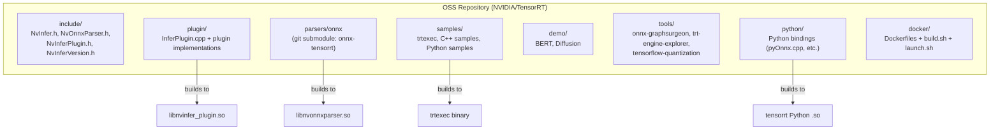
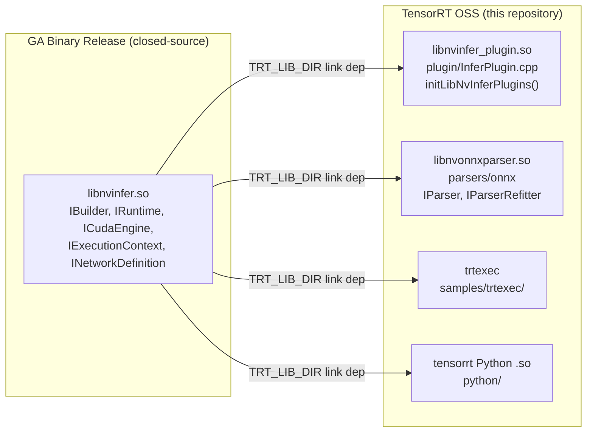
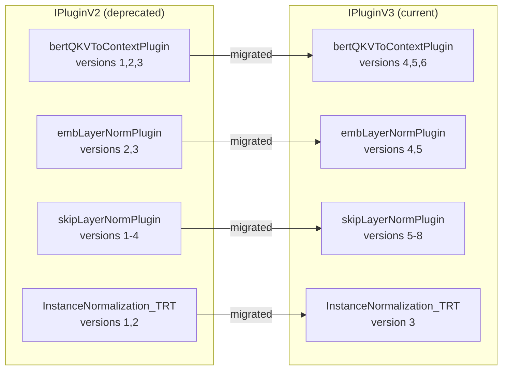
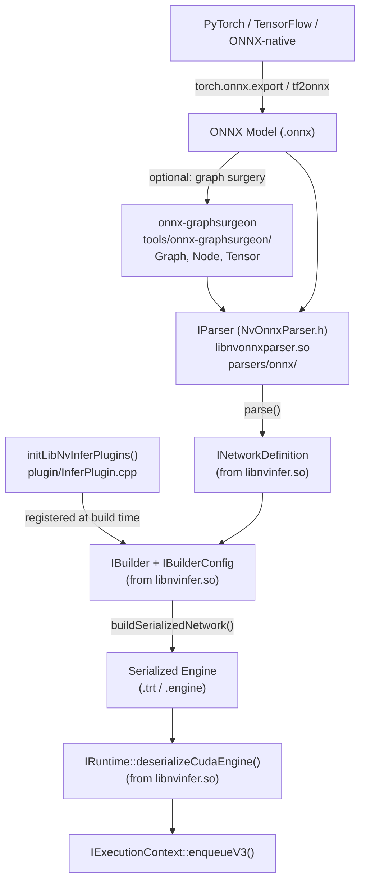

<!-- source: DeepWiki mcp.deepwiki.com · repo NVIDIA/TensorRT · page 1 TensorRT Overview · fetched 2026-10-26 -->

# TensorRT Overview

Relevant source files

The following files were used as context for generating this wiki page:

- [.gitmodules](.gitmodules)
- [CHANGELOG.md](CHANGELOG.md)
- [README.md](README.md)
- [VERSION](VERSION)
- [docker/build.sh](docker/build.sh)
- [docker/launch.sh](docker/launch.sh)
- [docker/ubuntu-cross-aarch64.Dockerfile](docker/ubuntu-cross-aarch64.Dockerfile)
- [include/NvInferVersion.h](include/NvInferVersion.h)

This page describes the structure and purpose of the **NVIDIA/TensorRT Open Source Software (OSS)** repository. It covers what the repository contains, how it relates to the closed-source TensorRT GA binary release, the supported platforms, and the API migration requirements coming in TensorRT 11.0.

For installation steps and prerequisites, see [Installation and Setup](#1.1). For the build system in detail, see [Building From Source](#2).

---

## What This Repository Is

The TensorRT OSS repository is a **partial open-source complement** to the TensorRT General Availability (GA) binary release (`libnvinfer.so`). It does not contain the core inference engine. Instead, it contains:

- The **plugin library** (`libnvinfer_plugin.so`) — built-in custom layer implementations
- The **ONNX parser** (`libnvonnxparser.so`) — converts ONNX graphs to `INetworkDefinition`
- The **`trtexec` CLI** — engine building and benchmarking tool
- **C++ and Python samples** — reference implementations
- **Demo applications** — BERT, Stable Diffusion, Tacotron2
- **Developer tools** — ONNX Graph Surgeon, TRT Engine Explorer, TF Quantization Toolkit
- **Python bindings** — wraps the C++ API for Python consumers

The core TensorRT runtime (`IBuilder`, `IRuntime`, `ICudaEngine`, etc.) is **not** part of this repository. It is distributed as a closed-source binary from NVIDIA's developer portal and is a required build dependency.

Sources: [README.md:14-16]()

---

## Repository at a Glance

The following diagram maps top-level directories to their primary roles and output artifacts.

**Repository Component Map**

Sources: [README.md:14-16](), [.gitmodules:9-12]()

---

## Relationship to the TensorRT GA Binary

The OSS components are built **against** the GA release, not independent of it. The GA release provides `libnvinfer.so`, which contains the core builder and runtime. All OSS components link to it.

**OSS vs. GA Dependency Relationship**

The CMake build requires `TRT_LIB_DIR` to be set to the directory containing the GA libraries. Without them, nothing in the OSS repo can be compiled.

Sources: [README.md:38-82]()

---

## Current Version

| Component | Version |
|-----------|---------|
| TensorRT OSS | `10.15.1.29` |
| `NV_TENSORRT_MAJOR` | `10` |
| `NV_TENSORRT_MINOR` | `15` |
| `NV_TENSORRT_PATCH` | `1` |
| `NV_TENSORRT_BUILD` | `29` |
| Required CUDA | `13.1` or `12.9` |
| cuDNN (optional) | `8.9` |

Version macros are defined in [include/NvInferVersion.h:26-33]().

Sources: [VERSION:1-1](), [include/NvInferVersion.h:26-33]()

---

## Supported Platforms

| Platform | Architecture | Notes |
|----------|-------------|-------|
| Ubuntu 24.04 | x86_64 | Primary Linux target |
| Ubuntu 24.04 | aarch64 | Native build |
| Rocky Linux 8 | x86_64 | RPM-based distributions |
| Jetson (JetPack) | aarch64 | Cross-compiled from x86_64 |
| DriveOS 6.5 / 7 | aarch64 (Linux) | Cross-compiled; QNX also supported |
| DriveOS 6.5 | aarch64 (QNX) | Requires QNX toolchain |
| Windows 10/11 | x86_64 | Native build via MSVC |

Build toolchain files for cross-compilation live in `cmake/toolchains/`. The relevant ones are:

| Toolchain File | Target |
|---|---|
| `cmake_aarch64-native.toolchain` | Native aarch64 Linux build |
| `cmake_aarch64_cross.toolchain` | Cross-compile for Jetson from x86_64 |
| `cmake_aarch64_dos_cross.toolchain` | Cross-compile for DriveOS Linux |
| `cmake_qnx.toolchain` | Cross-compile for QNX |
| `cmake_qnx_safe.toolchain` | Safety-certified QNX builds |

Sources: [README.md:120-310](), [docker/ubuntu-cross-aarch64.Dockerfile:1-100]()

---

## What Each OSS Component Does

### Plugin Library (`plugin/`)

Contains built-in TensorRT plugins shipped as `libnvinfer_plugin.so`. All plugins register themselves when `initLibNvInferPlugins()` is called. Plugins are grouped by application domain:

| Plugin Group | Examples |
|---|---|
| NMS / Detection | `EfficientNMS_TRT`, `BatchedNMS_TRT`, `GenerateDetection_TRT` |
| BERT / NLP | `CustomQKVToContextPluginDynamic`, `CustomEmbLayerNormDynamic`, `CustomSkipLayerNormDynamic` |
| 3D Perception | `VoxelGeneratorPlugin`, `DecodeBbox3DPlugin` |
| Normalization | `InstanceNormalization_TRT`, `GroupNormalizationPlugin` |
| Attention | `DisentangledAttention_TRT`, `MultiscaleDeformableAttnPlugin_TRT` |

For detailed plugin documentation, see [Plugin System](#4).

### ONNX Parser (`parsers/onnx`)

A git submodule pointing to `onnx/onnx-tensorrt`. Provides `IParser` and `IParserRefitter` interfaces declared in `include/NvOnnxParser.h`. Converts ONNX model graphs into `INetworkDefinition` objects consumable by `IBuilder`.

For details, see [Builder and Optimization](#3.2).

### `trtexec` (`samples/trtexec/`)

A command-line utility for building TRT engines from ONNX models and benchmarking inference throughput. It is both a tool and a reference consumer of the OSS sample infrastructure in `samples/common/`.

For shared sample infrastructure details, see [Sample Infrastructure](#5.1).

### Demo Applications (`demo/`)

| Demo | Location | Purpose |
|---|---|---|
| BERT | `demo/BERT/` | NLP inference, INT8 calibration, SQuAD eval |
| Stable Diffusion / Flux | `demo/Diffusion/` | Text-to-image / image-to-image pipelines |

See [Demo Applications](#5) for details.

### Tools (`tools/`)

| Tool | Path | Purpose |
|---|---|---|
| ONNX Graph Surgeon | `tools/onnx-graphsurgeon/` | Programmatic ONNX graph manipulation |
| TRT Engine Explorer | `tools/trt-engine-explorer/` | Engine plan visualization and analysis |
| TF Quantization Toolkit | `tools/tensorflow-quantization/` | QAT for TensorFlow 2 models |

See [ONNX Graph Surgeon](#6) and [Performance and Profiling Tools](#8) for details.

---

## Upcoming Breaking Changes in TensorRT 11.0

TensorRT 11.0 is planned for 2026 Q2. It removes several legacy APIs that have been deprecated over the TRT 10.x series. Affected code in this repository is actively being migrated.

| Removed Feature | Replacement | Tracking in OSS |
|---|---|---|
| `IPluginV2` and all subclasses | `IPluginV3` + `IPluginCreatorV3One` | Plugins progressively migrated since TRT 10.4 |
| Weakly-typed networks | Strongly Typed Networks (`IBuilderConfig`) | New samples added in TRT 10.15 |
| Implicit quantization APIs | Explicit Quantization via QDQ nodes | Parser and sample updates |
| TREX tool | Nsight Deep Learning Designer | `tools/trt-engine-explorer/` will be removed |
| Python 3.9 and older bindings | Python 3.10+ | Already enforced in TRT 10.13.2+ |

### Plugin Migration State (as of TRT 10.15)

The plugin library uses a version number per plugin. Each `IPluginV2`-derived version has been given a corresponding `IPluginV3`-derived successor:

Sources: [README.md:3-12](), [CHANGELOG.md:1-120]()

---

## Model-to-Inference Flow

The following shows the full path from a training framework to a running TensorRT inference session, with code entities at each step.

**End-to-End Data Flow**

Sources: [README.md:38-82](), [CHANGELOG.md:379-410]()

---

