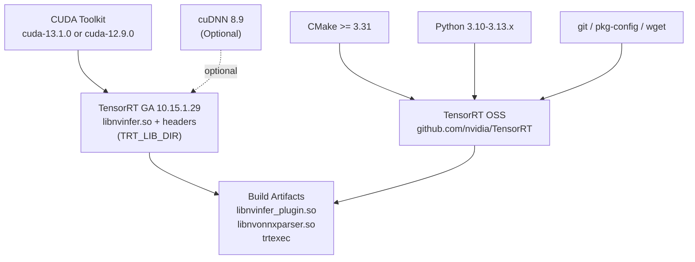
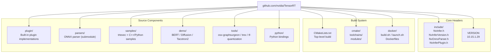
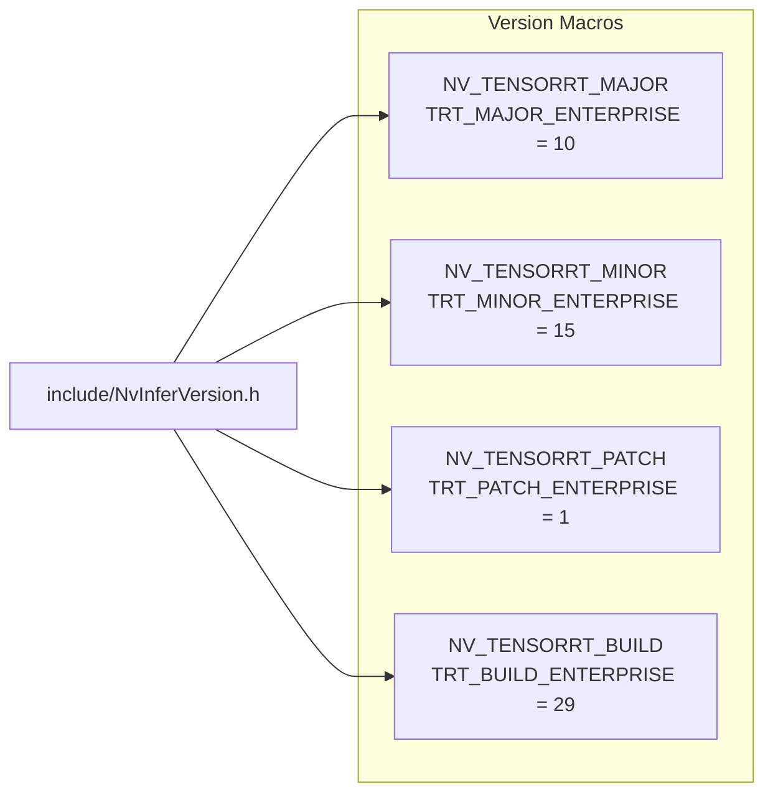
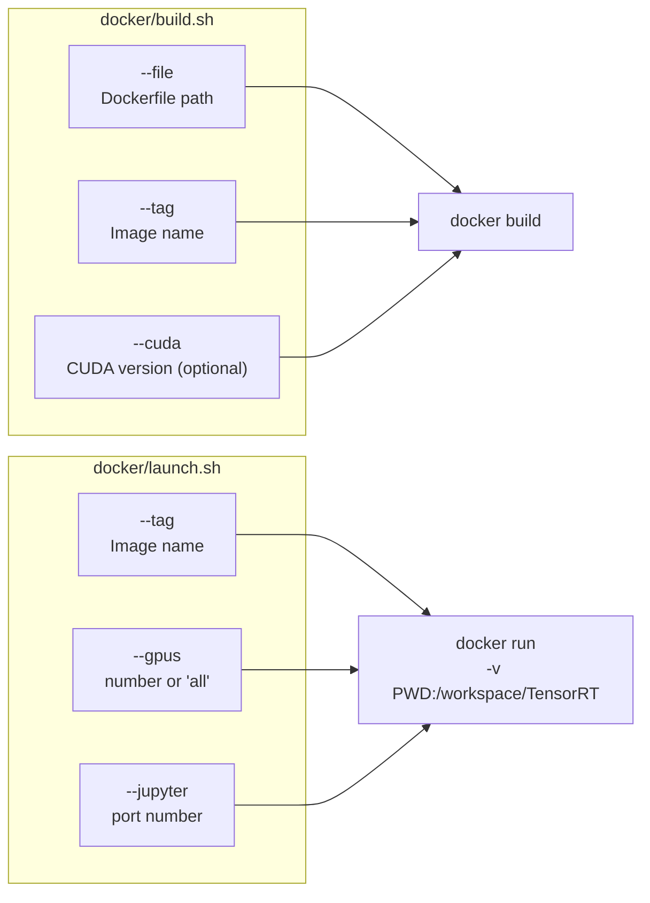
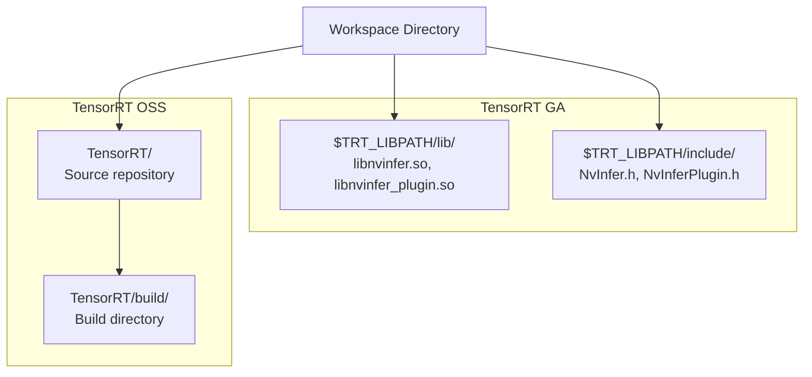

<!-- source: DeepWiki mcp.deepwiki.com · repo NVIDIA/TensorRT · page 1.1 Installation and Setup · fetched 2026-10-26 -->

# Installation and Setup

<details>
<summary>Relevant source files</summary>

The following files were used as context for generating this wiki page:

- [README.md](README.md)
- [VERSION](VERSION)
- [docker/build.sh](docker/build.sh)
- [docker/launch.sh](docker/launch.sh)
- [docker/ubuntu-cross-aarch64.Dockerfile](docker/ubuntu-cross-aarch64.Dockerfile)
- [include/NvInferVersion.h](include/NvInferVersion.h)

</details>


This document covers the initial installation and setup process for TensorRT Open Source Software (OSS). It describes the two available installation paths—a prebuilt Python package for quick setup and a full source build—along with prerequisites, supported platforms, and environment configuration.

For detailed information about the build process itself, see page 2. For Docker-specific build environments, see page 2.2.

## Prebuilt Python Package

For Python users who do not need to modify plugins, parsers, or samples, the TensorRT Python package is available directly from PyPI:

```bash
pip install tensorrt
```

This installs the TensorRT Python bindings without requiring a source build. If this is sufficient for your use case, the remainder of this page (covering source builds) can be skipped.

Sources: [README.md:27-36]()

## Prerequisites

TensorRT OSS requires both the TensorRT GA (General Availability) binaries and several system dependencies. The OSS components extend and build upon the GA release.

### System Requirements

The following table lists required system packages for a source build:

| Component | Required Version | Notes |
|-----------|-----------------|-------|
| TensorRT GA | 10.15.1.29 | Provides `libnvinfer.so` and headers |
| CUDA Toolkit | 13.1.0 or 12.9.0 | GPU compute framework |
| cuDNN | 8.9 | Optional; needed for some plugins |
| CMake | >= 3.31 | Build system generator |
| Python | >= 3.10, <= 3.13.x | Scripting and demo applications |
| pip | >= 19.0 | Python package management |
| GNU Make | >= 4.1 | Build execution (Linux) |
| git | any | Source control |
| pkg-config | any | Library detection |
| wget | any | Dependency fetching |

> **Note:** `onnx-tensorrt`, `cub`, and `protobuf` are downloaded automatically as part of the build process and do not need to be pre-installed.

### Optional Packages

| Package | Purpose |
|---------|---------|
| Docker >= 19.03 + NVIDIA Container Toolkit | Containerized build environment |
| `onnx`, `onnxruntime` | Demo applications and tests |
| `tensorflow-gpu` >= 2.5.1 | TF quantization toolkit demos |
| `pycuda` < 2021.1 | Python CUDA interop |
| `Pillow` >= 9.0.1 | Image I/O in samples |
| `numpy`, `pytest` | Testing |
| `clang-format`, `git-clang-format` | Code formatting (contributors only) |

### Dependency Relationships

**Diagram: Source build dependency graph**



Sources: [README.md:40-82]()

## TensorRT GA Download

TensorRT OSS requires the corresponding TensorRT GA binaries at build time. The `TRT_LIB_DIR` CMake variable must point to the extracted library directory. The current supported version is `10.15.1.29`, as defined in [include/NvInferVersion.h:26-33]() and [VERSION:1]().

> If you are using the TensorRT OSS build container, TensorRT libraries are pre-installed under `/usr/lib/x86_64-linux-gnu` and this download step can be skipped.

### Platform-Specific Downloads

Download the appropriate TensorRT GA package from the [NVIDIA Developer Zone](https://developer.nvidia.com):

| Platform | CUDA Version | Archive Filename |
|----------|-------------|-----------------|
| Linux x86_64 | 13.1 | `TensorRT-10.15.1.29.Linux.x86_64-gnu.cuda-13.1.tar.gz` |
| Linux x86_64 | 12.9 | `TensorRT-10.15.1.29.Linux.x86_64-gnu.cuda-12.9.tar.gz` |
| Windows x86_64 | 13.1 | `TensorRT-10.15.1.29.Windows.win10.cuda-13.1.zip` |
| Windows x86_64 | 12.9 | `TensorRT-10.15.1.29.Windows.win10.cuda-12.9.zip` |

> For aarch64 targets (Jetson, DriveOS), the cross-compile Docker containers download and install the appropriate aarch64 TensorRT libraries automatically. See [docker/ubuntu-cross-aarch64.Dockerfile:87-89]().

### Environment Variable Setup

After extracting the TensorRT GA package, set `TRT_LIBPATH` to the `lib/` subdirectory:

**Linux (Ubuntu 22.04, x86-64, CUDA 13.1):**
```bash
cd ~/Downloads
tar -xvzf TensorRT-10.15.1.29.Linux.x86_64-gnu.cuda-13.1.tar.gz
export TRT_LIBPATH=`pwd`/TensorRT-10.15.1.29/lib
```

**Windows (x86-64, CUDA 12.9):**
```powershell
Expand-Archive -Path TensorRT-10.15.1.29.Windows.win10.cuda-12.9.zip
$env:TRT_LIBPATH="$pwd\TensorRT-10.15.1.29\lib"
```

`TRT_LIBPATH` is passed directly to CMake as `-DTRT_LIB_DIR=$TRT_LIBPATH`.

Sources: [README.md:84-118](), [include/NvInferVersion.h:26-33](), [VERSION:1]()

## Repository Setup

### Cloning TensorRT OSS

Clone the repository with all required submodules. The submodules include `onnx-tensorrt`, `cub`, and `protobuf`:

```bash
git clone -b main https://github.com/nvidia/TensorRT TensorRT
cd TensorRT
git submodule update --init --recursive
```

### Repository Structure

**Diagram: Repository directory layout and key files**



Sources: [README.md:86-92](), [VERSION:1]()

## Environment Configuration

### CMake Variables

The build system requires two variables and accepts several optional ones:

| Variable | Required | Default | Description |
|----------|----------|---------|-------------|
| `TRT_LIB_DIR` | Yes | — | Path to TensorRT GA `lib/` directory |
| `TRT_OUT_DIR` | Yes | — | Output directory for build artifacts |
| `CUDA_VERSION` | No | `13.1` | CUDA version to target (e.g. `12.9`) |
| `CUDNN_VERSION` | No | — | cuDNN version (e.g. `8.9`) |
| `GPU_ARCHS` | No | all major SMs | Space-separated SM architectures (e.g. `"80 120"`) |
| `CMAKE_TOOLCHAIN_FILE` | No | — | Toolchain file for cross-compilation |
| `BUILD_PLUGINS` | No | `ON` | Build `libnvinfer_plugin.so` |
| `BUILD_PARSERS` | No | `ON` | Build `libnvonnxparser.so` |
| `BUILD_SAMPLES` | No | `ON` | Build sample binaries |
| `CMAKE_BUILD_TYPE` | No | `Release` | `Release` or `Debug` |
| `TRT_PLATFORM_ID` | No | `x86_64` | Target platform for bare-metal builds |

### Version Macros

The version of TensorRT in use is defined in `NvInferVersion.h`. The build system reads these macros to set library versioning:

**Diagram: Version macro definitions in NvInferVersion.h**



Sources: [include/NvInferVersion.h:26-33](), [README.md:225-241]()

## Supported Platforms and Architectures

TensorRT OSS supports both native and cross-compiled builds across multiple platforms:

| Platform | Architecture | Build Type | Toolchain |
|----------|-------------|-----------|-----------|
| Linux (Ubuntu 24.04) | x86_64 | Native | Host GCC |
| Linux (Ubuntu 24.04) | aarch64 | Native | `cmake_aarch64-native.toolchain` |
| Linux (Ubuntu 24.04) | aarch64 (Jetson) | Cross-compile | `cmake_aarch64_cross.toolchain` |
| DriveOS Linux | aarch64 | Cross-compile | `cmake_aarch64_dos_cross.toolchain` |
| DriveOS QNX | aarch64 | Cross-compile | `cmake_qnx.toolchain` / `cmake_qnx_safe.toolchain` |
| Windows 10/11 | x86_64 | Native | MSVC (`msbuild`) |
| Rocky Linux 8 | x86_64 | Native | Host GCC |

Toolchain files live under `cmake/toolchains/`.

## Build Environment Setup

### Docker Environment (Recommended)

For Linux platforms, Docker provides a consistent build environment. The [docker/build.sh]() script wraps `docker build` with arguments for the Dockerfile, image tag, and CUDA version.

**Available Dockerfiles:**

| Dockerfile | Target |
|-----------|--------|
| `docker/ubuntu-24.04.Dockerfile` | x86_64 native (default) |
| `docker/ubuntu-24.04-aarch64.Dockerfile` | aarch64 native |
| `docker/ubuntu-cross-aarch64.Dockerfile` | Cross-compile for Jetson (aarch64) |
| `docker/rockylinux8.Dockerfile` | Rocky Linux 8 x86_64 |

#### Building Docker Containers

```bash
# Ubuntu 24.04 with CUDA 13.1 (default)
./docker/build.sh --file docker/ubuntu-24.04.Dockerfile --tag tensorrt-ubuntu24.04-cuda13.1

# Rocky Linux 8 with CUDA 13.1
./docker/build.sh --file docker/rockylinux8.Dockerfile --tag tensorrt-rockylinux8-cuda13.1

# Cross-compile for Jetson (aarch64) with CUDA 13.1
./docker/build.sh --file docker/ubuntu-cross-aarch64.Dockerfile --tag tensorrt-jetpack-cuda13.1

# Native aarch64 build
./docker/build.sh --file docker/ubuntu-24.04-aarch64.Dockerfile --tag tensorrt-aarch64-ubuntu24.04-cuda13.1
```

#### Launching Build Container

```bash
./docker/launch.sh --tag tensorrt-ubuntu24.04-cuda13.1 --gpus all
```

The `docker/launch.sh` script mounts the current directory into `/workspace/TensorRT` inside the container. Pass `--jupyter <port>` to start a Jupyter notebook server instead of a shell.

Inside the container:
- TensorRT libraries are pre-installed under `/usr/lib/x86_64-linux-gnu`
- `TRT_LIBPATH` and `TRT_OSSPATH` environment variables are set
- Cross-compilation toolchains are available for aarch64 builds (see [docker/ubuntu-cross-aarch64.Dockerfile:39-54]())

**Diagram: docker/build.sh and docker/launch.sh arguments**



### Native Environment

For native builds without Docker, install all [prerequisite](#prerequisites) system packages, set `TRT_LIBPATH` to the extracted TensorRT GA `lib/` directory, and proceed to the CMake build step described in page 2.

Sources: [README.md:120-161](), [docker/build.sh:19-50](), [docker/launch.sh:19-58](), [docker/ubuntu-cross-aarch64.Dockerfile:24-100]()

## Build Environment Verification

### Directory Structure Check

Verify your setup by checking the expected directory structure:



### Environment Variable Validation

Confirm the required environment variables are set:

```bash
echo "TRT_LIBPATH: $TRT_LIBPATH"
echo "TRT_OSSPATH: $TRT_OSSPATH"  # Set automatically in Docker containers
```

### Quick Build Test

Perform a basic CMake configuration to verify setup:

```bash
cd TensorRT
mkdir -p build && cd build
cmake .. -DTRT_LIB_DIR=$TRT_LIBPATH -DTRT_OUT_DIR=`pwd`/out
```

This command should complete without errors, indicating that:
- TensorRT GA libraries are found
- All dependencies are available
- Build configuration is valid

**Sources:** [README.md:153-162](), [CMakeLists.txt:23-24]()

---

