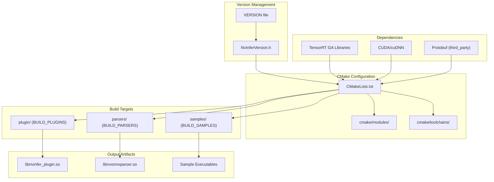
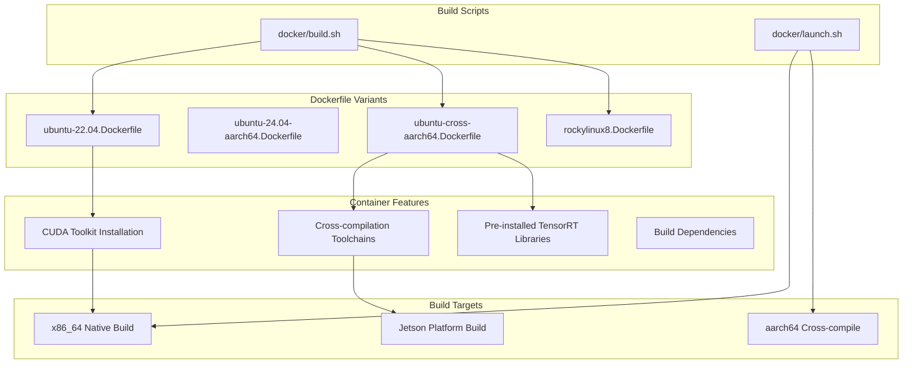
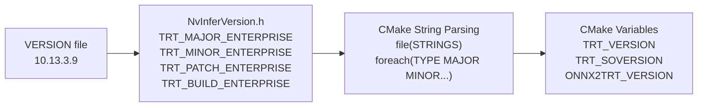
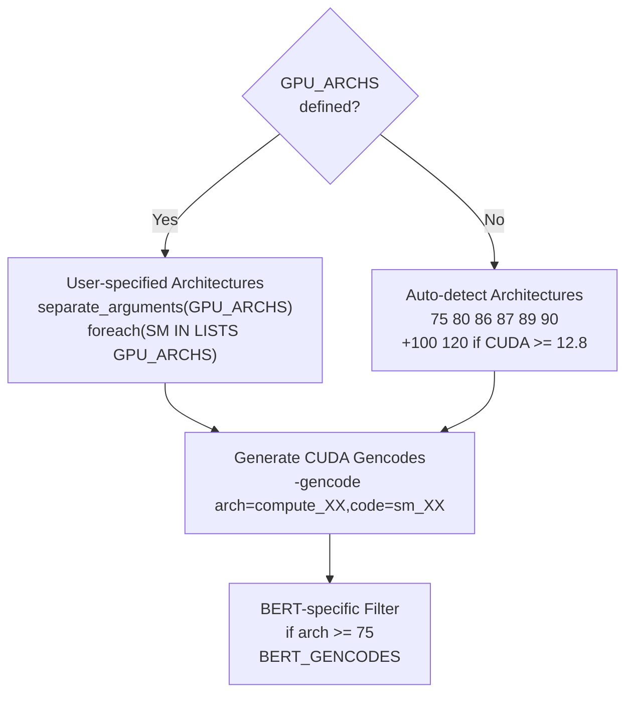
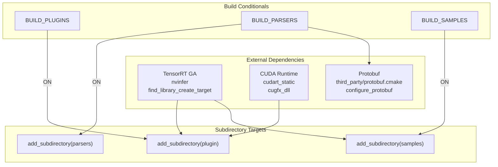
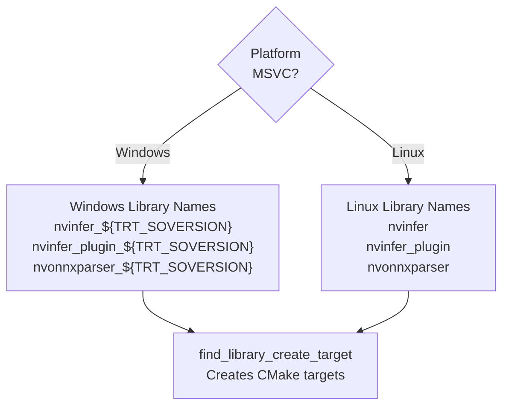

<!-- source: DeepWiki mcp.deepwiki.com · repo NVIDIA/TensorRT · page 2 Building From Source · fetched 2026-10-26 -->

# Building From Source

<details>
<summary>Relevant source files</summary>

The following files were used as context for generating this wiki page:

- [CMakeLists.txt](CMakeLists.txt)
- [README.md](README.md)
- [VERSION](VERSION)
- [cmake/toolchains/cmake_qnx_safe.toolchain](cmake/toolchains/cmake_qnx_safe.toolchain)
- [docker/build.sh](docker/build.sh)
- [docker/launch.sh](docker/launch.sh)
- [docker/ubuntu-cross-aarch64.Dockerfile](docker/ubuntu-cross-aarch64.Dockerfile)
- [include/NvInferVersion.h](include/NvInferVersion.h)
- [samples/common/sampleEngines.cpp](samples/common/sampleEngines.cpp)
- [samples/common/sampleInference.cpp](samples/common/sampleInference.cpp)
- [samples/common/sampleInference.h](samples/common/sampleInference.h)
- [samples/common/sampleOptions.cpp](samples/common/sampleOptions.cpp)
- [samples/common/sampleOptions.h](samples/common/sampleOptions.h)
- [samples/common/sampleReporting.cpp](samples/common/sampleReporting.cpp)
- [samples/trtexec/trtexec.cpp](samples/trtexec/trtexec.cpp)

</details>


This document provides comprehensive guidance for building TensorRT Open Source Software (OSS) components from source code. It covers the CMake-based build system, Docker containerization for reproducible builds, dependency management, and cross-compilation support for multiple platforms and architectures.

For information about the overall repository structure and components, see [TensorRT Overview](#1). For details about the plugin system that gets built as part of this process, see [Plugin System](#4).

## Build System Overview

TensorRT OSS uses a CMake-based build system that supports multiple platforms, architectures, and build configurations. The system is designed to build plugins, parsers, and sample applications while linking against the TensorRT GA (General Availability) libraries.

### Build System Architecture



Sources: [CMakeLists.txt:1-239](), [include/NvInferVersion.h:1-45](), [VERSION:1-2]()

## Prerequisites and Dependencies

The build system requires several categories of dependencies that must be satisfied before compilation can begin.

### Required Dependencies

| Component | Version | Purpose |
|-----------|---------|---------|
| TensorRT GA | 10.13.3.9 | Core runtime libraries |
| CUDA | 13.0.0 or 12.9.0 | GPU computation framework |
| CMake | >= 3.31 | Build system generator |
| Python | 3.10-3.13.x | Build scripting and samples |
| GCC/Clang | Compatible | C++ compilation |

### CMake Build Variables

The build system uses several key CMake variables for configuration:

| Variable | Default | Description |
|----------|---------|-------------|
| `TRT_LIB_DIR` | `CMAKE_BINARY_DIR` | Path to TensorRT GA libraries |
| `TRT_OUT_DIR` | `CMAKE_BINARY_DIR` | Output directory for build artifacts |
| `BUILD_PLUGINS` | `ON` | Build TensorRT plugin library |
| `BUILD_PARSERS` | `ON` | Build ONNX parser library |
| `BUILD_SAMPLES` | `ON` | Build sample applications |
| `GPU_ARCHS` | Auto-detected | Target GPU architectures |

Sources: [README.md:29-72](), [CMakeLists.txt:205-219]()

## Docker Build Environments

TensorRT OSS provides Docker-based build environments for reproducible cross-platform builds. The Docker system supports multiple Linux distributions and cross-compilation targets.

### Docker Build System Architecture



### Container Build Process

The Docker build system uses two main scripts:

1. **`docker/build.sh`** - Builds Docker images with specified configurations
2. **`docker/launch.sh`** - Launches containers with proper GPU access and volume mounts

Example container generation:
```bash
./docker/build.sh --file docker/ubuntu-22.04.Dockerfile --tag tensorrt-ubuntu22.04-cuda13.0
./docker/launch.sh --tag tensorrt-ubuntu22.04-cuda13.0 --gpus all
```

Sources: [docker/build.sh:1-51](), [docker/launch.sh:1-59](), [docker/ubuntu-cross-aarch64.Dockerfile:1-101]()

## CMake Configuration and Build Options

The root `CMakeLists.txt` implements a sophisticated build configuration system that handles version management, dependency resolution, and target architecture selection.

### Version Management System

The build system extracts version information from header files and integrates it into CMake variables:



The version extraction is implemented in [CMakeLists.txt:51-61]():
- Reads `#define TRT_.*_ENTERPRISE` patterns from `NvInferVersion.h`
- Extracts numeric values using regex matching
- Sets `TRT_VERSION` and `TRT_SOVERSION` variables

### GPU Architecture Selection

The build system supports flexible GPU architecture targeting through the `GPU_ARCHS` variable:



Sources: [CMakeLists.txt:71-100]()

## Build Process

### Standard Build Workflow

The typical build process follows these steps:

1. **Environment Setup**
```bash
export TRT_LIBPATH=/path/to/tensorrt/lib
cd TensorRT
mkdir -p build && cd build
```

2. **CMake Configuration**
```bash
cmake .. -DTRT_LIB_DIR=$TRT_LIBPATH -DTRT_OUT_DIR=`pwd`/out
```

3. **Compilation**
```bash
make -j$(nproc)
```

### Build Targets and Dependencies



Sources: [CMakeLists.txt:224-238](), [CMakeLists.txt:159-178]()

## Cross-Compilation Support

### Jetson and aarch64 Builds

The build system supports cross-compilation for ARM-based platforms through CMake toolchain files:

| Platform | Toolchain File | Build Command |
|----------|---------------|---------------|
| aarch64 native | `cmake_aarch64-native.toolchain` | Standard cmake with toolchain |
| aarch64 cross-compile | `cmake_aarch64_cross.toolchain` | Cross-compilation from x86_64 |
| Jetson Thor | Native build | `TRT_PLATFORM_ID=aarch64 GPU_ARCHS=110` |

### Cross-compilation Docker Environment

The `ubuntu-cross-aarch64.Dockerfile` provides a complete cross-compilation environment:

- **Base Image**: `nvidia/cuda:13.0.0-devel-ubuntu24.04`
- **Cross-compile Toolchain**: `g++-aarch64-linux-gnu`
- **CUDA Cross Tools**: `cuda-cross-sbsa-13-0`
- **Pre-installed TensorRT**: aarch64 libraries in `/usr/lib/aarch64-linux-gnu`

Example cross-compilation build:
```bash
cmake .. -DTRT_LIB_DIR=$TRT_LIBPATH \
         -DCMAKE_TOOLCHAIN_FILE=$TRT_OSSPATH/cmake/toolchains/cmake_aarch64_cross.toolchain \
         -DGPU_ARCHS=110
```

Sources: [docker/ubuntu-cross-aarch64.Dockerfile:78-100](), [README.md:184-191]()

## Build System Integration

### Library Name Resolution

The build system handles platform-specific library naming conventions through conditional logic:



The `find_library_create_target` function from [cmake/modules/find_library_create_target.cmake]() creates CMake targets for TensorRT libraries, searching in `TRT_LIB_DIR` and system paths.

Sources: [CMakeLists.txt:180-198](), [CMakeLists.txt:22-33]()

---

