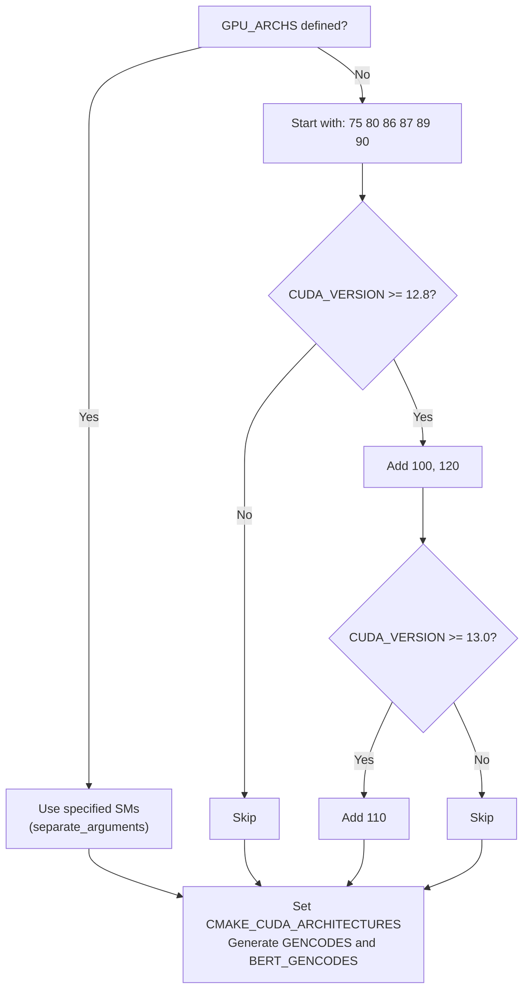
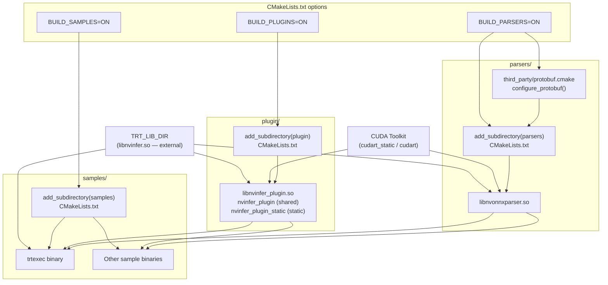
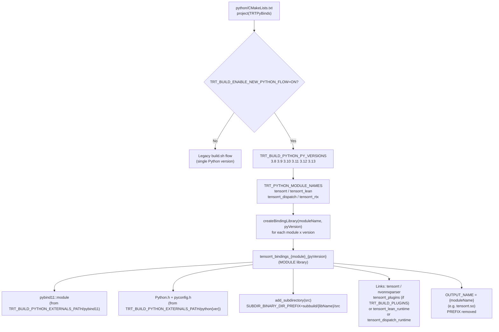
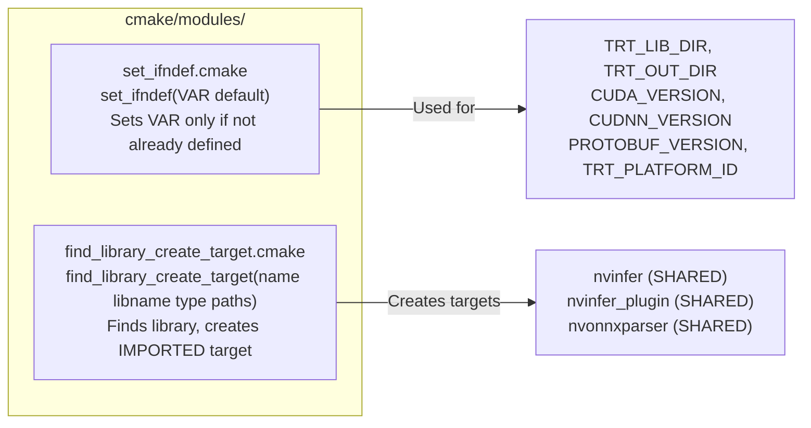

<!-- source: DeepWiki mcp.deepwiki.com · repo NVIDIA/TensorRT · page 2.1 Build System Architecture · fetched 2026-10-26 -->

# Build System Architecture

<details>
<summary>Relevant source files</summary>

The following files were used as context for generating this wiki page:

- [.gitignore](.gitignore)
- [CMakeLists.txt](CMakeLists.txt)
- [README.md](README.md)
- [VERSION](VERSION)
- [cmake/toolchains/cmake_qnx_safe.toolchain](cmake/toolchains/cmake_qnx_safe.toolchain)
- [docker/build.sh](docker/build.sh)
- [docker/launch.sh](docker/launch.sh)
- [docker/ubuntu-cross-aarch64.Dockerfile](docker/ubuntu-cross-aarch64.Dockerfile)
- [include/NvInferVersion.h](include/NvInferVersion.h)
- [include/NvOnnxParser.h](include/NvOnnxParser.h)
- [python/CMakeLists.txt](python/CMakeLists.txt)
- [python/build.sh](python/build.sh)
- [python/docstrings/parsers/pyOnnxDoc.h](python/docstrings/parsers/pyOnnxDoc.h)
- [python/src/parsers/pyOnnx.cpp](python/src/parsers/pyOnnx.cpp)
- [samples/common/sampleEngines.cpp](samples/common/sampleEngines.cpp)
- [samples/common/sampleInference.cpp](samples/common/sampleInference.cpp)
- [samples/common/sampleInference.h](samples/common/sampleInference.h)
- [samples/common/sampleOptions.cpp](samples/common/sampleOptions.cpp)
- [samples/common/sampleOptions.h](samples/common/sampleOptions.h)
- [samples/common/sampleReporting.cpp](samples/common/sampleReporting.cpp)
- [samples/trtexec/trtexec.cpp](samples/trtexec/trtexec.cpp)

</details>


This page documents the internals of the CMake-based build system for TensorRT OSS: the structure of `CMakeLists.txt`, all recognized build variables, how the three primary build targets relate to one another, and how the separate Python bindings build works. For information about the Docker environments that wrap this build system, see [Docker Build Environments](#2.2). For the higher-level walkthrough of the build process from a user perspective, see [Building From Source](#2).

---

## Overview

The TensorRT OSS build system has two entry points:

| Entry Point | Purpose |
|---|---|
| `CMakeLists.txt` (root) | Builds the C++ libraries and samples: plugins (`libnvinfer_plugin`), parsers (`libnvonnxparser`), and sample binaries including `trtexec` |
| `python/CMakeLists.txt` + `python/build.sh` | Builds the Python `.so` bindings as a separate project, one per Python version and module variant |

The root build requires a pre-built TensorRT GA binary release (providing `libnvinfer.so`) and a CUDA toolkit installation. Everything else — Protobuf, CUB — is downloaded and built by CMake automatically.

Sources: [CMakeLists.txt:1-30](), [python/build.sh:1-75](), [README.md:38-241]()

---

## Root CMakeLists.txt Structure

**CMake module loading and output directory setup**

[CMakeLists.txt:19-43]()

The file begins by loading two custom CMake modules from `cmake/modules/`:

- `set_ifndef.cmake` — a helper that sets a variable only if it is not already defined, used throughout for default values.
- `find_library_create_target.cmake` — wraps `find_library` and creates an imported CMake target in one step.

Output paths `RUNTIME_OUTPUT_DIRECTORY`, `LIBRARY_OUTPUT_DIRECTORY`, and `ARCHIVE_OUTPUT_DIRECTORY` are all set to `TRT_OUT_DIR`.

**Version extraction**

[CMakeLists.txt:51-61]()

The project version is not hard-coded in CMakeLists.txt. Instead, it is parsed at configure time from `include/NvInferVersion.h` using CMake's `file(STRINGS ...)` and regex matching against the `TRT_*_ENTERPRISE` macros. This ensures the version string in the build system stays synchronized with the header.

```
TRT_VERSION = TRT_MAJOR_ENTERPRISE.TRT_MINOR_ENTERPRISE.TRT_PATCH_ENTERPRISE
TRT_SOVERSION = TRT_MAJOR_ENTERPRISE
```

Sources: [CMakeLists.txt:51-61](), [include/NvInferVersion.h:26-29]()

---

## CMake Build Variables

### Required Variables

| Variable | Purpose |
|---|---|
| `TRT_LIB_DIR` | Path to the pre-built TensorRT GA library directory (containing `libnvinfer.so`). Defaults to `CMAKE_BINARY_DIR` if unset, which is typically wrong for out-of-tree builds. |
| `TRT_OUT_DIR` | Output directory where all compiled artifacts are copied. |

Sources: [CMakeLists.txt:23-33](), [README.md:225-227]()

### Optional Variables

| Variable | Default | Notes |
|---|---|---|
| `CMAKE_BUILD_TYPE` | `Release` | `Debug` adds `_debug` suffix (via `TRT_DEBUG_POSTFIX`) to library names |
| `CUDA_VERSION` | `13.1.0` | Controls CUDA feature detection and default GPU architectures |
| `CUDNN_VERSION` | `8.9` | Used when cuDNN-dependent plugins are built |
| `PROTOBUF_VERSION` | `3.20.3` | CMake downloads and builds this version; does not use system Protobuf |
| `GPU_ARCHS` | See below | Space-separated SM numbers, e.g. `"80 90 120"` |
| `CMAKE_TOOLCHAIN_FILE` | (none) | Path to a cross-compilation toolchain file |
| `TRT_PLATFORM_ID` | `x86_64` | Used for bare-metal (non-Docker) cross-compilation identification |
| `BUILD_PLUGINS` | `ON` | Build `libnvinfer_plugin` from source; if `OFF`, searches for a prebuilt copy |
| `BUILD_PARSERS` | `ON` | Build `libnvonnxparser` from source; if `OFF`, searches for a prebuilt copy |
| `BUILD_SAMPLES` | `ON` | Build sample binaries including `trtexec` |
| `BUILD_SAFE_SAMPLES` | `OFF` | Build safety-certified sample programs against `libnvinfer_safe` |
| `TRT_SAFETY_INFERENCE_ONLY` | `OFF` | Forces `BUILD_PLUGINS`, `BUILD_PARSERS`, and `BUILD_SAMPLES` all to `OFF` and enables `BUILD_SAFE_SAMPLES` |

Sources: [CMakeLists.txt:70-127](), [README.md:228-241]()

### GPU Architecture Selection

[CMakeLists.txt:74-107]()

When `GPU_ARCHS` is not set, the build system generates PTX/SASS for a default set of compute capabilities based on `CUDA_VERSION`:

| CUDA Version | Default Architectures |
|---|---|
| Any | 75, 80, 86, 87, 89, 90 |
| ≥ 12.8 | + 100, 120 |
| ≥ 13.0 | + 110 |

PTX is generated for the highest SM in the list (for forward compatibility). BERT plugin kernels have a separate gencode list (`BERT_GENCODES`) that excludes SM 110.

When `GPU_ARCHS` is set, only the specified SMs are compiled, which reduces build time and binary size.

**GPU architecture flow**



Sources: [CMakeLists.txt:74-107]()

---

## Three Main Build Targets

The following diagram maps the three `option()` flags to the subdirectories and output libraries they control.

**Build target dependency graph**



Sources: [CMakeLists.txt:291-387]()

### When BUILD_PLUGINS or BUILD_PARSERS is OFF

[CMakeLists.txt:368-378]()

When a build flag is `OFF`, the build system uses `find_library_create_target` to locate a prebuilt version of the library. The search order is:

1. `TRT_OUT_DIR` (a previously built OSS version)
2. `TRT_LIB_DIR` (the GA release directory)
3. System paths

If a `Debug` build type is active, debug-suffixed versions are preferred over release versions.

---

## External Dependencies

| Dependency | How Acquired | Controlled By |
|---|---|---|
| `libnvinfer.so` | Must be provided externally via `TRT_LIB_DIR` | `find_library_create_target(nvinfer ...)` [CMakeLists.txt:322]() |
| CUDA | `find_package(CUDA)` or cross-compile toolchain | `CUDA_VERSION` variable |
| cuDNN | Optional; searched on system | `CUDNN_VERSION` variable |
| Protobuf | Downloaded and built by `third_party/protobuf.cmake` | `PROTOBUF_VERSION` variable |
| CUB | Bundled as `third_party/cub` for CUDA < 11.0 | Auto-detected from `CUDA_VERSION` |

Sources: [CMakeLists.txt:280-298](), [CMakeLists.txt:144-151]()

### CUDA Runtime Linking

[CMakeLists.txt:327-346]()

The CUDA runtime library selection depends on the CUDA version:

- CUDA ≥ 12.0: links `cudart_static`, sets `CMAKE_CUDA_RUNTIME_LIBRARY=static`
- CUDA < 12.0: links shared `cudart`, sets `CMAKE_CUDA_RUNTIME_LIBRARY=shared`
- QNX Safe builds: `CMAKE_CUDA_RUNTIME_LIBRARY=None` (manual linking via `trt_global_definitions`)

---

## Cross-Compilation Toolchains

The `cmake/toolchains/` directory provides toolchain files for non-native builds. Each file sets `CMAKE_SYSTEM_NAME`, `CMAKE_SYSTEM_PROCESSOR`, and the cross-compiler paths.

| Toolchain File | Target |
|---|---|
| `cmake/toolchains/cmake_aarch64-native.toolchain` | Native aarch64 Linux (e.g., Jetson native build) |
| `cmake/toolchains/cmake_aarch64_cross.toolchain` | Cross-compile for aarch64 Linux (Jetson via JetPack) |
| `cmake/toolchains/cmake_aarch64_dos_cross.toolchain` | Cross-compile for DriveOS aarch64 Linux |
| `cmake/toolchains/cmake_qnx.toolchain` | Cross-compile for QNX aarch64 |
| `cmake/toolchains/cmake_qnx_safe.toolchain` | Cross-compile for QNX aarch64 Safety (Safe CUDA) |

> **Note for native aarch64 builds:** The C compiler must be specified explicitly via `CC=/usr/bin/gcc` because Protobuf's build process requires it [README.md:192-193]().

The QNX Safe toolchain [cmake/toolchains/cmake_qnx_safe.toolchain:1-140]() additionally:
- Disables `cudadevrt` linkage (`--cudadevrt=none`)
- Adds QNX-specific defines: `_QNX_SOURCE`, `IS_QNX_SAFE=1`
- Sets `CMAKE_TRY_COMPILE_TARGET_TYPE=STATIC_LIBRARY` to avoid linker issues during compiler detection

Sources: [cmake/toolchains/cmake_qnx_safe.toolchain:18-120](), [README.md:178-210]()

### Build Examples

The following commands illustrate the most common build configurations:

```bash
# Standard Linux x86_64
cmake .. -DTRT_LIB_DIR=$TRT_LIBPATH -DTRT_OUT_DIR=`pwd`/out

# Native aarch64 (Jetson)
cmake .. -DTRT_LIB_DIR=$TRT_LIBPATH -DTRT_OUT_DIR=`pwd`/out -DTRT_PLATFORM_ID=aarch64

# Cross-compile for Jetson (from x86 host)
cmake .. -DTRT_LIB_DIR=$TRT_LIBPATH -DTRT_OUT_DIR=`pwd`/out \
         -DCMAKE_TOOLCHAIN_FILE=$TRT_OSSPATH/cmake/toolchains/cmake_aarch64_cross.toolchain

# Limit to specific GPU architectures to speed up builds
cmake .. -DTRT_LIB_DIR=$TRT_LIBPATH -DTRT_OUT_DIR=`pwd`/out -DGPU_ARCHS="80 90"

# Windows
cmake .. -DTRT_LIB_DIR="$env:TRT_LIBPATH" -DTRT_OUT_DIR="$pwd\\out"
msbuild TensorRT.sln /property:Configuration=Release -m:$env:NUMBER_OF_PROCESSORS
```

Sources: [README.md:162-222]()

---

## Safety Build Mode

[CMakeLists.txt:154-252]()

Setting `BUILD_SAFE_SAMPLES=ON` or `TRT_SAFETY_INFERENCE_ONLY=ON` activates the safety inference path, which links against `libnvinfer_safe` instead of `libnvinfer`.

The build system:
1. Searches for `nvinfer_safe` and `nvinfer_safe_debug` in `TRT_LIB_DIR`
2. Creates imported targets `TRTSAFE::nvinfer_safe_shared` and `TRTSAFE::nvinfer_safe_debug`
3. Creates an interface target `trt_global_definitions` that propagates common compile flags, include directories, and link libraries to all safety samples
4. Defines `ENABLE_UNIFIED_BUILDER=1` for conditional compilation throughout the codebase

When `TRT_SAFETY_INFERENCE_ONLY=ON`, CMake forcibly sets `BUILD_PLUGINS`, `BUILD_PARSERS`, and `BUILD_SAMPLES` to `OFF`.

Sources: [CMakeLists.txt:154-252]()

---

## Python Bindings Build

The Python bindings live in `python/` and are built as a separate CMake project from the main tree. They are **not** added as a subdirectory from the root `CMakeLists.txt`.

There are two ways to build them:

### Method 1: python/build.sh

[python/build.sh:1-75]()

This script creates a single binding `.so` for one Python version at a time. It accepts configuration through environment variables:

| Environment Variable | Default | Purpose |
|---|---|---|
| `PYTHON_MAJOR_VERSION` | `3` | Python major version |
| `PYTHON_MINOR_VERSION` | `8` | Python minor version |
| `TARGET_ARCHITECTURE` | `x86_64` | Target CPU architecture |
| `CUDA_ROOT` | `/usr/local/cuda` | CUDA installation path |
| `TRT_OSSPATH` | `/workspace/TensorRT` | Root of the TensorRT OSS checkout |
| `TRT_LIBPATH` | (required) | Path to TensorRT GA libraries |
| `TENSORRT_MODULE` | (required) | Module name: `tensorrt`, `tensorrt_lean`, etc. |

The script:
1. Runs `cmake` in `python/build/`
2. Runs `make -j12` to produce `tensorrt.so`
3. Reads `TRT_MAJOR_ENTERPRISE`, `TRT_MINOR_ENTERPRISE`, etc. from `include/NvInferVersion.h` using `awk`
4. Runs `python3 setup.py bdist_wheel` to produce an installable wheel

### Method 2: python/CMakeLists.txt (new flow)

[python/CMakeLists.txt:22-253]()

A newer, more capable flow is gated behind `TRT_BUILD_ENABLE_NEW_PYTHON_FLOW=ON`. When active, it builds bindings for all configured Python versions in a single CMake invocation.

**Python binding build structure**



Key design details:

- `PYBIND11_NOPYTHON ON` disables pybind11's automatic Python detection, since bindings for multiple versions are built simultaneously.
- The `createBindingLibrary` function [python/CMakeLists.txt:80-210]() is called once per `(moduleName, pyVersion)` pair, producing a dedicated CMake library target per combination.
- The `tensorrt` full module links against `nvonnxparser`; the `tensorrt_lean` and `tensorrt_dispatch` modules link against their respective lean/dispatch runtimes only.
- The `tensorrt` module includes ONNX parser bindings from `python/src/parsers/pyOnnx.cpp`.

Sources: [python/CMakeLists.txt:22-253](), [python/build.sh:30-74](), [python/src/parsers/pyOnnx.cpp:1-30]()

---

## Key CMake Module Functions

**Mapping of CMake helpers to their files**



Sources: [CMakeLists.txt:19-24](), [CMakeLists.txt:322-378]()

---

## Build Output Summary

All artifacts are written to `TRT_OUT_DIR`. The table below maps build options to output files.

| Enabled Option | Output Artifact | Source Subdirectory |
|---|---|---|
| `BUILD_PLUGINS=ON` | `libnvinfer_plugin.so`, `libnvinfer_plugin.a` | `plugin/` |
| `BUILD_PARSERS=ON` | `libnvonnxparser.so` | `parsers/` |
| `BUILD_SAMPLES=ON` | `trtexec` and other sample binaries | `samples/` |
| `BUILD_SAFE_SAMPLES=ON` | Safety sample binaries | `samples/` |
| `python/build.sh` | `tensorrt.so` wheel | `python/build/` |

On Windows, library names include the major version number suffix (e.g., `nvinfer_10.dll`, `nvinfer_plugin_10.dll`) as controlled by [CMakeLists.txt:309-319]().

Sources: [CMakeLists.txt:40-43](), [CMakeLists.txt:304-387](), [python/build.sh:68-74]()

---

