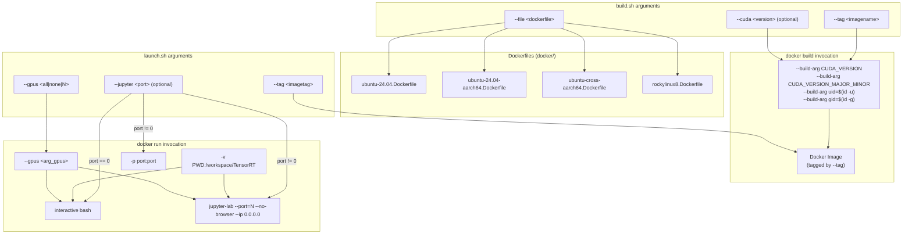
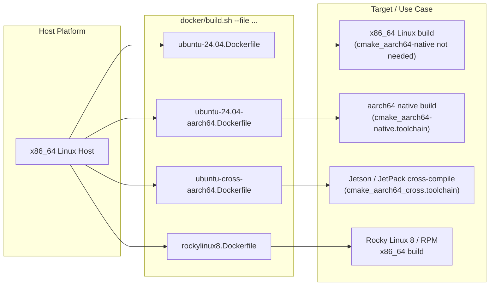

<!-- source: DeepWiki mcp.deepwiki.com · repo NVIDIA/TensorRT · page 2.2 Docker Build Environments · fetched 2026-10-26 -->

# Docker Build Environments

<details>
<summary>Relevant source files</summary>

The following files were used as context for generating this wiki page:

- [README.md](README.md)
- [VERSION](VERSION)
- [docker/build.sh](docker/build.sh)
- [docker/launch.sh](docker/launch.sh)
- [docker/ubuntu-cross-aarch64.Dockerfile](docker/ubuntu-cross-aarch64.Dockerfile)
- [include/NvInferVersion.h](include/NvInferVersion.h)

</details>


This page documents the containerized build environment for TensorRT OSS: the available Dockerfiles, the `docker/build.sh` helper for building images, and the `docker/launch.sh` helper for running them. This covers environment setup only. For the CMake arguments and build targets that run *inside* these containers, see [Build System Architecture](#2.1).

---

## Overview

The `docker/` directory provides a set of pre-configured Dockerfiles and two shell scripts. Each Dockerfile installs the necessary system toolchain, CUDA toolkit, Python, CMake, and TensorRT GA libraries so that the in-container build environment requires no further manual dependency installation.

The two scripts are:

| Script | Purpose |
|---|---|
| `docker/build.sh` | Builds a Docker image from a chosen Dockerfile |
| `docker/launch.sh` | Runs a container from a previously built image |

**Prerequisites for containerized builds:**
- Docker >= 19.03
- NVIDIA Container Toolkit (required for GPU access inside the container)

---

## Available Dockerfiles

Four Dockerfiles are provided, each targeting a different host or target platform:

| Dockerfile | Base Image | Use Case |
|---|---|---|
| `docker/ubuntu-24.04.Dockerfile` | `nvidia/cuda:*-devel-ubuntu24.04` | Native x86_64 Linux build (default) |
| `docker/ubuntu-24.04-aarch64.Dockerfile` | `nvidia/cuda:*-devel-ubuntu24.04` | Native aarch64 Linux build |
| `docker/ubuntu-cross-aarch64.Dockerfile` | `nvidia/cuda:*-devel-ubuntu24.04` | Cross-compile x86_64 → aarch64 (Jetson/JetPack) |
| `docker/rockylinux8.Dockerfile` | Rocky Linux 8 base | Native x86_64 RPM-based Linux build |

### Cross-Compilation Dockerfile Details

The `docker/ubuntu-cross-aarch64.Dockerfile` is the most complex of the four. It sets up a full aarch64 cross-compilation toolchain on an x86_64 host.

Key setup steps performed by this Dockerfile:

1. Installs `g++-aarch64-linux-gnu` for C++ cross-compilation
2. Downloads and installs CMake 3.27.9 from source (the system version is typically too old)
3. Downloads the CUDA cross-compile toolchain package (`cuda-cross-sbsa-13-1`)
4. Downloads and unpacks the TensorRT aarch64 GA tarball, placing `.so` files under `/usr/lib/aarch64-linux-gnu`
5. Sets environment variables `TRT_LIBPATH` and `TRT_OSSPATH` for use in subsequent CMake invocations

The `CUDA_VERSION` and `OS_VERSION` are both configurable `ARG` values with defaults of `13.1.0` and `24.04` respectively.

Sources: [docker/ubuntu-cross-aarch64.Dockerfile:1-101]()

---

## docker/build.sh

[docker/build.sh:1-51]()

`build.sh` is a thin wrapper around `docker build`. It accepts three arguments:

| Argument | Default | Description |
|---|---|---|
| `--file <dockerfile>` | `docker/ubuntu-24.04.Dockerfile` | Path to the Dockerfile to use |
| `--tag <imagename>` | `tensorrt-ubuntu` | Tag applied to the resulting image |
| `--cuda <version>` | *(not passed)* | If set, passes `CUDA_VERSION` and `CUDA_VERSION_MAJOR_MINOR` as Docker build args |
| `-h / --help` | — | Prints usage |

The script always forwards `--build-arg uid=$(id -u)` and `--build-arg gid=$(id -g)` so the in-container `trtuser` account is created with matching host UID/GID, avoiding permission issues on the bind-mounted workspace.

If `--cuda` is omitted, the Dockerfile's own `ARG CUDA_VERSION` default is used.

**Usage examples:**

```bash
# Ubuntu 24.04 x86_64, default CUDA 13.1
./docker/build.sh --file docker/ubuntu-24.04.Dockerfile --tag tensorrt-ubuntu24.04-cuda13.1

# Rocky Linux 8
./docker/build.sh --file docker/rockylinux8.Dockerfile --tag tensorrt-rockylinux8-cuda13.1

# Cross-compile image for Jetson (aarch64)
./docker/build.sh --file docker/ubuntu-cross-aarch64.Dockerfile --tag tensorrt-jetpack-cuda13.1

# Ubuntu 24.04 native aarch64
./docker/build.sh --file docker/ubuntu-24.04-aarch64.Dockerfile --tag tensorrt-aarch64-ubuntu24.04-cuda13.1

# Override CUDA version
./docker/build.sh --file docker/ubuntu-24.04.Dockerfile --tag tensorrt-ubuntu24.04-cuda12.9 --cuda 12.9
```

Sources: [docker/build.sh:1-51]()

---

## docker/launch.sh

[docker/launch.sh:1-59]()

`launch.sh` is a wrapper around `docker run`. It mounts the current working directory into the container at `/workspace/TensorRT` and starts an interactive shell (or a Jupyter server).

| Argument | Default | Description |
|---|---|---|
| `--tag <imagetag>` | `tensorrt-ubuntu24.04` | Image tag to run |
| `--gpus <number>` | `all` | GPU visibility. Pass `none` to disable GPU access |
| `--jupyter <port>` | `0` (disabled) | If non-zero, exposes the port and runs `jupyter-lab` instead of a shell |
| `-h / --help` | — | Prints usage |

When `--gpus none` is passed, the `--gpus` flag is omitted from `docker run` entirely, which is useful for build-only workflows with no GPU present.

When `--jupyter <port>` is non-zero, the script appends `-p <port>:<port>` and runs `jupyter-lab --port=<port> --no-browser --ip 0.0.0.0 --allow-root` as the container command.

**Usage examples:**

```bash
# Interactive shell, all GPUs
./docker/launch.sh --tag tensorrt-ubuntu24.04-cuda13.1 --gpus all

# No GPU (build only)
./docker/launch.sh --tag tensorrt-ubuntu24.04-cuda13.1 --gpus none

# Launch Jupyter on port 8888
./docker/launch.sh --tag tensorrt-ubuntu24.04-cuda13.1 --jupyter 8888
```

> **Note:** The `sudo` password inside Ubuntu containers is `nvidia`. Write permission on the host directory is required because it is mounted with UID:GID `1000:1000`.

Sources: [docker/launch.sh:1-59]()

---

## Build Flow Diagram

The following diagram maps the scripts and files to the Docker operations they invoke.

**Docker environment setup flow**



Sources: [docker/build.sh:1-51](), [docker/launch.sh:1-59]()

---

## Dockerfile Environment Variables

Each Dockerfile sets environment variables that downstream CMake commands rely on. The cross-compile Dockerfile is the most explicit about this:

| Variable | Value (cross-aarch64) | Purpose |
|---|---|---|
| `TRT_VERSION` | `10.15.1.29` | TensorRT version installed in image |
| `TRT_LIBPATH` | `/usr/lib/aarch64-linux-gnu` | Passed as `-DTRT_LIB_DIR` to CMake |
| `TRT_OSSPATH` | `/workspace/TensorRT` | Mount point for the repository |
| `PATH` | `/opt/venv/bin:$PATH` | Python virtualenv is active by default |

For the x86_64 Ubuntu images, TensorRT GA libraries are pre-installed under `/usr/lib/x86_64-linux-gnu`, so no explicit `TRT_LIB_DIR` argument is needed when building inside the container.

Sources: [docker/ubuntu-cross-aarch64.Dockerfile:94-97](), [README.md:94-98]()

---

## Dockerfile vs. Target Platform Matrix



Sources: [README.md:124-160](), [docker/ubuntu-cross-aarch64.Dockerfile:1-101]()

---

