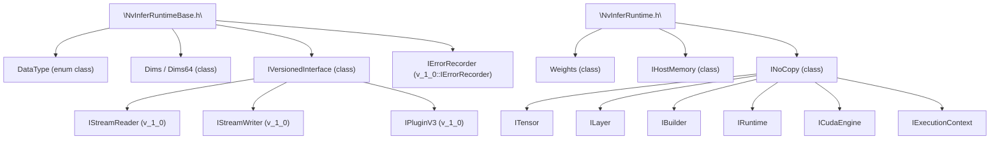
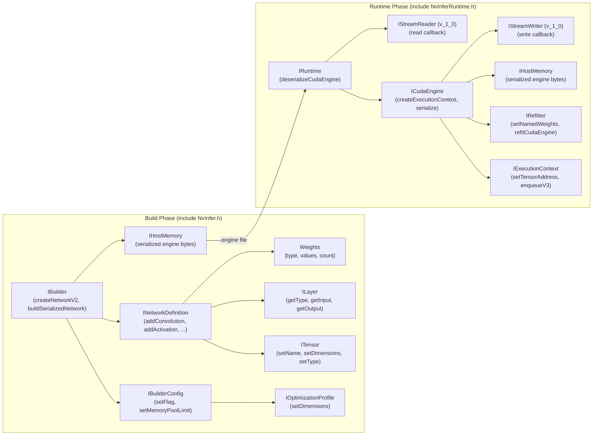

<!-- source: DeepWiki mcp.deepwiki.com · repo NVIDIA/TensorRT · page 3 Core API · fetched 2026-10-26 -->

# Core API

<details>
<summary>Relevant source files</summary>

The following files were used as context for generating this wiki page:

- [.gitmodules](.gitmodules)
- [CHANGELOG.md](CHANGELOG.md)
- [include/NvInfer.h](include/NvInfer.h)
- [include/NvInferImpl.h](include/NvInferImpl.h)
- [include/NvInferLegacyDims.h](include/NvInferLegacyDims.h)
- [include/NvInferPlugin.h](include/NvInferPlugin.h)
- [include/NvInferPluginUtils.h](include/NvInferPluginUtils.h)
- [include/NvInferRuntime.h](include/NvInferRuntime.h)
- [include/NvInferRuntimeBase.h](include/NvInferRuntimeBase.h)
- [include/NvInferRuntimeCommon.h](include/NvInferRuntimeCommon.h)
- [include/NvInferRuntimePlugin.h](include/NvInferRuntimePlugin.h)

</details>


This page covers the TensorRT C++ API header organization under `include/`, the `nvinfer1` namespace, versioning macros, and the separation between builder-time and runtime headers. The types and classes described here form the foundation on which the rest of the system is built.

- For network construction types (`ITensor`, `ILayer`, `INetworkDefinition`, `Weights`), see [Network Definition](#3.1).
- For the builder and optimization profile API (`IBuilder`, `IBuilderConfig`), see [Builder and Optimization](#3.2).
- For runtime inference (`IRuntime`, `ICudaEngine`, `IExecutionContext`), see [Runtime and Inference](#3.3).
- For the plugin extension system, see [Plugin System](#4).

---

## Header Organization

All public API headers are located under `include/`. Each header has a distinct role; applications select the appropriate entry point header based on what they need.

**Header Dependency Diagram**

```mermaid
graph TD
  NvInfer_h["\"NvInfer.h\"\n(builder + network definition)"]
  NvInferRuntime_h["\"NvInferRuntime.h\"\n(runtime only)"]
  NvInferPlugin_h["\"NvInferPlugin.h\"\n(built-in plugin library)"]
  NvInferPluginUtils_h["\"NvInferPluginUtils.h\"\n(plugin parameter structs)"]
  NvInferImpl_h["\"NvInferImpl.h\"\n(vtable bridge, apiv namespace)"]
  NvInferRuntimeCommon_h["\"NvInferRuntimeCommon.h\"\n(IPluginRegistry)"]
  NvInferRuntimePlugin_h["\"NvInferRuntimePlugin.h\"\n(IPluginV2, PluginTensorDesc)"]
  NvInferPluginBase_h["\"NvInferPluginBase.h\"\n(IPluginCreatorInterface)"]
  NvInferLegacyDims_h["\"NvInferLegacyDims.h\"\n(Dims2, Dims3, Dims4, DimsHW)"]
  NvInferRuntimeBase_h["\"NvInferRuntimeBase.h\"\n(DataType, Dims, macros)"]
  NvInferVersion_h["\"NvInferVersion.h\"\n(NV_TENSORRT_MAJOR/MINOR/PATCH)"]

  NvInfer_h --> NvInferLegacyDims_h
  NvInfer_h --> NvInferRuntime_h
  NvInferPlugin_h --> NvInfer_h
  NvInferPlugin_h --> NvInferPluginUtils_h
  NvInferPluginUtils_h --> NvInferRuntimeCommon_h
  NvInferRuntime_h --> NvInferImpl_h
  NvInferRuntime_h --> NvInferPluginBase_h
  NvInferRuntime_h --> NvInferRuntimeCommon_h
  NvInferRuntimeCommon_h --> NvInferPluginBase_h
  NvInferRuntimeCommon_h --> NvInferRuntimePlugin_h
  NvInferRuntimePlugin_h --> NvInferPluginBase_h
  NvInferImpl_h --> NvInferLegacyDims_h
  NvInferImpl_h --> NvInferRuntimeCommon_h
  NvInferLegacyDims_h --> NvInferRuntimeBase_h
  NvInferRuntimeBase_h --> NvInferVersion_h
```

Sources: [include/NvInfer.h:1-22](), [include/NvInferRuntime.h:1-32](), [include/NvInferImpl.h:1-23](), [include/NvInferPlugin.h:1-42](), [include/NvInferPluginUtils.h:1-22](), [include/NvInferRuntimeBase.h:1-25](), [include/NvInferLegacyDims.h:1-23]()

### Entry Point Summary

| Header | Include for | Notes |
|--------|-------------|-------|
| `NvInfer.h` | Engine building + network definition | Includes `NvInferRuntime.h` transitively |
| `NvInferRuntime.h` | Inference-only deployments | Excludes builder-time classes |
| `NvInferPlugin.h` | Using or registering the built-in plugin library | Declares `initLibNvInferPlugins()` |
| `NvInferPluginUtils.h` | Plugin parameter structs only | `PriorBoxParameters`, `NMSParameters`, etc. |

Sources: [include/NvInfer.h:38-40](), [include/NvInferRuntime.h:22-26](), [include/NvInferPlugin.h:26-28]()

---

## The `nvinfer1` Namespace

All TensorRT API types reside in the `nvinfer1` namespace. The comment in `NvInfer.h` describes it as "The TensorRT API version 1 namespace." Plugin utilities use the nested `nvinfer1::plugin` namespace.

Versioned interface implementations use nested `v_1_0` sub-namespaces, with the outer namespace providing `using` aliases:

```cpp
// Pattern used throughout NvInferImpl.h
namespace v_1_0 { class IStreamReader; }
using IStreamReader = v_1_0::IStreamReader;
```

This pattern allows future ABI-compatible updates by adding `v_1_1` variants without breaking the outer alias.

Sources: [include/NvInfer.h:47-48](), [include/NvInferImpl.h:124-141](), [include/NvInferPluginUtils.h:31-33]()

---

## Versioning

Version constants are defined in `include/NvInferVersion.h` (not included in OSS sources, but referenced by `NvInferRuntimeBase.h`). The macros `NV_TENSORRT_MAJOR`, `NV_TENSORRT_MINOR`, and `NV_TENSORRT_PATCH` are set there, and `NvInferRuntimeBase.h` computes the combined version:

```c
// From include/NvInferRuntimeBase.h
#define NV_TENSORRT_VERSION_INT(major, minor, patch)  \
    ((major)*10000L + (minor)*100L + (patch)*1L)

#define NV_TENSORRT_VERSION  \
    NV_TENSORRT_VERSION_INT(NV_TENSORRT_MAJOR, NV_TENSORRT_MINOR, NV_TENSORRT_PATCH)
```

`NV_TENSORRT_VERSION` is an integer usable in preprocessor expressions. It is also returned by `IPluginV2::getTensorRTVersion()` (the low 24 bits) for ABI compatibility checking of legacy plugins.

`NvInferRuntimeBase.h` also defines several annotation macros used throughout the headers:

| Macro | Purpose |
|-------|---------|
| `TRT_DEPRECATED` | Marks a symbol deprecated; expands to `[[deprecated]]` in C++14+ |
| `TRT_DEPRECATED_BECAUSE(REASON)` | Deprecated with a message |
| `TRT_DEPRECATED_ENUM` | Applied to individual enum values |
| `TRT_NODISCARD` | Expands to `[[nodiscard]]`; used on functions whose return values must not be ignored |
| `TENSORRTAPI` | Visibility attribute for exported symbols |

Sources: [include/NvInferRuntimeBase.h:96-101](), [include/NvInferRuntimeBase.h:27-59]()

---

## Core Primitive Types

**Type Hierarchy: Primitives**



Sources: [include/NvInferRuntimeBase.h:140-205](), [include/NvInferRuntime.h:41-59](), [include/NvInferRuntime.h:110-166]()

### `DataType`

Defined in [include/NvInferRuntimeBase.h:144-194](). Represents the element type of tensors and weights.

| Enumerator | Value | Description |
|------------|-------|-------------|
| `kFLOAT` | 0 | 32-bit IEEE float |
| `kHALF` | 1 | 16-bit IEEE float (FP16) |
| `kINT8` | 2 | Signed 8-bit integer (used for quantization) |
| `kINT32` | 3 | Signed 32-bit integer |
| `kBOOL` | 4 | 8-bit boolean (0=false, 1=true) |
| `kUINT8` | 5 | Unsigned 8-bit integer |
| `kFP8` | 6 | 8-bit float, E4M3 format, bias 7 |
| `kBF16` | 7 | Brain float (8-bit exponent, 8-bit significand) |
| `kINT64` | 8 | Signed 64-bit integer |
| `kINT4` | 9 | Signed 4-bit integer |
| `kFP4` | 10 | 4-bit float (E2M1) |
| `kE8M0` | 11 | Unsigned exponent-only 8-bit float for quantization scales |

`EnumMax<DataType>()` returns `12`. The pattern of specializing `EnumMaxImpl<T>` is used throughout the API to allow compile-time bounds checking.

Sources: [include/NvInferRuntimeBase.h:144-205]()

### `Dims` / `Dims64`

`Dims64` is the primary dimension descriptor [include/NvInferRuntimeBase.h:217-233](). `Dims` is a `using` alias for `Dims64`. It holds up to `MAX_DIMS = 8` extents as `int64_t d[MAX_DIMS]` and a rank as `int32_t nbDims`.

Special sentinel values:
- **Invalid dims**: `nbDims == -1`, all `d[i] == 0`.
- **Unknown rank**: `nbDims == -1`, all `d[i] == -1`.
- **Wildcard dimension**: A specific `d[i] == -1` during dynamic shape analysis.

Concrete subclasses in [include/NvInferLegacyDims.h]() provide named accessors for common ranks:

| Class | Rank | Notes |
|-------|------|-------|
| `Dims2` | 2 | Generic 2D |
| `DimsHW` | 2 | `.h()` and `.w()` accessors |
| `Dims3` | 3 | Generic 3D |
| `Dims4` | 4 | Generic 4D |

Sources: [include/NvInferRuntimeBase.h:217-233](), [include/NvInferLegacyDims.h:43-202]()

### `Weights`

Defined in [include/NvInferRuntime.h:123-129](). A non-owning descriptor for a contiguous array of weight values:

| Field | Type | Description |
|-------|------|-------------|
| `type` | `DataType` | Element type |
| `values` | `void const*` | Pointer to weight data |
| `count` | `int64_t` | Number of elements |

The pointed-to data must remain valid until the engine is built. Zero-count weights (empty weights) use `values == nullptr` and `count == 0`.

Sources: [include/NvInferRuntime.h:110-129]()

### `IHostMemory`

Defined in [include/NvInferRuntime.h:141-166](). Wraps library-allocated host memory returned from operations like `ICudaEngine::serialize()`. Access via `data()`, `size()`, and `type()`. The memory is owned by the library and released when the object is destroyed.

`IHostMemory` extends `INoCopy`, so it must be accessed through a pointer and is not copyable or movable.

Sources: [include/NvInferRuntime.h:134-166]()

---

## Base Classes

### `INoCopy`

Defined in [include/NvInferRuntime.h:50-59](). Base for all TensorRT interface classes implemented inside the library. Deletes copy constructor, move constructor, and both assignment operators. All major API objects (`ITensor`, `ILayer`, `IBuilder`, `ICudaEngine`, `IExecutionContext`, `IRuntime`, etc.) extend `INoCopy`. Applications must use pointers to interact with these objects.

Sources: [include/NvInferRuntime.h:50-59]()

### `IVersionedInterface`

Defined in [include/NvInferRuntimeBase.h:276-303](). Base for interfaces that cross the shared library boundary and require explicit versioning. Provides:
- `getInterfaceInfo()` — returns an `InterfaceInfo` struct with `kind` (string), `major`, and `minor` version.
- `getAPILanguage()` — returns `APILanguage::kCPP` by default, or `kPYTHON` for Python-implemented plugins.

Classes that extend `IVersionedInterface` (rather than `INoCopy`) are typically implemented by the **application** and passed into TensorRT, rather than implemented by TensorRT itself. Examples include `IStreamReader`, `IStreamWriter`, `IPluginV3`, and `IOutputAllocator`.

Sources: [include/NvInferRuntimeBase.h:276-303](), [include/NvInferImpl.h:124-141]()

---

## Error Handling

### `ErrorCode`

Defined in [include/NvInferRuntimeBase.h:310-398](). An enum class with values used by `IErrorRecorder`:

| Enumerator | Description |
|------------|-------------|
| `kSUCCESS` | No error |
| `kUNSPECIFIED_ERROR` | Catch-all for forward compatibility |
| `kINTERNAL_ERROR` | TensorRT is in an invalid state; further calls are undefined |
| `kINVALID_ARGUMENT` | API contract violation on a single argument |
| `kINVALID_CONFIG` | Arguments are individually valid but inconsistent |
| `kFAILED_ALLOCATION` | Host or device memory allocation failed |
| `kFAILED_INITIALIZATION` | Dependent component did not initialize |
| `kFAILED_EXECUTION` | Asynchronous execution error or CUDA error |
| `kFAILED_COMPUTATION` | Data corruption during execution (NaN, overflow) |
| `kINVALID_STATE` | Invalid call sequence |
| `kUNSUPPORTED_STATE` | Network/hardware combination not supported |

Sources: [include/NvInferRuntimeBase.h:310-398]()

### `IErrorRecorder`

Defined as `v_1_0::IErrorRecorder` in [include/NvInferRuntimeBase.h:413-556](). Applications implement this interface to receive structured error reports. Key methods: `getNbErrors()`, `getErrorCode(int32_t)`, `getErrorDesc(int32_t)`, `hasOverflowed()`, `clear()`, and `reportError(ErrorCode, ErrorDesc)`. A recorder is attached to an object via `setErrorRecorder()`, available on most major interfaces.

Sources: [include/NvInferRuntimeBase.h:413-556]()

---

## Builder-Time vs. Runtime Separation

TensorRT uses two distinct sets of headers to allow inference-only deployments to be built without the engine builder.

**Phase Separation Diagram**



Sources: [include/NvInfer.h:18-22](), [include/NvInferRuntime.h:18-32](), [include/NvInferImpl.h:62-178]()

The classes in the "Build Phase" box are only available when `NvInfer.h` is included (which pulls in `NvInferRuntime.h` transitively). Inference-only applications can include only `NvInferRuntime.h` and avoid a link-time dependency on the builder.

---

## Internal Implementation Bridge (`apiv` namespace)

`NvInferImpl.h` defines the `nvinfer1::apiv` namespace, which contains pure-virtual classes (prefixed with `V`) that serve as the ABI boundary between the public API classes and the closed-source TensorRT library:

| `apiv` class | Used by public class |
|---|---|
| `VRuntime` | `IRuntime` |
| `VCudaEngine` | `ICudaEngine` |
| `VExecutionContext` | `IExecutionContext` |
| `VRefitter` | `IRefitter` |
| `VOptimizationProfile` | `IOptimizationProfile` |
| `VTensor` | `ITensor` |
| `VEngineInspector` | `IEngineInspector` |
| `VHostMemory` | `IHostMemory` |

Each public class holds a pointer to its corresponding `apiv::V*` object (e.g., `ITensor` holds `apiv::VTensor* mImpl`) and forwards method calls through it. Application code must not call `apiv` methods directly.

Sources: [include/NvInferImpl.h:244-500](), [include/NvInfer.h:569-571](), [include/NvInferRuntime.h:163-165]()

---

## Plugin-Related Headers

Two headers are relevant for plugin consumers without being part of the network definition or runtime:

- **`NvInferPlugin.h`** — declares the C-linkage function `initLibNvInferPlugins(void* logger, char const* libNamespace)`, which registers all built-in TensorRT plugins into the global `IPluginRegistry`. This must be called before deserializing any engine that uses built-in plugins. See [Plugin Registration and Initialization](#4.1).

- **`NvInferPluginUtils.h`** — defines parameter structs used by the built-in plugins, such as `PriorBoxParameters`, `GridAnchorParameters`, `NMSParameters`, `RPROIParams`, and `DetectionOutputParameters`. These live in the `nvinfer1::plugin` namespace. Several are deprecated as of TensorRT 10.0.

Sources: [include/NvInferPlugin.h:29-42](), [include/NvInferPluginUtils.h:43-200]()

---

