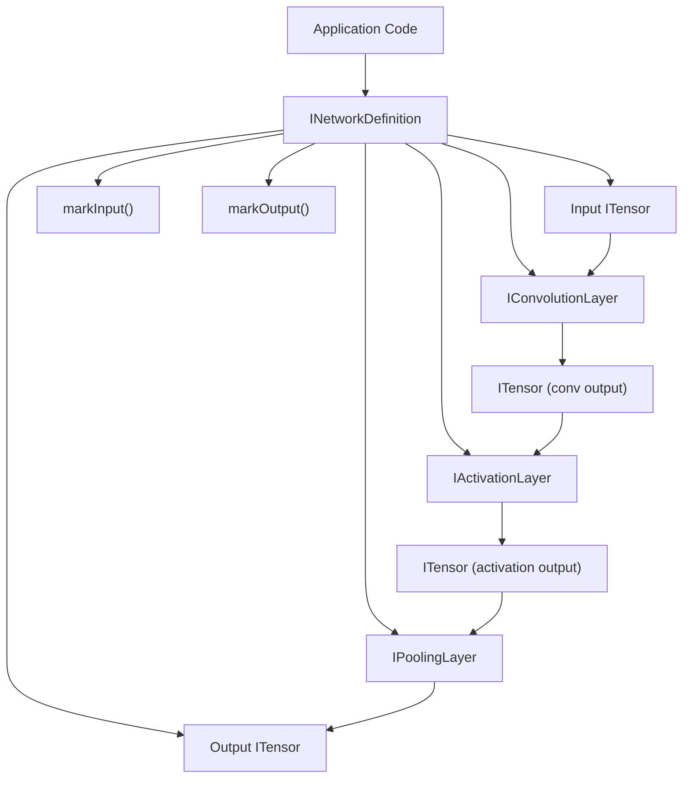
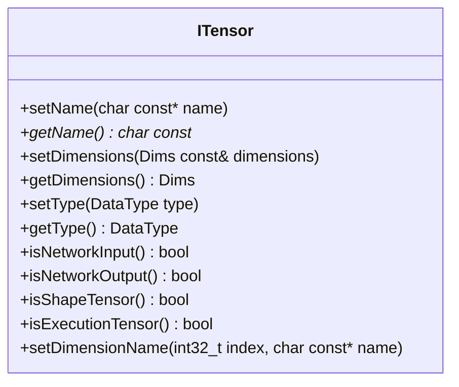
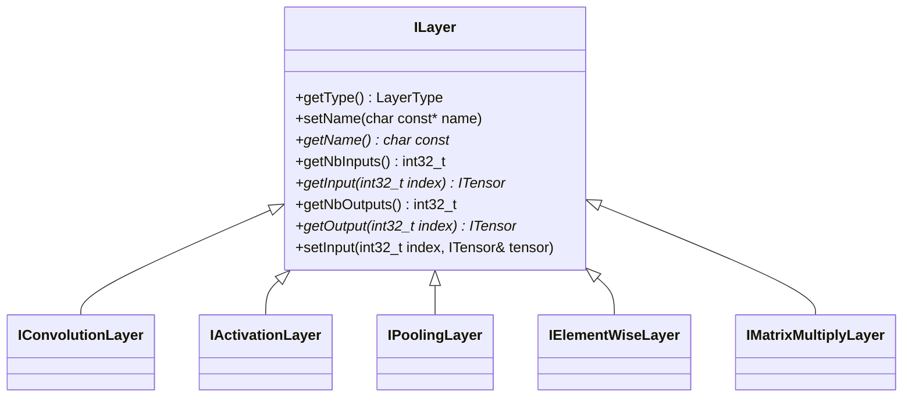
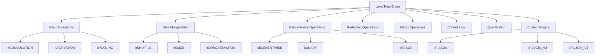
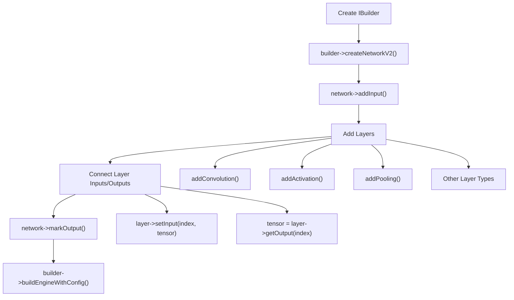
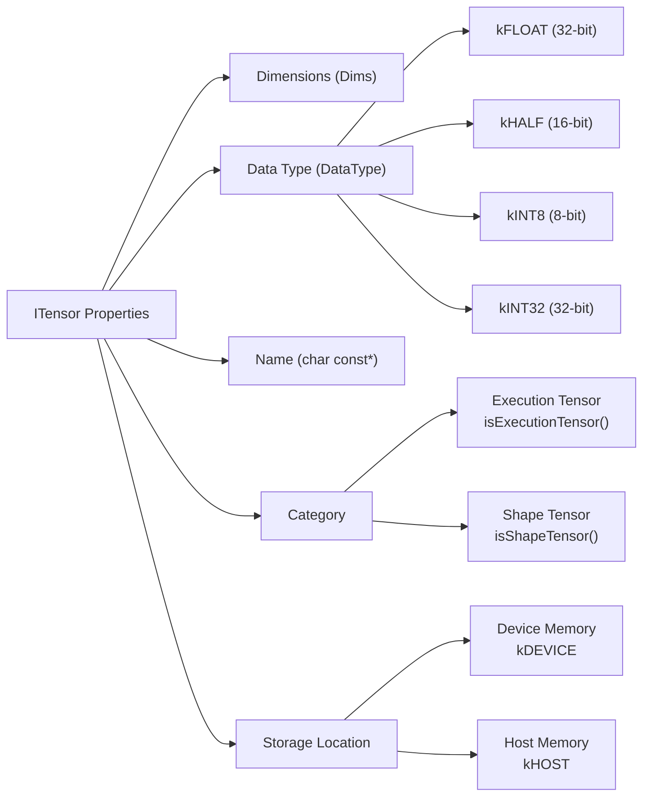
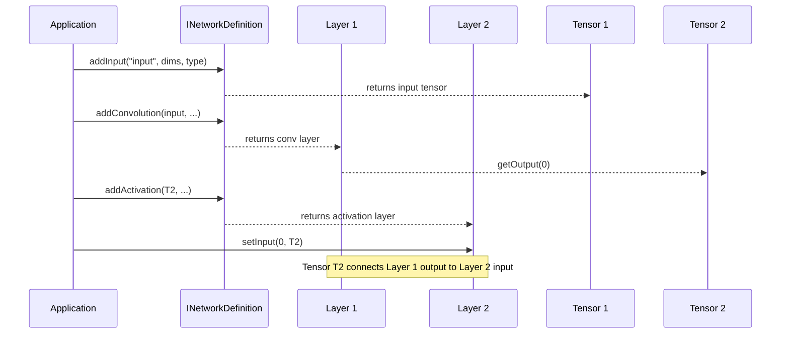

<!-- source: DeepWiki mcp.deepwiki.com · repo NVIDIA/TensorRT · page 3.1 Network Definition · fetched 2026-10-26 -->

# Network Definition

Relevant source files

The following files were used as context for generating this wiki page:

- [include/NvInfer.h](include/NvInfer.h)
- [include/NvInferImpl.h](include/NvInferImpl.h)
- [include/NvInferLegacyDims.h](include/NvInferLegacyDims.h)
- [include/NvInferPlugin.h](include/NvInferPlugin.h)
- [include/NvInferPluginUtils.h](include/NvInferPluginUtils.h)
- [include/NvInferRuntime.h](include/NvInferRuntime.h)
- [include/NvInferRuntimeBase.h](include/NvInferRuntimeBase.h)
- [include/NvInferRuntimeCommon.h](include/NvInferRuntimeCommon.h)
- [include/NvInferRuntimePlugin.h](include/NvInferRuntimePlugin.h)

This document covers the creation and definition of TensorRT neural networks using the `INetworkDefinition` API. It explains how to programmatically construct networks by creating tensors, adding layers, and connecting them together to form computational graphs.

For information about optimizing and building these network definitions into engines, see [Builder and Optimization](#3.2). For executing the built engines, see [Runtime and Inference](#3.3).

## Network Definition Overview

Network definition in TensorRT involves creating a computational graph where nodes represent operations (layers) and edges represent data flow (tensors). The primary interface for this is `INetworkDefinition`, which provides methods to add layers, create tensors, and specify network inputs and outputs.

Sources: [include/NvInfer.h:169-869]()

## Core Components

### ITensor - Network Data Representation

`ITensor` represents data flowing through the network. Each tensor has dimensions, a data type, and a name. Tensors serve as both inputs to layers and outputs from layers.

Key tensor properties:
- **Dimensions**: Shape of the tensor data using `Dims` structure
- **Data Type**: Element type (`DataType::kFLOAT`, `DataType::kHALF`, `DataType::kINT8`, etc.)
- **Network Role**: Input tensors, intermediate tensors, or output tensors
- **Tensor Category**: Execution tensors (data) or shape tensors (metadata)

Sources: [include/NvInfer.h:169-567]()

### ILayer - Network Operations

`ILayer` is the base class for all network operations. Each layer type inherits from `ILayer` and implements specific computation logic.

Sources: [include/NvInfer.h:570-869]()

## Layer Types and Categories

TensorRT supports a comprehensive set of layer types organized into functional categories:

| Category | Layer Types | Purpose |
|----------|-------------|---------|
| **Basic Operations** | `kCONVOLUTION`, `kACTIVATION`, `kPOOLING` | Core neural network operations |
| **Data Manipulation** | `kSHUFFLE`, `kSLICE`, `kCONCATENATION`, `kGATHER` | Tensor reshaping and indexing |
| **Element-wise** | `kELEMENTWISE`, `kUNARY`, `kSCALE` | Per-element computations |
| **Reduction** | `kREDUCE`, `kTOPK`, `kSOFTMAX` | Aggregation operations |
| **Matrix Operations** | `kMATRIX_MULTIPLY`, `kEINSUM` | Linear algebra operations |
| **Control Flow** | `kCONDITION`, `kLOOP_OUTPUT`, `kSELECT` | Conditional execution |
| **Quantization** | `kQUANTIZE`, `kDEQUANTIZE`, `kCAST` | Precision conversion |
| **Custom** | `kPLUGIN`, `kPLUGIN_V2`, `kPLUGIN_V3` | User-defined operations |

Sources: [include/NvInfer.h:57-121]()

## Network Construction Workflow

The typical workflow for creating a TensorRT network follows this pattern:

Sources: [include/NvInfer.h:57-869]()

## Tensor Management

### Tensor Properties and Metadata

Tensors carry essential metadata that TensorRT uses for optimization and validation:

### Shape Tensors vs Execution Tensors

TensorRT distinguishes between two categories of tensors:

- **Execution Tensors**: Carry actual network data and participate in the main computation
- **Shape Tensors**: Carry shape/size information used for dynamic shape inference

The distinction is determined by `isExecutionTensor()` and `isShapeTensor()` methods.

Sources: [include/NvInfer.h:472-522]()

## Layer Connection and Data Flow

Layers are connected by setting their input tensors to be the output tensors of previous layers:

The connection between layers is established through the tensor references:
- `ILayer::getOutput(index)` returns output tensors from a layer
- `ILayer::setInput(index, tensor)` sets input tensors for a layer
- `ILayer::getInput(index)` retrieves input tensors of a layer

Sources: [include/NvInfer.h:614-667]()

## Advanced Tensor Features

### Dynamic Shapes and Named Dimensions

For networks with dynamic input shapes, tensors support dimension naming to establish relationships between dimensions across different tensors:

- `setDimensionName(index, name)` - Associate a name with a tensor dimension
- `getDimensionName(index)` - Retrieve the name of a dimension

This enables TensorRT to understand that dimensions with the same name must have equal values at runtime.

### Tensor Formats and Allowed Formats

Tensors can specify which memory formats they support:
- `setAllowedFormats(formats)` - Restrict supported tensor formats
- `getAllowedFormats()` - Query supported formats

This is particularly important for optimizing memory layout and enabling specialized kernels.

Sources: [include/NvInfer.h:437-562]()

---

