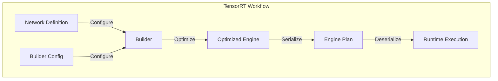
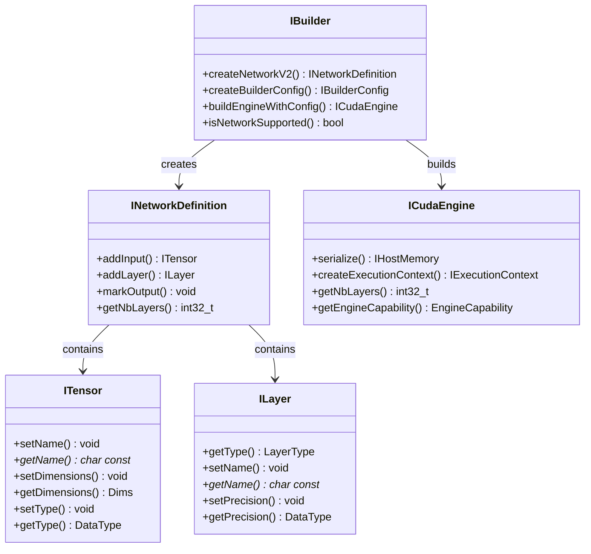
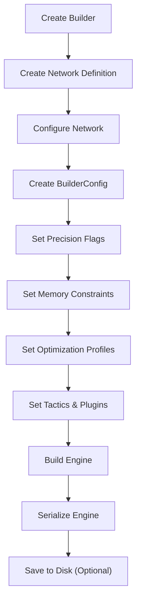
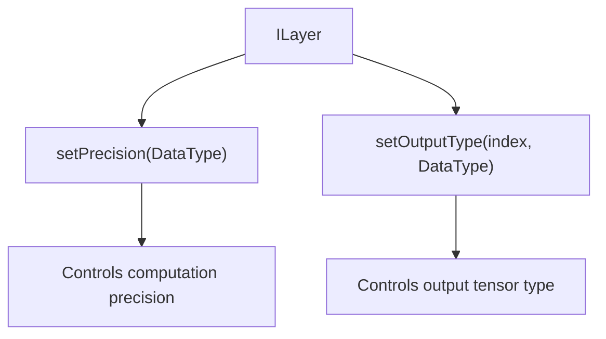
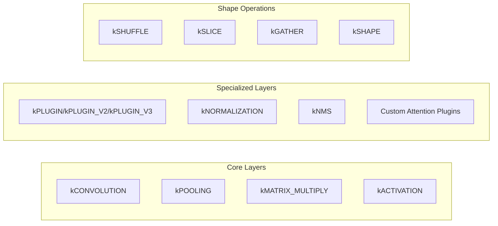
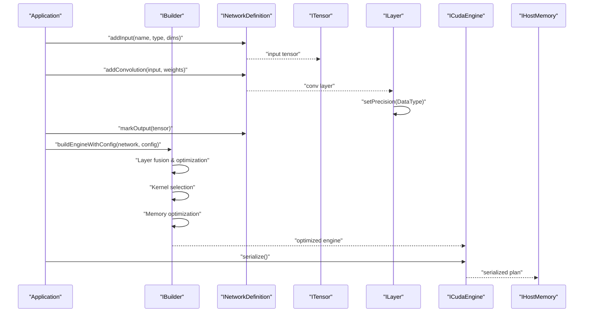
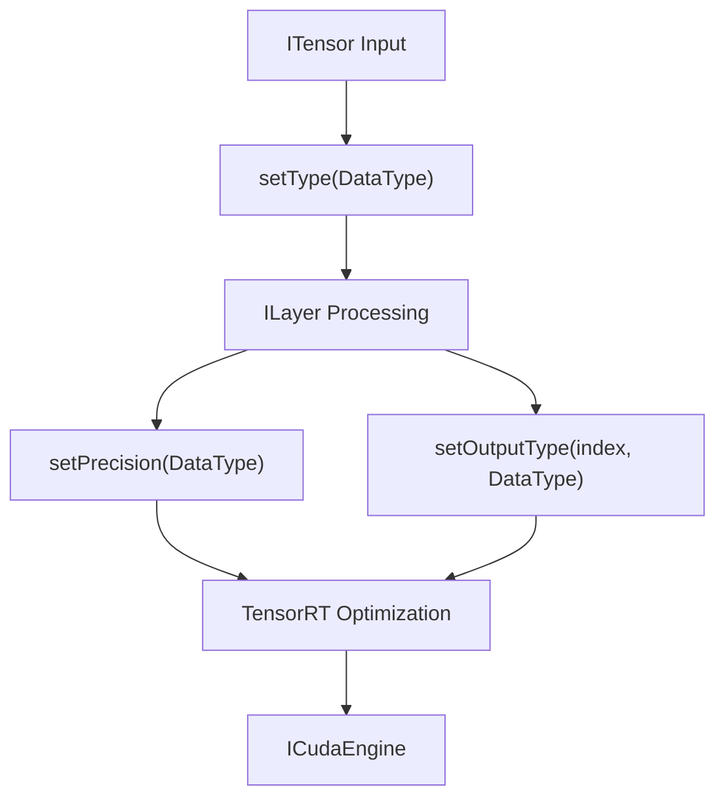

<!-- source: DeepWiki mcp.deepwiki.com · repo NVIDIA/TensorRT · page 3.2 Builder and Optimization · fetched 2026-10-26 -->

# Builder and Optimization

<details>
<summary>Relevant source files</summary>

The following files were used as context for generating this wiki page:

- [.gitignore](.gitignore)
- [include/NvInfer.h](include/NvInfer.h)
- [include/NvInferImpl.h](include/NvInferImpl.h)
- [include/NvInferLegacyDims.h](include/NvInferLegacyDims.h)
- [include/NvInferPlugin.h](include/NvInferPlugin.h)
- [include/NvInferPluginUtils.h](include/NvInferPluginUtils.h)
- [include/NvInferRuntime.h](include/NvInferRuntime.h)
- [include/NvInferRuntimeBase.h](include/NvInferRuntimeBase.h)
- [include/NvInferRuntimeCommon.h](include/NvInferRuntimeCommon.h)
- [include/NvInferRuntimePlugin.h](include/NvInferRuntimePlugin.h)
- [include/NvOnnxParser.h](include/NvOnnxParser.h)
- [python/CMakeLists.txt](python/CMakeLists.txt)
- [python/build.sh](python/build.sh)
- [python/docstrings/parsers/pyOnnxDoc.h](python/docstrings/parsers/pyOnnxDoc.h)
- [python/src/parsers/pyOnnx.cpp](python/src/parsers/pyOnnx.cpp)

</details>


The TensorRT Builder is a crucial component in the TensorRT workflow, responsible for transforming a network definition into an optimized runtime engine. This page documents the Builder API and optimization techniques available in TensorRT for creating high-performance inference engines. For information about creating network definitions, see [Network Definition](#2.1), and for executing the optimized engines, see [Runtime and Inference](#2.3).

## Builder Overview

The TensorRT Builder takes a network definition and generates an optimized engine by applying various transformations, layer optimizations, and kernel selections based on the target hardware and specified constraints.



Sources: [include/NvInfer.h:24-41](), [include/NvInferRuntime.h:75-107]()

## Key Builder Components

The TensorRT builder system consists of several key classes that work together to create optimized engines:



Sources: [include/NvInfer.h:182-567](), [include/NvInferRuntime.h:353-423](), [include/NvInferImpl.h:71-176]()

## Building Process

The building process involves several steps that transform the network definition into an optimized engine:



Sources: [include/NvInfer.h:57-121](), [include/NvInferRuntime.h:142-202]()

## Optimization Techniques

### Precision Modes

TensorRT supports various precision modes to balance performance and accuracy:

| Precision Mode | DataType Enum | Description |
|----------------|---------------|-------------|
| FP32           | `kFLOAT`      | 32-bit floating point format |
| FP16           | `kHALF`       | IEEE 16-bit floating-point format |
| INT8           | `kINT8`       | Signed 8-bit integer representing quantized floating-point |
| INT32          | `kINT32`      | Signed 32-bit integer format |
| BOOL           | `kBOOL`       | 8-bit boolean, 0 = false, 1 = true |
| UINT8          | `kUINT8`      | Unsigned 8-bit integer format |
| FP8            | `kFP8`        | Signed 8-bit floating point with 1 sign, 4 exponent, 3 mantissa bits |
| BF16           | `kBF16`       | Brain float with 8 bit exponent and 8 bit significand |
| INT64          | `kINT64`      | Signed 64-bit integer type |
| INT4           | `kINT4`       | Signed 4-bit integer type |

To enable these precision modes, set the appropriate flags in the builder configuration:

```cpp
// Example: Enabling precision modes
config->setFlag(BuilderFlag::kFP16);  // Enable FP16 precision
config->setFlag(BuilderFlag::kINT8);  // Enable INT8 precision
```

Sources: [include/NvInferRuntimeBase.h:142-192](), [include/NvInfer.h:281-299]()

### Memory Management

Properly configuring memory constraints is essential for optimal performance:

#### Workspace Size

The workspace size determines how much GPU memory TensorRT can use for temporary storage during execution:

For models that exceed GPU memory, the engine supports weight streaming and memory management:

Sources: [include/NvInferImpl.h:403-417](), [include/NvInferRuntime.h:111-130]()

## Builder Configuration Options

The builder configuration allows fine-grained control over the optimization process:

### Precision Constraints

Control how TensorRT handles precision constraints:

### Layer-Specific Precision Control

Individual layers support precision configuration through the `ILayer` interface:

The `setPrecision()` method allows controlling computational precision per layer, while `setOutputType()` controls the output data type:



Sources: [include/NvInfer.h:670-833](), [include/NvInferRuntime.h:75-97]()

## Profiling and Optimization Analysis

TensorRT provides several mechanisms to profile and analyze engine performance:

### Timing Cache

The timing cache stores the results of tactic selection to speed up subsequent builds:


Timing cache modes:

| Mode | Description |
|------|-------------|
| kDISABLE | Don't use timing cache |
| kLOCAL | Use timing cache for current build only |
| kGLOBAL | Load/save timing cache from/to disk |

Sources: [include/NvInferImpl.h:169-170](), [include/NvInferRuntime.h:163-167]()

### Profiling Verbosity

Control the level of information in the built engine for profiling:

The `ProfilingVerbosity` enumeration controls the level of profiling information stored in the engine:

Sources: [include/NvInferImpl.h:199](), [include/NvInferRuntime.h:372]()

## Advanced Optimization Features

### Engine Capabilities

TensorRT supports different engine capability flows that determine runtime restrictions:

| EngineCapability | Description |
|------------------|-------------|
| `kSTANDARD`      | Standard TensorRT flow supporting GPU and DLA |
| `kSAFETY`        | Safety-certified subset for automotive applications |
| `kDLA_STANDALONE`| DLA-only execution with external runtime |

### Layer Types and Optimization

TensorRT supports extensive layer types for optimization, including:



Sources: [include/NvInfer.h:57-110](), [include/NvInferRuntime.h:75-107]()

## Builder Construction Workflow

The typical workflow for creating an optimized engine involves these steps:



Sources: [include/NvInfer.h:182-567](), [include/NvInferRuntime.h:142-167]()

## Implementation Examples

### Tensor and Layer Configuration

The optimization process involves configuring tensors and layers with appropriate data types and precision settings:



Key configuration methods:
- `ITensor::setType()` - Sets tensor data type
- `ILayer::setPrecision()` - Controls computation precision  
- `ILayer::setOutputType()` - Sets output tensor type
- `ICudaEngine::getEngineCapability()` - Returns engine capability level

Sources: [include/NvInfer.h:281-833](), [include/NvInferRuntime.h:367]()

## Common Optimization Strategies

The following table summarizes common optimization strategies for different scenarios:

| Scenario | Recommended Optimizations |
|----------|---------------------------|
| Maximum Performance | `kINT8`/`kFP8` data types, plugin acceleration, optimal tensor formats |
| Accuracy-Critical | `kFLOAT` or `kHALF`, per-layer precision with `setPrecision()` |
| Memory-Constrained | `kINT8` quantization, weight streaming, reduced precision |
| Plugin Integration | Custom `IPluginV3` implementations for specialized operations |
| Safety-Critical | `EngineCapability::kSAFETY` for certified operations |
| Dynamic Shapes | Optimization profiles with shape bounds |

Sources: [include/NvInferRuntimeBase.h:142-192](), [include/NvInfer.h:670-738](), [include/NvInferRuntime.h:75-97]()

## Conclusion

The TensorRT Builder is a powerful tool for creating highly optimized inference engines. By understanding the various configuration options and optimization techniques, you can achieve the best balance of performance, accuracy, and resource usage for your specific use case.

For executing the generated optimized engines, see [Runtime and Inference](#2.3).

---

