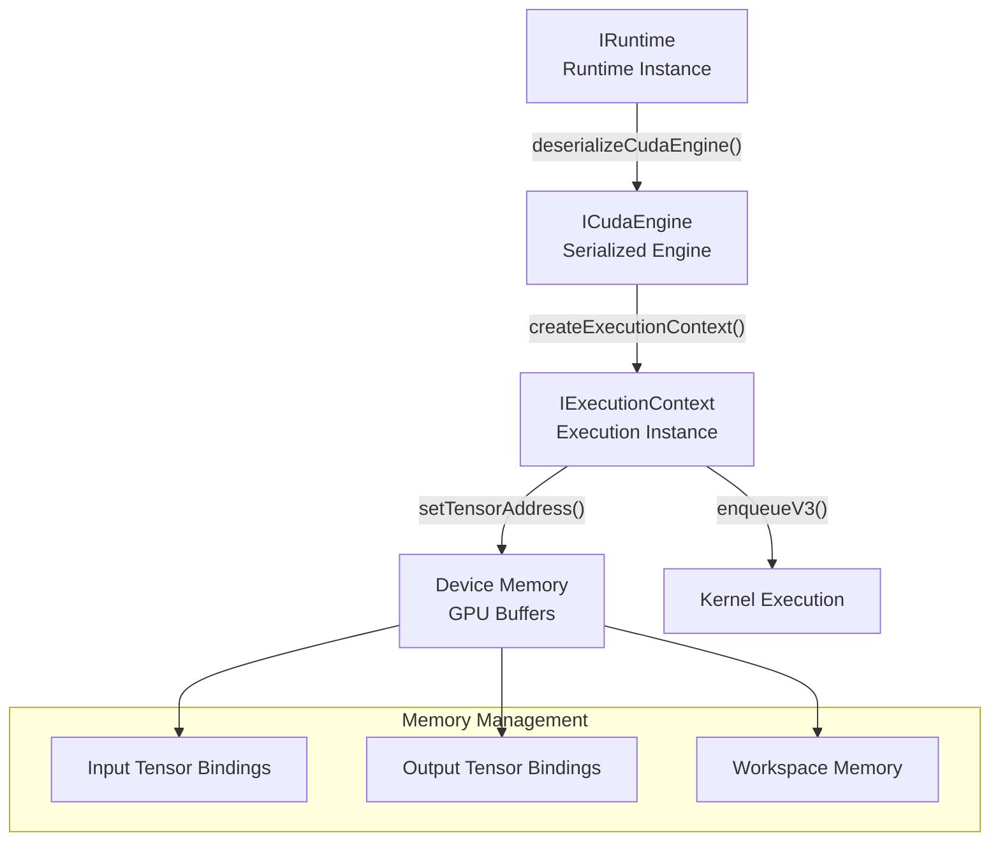
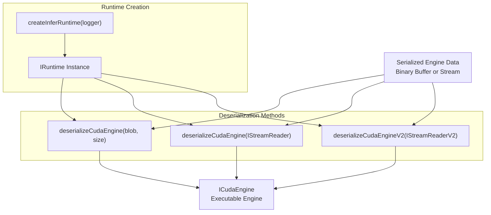
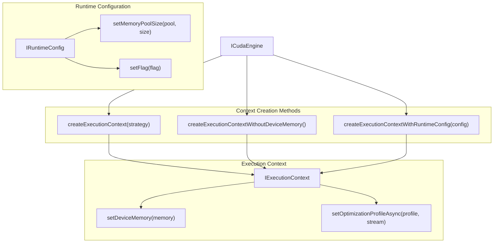
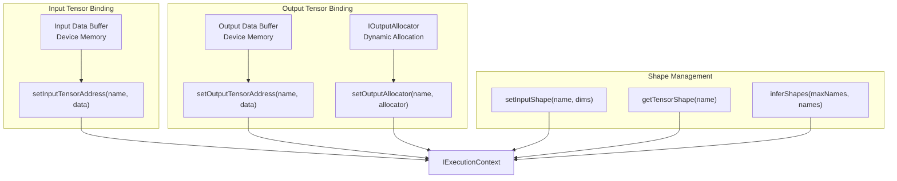
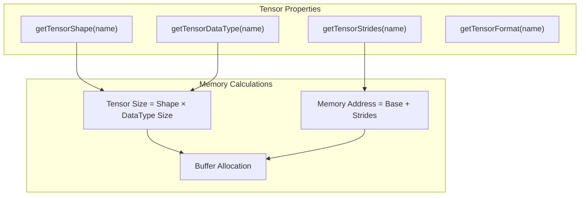
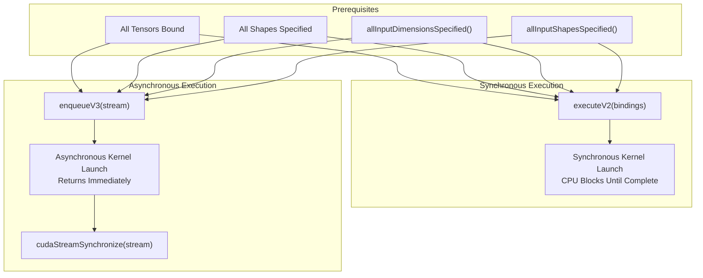
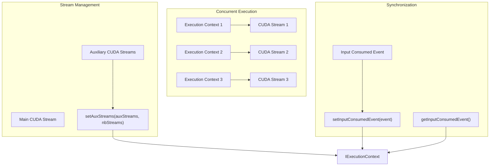
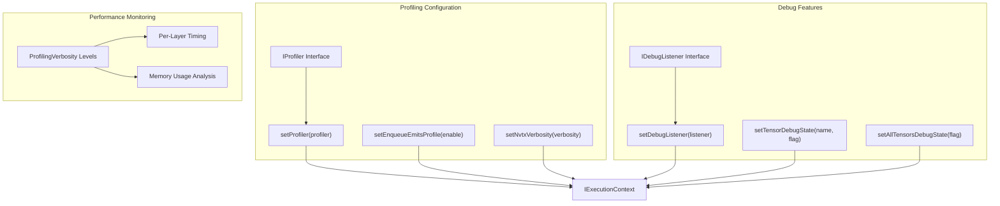

<!-- source: DeepWiki mcp.deepwiki.com · repo NVIDIA/TensorRT · page 3.3 Runtime and Inference · fetched 2026-10-26 -->

# Runtime and Inference

Relevant source files

The following files were used as context for generating this wiki page:

- [CMakeLists.txt](CMakeLists.txt)
- [cmake/toolchains/cmake_qnx_safe.toolchain](cmake/toolchains/cmake_qnx_safe.toolchain)
- [include/NvInfer.h](include/NvInfer.h)
- [include/NvInferImpl.h](include/NvInferImpl.h)
- [include/NvInferLegacyDims.h](include/NvInferLegacyDims.h)
- [include/NvInferPlugin.h](include/NvInferPlugin.h)
- [include/NvInferPluginUtils.h](include/NvInferPluginUtils.h)
- [include/NvInferRuntime.h](include/NvInferRuntime.h)
- [include/NvInferRuntimeBase.h](include/NvInferRuntimeBase.h)
- [include/NvInferRuntimeCommon.h](include/NvInferRuntimeCommon.h)
- [include/NvInferRuntimePlugin.h](include/NvInferRuntimePlugin.h)
- [samples/common/sampleEngines.cpp](samples/common/sampleEngines.cpp)
- [samples/common/sampleInference.cpp](samples/common/sampleInference.cpp)
- [samples/common/sampleInference.h](samples/common/sampleInference.h)
- [samples/common/sampleOptions.cpp](samples/common/sampleOptions.cpp)
- [samples/common/sampleOptions.h](samples/common/sampleOptions.h)
- [samples/common/sampleReporting.cpp](samples/common/sampleReporting.cpp)
- [samples/trtexec/trtexec.cpp](samples/trtexec/trtexec.cpp)

This document covers the TensorRT runtime system for executing optimized engines. It focuses on engine deserialization, execution context management, memory binding, and inference execution. For information about building networks and creating engines, see [Network Definition](#3.1) and [Builder and Optimization](#3.2).

## Runtime Architecture Overview

The TensorRT runtime system provides a streamlined execution environment for optimized engines. The core components work together to manage device memory, bind tensors, and execute inference with minimal overhead.

Sources: [include/NvInferRuntime.h:1-50](), [include/NvInferImpl.h:276-302](), [include/NvInferImpl.h:353-423](), [include/NvInferImpl.h:425-479]()

## Runtime and Engine Management

### Runtime Creation and Engine Deserialization

The `IRuntime` interface handles engine deserialization and provides the entry point for inference execution. Engines are deserialized from binary data or streams into executable `ICudaEngine` objects.

Key runtime configuration methods include memory allocator management, DLA core assignment, and plugin registry access:

| Method | Purpose |
|--------|---------|
| `setGpuAllocator()` | Custom GPU memory allocator |
| `setDLACore()` | DLA device assignment |
| `getPluginRegistry()` | Access to plugin registry |
| `setMaxThreads()` | Thread pool configuration |

Sources: [include/NvInferImpl.h:276-302](), [include/NvInferRuntime.h:276-450]()

### Engine Properties and Metadata

The `ICudaEngine` provides access to engine metadata, optimization profiles, and tensor information required for proper execution context setup.

```mermaid
graph TD
    ICudaEngine["ICudaEngine"]
    
    subgraph "Engine Metadata"
        getName["getName()"]
        getNbLayers["getNbLayers()"]
        getEngineCapability["getEngineCapability()"]
        getHardwareCompatibilityLevel["getHardwareCompatibilityLevel()"]
    end
    
    subgraph "Tensor Information"  
        getNbIOTensors["getNbIOTensors()"]
        getIOTensorName["getIOTensorName(index)"]
        getTensorShape["getTensorShape(name)"]
        getTensorDataType["getTensorDataType(name)"]
        getTensorLocation["getTensorLocation(name)"]
    end
    
    subgraph "Optimization Profiles"
        getNbOptimizationProfiles["getNbOptimizationProfiles()"]
        getProfileShape["getProfileShape(name, profile, selector)"]
        getProfileTensorValues["getProfileTensorValues(name, profile, selector)"]
    end
    
    ICudaEngine --> getName
    ICudaEngine --> getNbLayers
    ICudaEngine --> getEngineCapability
    ICudaEngine --> getHardwareCompatibilityLevel
    
    ICudaEngine --> getNbIOTensors
    ICudaEngine --> getIOTensorName  
    ICudaEngine --> getTensorShape
    ICudaEngine --> getTensorDataType
    ICudaEngine --> getTensorLocation
    
    ICudaEngine --> getNbOptimizationProfiles
    ICudaEngine --> getProfileShape
    ICudaEngine --> getProfileTensorValues
```

Sources: [include/NvInferImpl.h:353-423]()

## Execution Context Management

### Context Creation and Configuration

Execution contexts provide the runtime environment for inference execution. Each context maintains its own state and can execute independently, enabling concurrent inference across multiple streams.

Sources: [include/NvInferImpl.h:353-423](), [include/NvInferImpl.h:425-479]()

### Memory Management Strategies

TensorRT provides flexible memory management through different allocation strategies and custom allocators:

| Strategy | Description | Use Case |
|----------|-------------|----------|
| `ExecutionContextAllocationStrategy::kDEFAULT` | TensorRT manages all memory | Simple applications |
| `ExecutionContextAllocationStrategy::kUSER_MANAGED` | Application provides memory | Custom memory pools |
| `setDeviceMemoryV2()` | Manual memory assignment | Fine-grained control |
| `setTemporaryStorageAllocator()` | Custom workspace allocator | Dynamic workspace |

## Tensor Binding and Memory Management

### Tensor Addressing

Modern TensorRT uses named tensor binding through the `setTensorAddress()` family of methods, replacing the older index-based binding approach.

### Memory Layout and Strides

Tensor memory layout is determined by the engine's optimization decisions and can be queried for proper buffer management:

Sources: [include/NvInferImpl.h:425-479]()

## Inference Execution

### Execution Methods

TensorRT provides two primary execution interfaces: synchronous `executeV2()` and asynchronous `enqueueV3()`. The asynchronous interface is recommended for production deployments.

### Multi-Stream Execution

Advanced applications can utilize multiple CUDA streams for overlapped execution and improved throughput:

Sources: [include/NvInferImpl.h:425-479]()

## Performance Optimization and Profiling

### Profiling and Debugging

TensorRT provides comprehensive profiling capabilities for performance analysis and debugging:

### Memory Pool Management

Advanced memory management through memory pools enables fine-grained control over GPU memory allocation:

| Pool Type | Purpose | Configuration Method |
|-----------|---------|---------------------|
| `MemoryPoolType::kWORKSPACE` | Temporary computation space | `setMemoryPoolSize()` |
| `MemoryPoolType::kDLA_MANAGED_SRAM` | DLA SRAM allocation | `setMemoryPoolSize()` |
| `MemoryPoolType::kDLA_LOCAL_DRAM` | DLA local DRAM | `setMemoryPoolSize()` |
| `MemoryPoolType::kDLA_GLOBAL_DRAM` | DLA global DRAM | `setMemoryPoolSize()` |

Sources: [include/NvInferImpl.h:425-479](), [include/NvInferRuntime.h:1000-1200]()

---

