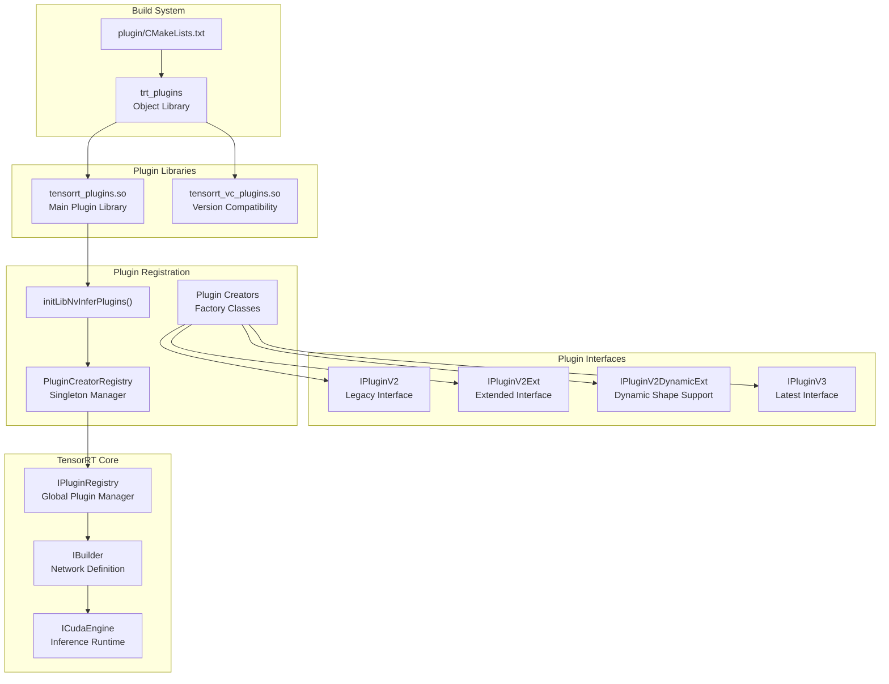
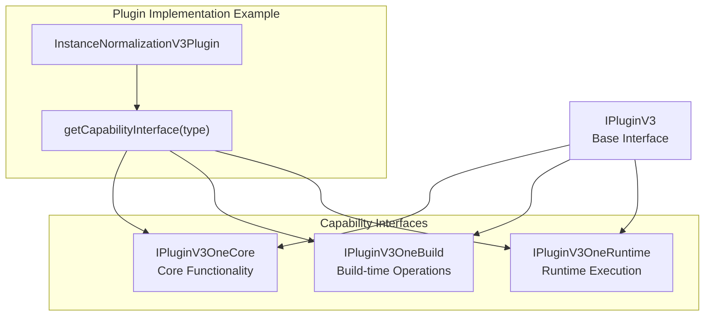
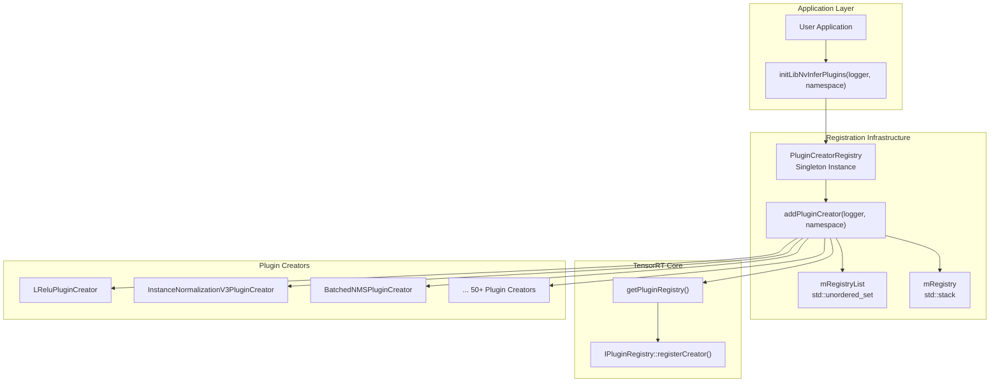
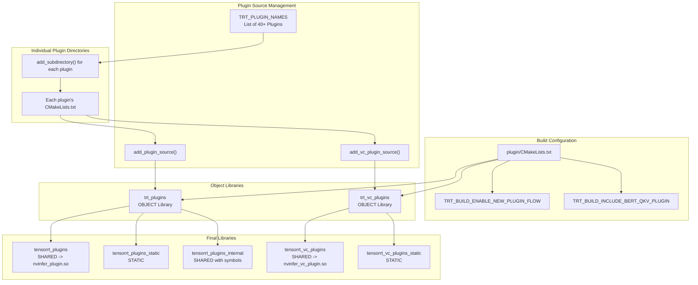
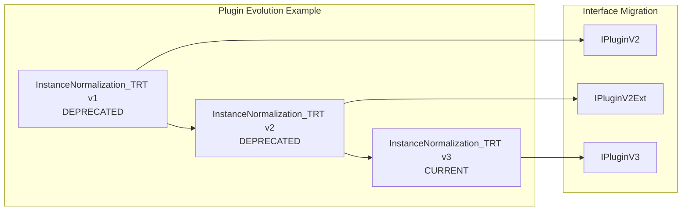

<!-- source: DeepWiki mcp.deepwiki.com · repo NVIDIA/TensorRT · page 4 Plugin System · fetched 2026-10-26 -->

# Plugin System

Relevant source files

The following files were used as context for generating this wiki page:

- [.gitmodules](.gitmodules)
- [CHANGELOG.md](CHANGELOG.md)
- [plugin/CMakeLists.txt](plugin/CMakeLists.txt)
- [plugin/README.md](plugin/README.md)
- [plugin/common/checkMacrosPlugin.cpp](plugin/common/checkMacrosPlugin.cpp)
- [plugin/exports-vfc_plugin.map](plugin/exports-vfc_plugin.map)
- [plugin/multiscaleDeformableAttnPlugin/CMakeLists.txt](plugin/multiscaleDeformableAttnPlugin/CMakeLists.txt)
- [plugin/multiscaleDeformableAttnPlugin/README.md](plugin/multiscaleDeformableAttnPlugin/README.md)
- [plugin/multiscaleDeformableAttnPlugin/multiscaleDeformableAttn.cu](plugin/multiscaleDeformableAttnPlugin/multiscaleDeformableAttn.cu)
- [plugin/multiscaleDeformableAttnPlugin/multiscaleDeformableAttn.h](plugin/multiscaleDeformableAttnPlugin/multiscaleDeformableAttn.h)
- [plugin/multiscaleDeformableAttnPlugin/multiscaleDeformableAttnPlugin.cpp](plugin/multiscaleDeformableAttnPlugin/multiscaleDeformableAttnPlugin.cpp)
- [plugin/multiscaleDeformableAttnPlugin/multiscaleDeformableAttnPlugin.h](plugin/multiscaleDeformableAttnPlugin/multiscaleDeformableAttnPlugin.h)
- [plugin/multiscaleDeformableAttnPlugin/multiscaleDeformableIm2ColCuda.cuh](plugin/multiscaleDeformableAttnPlugin/multiscaleDeformableIm2ColCuda.cuh)
- [scripts/stubify.sh](scripts/stubify.sh)

TensorRT's Plugin System provides a framework for extending TensorRT with custom layer implementations that are not natively supported. This system enables users to implement specialized operations, accelerate specific network architectures, and integrate domain-specific optimizations while maintaining compatibility with TensorRT's inference engine.

This page covers the overall plugin architecture, interfaces, registration mechanisms, and build system. For specific plugin implementations, see [BERT and NLP Plugins](#4.3), [Detection and NMS Plugins](#4.4), [3D Perception Plugins](#4.5), and [Normalization Plugins](#4.6). For creating custom plugins, see [Creating Custom Plugins](#4.2).

## Architecture Overview

TensorRT's plugin system consists of several key components that work together to enable custom layer functionality:

Sources: [plugin/CMakeLists.txt:1-280](), [plugin/api/inferPlugin.cpp:86-174](), [plugin/README.md:1-68]()

## Plugin Interfaces and Versioning

TensorRT provides multiple plugin interfaces to accommodate different use cases and maintain backward compatibility:

| Interface | Version | Dynamic Shapes | Use Case |
|-----------|---------|----------------|----------|
| `IPluginV2` | Legacy | No | Simple static plugins |
| `IPluginV2Ext` | Extended | No | Enhanced static plugins |
| `IPluginV2DynamicExt` | Dynamic | Yes | Dynamic shape support |
| `IPluginV3` | Latest | Yes | Modern interface with capabilities |

The `IPluginV3` interface introduces a capability-based system where plugins implement specific capability interfaces:

Sources: [plugin/instanceNormalizationPlugin/instanceNormalizationPlugin.cu:94-114](), [plugin/leakyReluPlugin/lReluPlugin.h:31-73]()

## Registration and Initialization System

The plugin registration system ensures plugins are properly initialized and available to TensorRT engines:

The registration process follows this sequence:

1. **Library Loading**: Application loads `tensorrt_plugins.so`
2. **Initialization Call**: Application calls `initLibNvInferPlugins(logger, namespace)`
3. **Creator Registration**: Each plugin creator is registered through `PluginCreatorRegistry::addPluginCreator<T>()`
4. **Duplicate Prevention**: The registry checks `mRegistryList` to prevent duplicate registrations
5. **TensorRT Integration**: Successfully registered creators are added to TensorRT's `IPluginRegistry`

Sources: [plugin/api/inferPlugin.cpp:86-174](), [plugin/api/inferPlugin.cpp:181-235]()

## Build System Architecture

The plugin build system is designed to support multiple library configurations and cross-platform compilation:

The build system supports several key features:

- **Object Library Pattern**: Uses `OBJECT` libraries to compile sources once and link multiple times
- **Symbol Management**: Different export maps control symbol visibility for each library variant
- **Architecture Support**: Configures CUDA architectures via `CMAKE_CUDA_ARCHITECTURES`
- **Version Compatibility**: Separate VC (Version Compatibility) libraries for minimal plugin subsets

Key build artifacts include:
- `libnvinfer_plugin.so`: Main plugin library for production use
- `libnvinfer_plugin_internal.so`: Development library with exposed symbols
- `libnvinfer_vc_plugin.so`: Version compatibility library

Sources: [plugin/CMakeLists.txt:20-280](), [plugin/CMakeLists.txt:36-93]()

## Plugin Categories

The TensorRT OSS plugin library contains over 40 different plugins organized into functional categories:

| Category | Example Plugins | Purpose |
|----------|----------------|---------|
| **BERT/NLP** | `bertQKVToContextPlugin`, `embLayerNormPlugin`, `skipLayerNormPlugin` | Transformer model acceleration |
| **Detection** | `batchedNMSPlugin`, `efficientNMSPlugin`, `generateDetectionPlugin` | Object detection pipelines |
| **3D Perception** | `pillarScatterPlugin`, `voxelGeneratorPlugin`, `decodeBbox3DPlugin` | Point cloud and 3D object detection |
| **Normalization** | `instanceNormalizationPlugin`, `groupNormalizationPlugin` | Various normalization layers |
| **Spatial Operations** | `cropAndResizePlugin`, `roiAlignPlugin`, `proposalPlugin` | Spatial feature manipulation |
| **Utility** | `flattenConcat`, `splitPlugin`, `reorgPlugin` | General tensor operations |

Many plugins have multiple versions to maintain backward compatibility:

Sources: [plugin/README.md:4-68](), [plugin/CMakeLists.txt:36-84]()

## Plugin Lifecycle

Understanding the plugin lifecycle is crucial for both plugin developers and users:

1. **Registration**: Plugins are registered during library initialization via `initLibNvInferPlugins()`
2. **Creation**: Plugin instances are created by their respective creators during network building
3. **Configuration**: Plugins are configured with input/output tensor information
4. **Context Attachment**: Runtime plugins are attached to execution contexts via `attachToContext()`
5. **Execution**: Plugin kernels are launched during inference via `enqueue()`
6. **Cleanup**: Plugin resources are released when engines are destroyed

The plugin system provides thread-safe registration and manages plugin lifetimes automatically through RAII patterns and smart pointers.

Sources: [plugin/api/inferPlugin.cpp:86-174](), [plugin/instanceNormalizationPlugin/instanceNormalizationPlugin.cu:554-559]()

---

