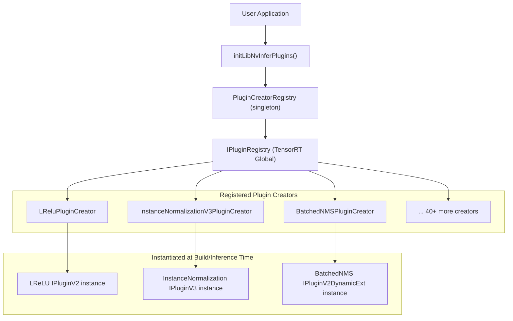
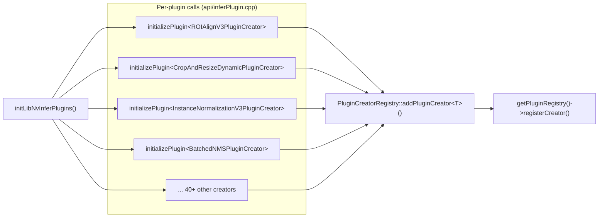
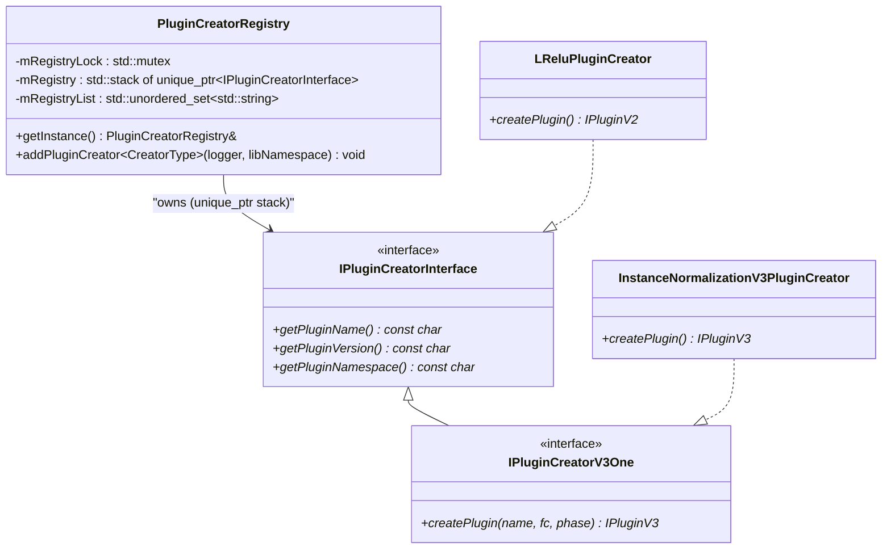
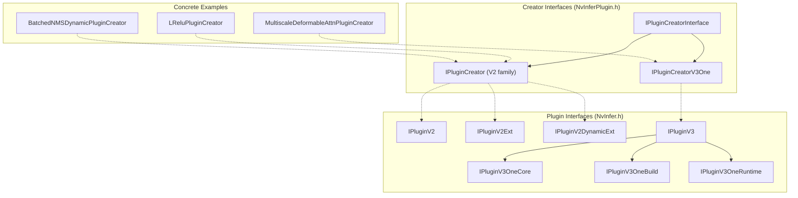
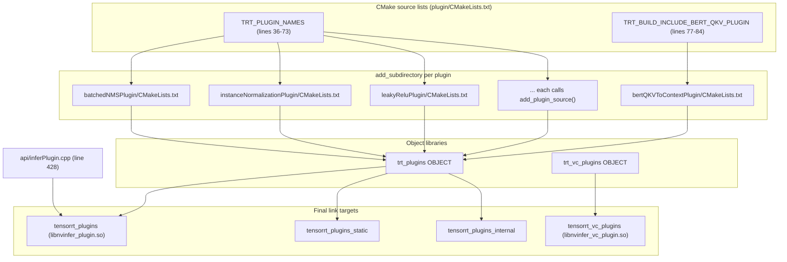
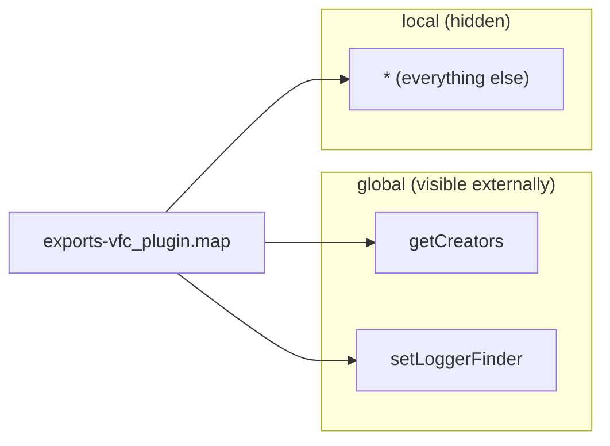
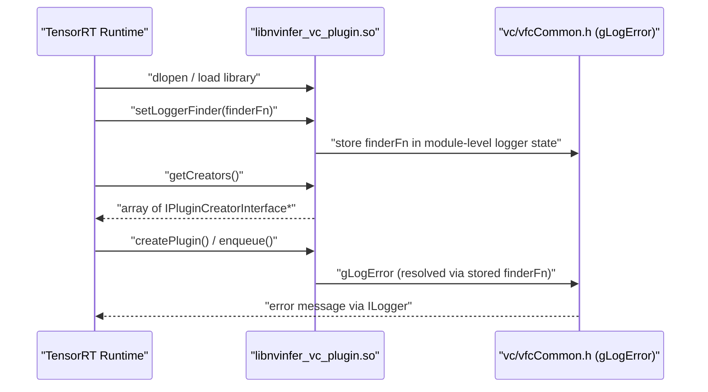

<!-- source: DeepWiki mcp.deepwiki.com · repo NVIDIA/TensorRT · page 4.1 Plugin Registration and Initialization · fetched 2026-10-26 -->

# Plugin Registration and Initialization

<details>
<summary>Relevant source files</summary>

The following files were used as context for generating this wiki page:

- [plugin/CMakeLists.txt](plugin/CMakeLists.txt)
- [plugin/README.md](plugin/README.md)
- [plugin/common/checkMacrosPlugin.cpp](plugin/common/checkMacrosPlugin.cpp)
- [plugin/exports-vfc_plugin.map](plugin/exports-vfc_plugin.map)
- [plugin/multiscaleDeformableAttnPlugin/CMakeLists.txt](plugin/multiscaleDeformableAttnPlugin/CMakeLists.txt)
- [plugin/multiscaleDeformableAttnPlugin/README.md](plugin/multiscaleDeformableAttnPlugin/README.md)
- [plugin/multiscaleDeformableAttnPlugin/multiscaleDeformableAttn.cu](plugin/multiscaleDeformableAttnPlugin/multiscaleDeformableAttn.cu)
- [plugin/multiscaleDeformableAttnPlugin/multiscaleDeformableAttn.h](plugin/multiscaleDeformableAttnPlugin/multiscaleDeformableAttn.h)
- [plugin/multiscaleDeformableAttnPlugin/multiscaleDeformableAttnPlugin.cpp](plugin/multiscaleDeformableAttnPlugin/multiscaleDeformableAttnPlugin.cpp)
- [plugin/multiscaleDeformableAttnPlugin/multiscaleDeformableAttnPlugin.h](plugin/multiscaleDeformableAttnPlugin/multiscaleDeformableAttnPlugin.h)
- [plugin/multiscaleDeformableAttnPlugin/multiscaleDeformableIm2ColCuda.cuh](plugin/multiscaleDeformableAttnPlugin/multiscaleDeformableIm2ColCuda.cuh)
- [scripts/stubify.sh](scripts/stubify.sh)

</details>


This document covers the mechanism by which TensorRT plugins are registered and made available for use during network building and inference. Plugin registration is the process of adding plugin creators to TensorRT's global plugin registry, enabling them to be discovered and instantiated when needed.

For information about implementing custom plugins, see [Creating Custom Plugins](#4.2). For details about specific plugin implementations, see [BERT and NLP Plugins](#4.3), [Detection and NMS Plugins](#4.4), and related sections.

## Plugin Registration Architecture

TensorRT's plugin system uses a factory pattern where plugin creators are registered globally and used to instantiate plugin instances. The registration process is managed through a centralized entry point and thread-safe registry.

**Plugin Registration Flow**



The registration system ensures that each plugin type is registered exactly once and provides thread-safe access to the plugin registry during initialization.

Sources: [plugin/api/inferPlugin.cpp:88-168](), [plugin/api/inferPlugin.cpp:181-234](), [plugin/CMakeLists.txt:428-429]()

## Main Entry Point

The primary interface for plugin registration is the `initLibNvInferPlugins` function declared in `NvInferPlugin.h`, which serves as the single entry point for registering all available plugins.

```
extern "C" bool initLibNvInferPlugins(void* logger, char const* libNamespace);
```

| Parameter | Description |
|-----------|-------------|
| `logger` | Pointer to a TensorRT `ILogger`; used for diagnostic output during registration |
| `libNamespace` | Namespace string under which all plugins are registered (typically `""`) |
| Return value | `true` if all plugins were successfully registered |

The function has C linkage so it can be loaded from a shared library without name mangling.

**`initLibNvInferPlugins` Internal Call Chain**



Sources: [plugin/api/inferPlugin.cpp:181-234](), [plugin/api/inferPlugin.cpp:170-174]()

## Plugin Creator Registry

The `PluginCreatorRegistry` class implements a thread-safe singleton pattern that manages the registration of plugin creators and prevents duplicate registrations.

**`PluginCreatorRegistry` Class Structure**



### Registration Process

The `addPluginCreator<CreatorType>` template method runs the following steps for each plugin:

| Step | Action |
|------|--------|
| 1 | Acquire `mRegistryLock` mutex for thread safety |
| 2 | Check `mRegistryList` for duplicate key `{namespace}::{name} version {version}` |
| 3 | Instantiate a new `CreatorType` as a `unique_ptr` |
| 4 | Call `setPluginNamespace(libNamespace)` on the new creator |
| 5 | Call `getPluginRegistry()->registerCreator(creator, libNamespace)` |
| 6 | Push the `unique_ptr` onto `mRegistry` for lifecycle management |

The composite duplicate-detection key has the form:
```
{namespace}::{plugin_name} version {plugin_version}
```

Sources: [plugin/api/inferPlugin.cpp:88-168](), [plugin/api/inferPlugin.cpp:98-144]()

## Plugin Interface Hierarchy

TensorRT supports multiple plugin interface versions. The registration system handles all interface types uniformly through the creator pattern. New plugins should implement `IPluginV3`; the `IPluginV2` family is deprecated and scheduled for removal in TRT 11.

### Supported Plugin Interfaces

| Interface | Shape support | Status | Example |
|-----------|--------------|--------|---------|
| `IPluginV2` | Static shapes only | Deprecated | `DetectionLayerPlugin` |
| `IPluginV2Ext` | Static + broadcasting | Deprecated | `ReorgPlugin` |
| `IPluginV2DynamicExt` | Dynamic shapes | Deprecated | `BatchedNMSPlugin` |
| `IPluginV3` | Dynamic shapes, capability-based | Current | `MultiscaleDeformableAttnPlugin` |

**Plugin Creator and Plugin Interface Mapping**



Sources: [plugin/multiscaleDeformableAttnPlugin/multiscaleDeformableAttnPlugin.h:46-116](), [plugin/leakyReluPlugin/lReluPlugin.h:75-95]()

## Build System Integration

The plugin registration system is tightly integrated with the CMake build system, which manages plugin compilation, library creation, and symbol export.

### Plugin Library Structure

| CMake Target | Output Shared Object | Purpose |
|---|---|---|
| `tensorrt_plugins` | `libnvinfer_plugin.so` | Public shared library |
| `tensorrt_plugins_static` | `libnvinfer_plugin_static.a` | Public static library |
| `tensorrt_plugins_internal` | `libnvinfer_plugin_internal.so` | Internal build with full symbols (no strip) |
| `tensorrt_vc_plugins` | `libnvinfer_vc_plugin.so` | Version compatibility subset |
| `tensorrt_vc_plugins_static` | `libnvinfer_vc_plugin_static.a` | Static version compatibility |

All shared targets except `tensorrt_plugins_internal` have `CXX_VISIBILITY_PRESET hidden` and use linker version scripts to restrict exported symbols.

**Build System Plugin Compilation Flow**



The `add_plugin_source` function (defined in [plugin/CMakeLists.txt:26-28]()) is used inside each plugin's `CMakeLists.txt` to append that plugin's source files to the `trt_plugins` object library. The VFC-specific variant, `add_vc_plugin_source`, feeds `trt_vc_plugins`.

Sources: [plugin/CMakeLists.txt:36-93](), [plugin/CMakeLists.txt:125-131](), [plugin/CMakeLists.txt:25-28](), [plugin/CMakeLists.txt:426-429]()

## Symbol Export Control

Plugin libraries use GNU linker version scripts to control which symbols are externally visible. This prevents symbol conflicts and reduces the public surface of each `.so`.

### Export Map Configuration

| Export Map File | Used By | Effect |
|---|---|---|
| `exports.map` | `tensorrt_plugins`, `tensorrt_plugins_static` | Exports the full public plugin API |
| `exports-vfc_plugin.map` | `tensorrt_vc_plugins`, `tensorrt_vc_plugins_static` | Exports only two symbols (see below) |

The linker flags applied to all plugin shared libraries (non-MSVC) are:

```
--version-script=<map>
-z relro
-Bsymbolic
--no-undefined
--no-as-needed
--strip-all  (Release builds only)
```

**Symbol Visibility: exports-vfc_plugin.map**



The two exported symbols from `libnvinfer_vc_plugin.so` are:

| Symbol | Purpose |
|--------|---------|
| `getCreators` | Returns the array of `IPluginCreatorInterface*` provided by this VFC library, allowing TensorRT to discover VFC plugin creators without calling `initLibNvInferPlugins`. |
| `setLoggerFinder` | Injects a logger-finder callback into the VFC library so it can access TensorRT's `ILogger` for error reporting. |

Sources: [plugin/exports-vfc_plugin.map:19-24](), [plugin/CMakeLists.txt:139-150](), [plugin/CMakeLists.txt:238-250]()

## VFC Logger Finder Mechanism

The version compatibility plugin library (`libnvinfer_vc_plugin.so`) is a self-contained subset of plugins built without a hard dependency on the main TensorRT logger. Instead it uses a logger-finder function pointer injected at runtime via `setLoggerFinder`.

The VFC-specific code paths are gated by the compile-time define `COMPILE_VFC_PLUGIN=1`, which is set only on the `trt_vc_plugins` object library:

[plugin/CMakeLists.txt:121-123]()

The supporting infrastructure lives in `plugin/vc/vfcCommon.h`, which is included by `plugin/common/checkMacrosPlugin.cpp`:

[plugin/common/checkMacrosPlugin.cpp:20-21]()

**VFC Logger Finder Flow**



`vfcCommon.h` provides the module-level `gLogError` handle used throughout the VFC plugin code (and referenced in `checkMacrosPlugin.cpp` error-handling functions such as `throwCublasError` and `throwCudnnError`).

Sources: [plugin/common/checkMacrosPlugin.cpp:18-21](), [plugin/CMakeLists.txt:121-123](), [plugin/exports-vfc_plugin.map:19-24]()

## Plugin Lifecycle Management

The registration system manages plugin creator lifecycles to ensure proper resource cleanup and prevent memory leaks.

### Creator Lifecycle

1. **Creation**: Plugin creators are instantiated as `unique_ptr` objects during registration
2. **Storage**: Creators are stored in a LIFO stack within the registry
3. **Cleanup**: The registry destructor automatically releases creators in reverse order of registration

This design ensures that plugin creators remain valid for the lifetime of the plugin library and are properly cleaned up when the library is unloaded.

Sources: [plugin/api/inferPlugin.cpp:146-156](), [plugin/api/inferPlugin.cpp:119](), [plugin/api/inferPlugin.cpp:150-154]()

---

