<!-- source: DeepWiki mcp.deepwiki.com · repo NVIDIA/TensorRT · page 4.2 Creating Custom Plugins · fetched 2026-10-26 -->

# Creating Custom Plugins

Relevant source files

The following files were used as context for generating this wiki page:

- [.gitmodules](.gitmodules)
- [CHANGELOG.md](CHANGELOG.md)
- [plugin/bertQKVToContextPlugin/qkvToContextInt8InterleavedPlugin.cpp](plugin/bertQKVToContextPlugin/qkvToContextInt8InterleavedPlugin.cpp)
- [plugin/bertQKVToContextPlugin/qkvToContextInt8InterleavedPlugin.h](plugin/bertQKVToContextPlugin/qkvToContextInt8InterleavedPlugin.h)
- [plugin/common/bertCommon.h](plugin/common/bertCommon.h)
- [plugin/common/checkMacrosPlugin.cpp](plugin/common/checkMacrosPlugin.cpp)
- [plugin/common/checkMacrosPlugin.h](plugin/common/checkMacrosPlugin.h)
- [plugin/common/plugin.h](plugin/common/plugin.h)
- [plugin/exports-vfc_plugin.map](plugin/exports-vfc_plugin.map)
- [plugin/roiAlignPlugin/roiAlignKernel.h](plugin/roiAlignPlugin/roiAlignKernel.h)
- [samples/common/safeCommon.h](samples/common/safeCommon.h)
- [scripts/stubify.sh](scripts/stubify.sh)

This document covers the process of implementing custom TensorRT plugins using the IPluginV3 interface and related plugin development patterns. It focuses on the technical implementation details, class hierarchies, and development workflow for extending TensorRT with custom operations.

For information about plugin registration and initialization, see [Plugin Registration and Initialization](#4.1). For details about specific plugin categories like BERT or detection plugins, see [BERT and NLP Plugins](#4.3) and [Detection and NMS Plugins](#4.4).

## Plugin Interface Architecture

TensorRT plugins are implemented through a capability-based interface system centered around `IPluginV3`. The plugin system uses a modular approach where different capabilities are exposed through separate interfaces.

### Core Interface Structure

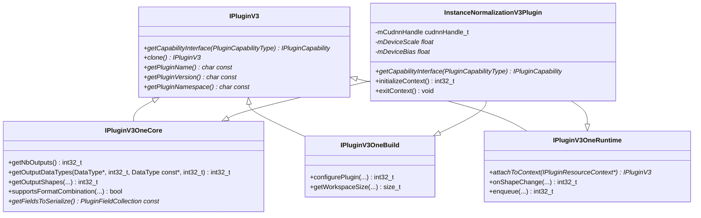

Sources: [plugin/instanceNormalizationPlugin/instanceNormalizationPlugin.cu:94-114]()

### Capability Interface Pattern

The `getCapabilityInterface` method routes requests to appropriate capability implementations:

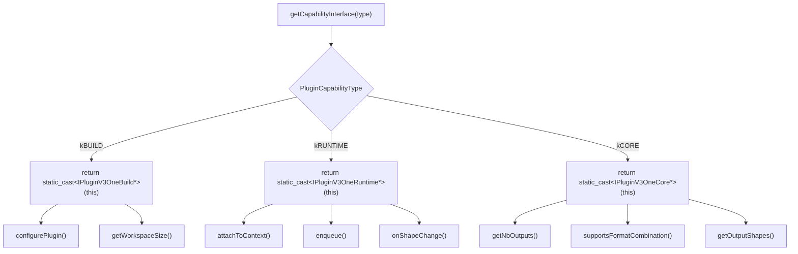

Sources: [plugin/instanceNormalizationPlugin/instanceNormalizationPlugin.cu:94-114]()

## Plugin Implementation Structure

### Constructor and Member Initialization

Custom plugins typically maintain both host and device copies of parameters and support multiple constructor patterns for different initialization scenarios.

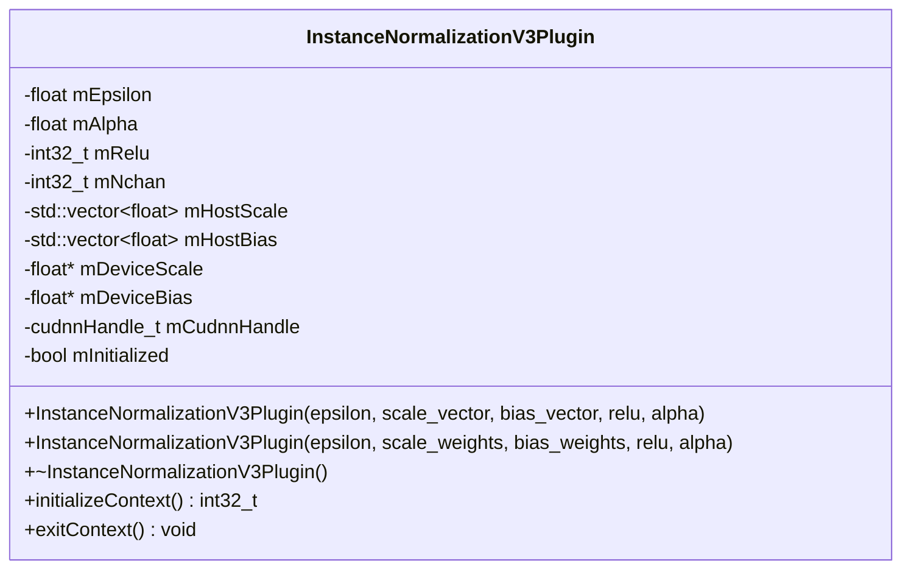

The plugin constructor handles weight conversion from different input formats:

Sources: [plugin/instanceNormalizationPlugin/instanceNormalizationPlugin.cu:37-81]()

### Context Management

Plugin context management follows a clear initialization and cleanup pattern:

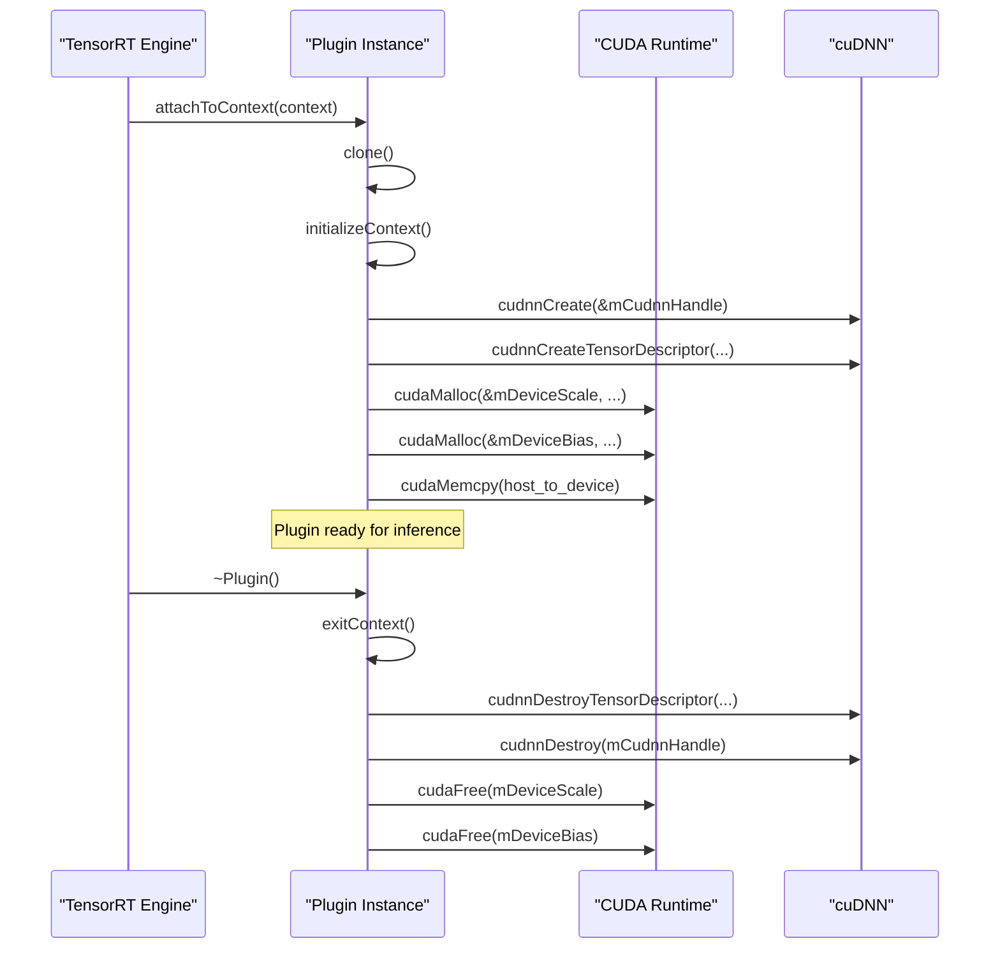

Sources: [plugin/instanceNormalizationPlugin/instanceNormalizationPlugin.cu:116-165]()

### Format and Data Type Support

The `supportsFormatCombination` method defines supported tensor formats and data types:

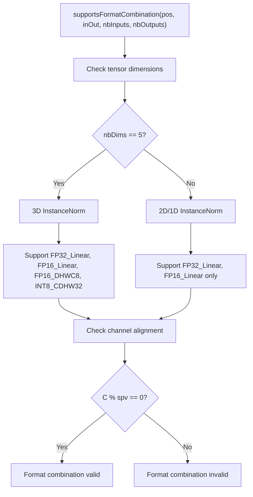

Sources: [plugin/instanceNormalizationPlugin/instanceNormalizationPlugin.cu:442-486]()

## Plugin Creator Pattern

### Creator Implementation

Plugin creators implement the factory pattern for plugin instantiation and provide metadata about plugin parameters:

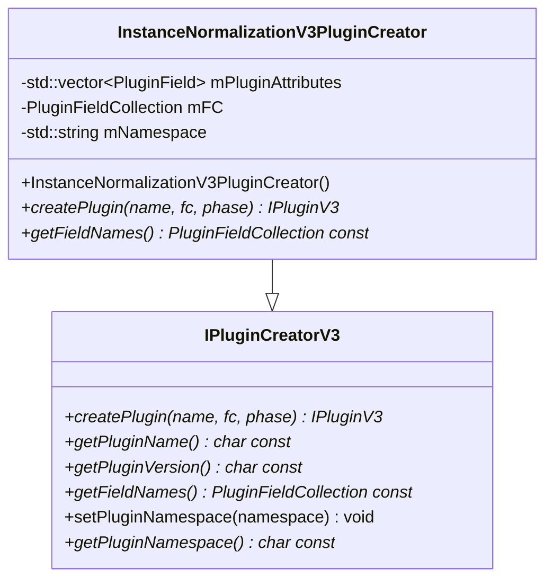

### Parameter Parsing

The creator's `createPlugin` method parses configuration parameters from a `PluginFieldCollection`:

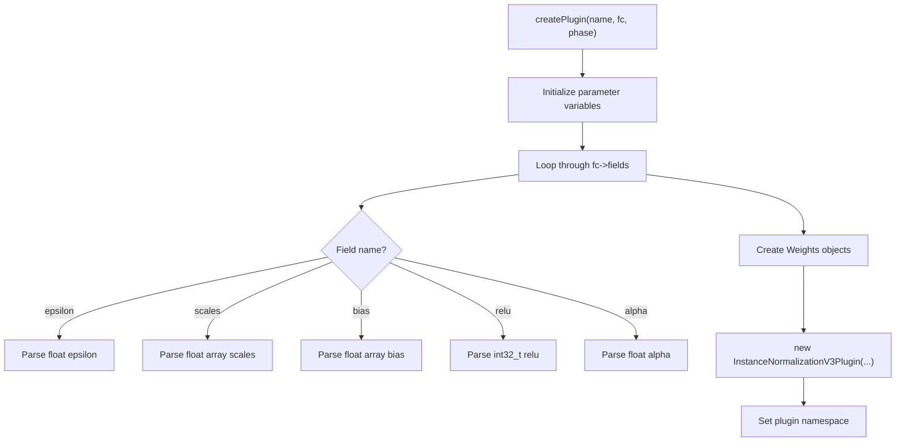

Sources: [plugin/instanceNormalizationPlugin/instanceNormalizationPlugin.cu:624-691]()

## Memory and Workspace Management

### Workspace Size Calculation

Plugins must calculate workspace memory requirements based on input dimensions and tensor formats:

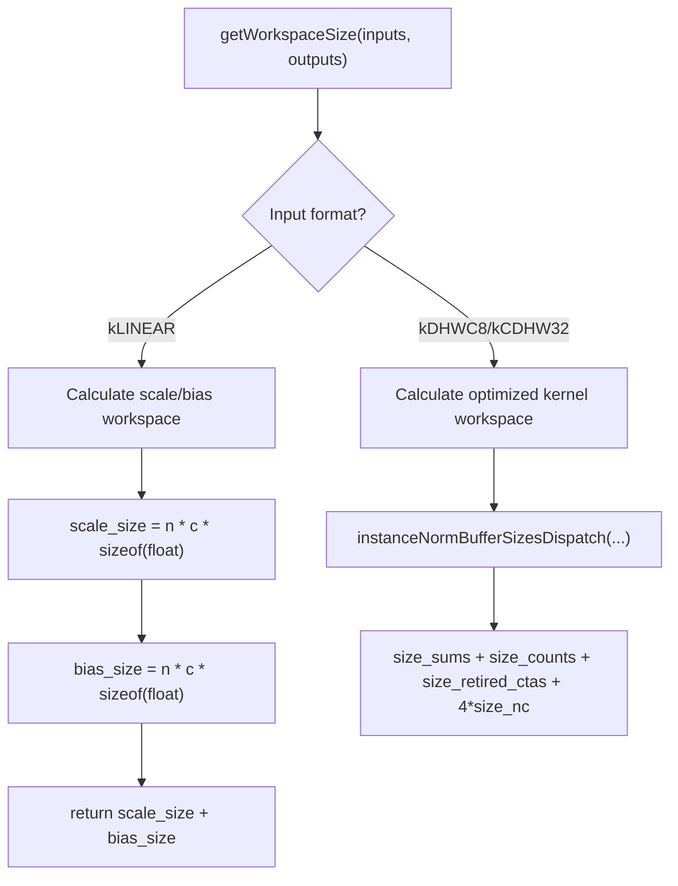

### Runtime Memory Usage

During `enqueue`, the plugin uses workspace memory for temporary computations:

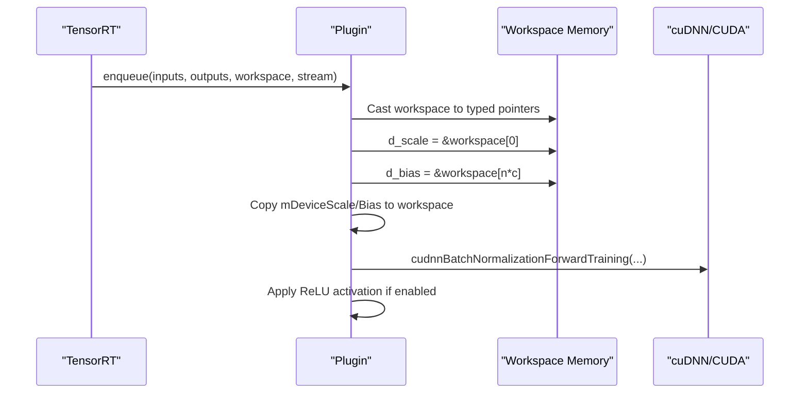

Sources: [plugin/instanceNormalizationPlugin/instanceNormalizationPlugin.cu:167-219](), [plugin/instanceNormalizationPlugin/instanceNormalizationPlugin.cu:221-440]()

## Error Handling and Validation

### Plugin Error Macros

The plugin system provides standardized error handling macros for different error types:

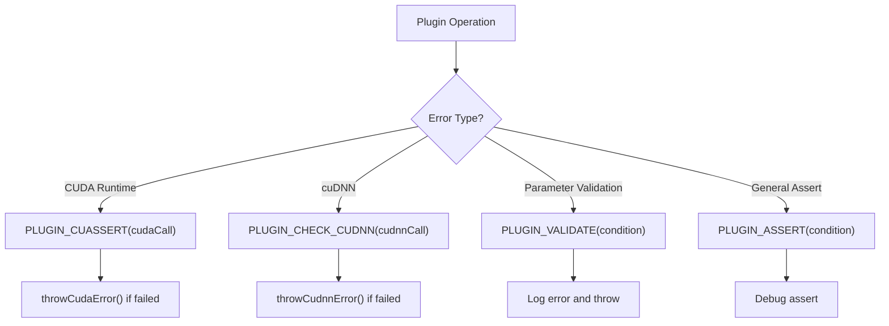

### Exception Safety

Plugins use exception handling in public API methods to prevent exceptions from crossing library boundaries:

Sources: [plugin/common/checkMacrosPlugin.cpp:29-64](), [plugin/instanceNormalizationPlugin/instanceNormalizationPlugin.cu:109-113]()

## Build System Integration

### Symbol Export Control

Plugin libraries use linker maps to control symbol visibility:

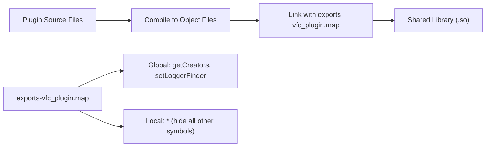

The map file ensures only essential plugin registration functions are exposed while hiding implementation details.

Sources: [plugin/exports-vfc_plugin.map:18-24]()

---

