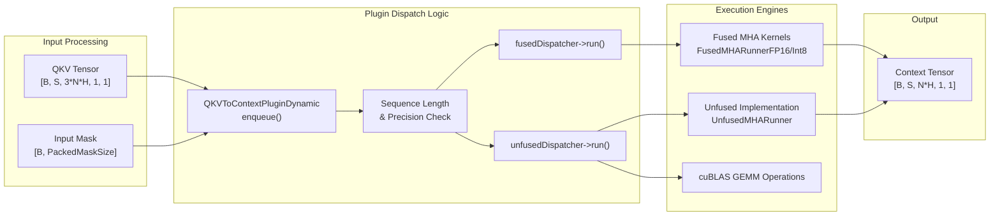

<!-- source: DeepWiki mcp.deepwiki.com · repo NVIDIA/TensorRT · page 4.3 BERT and NLP Plugins · fetched 2026-10-26 -->

# BERT and NLP Plugins

<details>
<summary>Relevant source files</summary>

The following files were used as context for generating this wiki page:

- [plugin/bertQKVToContextPlugin/README.md](plugin/bertQKVToContextPlugin/README.md)
- [plugin/bertQKVToContextPlugin/qkvToContextInt8InterleavedPlugin.cpp](plugin/bertQKVToContextPlugin/qkvToContextInt8InterleavedPlugin.cpp)
- [plugin/bertQKVToContextPlugin/qkvToContextInt8InterleavedPlugin.h](plugin/bertQKVToContextPlugin/qkvToContextInt8InterleavedPlugin.h)
- [plugin/bertQKVToContextPlugin/qkvToContextPlugin.cpp](plugin/bertQKVToContextPlugin/qkvToContextPlugin.cpp)
- [plugin/common/bertCommon.h](plugin/common/bertCommon.h)
- [plugin/common/checkMacrosPlugin.h](plugin/common/checkMacrosPlugin.h)
- [plugin/common/plugin.h](plugin/common/plugin.h)
- [plugin/embLayerNormPlugin/README.md](plugin/embLayerNormPlugin/README.md)
- [plugin/embLayerNormPlugin/embLayerNormKernel.cu](plugin/embLayerNormPlugin/embLayerNormKernel.cu)
- [plugin/embLayerNormPlugin/embLayerNormPlugin.cpp](plugin/embLayerNormPlugin/embLayerNormPlugin.cpp)
- [plugin/embLayerNormPlugin/embLayerNormPlugin.h](plugin/embLayerNormPlugin/embLayerNormPlugin.h)
- [plugin/embLayerNormPlugin/embLayerNormVarSeqlenKernelHFace.cu](plugin/embLayerNormPlugin/embLayerNormVarSeqlenKernelHFace.cu)
- [plugin/embLayerNormPlugin/embLayerNormVarSeqlenKernelMTron.cu](plugin/embLayerNormPlugin/embLayerNormVarSeqlenKernelMTron.cu)
- [plugin/embLayerNormPlugin/embLayerNormVarSeqlenPlugin.cpp](plugin/embLayerNormPlugin/embLayerNormVarSeqlenPlugin.cpp)
- [plugin/embLayerNormPlugin/embLayerNormVarSeqlenPlugin.h](plugin/embLayerNormPlugin/embLayerNormVarSeqlenPlugin.h)
- [plugin/geluPlugin/CustomGeluPluginDynamic_PluginConfig.yaml](plugin/geluPlugin/CustomGeluPluginDynamic_PluginConfig.yaml)
- [plugin/geluPlugin/geluPlugin.h](plugin/geluPlugin/geluPlugin.h)
- [plugin/pillarScatterPlugin/README.md](plugin/pillarScatterPlugin/README.md)
- [plugin/roiAlignPlugin/roiAlignKernel.h](plugin/roiAlignPlugin/roiAlignKernel.h)
- [plugin/skipLayerNormPlugin/README.md](plugin/skipLayerNormPlugin/README.md)
- [samples/common/safeCommon.h](samples/common/safeCommon.h)

</details>


This document covers the specialized TensorRT plugins designed for BERT and Transformer-based natural language processing models. These plugins provide optimized implementations of key operations including multi-head attention, embedding layers, layer normalization, and residual connections.

For general plugin system information, see [Plugin System](#4). For detection-specific plugins, see [Detection and NMS Plugins](#4.4). For 3D perception plugins, see [3D Perception Plugins](#4.5).

## Overview

The BERT and NLP plugin collection implements the core computational primitives required for Transformer architectures. These plugins are specifically optimized for BERT-style models and provide both standard and variable sequence length variants to handle different deployment scenarios.

The plugin ecosystem includes four main categories:
- **Multi-Head Attention**: QKV-to-Context computation with fused and unfused implementations
- **Embedding and Normalization**: Token, position, and segment embedding with layer normalization
- **Skip Connections**: Residual connections combined with layer normalization
- **Activation Functions**: GELU activation optimized for NLP workloads

Sources: [plugin/bertQKVToContextPlugin/README.md:1-115](), [plugin/embLayerNormPlugin/README.md:1-143](), [plugin/skipLayerNormPlugin/README.md:1-82]()

## Plugin Class Architecture

```mermaid
graph TD
    subgraph "Plugin Interfaces"
        IPluginV3["IPluginV3<br/>Base Interface"]
        IPluginV3Core["IPluginV3OneCore<br/>Core Methods"]
        IPluginV3Build["IPluginV3OneBuild<br/>Build-time Methods"]
        IPluginV3Runtime["IPluginV3OneRuntime<br/>Runtime Methods"]
    end
    
    subgraph "QKV-to-Context Plugins"
        QKVDynamic["QKVToContextPluginDynamic<br/>Standard Multi-Head Attention"]
        QKVVarSeq["QKVToContextVarSeqlenPlugin<br/>Variable Sequence Length"]
        QKVInterleaved["QKVToContextInterleavedPlugin<br/>INT8 Interleaved"]
        QKVCreator["QKVToContextPluginDynamicCreator"]
    end
    
    subgraph "Embedding Plugins"
        EmbDynamic["EmbLayerNormPluginDynamic<br/>Fixed Sequence Length"]
        EmbHFace["EmbLayerNormVarSeqlenPluginHFace<br/>HuggingFace Variant"]
        EmbMTron["EmbLayerNormVarSeqlenPluginMTron<br/>Megatron Variant"]
        EmbCreator["EmbLayerNormPluginDynamicCreator"]
    end
    
    subgraph "Execution Engines"
        FusedFP16["FusedMHARunnerFP16<br/>Optimized FP16 Kernels"]
        FusedInt8["FusedMHARunnerInt8<br/>Optimized INT8 Kernels"]
        UnfusedMHA["UnfusedMHARunner<br/>General Purpose MHA"]
    end
    
    IPluginV3 --> IPluginV3Core
    IPluginV3 --> IPluginV3Build  
    IPluginV3 --> IPluginV3Runtime
    
    QKVDynamic --> IPluginV3Core
    QKVDynamic --> IPluginV3Build
    QKVDynamic --> IPluginV3Runtime
    
    QKVVarSeq --> IPluginV3Core
    QKVVarSeq --> IPluginV3Build
    QKVVarSeq --> IPluginV3Runtime
    
    EmbDynamic --> IPluginV3Core
    EmbDynamic --> IPluginV3Build
    EmbDynamic --> IPluginV3Runtime
    
    QKVDynamic --> FusedFP16
    QKVDynamic --> FusedInt8
    QKVDynamic --> UnfusedMHA
    
    QKVCreator --> QKVDynamic
    EmbCreator --> EmbDynamic
```



Sources: [plugin/bertQKVToContextPlugin/qkvToContextPlugin.cpp:55-124](), [plugin/embLayerNormPlugin/embLayerNormPlugin.cpp:98-118](), [plugin/embLayerNormPlugin/embLayerNormVarSeqlenPlugin.h:46-85]()

## QKV-to-Context Multi-Head Attention

The `QKVToContextPluginDynamic` class implements scaled multi-head attention computation, the core operation in Transformer models. It takes combined query, key, and value tensors and computes attention scores using `softmax(K'Q/sqrt(HeadSize))`.

### Key Components

**Main Plugin Class**: `QKVToContextPluginDynamic` 
- Implements `IPluginV3`, `IPluginV3OneCore`, `IPluginV3OneBuild`, `IPluginV3OneRuntime`
- Handles input validation, format checking, and execution dispatch
- Supports FP32, FP16, and INT8 precision modes

**Execution Runners**: The plugin uses different execution paths based on sequence length and precision:
- `FusedMHARunnerFP16`: Optimized kernels for FP16 with specific sequence lengths (64, 96, 128, 384)
- `FusedMHARunnerInt8`: INT8 optimized kernels for supported sequence lengths  
- `UnfusedMHARunner`: General-purpose implementation for other cases

**Variable Sequence Support**: `QKVToContextVarSeqlenPlugin` provides optimized handling for batches with variable sequence lengths using cumulative sequence length indexing.

### Data Flow



Sources: [plugin/bertQKVToContextPlugin/qkvToContextPlugin.cpp:510-539](), [plugin/bertQKVToContextPlugin/qkvToContextPlugin.cpp:333-341](), [plugin/bertQKVToContextPlugin/qkvToContextPlugin.cpp:126-144]()

## Embedding and Layer Normalization

The `EmbLayerNormPluginDynamic` combines multiple embedding lookups with layer normalization in a single fused operation, essential for BERT input processing.

### Core Functionality

The plugin performs three embedding lookups and combines them:
1. **Word Embedding**: Token ID → word embedding vector
2. **Position Embedding**: Sequence position → positional encoding  
3. **Token Type Embedding**: Segment ID → token type embedding

These embeddings are summed and then layer normalized using learned `beta` and `gamma` parameters.

### Plugin Variants

**Fixed Sequence Length**: `EmbLayerNormPluginDynamic`
- Input shape: `[S, B]` for token IDs, segment IDs, input mask
- Output: `[S, B, E, 1, 1]` embedded sequence + `[B, PackedMaskSize]` processed mask

**Variable Sequence Length**: 
- `EmbLayerNormVarSeqlenPluginHFace`: HuggingFace-compatible variant
- `EmbLayerNormVarSeqlenPluginMTron`: Megatron-compatible variant
- Input shape: `[SumS]` flattened sequences + `[B+1]` cumulative sequence lengths

### Implementation Details

The `enqueue()` method dispatches to specialized CUDA kernels:
- `embSkipLayerNorm<float>()` for FP32 processing  
- `embSkipLayerNorm<half>()` for FP16 processing
- `convertMask()` for attention mask preprocessing when using fused MHA kernels

Sources: [plugin/embLayerNormPlugin/embLayerNormPlugin.cpp:250-335](), [plugin/embLayerNormPlugin/embLayerNormPlugin.cpp:41-73](), [plugin/embLayerNormPlugin/embLayerNormVarSeqlenPlugin.cpp:365-419]()

## Skip Connections and Layer Normalization

The `SkipLayerNormPluginDynamic` implements residual connections combined with layer normalization, a fundamental building block in Transformer architectures.

### Operation Sequence

1. **Residual Addition**: `output = input + skip`
2. **Optional Bias Addition**: `output = output + bias` (if bias provided)
3. **Layer Normalization**: Apply learned `beta` and `gamma` parameters

The plugin supports both fixed and variable sequence length variants, with specialized implementations for different precision modes (FP32, FP16, INT8).

Sources: [plugin/skipLayerNormPlugin/README.md:15-36]()

## Hardware Compatibility and Performance Optimizations

### Compute Capability Requirements

BERT plugins require GPU compute capability ≥ 7.0 (Turing architecture and above). The fused MHA kernels specifically target:
- **SM 7.5** (Turing): RTX 20xx series
- **SM 8.0/8.6/8.7** (Ampere): A100, RTX 30xx series  
- **SM 8.9** (Ada): RTX 40xx series
- **SM 9.0** (Hopper): H100
- **SM 10.0/12.0** (Blackwell): GB100, GB200

### Optimization Strategies

**Fused Kernel Selection**: The plugins automatically choose between fused and unfused implementations based on:
```cpp
if (fusedDispatcher.get() && fusedDispatcher->isValid(mHeadSize, mS)) {
    fusedDispatcher->run(inputDesc[0], outputDesc[0], inputs[0], maskPtr, outputs[0], workspace, stream, mCublasHandle);
} else {
    unfusedDispatcher->run(inputDesc[0], outputDesc[0], inputs[0], maskPtr, outputs[0], workspace, stream, mCublasHandle);
}
```

**Memory Layout Optimizations**: INT8 plugins use specialized tensor formats:
- `TensorFormat::kCHW32` for hidden dimensions divisible by 32
- `TensorFormat::kCHW4` for other hidden dimensions

**Sequence Length Specialization**: Fused kernels are optimized for specific sequence lengths (64, 96, 128, 384) with dedicated CUDA kernel implementations.

Sources: [plugin/bertQKVToContextPlugin/qkvToContextPlugin.cpp:520-531](), [plugin/common/bertCommon.h:172-194](), [plugin/bertQKVToContextPlugin/qkvToContextPlugin.cpp:232-241]()

## Integration with BERT Models

### Typical Usage Pattern

1. **Input Processing**: `EmbLayerNormPluginDynamic` handles token embedding and produces initial hidden states
2. **Transformer Layers**: Alternating `QKVToContextPluginDynamic` (attention) and `SkipLayerNormPluginDynamic` (residual + normalization)  
3. **Activation Functions**: `GeluPlugin` provides optimized GELU activation between linear layers

### Plugin Registration

All BERT plugins register with TensorRT using the `REGISTER_TENSORRT_PLUGIN` macro:
```cpp
REGISTER_TENSORRT_PLUGIN(QKVToContextPluginDynamicCreator);
REGISTER_TENSORRT_PLUGIN(EmbLayerNormPluginDynamicCreator);
```

The plugins are initialized via `initLibNvInferPlugins()` and can be accessed through the plugin registry using their versioned names like `"CustomQKVToContextPluginDynamic"` and `"CustomEmbLayerNormPluginDynamic"`.

Sources: [plugin/bertQKVToContextPlugin/qkvToContextPlugin.cpp:48](), [plugin/embLayerNormPlugin/embLayerNormPlugin.cpp:39](), [plugin/bertQKVToContextPlugin/qkvToContextPlugin.cpp:45-46]()

---

