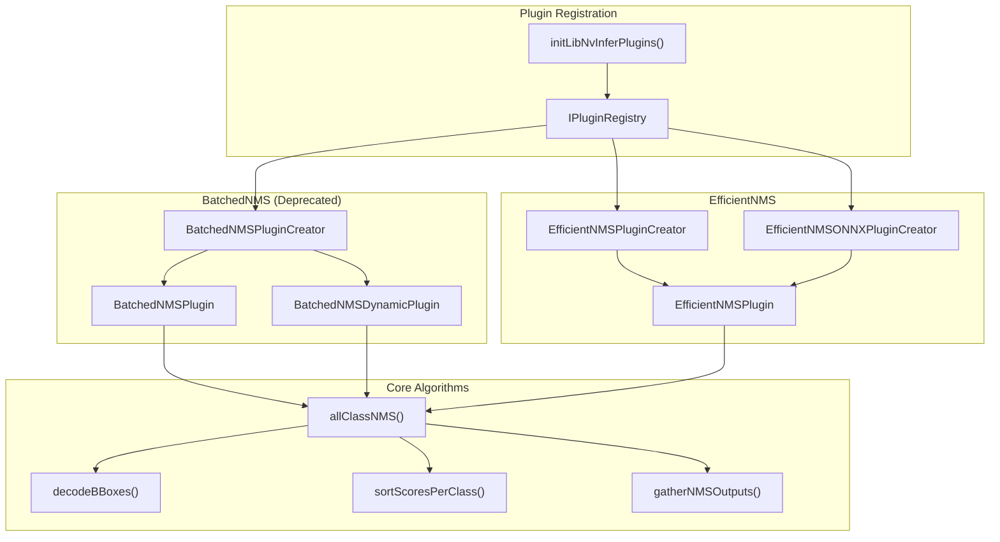
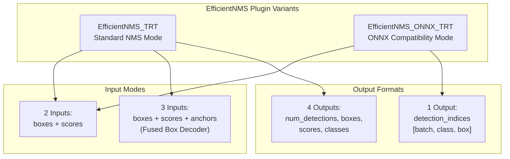
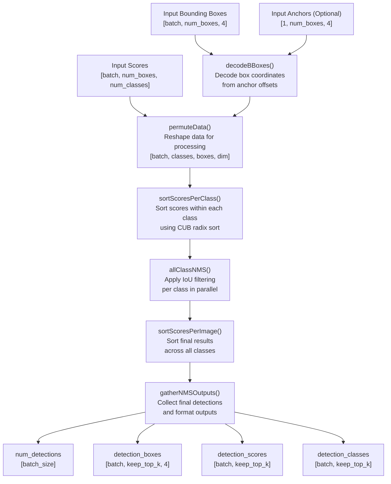
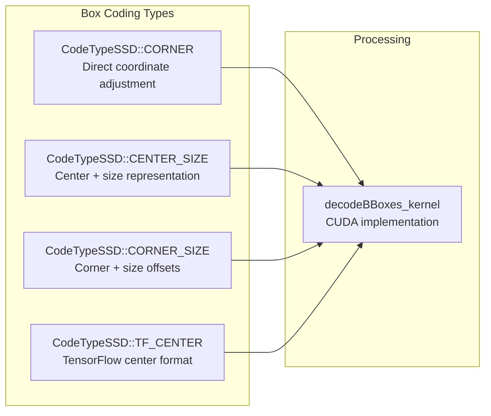
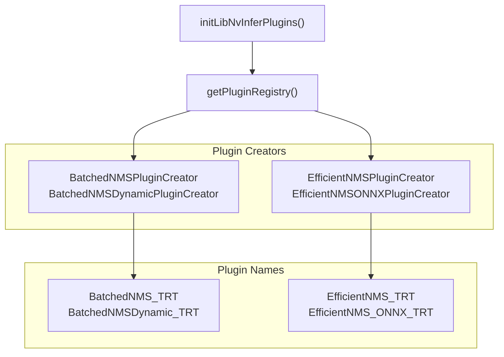
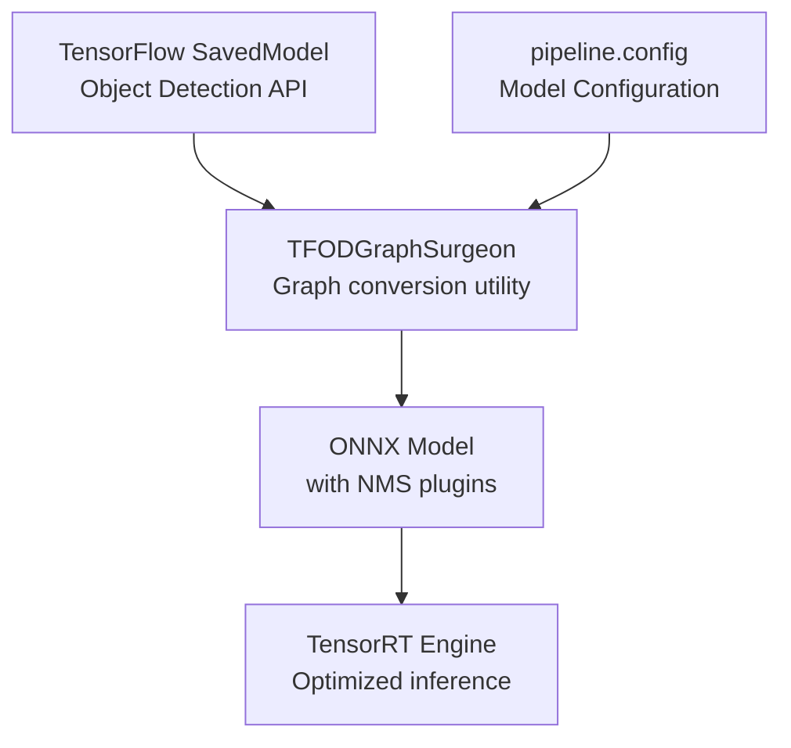

<!-- source: DeepWiki mcp.deepwiki.com · repo NVIDIA/TensorRT · page 4.4 Detection and NMS Plugins · fetched 2026-10-26 -->

# Detection and NMS Plugins

Relevant source files

The following files were used as context for generating this wiki page:

- [plugin/batchTilePlugin/batchTilePlugin.cpp](plugin/batchTilePlugin/batchTilePlugin.cpp)
- [plugin/batchTilePlugin/batchTilePlugin.h](plugin/batchTilePlugin/batchTilePlugin.h)
- [plugin/batchedNMSPlugin/README.md](plugin/batchedNMSPlugin/README.md)
- [plugin/batchedNMSPlugin/batchedNMSInference.cu](plugin/batchedNMSPlugin/batchedNMSInference.cu)
- [plugin/batchedNMSPlugin/batchedNMSPlugin.cpp](plugin/batchedNMSPlugin/batchedNMSPlugin.cpp)
- [plugin/batchedNMSPlugin/batchedNMSPlugin.h](plugin/batchedNMSPlugin/batchedNMSPlugin.h)
- [plugin/batchedNMSPlugin/gatherNMSOutputs.cu](plugin/batchedNMSPlugin/gatherNMSOutputs.cu)
- [plugin/batchedNMSPlugin/gatherNMSOutputs.h](plugin/batchedNMSPlugin/gatherNMSOutputs.h)
- [plugin/common/kernels/allClassNMS.cu](plugin/common/kernels/allClassNMS.cu)
- [plugin/common/kernels/decodeBBoxes.cu](plugin/common/kernels/decodeBBoxes.cu)
- [plugin/common/kernels/detectionForward.cu](plugin/common/kernels/detectionForward.cu)
- [plugin/common/kernels/gatherTopDetections.cu](plugin/common/kernels/gatherTopDetections.cu)
- [plugin/common/kernels/kernel.h](plugin/common/kernels/kernel.h)
- [plugin/common/kernels/permuteData.cu](plugin/common/kernels/permuteData.cu)
- [plugin/common/kernels/sortScoresPerClass.cu](plugin/common/kernels/sortScoresPerClass.cu)
- [plugin/common/kernels/sortScoresPerImage.cu](plugin/common/kernels/sortScoresPerImage.cu)
- [plugin/common/nmsHelper.cpp](plugin/common/nmsHelper.cpp)
- [plugin/common/plugin.cpp](plugin/common/plugin.cpp)
- [plugin/common/templates.h](plugin/common/templates.h)
- [plugin/coordConvACPlugin/coordConvACPlugin.cpp](plugin/coordConvACPlugin/coordConvACPlugin.cpp)
- [plugin/coordConvACPlugin/coordConvACPlugin.h](plugin/coordConvACPlugin/coordConvACPlugin.h)
- [plugin/cropAndResizePlugin/cropAndResizePlugin.cpp](plugin/cropAndResizePlugin/cropAndResizePlugin.cpp)
- [plugin/cropAndResizePlugin/cropAndResizePlugin.h](plugin/cropAndResizePlugin/cropAndResizePlugin.h)
- [plugin/decodeBbox3DPlugin/decodeBbox3D.cpp](plugin/decodeBbox3DPlugin/decodeBbox3D.cpp)
- [plugin/detectionLayerPlugin/detectionLayerPlugin.h](plugin/detectionLayerPlugin/detectionLayerPlugin.h)
- [plugin/efficientNMSPlugin/EfficientNMSPlugin_PluginConfig.yaml](plugin/efficientNMSPlugin/EfficientNMSPlugin_PluginConfig.yaml)
- [plugin/efficientNMSPlugin/README.md](plugin/efficientNMSPlugin/README.md)
- [plugin/efficientNMSPlugin/efficientNMSInference.cu](plugin/efficientNMSPlugin/efficientNMSInference.cu)
- [plugin/efficientNMSPlugin/efficientNMSInference.h](plugin/efficientNMSPlugin/efficientNMSInference.h)
- [plugin/efficientNMSPlugin/efficientNMSParameters.h](plugin/efficientNMSPlugin/efficientNMSParameters.h)
- [plugin/efficientNMSPlugin/efficientNMSPlugin.cpp](plugin/efficientNMSPlugin/efficientNMSPlugin.cpp)
- [plugin/efficientNMSPlugin/efficientNMSPlugin.h](plugin/efficientNMSPlugin/efficientNMSPlugin.h)
- [plugin/efficientNMSPlugin/tftrt/efficientNMSExplicitTFTRTPlugin.cpp](plugin/efficientNMSPlugin/tftrt/efficientNMSExplicitTFTRTPlugin.cpp)
- [plugin/generateDetectionPlugin/generateDetectionPlugin.cpp](plugin/generateDetectionPlugin/generateDetectionPlugin.cpp)
- [plugin/generateDetectionPlugin/generateDetectionPlugin.h](plugin/generateDetectionPlugin/generateDetectionPlugin.h)
- [plugin/multilevelCropAndResizePlugin/multilevelCropAndResizePlugin.cpp](plugin/multilevelCropAndResizePlugin/multilevelCropAndResizePlugin.cpp)
- [plugin/multilevelCropAndResizePlugin/multilevelCropAndResizePlugin.h](plugin/multilevelCropAndResizePlugin/multilevelCropAndResizePlugin.h)
- [plugin/multilevelProposeROI/multilevelProposeROIPlugin.cpp](plugin/multilevelProposeROI/multilevelProposeROIPlugin.cpp)
- [plugin/multilevelProposeROI/multilevelProposeROIPlugin.h](plugin/multilevelProposeROI/multilevelProposeROIPlugin.h)
- [plugin/nmsPlugin/nmsPlugin.cpp](plugin/nmsPlugin/nmsPlugin.cpp)
- [plugin/nmsPlugin/nmsPlugin.h](plugin/nmsPlugin/nmsPlugin.h)
- [plugin/nvFasterRCNN/nvFasterRCNNPlugin.cpp](plugin/nvFasterRCNN/nvFasterRCNNPlugin.cpp)
- [plugin/nvFasterRCNN/nvFasterRCNNPlugin.h](plugin/nvFasterRCNN/nvFasterRCNNPlugin.h)
- [plugin/priorBoxPlugin/priorBoxPlugin.cpp](plugin/priorBoxPlugin/priorBoxPlugin.cpp)
- [plugin/priorBoxPlugin/priorBoxPlugin.h](plugin/priorBoxPlugin/priorBoxPlugin.h)
- [plugin/proposalPlugin/proposalPlugin.cpp](plugin/proposalPlugin/proposalPlugin.cpp)
- [plugin/proposalPlugin/proposalPlugin.h](plugin/proposalPlugin/proposalPlugin.h)
- [plugin/resizeNearestPlugin/resizeNearestPlugin.cpp](plugin/resizeNearestPlugin/resizeNearestPlugin.cpp)
- [plugin/resizeNearestPlugin/resizeNearestPlugin.h](plugin/resizeNearestPlugin/resizeNearestPlugin.h)
- [plugin/specialSlicePlugin/specialSlicePlugin.cpp](plugin/specialSlicePlugin/specialSlicePlugin.cpp)
- [plugin/specialSlicePlugin/specialSlicePlugin.h](plugin/specialSlicePlugin/specialSlicePlugin.h)
- [plugin/voxelGeneratorPlugin/voxelGenerator.cpp](plugin/voxelGeneratorPlugin/voxelGenerator.cpp)
- [plugin/voxelGeneratorPlugin/voxelGenerator.h](plugin/voxelGeneratorPlugin/voxelGenerator.h)
- [samples/python/detectron2/create_onnx.py](samples/python/detectron2/create_onnx.py)
- [samples/python/efficientdet/create_onnx.py](samples/python/efficientdet/create_onnx.py)
- [samples/python/tensorflow_object_detection_api/build_engine.py](samples/python/tensorflow_object_detection_api/build_engine.py)
- [samples/python/tensorflow_object_detection_api/create_onnx.py](samples/python/tensorflow_object_detection_api/create_onnx.py)

This document covers the TensorRT plugins specifically designed for object detection tasks, focusing on Non-Maximum Suppression (NMS) implementations. These plugins accelerate the post-processing steps commonly required in object detection models by performing bounding box filtering, score thresholding, and duplicate removal on GPU.

For information about other specialized plugins like BERT/NLP plugins, see [BERT and NLP Plugins](#4.3). For general plugin system architecture, see [Plugin System](#4).

## Overview

The detection and NMS plugin ecosystem provides GPU-accelerated implementations of common object detection post-processing operations. The main plugins are:

- `BatchedNMSPlugin` - Legacy NMS implementation (deprecated since TensorRT 9.0)
- `EfficientNMSPlugin` - Optimized NMS with better performance characteristics
- Supporting CUDA kernels for core NMS algorithms

## Plugin Architecture

Sources: [plugin/batchedNMSPlugin/batchedNMSPlugin.h:31-163](), [plugin/efficientNMSPlugin/efficientNMSPlugin.cpp:22-25](), [plugin/common/kernels/kernel.h:40-43]()

## BatchedNMS Plugin (Deprecated)

The `BatchedNMSPlugin` was the original NMS implementation but has been deprecated since TensorRT 9.0 in favor of the built-in `INMSLayer` and `EfficientNMSPlugin`.

### Plugin Classes

| Class | Interface | Purpose |
|-------|-----------|---------|
| `BatchedNMSPlugin` | `IPluginV2Ext` | Static shape NMS implementation |
| `BatchedNMSDynamicPlugin` | `IPluginV2DynamicExt` | Dynamic shape NMS implementation |
| `BatchedNMSPluginCreator` | Plugin Creator | Creates static shape plugin instances |
| `BatchedNMSDynamicPluginCreator` | Plugin Creator | Creates dynamic shape plugin instances |

### Key Parameters

The plugin uses `NMSParameters` structure containing:

- `shareLocation` - Whether bounding boxes are shared across classes
- `backgroundLabelId` - Label ID for background class 
- `numClasses` - Number of object classes
- `topK` - Number of boxes to feed into NMS (max 4096)
- `keepTopK` - Number of final boxes to keep per image
- `scoreThreshold` - Minimum confidence score threshold
- `iouThreshold` - IoU threshold for overlap suppression
- `isNormalized` - Whether box coordinates are normalized [0,1]

Sources: [plugin/batchedNMSPlugin/batchedNMSPlugin.h:31-163](), [plugin/batchedNMSPlugin/batchedNMSPlugin.cpp:67-75](), [plugin/batchedNMSPlugin/README.md:58-71]()

## EfficientNMS Plugin

The `EfficientNMSPlugin` provides a more efficient NMS implementation with better performance characteristics and additional features.

### Plugin Variants

### Key Features

- **Fused Box Decoder**: Optional third input for anchor boxes enables box decoding within NMS
- **Dynamic Shapes**: Full support for dynamic batch size and box counts  
- **Optimized Algorithm**: Reduces latency compared to BatchedNMS
- **Multiple Box Codings**: Supports BoxCorner `[x1,y1,x2,y2]` and BoxCenterSize `[x,y,w,h]` formats
- **Class-Agnostic NMS**: Optional mode for YOLO-style detection

Sources: [plugin/efficientNMSPlugin/efficientNMSPlugin.cpp:35-72](), [plugin/efficientNMSPlugin/README.md:25-77](), [plugin/efficientNMSPlugin/efficientNMSParameters.h:28-58]()

## Core NMS Algorithm Implementation  

The NMS plugins rely on several core CUDA kernels that implement the detection pipeline:

### Algorithm Flow

### Key Algorithm Components

| Kernel Function | File | Purpose |
|-----------------|------|---------|
| `decodeBBoxes()` | [decodeBBoxes.cu:369-407]() | Decode bounding box coordinates from anchor offsets |
| `sortScoresPerClass()` | [sortScoresPerClass.cu:232-267]() | Sort detection scores within each class |
| `allClassNMS()` | [allClassNMS.cu:374-392]() | Apply IoU-based filtering across all classes |
| `sortScoresPerImage()` | [sortScoresPerImage.cu:27-75]() | Sort final detections across classes per image |
| `gatherNMSOutputs()` | [gatherNMSOutputs.cu:190-237]() | Collect and format final detection outputs |

Sources: [plugin/batchedNMSPlugin/batchedNMSInference.cu:26-137](), [plugin/common/kernels/kernel.h:40-96]()

## Box Decoding Support

The plugins support multiple bounding box encoding schemes commonly used in object detection:

### Supported Coding Types

### Implementation Details

The box decoding logic handles different coordinate systems and applies transformations like:

- Anchor box offset adjustments
- Exponential scaling for width/height
- Coordinate system conversions (e.g. `[y,x,h,w]` to `[x,y,w,h]`)
- Optional coordinate clipping to `[0,1]` range

Sources: [plugin/common/kernels/decodeBBoxes.cu:91-299](), [plugin/common/bboxUtils.h]()

## EfficientNMS Algorithm Optimizations

The `EfficientNMSPlugin` implements several optimizations over the traditional NMS approach:

### Performance Optimizations

1. **Reduced Memory Transfers**: Minimizes data movement between GPU memory regions
2. **Optimized Sorting**: Uses CUB library for high-performance radix sorting
3. **Early Termination**: Exits processing when sufficient detections found
4. **Score Filtering**: Pre-filters low-confidence detections before expensive IoU calculations
5. **Parallel Processing**: Processes multiple classes concurrently where possible

### Algorithm Flow

The efficient algorithm follows this optimized pipeline:

- **Filter Phase**: `EfficientNMSFilter` removes low-scoring boxes using score threshold
- **Sort Phase**: CUB-based sorting of filtered scores in descending order  
- **NMS Phase**: `EfficientNMS` kernel applies IoU suppression with optimized memory access
- **Output Phase**: Format results according to plugin configuration

Sources: [plugin/efficientNMSPlugin/efficientNMSInference.cu:177-337](), [plugin/efficientNMSPlugin/efficientNMSInference.cu:394-456](), [plugin/efficientNMSPlugin/README.md:114-153]()

## Plugin Registration and Usage

### Registration Process

NMS plugins are registered through the standard TensorRT plugin registry:

### Plugin Attributes

Both plugin families accept configuration through plugin attributes:

**BatchedNMS Attributes:**
- `shareLocation`, `backgroundLabelId`, `numClasses`  
- `topK`, `keepTopK`, `scoreThreshold`, `iouThreshold`
- `isNormalized`, `clipBoxes`, `scoreBits`, `caffeSemantics`

**EfficientNMS Attributes:**  
- `score_threshold`, `iou_threshold`, `max_output_boxes`
- `background_class`, `score_activation`, `class_agnostic`, `box_coding`

Sources: [plugin/batchedNMSPlugin/batchedNMSPlugin.cpp:627-643](), [plugin/efficientNMSPlugin/efficientNMSPlugin.cpp:413-426]()

## Integration Examples

### Usage in Object Detection Models

The NMS plugins are commonly used in popular object detection architectures:

- **SSD Models**: Use `BatchedNMSPlugin` or `EfficientNMSPlugin` for final detection filtering
- **EfficientDet**: Optimized with `EfficientNMSPlugin` using fused box decoder mode  
- **Faster R-CNN**: Two-stage detection with separate NMS for RPN and final detection
- **YOLO Models**: Class-agnostic NMS configuration for single-shot detection

### TensorFlow Object Detection API Integration

The codebase includes comprehensive support for converting TensorFlow Object Detection API models:

Sources: [samples/python/tensorflow_object_detection_api/create_onnx.py:47-157](), [samples/python/tensorflow_object_detection_api/build_engine.py:122-280](), [samples/python/detectron2/create_onnx.py:49-95](), [samples/python/efficientdet/create_onnx.py:37-85]()

---

