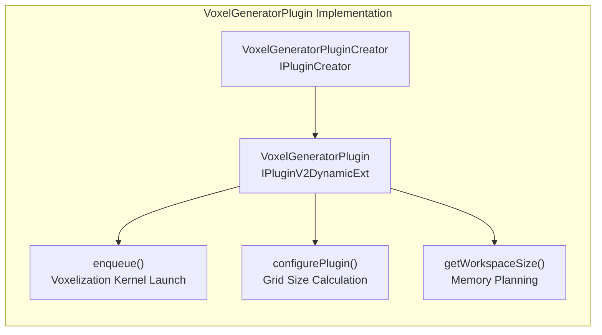
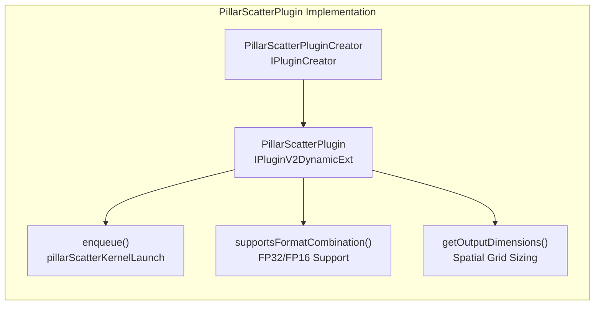
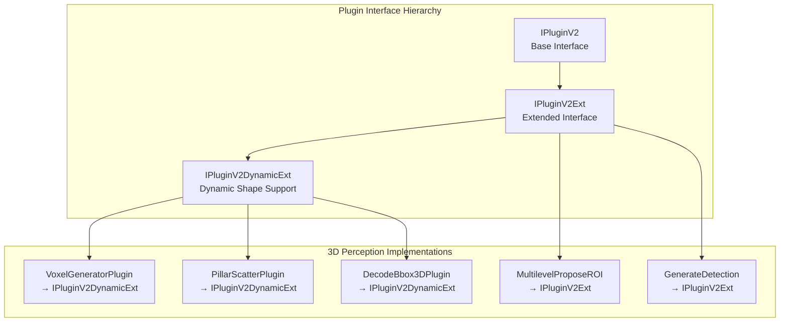

<!-- source: DeepWiki mcp.deepwiki.com · repo NVIDIA/TensorRT · page 4.5 3D Perception Plugins · fetched 2026-10-26 -->

# 3D Perception Plugins

<details>
<summary>Relevant source files</summary>

The following files were used as context for generating this wiki page:

- [plugin/batchTilePlugin/batchTilePlugin.cpp](plugin/batchTilePlugin/batchTilePlugin.cpp)
- [plugin/batchTilePlugin/batchTilePlugin.h](plugin/batchTilePlugin/batchTilePlugin.h)
- [plugin/common/templates.h](plugin/common/templates.h)
- [plugin/cropAndResizePlugin/cropAndResizePlugin.cpp](plugin/cropAndResizePlugin/cropAndResizePlugin.cpp)
- [plugin/cropAndResizePlugin/cropAndResizePlugin.h](plugin/cropAndResizePlugin/cropAndResizePlugin.h)
- [plugin/decodeBbox3DPlugin/decodeBbox3D.cpp](plugin/decodeBbox3DPlugin/decodeBbox3D.cpp)
- [plugin/detectionLayerPlugin/detectionLayerPlugin.h](plugin/detectionLayerPlugin/detectionLayerPlugin.h)
- [plugin/efficientNMSPlugin/tftrt/efficientNMSExplicitTFTRTPlugin.cpp](plugin/efficientNMSPlugin/tftrt/efficientNMSExplicitTFTRTPlugin.cpp)
- [plugin/generateDetectionPlugin/generateDetectionPlugin.cpp](plugin/generateDetectionPlugin/generateDetectionPlugin.cpp)
- [plugin/generateDetectionPlugin/generateDetectionPlugin.h](plugin/generateDetectionPlugin/generateDetectionPlugin.h)
- [plugin/multilevelCropAndResizePlugin/multilevelCropAndResizePlugin.cpp](plugin/multilevelCropAndResizePlugin/multilevelCropAndResizePlugin.cpp)
- [plugin/multilevelCropAndResizePlugin/multilevelCropAndResizePlugin.h](plugin/multilevelCropAndResizePlugin/multilevelCropAndResizePlugin.h)
- [plugin/multilevelProposeROI/multilevelProposeROIPlugin.cpp](plugin/multilevelProposeROI/multilevelProposeROIPlugin.cpp)
- [plugin/multilevelProposeROI/multilevelProposeROIPlugin.h](plugin/multilevelProposeROI/multilevelProposeROIPlugin.h)
- [plugin/proposalPlugin/proposalPlugin.cpp](plugin/proposalPlugin/proposalPlugin.cpp)
- [plugin/proposalPlugin/proposalPlugin.h](plugin/proposalPlugin/proposalPlugin.h)
- [plugin/resizeNearestPlugin/resizeNearestPlugin.cpp](plugin/resizeNearestPlugin/resizeNearestPlugin.cpp)
- [plugin/resizeNearestPlugin/resizeNearestPlugin.h](plugin/resizeNearestPlugin/resizeNearestPlugin.h)
- [plugin/specialSlicePlugin/specialSlicePlugin.cpp](plugin/specialSlicePlugin/specialSlicePlugin.cpp)
- [plugin/specialSlicePlugin/specialSlicePlugin.h](plugin/specialSlicePlugin/specialSlicePlugin.h)
- [plugin/voxelGeneratorPlugin/voxelGenerator.cpp](plugin/voxelGeneratorPlugin/voxelGenerator.cpp)
- [plugin/voxelGeneratorPlugin/voxelGenerator.h](plugin/voxelGeneratorPlugin/voxelGenerator.h)

</details>


This document covers TensorRT plugins specifically designed for 3D perception tasks, including point cloud processing, 3D object detection, and spatial feature manipulation. These plugins enable efficient acceleration of computer vision models that work with 3D spatial data, LiDAR point clouds, and multi-level feature pyramids.

For general detection and NMS operations on 2D data, see [Detection and NMS Plugins](#4.4). For plugin system fundamentals, see [Plugin System](#4).

## Overview

3D perception plugins in TensorRT handle the unique computational requirements of processing three-dimensional spatial data. Unlike traditional 2D image processing, 3D perception involves sparse point clouds, voxelization, multi-level feature pyramids, and specialized geometric transformations.

```mermaid
graph TD
    subgraph "Point Cloud Processing"
        PC["Point Cloud Input<br/>[N, Points, Features]"]
        VG["VoxelGeneratorPlugin<br/>voxelGenerator.cpp"]
        PS["PillarScatterPlugin<br/>pillarScatter.cpp"]
    end
    
    subgraph "Feature Pyramid Processing"
        FPN["Feature Pyramid Network<br/>Multiple Scales"]
        MPROI["MultilevelProposeROIPlugin<br/>multilevelProposeROIPlugin.cpp"]
        MCAR["MultilevelCropAndResizePlugin<br/>multilevelCropAndResizePlugin.cpp"]
    end
    
    subgraph "3D Detection Generation"
        CLS["Classification Predictions"]
        BOX["Box Predictions"]
        DIR["Direction Predictions"]
        DB3D["DecodeBbox3DPlugin<br/>decodeBbox3D.cpp"]
        GD["GenerateDetectionPlugin<br/>generateDetectionPlugin.cpp"]
    end
    
    PC --> VG
    VG --> PS
    PS --> FPN
    FPN --> MPROI
    MPROI --> MCAR
    MCAR --> CLS
    MCAR --> BOX
    CLS --> DB3D
    BOX --> DB3D
    DIR --> DB3D
    DB3D --> GD
    GD --> ["Final 3D Detections<br/>[N, Boxes, 9]"]
```

Sources: [plugin/pillarScatterPlugin/pillarScatter.cpp:1-289](), [plugin/voxelGeneratorPlugin/voxelGenerator.cpp:1-509](), [plugin/decodeBbox3DPlugin/decodeBbox3D.cpp:1-509](), [plugin/multilevelProposeROI/multilevelProposeROIPlugin.cpp:1-526]()

## Point Cloud Preprocessing Plugins

### VoxelGeneratorPlugin

The `VoxelGeneratorPlugin` converts sparse 3D point clouds into dense voxel representations, which are essential for CNN-based 3D perception models.

**Key Functionality:**
- Converts point clouds to voxelized feature representations
- Handles variable-length point sequences per voxel
- Supports configurable voxel sizes and point cloud ranges
- Implements pillar-based voxelization for efficient processing

**Inputs and Outputs:**
- Input: Point cloud array `[batch, points, features]` and point counts
- Outputs: Voxel features `[batch, max_voxels, max_points, features]`, voxel coordinates `[batch, max_voxels, 4]`, and voxel counts



Sources: [plugin/voxelGeneratorPlugin/voxelGenerator.cpp:50-87](), [plugin/voxelGeneratorPlugin/voxelGenerator.h:34-91]()

### PillarScatterPlugin

The `PillarScatterPlugin` scatters pillar features into a spatial feature map, converting the compressed pillar representation back to a full 2D spatial grid.

**Key Functionality:**
- Scatters pillar features to spatial coordinates
- Supports both FP32 and FP16 data types
- Handles batch processing efficiently
- Uses CUDA kernels for parallel scattering operations

**Inputs and Outputs:**
- Input: Pillar features `[batch, max_pillars, features]`, coordinates, and parameters
- Output: Spatial feature map `[batch, features, height, width]`



Sources: [plugin/pillarScatterPlugin/pillarScatter.cpp:28-32](), [plugin/pillarScatterPlugin/pillarScatter.cpp:107-155]()

## Multi-Level Feature Processing

### MultilevelProposeROIPlugin

The `MultilevelProposeROIPlugin` generates region proposals across multiple levels of a feature pyramid, implementing the Region Proposal Network (RPN) functionality for multi-scale 3D detection.

**Key Functionality:**
- Processes multiple feature pyramid levels simultaneously
- Generates anchor boxes for each pyramid level
- Applies NMS across all pyramid levels
- Supports configurable foreground/background thresholds

```mermaid
graph TD
    subgraph "MultilevelProposeROI Architecture"
        MPROI["MultilevelProposeROI<br/>IPluginV2Ext"]
        
        subgraph "Feature Levels (P2-P6)"
            P2["P2: 1/4 scale<br/>Small objects"]
            P3["P3: 1/8 scale<br/>Medium objects"] 
            P4["P4: 1/16 scale<br/>Large objects"]
            P5["P5: 1/32 scale<br/>Very large objects"]
            P6["P6: 1/64 scale<br/>Huge objects"]
        end
        
        subgraph "Processing Pipeline"
            ANC["generate_pyramid_anchors()<br/>Anchor Generation"]
            PROP["MultilevelPropose()<br/>Per-level Proposals"]
            NMS["ConcatTopK()<br/>Cross-level NMS"]
        end
        
        P2 --> ANC
        P3 --> ANC
        P4 --> ANC
        P5 --> ANC
        P6 --> ANC
        
        ANC --> PROP
        PROP --> NMS
        NMS --> ["ROI Proposals<br/>[N, keep_topk, 4]"]
    end
```

Sources: [plugin/multilevelProposeROI/multilevelProposeROIPlugin.cpp:377-421](), [plugin/multilevelProposeROI/multilevelProposeROIPlugin.cpp:423-474]()

### MultilevelCropAndResizePlugin

The `MultilevelCropAndResizePlugin` performs ROI pooling across multiple feature pyramid levels, enabling feature extraction from regions of interest at appropriate scales.

**Key Functionality:**
- Crops features from multiple pyramid levels based on ROI size
- Applies bilinear interpolation for feature resizing
- Routes ROIs to appropriate pyramid levels based on area
- Supports both FP32 and FP16 precision

**Level Assignment Logic:**
- Small ROIs (area < threshold) → Higher resolution levels (P2/P3)
- Large ROIs (area ≥ threshold) → Lower resolution levels (P4/P5/P6)

Sources: [plugin/multilevelCropAndResizePlugin/multilevelCropAndResizePlugin.cpp:108-120](), [plugin/multilevelCropAndResizePlugin/multilevelCropAndResizePlugin.cpp:223-237]()

## 3D Detection Generation

### DecodeBbox3DPlugin

The `DecodeBbox3DPlugin` decodes raw neural network predictions into 3D bounding boxes with proper coordinate transformations and filtering.

**Key Functionality:**
- Decodes classification scores, box regression, and direction predictions
- Applies anchor-based coordinate transformations
- Filters predictions based on score thresholds
- Handles 3D-specific parameters like direction bins and point cloud ranges

**Input Processing:**
- Classification predictions: `[batch, height, width, num_classes * num_anchors_per_location]`
- Box predictions: `[batch, height, width, num_classes * 7 * num_anchors_per_location]` 
- Direction predictions: `[batch, height, width, num_dir_bins * num_anchors_per_location]`

```mermaid
graph LR
    subgraph "DecodeBbox3D Processing"
        CLS_IN["Classification<br/>Predictions"]
        BOX_IN["Box<br/>Predictions"]
        DIR_IN["Direction<br/>Predictions"]
        
        DECODE["decodeBbox3DLaunch()<br/>Coordinate Transform"]
        FILTER["Score Filtering<br/>Point Cloud Range Check"]
        
        CLS_IN --> DECODE
        BOX_IN --> DECODE
        DIR_IN --> DECODE
        
        DECODE --> FILTER
        FILTER --> ["3D Bboxes<br/>[N, valid_boxes, 9]<br/>(x,y,z,l,w,h,θ,cls,score)"]
    end
```

Sources: [plugin/decodeBbox3DPlugin/decodeBbox3D.cpp:228-262](), [plugin/decodeBbox3DPlugin/decodeBbox3D.cpp:36-76]()

### GenerateDetectionPlugin

The `GenerateDetectionPlugin` performs the final detection generation step, applying Non-Maximum Suppression (NMS) and producing the final detection results.

**Key Functionality:**
- Applies class-specific NMS to remove duplicate detections
- Handles multi-class detection scenarios
- Clips bounding boxes to image boundaries
- Supports configurable IoU and score thresholds

**Processing Pipeline:**
1. Takes classification scores, bounding box deltas, and ROI proposals
2. Applies box regression to refine proposals
3. Performs NMS within each class
4. Returns top-K detections across all classes

Sources: [plugin/generateDetectionPlugin/generateDetectionPlugin.cpp:297-319](), [plugin/generateDetectionPlugin/generateDetectionPlugin.cpp:125-148]()

## Plugin Interface Patterns

3D perception plugins follow consistent interface patterns for integration with TensorRT:



**Common Plugin Methods:**
- `getOutputDimensions()`: Calculates output tensor shapes based on input dimensions
- `supportsFormatCombination()`: Defines supported data types and tensor formats
- `configurePlugin()`: Sets up internal state based on actual tensor dimensions
- `enqueue()`: Executes the plugin's CUDA kernels
- `getWorkspaceSize()`: Calculates temporary memory requirements

Sources: [plugin/pillarScatterPlugin/pillarScatter.cpp:41-54](), [plugin/voxelGeneratorPlugin/voxelGenerator.cpp:113-128](), [plugin/decodeBbox3DPlugin/decodeBbox3D.cpp:111-126]()

## Integration Considerations

When using 3D perception plugins, consider:

**Memory Management:**
- Point cloud data can be large and sparse
- Voxelization creates dense representations requiring significant memory
- Multi-level processing increases peak memory usage

**Precision Support:**
- Most plugins support both FP32 and FP16 for memory efficiency
- Point cloud preprocessing typically requires FP32 for numerical stability
- Feature processing can often use FP16 for speed

**Dynamic Shapes:**
- Point cloud sizes vary significantly between samples
- Plugins handle dynamic batch sizes and varying point counts
- Workspace memory is calculated based on maximum expected dimensions

Sources: [plugin/pillarScatterPlugin/pillarScatter.cpp:102-106](), [plugin/voxelGeneratorPlugin/voxelGenerator.cpp:227-250](), [plugin/decodeBbox3DPlugin/decodeBbox3D.cpp:217-226]()

---

