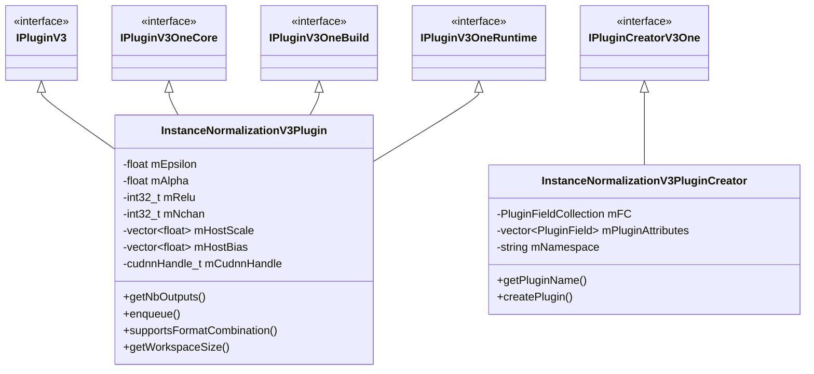
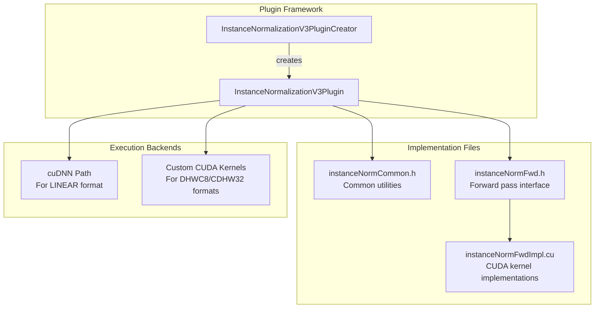
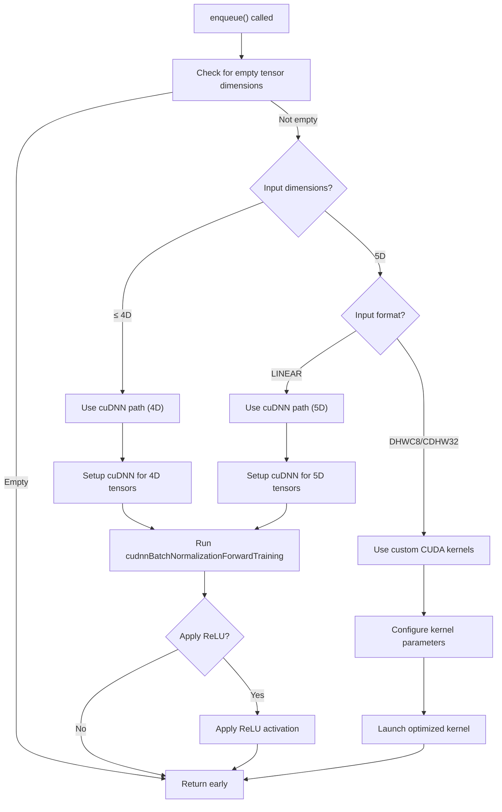

<!-- source: DeepWiki mcp.deepwiki.com · repo NVIDIA/TensorRT · page 4.6 Normalization and Attention Plugins · fetched 2026-10-26 -->

# Normalization Plugins

<details>
<summary>Relevant source files</summary>

The following files were used as context for generating this wiki page:

- [plugin/CMakeLists.txt](plugin/CMakeLists.txt)
- [plugin/README.md](plugin/README.md)
- [plugin/disentangledAttentionPlugin/CMakeLists.txt](plugin/disentangledAttentionPlugin/CMakeLists.txt)
- [plugin/disentangledAttentionPlugin/README.md](plugin/disentangledAttentionPlugin/README.md)
- [plugin/disentangledAttentionPlugin/disentangledAttentionPlugin.cpp](plugin/disentangledAttentionPlugin/disentangledAttentionPlugin.cpp)
- [plugin/disentangledAttentionPlugin/disentangledAttentionPlugin.h](plugin/disentangledAttentionPlugin/disentangledAttentionPlugin.h)
- [plugin/disentangledAttentionPlugin/disentangledKernel.cu](plugin/disentangledAttentionPlugin/disentangledKernel.cu)
- [plugin/efficientNMSPlugin/tftrt/CMakeLists.txt](plugin/efficientNMSPlugin/tftrt/CMakeLists.txt)
- [plugin/efficientNMSPlugin/tftrt/efficientNMSExplicitTFTRTPlugin.h](plugin/efficientNMSPlugin/tftrt/efficientNMSExplicitTFTRTPlugin.h)
- [plugin/efficientNMSPlugin/tftrt/efficientNMSImplicitTFTRTPlugin.cpp](plugin/efficientNMSPlugin/tftrt/efficientNMSImplicitTFTRTPlugin.cpp)
- [plugin/efficientNMSPlugin/tftrt/efficientNMSImplicitTFTRTPlugin.h](plugin/efficientNMSPlugin/tftrt/efficientNMSImplicitTFTRTPlugin.h)
- [plugin/instanceNormalizationPlugin/CMakeLists.txt](plugin/instanceNormalizationPlugin/CMakeLists.txt)
- [plugin/instanceNormalizationPlugin/README.md](plugin/instanceNormalizationPlugin/README.md)
- [plugin/instanceNormalizationPlugin/instanceNormCommon.h](plugin/instanceNormalizationPlugin/instanceNormCommon.h)
- [plugin/instanceNormalizationPlugin/instanceNormFwd.h](plugin/instanceNormalizationPlugin/instanceNormFwd.h)
- [plugin/instanceNormalizationPlugin/instanceNormFwdImpl.cu](plugin/instanceNormalizationPlugin/instanceNormFwdImpl.cu)
- [plugin/instanceNormalizationPlugin/instanceNormalizationPlugin.cu](plugin/instanceNormalizationPlugin/instanceNormalizationPlugin.cu)
- [plugin/instanceNormalizationPlugin/instanceNormalizationPlugin.h](plugin/instanceNormalizationPlugin/instanceNormalizationPlugin.h)
- [plugin/multiscaleDeformableAttnPlugin/CMakeLists.txt](plugin/multiscaleDeformableAttnPlugin/CMakeLists.txt)
- [plugin/multiscaleDeformableAttnPlugin/README.md](plugin/multiscaleDeformableAttnPlugin/README.md)
- [plugin/multiscaleDeformableAttnPlugin/multiscaleDeformableAttn.cu](plugin/multiscaleDeformableAttnPlugin/multiscaleDeformableAttn.cu)
- [plugin/multiscaleDeformableAttnPlugin/multiscaleDeformableAttn.h](plugin/multiscaleDeformableAttnPlugin/multiscaleDeformableAttn.h)
- [plugin/multiscaleDeformableAttnPlugin/multiscaleDeformableAttnPlugin.cpp](plugin/multiscaleDeformableAttnPlugin/multiscaleDeformableAttnPlugin.cpp)
- [plugin/multiscaleDeformableAttnPlugin/multiscaleDeformableAttnPlugin.h](plugin/multiscaleDeformableAttnPlugin/multiscaleDeformableAttnPlugin.h)
- [plugin/multiscaleDeformableAttnPlugin/multiscaleDeformableIm2ColCuda.cuh](plugin/multiscaleDeformableAttnPlugin/multiscaleDeformableIm2ColCuda.cuh)

</details>


The normalization plugins provide efficient implementations of various normalization operations in TensorRT. These plugins support different normalization techniques commonly used in deep learning models, including instance normalization for style transfer and generative models. The primary implementation is the `InstanceNormalizationV3Plugin`, which normalizes each feature map independently across spatial dimensions (unlike batch normalization which normalizes across the batch dimension).

## Instance Normalization Plugin

### Purpose and Overview

The `InstanceNormalizationV3Plugin` applies the following transformation to input tensors:

For an input tensor of shape [N, C, H, W] (or [N, C, D, H, W] for 3D), each feature map is normalized as:

```
y = scale * (x - mean) / sqrt(variance + epsilon) + bias
```

Where:
- `mean` and `variance` are computed per-channel for each batch item
- `scale` and `bias` are learnable parameters per channel
- `epsilon` is a small constant added for numerical stability
- Optional ReLU activation can be applied afterwards

Sources: [plugin/instanceNormalizationPlugin/instanceNormalizationPlugin.h:45-53](), [plugin/instanceNormalizationPlugin/instanceNormalizationPlugin.cu:47-50]()

### Plugin Architecture

The instance normalization implementation consists of two main classes:

1. **InstanceNormalizationV3Plugin**: Core implementation that inherits from multiple TensorRT plugin interfaces
2. **InstanceNormalizationV3PluginCreator**: Factory class for creating plugin instances

#### Class Structure



Sources: [plugin/instanceNormalizationPlugin/instanceNormalizationPlugin.h:40-153]()

#### Implementation Components



Sources: [plugin/instanceNormalizationPlugin/instanceNormalizationPlugin.cu:18-19](), [plugin/instanceNormalizationPlugin/CMakeLists.txt:18-26]()

### Key Parameters

The instance normalization plugin accepts several parameters to configure its behavior:

| Parameter | Type | Description |
|-----------|------|-------------|
| epsilon | float | Small constant added to variance for numerical stability |
| scales | float[] | Scale factors for each channel |
| bias | float[] | Bias values for each channel |
| relu | int32_t | Activation mode: 0=none, 1=ReLU, 2=Leaky ReLU |
| alpha | float | Negative slope for Leaky ReLU (used when relu=2) |

Sources: [plugin/instanceNormalizationPlugin/instanceNormalizationPlugin.cu:582-592](), [plugin/instanceNormalizationPlugin/instanceNormalizationPlugin.cu:602-606]()

### Supported Data Formats and Types

The instance normalization plugin supports different combinations of data formats and types depending on the dimensionality of the input tensor:

### For 3D and 4D tensors (nbSpatialDims == 1 or 2):
- FP32_Linear (NCHW format with FP32 data)
- FP16_Linear (NCHW format with FP16 data)

### For 5D tensors (nbSpatialDims == 3):
- FP32_Linear (NCDHW format with FP32 data)
- FP16_Linear (NCDHW format with FP16 data)
- FP16_DHWC8 (Vectorized format with FP16 data)
- INT8_CDHW32 (Vectorized format with INT8 data)

For vectorized formats, the number of channels must be a multiple of the vectorization factor (8 for DHWC8, 32 for CDHW32).

Sources: [plugin/instanceNormalizationPlugin/instanceNormalizationPlugin.cu:445-489]()

### Implementation Details

The instance normalization plugin uses two different implementation paths depending on the input format:

#### Implementation Flow



Sources: [plugin/instanceNormalizationPlugin/instanceNormalizationPlugin.cu:224-443]()

#### cuDNN Implementation Path

For LINEAR format (NCHW/NCDHW), the instance normalization plugin leverages cuDNN's batch normalization API:

1. Sets up appropriate tensor descriptors based on dimensions
2. Replicates scale and bias data for each batch item
3. Uses `cudnnBatchNormalizationForwardTraining` with `CUDNN_BATCHNORM_SPATIAL_PERSISTENT` mode
4. May fall back to `CUDNN_BATCHNORM_SPATIAL` for CUDA graph capture with older CUDA versions
5. Optionally applies ReLU activation after normalization

Sources: [plugin/instanceNormalizationPlugin/instanceNormalizationPlugin.cu:256-310](), [plugin/instanceNormalizationPlugin/instanceNormalizationPlugin.cu:313-378]()

#### Custom CUDA Kernels Path

For vectorized formats (DHWC8/CDHW32) with 5D tensors, the instance normalization plugin uses specialized CUDA kernels:

1. Allocates workspace memory for reduction operations
2. Configures kernel parameters including normalization and ReLU settings
3. Dispatches specialized kernels based on input/output data types and GPU architecture
4. Kernels compute mean and variance using parallel reduction techniques
5. Applies normalization and optional ReLU in a single pass

The custom kernels include optimizations for specific NVIDIA GPU architectures:
- SM 700 (Volta)
- SM 720 (Volta)
- SM 750 (Turing)
- SM 800 (Ampere)
- SM 860 (Ampere)
- SM 870 (Ampere)

Sources: [plugin/instanceNormalizationPlugin/instanceNormFwdImpl.cu:382-436](), [plugin/instanceNormalizationPlugin/instanceNormFwdImpl.cu:753-1019]()

### Memory Considerations

The instance normalization plugin requires temporary workspace memory, especially for the custom CUDA kernel path:

1. For LINEAR format:
   - Memory to replicate scale and bias data for each batch item
   
2. For vectorized formats (DHWC8/CDHW32):
   - Memory for sums, counts, and synchronization primitives
   - Memory for storing running statistics
   - Size varies based on tensor dimensions and batch size

The required workspace size is calculated by the `getWorkspaceSize` method.

Sources: [plugin/instanceNormalizationPlugin/instanceNormalizationPlugin.cu:169-222]()

### Algorithm and Optimization Details

The custom CUDA kernel implementation uses a two-phase approach:

1. **First phase**: Each thread block processes a portion of the input tensor
   - Computes local mean and variance for its assigned elements
   - Stores results in shared memory
   - Uses parallel reduction within blocks for efficiency

2. **Second phase**: Results from all blocks are combined
   - Local means and variances are merged to compute global statistics
   - Final normalization is applied with scale and bias
   - Optional ReLU activation is applied if requested

For vectorized formats, the implementation uses specialized load/store operations and optimized memory access patterns to maximize throughput.

Sources: [plugin/instanceNormalizationPlugin/instanceNormFwdImpl.cu:31-615](), [plugin/instanceNormalizationPlugin/instanceNormCommon.h:134-143]()

### Performance Considerations

To achieve optimal performance with the instance normalization plugin:

1. **Format selection**:
   - For 5D tensors, consider using vectorized formats (DHWC8 for FP16, CDHW32 for INT8) which have specialized optimizations
   - For 3D/4D tensors, LINEAR format is the only option

2. **Channel alignment**:
   - For DHWC8 format: ensure number of channels is a multiple of 8
   - For CDHW32 format: ensure number of channels is a multiple of 32

3. **GPU architecture**:
   - The plugin includes specialized optimizations for different NVIDIA GPU architectures
   - Performance will be best on architectures with explicit optimizations (Volta, Turing, Ampere)

4. **Activation fusion**:
   - Use the built-in ReLU capability rather than adding a separate ReLU layer
   - This reduces memory bandwidth and improves overall performance

5. **Memory requirements**:
   - Ensure sufficient workspace memory is available, especially for large batch sizes or channel counts

Sources: [plugin/instanceNormalizationPlugin/instanceNormFwdImpl.cu:674-685](), [plugin/instanceNormalizationPlugin/instanceNormalizationPlugin.cu:445-489]()

---

