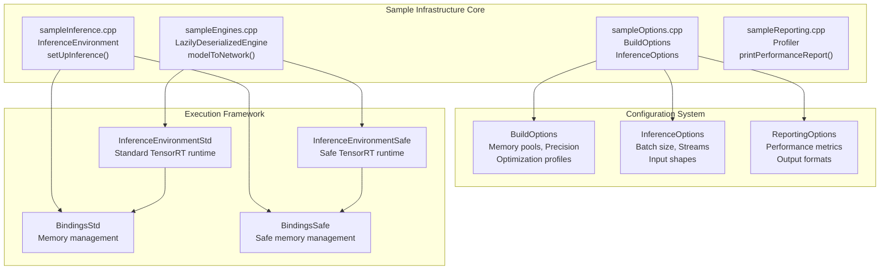
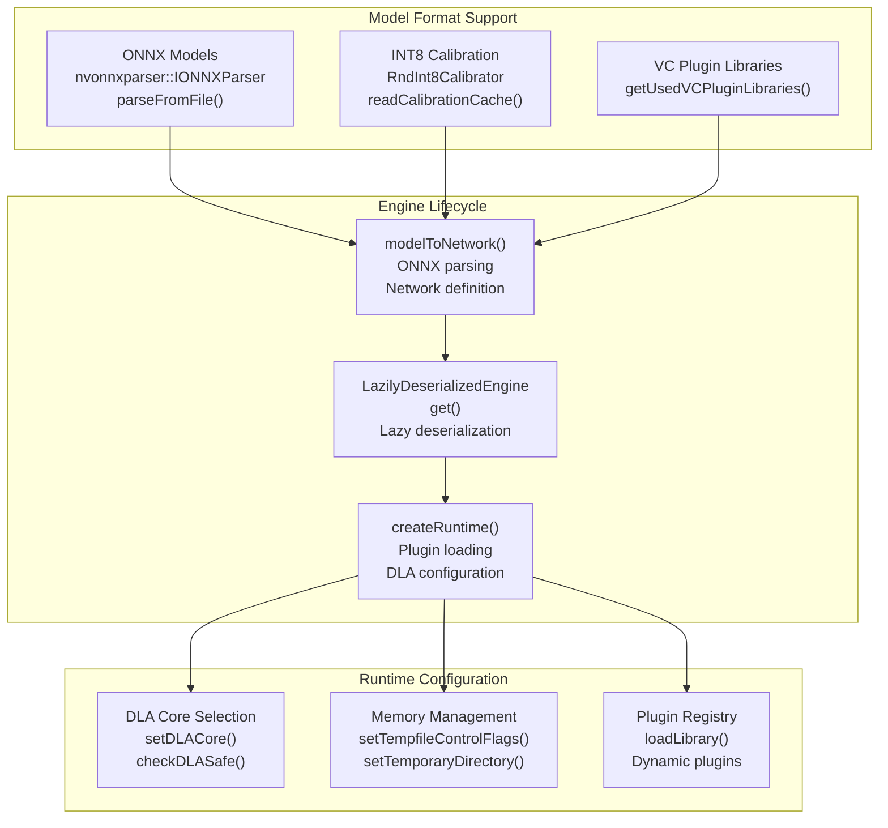
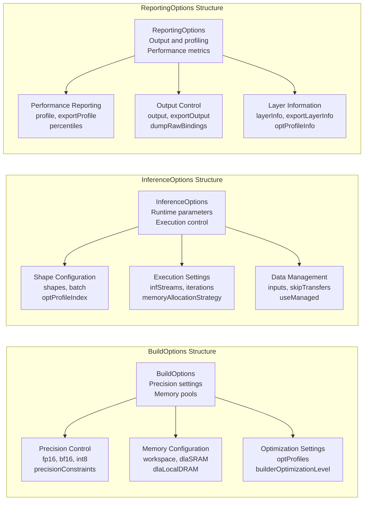
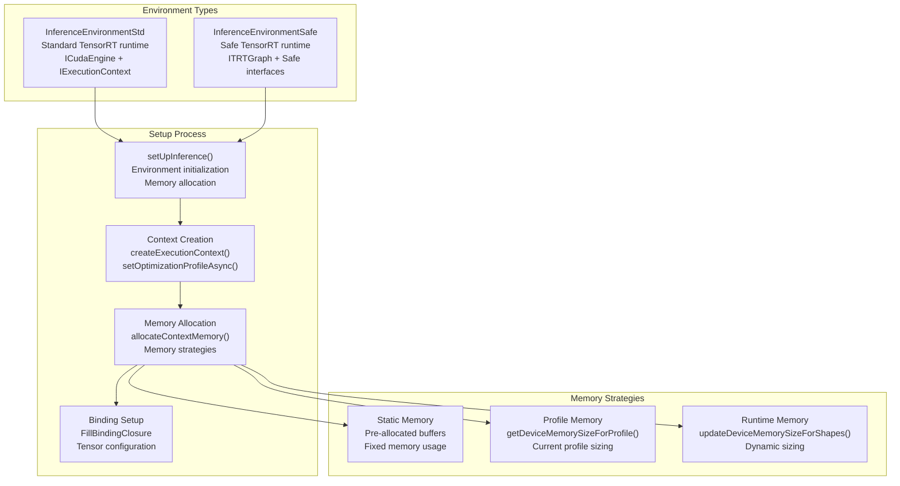
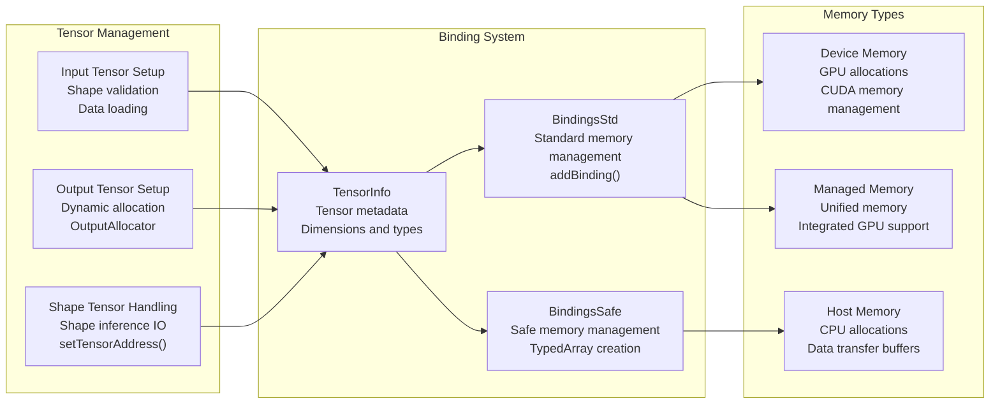
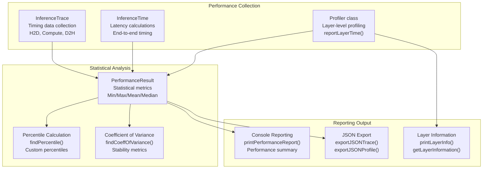
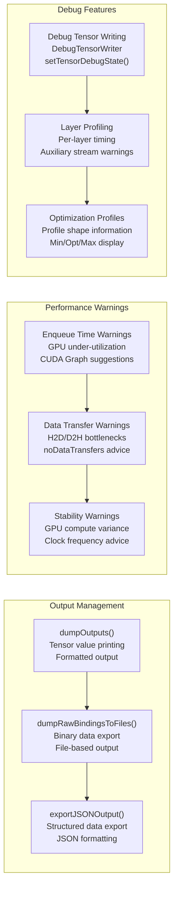

<!-- source: DeepWiki mcp.deepwiki.com · repo NVIDIA/TensorRT · page 5 Demo Applications · fetched 2026-10-26 -->

# Demo Applications

Relevant source files

The following files were used as context for generating this wiki page:

- [.gitmodules](.gitmodules)
- [CHANGELOG.md](CHANGELOG.md)
- [demo/BERT/README.md](demo/BERT/README.md)
- [demo/BERT/builder.py](demo/BERT/builder.py)
- [demo/BERT/builder_varseqlen.py](demo/BERT/builder_varseqlen.py)
- [demo/BERT/infer_c/bert_infer.h](demo/BERT/infer_c/bert_infer.h)
- [demo/BERT/inference.ipynb](demo/BERT/inference.ipynb)
- [demo/BERT/inference.py](demo/BERT/inference.py)
- [demo/BERT/inference_varseqlen.py](demo/BERT/inference_varseqlen.py)
- [demo/BERT/perf.py](demo/BERT/perf.py)
- [demo/BERT/perf_varseqlen.py](demo/BERT/perf_varseqlen.py)
- [demo/BERT/scripts/download_model.sh](demo/BERT/scripts/download_model.sh)
- [demo/BERT/scripts/download_squad.sh](demo/BERT/scripts/download_squad.sh)
- [demo/BERT/scripts/inference_benchmark.sh](demo/BERT/scripts/inference_benchmark.sh)
- [demo/BERT/scripts/inference_benchmark_megatron.sh](demo/BERT/scripts/inference_benchmark_megatron.sh)
- [demo/Diffusion/README.md](demo/Diffusion/README.md)
- [demo/Diffusion/demo_img2img_flux.py](demo/Diffusion/demo_img2img_flux.py)
- [demo/Diffusion/demo_txt2img_flux.py](demo/Diffusion/demo_txt2img_flux.py)
- [demo/Diffusion/requirements.txt](demo/Diffusion/requirements.txt)
- [samples/sampleINT8API/sampleINT8API.cpp](samples/sampleINT8API/sampleINT8API.cpp)

This section covers the TensorRT demo applications and sample infrastructure that demonstrate TensorRT acceleration across various AI workloads. These applications serve as reference implementations showing how to integrate TensorRT with different model types, frameworks, and deployment scenarios.

For information about the core TensorRT API used by these demos, see [Core API](#3). For details about the plugin system utilized by many demos, see [Plugin System](#4).

## Sample Infrastructure Architecture

The TensorRT sample infrastructure provides a comprehensive framework for building, configuring, and executing TensorRT engines across different demo applications. The architecture is built around several key components that handle engine management, configuration parsing, inference execution, and performance reporting.

### Sample Infrastructure Components

Sources: [samples/common/sampleEngines.cpp:108-177](), [samples/common/sampleOptions.cpp:369-396](), [samples/common/sampleInference.cpp:407-418](), [samples/common/sampleReporting.cpp:324-347]()

### Engine Management System

The engine management system provides lazy deserialization and runtime configuration capabilities through the `LazilyDeserializedEngine` class and related utilities.

Sources: [samples/common/sampleEngines.cpp:239-297](), [samples/common/sampleEngines.cpp:302-398](), [samples/common/sampleEngines.cpp:108-177]()

## Configuration and Options System

The configuration system provides comprehensive control over build and inference parameters through structured option classes that parse command-line arguments and validate configuration settings.

### Build and Inference Configuration

Sources: [samples/common/sampleOptions.cpp:498-514](), [samples/common/sampleOptions.cpp:570-584](), [samples/common/sampleOptions.cpp:696-767]()

### Option Parsing and Validation

The option parsing system handles complex command-line argument processing with type conversion, validation, and error handling capabilities.

```mermaid
graph TD
    subgraph "Argument Processing"
        ArgParse["Arguments map<br/>Command-line parsing<br/>Flag validation"]
        TypeConv["stringToValue<br/>Type conversion<br/>Unit multipliers"]
        Validation["validateNonEmpty<br/>Range checking<br/>Format validation"]
    end
    
    subgraph "Shape Processing"
        ShapesParse["getShapesBuild()<br/>Profile shapes<br/>Dynamic dimensions"]
        ShapesValid["processShapes()<br/>Min/Opt/Max validation<br/>Broadcasting"]
        ProfileMgmt["getOptimizationProfiles()<br/>Multiple profiles<br/>Index validation"]
    end
    
    subgraph "Format Handling"
        IOFormats["IOFormat parsing<br/>DataType + TensorFormats<br/>Broadcast logic"]
        LayerTypes["LayerPrecisions<br/>LayerOutputTypes<br/>Layer-specific config"]
        DeviceTypes["LayerDeviceTypes<br/>GPU/DLA selection<br/>Per-layer assignment"]
    end
    
    ArgParse --> TypeConv
    TypeConv --> Validation
    
    ShapesParse --> ShapesValid
    ShapesValid --> ProfileMgmt
    
    IOFormats --> LayerTypes
    LayerTypes --> DeviceTypes
```

Sources: [samples/common/sampleOptions.cpp:91-132](), [samples/common/sampleOptions.cpp:473-477](), [samples/common/sampleOptions.cpp:570-612]()

## Inference Execution Framework

The inference execution framework provides both standard and safe runtime environments with comprehensive memory management, context handling, and execution control.

### Inference Environment Setup

Sources: [samples/common/sampleInference.cpp:525-808](), [samples/common/sampleInference.cpp:342-385](), [samples/common/sampleInference.cpp:234-322]()

### Binding and Memory Management

Sources: [samples/common/sampleInference.cpp:235-322](), [samples/common/sampleInference.cpp:676-808](), [samples/common/sampleInference.cpp:421-523]()

## Performance Reporting System

The performance reporting system provides comprehensive analysis of inference performance with detailed metrics, profiling capabilities, and export functionality.

### Performance Metrics and Analysis

Sources: [samples/common/sampleReporting.cpp:211-230](), [samples/common/sampleReporting.cpp:47-109](), [samples/common/sampleReporting.cpp:379-443]()

### Output and Debug Capabilities

The reporting system includes comprehensive output dumping, debug tensor analysis, and performance warning systems to help developers optimize their TensorRT applications.

Sources: [samples/common/sampleReporting.cpp:466-503](), [samples/common/sampleReporting.cpp:275-316](), [samples/common/sampleReporting.cpp:546-610]()

## Common Utilities and Support

The sample infrastructure includes extensive utility functions for data handling, memory management, timing, and cross-platform compatibility that support all demo applications.

### Data Processing and Memory Utilities

```mermaid
graph TB
    subgraph "Data Type Support"
        TypeSizes["getNbBytes()<br/>Size calculation per type<br/>FP32/FP16/INT8/etc"]
        DataConv["Type Conversion<br/>swapEndianness()<br/>Cross-platform support"]
        BufferOps["Buffer Operations<br/>fillBuffer()<br/>dumpBuffer()"]
    end
    
    subgraph "Memory Management"
        CudaMalloc["safeCudaMalloc()<br/>Safe GPU allocation<br/>Error handling"]
        HostMemory["HostMemory classes<br/>TypedHostMemory<br/>Type-safe allocations"]
        StreamMgmt["Stream Management<br/>makeCudaStream()<br/>RAII stream handling"]
    end
    
    subgraph "File Operations"
        FileLoad["loadFromFile()<br/>Binary data loading<br/>Size validation"]
        PPMRead["PPM/PGM Reading<br/>Image format support<br/>readPPMFile()"]
        ASCIIFiles["ASCII File I/O<br/>readASCIIFile()<br/>writeASCIIFile()"]
    end
    
    TypeSizes --> DataConv
    DataConv --> BufferOps
    
    CudaMalloc --> HostMemory
    HostMemory --> StreamMgmt
    
    FileLoad --> PPMRead
    PPMRead --> ASCIIFiles
```

Sources: [samples/common/common.h:556-584](), [samples/common/common.h:236-284](), [samples/common/common.h:348-421]()

The demo applications leverage this comprehensive sample infrastructure to provide robust, performant, and easy-to-use examples of TensorRT integration across various AI workloads and deployment scenarios.

---

