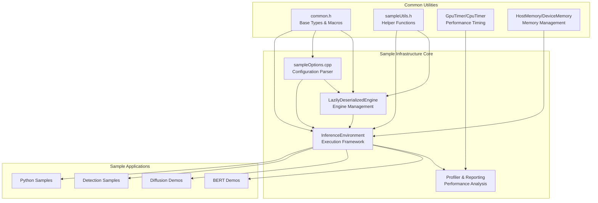
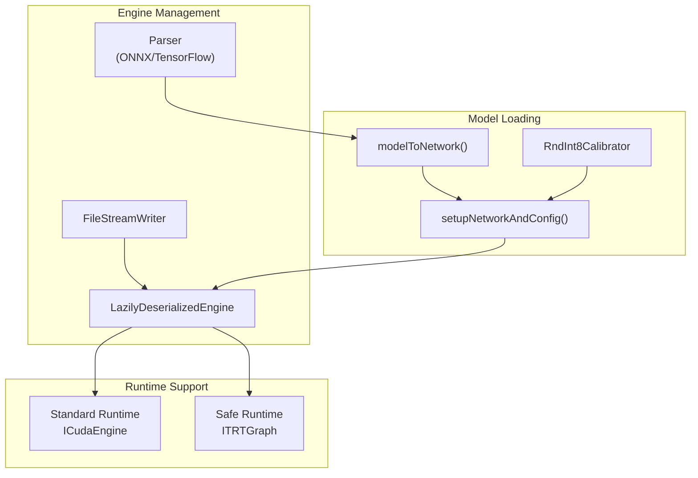
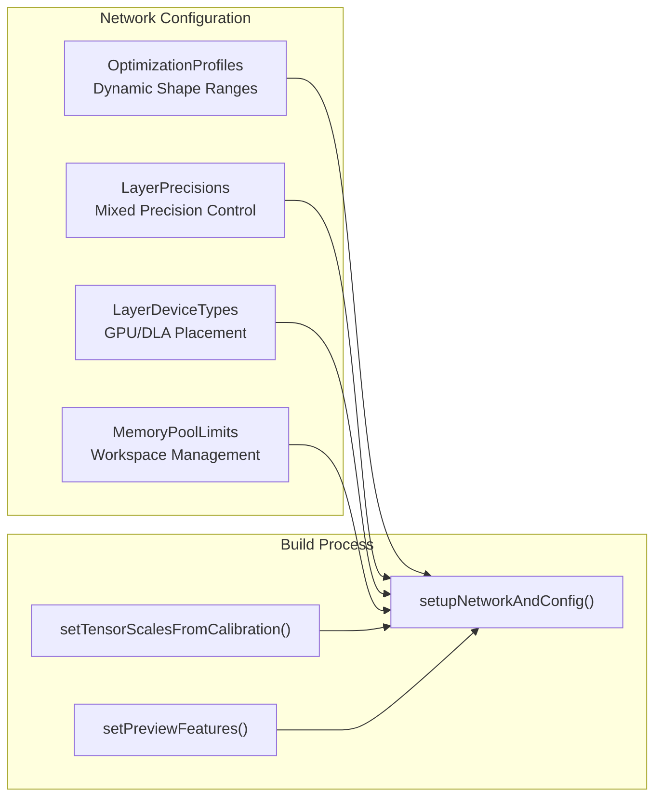
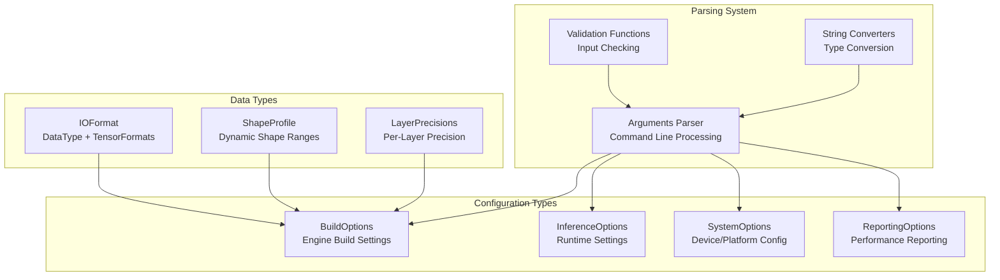
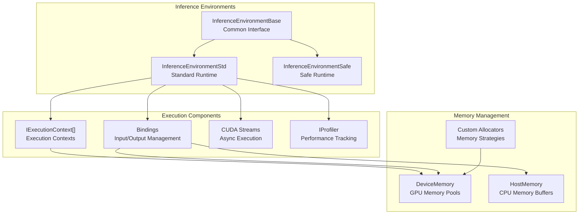
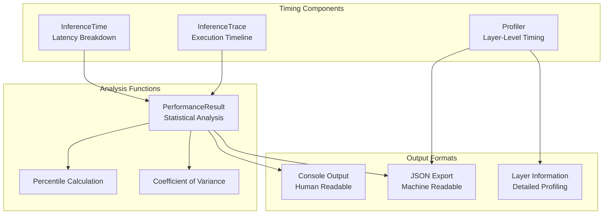
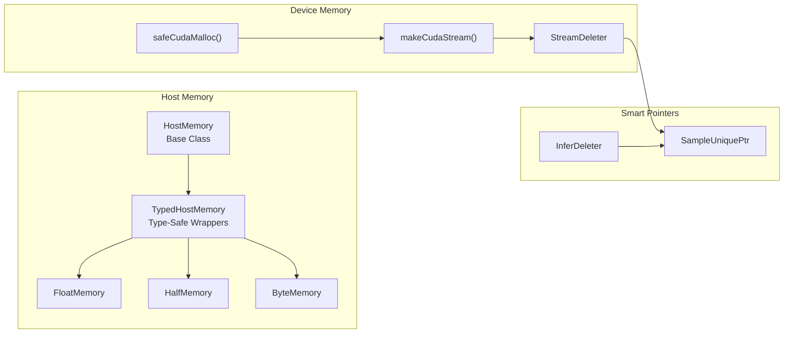

<!-- source: DeepWiki mcp.deepwiki.com · repo NVIDIA/TensorRT · page 5.1 Sample Infrastructure · fetched 2026-10-26 -->

# Sample Infrastructure

Relevant source files

The following files were used as context for generating this wiki page:

- [CMakeLists.txt](CMakeLists.txt)
- [cmake/toolchains/cmake_qnx_safe.toolchain](cmake/toolchains/cmake_qnx_safe.toolchain)
- [samples/common/common.h](samples/common/common.h)
- [samples/common/sampleEngines.cpp](samples/common/sampleEngines.cpp)
- [samples/common/sampleInference.cpp](samples/common/sampleInference.cpp)
- [samples/common/sampleInference.h](samples/common/sampleInference.h)
- [samples/common/sampleOptions.cpp](samples/common/sampleOptions.cpp)
- [samples/common/sampleOptions.h](samples/common/sampleOptions.h)
- [samples/common/sampleReporting.cpp](samples/common/sampleReporting.cpp)
- [samples/common/sampleUtils.h](samples/common/sampleUtils.h)
- [samples/trtexec/trtexec.cpp](samples/trtexec/trtexec.cpp)

The Sample Infrastructure provides common utilities and shared components used across all TensorRT sample applications for engine management, configuration parsing, inference execution, and performance benchmarking. This infrastructure abstracts away low-level TensorRT operations and provides a consistent interface for building, configuring, and running inference workloads.

For information about specific demo applications that use this infrastructure, see [BERT Inference](#5.2), [Diffusion Model Acceleration](#5.3), and [Python Integration Samples](#5.4).

## Architecture Overview

The sample infrastructure is organized into several key subsystems that work together to provide a complete framework for TensorRT applications:

Sources: [samples/common/sampleEngines.cpp:1-50](), [samples/common/sampleOptions.cpp:1-50](), [samples/common/sampleInference.cpp:1-50](), [samples/common/sampleReporting.cpp:1-50]()

## Engine Management System

The engine management system provides abstractions for loading, deserializing, and managing TensorRT engines with support for both standard and safe runtime modes.

### Core Engine Classes

The `LazilyDeserializedEngine` class provides lazy deserialization of TensorRT engines, supporting both lean runtime loading and version-compatible engines:

| Component | Purpose | Key Methods |
|-----------|---------|-------------|
| `LazilyDeserializedEngine` | Lazy engine loading and runtime management | `get()`, `release()`, `checkDLASafe()` |
| `FileStreamWriter` | Engine serialization to disk | `write()`, `finalize()` |
| `modelToNetwork()` | Convert ONNX/TF models to TensorRT networks | Handles ONNX parsing, plugin loading |

Sources: [samples/common/sampleEngines.cpp:108-177](), [samples/common/sampleEngines.cpp:52-80](), [samples/common/sampleEngines.cpp:239-297]()

### Network Configuration and Optimization

The infrastructure provides comprehensive support for configuring TensorRT networks with various precision modes, optimization profiles, and device-specific settings:

Sources: [samples/common/sampleEngines.cpp:707-879](), [samples/common/sampleEngines.cpp:452-509](), [samples/common/sampleEngines.cpp:633-705]()

## Configuration Management

The options system provides comprehensive command-line argument parsing and configuration management for TensorRT applications.

### Configuration Architecture

### Key Configuration Components

| Configuration Type | Purpose | Key Settings |
|-------------------|---------|--------------|
| `BuildOptions` | Engine compilation settings | Precision modes, optimization profiles, memory limits |
| `InferenceOptions` | Runtime execution settings | Batch size, streams, memory allocation strategy |
| `SystemOptions` | Device and platform settings | DLA core, GPU device selection |
| `ReportingOptions` | Performance analysis settings | Profiling, output formats, export options |

Sources: [samples/common/sampleOptions.cpp:369-395](), [samples/common/sampleOptions.cpp:570-694](), [samples/common/sampleOptions.cpp:820-855]()

## Inference Execution Framework

The inference framework provides a unified interface for executing TensorRT engines with support for multiple streams, memory management strategies, and both standard and safe runtime modes.

### Execution Environment Architecture

### Memory Allocation Strategies

The framework supports multiple memory allocation strategies to optimize performance for different use cases:

| Strategy | Description | Use Case |
|----------|-------------|----------|
| `kSTATIC` | Pre-allocate maximum memory | Consistent workloads |
| `kPROFILE` | Allocate for current optimization profile | Multi-profile engines |
| `kRUNTIME` | Allocate based on current input shapes | Dynamic shape workloads |

Sources: [samples/common/sampleInference.cpp:342-385](), [samples/common/sampleInference.cpp:525-809](), [samples/common/sampleInference.cpp:617-623]()

## Performance Analysis and Reporting

The reporting system provides comprehensive performance analysis capabilities with detailed metrics, profiling, and export functionality.

### Performance Metrics System

### Key Performance Metrics

The system tracks multiple performance dimensions to provide comprehensive analysis:

| Metric Category | Components | Purpose |
|-----------------|------------|---------|
| **Latency** | `h2d`, `compute`, `d2h`, `enq` | End-to-end timing breakdown |
| **Throughput** | Queries per second based on walltime | Overall system performance |
| **Stability** | Coefficient of variance | Performance consistency |
| **Resource Usage** | Memory allocation, stream utilization | Resource efficiency |

Sources: [samples/common/sampleReporting.cpp:211-230](), [samples/common/sampleReporting.cpp:232-322](), [samples/common/sampleReporting.cpp:379-443]()

## Common Utilities and Types

The infrastructure provides essential utilities and type definitions used throughout the TensorRT sample ecosystem.

### Memory Management Utilities

### Timing and Profiling Infrastructure

The infrastructure includes sophisticated timing utilities for performance measurement:

| Timer Type | Purpose | Implementation |
|------------|---------|---------------|
| `GpuTimer` | GPU kernel timing using CUDA events | Event-based measurement |
| `CpuTimer<Clock>` | CPU timing with configurable clock | Template-based timing |
| `PreciseCpuTimer` | High-resolution CPU timing | `std::chrono::high_resolution_clock` |
| `SimpleProfiler` | Basic layer profiling | `IProfiler` implementation |

Sources: [samples/common/common.h:236-284](), [samples/common/common.h:834-886](), [samples/common/common.h:121-205]()

### Data Processing Utilities

```mermaid
graph TB
    subgraph "Data Type Support"
        ENDIAN["swapEndianness<T>()"]
        VOLUME["volume() Calculations"]
        DIMS_CONV["toDims() Conversion"]
    end
    
    subgraph "I/O Operations"
        FILE_LOCATE["locateFile()"]
        PPM_READ["readPPMFile()"]
        ASCII_IO["readASCIIFile()/writeASCIIFile()"]
    end
    
    subgraph "String Processing"
        SPLIT_STRING["splitString()"]
        STARTS_WITH["startsWith()"]
        FILE_SAFE["genFilenameSafeString()"]
    end
    
    subgraph "Compute Capability"
        CC_DETECT["ComputeCapability::forDevice()"]
        SM_VERSION["getSMVersion()"]
        SM_SAFE["isSMSafe()"]
    end
    
    VOLUME --> DIMS_CONV
    FILE_LOCATE --> PPM_READ
    PPM_READ --> ASCII_IO
    
    SPLIT_STRING --> STARTS_WITH
    STARTS_WITH --> FILE_SAFE
    
    CC_DETECT --> SM_VERSION
    SM_VERSION --> SM_SAFE
```

Sources: [samples/common/common.h:610-667](), [samples/common/common.h:1010-1045](), [samples/common/common.h:1082-1108](), [samples/common/sampleUtils.h:128-176]()

---

