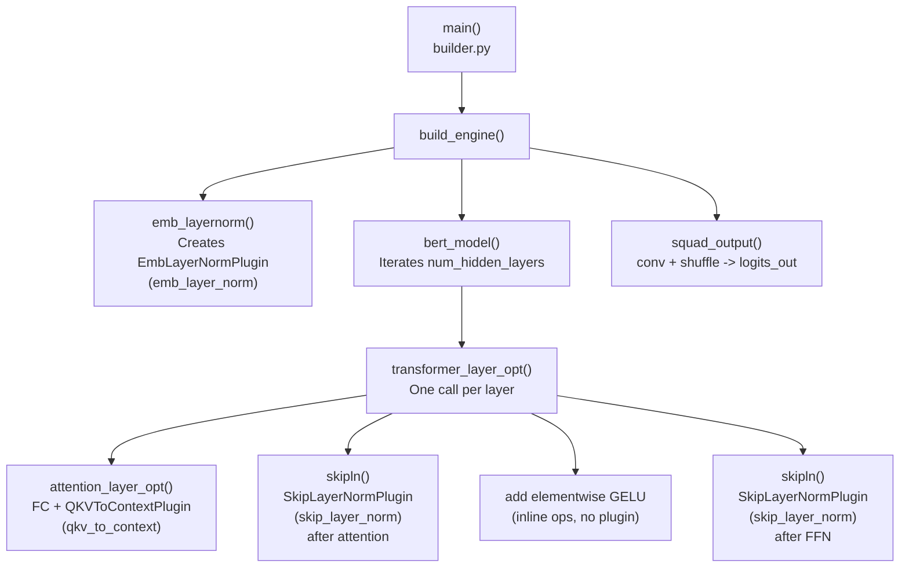
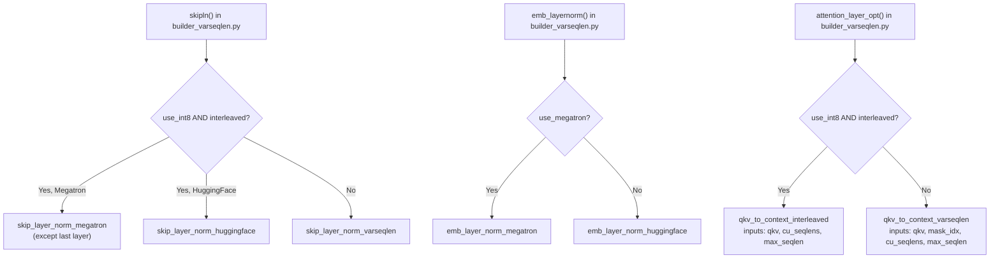
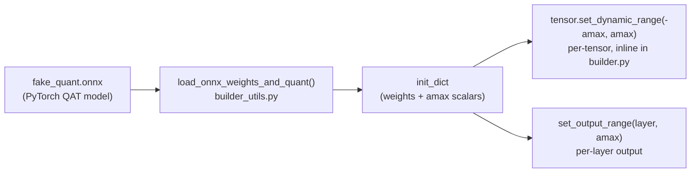
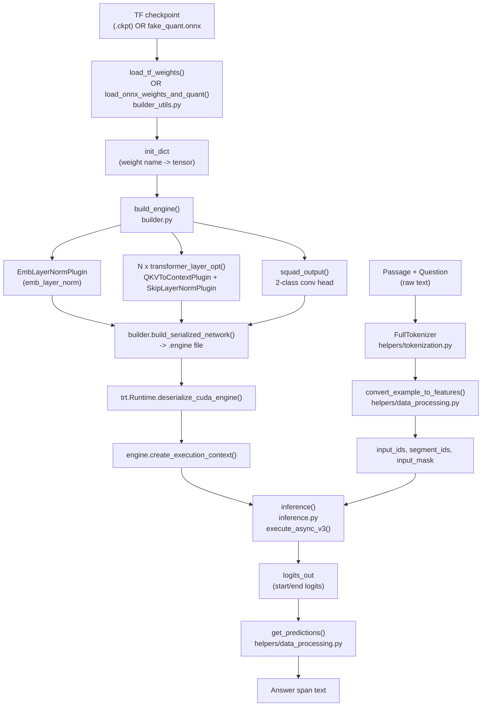

<!-- source: DeepWiki mcp.deepwiki.com · repo NVIDIA/TensorRT · page 5.2 BERT Inference Demo · fetched 2026-10-26 -->

# BERT Inference Demo

<details>
<summary>Relevant source files</summary>

The following files were used as context for generating this wiki page:

- [demo/BERT/README.md](demo/BERT/README.md)
- [demo/BERT/builder.py](demo/BERT/builder.py)
- [demo/BERT/builder_varseqlen.py](demo/BERT/builder_varseqlen.py)
- [demo/BERT/infer_c/bert_infer.h](demo/BERT/infer_c/bert_infer.h)
- [demo/BERT/inference.ipynb](demo/BERT/inference.ipynb)
- [demo/BERT/inference.py](demo/BERT/inference.py)
- [demo/BERT/inference_varseqlen.py](demo/BERT/inference_varseqlen.py)
- [demo/BERT/perf.py](demo/BERT/perf.py)
- [demo/BERT/perf_varseqlen.py](demo/BERT/perf_varseqlen.py)
- [demo/BERT/scripts/download_model.sh](demo/BERT/scripts/download_model.sh)
- [demo/BERT/scripts/download_squad.sh](demo/BERT/scripts/download_squad.sh)
- [demo/BERT/scripts/inference_benchmark.sh](demo/BERT/scripts/inference_benchmark.sh)
- [demo/BERT/scripts/inference_benchmark_megatron.sh](demo/BERT/scripts/inference_benchmark_megatron.sh)
- [samples/sampleINT8API/sampleINT8API.cpp](samples/sampleINT8API/sampleINT8API.cpp)

</details>


> **Deprecation Notice:** This demo has been deprecated since TensorRT 10.15 due to the deprecation of the `bertQKVToContextPlugin`. See [BERT and NLP Plugins](#4.3) for details on the underlying plugins.

This page documents the `demo/BERT` application: how BERT TensorRT engines are built, how inference is run on the SQuAD question-answering task, how INT8 calibration works, and how benchmarking is performed. For information about the BERT-specific TensorRT plugins this demo relies on (`QKVToContextPlugin`, `EmbLayerNormPlugin`, `SkipLayerNormPlugin`), see [BERT and NLP Plugins](#4.3). For the general plugin system, see [Plugin System](#4).

---

## Overview

The `demo/BERT` directory provides a self-contained Python pipeline for running high-performance BERT inference using TensorRT. It builds TensorRT engines directly from pre-trained TensorFlow checkpoints, PyTorch checkpoints, or fake-quantized ONNX models, then provides scripts for:

- SQuAD question-answering inference (interactive and dataset-level)
- INT8 Post-Training Quantization (PTQ) calibration
- INT8 Quantization-Aware Training (QAT) weight loading
- Performance benchmarking with and without CUDA Graph acceleration

Two parallel code paths exist: a **fixed sequence length** path and an experimental **variable sequence length** path.

---

## Model Architecture

BERT is a multi-layer bidirectional Transformer encoder. Two standard size configurations are supported:

| Model      | Hidden Layers | Hidden Size | Attention Heads | FF Filter Size | Max Seq Length | Parameters |
|:----------:|:-------------:|:-----------:|:---------------:|:--------------:|:--------------:|:----------:|
| BERT-Base  | 12            | 768         | 12              | 3072           | 512            | 110M       |
| BERT-Large | 24            | 1024        | 16              | 4096           | 512            | 330M       |

The inference pipeline consists of three host-side and one GPU-side stage:

**Inference Pipeline Stages**


Sources: [demo/BERT/README.md:62-69](), [demo/BERT/inference.py:112-235]()

---

## Directory Structure

| Path | Purpose |
|------|---------|
| `demo/BERT/builder.py` | Engine builder for fixed sequence length |
| `demo/BERT/builder_varseqlen.py` | Engine builder for variable sequence length |
| `demo/BERT/builder_utils.py` | Weight loading utilities shared by both builders |
| `demo/BERT/inference.py` | Fixed-length inference script (passage + question or SQuAD) |
| `demo/BERT/inference_varseqlen.py` | Variable-length inference script |
| `demo/BERT/inference_c.py` | Inference with CUDA Graph via pybind11 |
| `demo/BERT/perf.py` | Python benchmarking for fixed-length engines |
| `demo/BERT/perf_varseqlen.py` | Python benchmarking for variable-length engines |
| `demo/BERT/infer_c/bert_infer.h` | C++ `BertInference` struct for CUDA Graph support |
| `demo/BERT/infer_c/infer_c.cpp` | pybind11 interface used by `inference_c.py` |
| `demo/BERT/infer_c/perf.cpp` | C++ benchmarking binary with `--enable_graph` |
| `demo/BERT/helpers/` | Tokenization, data processing, calibrator, CUDA utilities |
| `demo/BERT/scripts/` | Shell scripts: download, build, benchmark |

Sources: [demo/BERT/README.md:204-229]()

---

## Engine Building

### Fixed-Length Builder (`builder.py`)

**Entry point:** `main()` in [demo/BERT/builder.py:513-700]()

The fixed-length builder assembles a TensorRT network from scratch using the TensorRT Python API, importing weights from a checkpoint. It does **not** parse an ONNX model for the main network path; instead, it calls TensorRT layer-construction APIs directly.

**`BertConfig`** class ([demo/BERT/builder.py:59-93]()) holds all configuration flags read from `bert_config.json`:

| Field | Meaning |
|-------|---------|
| `num_attention_heads` | Number of MHA heads |
| `hidden_size` | Embedding and hidden layer width |
| `intermediate_size` | Feed-forward intermediate size |
| `num_hidden_layers` | Number of Transformer encoder blocks |
| `use_fp16` | Enable FP16 builder flag |
| `use_int8` | Enable INT8 builder flag |
| `use_strict` | Enforce `PREFER_PRECISION_CONSTRAINTS`, `DIRECT_IO`, `REJECT_EMPTY_ALGORITHMS` |
| `use_int8_skipln` | Run `SkipLayerNormPlugin` in INT8 I/O mode |
| `use_int8_multihead` | Run `QKVToContextPlugin` in INT8 I/O mode |
| `use_qat` | Load dynamic ranges from fake-quantized ONNX weights |
| `use_sparsity` | Set `SPARSE_WEIGHTS` builder flag |
| `use_deprecated_plugins` | Toggle between `IPluginV2` and `IPluginV3` plugin variants |

**Network construction call chain:**

**Fixed-Length Network Construction**



Sources: [demo/BERT/builder.py:408-488](), [demo/BERT/builder.py:113-310]()

Key functions:

- **`emb_layernorm()`** [demo/BERT/builder.py:332-406](): Adds network input tensors (`input_ids`, `segment_ids`, `input_mask` as `trt.int32`), creates optimization profiles, and instantiates the `emb_layer_norm` plugin with embedding weights packed as `PluginField` objects.
- **`attention_layer_opt()`** [demo/BERT/builder.py:113-169](): Adds a 1×1 convolution for the combined QKV projection, then instantiates `qkv_to_context` plugin.
- **`skipln()`** [demo/BERT/builder.py:171-208](): Instantiates `skip_layer_norm` plugin with `beta`/`gamma` weights from the checkpoint.
- **`transformer_layer_opt()`** [demo/BERT/builder.py:210-295](): Assembles one full Transformer block: attention → FC → skip-layernorm → FFN (conv + GELU) → FC → skip-layernorm.
- **`bert_model()`** [demo/BERT/builder.py:297-310](): Loops over `num_hidden_layers`, calling `transformer_layer_opt()` at each layer prefix `l{n}_`.
- **`squad_output()`** [demo/BERT/builder.py:312-330](): Adds a final 1×1 convolution producing 2-class logits (start/end positions) for SQuAD.
- **`build_engine()`** [demo/BERT/builder.py:408-488](): Creates `IBuilder`, `INetworkDefinition`, and `IBuilderConfig`, applies precision flags, sets up calibration if needed, and calls `builder.build_serialized_network()`.
- **`generate_calibration_cache()`** [demo/BERT/builder.py:490-511](): A separate engine-build pass in FP32 mode that generates an INT8 calibration cache file for PTQ.

**Builder command-line arguments (key options):**

| Flag | Purpose |
|------|---------|
| `-m` / `--ckpt` | TensorFlow checkpoint path |
| `-x` / `--onnx` | Fake-quantized ONNX model path (QAT) |
| `-o` / `--output` | Output `.engine` file |
| `-b` / `--batch-size` | Batch size(s); repeatable for multiple profiles |
| `-s` / `--sequence-length` | Sequence length(s); repeatable |
| `-c` / `--config-dir` | Directory containing `bert_config.json` |
| `--fp16` | Enable FP16 |
| `--int8` | Enable INT8 |
| `--strict` | Strict precision constraints |
| `-iln` | INT8 I/O for `SkipLayerNormPlugin` |
| `-imh` | INT8 I/O for `QKVToContextPlugin` (Turing+) |
| `-sp` / `--sparse` | Sparse weights (Ampere) |
| `--use-v3-plugins` / `--use-deprecated-plugins` | Plugin API version toggle |
| `-tcf` | Timing cache file path |

Sources: [demo/BERT/builder.py:513-700]()

---

### Variable-Length Builder (`builder_varseqlen.py`)

**Entry point:** `main()` in [demo/BERT/builder_varseqlen.py:505-700]()

The variable-length builder eliminates padding waste. Instead of fixed `(batch, seq_len)` input tensors, it concatenates all sequences in the batch into a single flat tensor, plus a `cu_seqlens` (cumulative sequence lengths) buffer.

**Input tensors:**

| Tensor Name | Shape | dtype |
|-------------|-------|-------|
| `input_ids` | `(-1,)` flat | `int32` |
| `segment_ids` | `(-1,)` flat | `int32` |
| `cu_seqlens` | `(batch+1,)` | `int32` |
| `max_seqlen` | `(-1,)` | `int32` |

The builder selects variant plugin names based on whether interleaved INT8 or Megatron-style residuals are enabled:

**Variable-Length Plugin Selection**



Sources: [demo/BERT/builder_varseqlen.py:178-215](), [demo/BERT/builder_varseqlen.py:372-423](), [demo/BERT/builder_varseqlen.py:105-176]()

**Key difference from fixed-length:** PTQ calibration is not supported in the variable-length builder; an exception is raised if `--int8` is set without a QAT ONNX source [demo/BERT/builder_varseqlen.py:439-440]().

---

## INT8 Quantization

### Post-Training Quantization (PTQ)

PTQ is only available via `builder.py`. The flow:

1. `generate_calibration_cache()` builds a temporary FP32 engine, running `BertCalibrator` (from `helpers/calibrator.py`) over SQuAD training data to produce a calibration cache file.
2. The actual INT8 engine is then built using the cached calibration scales.
3. `builder_config.set_quantization_flag(trt.QuantizationFlag.CALIBRATE_BEFORE_FUSION)` is set to ensure calibration occurs before layer fusion [demo/BERT/builder.py:424-425]().

INT8 dynamic ranges for GELU outputs are clamped to 10 (`set_output_range(gelu_layer, 10)`) per the "GELU-10" approach from the FP8 quantization whitepaper [demo/BERT/builder.py:276]().

**GPU requirements for INT8 plugin I/O modes:**

| Flag | Minimum GPU |
|------|-------------|
| `-iln` (INT8 skip-layernorm) | Xavier (SM 7.2) |
| `-imh` (INT8 multi-head attention) | Turing (SM 7.5) |

### Quantization-Aware Training (QAT)

QAT engines use a fake-quantized ONNX model (generated by NVIDIA's PyTorch-Quantization toolkit). The builder loads quantization amax values from the ONNX model via `load_onnx_weights_and_quant()` in `builder_utils.py`, then calls `set_dynamic_range()` on each tensor and layer output directly rather than running a calibrator [demo/BERT/builder.py:128-168]().

**Dynamic range setting for QAT**



Sources: [demo/BERT/builder.py:128-168](), [demo/BERT/builder.py:235-289]()

---

## Inference Scripts

### Fixed-Length: `inference.py`

[demo/BERT/inference.py]() accepts a passage+question pair (or a SQuAD JSON file) and runs the engine to produce an answer.

**Runtime flow:**

1. Load plugin library (`libnvinfer_plugin.so`) via `ctypes.CDLL`.
2. Deserialize engine from file using `trt.Runtime.deserialize_cuda_engine()`.
3. Iterate `engine.num_optimization_profiles` to find a profile matching the requested batch size and sequence length.
4. Call `context.set_optimization_profile_async()`, `context.set_input_shape()`, `context.infer_shapes()`.
5. Allocate device buffers for `input_ids`, `segment_ids`, `input_mask`, and output `logits_out`.
6. Loop over features (each is a tokenized sliding window over the passage), copy inputs H→D, call `context.execute_async_v3()`, copy output D→H.
7. Call `dp.get_predictions()` to select the best answer span from start/end logits.

Key input tensors: `input_ids`, `segment_ids`, `input_mask` (each shape `(batch, seq_len)`, `int32`). Output tensor: `logits_out` (shape `(batch, seq_len, 2, 1, 1)`, `float32`).

Sources: [demo/BERT/inference.py:130-250]()

### Variable-Length: `inference_varseqlen.py`

[demo/BERT/inference_varseqlen.py]() uses the same external interface as `inference.py` but packs sequences without padding. Before each feature is processed, actual sequence length `S` is determined from `input_mask`, and only the non-padded tokens are transferred:

- `input_ids[0:S]`, `segment_ids[0:S]`
- `cu_seqlens = [0, S]` (2-element array for single sequence)
- `context.set_input_shape("input_ids", (S,))` called dynamically per inference

Sources: [demo/BERT/inference_varseqlen.py:159-202]()

### Jupyter Notebook: `inference.ipynb`

[demo/BERT/inference.ipynb]() wraps the same fixed-length engine execution in an interactive notebook with predefined passage/question pairs for the Apollo program topic.

### CUDA Graph: `inference_c.py` and `infer_c/`

To support CUDA Graph (which requires CUDA C/C++ APIs), a separate path is provided:

- `infer_c/bert_infer.h`: Defines `BertInference` struct [demo/BERT/infer_c/bert_infer.h:34-370]()
- `infer_c/infer_c.cpp`: pybind11 bindings, called by `inference_c.py`
- `infer_c/perf.cpp`: Standalone C++ benchmark binary with `--enable_graph`

**`BertInference` struct responsibilities:**

| Method | Role |
|--------|------|
| Constructor | Loads engine, creates runtime/context, allocates device buffers |
| `allocateBindings()` | Allocates GPU buffers for inputs and output |
| `prepare()` | Sets optimization profile, input shapes, captures CUDA graph if enabled |
| `run()` (overloads) | Copies inputs H→D, runs warmup iterations, times inference loop |
| `reportTiming()` | Prints avg/95th/99th percentile and throughput |

CUDA Graph capture uses `cudaStreamBeginCapture` / `cudaStreamEndCapture` / `cudaGraphInstantiate` [demo/BERT/infer_c/bert_infer.h:195-217]().

---

## Benchmarking

### `perf.py`

[demo/BERT/perf.py]() runs the fixed-length engine with random synthetic inputs and reports timing statistics.

| Argument | Default | Meaning |
|----------|---------|---------|
| `-e` | required | Engine file path |
| `-b` | `[1]` | Batch size(s); repeatable |
| `-s` | `128` | Sequence length |
| `-i` | `200` | Number of timed iterations |
| `-w` | `10` | Warm-up iterations |
| `-d` | `0.0` | Minimum duration (seconds) |

Output per batch size: total time, average time, 95th percentile, 99th percentile.

Sources: [demo/BERT/perf.py:39-143]()

### `perf_varseqlen.py`

[demo/BERT/perf_varseqlen.py]() is the equivalent for variable-length engines. Input buffers include `cu_seqlens` computed as `np.arange(0, seq_len * batch_size + 1, seq_len)` [demo/BERT/perf_varseqlen.py:74-79]().

### `scripts/inference_benchmark.sh`

[demo/BERT/scripts/inference_benchmark.sh]() runs the full benchmark suite across model variants, precisions, sequence lengths, and batch sizes. For each configuration, it:

1. Downloads checkpoints if not present (via `scripts/download_model.sh`).
2. Calls `builder.py` to build the engine if it does not exist.
3. Runs either `build/perf` (C++, with CUDA graph) if compiled, or `perf.py` (Python, no CUDA graph), with 100 warm-up runs and 1000–2000 timed iterations.

**Benchmark configurations covered:**

| Model | Precisions | Sequence Lengths | Batch Sizes |
|-------|-----------|-----------------|-------------|
| BERT-Base | INT8, FP16, FP32 | 128, 384 | 1,2,4,8,12,16,24,32,64,128 |
| BERT-Large | INT8-QAT, INT8, FP16, FP32 | 128, 384 | 1,2,4,8,12,16,24,32,64,128 |

Invoked as:

```
bash scripts/inference_benchmark.sh --gpu Ampere
```

GPU arch options: `Volta`, `Xavier`, `Turing`, `Ampere`.

Sources: [demo/BERT/scripts/inference_benchmark.sh:1-281]()

A separate script [demo/BERT/scripts/inference_benchmark_megatron.sh]() covers the Megatron-LM variant with dense and sparse QAT weights.

---

## End-to-End Data Flow

**Full Pipeline: Checkpoint to Answer**



Sources: [demo/BERT/inference.py:87-250](), [demo/BERT/builder.py:408-488]()

---

## Plugin Version Toggle

Both builders expose `--use-v3-plugins` and `--use-deprecated-plugins` as a mutually exclusive group. This controls which plugin creator is resolved:

- `--use-deprecated-plugins` (default): Uses `IPluginV2DynamicExt`-based creators.
- `--use-v3-plugins`: Uses `IPluginV3`-based creators. **Not recommended on Blackwell platforms.**

The helper functions `create_plugin()` and `add_plugin_to_network()` from `builder_utils.py` abstract this difference: they call either `INetworkDefinition.add_plugin_v2()` or `INetworkDefinition.add_plugin_v3()` depending on the flag.

Sources: [demo/BERT/builder.py:650-665](), [demo/BERT/README.md:233-237]()

---

## Requirements and Setup

| Dependency | Version Tested |
|-----------|---------------|
| Python | ≥ 3.8 |
| TensorRT | 10.11 |
| CUDA | 12.9 |
| cuda-python | 13.0.1 |
| onnx | 1.12.0 |
| tensorflow | 2.9.1 |
| torch | 1.11.0 |

GPU: Volta (SM 7.0), Turing (SM 7.5), Ampere (SM 8.0), or later.

**Setup steps:**

1. Build and launch TensorRT OSS container (see [Docker Build Environments](#2.2)).
2. `bash ./scripts/download_squad.sh` — downloads SQuAD v1.1 training/dev JSON.
3. `bash scripts/download_model.sh` — downloads BERT-Large FP16 SQuAD v2 checkpoint from NGC (requires NGC CLI API key).
4. `mkdir -p engines && python3 builder.py -m <ckpt> -o engines/bert.engine -b 1 -s 128 --fp16 -c <config_dir>`
5. `python3 inference.py -e engines/bert.engine -p "<passage>" -q "<question>" -v <vocab.txt>`

Sources: [demo/BERT/README.md:81-181]()

---

