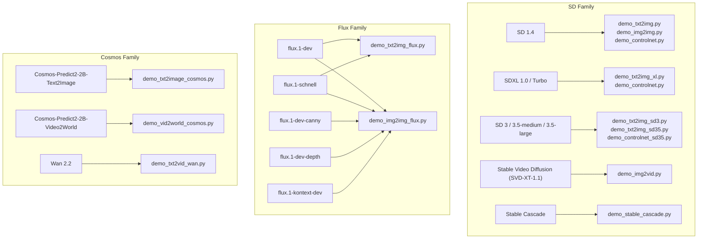
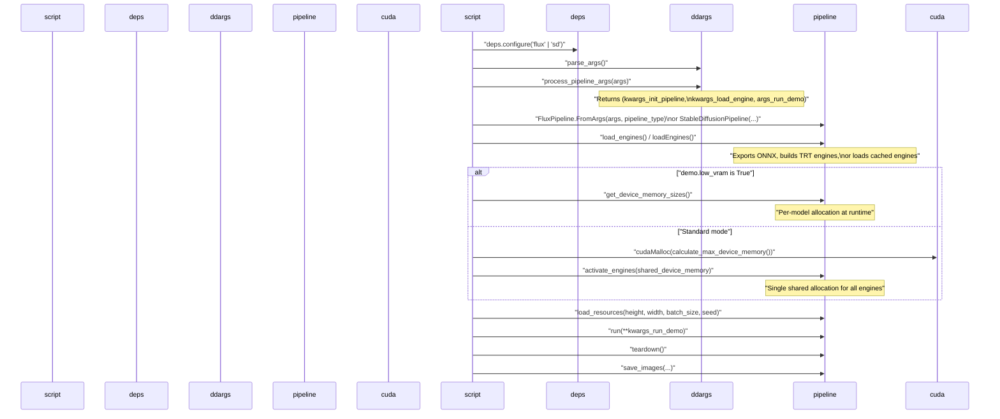
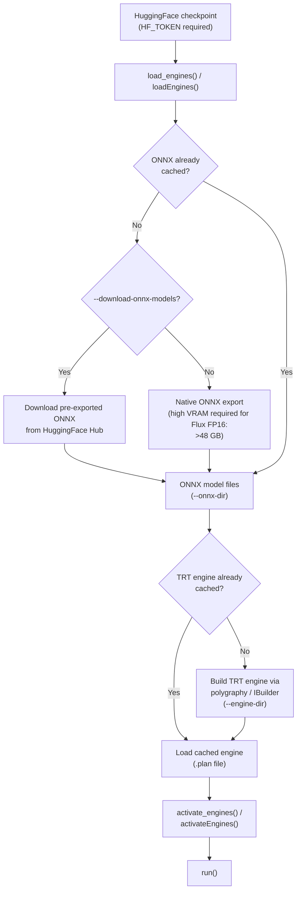

<!-- source: DeepWiki mcp.deepwiki.com · repo NVIDIA/TensorRT · page 5.3 Diffusion Model Acceleration · fetched 2026-10-26 -->

# Diffusion Model Acceleration

<details>
<summary>Relevant source files</summary>

The following files were used as context for generating this wiki page:

- [demo/Diffusion/README.md](demo/Diffusion/README.md)
- [demo/Diffusion/demo_img2img.py](demo/Diffusion/demo_img2img.py)
- [demo/Diffusion/demo_img2img_flux.py](demo/Diffusion/demo_img2img_flux.py)
- [demo/Diffusion/demo_txt2img.py](demo/Diffusion/demo_txt2img.py)
- [demo/Diffusion/demo_txt2img_flux.py](demo/Diffusion/demo_txt2img_flux.py)
- [demo/Diffusion/requirements.txt](demo/Diffusion/requirements.txt)

</details>


This page documents the `demo/Diffusion` application, which provides TensorRT-accelerated image and video generation pipelines for Stable Diffusion, Flux, Cosmos, and related models. It covers supported model families, the dependency management system, pipeline class hierarchy, VRAM management strategy, quantization options, and CLI usage patterns.

For information about the shared C++ sample infrastructure used across other demos, see [Sample Infrastructure](#5.1). For the BERT inference demo, see [BERT Inference Demo](#5.2).

---

## Directory Overview

The demo lives entirely under `demo/Diffusion/`. The entry-point scripts follow the naming pattern `demo_<task>_<model>.py`. All shared logic is in the `demo_diffusion` Python package (a subdirectory with submodules).

**Entry-point scripts:**

| Script | Pipeline |
|---|---|
| `demo_txt2img.py` | Stable Diffusion text-to-image |
| `demo_img2img.py` | Stable Diffusion image-to-image |
| `demo_controlnet.py` | Stable Diffusion ControlNet |
| `demo_txt2img_xl.py` | Stable Diffusion XL text-to-image |
| `demo_txt2img_flux.py` | Flux text-to-image |
| `demo_img2img_flux.py` | Flux image-to-image / ControlNet / Kontext |
| `demo_txt2img_sd3.py` | Stable Diffusion 3 |
| `demo_txt2img_sd35.py` | Stable Diffusion 3.5 |
| `demo_controlnet_sd35.py` | SD 3.5 ControlNet |
| `demo_img2vid.py` | Stable Video Diffusion |
| `demo_stable_cascade.py` | Stable Cascade |
| `demo_txt2image_cosmos.py` | Cosmos Predict2 text-to-image |
| `demo_vid2world_cosmos.py` | Cosmos Predict2 video-to-world |
| `demo_txt2vid_wan.py` | Wan 2.2 text-to-video |

**`demo_diffusion` package submodules used across scripts:**

| Submodule | Role |
|---|---|
| `deps` | Dependency family configuration and installation status |
| `dd_argparse` | Common CLI argument definitions and processing |
| `pipeline` | Pipeline class implementations (`FluxPipeline`, `FluxKontextPipeline`, `StableDiffusionPipeline`, etc.) |
| `image` | Image download and preprocessing utilities |

Sources: [demo/Diffusion/README.md:1-98](), [demo/Diffusion/demo_txt2img.py:1-62](), [demo/Diffusion/demo_txt2img_flux.py:1-172](), [demo/Diffusion/demo_img2img.py:1-82](), [demo/Diffusion/demo_img2img_flux.py:1-285]()

---

## Model Families and Supported Versions

The demo groups models into three families, each with its own dependency set.

**Title: Model Families and Their Pipeline Scripts**



Sources: [demo/Diffusion/README.md:42-55](), [demo/Diffusion/demo_txt2img_flux.py:36-43](), [demo/Diffusion/demo_img2img_flux.py:36-45]()

---

## Dependency Management System

Dependencies are managed by `setup.py` through a family-based model. Each family has a distinct set of Python packages. Calling `deps.configure("flux")` or `deps.configure("sd")` at the top of each script activates the appropriate path configuration before any external imports occur.

**Installing dependencies:**

```
# All families
python3 setup.py all

# Specific families
python3 setup.py sd
python3 setup.py flux
python3 setup.py cosmos
```

The `TENSORRT_DIFFUSION_DEPS_ROOT` environment variable (or `--deps-root` CLI flag) controls where packages are installed. This allows persistent storage across container restarts when using a volume mount. The `deps.print_status()` function reports which families are currently installed.

**Key packages (from `requirements.txt`):**

| Package | Version | Purpose |
|---|---|---|
| `diffusers` | 0.35.2 | HuggingFace diffusion model pipeline base |
| `transformers` | 4.52.4 | Tokenizers and text encoders |
| `nvidia-modelopt` | 0.31.0 | INT8/FP8/FP4 quantization (ModelOpt) |
| `onnx-graphsurgeon` | 0.5.2 | ONNX graph manipulation |
| `polygraphy` | 0.49.22 | TensorRT engine building utilities |
| `onnx` | 1.18.0 | ONNX model representation |
| `peft` | 0.17.0 | LoRA weight loading |
| `controlnet_aux` | 0.0.6 | ControlNet image preprocessors |

Sources: [demo/Diffusion/requirements.txt:1-24](), [demo/Diffusion/demo_txt2img_flux.py:19-20](), [demo/Diffusion/demo_img2img.py:19-20](), [demo/Diffusion/README.md:35-75]()

---

## Pipeline Execution Model

Every demo script follows the same lifecycle pattern. The key difference between the Flux and Stable Diffusion pipelines is the naming convention: Flux uses `snake_case` method names while Stable Diffusion uses `camelCase`.

**Title: Demo Script Execution Lifecycle**



Sources: [demo/Diffusion/demo_txt2img_flux.py:133-171](), [demo/Diffusion/demo_img2img_flux.py:243-284](), [demo/Diffusion/demo_txt2img.py:35-61](), [demo/Diffusion/demo_img2img.py:39-81]()

---

## Pipeline Class Hierarchy

**Title: Pipeline Classes and Factory Methods**

```mermaid
classDiagram
    class "FluxPipeline" {
        +FromArgs(args, pipeline_type) FluxPipeline
        +load_engines(framework_model_dir, ...)
        +activate_engines(shared_device_memory)
        +get_device_memory_sizes() dict
        +calculate_max_device_memory() int
        +load_resources(height, width, batch_size, seed)
        +run(prompt, prompt2, height, width, ...)
        +teardown()
        +save_images(prompt, images, ...)
        +low_vram bool
        +device_memory_sizes dict
    }
    class "FluxKontextPipeline" {
        +FromArgs(args, pipeline_type) FluxKontextPipeline
    }
    class "StableDiffusionPipeline" {
        +__init__(pipeline_type, ...)
        +loadEngines(engine_dir, framework_model_dir, onnx_dir, ...)
        +activateEngines(shared_device_memory)
        +calculateMaxDeviceMemory() int
        +loadResources(height, width, batch_size, seed)
        +run(*args_run_demo, **demo_kwargs)
        +teardown()
    }
    class "PIPELINE_TYPE" {
        <<enumeration>>
        TXT2IMG
        IMG2IMG
        INPAINT
    }
    "FluxKontextPipeline" --|> "FluxPipeline"
    "FluxPipeline" ..> "PIPELINE_TYPE"
    "StableDiffusionPipeline" ..> "PIPELINE_TYPE"
```

Sources: [demo/Diffusion/demo_txt2img_flux.py:140-146](), [demo/Diffusion/demo_img2img_flux.py:251-258](), [demo/Diffusion/demo_txt2img.py:42-56](), [demo/Diffusion/demo_img2img.py:61-78]()

---

## VRAM Management

### Standard Mode

In standard mode, `calculate_max_device_memory()` computes the largest single allocation needed across all engines. A single `cudart.cudaMalloc()` call allocates a shared buffer, which is then passed to `activate_engines(shared_device_memory)`. All TensorRT engines share this buffer for activation memory.

See [demo/Diffusion/demo_txt2img_flux.py:155-165]() and [demo/Diffusion/demo_img2img.py:73-75]().

### Low-VRAM Mode (`--low-vram`)

When `demo.low_vram` is `True`, the shared allocation is skipped. Instead, `get_device_memory_sizes()` returns per-model memory requirements. Device memory is allocated individually before each model is executed, then freed after, so only one model's activation memory is resident at a time. The result is stored in `demo.device_memory_sizes`.

See [demo/Diffusion/demo_txt2img_flux.py:156-161]() and [demo/Diffusion/demo_img2img_flux.py:269-274]().

### Flux VRAM Reference Table

These figures apply to Flux.1-dev with `--build-static-batch` enabled and exclude the ONNX export step.

| Precision | Default VRAM | With `--low-vram` |
|---|---|---|
| FP16 | 39.3 GB | 23.9 GB |
| BF16 | 35.7 GB | 23.9 GB |
| FP8 | 24.6 GB | 14.9 GB |
| FP4 | 21.67 GB | 11.1 GB |

> FP8 and FP4 require Hopper, Ada, or Blackwell GPUs. FP4 performance is optimal on Blackwell.

### Additional Memory Flags

| Flag | Effect |
|---|---|
| `--ws` | Enables TensorRT weight streaming in built engines |
| `--t5-ws-percentage` | Sets runtime weight streaming budget (0–100%) for the T5 encoder engine |
| `--transformer-ws-percentage` | Sets runtime weight streaming budget for the transformer engine |
| `--build-static-batch` | Builds engines with static batch size, reducing activation memory |

Sources: [demo/Diffusion/README.md:470-491](), [demo/Diffusion/demo_txt2img_flux.py:155-161](), [demo/Diffusion/demo_img2img_flux.py:268-274]()

---

## Quantization Support

The demo integrates with NVIDIA ModelOpt (`nvidia-modelopt`) for quantization. Quantization affects both the ONNX export and TRT engine build steps.

| Flag | Precision | Supported Models | GPU Requirement |
|---|---|---|---|
| `--int8` | INT8 | SD 1.4, SDXL | Any |
| `--fp8` | FP8 | SDXL, SD 3.5, Flux ControlNet/Kontext, SVD | Hopper / Ada |
| `--fp4` | FP4 | Flux | Blackwell (optimal) |
| `--bf16` | BF16 | Flux, SD 3.5, Stable Cascade, Cosmos | Any |

- FP8 quantization for Flux ControlNet pipelines requires a calibration dataset path, provided via `--calibration-dataset`. The default path is `./{depth|canny}-eval/benchmark`.
- INT8/FP8 cannot be combined with LoRA weights for SDXL.
- Pre-exported ONNX models can be downloaded with `--download-onnx-models` (supported for BF16, FP8, FP4 Flux pipelines), which bypasses native export on the local device.

Sources: [demo/Diffusion/README.md:113-203](), [demo/Diffusion/demo_img2img_flux.py:200-216]()

---

## ONNX Export and Engine Build Flow

**Title: ONNX Export to TRT Engine Pipeline**



> Use `--onnx-export-only` to run only the ONNX export step on a high-VRAM device and skip inference. The resulting ONNX files can later be used on a lower-VRAM device for the build and inference steps.

> Use `--timing-cache <path>` to accelerate repeated engine builds during development. Timing caches are not recommended for production builds.

Sources: [demo/Diffusion/README.md:336-467](), [demo/Diffusion/demo_txt2img_flux.py:145-162]()

---

## Key CLI Arguments

These arguments apply across most demo scripts via `dd_argparse.add_arguments()`.

| Argument | Description |
|---|---|
| `--hf-token` | HuggingFace access token for downloading model checkpoints |
| `--version` | Model version string (e.g. `xl-1.0`, `flux.1-dev`, `3.5-large`) |
| `--height`, `--width` | Output image dimensions (must be multiples of 8) |
| `--denoising-steps` | Number of diffusion denoising iterations |
| `--guidance-scale` | Classifier-free guidance scale |
| `--scheduler` | Noise scheduler (e.g. `LCM`, `EulerA`; availability varies by model) |
| `--onnx-dir` | Directory for cached ONNX model files |
| `--engine-dir` | Directory for cached TRT engine `.plan` files |
| `--framework-model-dir` | Directory for downloaded PyTorch model weights |
| `--batch-size` | Number of images per inference call |
| `--batch-count` | Number of inference iterations to run |
| `--seed` | RNG seed for reproducibility |
| `--low-vram` | Enable per-model device memory allocation |
| `--ws` | Enable TensorRT weight streaming |
| `--build-static-batch` | Build engines with static (not dynamic) batch size |
| `--use-cuda-graph` | Enable CUDA graph capture (requires `--build-static-batch`) |
| `--lora-path`, `--lora-weight` | LoRA model HF repo path(s) and blending weight(s) |
| `--download-onnx-models` | Download pre-exported ONNX from HuggingFace instead of native export |
| `--onnx-export-only` | Export ONNX models and exit without building engines or running inference |
| `--custom-onnx-paths` | Override ONNX paths per model: `model_name:/path/to/model.onnx,...` |
| `--custom-engine-paths` | Override engine paths per model: `model_name:/path/to/model.plan,...` |
| `--timing-cache` | Path to TRT timing cache file for faster repeated engine builds |
| `--num-warmup-runs` | Number of warmup inference calls before timing |

Sources: [demo/Diffusion/README.md:542-548](), [demo/Diffusion/demo_txt2img_flux.py:31-87](), [demo/Diffusion/demo_img2img_flux.py:33-117]()

---

## Setup and Environment

The demo requires CUDA ≥ 12.0 and runs inside the NVIDIA PyTorch container:

```
docker run --rm -it --gpus all \
  -v $PWD:/workspace \
  -v $PWD/deps:/workspace/deps \
  nvcr.io/nvidia/pytorch:25.09-py3 /bin/bash
```

Mounting `$PWD/deps` as a volume persists installed dependencies across container restarts. The `TENSORRT_DIFFUSION_DEPS_ROOT` environment variable must be exported in any shell that runs the demo scripts after a custom install path is configured.

Verified GPU targets include H100, A100, L40, T4, and RTX 4090.

Sources: [demo/Diffusion/README.md:6-85]()

---

