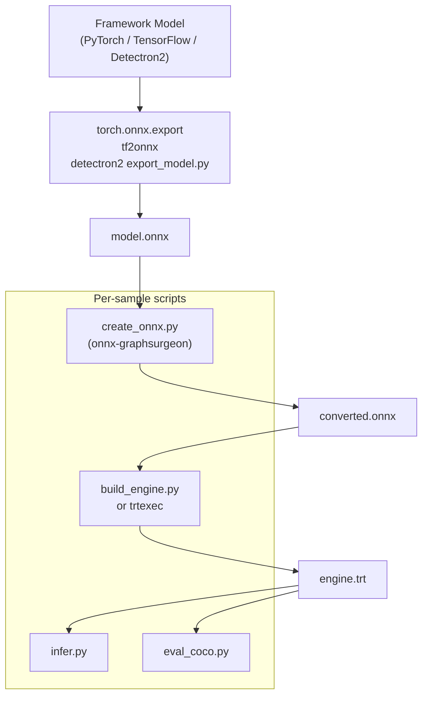
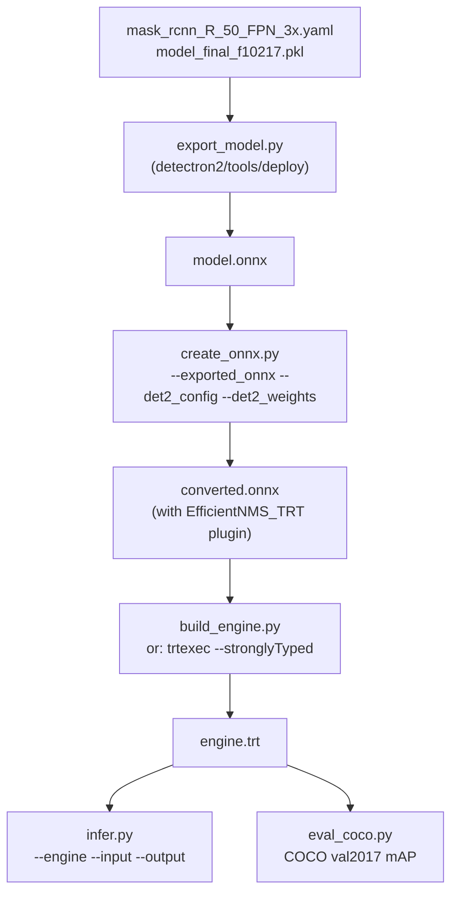
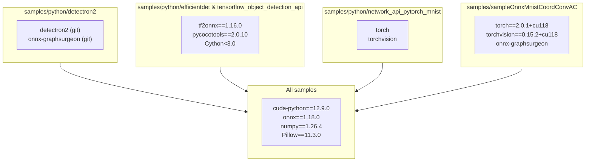
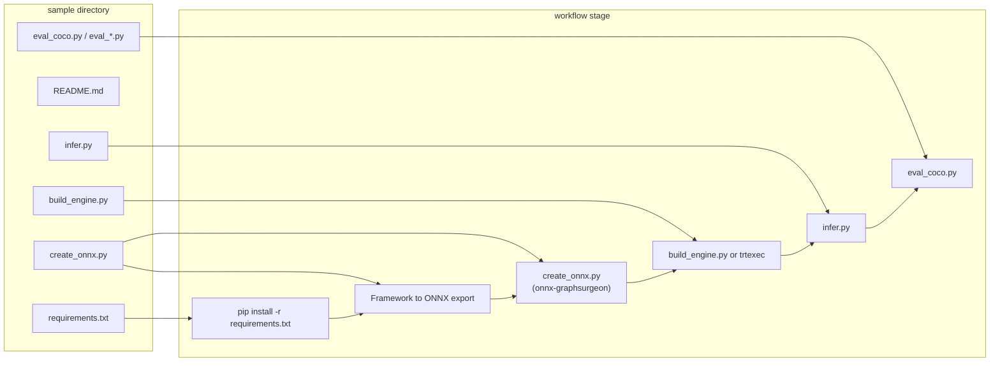

<!-- source: DeepWiki mcp.deepwiki.com · repo NVIDIA/TensorRT · page 5.4 Python Integration Samples · fetched 2026-10-26 -->

# Python Integration Samples

Relevant source files

The following files were used as context for generating this wiki page:

- [samples/python/detectron2/README.md](samples/python/detectron2/README.md)
- [samples/python/detectron2/requirements.txt](samples/python/detectron2/requirements.txt)
- [samples/python/efficientdet/requirements.txt](samples/python/efficientdet/requirements.txt)
- [samples/python/introductory_parser_samples/requirements.txt](samples/python/introductory_parser_samples/requirements.txt)
- [samples/python/network_api_pytorch_mnist/requirements.txt](samples/python/network_api_pytorch_mnist/requirements.txt)
- [samples/python/tensorflow_object_detection_api/requirements.txt](samples/python/tensorflow_object_detection_api/requirements.txt)
- [samples/python/yolov3_onnx/requirements.txt](samples/python/yolov3_onnx/requirements.txt)
- [samples/sampleOnnxMNIST/README.md](samples/sampleOnnxMNIST/README.md)
- [samples/sampleOnnxMnistCoordConvAC/README.md](samples/sampleOnnxMnistCoordConvAC/README.md)
- [samples/sampleOnnxMnistCoordConvAC/coord_conv.py](samples/sampleOnnxMnistCoordConvAC/coord_conv.py)
- [samples/sampleOnnxMnistCoordConvAC/mnist_coord_conv_train.py](samples/sampleOnnxMnistCoordConvAC/mnist_coord_conv_train.py)
- [samples/sampleOnnxMnistCoordConvAC/modify_onnx_ac.py](samples/sampleOnnxMnistCoordConvAC/modify_onnx_ac.py)

This section documents Python samples that demonstrate TensorRT integration with popular machine learning frameworks and models. These samples show complete workflows from model conversion to inference, providing practical examples of deploying models with TensorRT acceleration.

For information about C++ samples and common infrastructure, see page 5.1. For framework-specific demos like BERT and Diffusion models, see pages 5.2 and 5.3. For ONNX graph manipulation used by several samples, see page 6.

The samples covered here include:
- **Detectron2** – Mask R-CNN R50-FPN 3x instance segmentation (`samples/python/detectron2/`)
- **YOLOv3 ONNX** – Object detection via ONNX conversion (`samples/python/yolov3_onnx/`)
- **EfficientDet** – Object detection from TensorFlow (`samples/python/efficientdet/`)
- **EfficientNet** – Classification from TensorFlow (`samples/python/efficientnet/`)
- **Network API PyTorch MNIST** – Direct TensorRT network API from Python (`samples/python/network_api_pytorch_mnist/`)
- **Introductory Parser Samples** – Basic ONNX parser usage (`samples/python/introductory_parser_samples/`)
- **MNIST CoordConv ONNX** – Custom plugin integration with ONNX graph modification (`samples/sampleOnnxMnistCoordConvAC/`)

## Overview

The Python integration samples demonstrate end-to-end workflows for accelerating models from various frameworks using TensorRT. Each sample typically follows a common pattern: framework model → ONNX → TensorRT engine → inference. The samples are located in `samples/python/` and include complete conversion scripts, engine builders, and inference utilities.

### Common Integration Pattern

Most samples follow the pattern: framework model → ONNX → (optional graph modification) → TensorRT engine → Python inference.

**Common workflow diagram**

Sources: [samples/python/detectron2/README.md:32-96](), [samples/python/detectron2/requirements.txt:1-12]()

## Sample Categories

### Object Detection Samples

The repository includes several object detection samples that demonstrate TensorRT acceleration of popular detection architectures.

#### Detectron2 Integration

The Detectron2 sample integrates Mask R-CNN R50-FPN 3x for instance segmentation, demonstrating the complete path from Detectron2 export to TensorRT inference. Located at `samples/python/detectron2/`.

**Detectron2 sample data flow**

**Key scripts:**

| Script | Role |
|--------|------|
| `create_onnx.py` | Converts Detectron2 ONNX export to TensorRT-compatible ONNX; embeds anchors and configures `EfficientNMS_TRT` |
| `build_engine.py` | Builds the TensorRT engine; can also be done with `trtexec --stronglyTyped` |
| `infer.py` | Runs inference on images, writes visualizations and tab-separated results |
| `eval_coco.py` | Evaluates mAP on COCO val2017 using Detectron2 evaluation functions |

**Resolution constraint:** The model requires input dimensions divisible by 32. The sample uses 1344×1344 (not the default 1333) and fixes this in `export_model.py` before running the export.

**NMS tuning:** `create_onnx.py` exposes `--first_nms_threshold` and `--second_nms_threshold` arguments. Higher thresholds reduce NMS plugin latency at the cost of recall.

Benchmark (RTX A5000, TensorRT 8.6.1, FP32):

| Precision | Latency | bbox COCO mAP | segm COCO mAP |
|-----------|---------|---------------|---------------|
| FP32 | 25.89 ms | 0.402 | 0.368 |

Sources: [samples/python/detectron2/README.md:32-96](), [samples/python/detectron2/README.md:103-169]()

#### YOLOv3 ONNX Integration

Located at `samples/python/yolov3_onnx/`. Demonstrates TensorRT acceleration of YOLOv3 via ONNX conversion. The ONNX model is downloaded and parsed directly; the sample does not require a separate graph-modification step.

#### TensorFlow Object Detection API Integration

Located at `samples/python/tensorflow_object_detection_api/`. Provides integration with TensorFlow's Object Detection API using `tf2onnx` for framework-to-ONNX conversion.

### Classification Samples

#### Network API PyTorch MNIST

Located at `samples/python/network_api_pytorch_mnist/`. Demonstrates using TensorRT's Python Network Definition API directly—building the network layer by layer from a PyTorch model—rather than going through an ONNX parser.

#### EfficientNet Integration

Located at `samples/python/efficientnet/`. Shows conversion and acceleration of EfficientNet classification models from TensorFlow to TensorRT via `tf2onnx`.

### Advanced Integration Samples

#### EfficientDet Integration

Located at `samples/python/efficientdet/`. Full workflow for EfficientDet object detection from TensorFlow: `tf2onnx` export, ONNX processing, engine building, and inference.

### Introductory Parser Samples

Located at `samples/python/introductory_parser_samples/`. These samples demonstrate basic use of the TensorRT ONNX parser API from Python. They are suitable as a starting point for understanding how to load an ONNX model, configure `IBuilderConfig`, serialize an engine, and run inference.

Dependencies are minimal: the `introductory_parser_samples` sample does not require framework libraries, only `onnx` and `cuda-python`. See [samples/python/introductory_parser_samples/requirements.txt:1-8]().

## Dependencies and Requirements

Each sample maintains its own `requirements.txt` file with specific dependencies. Common dependencies across samples include:

| Dependency | Purpose | Pinned Version |
|------------|---------|----------------|
| `onnx` | ONNX model format | 1.18.0 |
| `onnxruntime` | ONNX execution for validation | 1.18.1 |
| `numpy` | Numerical operations | 1.26.4 |
| `Pillow` | Image I/O | 11.3.0 |
| `cuda-python` | CUDA Python bindings | 12.9.0 |
| `pyyaml` | YAML config parsing | 6.0.1 |
| `tqdm` | Progress display | 4.66.4 |
| `requests` | HTTP downloads | 2.32.4 |

### Framework-Specific Dependencies

**Per-sample extra dependencies diagram**

Sources: [samples/python/detectron2/requirements.txt:1-12](), [samples/python/tensorflow_object_detection_api/requirements.txt:1-13](), [samples/python/network_api_pytorch_mnist/requirements.txt:1-10](), [samples/python/efficientdet/requirements.txt:1-11](), [samples/python/yolov3_onnx/requirements.txt:1-10]()

## Sample Structure and Workflow

### Standard Sample Components

Most Python integration samples follow a consistent directory structure:

**Standard sample file layout**

### Engine Building Patterns

The engine building process is standardized across samples with configurable precision and optimization settings:

| Precision Mode | Build Command Example | Use Case |
|----------------|----------------------|-----------|
| FP32 | `python build_engine.py --precision fp32` | Maximum accuracy |
| FP16 | `python build_engine.py --precision fp16` | Balanced performance |
| INT8 | `python build_engine.py --precision int8 --calib_input /path/to/images` | Maximum performance |

**INT8 Calibration Requirements:**
- Calibration dataset representative of inference data
- Typically 5,000+ images for good accuracy
- Calibration cache files for reusability

Sources: [samples/python/detectron2/README.md:113-144](), [samples/python/efficientdet/requirements.txt:1-11](), [samples/python/efficientnet/requirements.txt:1-11]()

## Performance Considerations

### Optimization Strategies

Each sample demonstrates different optimization approaches:

1. **NMS Threshold Tuning**: Adjustable NMS score thresholds for latency-accuracy tradeoffs
2. **Dynamic vs Fixed Shapes**: Most samples use fixed input shapes for optimal performance
3. **CUDA Graphs**: Recommended for production deployment via `--useCudaGraph`
4. **Precision Selection**: FP16 typically provides best performance-accuracy balance

### Benchmark Results

Sample performance data from Detectron2 integration on RTX A5000 with TensorRT 8.6.1:

| Precision | Latency | bbox COCO mAP | segm COCO mAP |
|-----------|---------|---------------|---------------|
| FP32 | 25.89 ms | 0.402 | 0.368 |
| FP16 | 13.00 ms | 0.402 | 0.368 |
| INT8 | 7.29 ms | 0.399 | 0.366 |

Sources: [samples/python/detectron2/README.md:162-168]()

---

