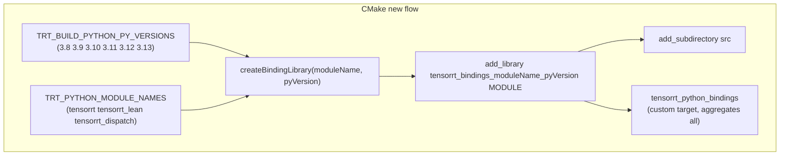
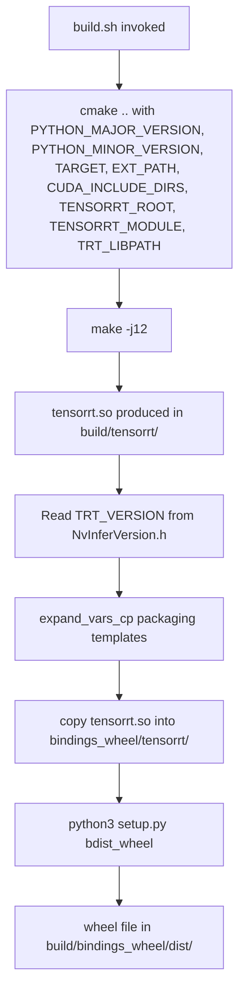
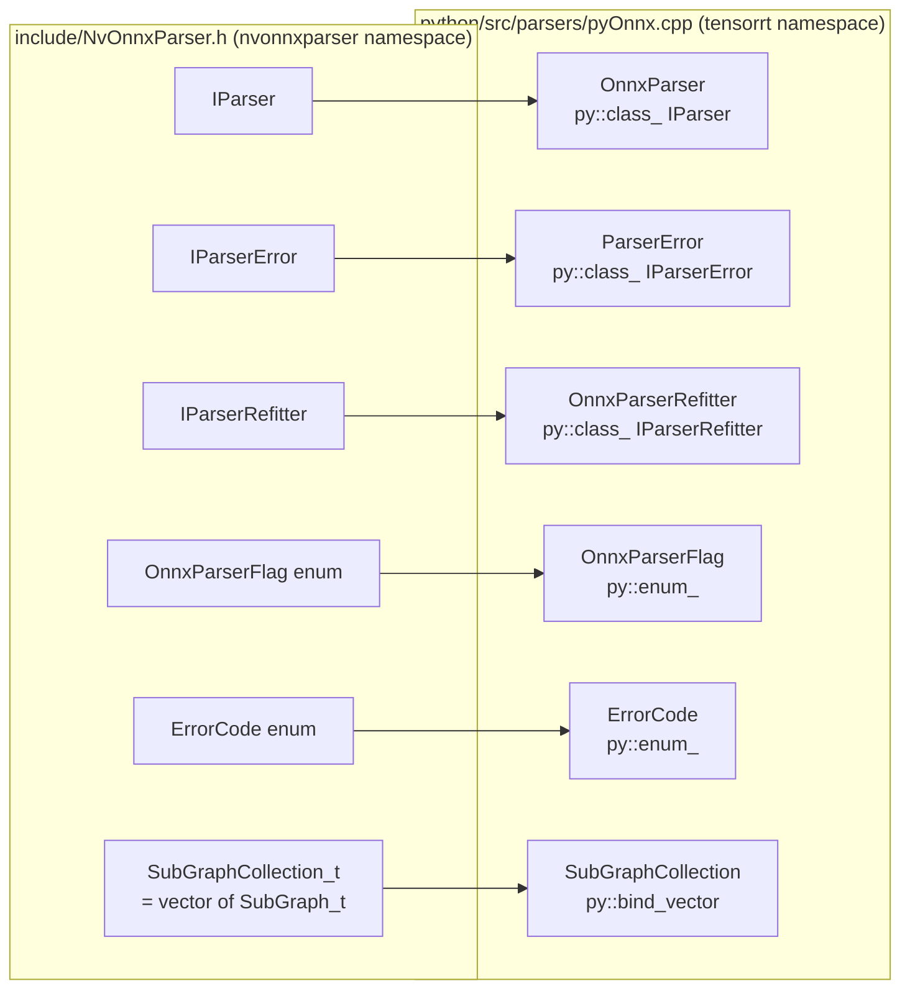
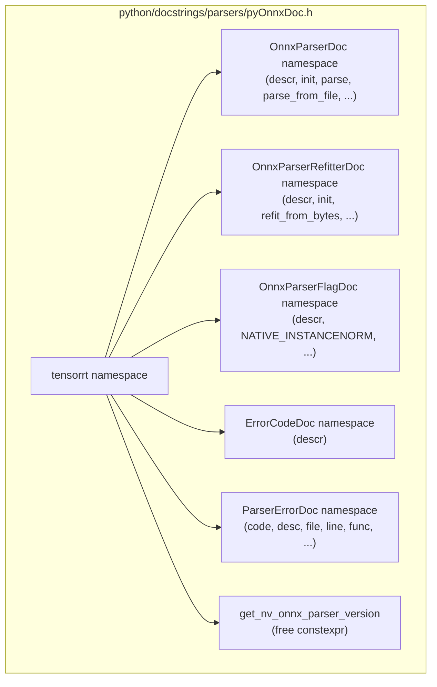

<!-- source: DeepWiki mcp.deepwiki.com · repo NVIDIA/TensorRT · page 5.5 Python Bindings · fetched 2026-10-26 -->

# Python Bindings

<details>
<summary>Relevant source files</summary>

The following files were used as context for generating this wiki page:

- [.gitignore](.gitignore)
- [include/NvOnnxParser.h](include/NvOnnxParser.h)
- [python/CMakeLists.txt](python/CMakeLists.txt)
- [python/build.sh](python/build.sh)
- [python/docstrings/parsers/pyOnnxDoc.h](python/docstrings/parsers/pyOnnxDoc.h)
- [python/src/parsers/pyOnnx.cpp](python/src/parsers/pyOnnx.cpp)

</details>


This page covers the Python binding layer for TensorRT located in the `python/` directory. It documents the build system, the module variant architecture, the ONNX parser bindings (`pyOnnx.cpp`), and the docstring infrastructure. It does not cover the Python-based demo applications or integration samples — for those, see [Python Integration Samples](#5.4) and [Demo Applications](#5).

---

## Overview

The `python/` directory produces shared library modules (`.so` / `.pyd`) that expose TensorRT's C++ API to Python via [pybind11](https://github.com/pybind/pybind11). The bindings are structured into distinct module variants to match the different TensorRT deployment scenarios. The full `tensorrt` module includes ONNX parser bindings; the lean and dispatch variants expose only the runtime inference API.

---

## Module Variants

Four module names are produced depending on build configuration:

| Module name | Linked C++ libraries | Contains ONNX parser |
|---|---|---|
| `tensorrt` | `nvinfer`, `nvonnxparser`, `nvinfer_plugin` | Yes |
| `tensorrt_lean` | `nvinfer_lean_runtime` | No |
| `tensorrt_dispatch` | `nvinfer_dispatch_runtime` | No |
| `tensorrt_rtx` | `nvinfer`, `nvonnxparser` (WinML build) | Yes |

The `tensorrt` module requires the ONNX parser to be available. If `TRT_BUILD_ONNX_PARSER` is `OFF`, it is excluded from the build automatically.

Sources: [python/CMakeLists.txt:41-53]()

---

## Build System

### Two Build Flows

The `python/CMakeLists.txt` supports two build flows, selected via the CMake option `TRT_BUILD_ENABLE_NEW_PYTHON_FLOW`:

**New flow (`TRT_BUILD_ENABLE_NEW_PYTHON_FLOW=ON`):** Builds all Python versions in one CMake invocation using a loop. Each combination of module name and Python version gets its own CMake target.

**Legacy flow (`TRT_BUILD_ENABLE_NEW_PYTHON_FLOW=OFF`):** Builds a single Python version per invocation, driven by environment variables. This is what `python/build.sh` uses.

Sources: [python/CMakeLists.txt:22-237]()

---

### New Flow: Per-Version Targets

The new flow iterates over a list of Python versions and module names, calling `createBindingLibrary(moduleName, pyVersion)` for each combination.

**Target diagram:**



Sources: [python/CMakeLists.txt:76-232]()

Key properties set per target:
- `PREFIX ""` — removes the `lib` prefix so the output is `tensorrt.so` not `libtensorrt.so`
- `CXX_VISIBILITY_PRESET hidden` / `VISIBILITY_INLINES_HIDDEN ON`
- `LIBRARY_OUTPUT_DIRECTORY` set to `${moduleName}_bindings-py${pyVersion}/`
- `OUTPUT_NAME` set to `${moduleName}`

The Python `Python.h` include path and the platform-specific `pyconfig.h` are located separately via `find_path`. The `pyconfig.h` lives under `${PYTHON_INCLUDES}/<triple>/python<ver>/` where `<triple>` is `x86_64-linux-gnu` or `aarch64-linux-gnu`.

Sources: [python/CMakeLists.txt:121-154]()

---

### Legacy Flow: `build.sh`

`python/build.sh` is the automation script for the legacy per-version build. It:

1. Invokes CMake with a single Python version and module name
2. Runs `make -j12` to build the `.so`
3. Reads the TensorRT version from `include/NvInferVersion.h` macros (`TRT_MAJOR_ENTERPRISE`, `TRT_MINOR_ENTERPRISE`, `TRT_PATCH_ENTERPRISE`, `TRT_BUILD_ENTERPRISE`)
4. Copies the packaging templates from `python/packaging/`, expanding version placeholder tokens via `expand_vars_cp`
5. Invokes `python3 setup.py bdist_wheel` to produce a pip-installable wheel

**Environment variables consumed by `build.sh`:**

| Variable | Default | Purpose |
|---|---|---|
| `PYTHON_MAJOR_VERSION` | `3` | Major Python version |
| `PYTHON_MINOR_VERSION` | `8` | Minor Python version |
| `TARGET_ARCHITECTURE` | `x86_64` | Target platform |
| `CUDA_ROOT` | `/usr/local/cuda` | Path to CUDA toolkit |
| `TRT_OSSPATH` | `/workspace/TensorRT` | Root of TensorRT OSS checkout |
| `EXT_PATH` | `/tmp/external` | Path to pybind11 and Python headers |
| `TENSORRT_MODULE` | _(required)_ | Module name, e.g. `tensorrt` |
| `TRT_LIBPATH` | _(required)_ | Path to TRT `.so` libraries |

Sources: [python/build.sh:17-74]()

**Build flow:**



Sources: [python/build.sh:30-74]()

---

### Source File Selection

In the legacy flow, which source files are compiled depends on the module:

| `TENSORRT_MODULE` value | Source files |
|---|---|
| `tensorrt` or `tensorrt_rtx` | All files matched by `src/**/*.cpp` (glob) |
| `tensorrt_lean` | `src/pyTensorRT.cpp`, `src/utils.cpp`, `src/infer/pyCore.cpp`, `src/infer/pyPlugin.cpp`, `src/infer/pyFoundationalTypes.cpp` |
| `tensorrt_dispatch` | Same as `tensorrt_lean` |

Sources: [python/CMakeLists.txt:308-316]()

---

## ONNX Parser Bindings

### File Overview

[python/src/parsers/pyOnnx.cpp]() contains the `bindOnnx(py::module& m)` function, which registers all ONNX-related Python types into the `tensorrt` module. It is included only in the full `tensorrt` / `tensorrt_rtx` builds.

The file depends on:
- `NvOnnxParser.h` — C++ interface definitions
- `parsers/pyOnnxDoc.h` — docstring constants
- `ForwardDeclarations.h` — shared pybind11 forward declarations
- `utils.h` — shared utilities including `throwPyError` and `doNothingDel`

Sources: [python/src/parsers/pyOnnx.cpp:1-291]()

---

### C++ → Python Type Map

The diagram below shows how C++ types in `NvOnnxParser.h` map to Python-visible names in `pyOnnx.cpp`:



Sources: [python/src/parsers/pyOnnx.cpp:180-290](), [include/NvOnnxParser.h:72-603]()

---

### `OnnxParser` (wraps `IParser`)

Python class registered at [python/src/parsers/pyOnnx.cpp:185-222]().

**Constructor:** Calls `nvonnxparser::createParser(network, logger)`. Uses `py::keep_alive` to keep the network and logger alive while the parser exists.

**Methods and properties:**

| Python name | C++ method | Notes |
|---|---|---|
| `parse(model, path=None)` | `IParser::parse` | Releases GIL during call |
| `parse_with_weight_descriptors(model)` | `IParser::parseWithWeightDescriptors` | Deprecated in TRT 10.13 |
| `parse_from_file(model)` | `IParser::parseFromFile` | GIL released via `py::call_guard` |
| `supports_operator(op_name)` | `IParser::supportsOperator` | Direct binding |
| `supports_model(model, path=None)` | `IParser::supportsModel` | Returns `(bool, SubGraphCollection)` tuple; deprecated in TRT 10.1 |
| `supports_model_v2(model, path=None)` | `IParser::supportsModelV2` | Preferred alternative to `supports_model` |
| `num_subgraphs` | `IParser::getNbSubgraphs` | Read-only property |
| `is_subgraph_supported(index)` | `IParser::isSubgraphSupported` | Call after `supports_model_v2` |
| `get_subgraph_nodes(index)` | `IParser::getSubgraphNodes` | Returns Python `list` of `int` |
| `num_errors` | `IParser::getNbErrors` | Read-only property |
| `get_error(index)` | `IParser::getError` | Returns `ParserError` |
| `clear_errors()` | `IParser::clearErrors` | Direct binding |
| `flags` | `IParser::getFlags` / `setFlags` | Read-write property |
| `clear_flag(flag)` | `IParser::clearFlag` | Takes `OnnxParserFlag` |
| `set_flag(flag)` | `IParser::setFlag` | Takes `OnnxParserFlag` |
| `get_flag(flag)` | `IParser::getFlag` | Returns `bool` |
| `get_layer_output_tensor(name, i)` | `IParser::getLayerOutputTensor` | Direct binding |
| `get_used_vc_plugin_libraries()` | `IParser::getUsedVCPluginLibraries` | Returns `List[str]` |
| `load_model_proto(model, path=None)` | `IParser::loadModelProto` | GIL released via `py::call_guard` |
| `load_initializer(name, data, size)` | `IParser::loadInitializer` | `data` is raw pointer as `size_t` |
| `parse_model_proto()` | `IParser::parseModelProto` | Direct binding |
| `set_builder_config(builder_config)` | `IParser::setBuilderConfig` | Uses `py::keep_alive` |

The GIL is released during IO-bound or compute-heavy operations (`parse`, `parse_from_file`, `load_model_proto`) using either `py::gil_scoped_release` in the lambda body or `py::call_guard<py::gil_scoped_release>{}` on the `.def()` call.

Sources: [python/src/parsers/pyOnnx.cpp:35-222]()

---

### `OnnxParserRefitter` (wraps `IParserRefitter`)

Python class registered at [python/src/parsers/pyOnnx.cpp:268-286]().

**Constructor:** Calls `nvonnxparser::createParserRefitter(refitter, logger)`.

**Methods:**

| Python name | C++ method | Notes |
|---|---|---|
| `refit_from_bytes(model, path=None)` | `IParserRefitter::refitFromBytes` | Releases GIL |
| `refit_from_file(model)` | `IParserRefitter::refitFromFile` | GIL released via `py::call_guard` |
| `num_errors` | `IParserRefitter::getNbErrors` | Read-only property |
| `get_error(index)` | `IParserRefitter::getError` | Returns `ParserError` |
| `clear_errors()` | `IParserRefitter::clearErrors` | Direct binding |
| `load_model_proto(model, path=None)` | `IParserRefitter::loadModelProto` | GIL released |
| `load_initializer(name, data, size)` | `IParserRefitter::loadInitializer` | `data` is raw pointer as `size_t` |
| `refit_model_proto()` | `IParserRefitter::refitModelProto` | Direct binding |

Sources: [python/src/parsers/pyOnnx.cpp:118-134](), [python/src/parsers/pyOnnx.cpp:268-286]()

---

### `ParserError` (wraps `IParserError`)

Python class registered at [python/src/parsers/pyOnnx.cpp:253-266]().

Uses `std::unique_ptr<IParserError, py::nodelete>` ownership — the Python object does not delete the underlying C++ object.

| Python name | C++ method |
|---|---|
| `code()` | `IParserError::code` |
| `desc()` | `IParserError::desc` |
| `file()` | `IParserError::file` |
| `line()` | `IParserError::line` |
| `func()` | `IParserError::func` |
| `node()` | `IParserError::node` |
| `node_name()` | `IParserError::nodeName` |
| `node_operator()` | `IParserError::nodeOperator` |
| `local_function_stack()` | `IParserError::localFunctionStack` (returns `List[str]`) |
| `local_function_stack_size()` | `IParserError::localFunctionStackSize` |
| `__str__` / `__repr__` | `pyonnx2trt::parserErrorStr` |

The `__str__` representation is assembled by `parserErrorStr` in the `pyonnx2trt` namespace, which combines node index, name, operator, function name, error code string, and description.

Sources: [python/src/parsers/pyOnnx.cpp:103-116](), [python/src/parsers/pyOnnx.cpp:142-176](), [python/src/parsers/pyOnnx.cpp:253-266]()

---

### `OnnxParserFlag` Enum

Registered at [python/src/parsers/pyOnnx.cpp:224-232]().

| Python value | C++ enumerator | Default | Purpose |
|---|---|---|---|
| `NATIVE_INSTANCENORM` | `kNATIVE_INSTANCENORM` | ON | Use TRT native InstanceNorm instead of plugin; required for version/hardware compatible engines |
| `ENABLE_UINT8_AND_ASYMMETRIC_QUANTIZATION_DLA` | `kENABLE_UINT8_AND_ASYMMETRIC_QUANTIZATION_DLA` | OFF | Allow UINT8 + asymmetric QDQ for DLA >= 3.16 |
| `REPORT_CAPABILITY_DLA` | `kREPORT_CAPABILITY_DLA` | OFF | DLA-aware per-node validation; requires `set_builder_config` to be called first |
| `ENABLE_PLUGIN_OVERRIDE` | `kENABLE_PLUGIN_OVERRIDE` | OFF | Allow loaded plugins to override standard ONNX operator implementations |

Sources: [python/src/parsers/pyOnnx.cpp:224-232](), [include/NvOnnxParser.h:109-130]()

---

### `ErrorCode` Enum

Registered at [python/src/parsers/pyOnnx.cpp:234-251]().

| Python value | C++ enumerator |
|---|---|
| `SUCCESS` | `kSUCCESS` |
| `INTERNAL_ERROR` | `kINTERNAL_ERROR` |
| `MEM_ALLOC_FAILED` | `kMEM_ALLOC_FAILED` |
| `MODEL_DESERIALIZE_FAILED` | `kMODEL_DESERIALIZE_FAILED` |
| `INVALID_VALUE` | `kINVALID_VALUE` |
| `INVALID_GRAPH` | `kINVALID_GRAPH` |
| `INVALID_NODE` | `kINVALID_NODE` |
| `UNSUPPORTED_GRAPH` | `kUNSUPPORTED_GRAPH` |
| `UNSUPPORTED_NODE` | `kUNSUPPORTED_NODE` |
| `UNSUPPORTED_NODE_ATTR` | `kUNSUPPORTED_NODE_ATTR` |
| `UNSUPPORTED_NODE_INPUT` | `kUNSUPPORTED_NODE_INPUT` |
| `UNSUPPORTED_NODE_DATATYPE` | `kUNSUPPORTED_NODE_DATATYPE` |
| `UNSUPPORTED_NODE_DYNAMIC` | `kUNSUPPORTED_NODE_DYNAMIC` |
| `UNSUPPORTED_NODE_SHAPE` | `kUNSUPPORTED_NODE_SHAPE` |
| `REFIT_FAILED` | `kREFIT_FAILED` |

`__str__` and `__repr__` are implemented via `pyonnx2trt::errorCodeStr`, which returns a plain string name.

Sources: [python/src/parsers/pyOnnx.cpp:142-163](), [python/src/parsers/pyOnnx.cpp:234-251]()

---

## Docstring Infrastructure

All user-visible docstrings are stored as `constexpr const char*` strings in header files under `python/docstrings/`. This separates documentation text from binding logic and keeps `pyOnnx.cpp` readable.

**Namespace structure:**



Each docstring is passed as the final argument to `.def(...)` or `.def_property(...)` calls in `pyOnnx.cpp`. For example:

```
.def("parse", lambdas::parse, "model"_a, "path"_a = nullptr, OnnxParserDoc::parse)
```

Sources: [python/docstrings/parsers/pyOnnxDoc.h:1-406](), [python/src/parsers/pyOnnx.cpp:192-222]()

---

## Lambda Namespace Pattern

`pyOnnx.cpp` uses a `lambdas` namespace to hold non-trivial binding adapters. These lambdas handle two concerns that pybind11 cannot do automatically:

1. **Buffer protocol translation** — Python `bytes`/`bytearray`/`memoryview` objects are received as `py::buffer`, and `info.ptr` / `info.size * info.itemsize` are extracted to call the C++ API.
2. **GIL release** — `py::gil_scoped_release` is used inside lambdas for calls that block (parsing, file I/O) so the Python interpreter remains responsive.

**Example pattern (from `lambdas::parse`):**

```
// Accepts py::buffer, extracts raw pointer, releases GIL
static const auto parse = [](IParser& self, py::buffer const& model, char const* path = nullptr) {
    py::buffer_info info = model.request();
    py::gil_scoped_release releaseGil{};
    return self.parse(info.ptr, info.size * info.itemsize, path);
};
```

Sources: [python/src/parsers/pyOnnx.cpp:34-135]()

---

## Full Call Flow Diagram

This diagram traces a typical Python call from user code down through the binding layer to the C++ library:

```mermaid
sequenceDiagram
  participant "Python user code" as User
  participant "tensorrt.OnnxParser\n(pyOnnx.cpp)" as Binding
  participant "lambdas::parse\n(pyOnnx.cpp)" as Lambda
  participant "nvonnxparser::IParser\n(NvOnnxParser.h)" as CppAPI
  participant "libnvonnxparser.so" as Lib

  User->>Binding: "parser.parse(model_bytes)"
  Binding->>Lambda: "dispatch to lambdas::parse"
  Lambda->>Lambda: "model.request() → py::buffer_info"
  Lambda->>Lambda: "py::gil_scoped_release"
  Lambda->>CppAPI: "self.parse(info.ptr, info.size * info.itemsize)"
  CppAPI->>Lib: "virtual dispatch"
  Lib-->>CppAPI: "bool result"
  CppAPI-->>Lambda: "bool"
  Lambda-->>Binding: "bool"
  Binding-->>User: "True / False"
```

Sources: [python/src/parsers/pyOnnx.cpp:35-39]()

---

