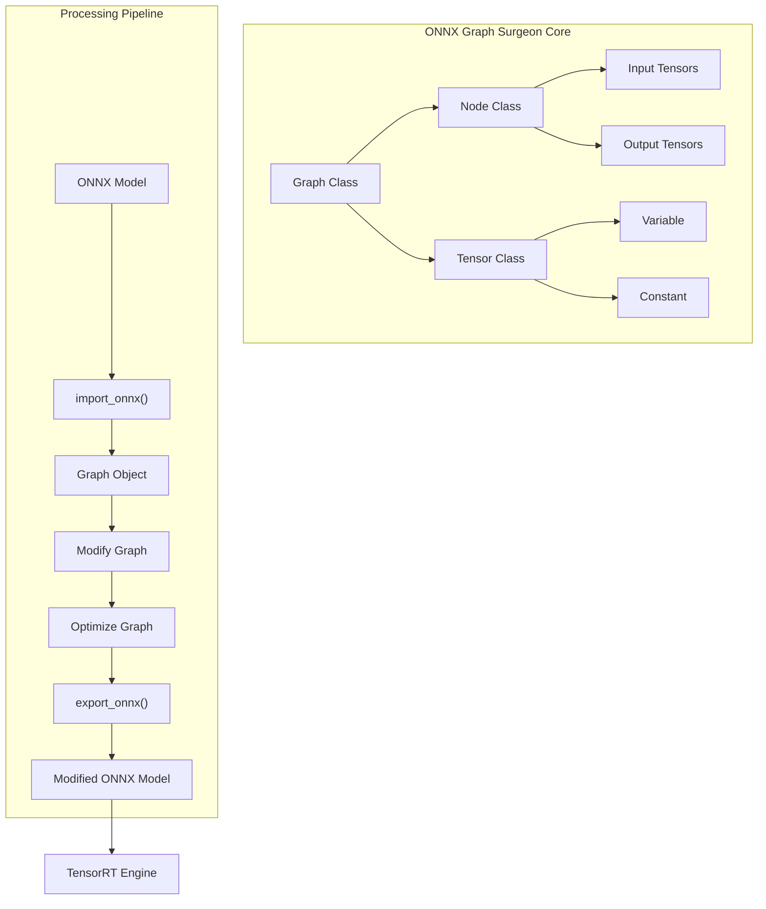
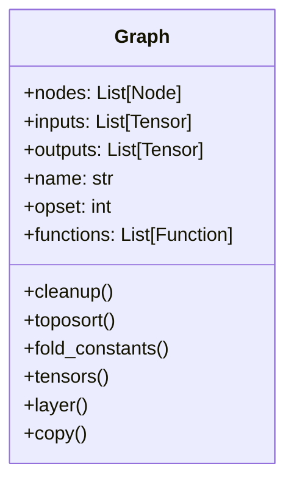
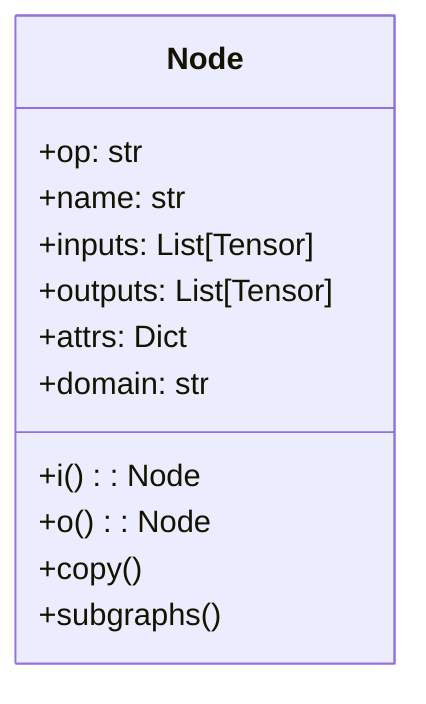
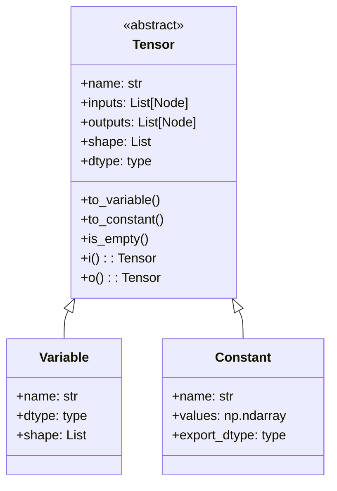

<!-- source: DeepWiki mcp.deepwiki.com · repo NVIDIA/TensorRT · page 6 ONNX Graph Surgeon · fetched 2026-10-26 -->

# ONNX Graph Surgeon

<details>
<summary>Relevant source files</summary>

The following files were used as context for generating this wiki page:

- [tools/onnx-graphsurgeon/CHANGELOG.md](tools/onnx-graphsurgeon/CHANGELOG.md)
- [tools/onnx-graphsurgeon/onnx_graphsurgeon/__init__.py](tools/onnx-graphsurgeon/onnx_graphsurgeon/__init__.py)
- [tools/onnx-graphsurgeon/onnx_graphsurgeon/exporters/onnx_exporter.py](tools/onnx-graphsurgeon/onnx_graphsurgeon/exporters/onnx_exporter.py)
- [tools/onnx-graphsurgeon/onnx_graphsurgeon/importers/onnx_importer.py](tools/onnx-graphsurgeon/onnx_graphsurgeon/importers/onnx_importer.py)
- [tools/onnx-graphsurgeon/onnx_graphsurgeon/ir/graph.py](tools/onnx-graphsurgeon/onnx_graphsurgeon/ir/graph.py)
- [tools/onnx-graphsurgeon/onnx_graphsurgeon/ir/node.py](tools/onnx-graphsurgeon/onnx_graphsurgeon/ir/node.py)
- [tools/onnx-graphsurgeon/onnx_graphsurgeon/ir/tensor.py](tools/onnx-graphsurgeon/onnx_graphsurgeon/ir/tensor.py)
- [tools/onnx-graphsurgeon/onnx_graphsurgeon/logger/logger.py](tools/onnx-graphsurgeon/onnx_graphsurgeon/logger/logger.py)
- [tools/onnx-graphsurgeon/onnx_graphsurgeon/util/exception.py](tools/onnx-graphsurgeon/onnx_graphsurgeon/util/exception.py)
- [tools/onnx-graphsurgeon/onnx_graphsurgeon/util/misc.py](tools/onnx-graphsurgeon/onnx_graphsurgeon/util/misc.py)
- [tools/onnx-graphsurgeon/setup.py](tools/onnx-graphsurgeon/setup.py)
- [tools/onnx-graphsurgeon/tests/ir/test_graph.py](tools/onnx-graphsurgeon/tests/ir/test_graph.py)
- [tools/onnx-graphsurgeon/tests/test_api.py](tools/onnx-graphsurgeon/tests/test_api.py)
- [tools/onnx-graphsurgeon/tests/test_exporters.py](tools/onnx-graphsurgeon/tests/test_exporters.py)
- [tools/onnx-graphsurgeon/tests/test_importers.py](tools/onnx-graphsurgeon/tests/test_importers.py)
- [tools/onnx-graphsurgeon/tests/test_ir.py](tools/onnx-graphsurgeon/tests/test_ir.py)

</details>


ONNX Graph Surgeon is a Python library that provides a convenient API for modifying ONNX models. It allows you to traverse, edit, and optimize ONNX graphs programmatically, making it easier to manipulate deep learning models before deploying them with TensorRT.

The library serves as an intermediate tool that sits between raw ONNX models and TensorRT, helping to prepare models for optimal inference performance by enabling modifications like layer fusion, constant folding, and general graph restructuring.

## Table of Contents

- [Key Components](#key-components)
- [Installation](#installation)
- [Core Concepts](#core-concepts)
- [Basic Usage](#basic-usage)
- [Graph Manipulation](#graph-manipulation)
- [Advanced Features](#advanced-features)
- [Examples](#examples)

## Key Components

ONNX Graph Surgeon provides a high-level representation of ONNX graphs with three primary components:



Sources:
- [tools/onnx-graphsurgeon/onnx_graphsurgeon/ir/graph.py:45-638]()
- [tools/onnx-graphsurgeon/onnx_graphsurgeon/ir/node.py:27-228]()
- [tools/onnx-graphsurgeon/onnx_graphsurgeon/ir/tensor.py:25-342]()
- [tools/onnx-graphsurgeon/onnx_graphsurgeon/importers/onnx_importer.py:202-571]()
- [tools/onnx-graphsurgeon/onnx_graphsurgeon/exporters/onnx_exporter.py:174-407]()

## Installation

ONNX Graph Surgeon is included in the TensorRT package. You can use it directly from the TensorRT repository. If you want to use it separately, you can install it from the source located in the `tools/onnx-graphsurgeon` directory.

## Core Concepts

### Graph Class

The `Graph` class is the central component that represents an ONNX computation graph. It contains nodes, inputs, outputs, and other metadata about the model.



Sources:
- [tools/onnx-graphsurgeon/onnx_graphsurgeon/ir/graph.py:45-638]()

### Node Class

The `Node` class represents an operation in the graph. Each node has:
- An operation type (`op`)
- Input and output tensors
- Attributes
- Optional name and domain



Sources:
- [tools/onnx-graphsurgeon/onnx_graphsurgeon/ir/node.py:27-228]()

### Tensor Classes

Tensors are represented by two main classes:
- `Variable`: Represents tensors whose values are not known until runtime
- `Constant`: Represents tensors with known values (weights, biases, etc.)



Sources:
- [tools/onnx-graphsurgeon/onnx_graphsurgeon/ir/tensor.py:25-342]()

## Basic Usage

### Importing and Exporting ONNX Models

The first step to modifying an ONNX model is to import it into the Graph Surgeon representation:

```python
import onnx
import onnx_graphsurgeon as gs

# Import ONNX model
onnx_model = onnx.load("model.onnx")
graph = gs.import_onnx(onnx_model)

# After modifications, export back to ONNX
modified_model = gs.export_onnx(graph)
onnx.save(modified_model, "modified_model.onnx")
```

Sources:
- [tools/onnx-graphsurgeon/onnx_graphsurgeon/__init__.py:1-10]()
- [tools/onnx-graphsurgeon/onnx_graphsurgeon/importers/onnx_importer.py:533-571]()
- [tools/onnx-graphsurgeon/onnx_graphsurgeon/exporters/onnx_exporter.py:383-407]()

### Navigating the Graph

ONNX Graph Surgeon allows easy navigation between nodes and tensors:

```python
# Access input and output tensors
input_tensor = graph.inputs[0]
output_tensor = graph.outputs[0]

# Get all tensors in the graph
tensor_map = graph.tensors()

# Navigate from tensor to its consumer nodes
for consumer in input_tensor.outputs:
    print(f"Tensor {input_tensor.name} is consumed by node {consumer.name} ({consumer.op})")

# Navigate from node to its input/output tensors
for node in graph.nodes:
    print(f"Node {node.name} inputs: {[t.name for t in node.inputs]}")
    print(f"Node {node.name} outputs: {[t.name for t in node.outputs]}")

# Convenience functions for navigation
# Get producer node of a tensor
producer = tensor.i()  # Same as tensor.inputs[0]

# Get consumer node of a tensor
consumer = tensor.o()  # Same as tensor.outputs[0]

# Get input node of a node
input_node = node.i()  # Same as node.inputs[0].inputs[0]

# Get output node of a node
output_node = node.o()  # Same as node.outputs[0].outputs[0]
```

Sources:
- [tools/onnx-graphsurgeon/onnx_graphsurgeon/ir/graph.py:640-690]()
- [tools/onnx-graphsurgeon/onnx_graphsurgeon/ir/node.py:75-112]()
- [tools/onnx-graphsurgeon/onnx_graphsurgeon/ir/tensor.py:115-152]()

## Graph Manipulation

### Cleaning Up Graphs

The `cleanup()` method removes unused nodes and tensors from the graph:

```python
# Remove unused nodes and tensors
graph.cleanup()

# Additional parameters
graph.cleanup(
    remove_unused_node_outputs=True,  # Remove outputs of nodes that are not used
    recurse_subgraphs=True,           # Apply cleanup to subgraphs too
    remove_unused_graph_inputs=False  # Remove unused graph inputs
)
```

Sources:
- [tools/onnx-graphsurgeon/onnx_graphsurgeon/ir/graph.py:380-477]()

### Topological Sorting

The `toposort()` method sorts the graph in topological order to ensure that each node's inputs are computed before the node itself:

```python
# Sort nodes in topological order
graph.toposort()

# Additional parameters
graph.toposort(
    recurse_subgraphs=True,  # Apply sorting to subgraphs too
    recurse_functions=True,  # Apply sorting to graph functions too 
    mode="full"              # Sort both nodes and functions. Other options: "nodes", "functions"
)
```

Sources:
- [tools/onnx-graphsurgeon/onnx_graphsurgeon/ir/graph.py:479-637]()

### Constant Folding

The `fold_constants()` method computes and replaces portions of the graph that can be evaluated during compile time:

```python
# Fold constants in the graph
graph.fold_constants()

# Additional parameters
graph.fold_constants(
    fold_shapes=True,         # Fold shape operations with static shapes
    recurse_subgraphs=True,   # Apply folding to subgraphs
    partitioning="recursive", # How to partition graph if folding fails. Options: None, "basic", "recursive"
    flatten_subgraphs=True,   # Flatten conditional subgraphs where possible
    size_threshold=None       # Maximum tensor size (in bytes) to fold. None = no limit
)
```

Sources:
- [tools/onnx-graphsurgeon/onnx_graphsurgeon/ir/graph.py:692-760]()

### Adding Layers to a Graph

ONNX Graph Surgeon makes it easy to add new operations to a graph:

```python
# Create tensors
input_tensor = gs.Variable(name="input", dtype=np.float32, shape=(1, 3, 224, 224))
output_tensor = gs.Variable(name="output", dtype=np.float32, shape=(1, 3, 224, 224))

# Create a node
new_node = gs.Node(op="Conv", 
                 inputs=[input_tensor], 
                 outputs=[output_tensor],
                 attrs={"kernel_size": [3, 3], "strides": [1, 1], "pads": [1, 1, 1, 1]})

# Add to graph
graph.nodes.append(new_node)

# Or use the layer() function (simpler)
conv_output = graph.layer(
    op="Conv",
    inputs=[input_tensor],
    outputs=["conv_output"],  # Name will be used to create a Variable
    attrs={"kernel_size": [3, 3], "strides": [1, 1], "pads": [1, 1, 1, 1]}
)[0]  # Returns list of output tensors
```

Sources:
- [tools/onnx-graphsurgeon/tests/ir/test_graph.py:349-420]()

## Advanced Features

### Function Registration

ONNX Graph Surgeon allows you to register custom functions for specific operations, making it easier to create commonly used patterns:

```python
# Register a function for all opsets
@gs.Graph.register()
def add(self, a, b):
    return self.layer(op="Add", inputs=[a, b], outputs=["add_out"])[0]

# Register a function for specific opsets
@gs.Graph.register(opsets=[11])
def relu(self, input_tensor):
    return self.layer(op="Relu", inputs=[input_tensor], outputs=["relu_out"])[0]

# Usage
graph = gs.Graph()
input_a = gs.Variable("input_a", dtype=np.float32, shape=(1, 3, 224, 224))
input_b = gs.Variable("input_b", dtype=np.float32, shape=(1, 3, 224, 224))
sum_output = graph.add(input_a, input_b)  # Create an Add node
relu_output = graph.relu(sum_output)      # Create a Relu node
```

Sources:
- [tools/onnx-graphsurgeon/onnx_graphsurgeon/ir/graph.py:54-93]()
- [tools/onnx-graphsurgeon/tests/ir/test_graph.py:38-103]()

### Working with Subgraphs

Some ONNX operations like `If`, `Loop`, and `Scan` contain subgraphs. ONNX Graph Surgeon allows you to work with these too:

```python
# Iterate over subgraphs in the graph
for subgraph in graph.subgraphs():
    # Modify subgraph
    subgraph.cleanup()
    subgraph.toposort()

# Iterate recursively, including nested subgraphs
for subgraph in graph.subgraphs(recursive=True):
    # Modify subgraph
    pass

# Access subgraphs in control flow nodes
if_node = [node for node in graph.nodes if node.op == "If"][0]
then_branch = if_node.attrs["then_branch"]  # Get 'then' subgraph
else_branch = if_node.attrs["else_branch"]  # Get 'else' subgraph
```

Sources:
- [tools/onnx-graphsurgeon/onnx_graphsurgeon/ir/graph.py:365-378]()
- [tools/onnx-graphsurgeon/onnx_graphsurgeon/ir/node.py:114-140]()

## Examples

### Example 1: Removing Layers

```python
import onnx
import onnx_graphsurgeon as gs

# Load model
model = onnx.load("model.onnx")
graph = gs.import_onnx(model)

# Find and remove dropout layers (common for inference optimization)
for node in graph.nodes:
    if node.op == "Dropout":
        # Reconnect the graph to bypass Dropout
        input_tensor = node.inputs[0]
        output_tensor = node.outputs[0]
        
        # Connect all consumers of dropout output to the dropout input
        for consumer in output_tensor.outputs:
            for i, tensor in enumerate(consumer.inputs):
                if tensor == output_tensor:
                    consumer.inputs[i] = input_tensor

# Clean up and export
graph.cleanup()
new_model = gs.export_onnx(graph)
onnx.save(new_model, "model_no_dropout.onnx")
```

### Example 2: Constant Folding and Optimization

```python
import onnx
import onnx_graphsurgeon as gs

# Load model
model = onnx.load("model.onnx")
graph = gs.import_onnx(model)

# Fold constants - this will evaluate operations with constant inputs
graph.fold_constants()

# Topologically sort the graph for better execution
graph.toposort()

# Clean up any dangling nodes
graph.cleanup()

# Export optimized model
new_model = gs.export_onnx(graph)
onnx.save(new_model, "model_optimized.onnx")
```

### Example 3: Adding a Custom Layer

```python
import onnx
import onnx_graphsurgeon as gs
import numpy as np

# Load model
model = onnx.load("model.onnx")
graph = gs.import_onnx(model)

# Get the output tensor of the model
original_output = graph.outputs[0]

# Create a new ReLU layer
relu_output = gs.Variable("relu_output", dtype=original_output.dtype, shape=original_output.shape)
relu_node = gs.Node(op="Relu", inputs=[original_output], outputs=[relu_output])

# Add the layer to the graph
graph.nodes.append(relu_node)

# Update graph outputs
graph.outputs = [relu_output]

# Export model
new_model = gs.export_onnx(graph)
onnx.save(new_model, "model_with_relu.onnx")
```

Sources:
- [tools/onnx-graphsurgeon/tests/test_api.py:27-39]()
- [tools/onnx-graphsurgeon/tests/test_ir.py:34-429]()

## Changelog and Version History

ONNX Graph Surgeon is actively maintained with regular updates. The current version is 0.5.6. For detailed information about changes in each version, refer to the CHANGELOG.md file.

Recent improvements include:
- Fixed a bug where `toposort()` could incorrectly report cycles in diamond-shaped graphs
- Added support for defining `gs.Constant` with numpy arrays constructed using `ml_dtypes`
- Added support for various ML-specific data types
- Improved performance for tensor conversions
- Added a `GraphPattern` API for finding matching subgraphs

Sources:
- [tools/onnx-graphsurgeon/CHANGELOG.md:1-471]()
- [tools/onnx-graphsurgeon/onnx_graphsurgeon/__init__.py:10]()

## Conclusion

ONNX Graph Surgeon provides powerful tools to manipulate ONNX graphs programmatically. It sits between raw ONNX models and TensorRT, allowing you to optimize and adapt models to get the best inference performance. Key features include graph traversal, node and tensor manipulation, constant folding, and graph cleanup.

---

