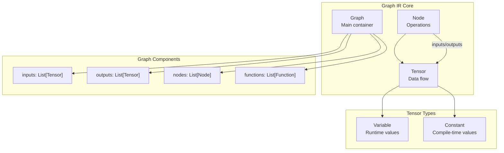
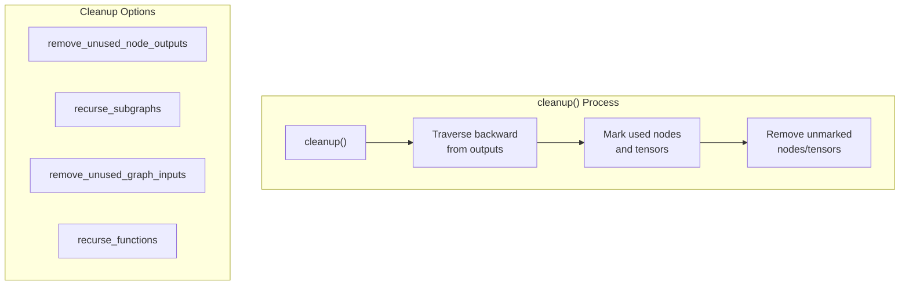
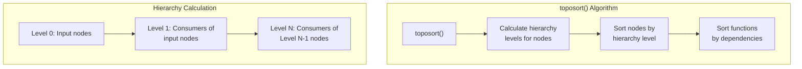
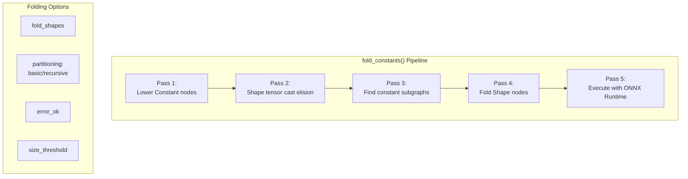
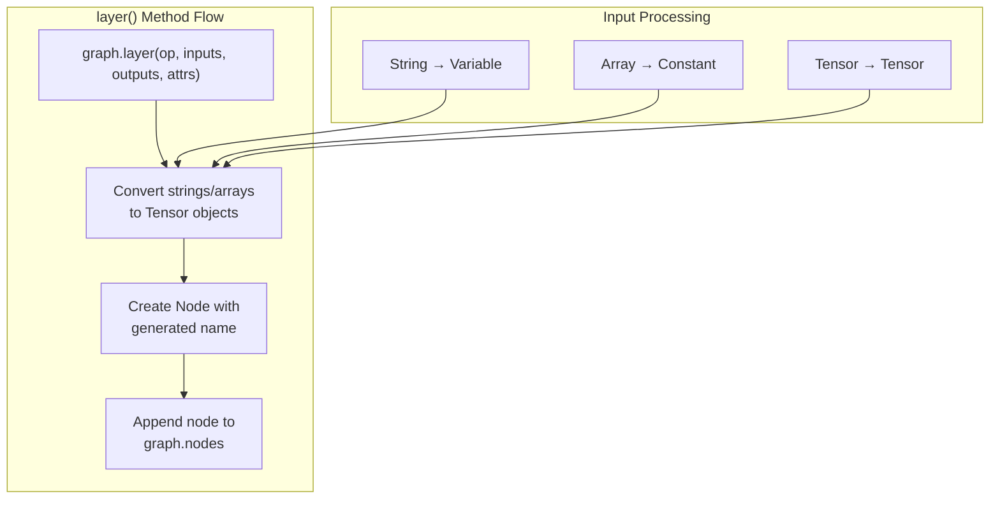
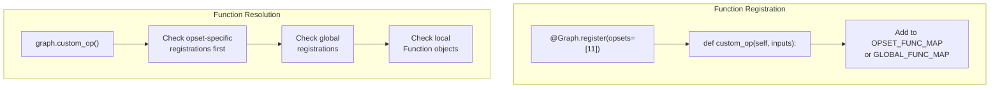
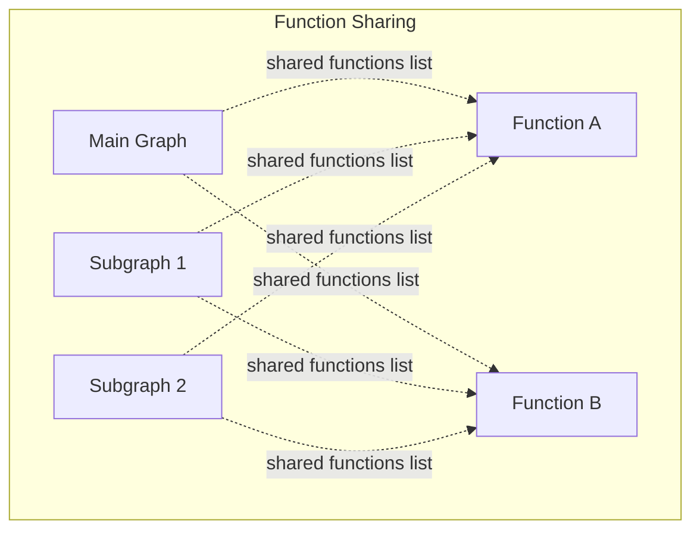

<!-- source: DeepWiki mcp.deepwiki.com · repo NVIDIA/TensorRT · page 6.1 Graph Manipulation · fetched 2026-10-26 -->

# Graph Manipulation

<details>
<summary>Relevant source files</summary>

The following files were used as context for generating this wiki page:

- [tools/onnx-graphsurgeon/CHANGELOG.md](tools/onnx-graphsurgeon/CHANGELOG.md)
- [tools/onnx-graphsurgeon/onnx_graphsurgeon/__init__.py](tools/onnx-graphsurgeon/onnx_graphsurgeon/__init__.py)
- [tools/onnx-graphsurgeon/onnx_graphsurgeon/exporters/onnx_exporter.py](tools/onnx-graphsurgeon/onnx_graphsurgeon/exporters/onnx_exporter.py)
- [tools/onnx-graphsurgeon/onnx_graphsurgeon/importers/onnx_importer.py](tools/onnx-graphsurgeon/onnx_graphsurgeon/importers/onnx_importer.py)
- [tools/onnx-graphsurgeon/onnx_graphsurgeon/ir/graph.py](tools/onnx-graphsurgeon/onnx_graphsurgeon/ir/graph.py)
- [tools/onnx-graphsurgeon/onnx_graphsurgeon/ir/node.py](tools/onnx-graphsurgeon/onnx_graphsurgeon/ir/node.py)
- [tools/onnx-graphsurgeon/onnx_graphsurgeon/ir/tensor.py](tools/onnx-graphsurgeon/onnx_graphsurgeon/ir/tensor.py)
- [tools/onnx-graphsurgeon/onnx_graphsurgeon/logger/logger.py](tools/onnx-graphsurgeon/onnx_graphsurgeon/logger/logger.py)
- [tools/onnx-graphsurgeon/onnx_graphsurgeon/util/exception.py](tools/onnx-graphsurgeon/onnx_graphsurgeon/util/exception.py)
- [tools/onnx-graphsurgeon/onnx_graphsurgeon/util/misc.py](tools/onnx-graphsurgeon/onnx_graphsurgeon/util/misc.py)
- [tools/onnx-graphsurgeon/setup.py](tools/onnx-graphsurgeon/setup.py)
- [tools/onnx-graphsurgeon/tests/ir/test_graph.py](tools/onnx-graphsurgeon/tests/ir/test_graph.py)
- [tools/onnx-graphsurgeon/tests/test_api.py](tools/onnx-graphsurgeon/tests/test_api.py)
- [tools/onnx-graphsurgeon/tests/test_exporters.py](tools/onnx-graphsurgeon/tests/test_exporters.py)
- [tools/onnx-graphsurgeon/tests/test_importers.py](tools/onnx-graphsurgeon/tests/test_importers.py)
- [tools/onnx-graphsurgeon/tests/test_ir.py](tools/onnx-graphsurgeon/tests/test_ir.py)

</details>


This document covers the core graph intermediate representation (IR) operations in ONNX Graph Surgeon, including node manipulation, constant folding, and topology optimization. These operations enable programmatic modification of ONNX graphs to prepare them for TensorRT deployment.

For information about converting between ONNX protobuf format and Graph Surgeon IR, see [Import and Export](#6.2).

## Graph IR Architecture

ONNX Graph Surgeon represents ONNX models using an intermediate representation centered around the `Graph` class. This IR provides a Python-native interface for graph manipulation while preserving ONNX semantics.



**Graph IR Components**

Sources: [tools/onnx-graphsurgeon/onnx_graphsurgeon/ir/graph.py:95-142]()

The `Graph` class maintains four key collections:

| Component | Type | Purpose |
|-----------|------|---------|
| `nodes` | `List[Node]` | Computational operations in the graph |
| `inputs` | `List[Tensor]` | Graph input tensors |
| `outputs` | `List[Tensor]` | Graph output tensors |
| `functions` | `List[Function]` | Custom function definitions |

## Core Manipulation Operations

### Graph Cleanup

The `cleanup()` method removes unused nodes and tensors from the graph through backward traversal from outputs.



**Key cleanup parameters:**

Sources: [tools/onnx-graphsurgeon/onnx_graphsurgeon/ir/graph.py:380-477]()

- `remove_unused_node_outputs`: Removes hanging tensor outputs
- `recurse_subgraphs`: Applies cleanup to nested subgraphs  
- `remove_unused_graph_inputs`: Removes unused graph-level inputs
- `recurse_functions`: Applies cleanup to function definitions

### Topological Sorting

The `toposort()` method orders nodes based on their dependencies, ensuring producers come before consumers.



**Topological sorting modes:**

Sources: [tools/onnx-graphsurgeon/onnx_graphsurgeon/ir/graph.py:479-639]()

| Mode | Description |
|------|-------------|
| `"full"` | Sort both nodes and functions |
| `"nodes"` | Sort only the node list |
| `"functions"` | Sort only the function list |

### Constant Folding

The `fold_constants()` method pre-computes subgraphs with constant inputs using ONNX Runtime.



**Constant folding features:**

Sources: [tools/onnx-graphsurgeon/onnx_graphsurgeon/ir/graph.py:692-970]()

- **Multi-pass approach**: Handles different constant patterns systematically
- **Shape folding**: Pre-computes `Shape` nodes with static input shapes
- **Cast elision**: Removes unnecessary float/int casting on shape tensors
- **Partitioning**: Isolates inference failures to prevent total folding failure
- **Size thresholding**: Limits folding of large tensors to avoid model bloat

## Node and Tensor Management

### Graph Layer API

The `layer()` method provides a convenient interface for adding nodes to the graph.



Sources: [tools/onnx-graphsurgeon/onnx_graphsurgeon/ir/graph.py:971-1055]()

### Tensor Map Generation

The `tensors()` method creates an ordered mapping of all tensors in the graph by walking nodes in order.

Sources: [tools/onnx-graphsurgeon/onnx_graphsurgeon/ir/graph.py:640-691]()

```python
# Example usage
tensor_map = graph.tensors(check_duplicates=True)
for name, tensor in tensor_map.items():
    print(f"{name}: {tensor.dtype} {tensor.shape}")
```

## Function Registration System

ONNX Graph Surgeon supports registering custom operations as graph methods using the `@Graph.register()` decorator.



**Registration example:**

Sources: [tools/onnx-graphsurgeon/onnx_graphsurgeon/ir/graph.py:54-94](), [tools/onnx-graphsurgeon/tests/ir/test_graph.py:38-104]()

```python
@Graph.register(opsets=[11])
def relu(self, inp):
    out = self.layer(op="Relu", inputs=[inp], outputs=["relu_out"])[0]
    out.dtype = inp.dtype
    return out

# Usage
graph = Graph(opset=11)
output = graph.relu(input_tensor)
```

## Subgraph Operations

### Subgraph Traversal

The `subgraphs()` method provides iteration over nested graphs within control flow nodes.

Sources: [tools/onnx-graphsurgeon/onnx_graphsurgeon/ir/graph.py:365-378]()

```python
# Iterate over immediate subgraphs
for subgraph in graph.subgraphs():
    process_subgraph(subgraph)

# Recursively iterate over all nested subgraphs  
for subgraph in graph.subgraphs(recursive=True):
    process_subgraph(subgraph)
```

### Function Management

The `functions` property maintains a shared list of custom function definitions across the graph hierarchy.



Sources: [tools/onnx-graphsurgeon/onnx_graphsurgeon/ir/graph.py:207-219](), [tools/onnx-graphsurgeon/onnx_graphsurgeon/ir/graph.py:345-364]()

## Graph Validation and Utilities

### Node ID Management

The `node_ids()` context manager provides temporary unique IDs for nodes during graph operations.

Sources: [tools/onnx-graphsurgeon/onnx_graphsurgeon/ir/graph.py:30-43](), [tools/onnx-graphsurgeon/onnx_graphsurgeon/ir/graph.py:238-251]()

```python
with graph.node_ids():
    # Each node now has a unique .id attribute
    for node in graph.nodes:
        print(f"Node {node.op} has ID: {node.id}")
# IDs are automatically removed when exiting context
```

### Graph Comparison

Graph equality is determined by comparing nodes, inputs, outputs, functions, and metadata.

Sources: [tools/onnx-graphsurgeon/onnx_graphsurgeon/ir/graph.py:220-236]()

The comparison checks:
- Opset and import domain compatibility
- Function set equality by unique ID
- Sequential equality of inputs, outputs, and nodes
- Deep structural equality of all components

---

