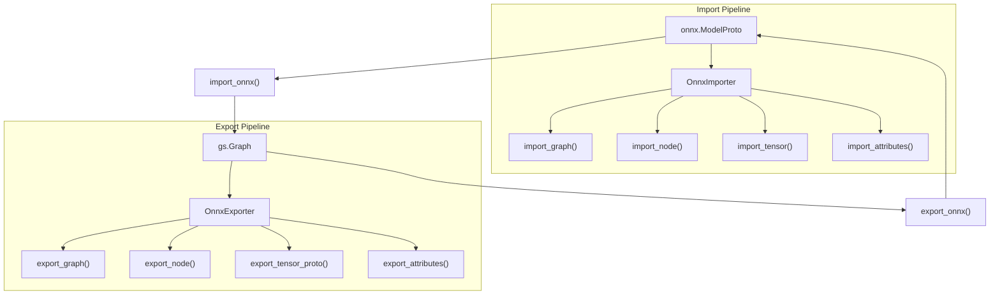
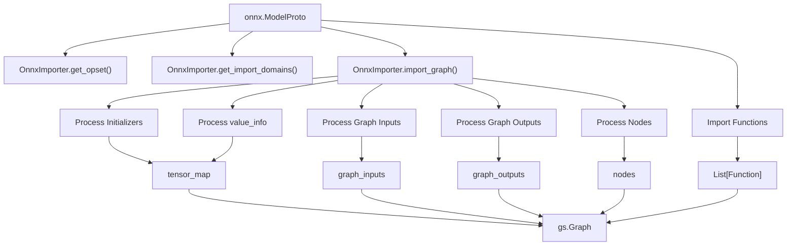
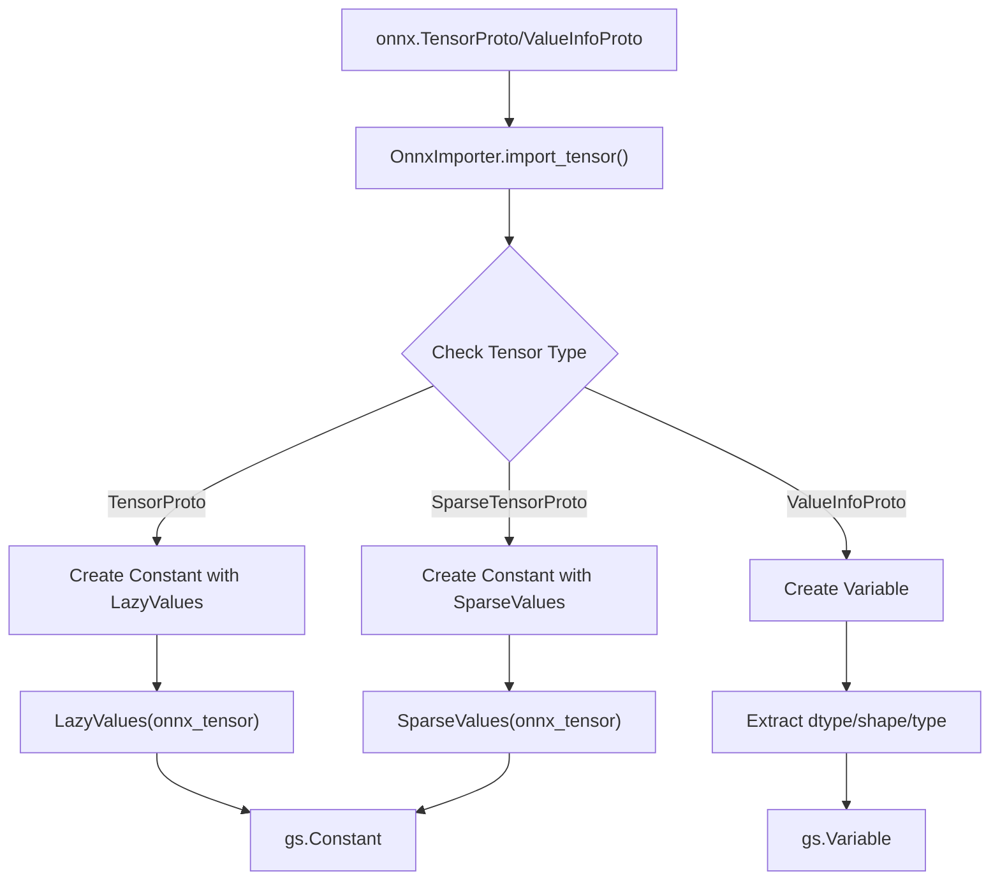
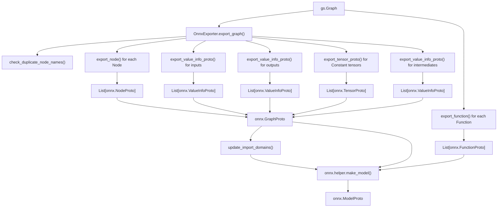
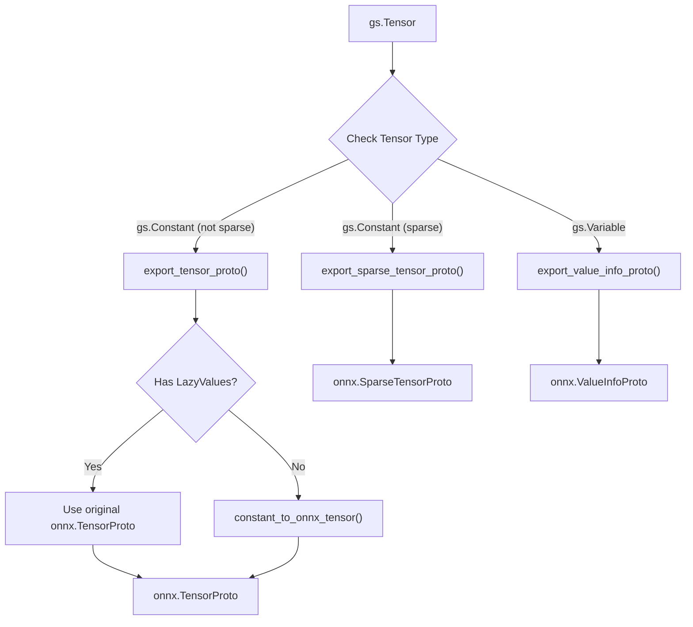
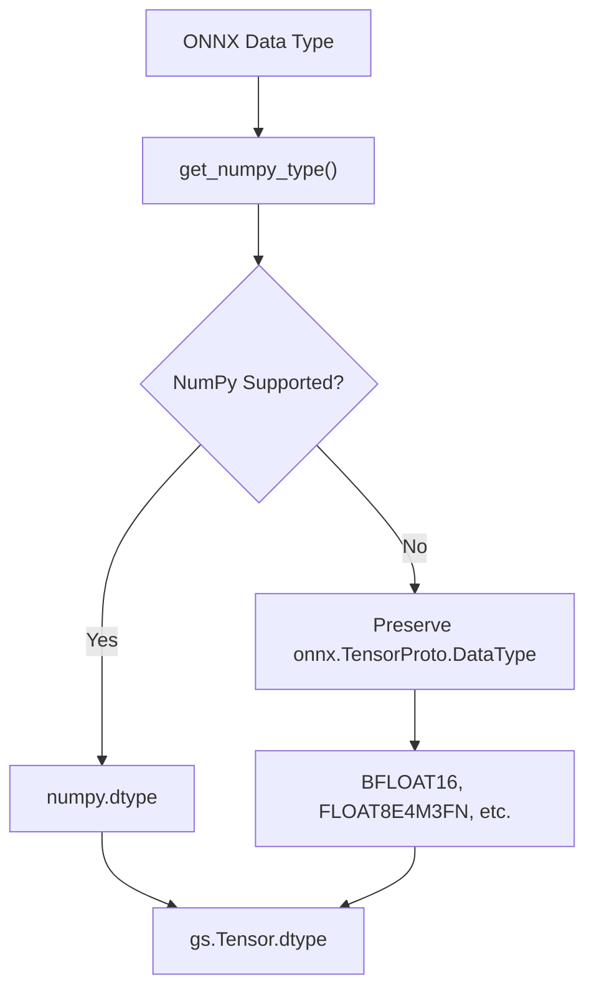
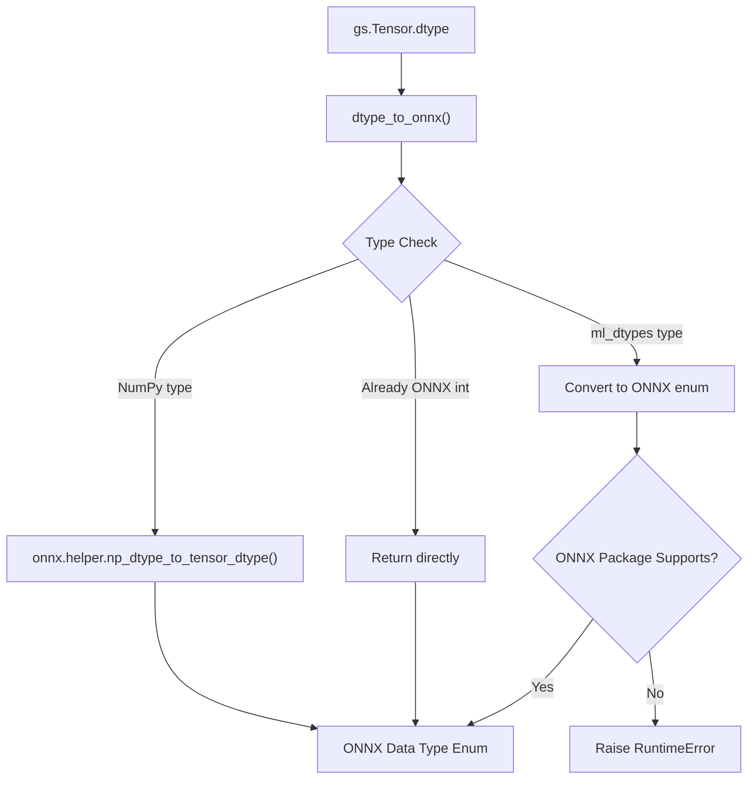
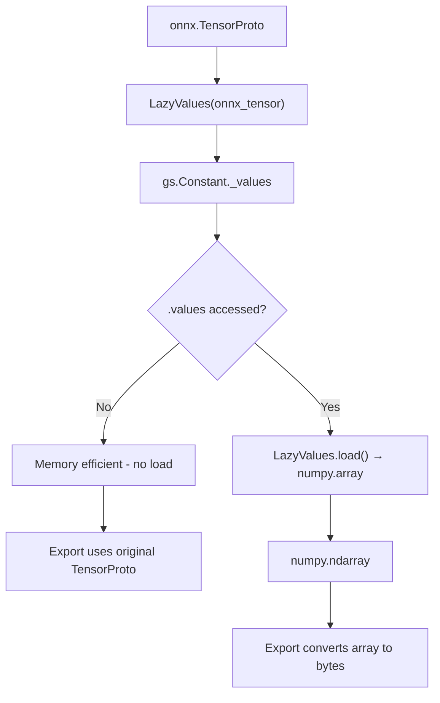

<!-- source: DeepWiki mcp.deepwiki.com · repo NVIDIA/TensorRT · page 6.2 Import and Export · fetched 2026-10-26 -->

# Import and Export

<details>
<summary>Relevant source files</summary>

The following files were used as context for generating this wiki page:

- [tools/onnx-graphsurgeon/CHANGELOG.md](tools/onnx-graphsurgeon/CHANGELOG.md)
- [tools/onnx-graphsurgeon/onnx_graphsurgeon/__init__.py](tools/onnx-graphsurgeon/onnx_graphsurgeon/__init__.py)
- [tools/onnx-graphsurgeon/onnx_graphsurgeon/exporters/onnx_exporter.py](tools/onnx-graphsurgeon/onnx_graphsurgeon/exporters/onnx_exporter.py)
- [tools/onnx-graphsurgeon/onnx_graphsurgeon/importers/onnx_importer.py](tools/onnx-graphsurgeon/onnx_graphsurgeon/importers/onnx_importer.py)
- [tools/onnx-graphsurgeon/onnx_graphsurgeon/ir/graph.py](tools/onnx-graphsurgeon/onnx_graphsurgeon/ir/graph.py)
- [tools/onnx-graphsurgeon/onnx_graphsurgeon/ir/node.py](tools/onnx-graphsurgeon/onnx_graphsurgeon/ir/node.py)
- [tools/onnx-graphsurgeon/onnx_graphsurgeon/ir/tensor.py](tools/onnx-graphsurgeon/onnx_graphsurgeon/ir/tensor.py)
- [tools/onnx-graphsurgeon/onnx_graphsurgeon/logger/logger.py](tools/onnx-graphsurgeon/onnx_graphsurgeon/logger/logger.py)
- [tools/onnx-graphsurgeon/onnx_graphsurgeon/util/exception.py](tools/onnx-graphsurgeon/onnx_graphsurgeon/util/exception.py)
- [tools/onnx-graphsurgeon/onnx_graphsurgeon/util/misc.py](tools/onnx-graphsurgeon/onnx_graphsurgeon/util/misc.py)
- [tools/onnx-graphsurgeon/setup.py](tools/onnx-graphsurgeon/setup.py)
- [tools/onnx-graphsurgeon/tests/ir/test_graph.py](tools/onnx-graphsurgeon/tests/ir/test_graph.py)
- [tools/onnx-graphsurgeon/tests/test_api.py](tools/onnx-graphsurgeon/tests/test_api.py)
- [tools/onnx-graphsurgeon/tests/test_exporters.py](tools/onnx-graphsurgeon/tests/test_exporters.py)
- [tools/onnx-graphsurgeon/tests/test_importers.py](tools/onnx-graphsurgeon/tests/test_importers.py)
- [tools/onnx-graphsurgeon/tests/test_ir.py](tools/onnx-graphsurgeon/tests/test_ir.py)

</details>


This document covers the conversion between ONNX protobuf format and ONNX GraphSurgeon's intermediate representation (IR). These operations enable loading ONNX models into the GraphSurgeon framework for manipulation and saving modified graphs back to ONNX format.

For information about graph manipulation operations, see [Graph Manipulation](#6.1).

## Overview

The import and export system provides bidirectional conversion between ONNX protobuf representations and GraphSurgeon's internal graph representation. The system handles the complexities of ONNX format details while presenting a clean Python API.

## Conversion Architecture



Sources: [tools/onnx-graphsurgeon/onnx_graphsurgeon/__init__.py:1-11](), [tools/onnx-graphsurgeon/onnx_graphsurgeon/importers/onnx_importer.py:417-530](), [tools/onnx-graphsurgeon/onnx_graphsurgeon/exporters/onnx_exporter.py:383-407]()

## Import Process

The import process converts ONNX protobuf objects into GraphSurgeon's intermediate representation through the `OnnxImporter` class and high-level `import_onnx` function.

### Import Flow



Sources: [tools/onnx-graphsurgeon/onnx_graphsurgeon/importers/onnx_importer.py:417-530]()

### Tensor Import

The `import_tensor` method handles different ONNX tensor types:

| ONNX Type | GraphSurgeon Type | Usage |
|-----------|------------------|-------|
| `onnx.TensorProto` | `Constant` | Model weights and constant values |
| `onnx.SparseTensorProto` | `Constant` with `SparseValues` | Sparse constant tensors |  
| `onnx.ValueInfoProto` | `Variable` | Graph inputs, outputs, and intermediates |



Sources: [tools/onnx-graphsurgeon/onnx_graphsurgeon/importers/onnx_importer.py:226-256](), [tools/onnx-graphsurgeon/onnx_graphsurgeon/ir/tensor.py:222-272](), [tools/onnx-graphsurgeon/onnx_graphsurgeon/ir/tensor.py:274-320]()

## Export Process  

The export process converts GraphSurgeon graphs back to ONNX protobuf format through the `OnnxExporter` class and high-level `export_onnx` function.

### Export Flow

**`export_onnx` / `OnnxExporter.export_graph` call sequence**



The helper `update_import_domains` [tools/onnx-graphsurgeon/onnx_graphsurgeon/exporters/onnx_exporter.py:97-121]() ensures the `opset_import` field on the exported model includes the standard ONNX opset as well as any custom op domains used by nodes in the graph and its subgraphs. It is called by both `export_onnx` and `export_function`.

Sources: [tools/onnx-graphsurgeon/onnx_graphsurgeon/exporters/onnx_exporter.py:97-121](), [tools/onnx-graphsurgeon/onnx_graphsurgeon/exporters/onnx_exporter.py:320-380](), [tools/onnx-graphsurgeon/onnx_graphsurgeon/exporters/onnx_exporter.py:383-407]()

### Tensor Export

GraphSurgeon tensors are exported to different ONNX protobuf types based on their usage:



Sources: [tools/onnx-graphsurgeon/onnx_graphsurgeon/exporters/onnx_exporter.py:174-191](), [tools/onnx-graphsurgeon/onnx_graphsurgeon/exporters/onnx_exporter.py:144-171](), [tools/onnx-graphsurgeon/onnx_graphsurgeon/exporters/onnx_exporter.py:193-219]()

## Core Classes

### OnnxImporter

`OnnxImporter` [tools/onnx-graphsurgeon/onnx_graphsurgeon/importers/onnx_importer.py:202-530]() is a static-methods-only class. All methods accept ONNX protobuf objects and return GraphSurgeon IR objects.

| Method | Input | Output | Notes |
|--------|-------|--------|-------|
| `import_tensor` | `onnx.TensorProto` or `onnx.ValueInfoProto` or `onnx.SparseTensorProto` | `gs.Constant` or `gs.Variable` | `TensorProto` → `Constant` with `LazyValues`; `ValueInfoProto` → `Variable` |
| `import_node` | `onnx.NodeProto` + tensor maps + opset | `gs.Node` | Resolves tensor references from the current and outer graph tensor maps |
| `import_graph` | `onnx.GraphProto` + optional outer `tensor_map` | `gs.Graph` | Processes initializers, `value_info`, inputs, outputs, and nodes in order |
| `import_function` | `onnx.FunctionProto` | `gs.Function` | Function inputs/outputs are created as `Variable`; no initializer field in ONNX functions |
| `import_attributes` | `List[onnx.AttributeProto]` | `OrderedDict` | Dispatches on attribute type; `GRAPH` attributes are recursively imported as subgraphs; `TENSOR` attributes become `gs.Constant` |

`import_graph` maintains two separate tensor maps: `tensor_map` (outer graph tensors, read-only) and `subgraph_tensor_map` (tensors belonging to the current graph). When resolving a tensor reference in `import_node`, the subgraph map is checked first, then the outer map. This enables correct import of control-flow nodes (e.g., `If`, `Loop`) that reference outer-graph tensors.

Sources: [tools/onnx-graphsurgeon/onnx_graphsurgeon/importers/onnx_importer.py:202-530]()

### OnnxExporter

`OnnxExporter` [tools/onnx-graphsurgeon/onnx_graphsurgeon/exporters/onnx_exporter.py:174-407]() is a static-methods-only class. All methods accept GraphSurgeon IR objects and return ONNX protobuf objects.

| Method | Input | Output | Notes |
|--------|-------|--------|-------|
| `export_tensor_proto` | `gs.Constant` | `onnx.TensorProto` | If `_values` is `LazyValues`, reuses the original `TensorProto` directly without loading into NumPy |
| `export_sparse_tensor_proto` | `gs.Constant` with `SparseValues` | `onnx.SparseTensorProto` | Returns the wrapped sparse proto directly |
| `export_value_info_proto` | `gs.Tensor`, `do_type_check: bool` | `onnx.ValueInfoProto` | If `do_type_check=True` (default), raises an error when `dtype` is `None` on graph inputs/outputs |
| `export_node` | `gs.Node` | `onnx.NodeProto` | Serializes op, name, domain, inputs, outputs, and attributes |
| `export_graph` | `gs.Graph`, `do_type_check=True` | `onnx.GraphProto` | Checks for duplicate node names; exports nodes, inputs, outputs, initializers, and `value_info` |
| `export_function` | `gs.Function` | `onnx.FunctionProto` | `Constant` tensors are wrapped in synthetic `Constant` nodes because `onnx.FunctionProto` has no `initializer` field |
| `export_attributes` | `dict` | `List[onnx.AttributeProto]` | `Graph` attribute values are exported as subgraphs with `do_type_check=False`; `Node.AttributeRef` is exported as a `ref_attr_name` proto |

#### `do_type_check` parameter

`export_graph` and the top-level `export_onnx` both accept a `do_type_check` boolean (default `True`). When enabled, `export_value_info_proto` will raise a critical error if a graph input or output tensor has no `dtype` set. This guards against exporting an invalid ONNX model. Subgraphs (node attributes of type `GRAPH`) are always exported with `do_type_check=False` because subgraph tensors may legitimately omit type information.

#### `export_function` special handling

ONNX `FunctionProto` has no `initializer` field, unlike `GraphProto`. To handle `gs.Constant` tensors that appear inside a `gs.Function`, `export_function` synthesizes `Constant` nodes that produce those tensors before the regular nodes. These synthetic nodes are prepended (they have no inputs, so topological order is preserved) and are not made visible in the user-facing `Function.nodes` list.

Sources: [tools/onnx-graphsurgeon/onnx_graphsurgeon/exporters/onnx_exporter.py:174-407]()

## Data Type Handling

The system handles various ONNX data types, including those not natively supported by NumPy:

### Type Conversion During Import



Sources: [tools/onnx-graphsurgeon/onnx_graphsurgeon/importers/onnx_importer.py:98-151]()

### Type Conversion During Export  



Sources: [tools/onnx-graphsurgeon/onnx_graphsurgeon/exporters/onnx_exporter.py:40-74]()

## LazyValues and Memory Efficiency

GraphSurgeon uses `LazyValues` to avoid loading large constant tensors into memory during import:



Sources: [tools/onnx-graphsurgeon/onnx_graphsurgeon/ir/tensor.py:222-271](), [tools/onnx-graphsurgeon/onnx_graphsurgeon/exporters/onnx_exporter.py:174-187]()

## Usage Patterns

### Basic Import/Export

```python
import onnx_graphsurgeon as gs
import onnx

# Import ONNX model to GraphSurgeon
onnx_model = onnx.load("model.onnx")
graph = gs.import_onnx(onnx_model)

# Manipulate graph...

# Export back to ONNX
modified_model = gs.export_onnx(graph)
onnx.save(modified_model, "modified_model.onnx")
```

### Working with External Data

The system preserves `data_location` attributes for models with external weights:

```python
# Import preserves external data location
graph = gs.import_onnx(model_with_external_data)

# Export maintains external data references  
output_model = gs.export_onnx(graph)
```

Sources: [onnx_graphsurgeon/importers/onnx_importer.py:239-247](), [onnx_graphsurgeon/exporters/onnx_exporter.py:185-186](), [tests/test_exporters.py:463-484]()

---

