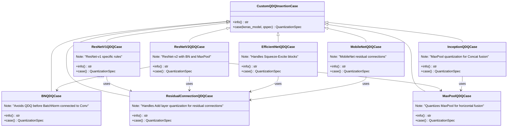

<!-- source: DeepWiki mcp.deepwiki.com · repo NVIDIA/TensorRT · page 7 Quantization Tools · fetched 2026-10-26 -->

# Quantization Tools

<details>
<summary>Relevant source files</summary>

The following files were used as context for generating this wiki page:

- [tools/tensorflow-quantization/README.md](tools/tensorflow-quantization/README.md)
- [tools/tensorflow-quantization/docs/source/docs/model_zoo.md](tools/tensorflow-quantization/docs/source/docs/model_zoo.md)
- [tools/tensorflow-quantization/examples/README.md](tools/tensorflow-quantization/examples/README.md)
- [tools/tensorflow-quantization/examples/data/data_loader.py](tools/tensorflow-quantization/examples/data/data_loader.py)
- [tools/tensorflow-quantization/examples/inception/README.md](tools/tensorflow-quantization/examples/inception/README.md)
- [tools/tensorflow-quantization/examples/inception/run_qat_workflow.py](tools/tensorflow-quantization/examples/inception/run_qat_workflow.py)
- [tools/tensorflow-quantization/examples/inception/test_qdq_node_placement.py](tools/tensorflow-quantization/examples/inception/test_qdq_node_placement.py)
- [tools/tensorflow-quantization/examples/infer_engine.py](tools/tensorflow-quantization/examples/infer_engine.py)
- [tools/tensorflow-quantization/examples/mobilenet/test_qdq_node_placement.py](tools/tensorflow-quantization/examples/mobilenet/test_qdq_node_placement.py)
- [tools/tensorflow-quantization/examples/requirements.txt](tools/tensorflow-quantization/examples/requirements.txt)
- [tools/tensorflow-quantization/examples/utils.py](tools/tensorflow-quantization/examples/utils.py)
- [tools/tensorflow-quantization/tensorflow_quantization/custom_qdq_cases.py](tools/tensorflow-quantization/tensorflow_quantization/custom_qdq_cases.py)
- [tools/tensorflow-quantization/tests/onnx_graph_qdq_validator.py](tools/tensorflow-quantization/tests/onnx_graph_qdq_validator.py)

</details>


This section covers the quantization tools and workflows available in the TensorRT repository for converting models to reduced precision formats, particularly INT8. The primary focus is on the TensorFlow Quantization Toolkit for Quantization-Aware Training (QAT) workflows that integrate with TensorRT deployment.

**Note**: Development has transitioned to the [TensorRT Model Optimizer](https://github.com/NVIDIA/TensorRT-Model-Optimizer). While the TensorFlow Quantization code remains available, it will no longer receive further development.

For information about ONNX graph manipulation tools used in quantization workflows, see [ONNX Graph Surgeon](#6).

## TensorFlow Quantization Toolkit

The TensorFlow Quantization Toolkit provides automated and manual insertion of Quantization/Dequantization (QDQ) nodes in TensorFlow 2.x Keras models following NVIDIA's QAT recipe for optimal TensorRT acceleration.

### Toolkit Architecture

```mermaid
graph TB
    subgraph "TensorFlow Quantization Toolkit"
        QUANTIZE["`quantize_model()`<br/>Core Quantization Function"]
        CUSTOM_QDQ["`CustomQDQInsertionCase`<br/>Base Class for Custom Rules"]
        QSPEC["`QuantizationSpec`<br/>Layer Configuration"]
    end
    
    subgraph "Custom QDQ Cases"
        GENERAL["`BNQDQCase`<br/>`ResidualConnectionQDQCase`<br/>`MaxPoolQDQCase`"]
        RESNET["`ResNetV1QDQCase`<br/>`ResNetV2QDQCase`"]
        EFFICIENT["`EfficientNetQDQCase`"]
        MOBILE["`MobileNetQDQCase`"]
        INCEPTION["`InceptionQDQCase`"]
    end
    
    subgraph "Validation & Testing"
        VALIDATOR["`ONNXQDQValidator`<br/>QDQ Node Placement Validation"]
        TEST_UTILS["`validate_quantized_model()`<br/>End-to-End Testing"]
    end
    
    subgraph "Utilities"
        CONVERT["`convert_saved_model_to_onnx()`<br/>TF to ONNX Conversion"]
        DATA_LOADER["`load_data_tfrecord_tf()`<br/>ImageNet Data Loading"]
        INFERENCE["`infer_engine.py`<br/>TensorRT Inference"]
    end
    
    QUANTIZE --> CUSTOM_QDQ
    QUANTIZE --> QSPEC
    CUSTOM_QDQ --> GENERAL
    CUSTOM_QDQ --> RESNET
    CUSTOM_QDQ --> EFFICIENT
    CUSTOM_QDQ --> MOBILE
    CUSTOM_QDQ --> INCEPTION
    
    QUANTIZE --> VALIDATOR
    VALIDATOR --> TEST_UTILS
    
    QUANTIZE --> CONVERT
    TEST_UTILS --> DATA_LOADER
    CONVERT --> INFERENCE
```

**Sources**: [tools/tensorflow-quantization/README.md:1-84](), [tools/tensorflow-quantization/tensorflow_quantization/custom_qdq_cases.py:18-363](), [tools/tensorflow-quantization/tests/onnx_graph_qdq_validator.py:46-551]()

### QAT Workflow

The complete QAT workflow follows a systematic process from model quantization to TensorRT deployment:

#### QAT Workflow Diagram

```mermaid
flowchart TD
    BASELINE["`tf.keras.Model`<br/>Baseline FP32 Model"]
    
    subgraph "Quantization Phase"
        QUANTIZE_FUNC["`quantize_model()`"]
        CUSTOM_CASES["`custom_qdq_cases`<br/>Model-specific Rules"]
        QSPEC_CONFIG["`QuantizationSpec`<br/>Layer Configuration"]
    end
    
    subgraph "Training Phase" 
        FINETUNE["`fine_tune()`<br/>QAT Fine-tuning"]
        CHECKPOINTS["`checkpoints_best`<br/>Saved Weights"]
    end
    
    subgraph "Conversion Phase"
        SAVEDMODEL["`tf.saved_model`<br/>Quantized SavedModel"]
        ONNX_CONV["`convert_saved_model_to_onnx()`"]
        ONNX_MODEL["`model_qat.onnx`<br/>ONNX Graph with QDQ"]
    end
    
    subgraph "Deployment Phase"
        TRTEXEC["`trtexec --int8`<br/>Engine Building"]
        ENGINE["`model_qat.engine`<br/>TensorRT Engine"]
        INFERENCE_ENGINE["`infer_engine.py`<br/>Inference & Evaluation"]
    end
    
    BASELINE --> QUANTIZE_FUNC
    CUSTOM_CASES --> QUANTIZE_FUNC  
    QSPEC_CONFIG --> QUANTIZE_FUNC
    QUANTIZE_FUNC --> FINETUNE
    FINETUNE --> CHECKPOINTS
    CHECKPOINTS --> SAVEDMODEL
    SAVEDMODEL --> ONNX_CONV
    ONNX_CONV --> ONNX_MODEL
    ONNX_MODEL --> TRTEXEC
    TRTEXEC --> ENGINE
    ENGINE --> INFERENCE_ENGINE
```

**Sources**: [tools/tensorflow-quantization/examples/README.md:4-11](), [tools/tensorflow-quantization/examples/inception/run_qat_workflow.py:76-178]()

## Custom QDQ Insertion System

The toolkit provides a sophisticated system for handling model-specific quantization requirements through custom QDQ insertion cases. Each case defines specific rules for where to place Quantization and Dequantization nodes.

### Custom QDQ Cases Hierarchy



**Sources**: [tools/tensorflow-quantization/tensorflow_quantization/custom_qdq_cases.py:83-363]()

### Key QDQ Insertion Rules

The custom QDQ cases implement specific optimization strategies:

| Case | Purpose | Key Rules |
|------|---------|-----------|
| `BNQDQCase` | BatchNorm handling | Avoids QDQ before BatchNorm when connected to Conv (fusion optimization) |
| `ResidualConnectionQDQCase` | Residual connections | Quantizes all Add layer inputs except one Conv pattern branch for INT8 kernel fusion |
| `MaxPoolQDQCase` | Pooling quantization | Enables MaxPool quantization for horizontal fusion in residual connections |
| `EfficientNetQDQCase` | Squeeze-Excite blocks | Quantizes Multiply layer inputs for SE block horizontal fusion |

**Sources**: [tools/tensorflow-quantization/tensorflow_quantization/custom_qdq_cases.py:83-363]()

## Model Support and Examples

The toolkit provides comprehensive examples for popular computer vision architectures:

### Supported Models

| Model Family | Specific Models | Custom QDQ Case | Key Optimizations |
|--------------|----------------|-----------------|-------------------|
| ResNet | ResNet-50/101/152 v1/v2 | `ResNetV1QDQCase`, `ResNetV2QDQCase` | Residual connection fusion |
| EfficientNet | EfficientNet-B0/B3 | `EfficientNetQDQCase` | SE block fusion, residual connections |
| MobileNet | MobileNet-v1/v2 | `MobileNetQDQCase` | Depthwise convolution patterns |
| Inception | Inception-v3 | `InceptionQDQCase` | Concat layer horizontal fusion |

**Sources**: [tools/tensorflow-quantization/examples/README.md:38-46](), [tools/tensorflow-quantization/examples/data/data_loader.py:53-61]()

### Example Workflow Structure

```mermaid
graph TB
    subgraph "Common Infrastructure"
        DATA_LOADER["`data_loader.py`<br/>ImageNet TFRecord Loading"]
        UTILS["`utils.py`<br/>Model Creation Utilities"]
        FINETUNING["`utils_finetuning.py`<br/>Training Infrastructure"]
    end
    
    subgraph "Model Examples"
        RESNET["`examples/resnet/`<br/>`run_qat_workflow.py`"]
        EFFICIENTNET["`examples/efficientnet/`<br/>`run_qat_workflow.py`"]
        MOBILENET["`examples/mobilenet/`<br/>`run_qat_workflow.py`"]
        INCEPTION["`examples/inception/`<br/>`run_qat_workflow.py`"]
    end
    
    subgraph "Validation"
        QDQ_TESTS["`test_qdq_node_placement.py`<br/>ONNX QDQ Validation"]
        VALIDATOR["`onnx_graph_qdq_validator.py`<br/>Validation Infrastructure"]
    end
    
    subgraph "Deployment"
        INFER_ENGINE["`infer_engine.py`<br/>TensorRT Engine Inference"]
        TRTEXEC["`trtexec`<br/>External TensorRT Tool"]
    end
    
    DATA_LOADER --> RESNET
    DATA_LOADER --> EFFICIENTNET  
    DATA_LOADER --> MOBILENET
    DATA_LOADER --> INCEPTION
    
    UTILS --> RESNET
    UTILS --> EFFICIENTNET
    UTILS --> MOBILENET  
    UTILS --> INCEPTION
    
    FINETUNING --> RESNET
    FINETUNING --> EFFICIENTNET
    FINETUNING --> MOBILENET
    FINETUNING --> INCEPTION
    
    RESNET --> QDQ_TESTS
    EFFICIENTNET --> QDQ_TESTS
    MOBILENET --> QDQ_TESTS
    INCEPTION --> QDQ_TESTS
    
    QDQ_TESTS --> VALIDATOR
    
    RESNET --> INFER_ENGINE
    EFFICIENTNET --> INFER_ENGINE
    MOBILENET --> INFER_ENGINE
    INCEPTION --> INFER_ENGINE
    
    INFER_ENGINE --> TRTEXEC
```

**Sources**: [tools/tensorflow-quantization/examples/README.md:1-104](), [tools/tensorflow-quantization/examples/utils.py:19-96](), [tools/tensorflow-quantization/examples/data/data_loader.py:1-351]()

## Validation and Testing Infrastructure

### ONNX QDQ Validator

The `ONNXQDQValidator` class provides comprehensive validation of QDQ node placement in ONNX graphs:

#### Validation Components

| Component | Function | Purpose |
|-----------|----------|---------|
| `_unintended_layer_quantize_check_pass()` | Prevents unwanted quantization | Ensures only intended layers are quantized |
| `_intended_layer_quantize_check_pass()` | Verifies required quantization | Ensures all intended layers are properly quantized |
| `_qdq_insertion_check_pass()` | Validates QDQ placement | Checks specific QDQ node insertion patterns |

#### Layer-Specific Validation Methods

| Method | Handles | Validation Logic |
|--------|---------|------------------|
| `_weighted_qdq_behavior()` | Conv2D, Dense, DepthwiseConv2D | Validates input/weight quantization based on `quantize_input`/`quantize_weight` flags |
| `_pool_qdq_behavior()` | MaxPool, AveragePool, GlobalAveragePool | Ensures single input is quantized |
| `_bn_qdq_behavior()` | BatchNormalization | Checks variable input quantization while ignoring constant parameters |
| `_multi_input_qdq_behavior()` | Add, Multiply, Concatenate | Validates quantization based on `quantization_index` specifications |

**Sources**: [tools/tensorflow-quantization/tests/onnx_graph_qdq_validator.py:46-551]()

### Testing Workflow

The `validate_quantized_model()` function provides end-to-end testing:

1. **Model Quantization**: Applies quantization with specified `QuantizationSpec` and custom QDQ cases
2. **ONNX Conversion**: Converts both baseline and quantized models to ONNX format
3. **QDQ Validation**: Validates QDQ node placements against expected behavior
4. **Result Verification**: Returns validation status for automated testing

**Sources**: [tools/tensorflow-quantization/tests/onnx_graph_qdq_validator.py:488-551]()

## Performance Results

The toolkit achieves competitive INT8 performance across various model architectures:

### Representative Results (TensorRT 8.4, A100 GPU)

| Model | Baseline Accuracy | QAT Accuracy | Baseline Latency (ms) | QAT Latency (ms) |
|-------|-------------------|--------------|----------------------|------------------|
| ResNet50-v1 | 75.05% | 75.12% | 7.95 | 0.45 |
| EfficientNet-B0 | 76.97% | 75.82% | 6.77 | 0.68 |
| MobileNet-v1 | 70.60% | 70.43% | 1.99 | 0.16 |
| Inception-v3 | 77.86% | 78.08% | 9.01 | 0.82 |

**Sources**: [tools/tensorflow-quantization/docs/source/docs/model_zoo.md:1-97]()

## Installation and Usage

### Requirements

- Python >= 3.8
- TensorFlow >= 2.8
- tf2onnx >= 1.10.1
- onnx-graphsurgeon
- TensorRT (optional) >= 8.4 GA

### Basic Usage

```python
from tensorflow_quantization.quantize import quantize_model
from tensorflow_quantization.custom_qdq_cases import ResNetV1QDQCase

# Quantize model with custom QDQ case
quantized_model = quantize_model(
    model=baseline_model,
    custom_qdq_cases=[ResNetV1QDQCase()]
)
```

**Sources**: [tools/tensorflow-quantization/README.md:18-63](), [tools/tensorflow-quantization/examples/inception/run_qat_workflow.py:121-122]()

---

