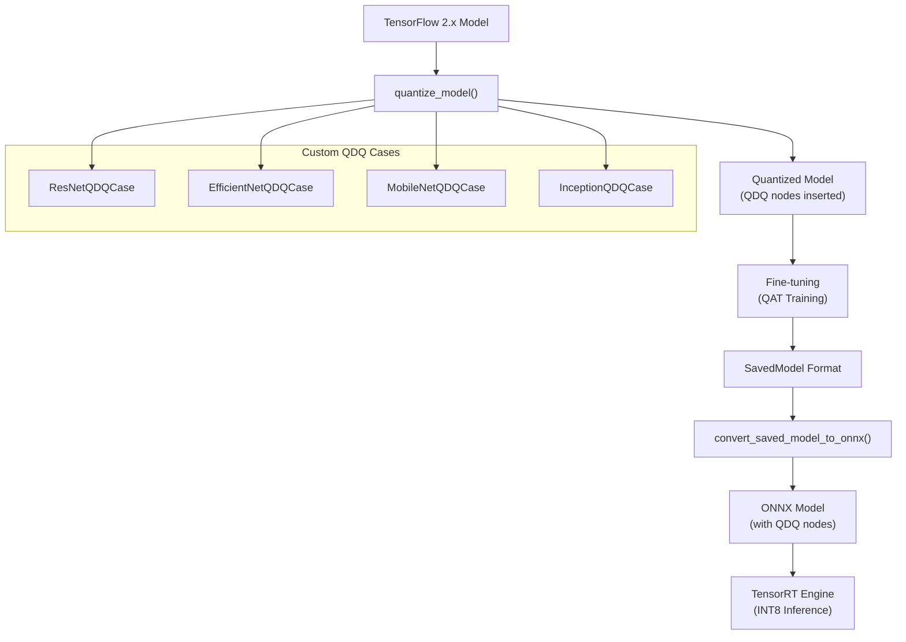
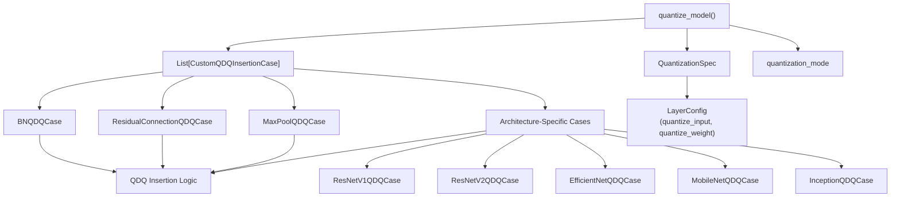
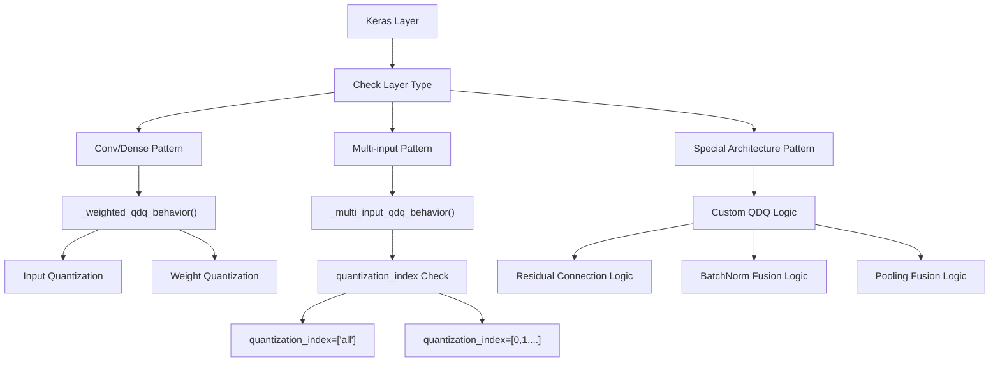
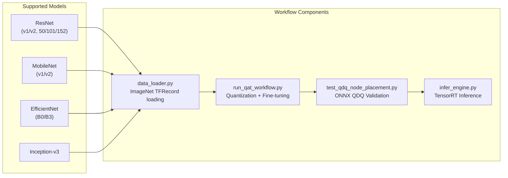
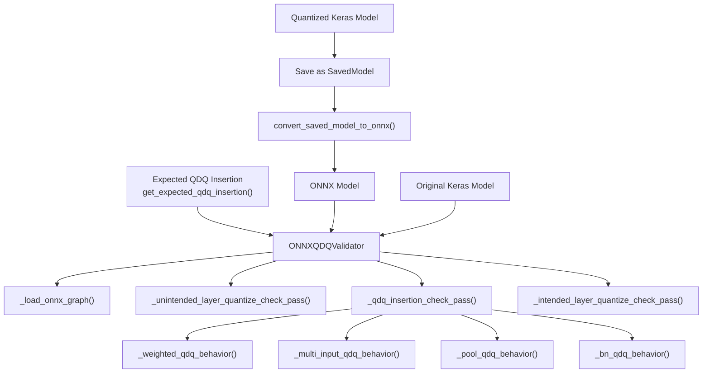
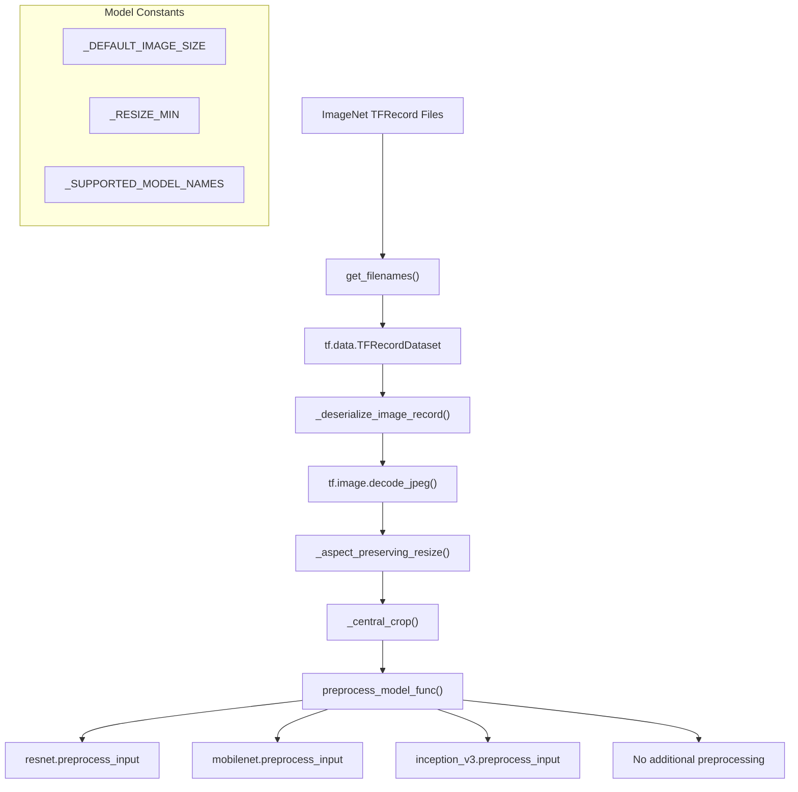
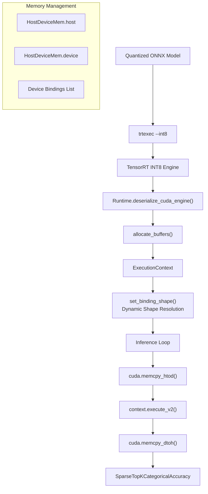

<!-- source: DeepWiki mcp.deepwiki.com · repo NVIDIA/TensorRT · page 7.1 TensorFlow Quantization Toolkit · fetched 2026-10-26 -->

# TensorFlow Quantization Toolkit

Relevant source files

The following files were used as context for generating this wiki page:

- [tools/tensorflow-quantization/README.md](tools/tensorflow-quantization/README.md)
- [tools/tensorflow-quantization/docs/source/docs/model_zoo.md](tools/tensorflow-quantization/docs/source/docs/model_zoo.md)
- [tools/tensorflow-quantization/examples/README.md](tools/tensorflow-quantization/examples/README.md)
- [tools/tensorflow-quantization/examples/data/data_loader.py](tools/tensorflow-quantization/examples/data/data_loader.py)
- [tools/tensorflow-quantization/examples/inception/README.md](tools/tensorflow-quantization/examples/inception/README.md)
- [tools/tensorflow-quantization/examples/inception/run_qat_workflow.py](tools/tensorflow-quantization/examples/inception/run_qat_workflow.py)
- [tools/tensorflow-quantization/examples/inception/test_qdq_node_placement.py](tools/tensorflow-quantization/examples/inception/test_qdq_node_placement.py)
- [tools/tensorflow-quantization/examples/infer_engine.py](tools/tensorflow-quantization/examples/infer_engine.py)
- [tools/tensorflow-quantization/examples/mobilenet/test_qdq_node_placement.py](tools/tensorflow-quantization/examples/mobilenet/test_qdq_node_placement.py)
- [tools/tensorflow-quantization/examples/requirements.txt](tools/tensorflow-quantization/examples/requirements.txt)
- [tools/tensorflow-quantization/examples/utils.py](tools/tensorflow-quantization/examples/utils.py)
- [tools/tensorflow-quantization/tensorflow_quantization/custom_qdq_cases.py](tools/tensorflow-quantization/tensorflow_quantization/custom_qdq_cases.py)
- [tools/tensorflow-quantization/tests/onnx_graph_qdq_validator.py](tools/tensorflow-quantization/tests/onnx_graph_qdq_validator.py)

The TensorFlow Quantization Toolkit is NVIDIA's comprehensive solution for Quantization-Aware Training (QAT) of TensorFlow 2.x Keras models, designed to achieve optimal INT8 inference performance with TensorRT. This toolkit implements NVIDIA's quantization recipe and provides automated QDQ (Quantize/Dequantize) node insertion with architecture-specific optimizations.

**Note**: Development has transitioned to the [TensorRT Model Optimizer](https://github.com/NVIDIA/TensorRT-Model-Optimizer). While this toolkit remains available, all new development efforts are focused on the Model Optimizer for the latest quantization and compression advancements.

For information about the broader quantization ecosystem, see [Quantization Tools](#7).

## Architecture Overview

The toolkit provides a complete workflow from TensorFlow model quantization through TensorRT engine deployment, with specialized handling for popular CNN architectures.

### High-Level Workflow

Sources: [tools/tensorflow-quantization/README.md:1-84](), [tools/tensorflow-quantization/examples/README.md:1-104]()

## Core Quantization System

The quantization system centers around the `quantize_model` function and customizable QDQ insertion rules implemented through `CustomQDQInsertionCase` classes.

### Quantization Components

Sources: [tools/tensorflow-quantization/tensorflow_quantization/custom_qdq_cases.py:1-363]()

## Custom QDQ Cases

The toolkit implements specialized quantization rules for different architectural patterns through `CustomQDQInsertionCase` subclasses that determine optimal QDQ node placement.

### Architecture-Specific Rules

| Architecture | QDQ Cases Applied | Purpose |
|-------------|------------------|---------|
| ResNet-v1 | `ResidualConnectionQDQCase` | Quantize residual connections for INT8 kernel fusion |
| ResNet-v2 | `ResidualConnectionQDQCase`, `BNQDQCase`, `MaxPoolQDQCase` | Handle pre-activation structure and pooling |
| EfficientNet | `ResidualConnectionQDQCase`, SE block handling | Quantize Squeeze-Excite multiply operations |
| MobileNet | `ResidualConnectionQDQCase` | Handle depthwise separable convolutions |
| Inception-v3 | `MaxPoolQDQCase` | Enable horizontal fusion in Concat layers |

### QDQ Insertion Logic

Sources: [tools/tensorflow-quantization/tensorflow_quantization/custom_qdq_cases.py:25-363]()

## Example Workflows

The toolkit provides complete end-to-end examples for popular model architectures, demonstrating the full QAT pipeline from model loading through TensorRT deployment.

### Model Support Matrix

Sources: [tools/tensorflow-quantization/examples/README.md:35-104](), [tools/tensorflow-quantization/examples/data/data_loader.py:53-351]()

## Validation and Testing Infrastructure

The toolkit includes comprehensive validation tools to ensure correct QDQ node placement in the generated ONNX models through the `ONNXQDQValidator` system.

### ONNX Validation Pipeline

Sources: [tools/tensorflow-quantization/tests/onnx_graph_qdq_validator.py:46-552]()

## Performance Results

The toolkit achieves competitive accuracy with significant performance improvements across popular architectures when deployed with TensorRT INT8 inference.

### Model Zoo Performance

| Model | Baseline Accuracy (%) | QAT Accuracy (%) | TensorRT Latency (ms, bs=1) | Speedup |
|-------|---------------------|------------------|---------------------------|---------|
| ResNet50-v1 | 75.05 | 75.12 | 0.45 | 17.7x |
| ResNet50-v2 | 75.36 | 75.65 | 0.57 | 10.8x |
| EfficientNet-B0 | 76.97 | 75.82 | 0.68 | 10.0x |
| MobileNet-v1 | 70.60 | 70.43 | 0.16 | 12.4x |
| Inception-v3 | 77.86 | 78.08 | 0.82 | 11.0x |

Sources: [tools/tensorflow-quantization/docs/source/docs/model_zoo.md:1-97]()

## Data Loading and Preprocessing

The toolkit provides specialized data loading infrastructure optimized for ImageNet workflows with model-specific preprocessing pipelines.

### Data Pipeline Components

Sources: [tools/tensorflow-quantization/examples/data/data_loader.py:53-351]()

## TensorRT Integration

The final deployment step involves converting the quantized ONNX model to a TensorRT engine for optimized INT8 inference with comprehensive accuracy validation.

### Inference Pipeline

Sources: [tools/tensorflow-quantization/examples/infer_engine.py:35-277]()

---

