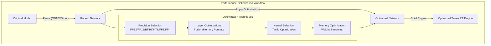
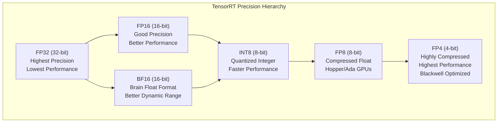
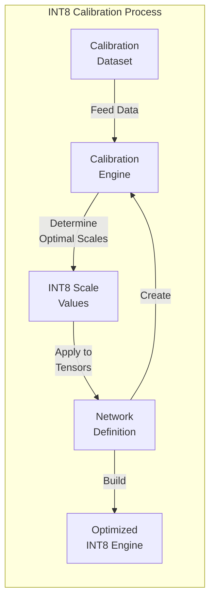
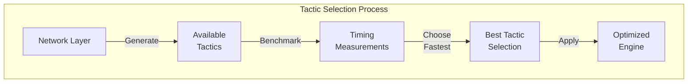
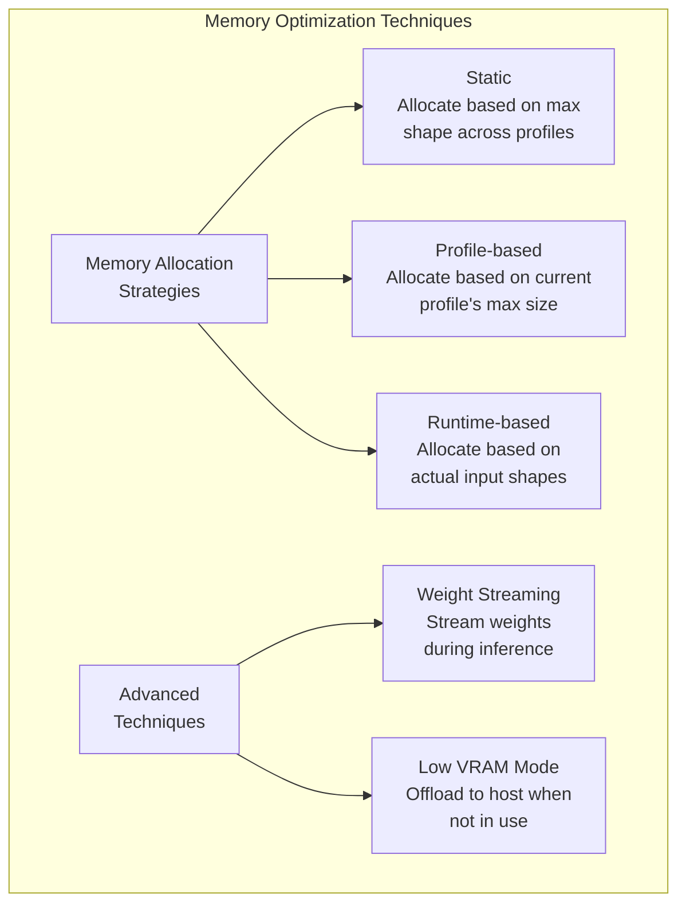
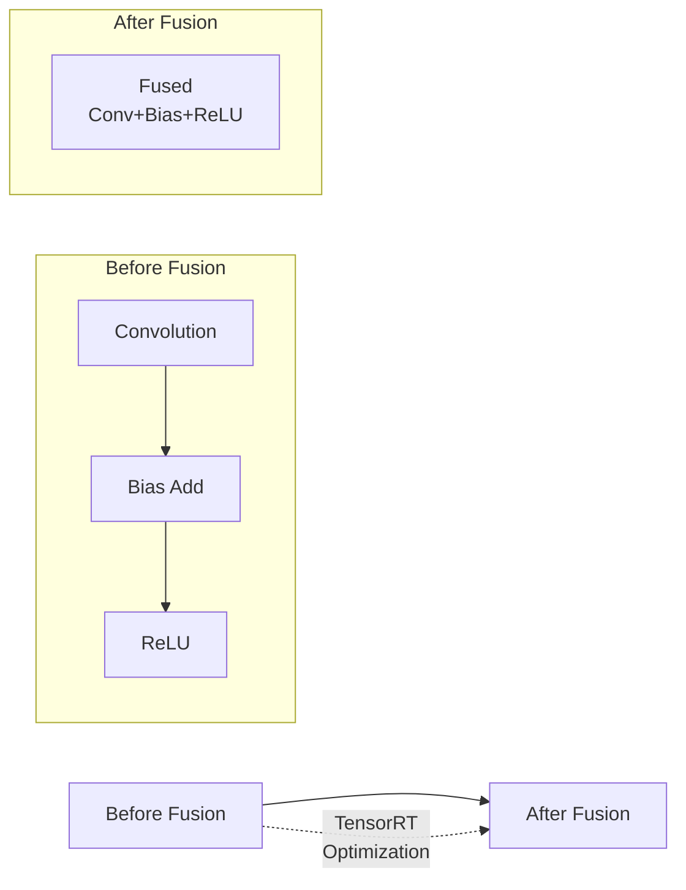

<!-- source: DeepWiki mcp.deepwiki.com · repo NVIDIA/TensorRT · page 8 Performance and Profiling Tools · fetched 2026-10-26 -->

# Performance Optimization

<details>
<summary>Relevant source files</summary>

The following files were used as context for generating this wiki page:

- [CMakeLists.txt](CMakeLists.txt)
- [cmake/toolchains/cmake_qnx_safe.toolchain](cmake/toolchains/cmake_qnx_safe.toolchain)
- [samples/common/common.h](samples/common/common.h)
- [samples/common/sampleEngines.cpp](samples/common/sampleEngines.cpp)
- [samples/common/sampleInference.cpp](samples/common/sampleInference.cpp)
- [samples/common/sampleInference.h](samples/common/sampleInference.h)
- [samples/common/sampleOptions.cpp](samples/common/sampleOptions.cpp)
- [samples/common/sampleOptions.h](samples/common/sampleOptions.h)
- [samples/common/sampleReporting.cpp](samples/common/sampleReporting.cpp)
- [samples/common/sampleUtils.h](samples/common/sampleUtils.h)
- [samples/trtexec/trtexec.cpp](samples/trtexec/trtexec.cpp)
- [tools/experimental/trt-engine-explorer/CHANGELOG.md](tools/experimental/trt-engine-explorer/CHANGELOG.md)
- [tools/experimental/trt-engine-explorer/README.md](tools/experimental/trt-engine-explorer/README.md)
- [tools/experimental/trt-engine-explorer/install.sh](tools/experimental/trt-engine-explorer/install.sh)
- [tools/experimental/trt-engine-explorer/notebooks/compare_engines.ipynb](tools/experimental/trt-engine-explorer/notebooks/compare_engines.ipynb)
- [tools/experimental/trt-engine-explorer/notebooks/engine_report_card.ipynb](tools/experimental/trt-engine-explorer/notebooks/engine_report_card.ipynb)
- [tools/experimental/trt-engine-explorer/notebooks/tutorial.ipynb](tools/experimental/trt-engine-explorer/notebooks/tutorial.ipynb)
- [tools/experimental/trt-engine-explorer/requirements.txt](tools/experimental/trt-engine-explorer/requirements.txt)
- [tools/experimental/trt-engine-explorer/setup.py](tools/experimental/trt-engine-explorer/setup.py)
- [tools/experimental/trt-engine-explorer/trex/__init__.py](tools/experimental/trt-engine-explorer/trex/__init__.py)
- [tools/experimental/trt-engine-explorer/trex/activations.py](tools/experimental/trt-engine-explorer/trex/activations.py)
- [tools/experimental/trt-engine-explorer/trex/compare_engines.py](tools/experimental/trt-engine-explorer/trex/compare_engines.py)
- [tools/experimental/trt-engine-explorer/trex/engine_plan.py](tools/experimental/trt-engine-explorer/trex/engine_plan.py)
- [tools/experimental/trt-engine-explorer/trex/graphing.py](tools/experimental/trt-engine-explorer/trex/graphing.py)
- [tools/experimental/trt-engine-explorer/trex/parser.py](tools/experimental/trt-engine-explorer/trex/parser.py)

</details>


This document covers techniques and best practices for optimizing performance of models executed with NVIDIA TensorRT. It focuses on precision modes, builder optimizations, memory management strategies, and model-specific enhancements to achieve maximum inference performance. For information on ONNX model conversion and optimization, see [ONNX Graph Surgeon](#5).

## TensorRT Performance Optimization Overview

TensorRT offers a comprehensive set of optimization techniques to maximize inference performance on NVIDIA GPUs. These optimizations occur at multiple levels, from precision reduction to kernel fusion and memory management.



Sources:
- [README.md:28-48](
- [samples/common/sampleOptions.cpp:418-473](
- [samples/common/sampleEngines.cpp:200-400](

## Precision Modes

TensorRT supports multiple precision modes that offer different trade-offs between accuracy, performance, and memory usage. Lower precision generally provides faster inference but may impact accuracy.

### Supported Precision Types



TensorRT allows selecting precision at multiple levels:
- Global precision mode (e.g., FP16, INT8)
- Per-layer precision control
- Mixed precision execution

### Enabling Different Precision Modes

Different precision modes can be enabled through builder configurations:

```cpp
// FP16 precision
config->setFlag(BuilderFlag::kFP16);

// INT8 precision (requires calibration or explicit quantization)
config->setFlag(BuilderFlag::kINT8);

// BF16 precision
config->setFlag(BuilderFlag::kBF16);

// FP8 precision (requires Hopper/Ada GPU)
config->setFlag(BuilderFlag::kFP8);
```

### Layer-Specific Precision Control

For fine-grained control, TensorRT allows setting precision for individual layers:

```cpp
// Set layer precision to FP16
layer->setPrecision(DataType::kHALF);

// Set output tensor type
layer->setOutputType(0, DataType::kHALF);
```

Sources:
- [include/NvInfer.h:239-273](
- [samples/common/sampleOptions.h:215-223](
- [samples/common/sampleOptions.cpp:153-157](
- [demo/Diffusion/README.md:86-100](

## Quantization

### INT8 Quantization

INT8 quantization reduces precision from 32-bit floating point to 8-bit integer representation, significantly improving performance and reducing memory usage.

#### Calibration-based Quantization

INT8 calibration requires a representative dataset to determine appropriate scaling factors:



TensorRT provides built-in calibrators:
- Entropy Calibrator
- Entropy2 Calibrator (recommended)
- MinMax Calibrator

#### Explicit Quantization

TensorRT also supports explicit quantization by manually setting dynamic ranges:

```cpp
// Set dynamic range for a tensor
tensor->setDynamicRange(-5.0f, 5.0f);
```

### FP8 and FP4 Quantization

For newer GPU architectures (Hopper, Ada, Blackwell), TensorRT supports even lower precision modes:

- **FP8 Quantization**: Available on Hopper (H100) and Ada (e.g., RTX 4090) GPUs.
- **FP4 Quantization**: Optimized for Blackwell architecture, offering the highest performance with suitable models.

These precision modes are particularly effective for Stable Diffusion and Transformer-based models.

Sources:
- [demo/Diffusion/README.md:173-179](
- [samples/common/sampleEngines.cpp:264-408](
- [CHANGELOG.md:36-46](

## Builder Optimization Techniques

### Optimization Levels

TensorRT builder accepts optimization levels that control how aggressively it tries to optimize the network:

```cpp
config->setBuilderOptimizationLevel(level); // 0-5, higher = more optimization
```

Higher levels spend more time during the build phase but can produce faster inference engines.

### Tactic Selection

Tactics are alternative implementations of the same operation. TensorRT selects the fastest tactic for each layer based on timing measurements:



### Timing Cache

To speed up the engine building process, TensorRT can save and reuse tactic timing information:

```cpp
// Create a timing cache
ITimingCache* cache = config->createTimingCache(nullptr, 0);

// Load existing cache from file
std::ifstream cacheFile("timing.cache", std::ios::binary);
if (cacheFile.good())
{
    // Read cache data and provide to TensorRT
    // ...
}

// Save timing cache after building
std::ofstream outCacheFile("timing.cache", std::ios::binary);
// Save cache data
// ...
```

In the Diffusion demo, timing cache is used to accelerate repeated builds:

```bash
python3 demo_txt2img.py "prompt" --timing-cache cache.json
```

Sources:
- [samples/common/sampleOptions.h:241-247](
- [samples/common/sampleOptions.cpp:485-512](
- [demo/Diffusion/README.md:416-420](

## Memory Optimization

### Memory Management Strategies

TensorRT offers multiple memory management strategies to optimize resource usage:



### Weight Streaming

Weight streaming keeps only a portion of model weights in GPU memory, streaming them as needed during inference. This technique is essential for running large models on memory-constrained systems.

```cpp
// Enable weight streaming with automatic budget determination
config->setWeightStreamingBudget(WeightStreamingBudget::kAUTOMATIC);

// Enable weight streaming with specific budget (in bytes)
config->setWeightStreamingBudget(1024 * 1024 * 1024); // 1 GB

// Enable weight streaming with percentage
config->setWeightStreamingBudget(0.5); // 50% of model weights streamed
```

The Diffusion demo provides granular control over weight streaming for different model components:

```bash
# Enable weight streaming with default settings
python3 demo_txt2img_flux.py "prompt" --ws

# Control streaming percentages for specific models
python3 demo_txt2img_flux.py "prompt" --ws --t5-ws-percentage 50 --transformer-ws-percentage 50
```

The `--t5-ws-percentage` and `--transformer-ws-percentage` flags control the runtime weight streaming budget as a percentage of streamable weights. Lower values (closer to 0) stream more weights and use less VRAM, while higher values (closer to 100) stream fewer weights.

### Low VRAM Mode

Low VRAM mode strategically allocates and releases memory, particularly effective for large diffusion models:

```bash
python3 demo_txt2img_flux.py "prompt" --low-vram
```

This mode individually allocates device memory before each model runs, significantly reducing peak memory usage. The VAE and VAE encoder typically require the largest device memory allocations.

### Static Batch Building

Building engines with static batch sizes reduces activation memory requirements:

```bash
python3 demo_txt2img_flux.py "prompt" --build-static-batch
```

This optimization limits the supported batch size during inference but substantially reduces VRAM usage during engine building and inference.

Sources:
- [samples/common/sampleOptions.h:90-95](
- [samples/common/sampleOptions.cpp:244-273](
- [demo/Diffusion/README.md:388-407](
- [demo_txt2img_flux.py:71-76](

## Layer and Engine Optimizations

### Layer Fusion

TensorRT automatically fuses compatible layers to reduce kernel launches and memory transfers:



### Tensor Formats

TensorRT supports various tensor memory formats optimized for different operations:

| Format | Description | Best For |
|--------|-------------|----------|
| kLINEAR (CHW) | Standard row-major format | General purpose |
| kCHW2 | Channel-padded for 2-channel data | Specific operations |
| kCHW4 | Channel-padded for 4-channel data | INT8 inference |
| kCHW16 | Channel-padded for 16-channel data | FP16 operations |
| kCHW32 | Channel-padded for 32-channel data | INT8 operations |
| kHWC | Height-Width-Channel format | CNN input/output |
| kDHWC | Depth-Height-Width-Channel | 3D operations |
| kDLA_LINEAR | Format for DLA execution | DLA acceleration |
| kDLA_HWC4 | Channel-padded HWC for DLA | DLA acceleration |

Tensor formats can be controlled with:

```cpp
// Set allowed formats for a tensor
tensor->setAllowedFormats(1U << static_cast<int32_t>(TensorFormat::kLINEAR) | 
                          1U << static_cast<int32_t>(TensorFormat::kCHW16));
```

### Refitting and Dynamic Shapes

TensorRT supports refitting engines with new weights without rebuilding the entire engine, and dynamic shapes for flexible input dimensions:

```cpp
// Create a refitter
IRefitter* refitter = createInferRefitter(engine, logger);

// Update weights
refitter->setWeights("layer_name", weights);

// Apply changes
refitter->refitCudaEngine();
```

Sources:
- [samples/common/sampleEngines.cpp:414-480](
- [samples/common/sampleOptions.cpp:181-204](
- [include/NvInferRuntime.h:434-446](

## Acceleration with CUDA Graphs

CUDA graphs capture a sequence of CUDA operations and replay them efficiently, reducing CPU overhead:

```mermaid
flowchart TB
    subgraph "Standard Execution"
        CPUWork1["CPU Work"]
        GPUKernel1["GPU Kernel 1"]
        CPUWork2["CPU Work"]
        GPUKernel2["GPU Kernel 2"]
        CPUWork3["CPU Work"]
        GPUKernel3["GPU Kernel 3"]
        
        CPUWork1 --> GPUKernel1
        GPUKernel1 --> CPUWork2
        CPUWork2 --> GPUKernel2
        GPUKernel2 --> CPUWork3
        CPUWork3 --> GPUKernel3
    end
    
    subgraph "CUDA Graph Execution"
        CPUInit["CPU Initialization"]
        GraphCapture["CUDA Graph Capture"]
        GraphExec["CUDA Graph Execution"]
        
        CPUInit --> GraphCapture
        GraphCapture --> GraphExec
    end
```



TensorRT supports CUDA graphs to reduce CPU overhead by capturing and replaying GPU operation sequences:

```cpp
// Create CUDA stream
cudaStream_t stream;
cudaStreamCreate(&stream);

// Capture CUDA graph
cudaGraph_t graph;
cudaGraphExec_t graphExec;

// Begin graph capture
cudaStreamBeginCapture(stream, cudaStreamCaptureModeGlobal);

// Run inference in capture mode
context->enqueueV2(bindings, stream, nullptr);

// End graph capture
cudaStreamEndCapture(stream, &graph);

// Create executable graph
cudaGraphInstantiate(&graphExec, graph, nullptr, nullptr, 0);

// Execute graph
cudaGraphLaunch(graphExec, stream);
```

Enable CUDA graphs in demo applications:

```bash
# Requires static batch sizes
python3 demo_txt2img.py "prompt" --use-cuda-graph --build-static-batch

# Cannot be combined with dynamic shapes
python3 demo_txt2img.py "prompt" --use-cuda-graph --build-static-batch
# Note: --build-dynamic-shape is incompatible with CUDA graphs
```

**CUDA Graph Requirements**:
- Fixed input shapes during graph capture and execution
- Static batch sizes (use `--build-static-batch`)
- Cannot be combined with `--build-dynamic-shape`
- Provides significant performance improvements for repeated inference with identical shapes

Sources:
- [demo/Diffusion/README.md:421-422](
- [CHANGELOG.md:373-374](

## Model-Specific Optimizations

### Diffusion Model Optimizations

Stable Diffusion and FLUX models demonstrate comprehensive optimization strategies implemented in TensorRT:

#### Precision and Quantization Options

1. **Multiple Precision Modes**:
   ```bash
   # Standard precision modes
   python3 demo_txt2img.py "prompt" --hf-token=$HF_TOKEN                    # FP32
   python3 demo_txt2img_flux.py "prompt" --hf-token=$HF_TOKEN --bf16       # BF16
   
   # Quantized modes for better performance
   python3 demo_txt2img.py "prompt" --hf-token=$HF_TOKEN --int8            # INT8
   python3 demo_txt2img.py "prompt" --hf-token=$HF_TOKEN --fp8             # FP8 (Hopper/Ada)
   python3 demo_txt2img_flux.py "prompt" --hf-token=$HF_TOKEN --fp4        # FP4 (Blackwell optimized)
   ```

2. **SDXL Quantization with ModelOpt**:
   ```bash
   # SDXL with INT8 quantization
   python3 demo_txt2img_xl.py "prompt" --version xl-1.0 --int8
   
   # SDXL with FP8 quantization (Hopper/Ada only)  
   python3 demo_txt2img_xl.py "prompt" --version xl-1.0 --fp8
   ```

#### Memory Optimization Strategies

3. **Complete VRAM Usage Matrix** (FLUX models with `--build-static-batch`):

   | Precision | Default VRAM Usage | With `--low-vram` | GPU Architecture Support |
   |-----------|-------------------|-------------------|-------------------------|
   | FP16      | 39.3 GB           | 23.9 GB           | All modern GPUs         |
   | BF16      | 35.7 GB           | 23.9 GB           | Ampere+                 |
   | FP8       | 24.6 GB           | 14.9 GB           | Hopper, Ada, Blackwell  |
   | FP4       | 21.67 GB          | 11.1 GB           | Blackwell (optimal)     |

4. **Advanced Memory Management**:
   ```bash
   # Comprehensive low-memory configuration
   python3 demo_txt2img_flux.py "prompt" \
     --low-vram \
     --ws \
     --build-static-batch \
     --t5-ws-percentage 0 \
     --transformer-ws-percentage 0
   ```

#### Model-Specific Optimizations

5. **LoRA Integration with Performance Tuning**:
   ```bash
   # FP16 LoRA with engine refitting
   python3 demo_txt2img_xl.py "prompt" --version=xl-1.0 \
     --lora-path "ostris/crayon_style_lora_sdxl" \
     --lora-weight 0.3 \
     --build-enable-refit
   
   # FP8 LoRA for maximum performance
   python3 demo_txt2img_xl.py "prompt" --version=xl-1.0 \
     --lora-path "ostris/crayon_style_lora_sdxl" \
     --lora-weight 0.3 \
     --fp8
   ```

6. **ControlNet with Quantization**:
   ```bash
   # FP8 ControlNet with calibration dataset
   python3 demo_img2img_flux.py "prompt" \
     --version="flux.1-dev-depth" \
     --fp8 --quantization-level 4 \
     --calibration-dataset depth-eval/benchmark \
     --build-static-batch
   ```

7. **Pre-exported Model Usage**:
   ```bash
   # Download pre-optimized ONNX models to avoid export overhead
   python3 demo_txt2img_flux.py "prompt" \
     --bf16 --download-onnx-models
   
   # Custom model paths for advanced workflows
   python3 demo_txt2img_flux.py "prompt" \
     --custom-onnx-paths transformer:/path/to/transformer.onnx,vae:/path/to/vae.onnx
   ```

#### Performance-Critical Flags

8. **CUDA Graphs for Static Workloads**:
   ```bash
   # Requires static batch sizes
   python3 demo_txt2img.py "prompt" \
     --use-cuda-graph \
     --build-static-batch
   ```

9. **ONNX Export Optimization**:
   ```bash
   # Export ONNX on high-VRAM systems, build engines elsewhere
   python3 demo_txt2img_flux.py "prompt" --onnx-export-only
   ```

### Transformer Model Optimizations

For transformer-based models like BERT:

1. **Layer Fusion**:
   - Multi-head attention optimization
   - GELU fusion

2. **Structured Sparsity**:
   - Enhances performance on specific GPU architectures

3. **FP8 Batch Matrix Multiplication**:
   - Accelerates attention mechanisms in transformer models

4. **Efficiently-sized Heads**:
   - Optimized head sizes for different precision modes

Sources:
- [demo/Diffusion/README.md:388-412](
- [CHANGELOG.md:301-306](
- [demo_txt2img_flux.py:69-108](

## Best Practices

### General Recommendations

1. **Precision Selection**:
   - Start with FP16 precision for good accuracy/performance balance
   - Test INT8/FP8 quantization for further performance improvements
   - Use BF16 when encountering training instability with FP16

2. **Memory Management**:
   - Use appropriate memory allocation strategy based on your use case
   - Enable weight streaming for large models
   - Utilize low VRAM mode when memory constrained

3. **Build Optimization**:
   - Use timing caches to accelerate repeated builds
   - Choose appropriate optimization level (higher for deployment, lower for debug)
   - Enable appropriate tactics for your model architecture

4. **Execution Optimization**:
   - Enable CUDA graphs for static workloads
   - Use static batch sizes when possible
   - Set appropriate workspace sizes

### Hardware-Specific Considerations

| GPU Architecture | Precision Support | Memory Optimization | Specific Notes |
|------------------|------------------|-------------------|----------------|
| Volta (V100)     | FP16, INT8       | Weight streaming, timing cache | Limited to older precision modes |
| Turing (T4, RTX 20xx) | FP16, INT8 | Weight streaming, low VRAM mode | Good for inference deployment |
| Ampere (A100, RTX 30xx) | FP16, BF16, INT8, TF32 | All memory optimizations | TF32 enabled by default |
| Hopper (H100) | FP16, BF16, INT8, FP8 | Native FP8 support, advanced streaming | Best for FP8 quantization |
| Ada (RTX 40xx) | FP16, BF16, INT8, FP8 | FP8 support, excellent memory efficiency | Consumer GPU FP8 support |
| Blackwell (B200, GB200) | FP16, BF16, INT8, FP8, FP4 | FP4 optimization, maximum efficiency | FP4 most performant on this architecture |

**Architecture-Specific Recommendations**:
- **Hopper/Ada**: Enable FP8 with `--fp8` for 2-4x memory reduction
- **Blackwell**: Use FP4 with `--fp4` for maximum performance on suitable models  
- **All Architectures**: Combine `--low-vram` and `--build-static-batch` for memory-constrained systems
- **High-end GPUs**: Use `--ws` with percentage controls for large model streaming

### Common Pitfalls

1. **Over-quantization**:
   - Excessive quantization can harm accuracy
   - Validate results after applying precision optimizations

2. **Unsuitable Memory Allocation**:
   - Static allocation may waste memory for dynamic workloads
   - Runtime allocation adds overhead but saves memory

3. **Ignoring Timing Caches**:
   - Building without timing caches increases build time
   - Reusing caches across different GPU types can degrade performance

4. **Insufficient Workspace Size**:
   - Too small workspace limits optimization potential
   - Too large wastes GPU memory

Sources:
- [demo/Diffusion/README.md:416-422](
- [samples/common/sampleOptions.h:200-278](
- [CHANGELOG.md:27-46](

## Profiling and Benchmarking

TensorRT provides profiling capabilities to identify performance bottlenecks:

```cpp
// Enable profiling
config->setProfilingVerbosity(ProfilingVerbosity::kDETAILED);

// Access profile data
context->setProfiler(profiler);
```

Common profiling metrics:
- Layer execution times
- CUDA kernel timings
- Memory throughput
- GPU utilization

For benchmarking in demos, use:
```bash
# Specify number of warmup runs
python3 demo_txt2img.py "prompt" --num-warmup-runs 10

# Run multiple iterations for stable results
python3 demo_txt2img.py "prompt" --batch-count 5

# Combined benchmarking with optimizations
python3 demo_txt2img_flux.py "prompt" \
  --num-warmup-runs 5 \
  --batch-count 10 \
  --use-cuda-graph \
  --build-static-batch
```

**Timing Cache for Build Performance**:
```bash
# Use timing cache to accelerate repeated builds
python3 demo_txt2img.py "prompt" --timing-cache cache.json
```

**Note**: Timing caches improve build performance but may degrade runtime performance if used across different GPU targets. For production deployment, build engines without timing cache for optimal performance.

Sources:
- [samples/common/sampleOptions.h:248-249](
- [demo_txt2img_flux.py:175-179](

## Conclusion

TensorRT offers a comprehensive suite of optimization techniques to maximize inference performance. By selecting appropriate precision modes, memory management strategies, and model-specific optimizations, you can achieve significant speedups while maintaining accuracy.

For specific use cases like Stable Diffusion, combinations of techniques such as FP8 quantization, weight streaming, and low VRAM mode can enable efficient inference even on resource-constrained systems.

Always benchmark and profile your specific workloads to identify the optimal set of optimizations for your application.

---

