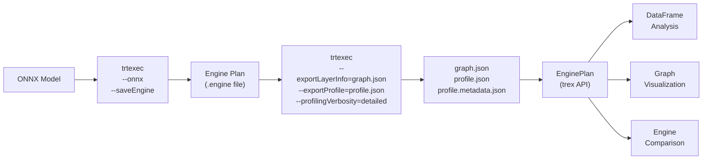
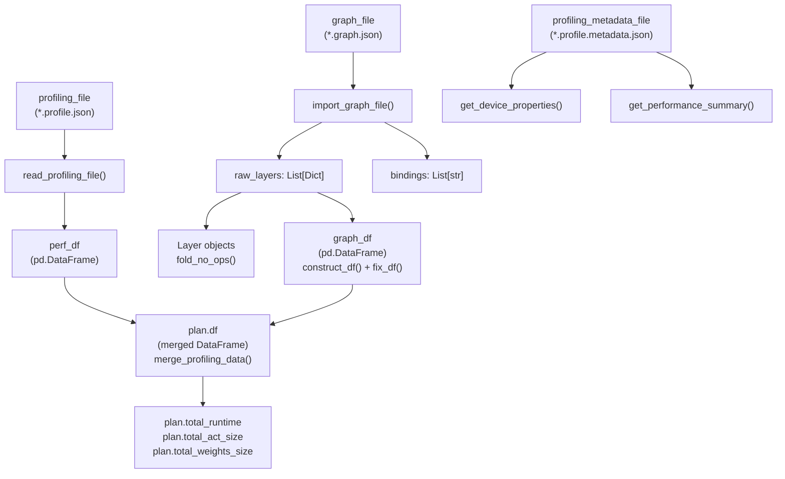
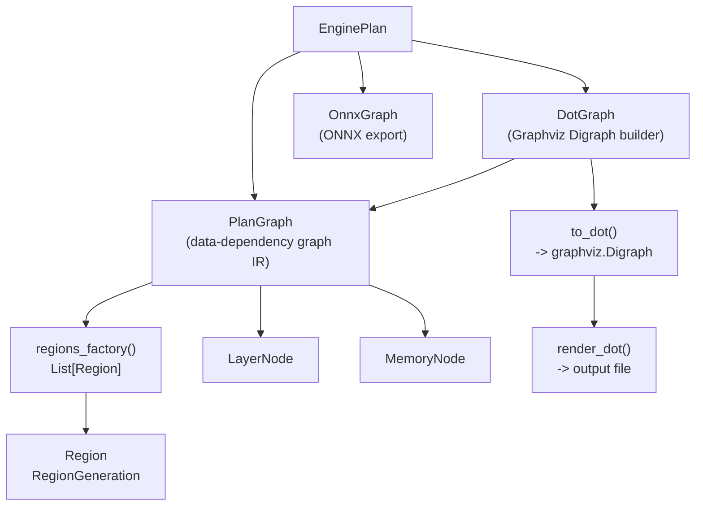
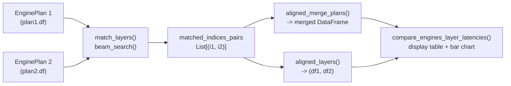
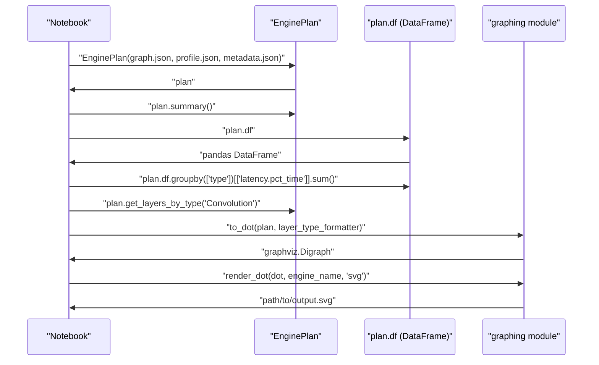

<!-- source: DeepWiki mcp.deepwiki.com · repo NVIDIA/TensorRT · page 8.1 TRT Engine Explorer · fetched 2026-10-26 -->

# TRT Engine Explorer

<details>
<summary>Relevant source files</summary>

The following files were used as context for generating this wiki page:

- [tools/experimental/trt-engine-explorer/CHANGELOG.md](tools/experimental/trt-engine-explorer/CHANGELOG.md)
- [tools/experimental/trt-engine-explorer/README.md](tools/experimental/trt-engine-explorer/README.md)
- [tools/experimental/trt-engine-explorer/install.sh](tools/experimental/trt-engine-explorer/install.sh)
- [tools/experimental/trt-engine-explorer/notebooks/compare_engines.ipynb](tools/experimental/trt-engine-explorer/notebooks/compare_engines.ipynb)
- [tools/experimental/trt-engine-explorer/notebooks/engine_report_card.ipynb](tools/experimental/trt-engine-explorer/notebooks/engine_report_card.ipynb)
- [tools/experimental/trt-engine-explorer/notebooks/tutorial.ipynb](tools/experimental/trt-engine-explorer/notebooks/tutorial.ipynb)
- [tools/experimental/trt-engine-explorer/requirements.txt](tools/experimental/trt-engine-explorer/requirements.txt)
- [tools/experimental/trt-engine-explorer/setup.py](tools/experimental/trt-engine-explorer/setup.py)
- [tools/experimental/trt-engine-explorer/trex/__init__.py](tools/experimental/trt-engine-explorer/trex/__init__.py)
- [tools/experimental/trt-engine-explorer/trex/activations.py](tools/experimental/trt-engine-explorer/trex/activations.py)
- [tools/experimental/trt-engine-explorer/trex/compare_engines.py](tools/experimental/trt-engine-explorer/trex/compare_engines.py)
- [tools/experimental/trt-engine-explorer/trex/engine_plan.py](tools/experimental/trt-engine-explorer/trex/engine_plan.py)
- [tools/experimental/trt-engine-explorer/trex/graphing.py](tools/experimental/trt-engine-explorer/trex/graphing.py)
- [tools/experimental/trt-engine-explorer/trex/parser.py](tools/experimental/trt-engine-explorer/trex/parser.py)

</details>


This page documents the `trex` Python package (`tools/experimental/trt-engine-explorer/`), which provides an API and Jupyter notebook environment for loading, inspecting, and comparing serialized TensorRT engine plans. It operates on JSON files exported by `trtexec` and **does not require a GPU** to run. For information about generating engine plans, see the `trtexec` tool documentation (see [8](#8)). For information about engine building and the inference runtime, see [3.3](#3.3).

---

## Overview

A TensorRT engine plan is a serialized binary that encodes the final optimized inference graph for a specific GPU and software version. `trex` loads the JSON representations of that graph and its per-layer profiling data, exposes them as a Pandas `DataFrame`, and provides APIs for:

- Summarizing latency, memory footprint, and layer structure
- Rendering the engine graph as SVG or PNG using Graphviz
- Comparing two or more engine plans side-by-side
- Identifying potential performance issues via layer linters

> **Note:** `trex` is best suited for initial performance debugging and structural inspection. For deep profiling, NVIDIA Nsight Systems is recommended.

**Supported TensorRT versions:** 8.2 and later (8.x, 9.x, 10.x)

---

## Workflow

The standard `trex` workflow proceeds in four steps:

**Typical trex workflow**


The utility script [tools/experimental/trt-engine-explorer/utils/process_engine.py]() automates steps 2–4 for ONNX models by invoking `trtexec` internally.

Sources: [tools/experimental/trt-engine-explorer/README.md:73-91]()

---

## Installation

```bash
cd TensorRT/tools/experimental/trt-engine-explorer

# Create a virtual environment
python3 -m virtualenv env_trex
source env_trex/bin/activate

# Install core packages only
python3 -m pip install -e .

# Install core + Jupyter notebook packages
python3 -m pip install -e .[notebook]

# Install Graphviz (required for graph rendering)
sudo apt --yes install graphviz
```

The `install.sh` script wraps this process with `--core` / `--full` / `--venv` flags.

| Install mode | Command | Includes |
|---|---|---|
| Core | `pip install -e .` | `pandas`, `graphviz`, `networkx`, `onnx`, `numpy`, etc. |
| Full/Notebook | `pip install -e .[notebook]` | Core + Jupyter, ipywidgets, plotly |

The `tensorrt` Python package is optional at install time but is required by `trex process` (the CLI engine-processing subcommand).

Sources: [tools/experimental/trt-engine-explorer/README.md:35-71](), [tools/experimental/trt-engine-explorer/setup.py:30-55](), [tools/experimental/trt-engine-explorer/requirements.txt:1-16](), [tools/experimental/trt-engine-explorer/install.sh:60-76]()

---

## Package Structure

**trex package module map**
```mermaid
graph TD
    init["trex/__init__.py\n(public API)"]
    ep["trex/engine_plan.py\nEnginePlan, summary_dict,\nprint_summary"]
    parser["trex/parser.py\nimport_graph_file,\nread_profiling_file,\nread_graph_file,\nget_device_properties,\nget_performance_summary"]
    act["trex/activations.py\nActivation,\ncreate_activations"]
    layer["trex/layer.py\nLayer, fold_no_ops"]
    dfp["trex/df_preprocessing.py\nfix_df, filter_by_layer,\nclean_for_display"]
    graph["trex/graphing.py\nPlanGraph, DotGraph,\nOnnxGraph, to_dot,\nrender_dot"]
    ce["trex/compare_engines.py\ncompare_engines_overview,\ncompare_engines_layer_latencies,\nmatch_layers"]
    lint["trex/lint.py\nlayer linters"]
    colors["trex/colors.py\nprecision_colormap,\nlayer_colormap"]
    rc["trex/report_card.py\nreport_card_*"]
    nb["trex/notebook.py\ndisplay_df, set_wide_display"]
    misc["trex/misc.py\ngroup_count,\ngroup_sum_attr"]

    init --> ep
    init --> parser
    init --> act
    init --> dfp
    init --> lint
    init --> colors
    ep --> parser
    ep --> layer
    ep --> dfp
    ep --> act
    graph --> ep
    graph --> act
    graph --> layer
    graph --> colors
    ce --> ep
    ce --> act
    ce --> misc
    ce --> colors
```

Sources: [tools/experimental/trt-engine-explorer/trex/__init__.py:1-26](), [tools/experimental/trt-engine-explorer/trex/engine_plan.py:1-30](), [tools/experimental/trt-engine-explorer/trex/graphing.py:22-44](), [tools/experimental/trt-engine-explorer/trex/compare_engines.py:22-38]()

---

## JSON Input Files

`trex` requires that TensorRT engine plans be exported to JSON using `trtexec` with these flags:

| Flag | File produced | Purpose |
|---|---|---|
| `--exportLayerInfo=<path>.graph.json` | graph JSON | Layer structure, types, inputs/outputs |
| `--exportProfile=<path>.profile.json` | profiling JSON | Per-layer latency measurements |
| `--profilingVerbosity=detailed` | (modifier) | Required for layer detail in graph JSON |
| `--exportTimes=<path>.timing.json` | timing JSON | End-to-end latency distribution |

The parser module reads these files:

| Function | File read | Returns |
|---|---|---|
| `read_graph_file()` | `*.graph.json` | `(layers: List, bindings: List)` |
| `read_profiling_file()` | `*.profile.json` | `List[Dict]` of per-layer timing records |
| `read_metadata_file()` | `*.profile.metadata.json` | Device and performance summary dicts |
| `read_timing_file()` | `*.timing.json` | `List[float]` of end-to-end latencies |

`import_graph_file()` wraps `read_graph_file()` and applies several normalizations: Unicode sanitization, deconvolution detection, profile ID filtering, and layer name disambiguation.

Sources: [tools/experimental/trt-engine-explorer/trex/parser.py:28-82](), [tools/experimental/trt-engine-explorer/trex/parser.py:108-223]()

---

## `EnginePlan` Class

`EnginePlan` is the central object in `trex`. It is defined in [tools/experimental/trt-engine-explorer/trex/engine_plan.py]().

### Constructor

```
EnginePlan(
    graph_file,
    profiling_file=None,
    profiling_metadata_file=None,
    build_metadata_file=None,
    name=None,
    profile_id=None
)
```

| Parameter | Type | Description |
|---|---|---|
| `graph_file` | `str` or `list` | Path to `*.graph.json`, or raw layer list |
| `profiling_file` | `str` | Path to `*.profile.json` |
| `profiling_metadata_file` | `str` | Path to `*.profile.metadata.json` |
| `build_metadata_file` | `str` | Path to build metadata JSON |
| `name` | `str` | Optional display name; defaults to filename |
| `profile_id` | `int` | Shape-profile index for multi-profile engines |

### Key Attributes and Properties

| Attribute | Type | Description |
|---|---|---|
| `df` | `pd.DataFrame` | Primary data structure; one row per non-constant layer |
| `layers` | `List[Layer]` | Layer objects (excludes `Constant` and `NoOp`) |
| `all_layers` | `List[Layer]` | All layers including constants |
| `constants` | `List[Layer]` | Constant layers only |
| `bindings` | `List[str]` | Names of network input/output tensors |
| `total_runtime` | `float` | Sum of all layer average latencies (ms) |
| `total_act_size` | `int` | Total activation memory (bytes) |
| `total_weights_size` | `int` | Total weights memory (bytes) |
| `device_properties` | `Dict` | GPU device info from metadata |
| `performance_summary` | `Dict` | trtexec throughput/latency summary |
| `builder_cfg` | `Dict` | Build options from metadata |

### DataFrame Columns

After construction, `plan.df` contains columns from the graph JSON plus several computed columns:

| Column | Source | Description |
|---|---|---|
| `Name` | graph JSON | Layer name |
| `type` | graph JSON | Layer type (e.g., `Convolution`, `Reformat`) |
| `Inputs` / `Outputs` | graph JSON | Tensor descriptors |
| `tactic` | graph JSON | Selected kernel tactic ID |
| `latency.avg_time` | profiling JSON | Average per-layer time (ms) |
| `latency.median_time` | profiling JSON | Median per-layer time (ms) |
| `latency.pct_time` | profiling JSON | Fraction of total engine time |
| `latency.time` | profiling JSON | Summed time across iterations |
| `total_io_size_bytes` | computed | Sum of input + output tensor sizes |
| `weights_size` | computed | Layer weight data size |
| `total_footprint_bytes` | computed | `total_io_size_bytes + weights_size` |
| `precision` | computed | Dominant precision of the layer |

### Key Methods

| Method | Description |
|---|---|
| `summary()` | Prints a human-readable summary of the plan |
| `get_layers_by_type(layer_type)` | Returns a filtered DataFrame for one layer type |
| `find(layer_name)` | Returns the `Layer` object with that name, or `None` |
| `get_bindings()` | Returns `(inputs: List[Activation], outputs: List[Activation])` |

**EnginePlan construction data flow**


Sources: [tools/experimental/trt-engine-explorer/trex/engine_plan.py:33-202]()

---

## `Activation` Class

`Activation` ([tools/experimental/trt-engine-explorer/trex/activations.py:100-146]()) wraps a raw tensor descriptor dictionary from the graph JSON. It normalizes the verbose format strings (e.g., `"Thirty-two wide channel vectorized row major FP16 format"` → `"FP16 NC/32HW32"`) via `_regionFormatDict`.

| Attribute | Description |
|---|---|
| `name` | Tensor name |
| `shape` | Tensor dimensions |
| `format` | Normalized format string |
| `precision` | Precision type string (e.g., `FP16`, `INT8`, `FP4`) |
| `data_size` | Bytes per element |
| `size_bytes` | Total tensor size in bytes |

`tooltip()` returns a newline-separated `shape + format` string used in graph node hover text.

Sources: [tools/experimental/trt-engine-explorer/trex/activations.py:29-152]()

---

## Graph Visualization

The `graphing` module ([tools/experimental/trt-engine-explorer/trex/graphing.py]()) converts an `EnginePlan` to Graphviz DOT format and renders it to SVG, PNG, or DOT files.

### Graph Rendering Classes

**graphing module class and function relationships**


#### `PlanGraph`

`PlanGraph` ([tools/experimental/trt-engine-explorer/trex/graphing.py:243-390]()) models the data-dependency graph of an engine plan. It contains:

- `layer_nodes`: `List[LayerNode]` — one node per execution layer
- `memory_nodes`: `List[MemoryNode]` — activation buffers and graph bindings
- `edges_list`: `List[Edge]` — data flow edges connecting layers via memory regions

Constructor parameters control which nodes are included:

| Parameter | Default | Effect |
|---|---|---|
| `include_regions` | `False` | Show intermediate activation buffer nodes |
| `include_constants` | `False` | Show constant weight layers |
| `include_forking_regions` | `False` | Show buffers written or read by multiple layers |

`Region` and `RegionGeneration` model memory buffer lifetimes. A region with multiple generations (i.e., the same buffer is written more than once) is unrolled into separate nodes to avoid cycles in the graph.

#### `DotGraph`

`DotGraph` ([tools/experimental/trt-engine-explorer/trex/graphing.py:669-834]()) builds a `graphviz.Digraph` from a `PlanGraph`. Key constructor options:

| Parameter | Default | Description |
|---|---|---|
| `layer_node_formatter` | required | Sets node fill color; use `layer_type_formatter` or `layer_precision_formatter` |
| `layer_node_renderer` | `layer_node_configurable_renderer` | Sets node label content |
| `display_latency` | `True` | Include per-layer latency in node labels |
| `latency_type` | `'avg_time'` | One of `avg_time`, `median_time`, `time` |
| `expand_layer_details` | `False` | Show fused operations for convolutions and pointwise layers |
| `display_metadata` | `True` | Show ONNX layer metadata (added in TRT 10.0) |
| `highlight_layers` | `None` | List of layer names to outline in red |
| `remove_disconnected_layers` | `False` | Omit layers with no inputs and no outputs |

#### Node Formatters and Renderers

| Name | Type | Description |
|---|---|---|
| `layer_type_formatter` | formatter | Colors nodes by layer type via `layer_colormap` |
| `layer_precision_formatter` | formatter | Colors nodes by layer precision via `precision_colormap` |
| `layer_node_renderer_simple` | renderer | Minimal: `name + type` |
| `layer_node_renderer_keras` | renderer | Keras-style with IO shape details |
| `layer_node_configurable_renderer` | renderer | HTML table with type, latency, name, metadata, fused ops |

#### `to_dot()` and `render_dot()`

```python
# Create a graphviz.Digraph
dot = to_dot(plan, graphing.layer_type_formatter)

# Render to SVG file
svg_path = render_dot(dot, engine_name, 'svg')

# Render to PNG file
png_path = render_dot(dot, engine_name, 'png')
```

`render_dot()` calls `dot_graph.render()` and prints the absolute path of the created file. Supported `output_format` values: `svg`, `png`, `dot`.

#### `OnnxGraph`

`OnnxGraph` exports the engine plan graph to ONNX format for viewing in Netron. It is constructed with `(plan, display_forking_regions)`.

Sources: [tools/experimental/trt-engine-explorer/trex/graphing.py:243-391](), [tools/experimental/trt-engine-explorer/trex/graphing.py:395-834]()

---

## Engine Comparison

The `compare_engines` module ([tools/experimental/trt-engine-explorer/trex/compare_engines.py]()) provides functions for side-by-side analysis of two or more `EnginePlan` instances.

### Key Functions

| Function | Description |
|---|---|
| `compare_engines_overview(plans)` | Dropdown widget showing stacked latency bars, precision counts, throughput, and layer-type latency comparisons across N plans |
| `compare_engines_summaries_tbl(plans, orientation)` | Tabular side-by-side summary of all plan metadata and performance stats |
| `compare_engines_layer_latencies(plan1, plan2, threshold, exact_matching)` | Aligns layers from two plans and displays a table + bar chart of per-layer latency differences with color highlighting |
| `compare_engines_layer_details(plan1, plan2)` | Dropdown to inspect individual aligned layer pairs (tactic, precision, format) |

### Layer Alignment: `match_layers()`

[tools/experimental/trt-engine-explorer/trex/compare_engines.py:291-402]()

Aligns corresponding layers from two plans using a heuristic signature based on layer type and input/output tensor shapes. The algorithm:

1. Assigns each layer a `signature` dict: `{type, inputs: [shapes], outputs: [shapes]}`
2. Uses a beam search to find matching layer pairs across both plans
3. Returns a list of `(index_1, index_2)` pairs, with `None` where no match exists

The `exact_matching` flag controls whether all input/output tensors are included in the signature (`True`) or only the first input and first output (`False`).

**`compare_engines` data flow**


Sources: [tools/experimental/trt-engine-explorer/trex/compare_engines.py:48-214](), [tools/experimental/trt-engine-explorer/trex/compare_engines.py:291-619]()

---

## Jupyter Notebooks

Four notebooks are provided in [tools/experimental/trt-engine-explorer/notebooks/]():

| Notebook | Purpose |
|---|---|
| `tutorial.ipynb` | Introduction to `trex`: loading plans, exploring the DataFrame, latency charts, precision analysis, graph rendering |
| `engine_report_card.ipynb` | Single-engine deep analysis: graph rendering, plan summary, performance widget, memory footprint widget, tactic view, Excel export |
| `compare_engines.ipynb` | Side-by-side comparison of two plans: `compare_engines_overview`, `compare_engines_summaries_tbl`, `compare_engines_layer_latencies`, per-plan graph rendering |
| `q_dq_placement.ipynb` | Experiment with QDQ node placement, data types, and strongly-typed networks |

### Launching Jupyter

```bash
# Classic Jupyter Notebook
jupyter-notebook --ip=0.0.0.0 --no-browser

# JupyterLab
jupyter lab --ip=0.0.0.0 --port=8888
```

**Typical notebook usage pattern**


Sources: [tools/experimental/trt-engine-explorer/notebooks/tutorial.ipynb:1-701](), [tools/experimental/trt-engine-explorer/notebooks/engine_report_card.ipynb:1-440](), [tools/experimental/trt-engine-explorer/notebooks/compare_engines.ipynb:1-268]()

---

## CLI Tool (`trex`)

The `trex` command-line tool is registered as a console script entry point in [tools/experimental/trt-engine-explorer/setup.py:53]() pointing to `bin/trex:main`.

| Subcommand | Requires `tensorrt` package | Description |
|---|---|---|
| `trex process` | Yes | Build engine, export graph and profiling JSON |
| `trex draw` | No | Render engine graph to SVG, PNG, or DOT |
| `trex summary` | No | Print a plan summary to stdout |

`trex draw` supports options including `--output_format`, `--beam=node,radius` (subgraph centered at a node), and `--query=regex_string` (subgraph matching layer names or metadata).

Sources: [tools/experimental/trt-engine-explorer/CHANGELOG.md:1-30](), [tools/experimental/trt-engine-explorer/setup.py:53]()

---

## Layer Linters

`trex/lint.py` (imported into the public `trex` namespace via [tools/experimental/trt-engine-explorer/trex/__init__.py:21]()) provides a preview API for flagging potential performance issues. Examples of issues a linter might flag include misaligned convolution channel counts or inefficient reformat layers. This is documented as a preview feature.

---

## Caveats

- **Per-layer measurement overhead:** When `trtexec` measures individual layers, it inserts CUDA events between layers, adding overhead. The sum of average layer latencies is therefore **higher** than the whole-engine latency reported by `trtexec` without layer profiling.
- **Multi-profile engines:** Engines built with multiple optimization profiles embed layers for each profile. `EnginePlan` defaults to profile 0. Pass `profile_id=N` to the constructor to target a different profile.
- **GPU requirement:** Running `trex` analysis does not require a GPU. Generating the input JSON files with `trtexec` does.

Sources: [tools/experimental/trt-engine-explorer/README.md:23-33](), [tools/experimental/trt-engine-explorer/trex/parser.py:108-148]()