# Page: TensorRT Overview

# TensorRT Overview

<details>
<summary>Relevant source files</summary>

The following files were used as context for generating this wiki page:

- [.gitmodules](.gitmodules)
- [CHANGELOG.md](CHANGELOG.md)
- [README.md](README.md)
- [VERSION](VERSION)
- [docker/build.sh](docker/build.sh)
- [docker/launch.sh](docker/launch.sh)
- [docker/ubuntu-cross-aarch64.Dockerfile](docker/ubuntu-cross-aarch64.Dockerfile)
- [include/NvInferVersion.h](include/NvInferVersion.h)

</details>


This page describes the structure and purpose of the **NVIDIA/TensorRT Open Source Software (OSS)** repository. It covers what the repository contains, how it relates to the closed-source TensorRT GA binary release, the supported platforms, and the API migration requirements coming in TensorRT 11.0.

For installation steps and prerequisites, see [Installation and Setup](#1.1). For the build system in detail, see [Building From Source](#2).

---

## What This Repository Is

The TensorRT OSS repository is a **partial open-source complement** to the TensorRT General Availability (GA) binary release (`libnvinfer.so`). It does not contain the core inference engine. Instead, it contains:

- The **plugin library** (`libnvinfer_plugin.so`) — built-in custom layer implementations
- The **ONNX parser** (`libnvonnxparser.so`) — converts ONNX graphs to `INetworkDefinition`
- The **`trtexec` CLI** — engine building and benchmarking tool
- **C++ and Python samples** — reference implementations
- **Demo applications** — BERT, Stable Diffusion, Tacotron2
- **Developer tools** — ONNX Graph Surgeon, TRT Engine Explorer, TF Quantization Toolkit
- **Python bindings** — wraps the C++ API for Python consumers

The core TensorRT runtime (`IBuilder`, `IRuntime`, `ICudaEngine`, etc.) is **not** part of this repository. It is distributed as a closed-source binary from NVIDIA's developer portal and is a required build dependency.

Sources: [README.md:14-16]()

---

## Repository at a Glance

The following diagram maps top-level directories to their primary roles and output artifacts.

**Repository Component Map**

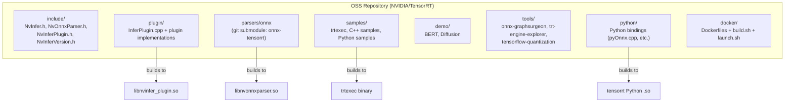

Sources: [README.md:14-16](), [.gitmodules:9-12]()

---

## Relationship to the TensorRT GA Binary

The OSS components are built **against** the GA release, not independent of it. The GA release provides `libnvinfer.so`, which contains the core builder and runtime. All OSS components link to it.

**OSS vs. GA Dependency Relationship**

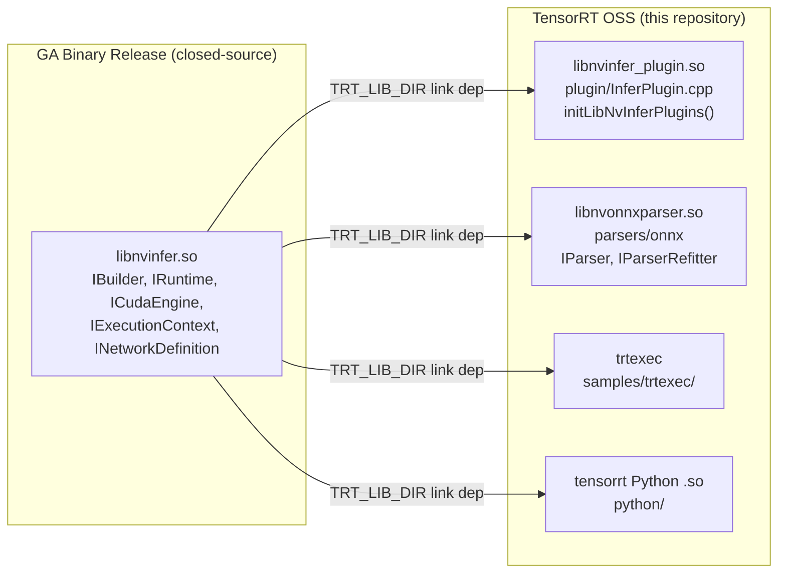

The CMake build requires `TRT_LIB_DIR` to be set to the directory containing the GA libraries. Without them, nothing in the OSS repo can be compiled.

Sources: [README.md:38-82]()

---

## Current Version

| Component | Version |
|-----------|---------|
| TensorRT OSS | `10.15.1.29` |
| `NV_TENSORRT_MAJOR` | `10` |
| `NV_TENSORRT_MINOR` | `15` |
| `NV_TENSORRT_PATCH` | `1` |
| `NV_TENSORRT_BUILD` | `29` |
| Required CUDA | `13.1` or `12.9` |
| cuDNN (optional) | `8.9` |

Version macros are defined in [include/NvInferVersion.h:26-33]().

Sources: [VERSION:1-1](), [include/NvInferVersion.h:26-33]()

---

## Supported Platforms

| Platform | Architecture | Notes |
|----------|-------------|-------|
| Ubuntu 24.04 | x86_64 | Primary Linux target |
| Ubuntu 24.04 | aarch64 | Native build |
| Rocky Linux 8 | x86_64 | RPM-based distributions |
| Jetson (JetPack) | aarch64 | Cross-compiled from x86_64 |
| DriveOS 6.5 / 7 | aarch64 (Linux) | Cross-compiled; QNX also supported |
| DriveOS 6.5 | aarch64 (QNX) | Requires QNX toolchain |
| Windows 10/11 | x86_64 | Native build via MSVC |

Build toolchain files for cross-compilation live in `cmake/toolchains/`. The relevant ones are:

| Toolchain File | Target |
|---|---|
| `cmake_aarch64-native.toolchain` | Native aarch64 Linux build |
| `cmake_aarch64_cross.toolchain` | Cross-compile for Jetson from x86_64 |
| `cmake_aarch64_dos_cross.toolchain` | Cross-compile for DriveOS Linux |
| `cmake_qnx.toolchain` | Cross-compile for QNX |
| `cmake_qnx_safe.toolchain` | Safety-certified QNX builds |

Sources: [README.md:120-310](), [docker/ubuntu-cross-aarch64.Dockerfile:1-100]()

---

## What Each OSS Component Does

### Plugin Library (`plugin/`)

Contains built-in TensorRT plugins shipped as `libnvinfer_plugin.so`. All plugins register themselves when `initLibNvInferPlugins()` is called. Plugins are grouped by application domain:

| Plugin Group | Examples |
|---|---|
| NMS / Detection | `EfficientNMS_TRT`, `BatchedNMS_TRT`, `GenerateDetection_TRT` |
| BERT / NLP | `CustomQKVToContextPluginDynamic`, `CustomEmbLayerNormDynamic`, `CustomSkipLayerNormDynamic` |
| 3D Perception | `VoxelGeneratorPlugin`, `DecodeBbox3DPlugin` |
| Normalization | `InstanceNormalization_TRT`, `GroupNormalizationPlugin` |
| Attention | `DisentangledAttention_TRT`, `MultiscaleDeformableAttnPlugin_TRT` |

For detailed plugin documentation, see [Plugin System](#4).

### ONNX Parser (`parsers/onnx`)

A git submodule pointing to `onnx/onnx-tensorrt`. Provides `IParser` and `IParserRefitter` interfaces declared in `include/NvOnnxParser.h`. Converts ONNX model graphs into `INetworkDefinition` objects consumable by `IBuilder`.

For details, see [Builder and Optimization](#3.2).

### `trtexec` (`samples/trtexec/`)

A command-line utility for building TRT engines from ONNX models and benchmarking inference throughput. It is both a tool and a reference consumer of the OSS sample infrastructure in `samples/common/`.

For shared sample infrastructure details, see [Sample Infrastructure](#5.1).

### Demo Applications (`demo/`)

| Demo | Location | Purpose |
|---|---|---|
| BERT | `demo/BERT/` | NLP inference, INT8 calibration, SQuAD eval |
| Stable Diffusion / Flux | `demo/Diffusion/` | Text-to-image / image-to-image pipelines |

See [Demo Applications](#5) for details.

### Tools (`tools/`)

| Tool | Path | Purpose |
|---|---|---|
| ONNX Graph Surgeon | `tools/onnx-graphsurgeon/` | Programmatic ONNX graph manipulation |
| TRT Engine Explorer | `tools/trt-engine-explorer/` | Engine plan visualization and analysis |
| TF Quantization Toolkit | `tools/tensorflow-quantization/` | QAT for TensorFlow 2 models |

See [ONNX Graph Surgeon](#6) and [Performance and Profiling Tools](#8) for details.

---

## Upcoming Breaking Changes in TensorRT 11.0

TensorRT 11.0 is planned for 2026 Q2. It removes several legacy APIs that have been deprecated over the TRT 10.x series. Affected code in this repository is actively being migrated.

| Removed Feature | Replacement | Tracking in OSS |
|---|---|---|
| `IPluginV2` and all subclasses | `IPluginV3` + `IPluginCreatorV3One` | Plugins progressively migrated since TRT 10.4 |
| Weakly-typed networks | Strongly Typed Networks (`IBuilderConfig`) | New samples added in TRT 10.15 |
| Implicit quantization APIs | Explicit Quantization via QDQ nodes | Parser and sample updates |
| TREX tool | Nsight Deep Learning Designer | `tools/trt-engine-explorer/` will be removed |
| Python 3.9 and older bindings | Python 3.10+ | Already enforced in TRT 10.13.2+ |

### Plugin Migration State (as of TRT 10.15)

The plugin library uses a version number per plugin. Each `IPluginV2`-derived version has been given a corresponding `IPluginV3`-derived successor:

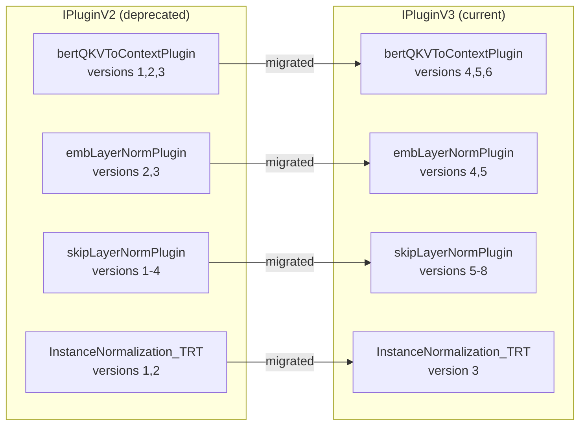

Sources: [README.md:3-12](), [CHANGELOG.md:1-120]()

---

## Model-to-Inference Flow

The following shows the full path from a training framework to a running TensorRT inference session, with code entities at each step.

**End-to-End Data Flow**

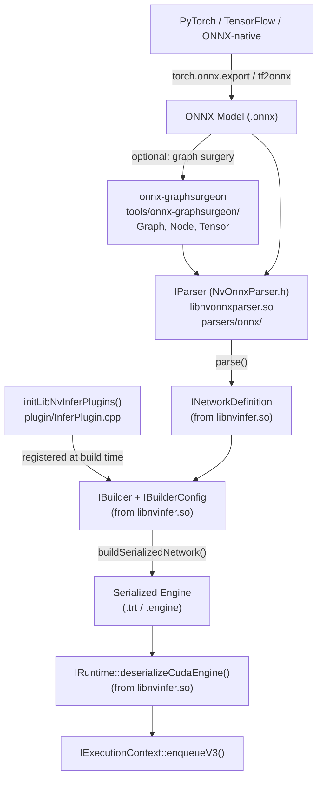

Sources: [README.md:38-82](), [CHANGELOG.md:379-410]()

---

# Page: Installation and Setup

# Installation and Setup

<details>
<summary>Relevant source files</summary>

The following files were used as context for generating this wiki page:

- [README.md](README.md)
- [VERSION](VERSION)
- [docker/build.sh](docker/build.sh)
- [docker/launch.sh](docker/launch.sh)
- [docker/ubuntu-cross-aarch64.Dockerfile](docker/ubuntu-cross-aarch64.Dockerfile)
- [include/NvInferVersion.h](include/NvInferVersion.h)

</details>


This document covers the initial installation and setup process for TensorRT Open Source Software (OSS). It describes the two available installation paths—a prebuilt Python package for quick setup and a full source build—along with prerequisites, supported platforms, and environment configuration.

For detailed information about the build process itself, see page 2. For Docker-specific build environments, see page 2.2.

## Prebuilt Python Package

For Python users who do not need to modify plugins, parsers, or samples, the TensorRT Python package is available directly from PyPI:

```bash
pip install tensorrt
```

This installs the TensorRT Python bindings without requiring a source build. If this is sufficient for your use case, the remainder of this page (covering source builds) can be skipped.

Sources: [README.md:27-36]()

## Prerequisites

TensorRT OSS requires both the TensorRT GA (General Availability) binaries and several system dependencies. The OSS components extend and build upon the GA release.

### System Requirements

The following table lists required system packages for a source build:

| Component | Required Version | Notes |
|-----------|-----------------|-------|
| TensorRT GA | 10.15.1.29 | Provides `libnvinfer.so` and headers |
| CUDA Toolkit | 13.1.0 or 12.9.0 | GPU compute framework |
| cuDNN | 8.9 | Optional; needed for some plugins |
| CMake | >= 3.31 | Build system generator |
| Python | >= 3.10, <= 3.13.x | Scripting and demo applications |
| pip | >= 19.0 | Python package management |
| GNU Make | >= 4.1 | Build execution (Linux) |
| git | any | Source control |
| pkg-config | any | Library detection |
| wget | any | Dependency fetching |

> **Note:** `onnx-tensorrt`, `cub`, and `protobuf` are downloaded automatically as part of the build process and do not need to be pre-installed.

### Optional Packages

| Package | Purpose |
|---------|---------|
| Docker >= 19.03 + NVIDIA Container Toolkit | Containerized build environment |
| `onnx`, `onnxruntime` | Demo applications and tests |
| `tensorflow-gpu` >= 2.5.1 | TF quantization toolkit demos |
| `pycuda` < 2021.1 | Python CUDA interop |
| `Pillow` >= 9.0.1 | Image I/O in samples |
| `numpy`, `pytest` | Testing |
| `clang-format`, `git-clang-format` | Code formatting (contributors only) |

### Dependency Relationships

**Diagram: Source build dependency graph**

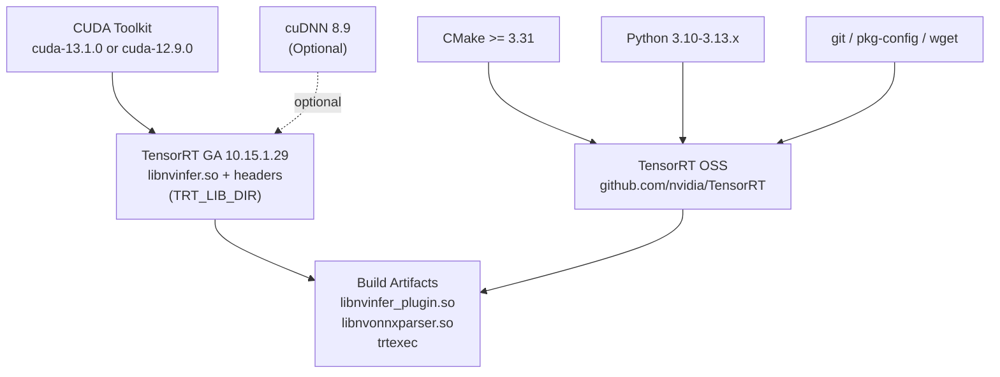

Sources: [README.md:40-82]()

## TensorRT GA Download

TensorRT OSS requires the corresponding TensorRT GA binaries at build time. The `TRT_LIB_DIR` CMake variable must point to the extracted library directory. The current supported version is `10.15.1.29`, as defined in [include/NvInferVersion.h:26-33]() and [VERSION:1]().

> If you are using the TensorRT OSS build container, TensorRT libraries are pre-installed under `/usr/lib/x86_64-linux-gnu` and this download step can be skipped.

### Platform-Specific Downloads

Download the appropriate TensorRT GA package from the [NVIDIA Developer Zone](https://developer.nvidia.com):

| Platform | CUDA Version | Archive Filename |
|----------|-------------|-----------------|
| Linux x86_64 | 13.1 | `TensorRT-10.15.1.29.Linux.x86_64-gnu.cuda-13.1.tar.gz` |
| Linux x86_64 | 12.9 | `TensorRT-10.15.1.29.Linux.x86_64-gnu.cuda-12.9.tar.gz` |
| Windows x86_64 | 13.1 | `TensorRT-10.15.1.29.Windows.win10.cuda-13.1.zip` |
| Windows x86_64 | 12.9 | `TensorRT-10.15.1.29.Windows.win10.cuda-12.9.zip` |

> For aarch64 targets (Jetson, DriveOS), the cross-compile Docker containers download and install the appropriate aarch64 TensorRT libraries automatically. See [docker/ubuntu-cross-aarch64.Dockerfile:87-89]().

### Environment Variable Setup

After extracting the TensorRT GA package, set `TRT_LIBPATH` to the `lib/` subdirectory:

**Linux (Ubuntu 22.04, x86-64, CUDA 13.1):**
```bash
cd ~/Downloads
tar -xvzf TensorRT-10.15.1.29.Linux.x86_64-gnu.cuda-13.1.tar.gz
export TRT_LIBPATH=`pwd`/TensorRT-10.15.1.29/lib
```

**Windows (x86-64, CUDA 12.9):**
```powershell
Expand-Archive -Path TensorRT-10.15.1.29.Windows.win10.cuda-12.9.zip
$env:TRT_LIBPATH="$pwd\TensorRT-10.15.1.29\lib"
```

`TRT_LIBPATH` is passed directly to CMake as `-DTRT_LIB_DIR=$TRT_LIBPATH`.

Sources: [README.md:84-118](), [include/NvInferVersion.h:26-33](), [VERSION:1]()

## Repository Setup

### Cloning TensorRT OSS

Clone the repository with all required submodules. The submodules include `onnx-tensorrt`, `cub`, and `protobuf`:

```bash
git clone -b main https://github.com/nvidia/TensorRT TensorRT
cd TensorRT
git submodule update --init --recursive
```

### Repository Structure

**Diagram: Repository directory layout and key files**

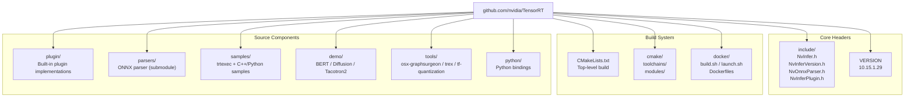

Sources: [README.md:86-92](), [VERSION:1]()

## Environment Configuration

### CMake Variables

The build system requires two variables and accepts several optional ones:

| Variable | Required | Default | Description |
|----------|----------|---------|-------------|
| `TRT_LIB_DIR` | Yes | — | Path to TensorRT GA `lib/` directory |
| `TRT_OUT_DIR` | Yes | — | Output directory for build artifacts |
| `CUDA_VERSION` | No | `13.1` | CUDA version to target (e.g. `12.9`) |
| `CUDNN_VERSION` | No | — | cuDNN version (e.g. `8.9`) |
| `GPU_ARCHS` | No | all major SMs | Space-separated SM architectures (e.g. `"80 120"`) |
| `CMAKE_TOOLCHAIN_FILE` | No | — | Toolchain file for cross-compilation |
| `BUILD_PLUGINS` | No | `ON` | Build `libnvinfer_plugin.so` |
| `BUILD_PARSERS` | No | `ON` | Build `libnvonnxparser.so` |
| `BUILD_SAMPLES` | No | `ON` | Build sample binaries |
| `CMAKE_BUILD_TYPE` | No | `Release` | `Release` or `Debug` |
| `TRT_PLATFORM_ID` | No | `x86_64` | Target platform for bare-metal builds |

### Version Macros

The version of TensorRT in use is defined in `NvInferVersion.h`. The build system reads these macros to set library versioning:

**Diagram: Version macro definitions in NvInferVersion.h**

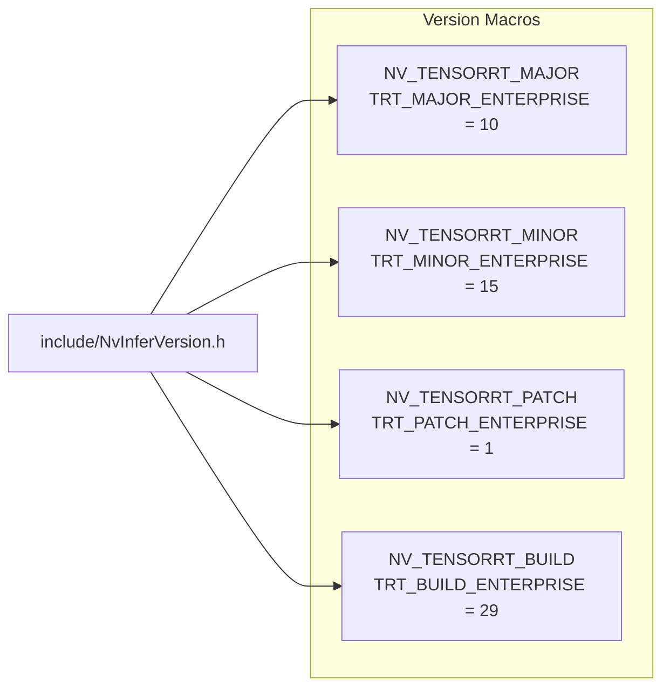

Sources: [include/NvInferVersion.h:26-33](), [README.md:225-241]()

## Supported Platforms and Architectures

TensorRT OSS supports both native and cross-compiled builds across multiple platforms:

| Platform | Architecture | Build Type | Toolchain |
|----------|-------------|-----------|-----------|
| Linux (Ubuntu 24.04) | x86_64 | Native | Host GCC |
| Linux (Ubuntu 24.04) | aarch64 | Native | `cmake_aarch64-native.toolchain` |
| Linux (Ubuntu 24.04) | aarch64 (Jetson) | Cross-compile | `cmake_aarch64_cross.toolchain` |
| DriveOS Linux | aarch64 | Cross-compile | `cmake_aarch64_dos_cross.toolchain` |
| DriveOS QNX | aarch64 | Cross-compile | `cmake_qnx.toolchain` / `cmake_qnx_safe.toolchain` |
| Windows 10/11 | x86_64 | Native | MSVC (`msbuild`) |
| Rocky Linux 8 | x86_64 | Native | Host GCC |

Toolchain files live under `cmake/toolchains/`.

## Build Environment Setup

### Docker Environment (Recommended)

For Linux platforms, Docker provides a consistent build environment. The [docker/build.sh]() script wraps `docker build` with arguments for the Dockerfile, image tag, and CUDA version.

**Available Dockerfiles:**

| Dockerfile | Target |
|-----------|--------|
| `docker/ubuntu-24.04.Dockerfile` | x86_64 native (default) |
| `docker/ubuntu-24.04-aarch64.Dockerfile` | aarch64 native |
| `docker/ubuntu-cross-aarch64.Dockerfile` | Cross-compile for Jetson (aarch64) |
| `docker/rockylinux8.Dockerfile` | Rocky Linux 8 x86_64 |

#### Building Docker Containers

```bash
# Ubuntu 24.04 with CUDA 13.1 (default)
./docker/build.sh --file docker/ubuntu-24.04.Dockerfile --tag tensorrt-ubuntu24.04-cuda13.1

# Rocky Linux 8 with CUDA 13.1
./docker/build.sh --file docker/rockylinux8.Dockerfile --tag tensorrt-rockylinux8-cuda13.1

# Cross-compile for Jetson (aarch64) with CUDA 13.1
./docker/build.sh --file docker/ubuntu-cross-aarch64.Dockerfile --tag tensorrt-jetpack-cuda13.1

# Native aarch64 build
./docker/build.sh --file docker/ubuntu-24.04-aarch64.Dockerfile --tag tensorrt-aarch64-ubuntu24.04-cuda13.1
```

#### Launching Build Container

```bash
./docker/launch.sh --tag tensorrt-ubuntu24.04-cuda13.1 --gpus all
```

The `docker/launch.sh` script mounts the current directory into `/workspace/TensorRT` inside the container. Pass `--jupyter <port>` to start a Jupyter notebook server instead of a shell.

Inside the container:
- TensorRT libraries are pre-installed under `/usr/lib/x86_64-linux-gnu`
- `TRT_LIBPATH` and `TRT_OSSPATH` environment variables are set
- Cross-compilation toolchains are available for aarch64 builds (see [docker/ubuntu-cross-aarch64.Dockerfile:39-54]())

**Diagram: docker/build.sh and docker/launch.sh arguments**

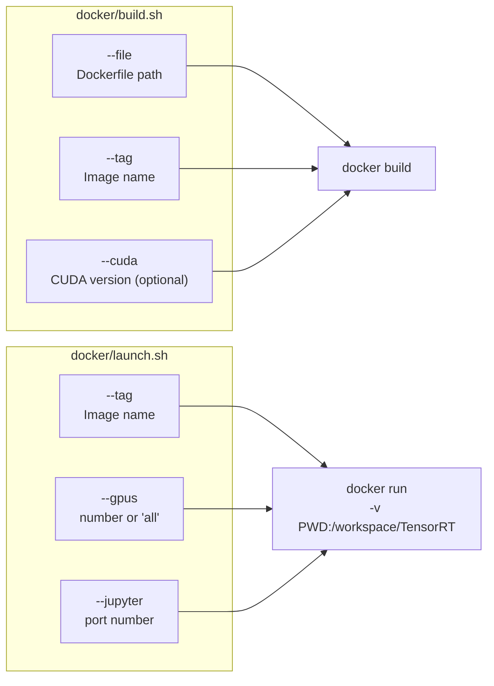

### Native Environment

For native builds without Docker, install all [prerequisite](#prerequisites) system packages, set `TRT_LIBPATH` to the extracted TensorRT GA `lib/` directory, and proceed to the CMake build step described in page 2.

Sources: [README.md:120-161](), [docker/build.sh:19-50](), [docker/launch.sh:19-58](), [docker/ubuntu-cross-aarch64.Dockerfile:24-100]()

## Build Environment Verification

### Directory Structure Check

Verify your setup by checking the expected directory structure:

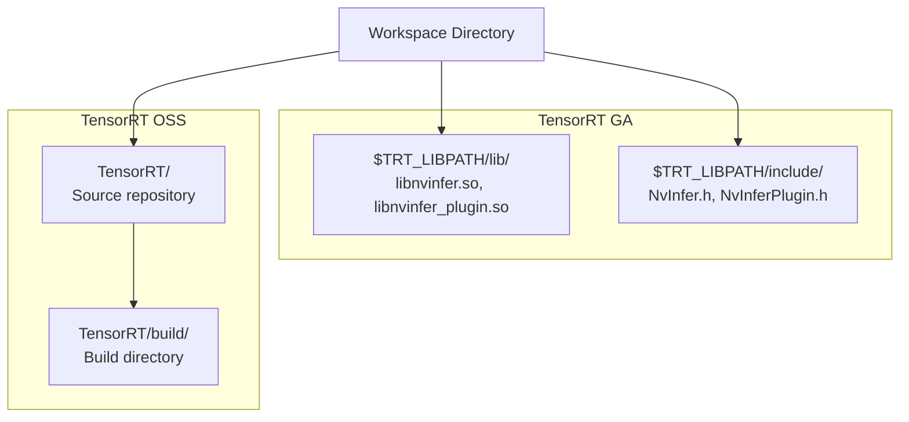

### Environment Variable Validation

Confirm the required environment variables are set:

```bash
echo "TRT_LIBPATH: $TRT_LIBPATH"
echo "TRT_OSSPATH: $TRT_OSSPATH"  # Set automatically in Docker containers
```

### Quick Build Test

Perform a basic CMake configuration to verify setup:

```bash
cd TensorRT
mkdir -p build && cd build
cmake .. -DTRT_LIB_DIR=$TRT_LIBPATH -DTRT_OUT_DIR=`pwd`/out
```

This command should complete without errors, indicating that:
- TensorRT GA libraries are found
- All dependencies are available
- Build configuration is valid

**Sources:** [README.md:153-162](), [CMakeLists.txt:23-24]()

---

# Page: Building From Source

# Building From Source

<details>
<summary>Relevant source files</summary>

The following files were used as context for generating this wiki page:

- [CMakeLists.txt](CMakeLists.txt)
- [README.md](README.md)
- [VERSION](VERSION)
- [cmake/toolchains/cmake_qnx_safe.toolchain](cmake/toolchains/cmake_qnx_safe.toolchain)
- [docker/build.sh](docker/build.sh)
- [docker/launch.sh](docker/launch.sh)
- [docker/ubuntu-cross-aarch64.Dockerfile](docker/ubuntu-cross-aarch64.Dockerfile)
- [include/NvInferVersion.h](include/NvInferVersion.h)
- [samples/common/sampleEngines.cpp](samples/common/sampleEngines.cpp)
- [samples/common/sampleInference.cpp](samples/common/sampleInference.cpp)
- [samples/common/sampleInference.h](samples/common/sampleInference.h)
- [samples/common/sampleOptions.cpp](samples/common/sampleOptions.cpp)
- [samples/common/sampleOptions.h](samples/common/sampleOptions.h)
- [samples/common/sampleReporting.cpp](samples/common/sampleReporting.cpp)
- [samples/trtexec/trtexec.cpp](samples/trtexec/trtexec.cpp)

</details>


This document provides comprehensive guidance for building TensorRT Open Source Software (OSS) components from source code. It covers the CMake-based build system, Docker containerization for reproducible builds, dependency management, and cross-compilation support for multiple platforms and architectures.

For information about the overall repository structure and components, see [TensorRT Overview](#1). For details about the plugin system that gets built as part of this process, see [Plugin System](#4).

## Build System Overview

TensorRT OSS uses a CMake-based build system that supports multiple platforms, architectures, and build configurations. The system is designed to build plugins, parsers, and sample applications while linking against the TensorRT GA (General Availability) libraries.

### Build System Architecture

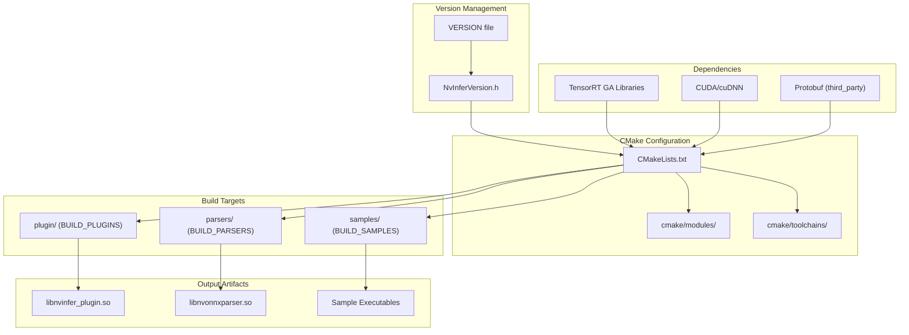

Sources: [CMakeLists.txt:1-239](), [include/NvInferVersion.h:1-45](), [VERSION:1-2]()

## Prerequisites and Dependencies

The build system requires several categories of dependencies that must be satisfied before compilation can begin.

### Required Dependencies

| Component | Version | Purpose |
|-----------|---------|---------|
| TensorRT GA | 10.13.3.9 | Core runtime libraries |
| CUDA | 13.0.0 or 12.9.0 | GPU computation framework |
| CMake | >= 3.31 | Build system generator |
| Python | 3.10-3.13.x | Build scripting and samples |
| GCC/Clang | Compatible | C++ compilation |

### CMake Build Variables

The build system uses several key CMake variables for configuration:

| Variable | Default | Description |
|----------|---------|-------------|
| `TRT_LIB_DIR` | `CMAKE_BINARY_DIR` | Path to TensorRT GA libraries |
| `TRT_OUT_DIR` | `CMAKE_BINARY_DIR` | Output directory for build artifacts |
| `BUILD_PLUGINS` | `ON` | Build TensorRT plugin library |
| `BUILD_PARSERS` | `ON` | Build ONNX parser library |
| `BUILD_SAMPLES` | `ON` | Build sample applications |
| `GPU_ARCHS` | Auto-detected | Target GPU architectures |

Sources: [README.md:29-72](), [CMakeLists.txt:205-219]()

## Docker Build Environments

TensorRT OSS provides Docker-based build environments for reproducible cross-platform builds. The Docker system supports multiple Linux distributions and cross-compilation targets.

### Docker Build System Architecture

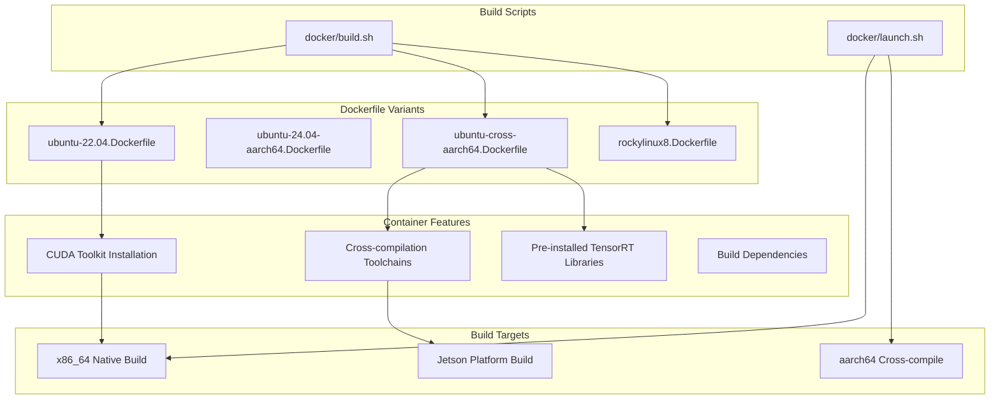

### Container Build Process

The Docker build system uses two main scripts:

1. **`docker/build.sh`** - Builds Docker images with specified configurations
2. **`docker/launch.sh`** - Launches containers with proper GPU access and volume mounts

Example container generation:
```bash
./docker/build.sh --file docker/ubuntu-22.04.Dockerfile --tag tensorrt-ubuntu22.04-cuda13.0
./docker/launch.sh --tag tensorrt-ubuntu22.04-cuda13.0 --gpus all
```

Sources: [docker/build.sh:1-51](), [docker/launch.sh:1-59](), [docker/ubuntu-cross-aarch64.Dockerfile:1-101]()

## CMake Configuration and Build Options

The root `CMakeLists.txt` implements a sophisticated build configuration system that handles version management, dependency resolution, and target architecture selection.

### Version Management System

The build system extracts version information from header files and integrates it into CMake variables:

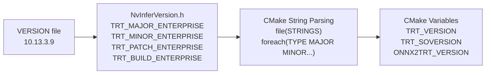

The version extraction is implemented in [CMakeLists.txt:51-61]():
- Reads `#define TRT_.*_ENTERPRISE` patterns from `NvInferVersion.h`
- Extracts numeric values using regex matching
- Sets `TRT_VERSION` and `TRT_SOVERSION` variables

### GPU Architecture Selection

The build system supports flexible GPU architecture targeting through the `GPU_ARCHS` variable:

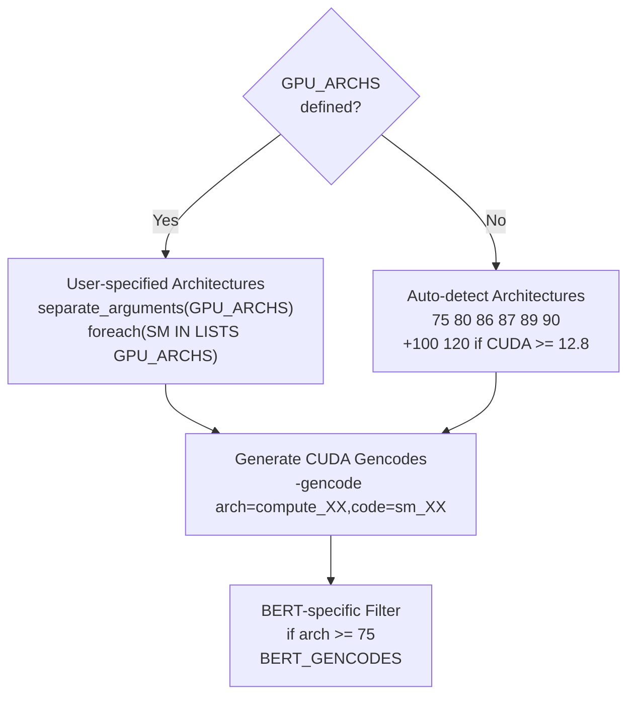

Sources: [CMakeLists.txt:71-100]()

## Build Process

### Standard Build Workflow

The typical build process follows these steps:

1. **Environment Setup**
```bash
export TRT_LIBPATH=/path/to/tensorrt/lib
cd TensorRT
mkdir -p build && cd build
```

2. **CMake Configuration**
```bash
cmake .. -DTRT_LIB_DIR=$TRT_LIBPATH -DTRT_OUT_DIR=`pwd`/out
```

3. **Compilation**
```bash
make -j$(nproc)
```

### Build Targets and Dependencies

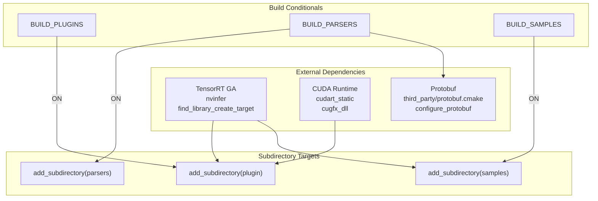

Sources: [CMakeLists.txt:224-238](), [CMakeLists.txt:159-178]()

## Cross-Compilation Support

### Jetson and aarch64 Builds

The build system supports cross-compilation for ARM-based platforms through CMake toolchain files:

| Platform | Toolchain File | Build Command |
|----------|---------------|---------------|
| aarch64 native | `cmake_aarch64-native.toolchain` | Standard cmake with toolchain |
| aarch64 cross-compile | `cmake_aarch64_cross.toolchain` | Cross-compilation from x86_64 |
| Jetson Thor | Native build | `TRT_PLATFORM_ID=aarch64 GPU_ARCHS=110` |

### Cross-compilation Docker Environment

The `ubuntu-cross-aarch64.Dockerfile` provides a complete cross-compilation environment:

- **Base Image**: `nvidia/cuda:13.0.0-devel-ubuntu24.04`
- **Cross-compile Toolchain**: `g++-aarch64-linux-gnu`
- **CUDA Cross Tools**: `cuda-cross-sbsa-13-0`
- **Pre-installed TensorRT**: aarch64 libraries in `/usr/lib/aarch64-linux-gnu`

Example cross-compilation build:
```bash
cmake .. -DTRT_LIB_DIR=$TRT_LIBPATH \
         -DCMAKE_TOOLCHAIN_FILE=$TRT_OSSPATH/cmake/toolchains/cmake_aarch64_cross.toolchain \
         -DGPU_ARCHS=110
```

Sources: [docker/ubuntu-cross-aarch64.Dockerfile:78-100](), [README.md:184-191]()

## Build System Integration

### Library Name Resolution

The build system handles platform-specific library naming conventions through conditional logic:

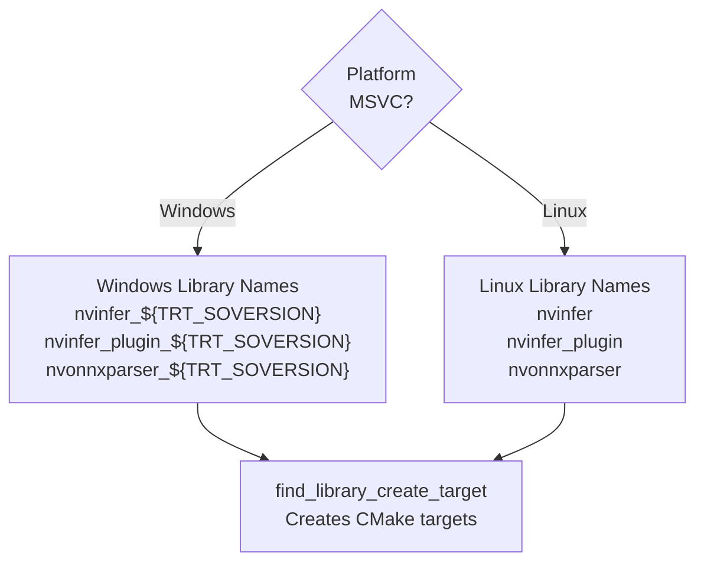

The `find_library_create_target` function from [cmake/modules/find_library_create_target.cmake]() creates CMake targets for TensorRT libraries, searching in `TRT_LIB_DIR` and system paths.

Sources: [CMakeLists.txt:180-198](), [CMakeLists.txt:22-33]()

---

# Page: Build System Architecture

# Build System Architecture

<details>
<summary>Relevant source files</summary>

The following files were used as context for generating this wiki page:

- [.gitignore](.gitignore)
- [CMakeLists.txt](CMakeLists.txt)
- [README.md](README.md)
- [VERSION](VERSION)
- [cmake/toolchains/cmake_qnx_safe.toolchain](cmake/toolchains/cmake_qnx_safe.toolchain)
- [docker/build.sh](docker/build.sh)
- [docker/launch.sh](docker/launch.sh)
- [docker/ubuntu-cross-aarch64.Dockerfile](docker/ubuntu-cross-aarch64.Dockerfile)
- [include/NvInferVersion.h](include/NvInferVersion.h)
- [include/NvOnnxParser.h](include/NvOnnxParser.h)
- [python/CMakeLists.txt](python/CMakeLists.txt)
- [python/build.sh](python/build.sh)
- [python/docstrings/parsers/pyOnnxDoc.h](python/docstrings/parsers/pyOnnxDoc.h)
- [python/src/parsers/pyOnnx.cpp](python/src/parsers/pyOnnx.cpp)
- [samples/common/sampleEngines.cpp](samples/common/sampleEngines.cpp)
- [samples/common/sampleInference.cpp](samples/common/sampleInference.cpp)
- [samples/common/sampleInference.h](samples/common/sampleInference.h)
- [samples/common/sampleOptions.cpp](samples/common/sampleOptions.cpp)
- [samples/common/sampleOptions.h](samples/common/sampleOptions.h)
- [samples/common/sampleReporting.cpp](samples/common/sampleReporting.cpp)
- [samples/trtexec/trtexec.cpp](samples/trtexec/trtexec.cpp)

</details>


This page documents the internals of the CMake-based build system for TensorRT OSS: the structure of `CMakeLists.txt`, all recognized build variables, how the three primary build targets relate to one another, and how the separate Python bindings build works. For information about the Docker environments that wrap this build system, see [Docker Build Environments](#2.2). For the higher-level walkthrough of the build process from a user perspective, see [Building From Source](#2).

---

## Overview

The TensorRT OSS build system has two entry points:

| Entry Point | Purpose |
|---|---|
| `CMakeLists.txt` (root) | Builds the C++ libraries and samples: plugins (`libnvinfer_plugin`), parsers (`libnvonnxparser`), and sample binaries including `trtexec` |
| `python/CMakeLists.txt` + `python/build.sh` | Builds the Python `.so` bindings as a separate project, one per Python version and module variant |

The root build requires a pre-built TensorRT GA binary release (providing `libnvinfer.so`) and a CUDA toolkit installation. Everything else — Protobuf, CUB — is downloaded and built by CMake automatically.

Sources: [CMakeLists.txt:1-30](), [python/build.sh:1-75](), [README.md:38-241]()

---

## Root CMakeLists.txt Structure

**CMake module loading and output directory setup**

[CMakeLists.txt:19-43]()

The file begins by loading two custom CMake modules from `cmake/modules/`:

- `set_ifndef.cmake` — a helper that sets a variable only if it is not already defined, used throughout for default values.
- `find_library_create_target.cmake` — wraps `find_library` and creates an imported CMake target in one step.

Output paths `RUNTIME_OUTPUT_DIRECTORY`, `LIBRARY_OUTPUT_DIRECTORY`, and `ARCHIVE_OUTPUT_DIRECTORY` are all set to `TRT_OUT_DIR`.

**Version extraction**

[CMakeLists.txt:51-61]()

The project version is not hard-coded in CMakeLists.txt. Instead, it is parsed at configure time from `include/NvInferVersion.h` using CMake's `file(STRINGS ...)` and regex matching against the `TRT_*_ENTERPRISE` macros. This ensures the version string in the build system stays synchronized with the header.

```
TRT_VERSION = TRT_MAJOR_ENTERPRISE.TRT_MINOR_ENTERPRISE.TRT_PATCH_ENTERPRISE
TRT_SOVERSION = TRT_MAJOR_ENTERPRISE
```

Sources: [CMakeLists.txt:51-61](), [include/NvInferVersion.h:26-29]()

---

## CMake Build Variables

### Required Variables

| Variable | Purpose |
|---|---|
| `TRT_LIB_DIR` | Path to the pre-built TensorRT GA library directory (containing `libnvinfer.so`). Defaults to `CMAKE_BINARY_DIR` if unset, which is typically wrong for out-of-tree builds. |
| `TRT_OUT_DIR` | Output directory where all compiled artifacts are copied. |

Sources: [CMakeLists.txt:23-33](), [README.md:225-227]()

### Optional Variables

| Variable | Default | Notes |
|---|---|---|
| `CMAKE_BUILD_TYPE` | `Release` | `Debug` adds `_debug` suffix (via `TRT_DEBUG_POSTFIX`) to library names |
| `CUDA_VERSION` | `13.1.0` | Controls CUDA feature detection and default GPU architectures |
| `CUDNN_VERSION` | `8.9` | Used when cuDNN-dependent plugins are built |
| `PROTOBUF_VERSION` | `3.20.3` | CMake downloads and builds this version; does not use system Protobuf |
| `GPU_ARCHS` | See below | Space-separated SM numbers, e.g. `"80 90 120"` |
| `CMAKE_TOOLCHAIN_FILE` | (none) | Path to a cross-compilation toolchain file |
| `TRT_PLATFORM_ID` | `x86_64` | Used for bare-metal (non-Docker) cross-compilation identification |
| `BUILD_PLUGINS` | `ON` | Build `libnvinfer_plugin` from source; if `OFF`, searches for a prebuilt copy |
| `BUILD_PARSERS` | `ON` | Build `libnvonnxparser` from source; if `OFF`, searches for a prebuilt copy |
| `BUILD_SAMPLES` | `ON` | Build sample binaries including `trtexec` |
| `BUILD_SAFE_SAMPLES` | `OFF` | Build safety-certified sample programs against `libnvinfer_safe` |
| `TRT_SAFETY_INFERENCE_ONLY` | `OFF` | Forces `BUILD_PLUGINS`, `BUILD_PARSERS`, and `BUILD_SAMPLES` all to `OFF` and enables `BUILD_SAFE_SAMPLES` |

Sources: [CMakeLists.txt:70-127](), [README.md:228-241]()

### GPU Architecture Selection

[CMakeLists.txt:74-107]()

When `GPU_ARCHS` is not set, the build system generates PTX/SASS for a default set of compute capabilities based on `CUDA_VERSION`:

| CUDA Version | Default Architectures |
|---|---|
| Any | 75, 80, 86, 87, 89, 90 |
| ≥ 12.8 | + 100, 120 |
| ≥ 13.0 | + 110 |

PTX is generated for the highest SM in the list (for forward compatibility). BERT plugin kernels have a separate gencode list (`BERT_GENCODES`) that excludes SM 110.

When `GPU_ARCHS` is set, only the specified SMs are compiled, which reduces build time and binary size.

**GPU architecture flow**

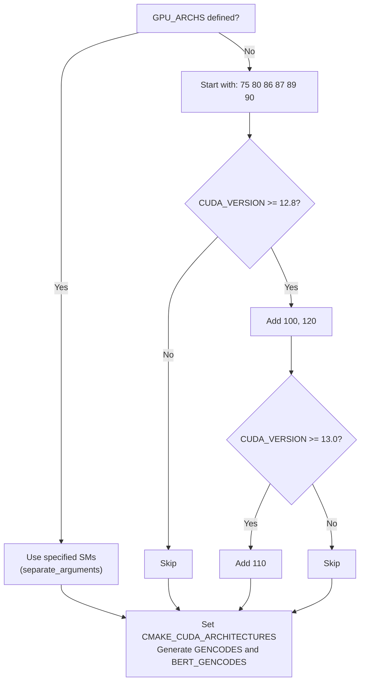

Sources: [CMakeLists.txt:74-107]()

---

## Three Main Build Targets

The following diagram maps the three `option()` flags to the subdirectories and output libraries they control.

**Build target dependency graph**

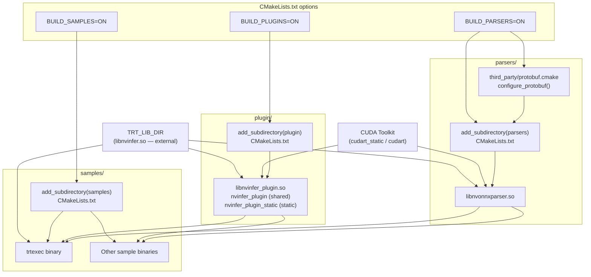

Sources: [CMakeLists.txt:291-387]()

### When BUILD_PLUGINS or BUILD_PARSERS is OFF

[CMakeLists.txt:368-378]()

When a build flag is `OFF`, the build system uses `find_library_create_target` to locate a prebuilt version of the library. The search order is:

1. `TRT_OUT_DIR` (a previously built OSS version)
2. `TRT_LIB_DIR` (the GA release directory)
3. System paths

If a `Debug` build type is active, debug-suffixed versions are preferred over release versions.

---

## External Dependencies

| Dependency | How Acquired | Controlled By |
|---|---|---|
| `libnvinfer.so` | Must be provided externally via `TRT_LIB_DIR` | `find_library_create_target(nvinfer ...)` [CMakeLists.txt:322]() |
| CUDA | `find_package(CUDA)` or cross-compile toolchain | `CUDA_VERSION` variable |
| cuDNN | Optional; searched on system | `CUDNN_VERSION` variable |
| Protobuf | Downloaded and built by `third_party/protobuf.cmake` | `PROTOBUF_VERSION` variable |
| CUB | Bundled as `third_party/cub` for CUDA < 11.0 | Auto-detected from `CUDA_VERSION` |

Sources: [CMakeLists.txt:280-298](), [CMakeLists.txt:144-151]()

### CUDA Runtime Linking

[CMakeLists.txt:327-346]()

The CUDA runtime library selection depends on the CUDA version:

- CUDA ≥ 12.0: links `cudart_static`, sets `CMAKE_CUDA_RUNTIME_LIBRARY=static`
- CUDA < 12.0: links shared `cudart`, sets `CMAKE_CUDA_RUNTIME_LIBRARY=shared`
- QNX Safe builds: `CMAKE_CUDA_RUNTIME_LIBRARY=None` (manual linking via `trt_global_definitions`)

---

## Cross-Compilation Toolchains

The `cmake/toolchains/` directory provides toolchain files for non-native builds. Each file sets `CMAKE_SYSTEM_NAME`, `CMAKE_SYSTEM_PROCESSOR`, and the cross-compiler paths.

| Toolchain File | Target |
|---|---|
| `cmake/toolchains/cmake_aarch64-native.toolchain` | Native aarch64 Linux (e.g., Jetson native build) |
| `cmake/toolchains/cmake_aarch64_cross.toolchain` | Cross-compile for aarch64 Linux (Jetson via JetPack) |
| `cmake/toolchains/cmake_aarch64_dos_cross.toolchain` | Cross-compile for DriveOS aarch64 Linux |
| `cmake/toolchains/cmake_qnx.toolchain` | Cross-compile for QNX aarch64 |
| `cmake/toolchains/cmake_qnx_safe.toolchain` | Cross-compile for QNX aarch64 Safety (Safe CUDA) |

> **Note for native aarch64 builds:** The C compiler must be specified explicitly via `CC=/usr/bin/gcc` because Protobuf's build process requires it [README.md:192-193]().

The QNX Safe toolchain [cmake/toolchains/cmake_qnx_safe.toolchain:1-140]() additionally:
- Disables `cudadevrt` linkage (`--cudadevrt=none`)
- Adds QNX-specific defines: `_QNX_SOURCE`, `IS_QNX_SAFE=1`
- Sets `CMAKE_TRY_COMPILE_TARGET_TYPE=STATIC_LIBRARY` to avoid linker issues during compiler detection

Sources: [cmake/toolchains/cmake_qnx_safe.toolchain:18-120](), [README.md:178-210]()

### Build Examples

The following commands illustrate the most common build configurations:

```bash
# Standard Linux x86_64
cmake .. -DTRT_LIB_DIR=$TRT_LIBPATH -DTRT_OUT_DIR=`pwd`/out

# Native aarch64 (Jetson)
cmake .. -DTRT_LIB_DIR=$TRT_LIBPATH -DTRT_OUT_DIR=`pwd`/out -DTRT_PLATFORM_ID=aarch64

# Cross-compile for Jetson (from x86 host)
cmake .. -DTRT_LIB_DIR=$TRT_LIBPATH -DTRT_OUT_DIR=`pwd`/out \
         -DCMAKE_TOOLCHAIN_FILE=$TRT_OSSPATH/cmake/toolchains/cmake_aarch64_cross.toolchain

# Limit to specific GPU architectures to speed up builds
cmake .. -DTRT_LIB_DIR=$TRT_LIBPATH -DTRT_OUT_DIR=`pwd`/out -DGPU_ARCHS="80 90"

# Windows
cmake .. -DTRT_LIB_DIR="$env:TRT_LIBPATH" -DTRT_OUT_DIR="$pwd\\out"
msbuild TensorRT.sln /property:Configuration=Release -m:$env:NUMBER_OF_PROCESSORS
```

Sources: [README.md:162-222]()

---

## Safety Build Mode

[CMakeLists.txt:154-252]()

Setting `BUILD_SAFE_SAMPLES=ON` or `TRT_SAFETY_INFERENCE_ONLY=ON` activates the safety inference path, which links against `libnvinfer_safe` instead of `libnvinfer`.

The build system:
1. Searches for `nvinfer_safe` and `nvinfer_safe_debug` in `TRT_LIB_DIR`
2. Creates imported targets `TRTSAFE::nvinfer_safe_shared` and `TRTSAFE::nvinfer_safe_debug`
3. Creates an interface target `trt_global_definitions` that propagates common compile flags, include directories, and link libraries to all safety samples
4. Defines `ENABLE_UNIFIED_BUILDER=1` for conditional compilation throughout the codebase

When `TRT_SAFETY_INFERENCE_ONLY=ON`, CMake forcibly sets `BUILD_PLUGINS`, `BUILD_PARSERS`, and `BUILD_SAMPLES` to `OFF`.

Sources: [CMakeLists.txt:154-252]()

---

## Python Bindings Build

The Python bindings live in `python/` and are built as a separate CMake project from the main tree. They are **not** added as a subdirectory from the root `CMakeLists.txt`.

There are two ways to build them:

### Method 1: python/build.sh

[python/build.sh:1-75]()

This script creates a single binding `.so` for one Python version at a time. It accepts configuration through environment variables:

| Environment Variable | Default | Purpose |
|---|---|---|
| `PYTHON_MAJOR_VERSION` | `3` | Python major version |
| `PYTHON_MINOR_VERSION` | `8` | Python minor version |
| `TARGET_ARCHITECTURE` | `x86_64` | Target CPU architecture |
| `CUDA_ROOT` | `/usr/local/cuda` | CUDA installation path |
| `TRT_OSSPATH` | `/workspace/TensorRT` | Root of the TensorRT OSS checkout |
| `TRT_LIBPATH` | (required) | Path to TensorRT GA libraries |
| `TENSORRT_MODULE` | (required) | Module name: `tensorrt`, `tensorrt_lean`, etc. |

The script:
1. Runs `cmake` in `python/build/`
2. Runs `make -j12` to produce `tensorrt.so`
3. Reads `TRT_MAJOR_ENTERPRISE`, `TRT_MINOR_ENTERPRISE`, etc. from `include/NvInferVersion.h` using `awk`
4. Runs `python3 setup.py bdist_wheel` to produce an installable wheel

### Method 2: python/CMakeLists.txt (new flow)

[python/CMakeLists.txt:22-253]()

A newer, more capable flow is gated behind `TRT_BUILD_ENABLE_NEW_PYTHON_FLOW=ON`. When active, it builds bindings for all configured Python versions in a single CMake invocation.

**Python binding build structure**

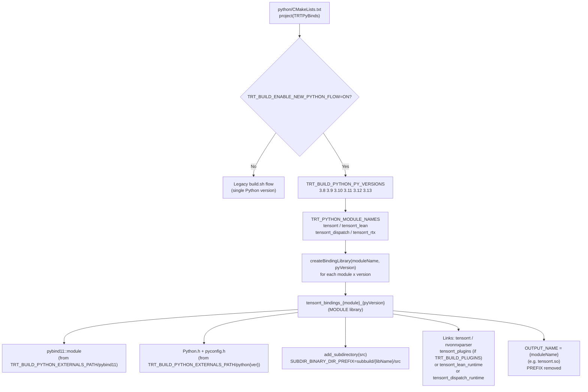

Key design details:

- `PYBIND11_NOPYTHON ON` disables pybind11's automatic Python detection, since bindings for multiple versions are built simultaneously.
- The `createBindingLibrary` function [python/CMakeLists.txt:80-210]() is called once per `(moduleName, pyVersion)` pair, producing a dedicated CMake library target per combination.
- The `tensorrt` full module links against `nvonnxparser`; the `tensorrt_lean` and `tensorrt_dispatch` modules link against their respective lean/dispatch runtimes only.
- The `tensorrt` module includes ONNX parser bindings from `python/src/parsers/pyOnnx.cpp`.

Sources: [python/CMakeLists.txt:22-253](), [python/build.sh:30-74](), [python/src/parsers/pyOnnx.cpp:1-30]()

---

## Key CMake Module Functions

**Mapping of CMake helpers to their files**

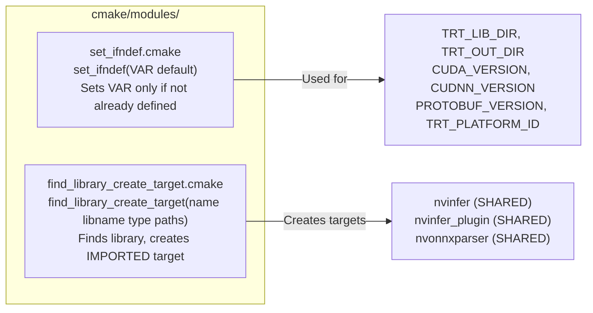

Sources: [CMakeLists.txt:19-24](), [CMakeLists.txt:322-378]()

---

## Build Output Summary

All artifacts are written to `TRT_OUT_DIR`. The table below maps build options to output files.

| Enabled Option | Output Artifact | Source Subdirectory |
|---|---|---|
| `BUILD_PLUGINS=ON` | `libnvinfer_plugin.so`, `libnvinfer_plugin.a` | `plugin/` |
| `BUILD_PARSERS=ON` | `libnvonnxparser.so` | `parsers/` |
| `BUILD_SAMPLES=ON` | `trtexec` and other sample binaries | `samples/` |
| `BUILD_SAFE_SAMPLES=ON` | Safety sample binaries | `samples/` |
| `python/build.sh` | `tensorrt.so` wheel | `python/build/` |

On Windows, library names include the major version number suffix (e.g., `nvinfer_10.dll`, `nvinfer_plugin_10.dll`) as controlled by [CMakeLists.txt:309-319]().

Sources: [CMakeLists.txt:40-43](), [CMakeLists.txt:304-387](), [python/build.sh:68-74]()

---

# Page: Docker Build Environments

# Docker Build Environments

<details>
<summary>Relevant source files</summary>

The following files were used as context for generating this wiki page:

- [README.md](README.md)
- [VERSION](VERSION)
- [docker/build.sh](docker/build.sh)
- [docker/launch.sh](docker/launch.sh)
- [docker/ubuntu-cross-aarch64.Dockerfile](docker/ubuntu-cross-aarch64.Dockerfile)
- [include/NvInferVersion.h](include/NvInferVersion.h)

</details>


This page documents the containerized build environment for TensorRT OSS: the available Dockerfiles, the `docker/build.sh` helper for building images, and the `docker/launch.sh` helper for running them. This covers environment setup only. For the CMake arguments and build targets that run *inside* these containers, see [Build System Architecture](#2.1).

---

## Overview

The `docker/` directory provides a set of pre-configured Dockerfiles and two shell scripts. Each Dockerfile installs the necessary system toolchain, CUDA toolkit, Python, CMake, and TensorRT GA libraries so that the in-container build environment requires no further manual dependency installation.

The two scripts are:

| Script | Purpose |
|---|---|
| `docker/build.sh` | Builds a Docker image from a chosen Dockerfile |
| `docker/launch.sh` | Runs a container from a previously built image |

**Prerequisites for containerized builds:**
- Docker >= 19.03
- NVIDIA Container Toolkit (required for GPU access inside the container)

---

## Available Dockerfiles

Four Dockerfiles are provided, each targeting a different host or target platform:

| Dockerfile | Base Image | Use Case |
|---|---|---|
| `docker/ubuntu-24.04.Dockerfile` | `nvidia/cuda:*-devel-ubuntu24.04` | Native x86_64 Linux build (default) |
| `docker/ubuntu-24.04-aarch64.Dockerfile` | `nvidia/cuda:*-devel-ubuntu24.04` | Native aarch64 Linux build |
| `docker/ubuntu-cross-aarch64.Dockerfile` | `nvidia/cuda:*-devel-ubuntu24.04` | Cross-compile x86_64 → aarch64 (Jetson/JetPack) |
| `docker/rockylinux8.Dockerfile` | Rocky Linux 8 base | Native x86_64 RPM-based Linux build |

### Cross-Compilation Dockerfile Details

The `docker/ubuntu-cross-aarch64.Dockerfile` is the most complex of the four. It sets up a full aarch64 cross-compilation toolchain on an x86_64 host.

Key setup steps performed by this Dockerfile:

1. Installs `g++-aarch64-linux-gnu` for C++ cross-compilation
2. Downloads and installs CMake 3.27.9 from source (the system version is typically too old)
3. Downloads the CUDA cross-compile toolchain package (`cuda-cross-sbsa-13-1`)
4. Downloads and unpacks the TensorRT aarch64 GA tarball, placing `.so` files under `/usr/lib/aarch64-linux-gnu`
5. Sets environment variables `TRT_LIBPATH` and `TRT_OSSPATH` for use in subsequent CMake invocations

The `CUDA_VERSION` and `OS_VERSION` are both configurable `ARG` values with defaults of `13.1.0` and `24.04` respectively.

Sources: [docker/ubuntu-cross-aarch64.Dockerfile:1-101]()

---

## docker/build.sh

[docker/build.sh:1-51]()

`build.sh` is a thin wrapper around `docker build`. It accepts three arguments:

| Argument | Default | Description |
|---|---|---|
| `--file <dockerfile>` | `docker/ubuntu-24.04.Dockerfile` | Path to the Dockerfile to use |
| `--tag <imagename>` | `tensorrt-ubuntu` | Tag applied to the resulting image |
| `--cuda <version>` | *(not passed)* | If set, passes `CUDA_VERSION` and `CUDA_VERSION_MAJOR_MINOR` as Docker build args |
| `-h / --help` | — | Prints usage |

The script always forwards `--build-arg uid=$(id -u)` and `--build-arg gid=$(id -g)` so the in-container `trtuser` account is created with matching host UID/GID, avoiding permission issues on the bind-mounted workspace.

If `--cuda` is omitted, the Dockerfile's own `ARG CUDA_VERSION` default is used.

**Usage examples:**

```bash
# Ubuntu 24.04 x86_64, default CUDA 13.1
./docker/build.sh --file docker/ubuntu-24.04.Dockerfile --tag tensorrt-ubuntu24.04-cuda13.1

# Rocky Linux 8
./docker/build.sh --file docker/rockylinux8.Dockerfile --tag tensorrt-rockylinux8-cuda13.1

# Cross-compile image for Jetson (aarch64)
./docker/build.sh --file docker/ubuntu-cross-aarch64.Dockerfile --tag tensorrt-jetpack-cuda13.1

# Ubuntu 24.04 native aarch64
./docker/build.sh --file docker/ubuntu-24.04-aarch64.Dockerfile --tag tensorrt-aarch64-ubuntu24.04-cuda13.1

# Override CUDA version
./docker/build.sh --file docker/ubuntu-24.04.Dockerfile --tag tensorrt-ubuntu24.04-cuda12.9 --cuda 12.9
```

Sources: [docker/build.sh:1-51]()

---

## docker/launch.sh

[docker/launch.sh:1-59]()

`launch.sh` is a wrapper around `docker run`. It mounts the current working directory into the container at `/workspace/TensorRT` and starts an interactive shell (or a Jupyter server).

| Argument | Default | Description |
|---|---|---|
| `--tag <imagetag>` | `tensorrt-ubuntu24.04` | Image tag to run |
| `--gpus <number>` | `all` | GPU visibility. Pass `none` to disable GPU access |
| `--jupyter <port>` | `0` (disabled) | If non-zero, exposes the port and runs `jupyter-lab` instead of a shell |
| `-h / --help` | — | Prints usage |

When `--gpus none` is passed, the `--gpus` flag is omitted from `docker run` entirely, which is useful for build-only workflows with no GPU present.

When `--jupyter <port>` is non-zero, the script appends `-p <port>:<port>` and runs `jupyter-lab --port=<port> --no-browser --ip 0.0.0.0 --allow-root` as the container command.

**Usage examples:**

```bash
# Interactive shell, all GPUs
./docker/launch.sh --tag tensorrt-ubuntu24.04-cuda13.1 --gpus all

# No GPU (build only)
./docker/launch.sh --tag tensorrt-ubuntu24.04-cuda13.1 --gpus none

# Launch Jupyter on port 8888
./docker/launch.sh --tag tensorrt-ubuntu24.04-cuda13.1 --jupyter 8888
```

> **Note:** The `sudo` password inside Ubuntu containers is `nvidia`. Write permission on the host directory is required because it is mounted with UID:GID `1000:1000`.

Sources: [docker/launch.sh:1-59]()

---

## Build Flow Diagram

The following diagram maps the scripts and files to the Docker operations they invoke.

**Docker environment setup flow**

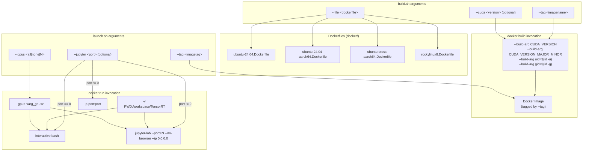

Sources: [docker/build.sh:1-51](), [docker/launch.sh:1-59]()

---

## Dockerfile Environment Variables

Each Dockerfile sets environment variables that downstream CMake commands rely on. The cross-compile Dockerfile is the most explicit about this:

| Variable | Value (cross-aarch64) | Purpose |
|---|---|---|
| `TRT_VERSION` | `10.15.1.29` | TensorRT version installed in image |
| `TRT_LIBPATH` | `/usr/lib/aarch64-linux-gnu` | Passed as `-DTRT_LIB_DIR` to CMake |
| `TRT_OSSPATH` | `/workspace/TensorRT` | Mount point for the repository |
| `PATH` | `/opt/venv/bin:$PATH` | Python virtualenv is active by default |

For the x86_64 Ubuntu images, TensorRT GA libraries are pre-installed under `/usr/lib/x86_64-linux-gnu`, so no explicit `TRT_LIB_DIR` argument is needed when building inside the container.

Sources: [docker/ubuntu-cross-aarch64.Dockerfile:94-97](), [README.md:94-98]()

---

## Dockerfile vs. Target Platform Matrix

```mermaid
graph LR
    subgraph "Host Platform"
        x86["x86_64 Linux Host"]
    end

    subgraph "docker/build.sh --file ..."
        DF_u2404["ubuntu-24.04.Dockerfile"]
        DF_aarch64["ubuntu-24.04-aarch64.Dockerfile"]
        DF_cross["ubuntu-cross-aarch64.Dockerfile"]
        DF_rocky["rockylinux8.Dockerfile"]
    end

    subgraph "Target / Use Case"
        T1["x86_64 Linux build\n(cmake_aarch64-native not needed)"]
        T2["aarch64 native build\n(cmake_aarch64-native.toolchain)"]
        T3["Jetson / JetPack cross-compile\n(cmake_aarch64_cross.toolchain)"]
        T4["Rocky Linux 8 / RPM\nx86_64 build"]
    end

    x86 --> DF_u2404 --> T1
    x86 --> DF_aarch64 --> T2
    x86 --> DF_cross --> T3
    x86 --> DF_rocky --> T4
```

Sources: [README.md:124-160](), [docker/ubuntu-cross-aarch64.Dockerfile:1-101]()

---

# Page: Core API

# Core API

<details>
<summary>Relevant source files</summary>

The following files were used as context for generating this wiki page:

- [.gitmodules](.gitmodules)
- [CHANGELOG.md](CHANGELOG.md)
- [include/NvInfer.h](include/NvInfer.h)
- [include/NvInferImpl.h](include/NvInferImpl.h)
- [include/NvInferLegacyDims.h](include/NvInferLegacyDims.h)
- [include/NvInferPlugin.h](include/NvInferPlugin.h)
- [include/NvInferPluginUtils.h](include/NvInferPluginUtils.h)
- [include/NvInferRuntime.h](include/NvInferRuntime.h)
- [include/NvInferRuntimeBase.h](include/NvInferRuntimeBase.h)
- [include/NvInferRuntimeCommon.h](include/NvInferRuntimeCommon.h)
- [include/NvInferRuntimePlugin.h](include/NvInferRuntimePlugin.h)

</details>


This page covers the TensorRT C++ API header organization under `include/`, the `nvinfer1` namespace, versioning macros, and the separation between builder-time and runtime headers. The types and classes described here form the foundation on which the rest of the system is built.

- For network construction types (`ITensor`, `ILayer`, `INetworkDefinition`, `Weights`), see [Network Definition](#3.1).
- For the builder and optimization profile API (`IBuilder`, `IBuilderConfig`), see [Builder and Optimization](#3.2).
- For runtime inference (`IRuntime`, `ICudaEngine`, `IExecutionContext`), see [Runtime and Inference](#3.3).
- For the plugin extension system, see [Plugin System](#4).

---

## Header Organization

All public API headers are located under `include/`. Each header has a distinct role; applications select the appropriate entry point header based on what they need.

**Header Dependency Diagram**

```mermaid
graph TD
  NvInfer_h["\"NvInfer.h\"\n(builder + network definition)"]
  NvInferRuntime_h["\"NvInferRuntime.h\"\n(runtime only)"]
  NvInferPlugin_h["\"NvInferPlugin.h\"\n(built-in plugin library)"]
  NvInferPluginUtils_h["\"NvInferPluginUtils.h\"\n(plugin parameter structs)"]
  NvInferImpl_h["\"NvInferImpl.h\"\n(vtable bridge, apiv namespace)"]
  NvInferRuntimeCommon_h["\"NvInferRuntimeCommon.h\"\n(IPluginRegistry)"]
  NvInferRuntimePlugin_h["\"NvInferRuntimePlugin.h\"\n(IPluginV2, PluginTensorDesc)"]
  NvInferPluginBase_h["\"NvInferPluginBase.h\"\n(IPluginCreatorInterface)"]
  NvInferLegacyDims_h["\"NvInferLegacyDims.h\"\n(Dims2, Dims3, Dims4, DimsHW)"]
  NvInferRuntimeBase_h["\"NvInferRuntimeBase.h\"\n(DataType, Dims, macros)"]
  NvInferVersion_h["\"NvInferVersion.h\"\n(NV_TENSORRT_MAJOR/MINOR/PATCH)"]

  NvInfer_h --> NvInferLegacyDims_h
  NvInfer_h --> NvInferRuntime_h
  NvInferPlugin_h --> NvInfer_h
  NvInferPlugin_h --> NvInferPluginUtils_h
  NvInferPluginUtils_h --> NvInferRuntimeCommon_h
  NvInferRuntime_h --> NvInferImpl_h
  NvInferRuntime_h --> NvInferPluginBase_h
  NvInferRuntime_h --> NvInferRuntimeCommon_h
  NvInferRuntimeCommon_h --> NvInferPluginBase_h
  NvInferRuntimeCommon_h --> NvInferRuntimePlugin_h
  NvInferRuntimePlugin_h --> NvInferPluginBase_h
  NvInferImpl_h --> NvInferLegacyDims_h
  NvInferImpl_h --> NvInferRuntimeCommon_h
  NvInferLegacyDims_h --> NvInferRuntimeBase_h
  NvInferRuntimeBase_h --> NvInferVersion_h
```

Sources: [include/NvInfer.h:1-22](), [include/NvInferRuntime.h:1-32](), [include/NvInferImpl.h:1-23](), [include/NvInferPlugin.h:1-42](), [include/NvInferPluginUtils.h:1-22](), [include/NvInferRuntimeBase.h:1-25](), [include/NvInferLegacyDims.h:1-23]()

### Entry Point Summary

| Header | Include for | Notes |
|--------|-------------|-------|
| `NvInfer.h` | Engine building + network definition | Includes `NvInferRuntime.h` transitively |
| `NvInferRuntime.h` | Inference-only deployments | Excludes builder-time classes |
| `NvInferPlugin.h` | Using or registering the built-in plugin library | Declares `initLibNvInferPlugins()` |
| `NvInferPluginUtils.h` | Plugin parameter structs only | `PriorBoxParameters`, `NMSParameters`, etc. |

Sources: [include/NvInfer.h:38-40](), [include/NvInferRuntime.h:22-26](), [include/NvInferPlugin.h:26-28]()

---

## The `nvinfer1` Namespace

All TensorRT API types reside in the `nvinfer1` namespace. The comment in `NvInfer.h` describes it as "The TensorRT API version 1 namespace." Plugin utilities use the nested `nvinfer1::plugin` namespace.

Versioned interface implementations use nested `v_1_0` sub-namespaces, with the outer namespace providing `using` aliases:

```cpp
// Pattern used throughout NvInferImpl.h
namespace v_1_0 { class IStreamReader; }
using IStreamReader = v_1_0::IStreamReader;
```

This pattern allows future ABI-compatible updates by adding `v_1_1` variants without breaking the outer alias.

Sources: [include/NvInfer.h:47-48](), [include/NvInferImpl.h:124-141](), [include/NvInferPluginUtils.h:31-33]()

---

## Versioning

Version constants are defined in `include/NvInferVersion.h` (not included in OSS sources, but referenced by `NvInferRuntimeBase.h`). The macros `NV_TENSORRT_MAJOR`, `NV_TENSORRT_MINOR`, and `NV_TENSORRT_PATCH` are set there, and `NvInferRuntimeBase.h` computes the combined version:

```c
// From include/NvInferRuntimeBase.h
#define NV_TENSORRT_VERSION_INT(major, minor, patch)  \
    ((major)*10000L + (minor)*100L + (patch)*1L)

#define NV_TENSORRT_VERSION  \
    NV_TENSORRT_VERSION_INT(NV_TENSORRT_MAJOR, NV_TENSORRT_MINOR, NV_TENSORRT_PATCH)
```

`NV_TENSORRT_VERSION` is an integer usable in preprocessor expressions. It is also returned by `IPluginV2::getTensorRTVersion()` (the low 24 bits) for ABI compatibility checking of legacy plugins.

`NvInferRuntimeBase.h` also defines several annotation macros used throughout the headers:

| Macro | Purpose |
|-------|---------|
| `TRT_DEPRECATED` | Marks a symbol deprecated; expands to `[[deprecated]]` in C++14+ |
| `TRT_DEPRECATED_BECAUSE(REASON)` | Deprecated with a message |
| `TRT_DEPRECATED_ENUM` | Applied to individual enum values |
| `TRT_NODISCARD` | Expands to `[[nodiscard]]`; used on functions whose return values must not be ignored |
| `TENSORRTAPI` | Visibility attribute for exported symbols |

Sources: [include/NvInferRuntimeBase.h:96-101](), [include/NvInferRuntimeBase.h:27-59]()

---

## Core Primitive Types

**Type Hierarchy: Primitives**

```mermaid
graph TD
  NvInferRuntimeBase_h["\"NvInferRuntimeBase.h\""]

  DataType["DataType (enum class)"]
  Dims["Dims / Dims64 (class)"]
  Weights["Weights (class)"]
  IHostMemory["IHostMemory (class)"]
  INoCopy["INoCopy (class)"]
  IVersionedInterface["IVersionedInterface (class)"]
  IErrorRecorder["IErrorRecorder (v_1_0::IErrorRecorder)"]

  NvInferRuntimeBase_h --> DataType
  NvInferRuntimeBase_h --> Dims
  NvInferRuntime_h["\"NvInferRuntime.h\""] --> Weights
  NvInferRuntime_h --> IHostMemory
  NvInferRuntime_h --> INoCopy
  NvInferRuntimeBase_h --> IVersionedInterface
  NvInferRuntimeBase_h --> IErrorRecorder

  INoCopy --> ITensor["ITensor"]
  INoCopy --> ILayer["ILayer"]
  INoCopy --> IBuilder["IBuilder"]
  INoCopy --> IRuntime["IRuntime"]
  INoCopy --> ICudaEngine["ICudaEngine"]
  INoCopy --> IExecutionContext["IExecutionContext"]

  IVersionedInterface --> IStreamReader["IStreamReader (v_1_0)"]
  IVersionedInterface --> IStreamWriter["IStreamWriter (v_1_0)"]
  IVersionedInterface --> IPluginV3["IPluginV3 (v_1_0)"]
```

Sources: [include/NvInferRuntimeBase.h:140-205](), [include/NvInferRuntime.h:41-59](), [include/NvInferRuntime.h:110-166]()

### `DataType`

Defined in [include/NvInferRuntimeBase.h:144-194](). Represents the element type of tensors and weights.

| Enumerator | Value | Description |
|------------|-------|-------------|
| `kFLOAT` | 0 | 32-bit IEEE float |
| `kHALF` | 1 | 16-bit IEEE float (FP16) |
| `kINT8` | 2 | Signed 8-bit integer (used for quantization) |
| `kINT32` | 3 | Signed 32-bit integer |
| `kBOOL` | 4 | 8-bit boolean (0=false, 1=true) |
| `kUINT8` | 5 | Unsigned 8-bit integer |
| `kFP8` | 6 | 8-bit float, E4M3 format, bias 7 |
| `kBF16` | 7 | Brain float (8-bit exponent, 8-bit significand) |
| `kINT64` | 8 | Signed 64-bit integer |
| `kINT4` | 9 | Signed 4-bit integer |
| `kFP4` | 10 | 4-bit float (E2M1) |
| `kE8M0` | 11 | Unsigned exponent-only 8-bit float for quantization scales |

`EnumMax<DataType>()` returns `12`. The pattern of specializing `EnumMaxImpl<T>` is used throughout the API to allow compile-time bounds checking.

Sources: [include/NvInferRuntimeBase.h:144-205]()

### `Dims` / `Dims64`

`Dims64` is the primary dimension descriptor [include/NvInferRuntimeBase.h:217-233](). `Dims` is a `using` alias for `Dims64`. It holds up to `MAX_DIMS = 8` extents as `int64_t d[MAX_DIMS]` and a rank as `int32_t nbDims`.

Special sentinel values:
- **Invalid dims**: `nbDims == -1`, all `d[i] == 0`.
- **Unknown rank**: `nbDims == -1`, all `d[i] == -1`.
- **Wildcard dimension**: A specific `d[i] == -1` during dynamic shape analysis.

Concrete subclasses in [include/NvInferLegacyDims.h]() provide named accessors for common ranks:

| Class | Rank | Notes |
|-------|------|-------|
| `Dims2` | 2 | Generic 2D |
| `DimsHW` | 2 | `.h()` and `.w()` accessors |
| `Dims3` | 3 | Generic 3D |
| `Dims4` | 4 | Generic 4D |

Sources: [include/NvInferRuntimeBase.h:217-233](), [include/NvInferLegacyDims.h:43-202]()

### `Weights`

Defined in [include/NvInferRuntime.h:123-129](). A non-owning descriptor for a contiguous array of weight values:

| Field | Type | Description |
|-------|------|-------------|
| `type` | `DataType` | Element type |
| `values` | `void const*` | Pointer to weight data |
| `count` | `int64_t` | Number of elements |

The pointed-to data must remain valid until the engine is built. Zero-count weights (empty weights) use `values == nullptr` and `count == 0`.

Sources: [include/NvInferRuntime.h:110-129]()

### `IHostMemory`

Defined in [include/NvInferRuntime.h:141-166](). Wraps library-allocated host memory returned from operations like `ICudaEngine::serialize()`. Access via `data()`, `size()`, and `type()`. The memory is owned by the library and released when the object is destroyed.

`IHostMemory` extends `INoCopy`, so it must be accessed through a pointer and is not copyable or movable.

Sources: [include/NvInferRuntime.h:134-166]()

---

## Base Classes

### `INoCopy`

Defined in [include/NvInferRuntime.h:50-59](). Base for all TensorRT interface classes implemented inside the library. Deletes copy constructor, move constructor, and both assignment operators. All major API objects (`ITensor`, `ILayer`, `IBuilder`, `ICudaEngine`, `IExecutionContext`, `IRuntime`, etc.) extend `INoCopy`. Applications must use pointers to interact with these objects.

Sources: [include/NvInferRuntime.h:50-59]()

### `IVersionedInterface`

Defined in [include/NvInferRuntimeBase.h:276-303](). Base for interfaces that cross the shared library boundary and require explicit versioning. Provides:
- `getInterfaceInfo()` — returns an `InterfaceInfo` struct with `kind` (string), `major`, and `minor` version.
- `getAPILanguage()` — returns `APILanguage::kCPP` by default, or `kPYTHON` for Python-implemented plugins.

Classes that extend `IVersionedInterface` (rather than `INoCopy`) are typically implemented by the **application** and passed into TensorRT, rather than implemented by TensorRT itself. Examples include `IStreamReader`, `IStreamWriter`, `IPluginV3`, and `IOutputAllocator`.

Sources: [include/NvInferRuntimeBase.h:276-303](), [include/NvInferImpl.h:124-141]()

---

## Error Handling

### `ErrorCode`

Defined in [include/NvInferRuntimeBase.h:310-398](). An enum class with values used by `IErrorRecorder`:

| Enumerator | Description |
|------------|-------------|
| `kSUCCESS` | No error |
| `kUNSPECIFIED_ERROR` | Catch-all for forward compatibility |
| `kINTERNAL_ERROR` | TensorRT is in an invalid state; further calls are undefined |
| `kINVALID_ARGUMENT` | API contract violation on a single argument |
| `kINVALID_CONFIG` | Arguments are individually valid but inconsistent |
| `kFAILED_ALLOCATION` | Host or device memory allocation failed |
| `kFAILED_INITIALIZATION` | Dependent component did not initialize |
| `kFAILED_EXECUTION` | Asynchronous execution error or CUDA error |
| `kFAILED_COMPUTATION` | Data corruption during execution (NaN, overflow) |
| `kINVALID_STATE` | Invalid call sequence |
| `kUNSUPPORTED_STATE` | Network/hardware combination not supported |

Sources: [include/NvInferRuntimeBase.h:310-398]()

### `IErrorRecorder`

Defined as `v_1_0::IErrorRecorder` in [include/NvInferRuntimeBase.h:413-556](). Applications implement this interface to receive structured error reports. Key methods: `getNbErrors()`, `getErrorCode(int32_t)`, `getErrorDesc(int32_t)`, `hasOverflowed()`, `clear()`, and `reportError(ErrorCode, ErrorDesc)`. A recorder is attached to an object via `setErrorRecorder()`, available on most major interfaces.

Sources: [include/NvInferRuntimeBase.h:413-556]()

---

## Builder-Time vs. Runtime Separation

TensorRT uses two distinct sets of headers to allow inference-only deployments to be built without the engine builder.

**Phase Separation Diagram**

```mermaid
flowchart LR
  subgraph "Build Phase (include NvInfer.h)"
    IBuilder["IBuilder\n(createNetworkV2, buildSerializedNetwork)"]
    IBuilderConfig["IBuilderConfig\n(setFlag, setMemoryPoolLimit)"]
    INetworkDefinition["INetworkDefinition\n(addConvolution, addActivation, ...)"]
    ITensor["ITensor\n(setName, setDimensions, setType)"]
    ILayer["ILayer\n(getType, getInput, getOutput)"]
    IOptimizationProfile["IOptimizationProfile\n(setDimensions)"]
    Weights["Weights\n{type, values, count}"]
    IHostMemory["IHostMemory\n(serialized engine bytes)"]

    IBuilder --> IBuilderConfig
    IBuilder --> INetworkDefinition
    INetworkDefinition --> ITensor
    INetworkDefinition --> ILayer
    IBuilderConfig --> IOptimizationProfile
    IBuilder --> IHostMemory
    INetworkDefinition --> Weights
  end

  subgraph "Runtime Phase (include NvInferRuntime.h)"
    IRuntime["IRuntime\n(deserializeCudaEngine)"]
    ICudaEngine["ICudaEngine\n(createExecutionContext, serialize)"]
    IExecutionContext["IExecutionContext\n(setTensorAddress, enqueueV3)"]
    IRefitter["IRefitter\n(setNamedWeights, refitCudaEngine)"]
    IStreamReader["IStreamReader (v_1_0)\n(read callback)"]
    IStreamWriter["IStreamWriter (v_1_0)\n(write callback)"]
    IHostMemory2["IHostMemory\n(serialized engine bytes)"]

    IRuntime --> ICudaEngine
    IRuntime --> IStreamReader
    ICudaEngine --> IExecutionContext
    ICudaEngine --> IRefitter
    ICudaEngine --> IHostMemory2
    ICudaEngine --> IStreamWriter
  end

  IHostMemory -->|".engine file"| IRuntime
```

Sources: [include/NvInfer.h:18-22](), [include/NvInferRuntime.h:18-32](), [include/NvInferImpl.h:62-178]()

The classes in the "Build Phase" box are only available when `NvInfer.h` is included (which pulls in `NvInferRuntime.h` transitively). Inference-only applications can include only `NvInferRuntime.h` and avoid a link-time dependency on the builder.

---

## Internal Implementation Bridge (`apiv` namespace)

`NvInferImpl.h` defines the `nvinfer1::apiv` namespace, which contains pure-virtual classes (prefixed with `V`) that serve as the ABI boundary between the public API classes and the closed-source TensorRT library:

| `apiv` class | Used by public class |
|---|---|
| `VRuntime` | `IRuntime` |
| `VCudaEngine` | `ICudaEngine` |
| `VExecutionContext` | `IExecutionContext` |
| `VRefitter` | `IRefitter` |
| `VOptimizationProfile` | `IOptimizationProfile` |
| `VTensor` | `ITensor` |
| `VEngineInspector` | `IEngineInspector` |
| `VHostMemory` | `IHostMemory` |

Each public class holds a pointer to its corresponding `apiv::V*` object (e.g., `ITensor` holds `apiv::VTensor* mImpl`) and forwards method calls through it. Application code must not call `apiv` methods directly.

Sources: [include/NvInferImpl.h:244-500](), [include/NvInfer.h:569-571](), [include/NvInferRuntime.h:163-165]()

---

## Plugin-Related Headers

Two headers are relevant for plugin consumers without being part of the network definition or runtime:

- **`NvInferPlugin.h`** — declares the C-linkage function `initLibNvInferPlugins(void* logger, char const* libNamespace)`, which registers all built-in TensorRT plugins into the global `IPluginRegistry`. This must be called before deserializing any engine that uses built-in plugins. See [Plugin Registration and Initialization](#4.1).

- **`NvInferPluginUtils.h`** — defines parameter structs used by the built-in plugins, such as `PriorBoxParameters`, `GridAnchorParameters`, `NMSParameters`, `RPROIParams`, and `DetectionOutputParameters`. These live in the `nvinfer1::plugin` namespace. Several are deprecated as of TensorRT 10.0.

Sources: [include/NvInferPlugin.h:29-42](), [include/NvInferPluginUtils.h:43-200]()

---

# Page: Network Definition

# Network Definition

<details>
<summary>Relevant source files</summary>

The following files were used as context for generating this wiki page:

- [include/NvInfer.h](include/NvInfer.h)
- [include/NvInferImpl.h](include/NvInferImpl.h)
- [include/NvInferLegacyDims.h](include/NvInferLegacyDims.h)
- [include/NvInferPlugin.h](include/NvInferPlugin.h)
- [include/NvInferPluginUtils.h](include/NvInferPluginUtils.h)
- [include/NvInferRuntime.h](include/NvInferRuntime.h)
- [include/NvInferRuntimeBase.h](include/NvInferRuntimeBase.h)
- [include/NvInferRuntimeCommon.h](include/NvInferRuntimeCommon.h)
- [include/NvInferRuntimePlugin.h](include/NvInferRuntimePlugin.h)

</details>


This document covers the creation and definition of TensorRT neural networks using the `INetworkDefinition` API. It explains how to programmatically construct networks by creating tensors, adding layers, and connecting them together to form computational graphs.

For information about optimizing and building these network definitions into engines, see [Builder and Optimization](#3.2). For executing the built engines, see [Runtime and Inference](#3.3).

## Network Definition Overview

Network definition in TensorRT involves creating a computational graph where nodes represent operations (layers) and edges represent data flow (tensors). The primary interface for this is `INetworkDefinition`, which provides methods to add layers, create tensors, and specify network inputs and outputs.

```mermaid
graph TD
    App["Application Code"] --> INetworkDefinition["INetworkDefinition"]
    INetworkDefinition --> ITensor1["Input ITensor"]
    INetworkDefinition --> ILayer1["IConvolutionLayer"]
    INetworkDefinition --> ILayer2["IActivationLayer"]
    INetworkDefinition --> ILayer3["IPoolingLayer"]
    INetworkDefinition --> ITensor2["Output ITensor"]
    
    ITensor1 --> ILayer1
    ILayer1 --> ITensor_conv["ITensor (conv output)"]
    ITensor_conv --> ILayer2
    ILayer2 --> ITensor_act["ITensor (activation output)"]
    ITensor_act --> ILayer3
    ILayer3 --> ITensor2
    
    INetworkDefinition --> NetworkInputs["markInput()"]
    INetworkDefinition --> NetworkOutputs["markOutput()"]
```

Sources: [include/NvInfer.h:169-869]()

## Core Components

### ITensor - Network Data Representation

`ITensor` represents data flowing through the network. Each tensor has dimensions, a data type, and a name. Tensors serve as both inputs to layers and outputs from layers.

```mermaid
classDiagram
    class ITensor {
        +setName(char const* name)
        +getName() char const*
        +setDimensions(Dims const& dimensions)
        +getDimensions() Dims
        +setType(DataType type)
        +getType() DataType
        +isNetworkInput() bool
        +isNetworkOutput() bool
        +isShapeTensor() bool
        +isExecutionTensor() bool
        +setDimensionName(int32_t index, char const* name)
    }
```

Key tensor properties:
- **Dimensions**: Shape of the tensor data using `Dims` structure
- **Data Type**: Element type (`DataType::kFLOAT`, `DataType::kHALF`, `DataType::kINT8`, etc.)
- **Network Role**: Input tensors, intermediate tensors, or output tensors
- **Tensor Category**: Execution tensors (data) or shape tensors (metadata)

Sources: [include/NvInfer.h:169-567]()

### ILayer - Network Operations

`ILayer` is the base class for all network operations. Each layer type inherits from `ILayer` and implements specific computation logic.

```mermaid
classDiagram
    class ILayer {
        +getType() LayerType
        +setName(char const* name)
        +getName() char const*
        +getNbInputs() int32_t
        +getInput(int32_t index) ITensor*
        +getNbOutputs() int32_t
        +getOutput(int32_t index) ITensor*
        +setInput(int32_t index, ITensor& tensor)
    }
    
    ILayer <|-- IConvolutionLayer
    ILayer <|-- IActivationLayer
    ILayer <|-- IPoolingLayer
    ILayer <|-- IElementWiseLayer
    ILayer <|-- IMatrixMultiplyLayer
```

Sources: [include/NvInfer.h:570-869]()

## Layer Types and Categories

TensorRT supports a comprehensive set of layer types organized into functional categories:

| Category | Layer Types | Purpose |
|----------|-------------|---------|
| **Basic Operations** | `kCONVOLUTION`, `kACTIVATION`, `kPOOLING` | Core neural network operations |
| **Data Manipulation** | `kSHUFFLE`, `kSLICE`, `kCONCATENATION`, `kGATHER` | Tensor reshaping and indexing |
| **Element-wise** | `kELEMENTWISE`, `kUNARY`, `kSCALE` | Per-element computations |
| **Reduction** | `kREDUCE`, `kTOPK`, `kSOFTMAX` | Aggregation operations |
| **Matrix Operations** | `kMATRIX_MULTIPLY`, `kEINSUM` | Linear algebra operations |
| **Control Flow** | `kCONDITION`, `kLOOP_OUTPUT`, `kSELECT` | Conditional execution |
| **Quantization** | `kQUANTIZE`, `kDEQUANTIZE`, `kCAST` | Precision conversion |
| **Custom** | `kPLUGIN`, `kPLUGIN_V2`, `kPLUGIN_V3` | User-defined operations |

```mermaid
graph TD
    LayerType["LayerType Enum"] --> Basic["Basic Operations"]
    LayerType --> DataManip["Data Manipulation"]
    LayerType --> ElementWise["Element-wise Operations"]
    LayerType --> Reduction["Reduction Operations"]
    LayerType --> Matrix["Matrix Operations"]
    LayerType --> ControlFlow["Control Flow"]
    LayerType --> Quantization["Quantization"]
    LayerType --> Custom["Custom Plugins"]
    
    Basic --> kCONVOLUTION
    Basic --> kACTIVATION
    Basic --> kPOOLING
    
    DataManip --> kSHUFFLE
    DataManip --> kSLICE
    DataManip --> kCONCATENATION
    
    ElementWise --> kELEMENTWISE
    ElementWise --> kUNARY
    ElementWise --> kSCALE
    
    Custom --> kPLUGIN
    Custom --> kPLUGIN_V2
    Custom --> kPLUGIN_V3
```

Sources: [include/NvInfer.h:57-121]()

## Network Construction Workflow

The typical workflow for creating a TensorRT network follows this pattern:

```mermaid
flowchart TD
    Start["Create IBuilder"] --> CreateNet["builder->createNetworkV2()"]
    CreateNet --> AddInput["network->addInput()"]
    AddInput --> AddLayers["Add Layers"]
    AddLayers --> ConnectLayers["Connect Layer Inputs/Outputs"]
    ConnectLayers --> MarkOutput["network->markOutput()"]
    MarkOutput --> BuildEngine["builder->buildEngineWithConfig()"]
    
    AddLayers --> Conv["addConvolution()"]
    AddLayers --> Act["addActivation()"]  
    AddLayers --> Pool["addPooling()"]
    AddLayers --> Other["Other Layer Types"]
    
    ConnectLayers --> SetInput["layer->setInput(index, tensor)"]
    ConnectLayers --> GetOutput["tensor = layer->getOutput(index)"]
```

Sources: [include/NvInfer.h:57-869]()

## Tensor Management

### Tensor Properties and Metadata

Tensors carry essential metadata that TensorRT uses for optimization and validation:

```mermaid
graph LR
    ITensor_props["ITensor Properties"] --> Dims["Dimensions (Dims)"]
    ITensor_props --> DataType["Data Type (DataType)"]
    ITensor_props --> Name["Name (char const*)"]
    ITensor_props --> Category["Category"]
    ITensor_props --> Location["Storage Location"]
    
    Category --> ExecutionTensor["Execution Tensor<br/>isExecutionTensor()"]
    Category --> ShapeTensor["Shape Tensor<br/>isShapeTensor()"]
    
    Location --> Device["Device Memory<br/>kDEVICE"]
    Location --> Host["Host Memory<br/>kHOST"]
    
    DataType --> kFLOAT["kFLOAT (32-bit)"]
    DataType --> kHALF["kHALF (16-bit)"]
    DataType --> kINT8["kINT8 (8-bit)"]
    DataType --> kINT32["kINT32 (32-bit)"]
```

### Shape Tensors vs Execution Tensors

TensorRT distinguishes between two categories of tensors:

- **Execution Tensors**: Carry actual network data and participate in the main computation
- **Shape Tensors**: Carry shape/size information used for dynamic shape inference

The distinction is determined by `isExecutionTensor()` and `isShapeTensor()` methods.

Sources: [include/NvInfer.h:472-522]()

## Layer Connection and Data Flow

Layers are connected by setting their input tensors to be the output tensors of previous layers:

```mermaid
sequenceDiagram
    participant App as Application
    participant Net as INetworkDefinition
    participant L1 as Layer 1
    participant L2 as Layer 2
    participant T1 as Tensor 1
    participant T2 as Tensor 2
    
    App->>Net: addInput("input", dims, type)
    Net-->>T1: returns input tensor
    
    App->>Net: addConvolution(input, ...)
    Net-->>L1: returns conv layer
    L1-->>T2: getOutput(0)
    
    App->>Net: addActivation(T2, ...)
    Net-->>L2: returns activation layer
    
    App->>L2: setInput(0, T2)
    Note over L1,L2: Tensor T2 connects Layer 1 output to Layer 2 input
```

The connection between layers is established through the tensor references:
- `ILayer::getOutput(index)` returns output tensors from a layer
- `ILayer::setInput(index, tensor)` sets input tensors for a layer
- `ILayer::getInput(index)` retrieves input tensors of a layer

Sources: [include/NvInfer.h:614-667]()

## Advanced Tensor Features

### Dynamic Shapes and Named Dimensions

For networks with dynamic input shapes, tensors support dimension naming to establish relationships between dimensions across different tensors:

- `setDimensionName(index, name)` - Associate a name with a tensor dimension
- `getDimensionName(index)` - Retrieve the name of a dimension

This enables TensorRT to understand that dimensions with the same name must have equal values at runtime.

### Tensor Formats and Allowed Formats

Tensors can specify which memory formats they support:
- `setAllowedFormats(formats)` - Restrict supported tensor formats
- `getAllowedFormats()` - Query supported formats

This is particularly important for optimizing memory layout and enabling specialized kernels.

Sources: [include/NvInfer.h:437-562]()

---

# Page: Builder and Optimization

# Builder and Optimization

<details>
<summary>Relevant source files</summary>

The following files were used as context for generating this wiki page:

- [.gitignore](.gitignore)
- [include/NvInfer.h](include/NvInfer.h)
- [include/NvInferImpl.h](include/NvInferImpl.h)
- [include/NvInferLegacyDims.h](include/NvInferLegacyDims.h)
- [include/NvInferPlugin.h](include/NvInferPlugin.h)
- [include/NvInferPluginUtils.h](include/NvInferPluginUtils.h)
- [include/NvInferRuntime.h](include/NvInferRuntime.h)
- [include/NvInferRuntimeBase.h](include/NvInferRuntimeBase.h)
- [include/NvInferRuntimeCommon.h](include/NvInferRuntimeCommon.h)
- [include/NvInferRuntimePlugin.h](include/NvInferRuntimePlugin.h)
- [include/NvOnnxParser.h](include/NvOnnxParser.h)
- [python/CMakeLists.txt](python/CMakeLists.txt)
- [python/build.sh](python/build.sh)
- [python/docstrings/parsers/pyOnnxDoc.h](python/docstrings/parsers/pyOnnxDoc.h)
- [python/src/parsers/pyOnnx.cpp](python/src/parsers/pyOnnx.cpp)

</details>


The TensorRT Builder is a crucial component in the TensorRT workflow, responsible for transforming a network definition into an optimized runtime engine. This page documents the Builder API and optimization techniques available in TensorRT for creating high-performance inference engines. For information about creating network definitions, see [Network Definition](#2.1), and for executing the optimized engines, see [Runtime and Inference](#2.3).

## Builder Overview

The TensorRT Builder takes a network definition and generates an optimized engine by applying various transformations, layer optimizations, and kernel selections based on the target hardware and specified constraints.

```mermaid
graph LR
    subgraph "TensorRT Workflow"
        direction LR
        NetworkDef["Network Definition"] -->|"Configure"| Builder["Builder"]
        BuilderConfig["Builder Config"] -->|"Configure"| Builder
        Builder -->|"Optimize"| Engine["Optimized Engine"]
        Engine -->|"Serialize"| Plan["Engine Plan"]
        Plan -->|"Deserialize"| Runtime["Runtime Execution"]
    end
```

Sources: [include/NvInfer.h:24-41](), [include/NvInferRuntime.h:75-107]()

## Key Builder Components

The TensorRT builder system consists of several key classes that work together to create optimized engines:

```mermaid
classDiagram
    class IBuilder {
        +createNetworkV2() INetworkDefinition
        +createBuilderConfig() IBuilderConfig  
        +buildEngineWithConfig() ICudaEngine
        +isNetworkSupported() bool
    }
    
    class INetworkDefinition {
        +addInput() ITensor
        +addLayer() ILayer
        +markOutput() void
        +getNbLayers() int32_t
    }
    
    class ITensor {
        +setName() void
        +getName() char const*
        +setDimensions() void
        +getDimensions() Dims
        +setType() void
        +getType() DataType
    }
    
    class ILayer {
        +getType() LayerType
        +setName() void
        +getName() char const*
        +setPrecision() void
        +getPrecision() DataType
    }
    
    class ICudaEngine {
        +serialize() IHostMemory
        +createExecutionContext() IExecutionContext
        +getNbLayers() int32_t
        +getEngineCapability() EngineCapability
    }
    
    IBuilder --> INetworkDefinition : creates
    IBuilder --> ICudaEngine : builds
    INetworkDefinition --> ITensor : contains
    INetworkDefinition --> ILayer : contains
```

Sources: [include/NvInfer.h:182-567](), [include/NvInferRuntime.h:353-423](), [include/NvInferImpl.h:71-176]()

## Building Process

The building process involves several steps that transform the network definition into an optimized engine:

```mermaid
flowchart TD
    A["Create Builder"] --> B["Create Network Definition"]
    B --> C["Configure Network"]
    C --> D["Create BuilderConfig"]
    D --> E["Set Precision Flags"]
    E --> F["Set Memory Constraints"]
    F --> G["Set Optimization Profiles"]
    G --> H["Set Tactics & Plugins"]
    H --> I["Build Engine"]
    I --> J["Serialize Engine"]
    J --> K["Save to Disk (Optional)"]
```

Sources: [include/NvInfer.h:57-121](), [include/NvInferRuntime.h:142-202]()

## Optimization Techniques

### Precision Modes

TensorRT supports various precision modes to balance performance and accuracy:

| Precision Mode | DataType Enum | Description |
|----------------|---------------|-------------|
| FP32           | `kFLOAT`      | 32-bit floating point format |
| FP16           | `kHALF`       | IEEE 16-bit floating-point format |
| INT8           | `kINT8`       | Signed 8-bit integer representing quantized floating-point |
| INT32          | `kINT32`      | Signed 32-bit integer format |
| BOOL           | `kBOOL`       | 8-bit boolean, 0 = false, 1 = true |
| UINT8          | `kUINT8`      | Unsigned 8-bit integer format |
| FP8            | `kFP8`        | Signed 8-bit floating point with 1 sign, 4 exponent, 3 mantissa bits |
| BF16           | `kBF16`       | Brain float with 8 bit exponent and 8 bit significand |
| INT64          | `kINT64`      | Signed 64-bit integer type |
| INT4           | `kINT4`       | Signed 4-bit integer type |

To enable these precision modes, set the appropriate flags in the builder configuration:

```cpp
// Example: Enabling precision modes
config->setFlag(BuilderFlag::kFP16);  // Enable FP16 precision
config->setFlag(BuilderFlag::kINT8);  // Enable INT8 precision
```

Sources: [include/NvInferRuntimeBase.h:142-192](), [include/NvInfer.h:281-299]()

### Memory Management

Properly configuring memory constraints is essential for optimal performance:

#### Workspace Size

The workspace size determines how much GPU memory TensorRT can use for temporary storage during execution:

For models that exceed GPU memory, the engine supports weight streaming and memory management:

Sources: [include/NvInferImpl.h:403-417](), [include/NvInferRuntime.h:111-130]()

## Builder Configuration Options

The builder configuration allows fine-grained control over the optimization process:

### Precision Constraints

Control how TensorRT handles precision constraints:

### Layer-Specific Precision Control

Individual layers support precision configuration through the `ILayer` interface:

The `setPrecision()` method allows controlling computational precision per layer, while `setOutputType()` controls the output data type:

```mermaid
graph TD
    Layer["ILayer"] --> SetPrecision["setPrecision(DataType)"]
    Layer --> SetOutputType["setOutputType(index, DataType)"]
    SetPrecision --> Computation["Controls computation precision"]
    SetOutputType --> Output["Controls output tensor type"]
```

Sources: [include/NvInfer.h:670-833](), [include/NvInferRuntime.h:75-97]()

## Profiling and Optimization Analysis

TensorRT provides several mechanisms to profile and analyze engine performance:

### Timing Cache

The timing cache stores the results of tactic selection to speed up subsequent builds:

```mermaid
graph TD
    subgraph "Timing Cache Flow"
        Init["Initialize Builder"] --> FirstBuild["First Build"]
        FirstBuild --> SaveCache["Save Timing Cache"]
        SaveCache --> NewBuild["New Build"]
        NewBuild --> LoadCache["Load Timing Cache"]
        LoadCache --> Skip["Skip Redundant Autotuning"]
        Skip --> FasterBuild["Faster Build Process"]
    end
```

Timing cache modes:

| Mode | Description |
|------|-------------|
| kDISABLE | Don't use timing cache |
| kLOCAL | Use timing cache for current build only |
| kGLOBAL | Load/save timing cache from/to disk |

Sources: [include/NvInferImpl.h:169-170](), [include/NvInferRuntime.h:163-167]()

### Profiling Verbosity

Control the level of information in the built engine for profiling:

The `ProfilingVerbosity` enumeration controls the level of profiling information stored in the engine:

Sources: [include/NvInferImpl.h:199](), [include/NvInferRuntime.h:372]()

## Advanced Optimization Features

### Engine Capabilities

TensorRT supports different engine capability flows that determine runtime restrictions:

| EngineCapability | Description |
|------------------|-------------|
| `kSTANDARD`      | Standard TensorRT flow supporting GPU and DLA |
| `kSAFETY`        | Safety-certified subset for automotive applications |
| `kDLA_STANDALONE`| DLA-only execution with external runtime |

### Layer Types and Optimization

TensorRT supports extensive layer types for optimization, including:

```mermaid
graph LR
    subgraph "Core Layers"
        CONV["kCONVOLUTION"]
        POOL["kPOOLING"] 
        FC["kMATRIX_MULTIPLY"]
        ACT["kACTIVATION"]
    end
    
    subgraph "Specialized Layers"
        PLUGIN["kPLUGIN/kPLUGIN_V2/kPLUGIN_V3"]
        NORM["kNORMALIZATION"]
        NMS["kNMS"]
        ATTN["Custom Attention Plugins"]
    end
    
    subgraph "Shape Operations"
        SHUFFLE["kSHUFFLE"]
        SLICE["kSLICE"] 
        GATHER["kGATHER"]
        SHAPE["kSHAPE"]
    end
```

Sources: [include/NvInfer.h:57-110](), [include/NvInferRuntime.h:75-107]()

## Builder Construction Workflow

The typical workflow for creating an optimized engine involves these steps:

```mermaid
sequenceDiagram
    participant App as "Application"
    participant Builder as "IBuilder"
    participant Network as "INetworkDefinition" 
    participant Tensor as "ITensor"
    participant Layer as "ILayer"
    participant Engine as "ICudaEngine"
    participant Memory as "IHostMemory"
    
    App->>Network: "addInput(name, type, dims)"
    Network-->>Tensor: "input tensor"
    
    App->>Network: "addConvolution(input, weights)"
    Network-->>Layer: "conv layer"
    Layer->>Layer: "setPrecision(DataType)"
    
    App->>Network: "markOutput(tensor)"
    
    App->>Builder: "buildEngineWithConfig(network, config)"
    Builder->>Builder: "Layer fusion & optimization"
    Builder->>Builder: "Kernel selection"
    Builder->>Builder: "Memory optimization"
    Builder-->>Engine: "optimized engine"
    
    App->>Engine: "serialize()"
    Engine-->>Memory: "serialized plan"
```

Sources: [include/NvInfer.h:182-567](), [include/NvInferRuntime.h:142-167]()

## Implementation Examples

### Tensor and Layer Configuration

The optimization process involves configuring tensors and layers with appropriate data types and precision settings:

```mermaid
flowchart TD
    Input["ITensor Input"] --> SetType["setType(DataType)"]
    SetType --> Layer["ILayer Processing"]
    Layer --> Precision["setPrecision(DataType)"]
    Layer --> OutputType["setOutputType(index, DataType)"]
    Precision --> Optimization["TensorRT Optimization"]
    OutputType --> Optimization
    Optimization --> Engine["ICudaEngine"]
```

Key configuration methods:
- `ITensor::setType()` - Sets tensor data type
- `ILayer::setPrecision()` - Controls computation precision  
- `ILayer::setOutputType()` - Sets output tensor type
- `ICudaEngine::getEngineCapability()` - Returns engine capability level

Sources: [include/NvInfer.h:281-833](), [include/NvInferRuntime.h:367]()

## Common Optimization Strategies

The following table summarizes common optimization strategies for different scenarios:

| Scenario | Recommended Optimizations |
|----------|---------------------------|
| Maximum Performance | `kINT8`/`kFP8` data types, plugin acceleration, optimal tensor formats |
| Accuracy-Critical | `kFLOAT` or `kHALF`, per-layer precision with `setPrecision()` |
| Memory-Constrained | `kINT8` quantization, weight streaming, reduced precision |
| Plugin Integration | Custom `IPluginV3` implementations for specialized operations |
| Safety-Critical | `EngineCapability::kSAFETY` for certified operations |
| Dynamic Shapes | Optimization profiles with shape bounds |

Sources: [include/NvInferRuntimeBase.h:142-192](), [include/NvInfer.h:670-738](), [include/NvInferRuntime.h:75-97]()

## Conclusion

The TensorRT Builder is a powerful tool for creating highly optimized inference engines. By understanding the various configuration options and optimization techniques, you can achieve the best balance of performance, accuracy, and resource usage for your specific use case.

For executing the generated optimized engines, see [Runtime and Inference](#2.3).

---

# Page: Runtime and Inference

# Runtime and Inference

<details>
<summary>Relevant source files</summary>

The following files were used as context for generating this wiki page:

- [CMakeLists.txt](CMakeLists.txt)
- [cmake/toolchains/cmake_qnx_safe.toolchain](cmake/toolchains/cmake_qnx_safe.toolchain)
- [include/NvInfer.h](include/NvInfer.h)
- [include/NvInferImpl.h](include/NvInferImpl.h)
- [include/NvInferLegacyDims.h](include/NvInferLegacyDims.h)
- [include/NvInferPlugin.h](include/NvInferPlugin.h)
- [include/NvInferPluginUtils.h](include/NvInferPluginUtils.h)
- [include/NvInferRuntime.h](include/NvInferRuntime.h)
- [include/NvInferRuntimeBase.h](include/NvInferRuntimeBase.h)
- [include/NvInferRuntimeCommon.h](include/NvInferRuntimeCommon.h)
- [include/NvInferRuntimePlugin.h](include/NvInferRuntimePlugin.h)
- [samples/common/sampleEngines.cpp](samples/common/sampleEngines.cpp)
- [samples/common/sampleInference.cpp](samples/common/sampleInference.cpp)
- [samples/common/sampleInference.h](samples/common/sampleInference.h)
- [samples/common/sampleOptions.cpp](samples/common/sampleOptions.cpp)
- [samples/common/sampleOptions.h](samples/common/sampleOptions.h)
- [samples/common/sampleReporting.cpp](samples/common/sampleReporting.cpp)
- [samples/trtexec/trtexec.cpp](samples/trtexec/trtexec.cpp)

</details>


This document covers the TensorRT runtime system for executing optimized engines. It focuses on engine deserialization, execution context management, memory binding, and inference execution. For information about building networks and creating engines, see [Network Definition](#3.1) and [Builder and Optimization](#3.2).

## Runtime Architecture Overview

The TensorRT runtime system provides a streamlined execution environment for optimized engines. The core components work together to manage device memory, bind tensors, and execute inference with minimal overhead.

```mermaid
graph TD
    IRuntime["IRuntime<br/>Runtime Instance"]
    ICudaEngine["ICudaEngine<br/>Serialized Engine"]
    IExecutionContext["IExecutionContext<br/>Execution Instance"]
    DeviceMemory["Device Memory<br/>GPU Buffers"]
    
    IRuntime --> |"deserializeCudaEngine()"| ICudaEngine
    ICudaEngine --> |"createExecutionContext()"| IExecutionContext
    IExecutionContext --> |"setTensorAddress()"| DeviceMemory
    IExecutionContext --> |"enqueueV3()"| Execution["Kernel Execution"]
    
    subgraph "Memory Management"
        InputBindings["Input Tensor Bindings"]
        OutputBindings["Output Tensor Bindings"] 
        WorkspaceMemory["Workspace Memory"]
    end
    
    DeviceMemory --> InputBindings
    DeviceMemory --> OutputBindings  
    DeviceMemory --> WorkspaceMemory
```

Sources: [include/NvInferRuntime.h:1-50](), [include/NvInferImpl.h:276-302](), [include/NvInferImpl.h:353-423](), [include/NvInferImpl.h:425-479]()

## Runtime and Engine Management

### Runtime Creation and Engine Deserialization

The `IRuntime` interface handles engine deserialization and provides the entry point for inference execution. Engines are deserialized from binary data or streams into executable `ICudaEngine` objects.

```mermaid
graph TD
    SerializedEngine["Serialized Engine Data<br/>Binary Buffer or Stream"]
    
    subgraph "Runtime Creation"
        createInferRuntime["createInferRuntime(logger)"]
        IRuntime["IRuntime Instance"]
    end
    
    subgraph "Deserialization Methods"
        deserializeCudaEngine["deserializeCudaEngine(blob, size)"]
        deserializeCudaEngineStream["deserializeCudaEngine(IStreamReader)"]
        deserializeCudaEngineV2["deserializeCudaEngineV2(IStreamReaderV2)"]
    end
    
    SerializedEngine --> deserializeCudaEngine
    SerializedEngine --> deserializeCudaEngineStream  
    SerializedEngine --> deserializeCudaEngineV2
    
    createInferRuntime --> IRuntime
    IRuntime --> deserializeCudaEngine
    IRuntime --> deserializeCudaEngineStream
    IRuntime --> deserializeCudaEngineV2
    
    deserializeCudaEngine --> ICudaEngine["ICudaEngine<br/>Executable Engine"]
    deserializeCudaEngineStream --> ICudaEngine
    deserializeCudaEngineV2 --> ICudaEngine
```

Key runtime configuration methods include memory allocator management, DLA core assignment, and plugin registry access:

| Method | Purpose |
|--------|---------|
| `setGpuAllocator()` | Custom GPU memory allocator |
| `setDLACore()` | DLA device assignment |
| `getPluginRegistry()` | Access to plugin registry |
| `setMaxThreads()` | Thread pool configuration |

Sources: [include/NvInferImpl.h:276-302](), [include/NvInferRuntime.h:276-450]()

### Engine Properties and Metadata

The `ICudaEngine` provides access to engine metadata, optimization profiles, and tensor information required for proper execution context setup.

```mermaid
graph TD
    ICudaEngine["ICudaEngine"]
    
    subgraph "Engine Metadata"
        getName["getName()"]
        getNbLayers["getNbLayers()"]
        getEngineCapability["getEngineCapability()"]
        getHardwareCompatibilityLevel["getHardwareCompatibilityLevel()"]
    end
    
    subgraph "Tensor Information"  
        getNbIOTensors["getNbIOTensors()"]
        getIOTensorName["getIOTensorName(index)"]
        getTensorShape["getTensorShape(name)"]
        getTensorDataType["getTensorDataType(name)"]
        getTensorLocation["getTensorLocation(name)"]
    end
    
    subgraph "Optimization Profiles"
        getNbOptimizationProfiles["getNbOptimizationProfiles()"]
        getProfileShape["getProfileShape(name, profile, selector)"]
        getProfileTensorValues["getProfileTensorValues(name, profile, selector)"]
    end
    
    ICudaEngine --> getName
    ICudaEngine --> getNbLayers
    ICudaEngine --> getEngineCapability
    ICudaEngine --> getHardwareCompatibilityLevel
    
    ICudaEngine --> getNbIOTensors
    ICudaEngine --> getIOTensorName  
    ICudaEngine --> getTensorShape
    ICudaEngine --> getTensorDataType
    ICudaEngine --> getTensorLocation
    
    ICudaEngine --> getNbOptimizationProfiles
    ICudaEngine --> getProfileShape
    ICudaEngine --> getProfileTensorValues
```

Sources: [include/NvInferImpl.h:353-423]()

## Execution Context Management

### Context Creation and Configuration

Execution contexts provide the runtime environment for inference execution. Each context maintains its own state and can execute independently, enabling concurrent inference across multiple streams.

```mermaid
graph TD
    ICudaEngine["ICudaEngine"]
    
    subgraph "Context Creation Methods"
        createExecutionContext["createExecutionContext(strategy)"]
        createExecutionContextWithoutDeviceMemory["createExecutionContextWithoutDeviceMemory()"]
        createExecutionContextWithRuntimeConfig["createExecutionContextWithRuntimeConfig(config)"]
    end
    
    subgraph "Execution Context"
        IExecutionContext["IExecutionContext"]
        setDeviceMemory["setDeviceMemory(memory)"]
        setOptimizationProfileAsync["setOptimizationProfileAsync(profile, stream)"]
    end
    
    subgraph "Runtime Configuration"
        IRuntimeConfig["IRuntimeConfig"]
        setMemoryPoolSize["setMemoryPoolSize(pool, size)"]
        setFlag["setFlag(flag)"]
    end
    
    ICudaEngine --> createExecutionContext
    ICudaEngine --> createExecutionContextWithoutDeviceMemory
    ICudaEngine --> createExecutionContextWithRuntimeConfig
    
    createExecutionContext --> IExecutionContext
    createExecutionContextWithoutDeviceMemory --> IExecutionContext
    createExecutionContextWithRuntimeConfig --> IExecutionContext
    
    IExecutionContext --> setDeviceMemory
    IExecutionContext --> setOptimizationProfileAsync
    
    IRuntimeConfig --> setMemoryPoolSize
    IRuntimeConfig --> setFlag
```

Sources: [include/NvInferImpl.h:353-423](), [include/NvInferImpl.h:425-479]()

### Memory Management Strategies

TensorRT provides flexible memory management through different allocation strategies and custom allocators:

| Strategy | Description | Use Case |
|----------|-------------|----------|
| `ExecutionContextAllocationStrategy::kDEFAULT` | TensorRT manages all memory | Simple applications |
| `ExecutionContextAllocationStrategy::kUSER_MANAGED` | Application provides memory | Custom memory pools |
| `setDeviceMemoryV2()` | Manual memory assignment | Fine-grained control |
| `setTemporaryStorageAllocator()` | Custom workspace allocator | Dynamic workspace |

## Tensor Binding and Memory Management

### Tensor Addressing

Modern TensorRT uses named tensor binding through the `setTensorAddress()` family of methods, replacing the older index-based binding approach.

```mermaid
graph TD
    subgraph "Input Tensor Binding"
        InputData["Input Data Buffer<br/>Device Memory"]
        setInputTensorAddress["setInputTensorAddress(name, data)"]
    end
    
    subgraph "Output Tensor Binding"  
        OutputData["Output Data Buffer<br/>Device Memory"]
        setOutputTensorAddress["setOutputTensorAddress(name, data)"]
        IOutputAllocator["IOutputAllocator<br/>Dynamic Allocation"]
        setOutputAllocator["setOutputAllocator(name, allocator)"]
    end
    
    subgraph "Shape Management"
        setInputShape["setInputShape(name, dims)"]
        getTensorShape["getTensorShape(name)"]
        inferShapes["inferShapes(maxNames, names)"]
    end
    
    InputData --> setInputTensorAddress
    OutputData --> setOutputTensorAddress
    IOutputAllocator --> setOutputAllocator
    
    setInputTensorAddress --> IExecutionContext
    setOutputTensorAddress --> IExecutionContext
    setOutputAllocator --> IExecutionContext
    
    setInputShape --> IExecutionContext
    getTensorShape --> IExecutionContext
    inferShapes --> IExecutionContext
```

### Memory Layout and Strides

Tensor memory layout is determined by the engine's optimization decisions and can be queried for proper buffer management:

```mermaid
graph TD
    subgraph "Tensor Properties"
        getTensorShape["getTensorShape(name)"]
        getTensorStrides["getTensorStrides(name)"]
        getTensorDataType["getTensorDataType(name)"]
        getTensorFormat["getTensorFormat(name)"]
    end
    
    subgraph "Memory Calculations"
        TensorSize["Tensor Size = Shape × DataType Size"]
        StrideCalculation["Memory Address = Base + Strides"]
        BufferAllocation["Buffer Allocation"]
    end
    
    getTensorShape --> TensorSize
    getTensorStrides --> StrideCalculation
    getTensorDataType --> TensorSize
    
    TensorSize --> BufferAllocation
    StrideCalculation --> BufferAllocation
```

Sources: [include/NvInferImpl.h:425-479]()

## Inference Execution

### Execution Methods

TensorRT provides two primary execution interfaces: synchronous `executeV2()` and asynchronous `enqueueV3()`. The asynchronous interface is recommended for production deployments.

```mermaid
graph TD
    subgraph "Synchronous Execution"
        executeV2["executeV2(bindings)"]
        SyncExecution["Synchronous Kernel Launch<br/>CPU Blocks Until Complete"]
    end
    
    subgraph "Asynchronous Execution"
        enqueueV3["enqueueV3(stream)"]
        AsyncExecution["Asynchronous Kernel Launch<br/>Returns Immediately"]
        cudaStreamSynchronize["cudaStreamSynchronize(stream)"]
    end
    
    subgraph "Prerequisites"
        TensorBinding["All Tensors Bound"]
        ShapeSpecification["All Shapes Specified"]
        allInputDimensionsSpecified["allInputDimensionsSpecified()"]
        allInputShapesSpecified["allInputShapesSpecified()"]
    end
    
    TensorBinding --> executeV2
    ShapeSpecification --> executeV2
    allInputDimensionsSpecified --> executeV2
    allInputShapesSpecified --> executeV2
    
    TensorBinding --> enqueueV3
    ShapeSpecification --> enqueueV3
    allInputDimensionsSpecified --> enqueueV3
    allInputShapesSpecified --> enqueueV3
    
    executeV2 --> SyncExecution
    enqueueV3 --> AsyncExecution
    AsyncExecution --> cudaStreamSynchronize
```

### Multi-Stream Execution

Advanced applications can utilize multiple CUDA streams for overlapped execution and improved throughput:

```mermaid
graph TD
    subgraph "Stream Management"
        MainStream["Main CUDA Stream"]
        AuxStreams["Auxiliary CUDA Streams"]
        setAuxStreams["setAuxStreams(auxStreams, nbStreams)"]
    end
    
    subgraph "Concurrent Execution"
        Context1["Execution Context 1"]
        Context2["Execution Context 2"]  
        Context3["Execution Context 3"]
        
        Stream1["CUDA Stream 1"]
        Stream2["CUDA Stream 2"]
        Stream3["CUDA Stream 3"]
    end
    
    subgraph "Synchronization"
        InputConsumedEvent["Input Consumed Event"]
        setInputConsumedEvent["setInputConsumedEvent(event)"]
        getInputConsumedEvent["getInputConsumedEvent()"]
    end
    
    AuxStreams --> setAuxStreams
    setAuxStreams --> IExecutionContext
    
    Context1 --> Stream1
    Context2 --> Stream2
    Context3 --> Stream3
    
    InputConsumedEvent --> setInputConsumedEvent
    setInputConsumedEvent --> IExecutionContext
    getInputConsumedEvent --> IExecutionContext
```

Sources: [include/NvInferImpl.h:425-479]()

## Performance Optimization and Profiling

### Profiling and Debugging

TensorRT provides comprehensive profiling capabilities for performance analysis and debugging:

```mermaid
graph TD
    subgraph "Profiling Configuration"
        IProfiler["IProfiler Interface"]
        setProfiler["setProfiler(profiler)"]
        setEnqueueEmitsProfile["setEnqueueEmitsProfile(enable)"]
        setNvtxVerbosity["setNvtxVerbosity(verbosity)"]
    end
    
    subgraph "Debug Features"
        IDebugListener["IDebugListener Interface"] 
        setDebugListener["setDebugListener(listener)"]
        setTensorDebugState["setTensorDebugState(name, flag)"]
        setAllTensorsDebugState["setAllTensorsDebugState(flag)"]
    end
    
    subgraph "Performance Monitoring"
        ProfilingVerbosity["ProfilingVerbosity Levels"]
        LayerTiming["Per-Layer Timing"]
        MemoryUsage["Memory Usage Analysis"]
    end
    
    IProfiler --> setProfiler
    setProfiler --> IExecutionContext
    setEnqueueEmitsProfile --> IExecutionContext
    setNvtxVerbosity --> IExecutionContext
    
    IDebugListener --> setDebugListener
    setDebugListener --> IExecutionContext
    setTensorDebugState --> IExecutionContext
    setAllTensorsDebugState --> IExecutionContext
    
    ProfilingVerbosity --> LayerTiming
    ProfilingVerbosity --> MemoryUsage
```

### Memory Pool Management

Advanced memory management through memory pools enables fine-grained control over GPU memory allocation:

| Pool Type | Purpose | Configuration Method |
|-----------|---------|---------------------|
| `MemoryPoolType::kWORKSPACE` | Temporary computation space | `setMemoryPoolSize()` |
| `MemoryPoolType::kDLA_MANAGED_SRAM` | DLA SRAM allocation | `setMemoryPoolSize()` |
| `MemoryPoolType::kDLA_LOCAL_DRAM` | DLA local DRAM | `setMemoryPoolSize()` |
| `MemoryPoolType::kDLA_GLOBAL_DRAM` | DLA global DRAM | `setMemoryPoolSize()` |

Sources: [include/NvInferImpl.h:425-479](), [include/NvInferRuntime.h:1000-1200]()

---

# Page: Plugin System

# Plugin System

<details>
<summary>Relevant source files</summary>

The following files were used as context for generating this wiki page:

- [.gitmodules](.gitmodules)
- [CHANGELOG.md](CHANGELOG.md)
- [plugin/CMakeLists.txt](plugin/CMakeLists.txt)
- [plugin/README.md](plugin/README.md)
- [plugin/common/checkMacrosPlugin.cpp](plugin/common/checkMacrosPlugin.cpp)
- [plugin/exports-vfc_plugin.map](plugin/exports-vfc_plugin.map)
- [plugin/multiscaleDeformableAttnPlugin/CMakeLists.txt](plugin/multiscaleDeformableAttnPlugin/CMakeLists.txt)
- [plugin/multiscaleDeformableAttnPlugin/README.md](plugin/multiscaleDeformableAttnPlugin/README.md)
- [plugin/multiscaleDeformableAttnPlugin/multiscaleDeformableAttn.cu](plugin/multiscaleDeformableAttnPlugin/multiscaleDeformableAttn.cu)
- [plugin/multiscaleDeformableAttnPlugin/multiscaleDeformableAttn.h](plugin/multiscaleDeformableAttnPlugin/multiscaleDeformableAttn.h)
- [plugin/multiscaleDeformableAttnPlugin/multiscaleDeformableAttnPlugin.cpp](plugin/multiscaleDeformableAttnPlugin/multiscaleDeformableAttnPlugin.cpp)
- [plugin/multiscaleDeformableAttnPlugin/multiscaleDeformableAttnPlugin.h](plugin/multiscaleDeformableAttnPlugin/multiscaleDeformableAttnPlugin.h)
- [plugin/multiscaleDeformableAttnPlugin/multiscaleDeformableIm2ColCuda.cuh](plugin/multiscaleDeformableAttnPlugin/multiscaleDeformableIm2ColCuda.cuh)
- [scripts/stubify.sh](scripts/stubify.sh)

</details>


TensorRT's Plugin System provides a framework for extending TensorRT with custom layer implementations that are not natively supported. This system enables users to implement specialized operations, accelerate specific network architectures, and integrate domain-specific optimizations while maintaining compatibility with TensorRT's inference engine.

This page covers the overall plugin architecture, interfaces, registration mechanisms, and build system. For specific plugin implementations, see [BERT and NLP Plugins](#4.3), [Detection and NMS Plugins](#4.4), [3D Perception Plugins](#4.5), and [Normalization Plugins](#4.6). For creating custom plugins, see [Creating Custom Plugins](#4.2).

## Architecture Overview

TensorRT's plugin system consists of several key components that work together to enable custom layer functionality:

```mermaid
graph TD
    subgraph "TensorRT Core"
        BUILDER["IBuilder<br/>Network Definition"]
        ENGINE["ICudaEngine<br/>Inference Runtime"]
        REGISTRY["IPluginRegistry<br/>Global Plugin Manager"]
    end
    
    subgraph "Plugin Interfaces"
        IPLUGINV2["IPluginV2<br/>Legacy Interface"]
        IPLUGINV2EXT["IPluginV2Ext<br/>Extended Interface"]
        IPLUGINV2DYN["IPluginV2DynamicExt<br/>Dynamic Shape Support"]
        IPLUGINV3["IPluginV3<br/>Latest Interface"]
    end
    
    subgraph "Plugin Libraries"
        TENSORRT_PLUGINS["tensorrt_plugins.so<br/>Main Plugin Library"]
        TENSORRT_VC_PLUGINS["tensorrt_vc_plugins.so<br/>Version Compatibility"]
    end
    
    subgraph "Plugin Registration"
        INIT_FUNC["initLibNvInferPlugins()"]
        CREATOR_REGISTRY["PluginCreatorRegistry<br/>Singleton Manager"]
        CREATORS["Plugin Creators<br/>Factory Classes"]
    end
    
    subgraph "Build System"
        MAIN_CMAKE["plugin/CMakeLists.txt"]
        PLUGIN_OBJECTS["trt_plugins<br/>Object Library"]
    end
    
    INIT_FUNC --> CREATOR_REGISTRY
    CREATOR_REGISTRY --> REGISTRY
    CREATORS --> IPLUGINV2
    CREATORS --> IPLUGINV2EXT  
    CREATORS --> IPLUGINV2DYN
    CREATORS --> IPLUGINV3
    
    REGISTRY --> BUILDER
    BUILDER --> ENGINE
    
    MAIN_CMAKE --> PLUGIN_OBJECTS
    PLUGIN_OBJECTS --> TENSORRT_PLUGINS
    PLUGIN_OBJECTS --> TENSORRT_VC_PLUGINS
    
    TENSORRT_PLUGINS --> INIT_FUNC
```

Sources: [plugin/CMakeLists.txt:1-280](), [plugin/api/inferPlugin.cpp:86-174](), [plugin/README.md:1-68]()

## Plugin Interfaces and Versioning

TensorRT provides multiple plugin interfaces to accommodate different use cases and maintain backward compatibility:

| Interface | Version | Dynamic Shapes | Use Case |
|-----------|---------|----------------|----------|
| `IPluginV2` | Legacy | No | Simple static plugins |
| `IPluginV2Ext` | Extended | No | Enhanced static plugins |
| `IPluginV2DynamicExt` | Dynamic | Yes | Dynamic shape support |
| `IPluginV3` | Latest | Yes | Modern interface with capabilities |

The `IPluginV3` interface introduces a capability-based system where plugins implement specific capability interfaces:

```mermaid
graph TD
    IPLUGINV3["IPluginV3<br/>Base Interface"]
    
    subgraph "Capability Interfaces"
        CORE["IPluginV3OneCore<br/>Core Functionality"]
        BUILD["IPluginV3OneBuild<br/>Build-time Operations"]  
        RUNTIME["IPluginV3OneRuntime<br/>Runtime Execution"]
    end
    
    IPLUGINV3 --> CORE
    IPLUGINV3 --> BUILD
    IPLUGINV3 --> RUNTIME
    
    subgraph "Plugin Implementation Example"
        INSTANCENORM["InstanceNormalizationV3Plugin"]
        GET_CAPABILITY["getCapabilityInterface(type)"]
    end
    
    INSTANCENORM --> GET_CAPABILITY
    GET_CAPABILITY --> CORE
    GET_CAPABILITY --> BUILD
    GET_CAPABILITY --> RUNTIME
```

Sources: [plugin/instanceNormalizationPlugin/instanceNormalizationPlugin.cu:94-114](), [plugin/leakyReluPlugin/lReluPlugin.h:31-73]()

## Registration and Initialization System

The plugin registration system ensures plugins are properly initialized and available to TensorRT engines:

```mermaid
graph TD
    subgraph "Application Layer"
        APP["User Application"]
        INIT_CALL["initLibNvInferPlugins(logger, namespace)"]
    end
    
    subgraph "Registration Infrastructure"
        CREATOR_REGISTRY["PluginCreatorRegistry<br/>Singleton Instance"]
        ADD_PLUGIN["addPluginCreator<T>(logger, namespace)"]
        REGISTRY_LIST["mRegistryList<br/>std::unordered_set<string>"]
        REGISTRY_STACK["mRegistry<br/>std::stack<unique_ptr>"]
    end
    
    subgraph "TensorRT Core"
        PLUGIN_REGISTRY["IPluginRegistry::registerCreator()"]
        GET_PLUGIN_REGISTRY["getPluginRegistry()"]
    end
    
    subgraph "Plugin Creators"
        LRELU_CREATOR["LReluPluginCreator"]
        INSTANCENORM_CREATOR["InstanceNormalizationV3PluginCreator"]
        BATCHEDNMS_CREATOR["BatchedNMSPluginCreator"]
        OTHER_CREATORS["... 50+ Plugin Creators"]
    end
    
    APP --> INIT_CALL
    INIT_CALL --> CREATOR_REGISTRY
    CREATOR_REGISTRY --> ADD_PLUGIN
    
    ADD_PLUGIN --> LRELU_CREATOR
    ADD_PLUGIN --> INSTANCENORM_CREATOR  
    ADD_PLUGIN --> BATCHEDNMS_CREATOR
    ADD_PLUGIN --> OTHER_CREATORS
    
    ADD_PLUGIN --> REGISTRY_LIST
    ADD_PLUGIN --> REGISTRY_STACK
    ADD_PLUGIN --> GET_PLUGIN_REGISTRY
    GET_PLUGIN_REGISTRY --> PLUGIN_REGISTRY
```

The registration process follows this sequence:

1. **Library Loading**: Application loads `tensorrt_plugins.so`
2. **Initialization Call**: Application calls `initLibNvInferPlugins(logger, namespace)`
3. **Creator Registration**: Each plugin creator is registered through `PluginCreatorRegistry::addPluginCreator<T>()`
4. **Duplicate Prevention**: The registry checks `mRegistryList` to prevent duplicate registrations
5. **TensorRT Integration**: Successfully registered creators are added to TensorRT's `IPluginRegistry`

Sources: [plugin/api/inferPlugin.cpp:86-174](), [plugin/api/inferPlugin.cpp:181-235]()

## Build System Architecture

The plugin build system is designed to support multiple library configurations and cross-platform compilation:

```mermaid
graph TD
    subgraph "Build Configuration"
        MAIN_CMAKE["plugin/CMakeLists.txt"]
        NEW_FLOW["TRT_BUILD_ENABLE_NEW_PLUGIN_FLOW"]
        BERT_OPTION["TRT_BUILD_INCLUDE_BERT_QKV_PLUGIN"]
    end
    
    subgraph "Object Libraries"
        TRT_PLUGINS["trt_plugins<br/>OBJECT Library"]
        TRT_VC_PLUGINS["trt_vc_plugins<br/>OBJECT Library"]
    end
    
    subgraph "Plugin Source Management"
        PLUGIN_NAMES["TRT_PLUGIN_NAMES<br/>List of 40+ Plugins"]
        ADD_PLUGIN_SOURCE["add_plugin_source()"]
        ADD_VC_PLUGIN_SOURCE["add_vc_plugin_source()"]
    end
    
    subgraph "Final Libraries"
        SHARED_LIB["tensorrt_plugins<br/>SHARED -> nvinfer_plugin.so"]
        STATIC_LIB["tensorrt_plugins_static<br/>STATIC"]
        INTERNAL_LIB["tensorrt_plugins_internal<br/>SHARED with symbols"]
        VC_SHARED["tensorrt_vc_plugins<br/>SHARED -> nvinfer_vc_plugin.so"]
        VC_STATIC["tensorrt_vc_plugins_static<br/>STATIC"]
    end
    
    subgraph "Individual Plugin Directories"
        SUBDIRS["add_subdirectory() for each plugin"]
        PLUGIN_CMAKE["Each plugin's CMakeLists.txt"]
    end
    
    MAIN_CMAKE --> NEW_FLOW
    MAIN_CMAKE --> BERT_OPTION
    MAIN_CMAKE --> TRT_PLUGINS
    MAIN_CMAKE --> TRT_VC_PLUGINS
    
    PLUGIN_NAMES --> SUBDIRS
    SUBDIRS --> PLUGIN_CMAKE
    PLUGIN_CMAKE --> ADD_PLUGIN_SOURCE
    PLUGIN_CMAKE --> ADD_VC_PLUGIN_SOURCE
    
    ADD_PLUGIN_SOURCE --> TRT_PLUGINS
    ADD_VC_PLUGIN_SOURCE --> TRT_VC_PLUGINS
    
    TRT_PLUGINS --> SHARED_LIB
    TRT_PLUGINS --> STATIC_LIB
    TRT_PLUGINS --> INTERNAL_LIB
    TRT_VC_PLUGINS --> VC_SHARED
    TRT_VC_PLUGINS --> VC_STATIC
```

The build system supports several key features:

- **Object Library Pattern**: Uses `OBJECT` libraries to compile sources once and link multiple times
- **Symbol Management**: Different export maps control symbol visibility for each library variant
- **Architecture Support**: Configures CUDA architectures via `CMAKE_CUDA_ARCHITECTURES`
- **Version Compatibility**: Separate VC (Version Compatibility) libraries for minimal plugin subsets

Key build artifacts include:
- `libnvinfer_plugin.so`: Main plugin library for production use
- `libnvinfer_plugin_internal.so`: Development library with exposed symbols
- `libnvinfer_vc_plugin.so`: Version compatibility library

Sources: [plugin/CMakeLists.txt:20-280](), [plugin/CMakeLists.txt:36-93]()

## Plugin Categories

The TensorRT OSS plugin library contains over 40 different plugins organized into functional categories:

| Category | Example Plugins | Purpose |
|----------|----------------|---------|
| **BERT/NLP** | `bertQKVToContextPlugin`, `embLayerNormPlugin`, `skipLayerNormPlugin` | Transformer model acceleration |
| **Detection** | `batchedNMSPlugin`, `efficientNMSPlugin`, `generateDetectionPlugin` | Object detection pipelines |
| **3D Perception** | `pillarScatterPlugin`, `voxelGeneratorPlugin`, `decodeBbox3DPlugin` | Point cloud and 3D object detection |
| **Normalization** | `instanceNormalizationPlugin`, `groupNormalizationPlugin` | Various normalization layers |
| **Spatial Operations** | `cropAndResizePlugin`, `roiAlignPlugin`, `proposalPlugin` | Spatial feature manipulation |
| **Utility** | `flattenConcat`, `splitPlugin`, `reorgPlugin` | General tensor operations |

Many plugins have multiple versions to maintain backward compatibility:

```mermaid
graph LR
    subgraph "Plugin Evolution Example"
        V1["InstanceNormalization_TRT v1<br/>DEPRECATED"]
        V2["InstanceNormalization_TRT v2<br/>DEPRECATED"] 
        V3["InstanceNormalization_TRT v3<br/>CURRENT"]
    end
    
    subgraph "Interface Migration"
        IPLV2["IPluginV2"]
        IPLV2EXT["IPluginV2Ext"]
        IPLV3["IPluginV3"]
    end
    
    V1 --> IPLV2
    V2 --> IPLV2EXT
    V3 --> IPLV3
    
    V1 --> V2
    V2 --> V3
```

Sources: [plugin/README.md:4-68](), [plugin/CMakeLists.txt:36-84]()

## Plugin Lifecycle

Understanding the plugin lifecycle is crucial for both plugin developers and users:

1. **Registration**: Plugins are registered during library initialization via `initLibNvInferPlugins()`
2. **Creation**: Plugin instances are created by their respective creators during network building
3. **Configuration**: Plugins are configured with input/output tensor information
4. **Context Attachment**: Runtime plugins are attached to execution contexts via `attachToContext()`
5. **Execution**: Plugin kernels are launched during inference via `enqueue()`
6. **Cleanup**: Plugin resources are released when engines are destroyed

The plugin system provides thread-safe registration and manages plugin lifetimes automatically through RAII patterns and smart pointers.

Sources: [plugin/api/inferPlugin.cpp:86-174](), [plugin/instanceNormalizationPlugin/instanceNormalizationPlugin.cu:554-559]()

---

# Page: Plugin Registration and Initialization

# Plugin Registration and Initialization

<details>
<summary>Relevant source files</summary>

The following files were used as context for generating this wiki page:

- [plugin/CMakeLists.txt](plugin/CMakeLists.txt)
- [plugin/README.md](plugin/README.md)
- [plugin/common/checkMacrosPlugin.cpp](plugin/common/checkMacrosPlugin.cpp)
- [plugin/exports-vfc_plugin.map](plugin/exports-vfc_plugin.map)
- [plugin/multiscaleDeformableAttnPlugin/CMakeLists.txt](plugin/multiscaleDeformableAttnPlugin/CMakeLists.txt)
- [plugin/multiscaleDeformableAttnPlugin/README.md](plugin/multiscaleDeformableAttnPlugin/README.md)
- [plugin/multiscaleDeformableAttnPlugin/multiscaleDeformableAttn.cu](plugin/multiscaleDeformableAttnPlugin/multiscaleDeformableAttn.cu)
- [plugin/multiscaleDeformableAttnPlugin/multiscaleDeformableAttn.h](plugin/multiscaleDeformableAttnPlugin/multiscaleDeformableAttn.h)
- [plugin/multiscaleDeformableAttnPlugin/multiscaleDeformableAttnPlugin.cpp](plugin/multiscaleDeformableAttnPlugin/multiscaleDeformableAttnPlugin.cpp)
- [plugin/multiscaleDeformableAttnPlugin/multiscaleDeformableAttnPlugin.h](plugin/multiscaleDeformableAttnPlugin/multiscaleDeformableAttnPlugin.h)
- [plugin/multiscaleDeformableAttnPlugin/multiscaleDeformableIm2ColCuda.cuh](plugin/multiscaleDeformableAttnPlugin/multiscaleDeformableIm2ColCuda.cuh)
- [scripts/stubify.sh](scripts/stubify.sh)

</details>


This document covers the mechanism by which TensorRT plugins are registered and made available for use during network building and inference. Plugin registration is the process of adding plugin creators to TensorRT's global plugin registry, enabling them to be discovered and instantiated when needed.

For information about implementing custom plugins, see [Creating Custom Plugins](#4.2). For details about specific plugin implementations, see [BERT and NLP Plugins](#4.3), [Detection and NMS Plugins](#4.4), and related sections.

## Plugin Registration Architecture

TensorRT's plugin system uses a factory pattern where plugin creators are registered globally and used to instantiate plugin instances. The registration process is managed through a centralized entry point and thread-safe registry.

**Plugin Registration Flow**

```mermaid
graph TD
    USER["User Application"]
    INIT["initLibNvInferPlugins()"]
    REGISTRY["PluginCreatorRegistry (singleton)"]
    GLOBAL_REG["IPluginRegistry (TensorRT Global)"]

    subgraph "Registered Plugin Creators"
        CREATOR1["LReluPluginCreator"]
        CREATOR2["InstanceNormalizationV3PluginCreator"]
        CREATOR3["BatchedNMSPluginCreator"]
        CREATOR_N["... 40+ more creators"]
    end

    subgraph "Instantiated at Build/Inference Time"
        PLUGIN1["LReLU IPluginV2 instance"]
        PLUGIN2["InstanceNormalization IPluginV3 instance"]
        PLUGIN3["BatchedNMS IPluginV2DynamicExt instance"]
    end

    USER --> INIT
    INIT --> REGISTRY
    REGISTRY --> GLOBAL_REG
    GLOBAL_REG --> CREATOR1
    GLOBAL_REG --> CREATOR2
    GLOBAL_REG --> CREATOR3
    GLOBAL_REG --> CREATOR_N

    CREATOR1 --> PLUGIN1
    CREATOR2 --> PLUGIN2
    CREATOR3 --> PLUGIN3
```

The registration system ensures that each plugin type is registered exactly once and provides thread-safe access to the plugin registry during initialization.

Sources: [plugin/api/inferPlugin.cpp:88-168](), [plugin/api/inferPlugin.cpp:181-234](), [plugin/CMakeLists.txt:428-429]()

## Main Entry Point

The primary interface for plugin registration is the `initLibNvInferPlugins` function declared in `NvInferPlugin.h`, which serves as the single entry point for registering all available plugins.

```
extern "C" bool initLibNvInferPlugins(void* logger, char const* libNamespace);
```

| Parameter | Description |
|-----------|-------------|
| `logger` | Pointer to a TensorRT `ILogger`; used for diagnostic output during registration |
| `libNamespace` | Namespace string under which all plugins are registered (typically `""`) |
| Return value | `true` if all plugins were successfully registered |

The function has C linkage so it can be loaded from a shared library without name mangling.

**`initLibNvInferPlugins` Internal Call Chain**

```mermaid
graph LR
    INIT_FUNC["initLibNvInferPlugins()"]

    subgraph "Per-plugin calls (api/inferPlugin.cpp)"
        CALL1["initializePlugin&lt;ROIAlignV3PluginCreator&gt;"]
        CALL2["initializePlugin&lt;CropAndResizeDynamicPluginCreator&gt;"]
        CALL3["initializePlugin&lt;InstanceNormalizationV3PluginCreator&gt;"]
        CALL4["initializePlugin&lt;BatchedNMSPluginCreator&gt;"]
        CALL_N["... 40+ other creators"]
    end

    REGISTRY_ADD["PluginCreatorRegistry::addPluginCreator&lt;T&gt;()"]
    TRT_REG["getPluginRegistry()->registerCreator()"]

    INIT_FUNC --> CALL1
    INIT_FUNC --> CALL2
    INIT_FUNC --> CALL3
    INIT_FUNC --> CALL4
    INIT_FUNC --> CALL_N

    CALL1 --> REGISTRY_ADD
    CALL2 --> REGISTRY_ADD
    CALL3 --> REGISTRY_ADD
    CALL4 --> REGISTRY_ADD
    CALL_N --> REGISTRY_ADD

    REGISTRY_ADD --> TRT_REG
```

Sources: [plugin/api/inferPlugin.cpp:181-234](), [plugin/api/inferPlugin.cpp:170-174]()

## Plugin Creator Registry

The `PluginCreatorRegistry` class implements a thread-safe singleton pattern that manages the registration of plugin creators and prevents duplicate registrations.

**`PluginCreatorRegistry` Class Structure**

```mermaid
classDiagram
    class PluginCreatorRegistry {
        -mRegistryLock : std::mutex
        -mRegistry : std::stack of unique_ptr~IPluginCreatorInterface~
        -mRegistryList : std::unordered_set~std::string~
        +getInstance() PluginCreatorRegistry&
        +addPluginCreator~CreatorType~(logger, libNamespace) void
    }

    class IPluginCreatorInterface {
        <<interface>>
        +getPluginName() const char*
        +getPluginVersion() const char*
        +getPluginNamespace() const char*
    }

    class IPluginCreatorV3One {
        <<interface>>
        +createPlugin(name, fc, phase) IPluginV3*
    }

    class LReluPluginCreator {
        +createPlugin() IPluginV2*
    }

    class InstanceNormalizationV3PluginCreator {
        +createPlugin() IPluginV3*
    }

    PluginCreatorRegistry --> IPluginCreatorInterface : "owns (unique_ptr stack)"
    IPluginCreatorInterface <|-- IPluginCreatorV3One
    LReluPluginCreator ..|> IPluginCreatorInterface
    InstanceNormalizationV3PluginCreator ..|> IPluginCreatorV3One
```

### Registration Process

The `addPluginCreator<CreatorType>` template method runs the following steps for each plugin:

| Step | Action |
|------|--------|
| 1 | Acquire `mRegistryLock` mutex for thread safety |
| 2 | Check `mRegistryList` for duplicate key `{namespace}::{name} version {version}` |
| 3 | Instantiate a new `CreatorType` as a `unique_ptr` |
| 4 | Call `setPluginNamespace(libNamespace)` on the new creator |
| 5 | Call `getPluginRegistry()->registerCreator(creator, libNamespace)` |
| 6 | Push the `unique_ptr` onto `mRegistry` for lifecycle management |

The composite duplicate-detection key has the form:
```
{namespace}::{plugin_name} version {plugin_version}
```

Sources: [plugin/api/inferPlugin.cpp:88-168](), [plugin/api/inferPlugin.cpp:98-144]()

## Plugin Interface Hierarchy

TensorRT supports multiple plugin interface versions. The registration system handles all interface types uniformly through the creator pattern. New plugins should implement `IPluginV3`; the `IPluginV2` family is deprecated and scheduled for removal in TRT 11.

### Supported Plugin Interfaces

| Interface | Shape support | Status | Example |
|-----------|--------------|--------|---------|
| `IPluginV2` | Static shapes only | Deprecated | `DetectionLayerPlugin` |
| `IPluginV2Ext` | Static + broadcasting | Deprecated | `ReorgPlugin` |
| `IPluginV2DynamicExt` | Dynamic shapes | Deprecated | `BatchedNMSPlugin` |
| `IPluginV3` | Dynamic shapes, capability-based | Current | `MultiscaleDeformableAttnPlugin` |

**Plugin Creator and Plugin Interface Mapping**

```mermaid
graph TB
    subgraph "Creator Interfaces (NvInferPlugin.h)"
        BASE["IPluginCreatorInterface"]
        V2C["IPluginCreator (V2 family)"]
        V3C["IPluginCreatorV3One"]
    end

    subgraph "Plugin Interfaces (NvInfer.h)"
        V2["IPluginV2"]
        V2E["IPluginV2Ext"]
        V2D["IPluginV2DynamicExt"]
        V3["IPluginV3"]
        V3CORE["IPluginV3OneCore"]
        V3BUILD["IPluginV3OneBuild"]
        V3RT["IPluginV3OneRuntime"]
    end

    subgraph "Concrete Examples"
        LRELU["LReluPluginCreator"]
        NMS["BatchedNMSDynamicPluginCreator"]
        MDATTN["MultiscaleDeformableAttnPluginCreator"]
    end

    BASE --> V2C
    BASE --> V3C

    V2C -.-> V2
    V2C -.-> V2E
    V2C -.-> V2D
    V3C -.-> V3

    V3 --> V3CORE
    V3 --> V3BUILD
    V3 --> V3RT

    LRELU -.-> V2C
    NMS -.-> V2C
    MDATTN -.-> V3C
```

Sources: [plugin/multiscaleDeformableAttnPlugin/multiscaleDeformableAttnPlugin.h:46-116](), [plugin/leakyReluPlugin/lReluPlugin.h:75-95]()

## Build System Integration

The plugin registration system is tightly integrated with the CMake build system, which manages plugin compilation, library creation, and symbol export.

### Plugin Library Structure

| CMake Target | Output Shared Object | Purpose |
|---|---|---|
| `tensorrt_plugins` | `libnvinfer_plugin.so` | Public shared library |
| `tensorrt_plugins_static` | `libnvinfer_plugin_static.a` | Public static library |
| `tensorrt_plugins_internal` | `libnvinfer_plugin_internal.so` | Internal build with full symbols (no strip) |
| `tensorrt_vc_plugins` | `libnvinfer_vc_plugin.so` | Version compatibility subset |
| `tensorrt_vc_plugins_static` | `libnvinfer_vc_plugin_static.a` | Static version compatibility |

All shared targets except `tensorrt_plugins_internal` have `CXX_VISIBILITY_PRESET hidden` and use linker version scripts to restrict exported symbols.

**Build System Plugin Compilation Flow**

```mermaid
graph TD
    subgraph "CMake source lists (plugin/CMakeLists.txt)"
        TRT_PLUGIN_NAMES["TRT_PLUGIN_NAMES (lines 36-73)"]
        BERT_FLAG["TRT_BUILD_INCLUDE_BERT_QKV_PLUGIN (lines 77-84)"]
    end

    subgraph "add_subdirectory per plugin"
        P1["batchedNMSPlugin/CMakeLists.txt"]
        P2["instanceNormalizationPlugin/CMakeLists.txt"]
        P3["leakyReluPlugin/CMakeLists.txt"]
        PN["... each calls add_plugin_source()"]
        BERT["bertQKVToContextPlugin/CMakeLists.txt"]
    end

    subgraph "Object libraries"
        OBJ["trt_plugins OBJECT"]
        VCOBJ["trt_vc_plugins OBJECT"]
    end

    subgraph "Final link targets"
        SHARED["tensorrt_plugins (libnvinfer_plugin.so)"]
        STATIC["tensorrt_plugins_static"]
        INTERNAL["tensorrt_plugins_internal"]
        VFC["tensorrt_vc_plugins (libnvinfer_vc_plugin.so)"]
    end

    REG_SRC["api/inferPlugin.cpp (line 428)"]

    TRT_PLUGIN_NAMES --> P1
    TRT_PLUGIN_NAMES --> P2
    TRT_PLUGIN_NAMES --> P3
    TRT_PLUGIN_NAMES --> PN
    BERT_FLAG --> BERT

    P1 --> OBJ
    P2 --> OBJ
    P3 --> OBJ
    PN --> OBJ
    BERT --> OBJ

    REG_SRC --> SHARED

    OBJ --> SHARED
    OBJ --> STATIC
    OBJ --> INTERNAL
    VCOBJ --> VFC
```

The `add_plugin_source` function (defined in [plugin/CMakeLists.txt:26-28]()) is used inside each plugin's `CMakeLists.txt` to append that plugin's source files to the `trt_plugins` object library. The VFC-specific variant, `add_vc_plugin_source`, feeds `trt_vc_plugins`.

Sources: [plugin/CMakeLists.txt:36-93](), [plugin/CMakeLists.txt:125-131](), [plugin/CMakeLists.txt:25-28](), [plugin/CMakeLists.txt:426-429]()

## Symbol Export Control

Plugin libraries use GNU linker version scripts to control which symbols are externally visible. This prevents symbol conflicts and reduces the public surface of each `.so`.

### Export Map Configuration

| Export Map File | Used By | Effect |
|---|---|---|
| `exports.map` | `tensorrt_plugins`, `tensorrt_plugins_static` | Exports the full public plugin API |
| `exports-vfc_plugin.map` | `tensorrt_vc_plugins`, `tensorrt_vc_plugins_static` | Exports only two symbols (see below) |

The linker flags applied to all plugin shared libraries (non-MSVC) are:

```
--version-script=<map>
-z relro
-Bsymbolic
--no-undefined
--no-as-needed
--strip-all  (Release builds only)
```

**Symbol Visibility: exports-vfc_plugin.map**

```mermaid
graph LR
    VFC_MAP["exports-vfc_plugin.map"]

    subgraph "global (visible externally)"
        GC["getCreators"]
        SLF["setLoggerFinder"]
    end

    subgraph "local (hidden)"
        ALL["* (everything else)"]
    end

    VFC_MAP --> GC
    VFC_MAP --> SLF
    VFC_MAP --> ALL
```

The two exported symbols from `libnvinfer_vc_plugin.so` are:

| Symbol | Purpose |
|--------|---------|
| `getCreators` | Returns the array of `IPluginCreatorInterface*` provided by this VFC library, allowing TensorRT to discover VFC plugin creators without calling `initLibNvInferPlugins`. |
| `setLoggerFinder` | Injects a logger-finder callback into the VFC library so it can access TensorRT's `ILogger` for error reporting. |

Sources: [plugin/exports-vfc_plugin.map:19-24](), [plugin/CMakeLists.txt:139-150](), [plugin/CMakeLists.txt:238-250]()

## VFC Logger Finder Mechanism

The version compatibility plugin library (`libnvinfer_vc_plugin.so`) is a self-contained subset of plugins built without a hard dependency on the main TensorRT logger. Instead it uses a logger-finder function pointer injected at runtime via `setLoggerFinder`.

The VFC-specific code paths are gated by the compile-time define `COMPILE_VFC_PLUGIN=1`, which is set only on the `trt_vc_plugins` object library:

[plugin/CMakeLists.txt:121-123]()

The supporting infrastructure lives in `plugin/vc/vfcCommon.h`, which is included by `plugin/common/checkMacrosPlugin.cpp`:

[plugin/common/checkMacrosPlugin.cpp:20-21]()

**VFC Logger Finder Flow**

```mermaid
sequenceDiagram
    participant TRT as "TensorRT Runtime"
    participant VFC as "libnvinfer_vc_plugin.so"
    participant vfcCommon as "vc/vfcCommon.h (gLogError)"

    TRT->>VFC: "dlopen / load library"
    TRT->>VFC: "setLoggerFinder(finderFn)"
    VFC->>vfcCommon: "store finderFn in module-level logger state"
    TRT->>VFC: "getCreators()"
    VFC-->>TRT: "array of IPluginCreatorInterface*"
    TRT->>VFC: "createPlugin() / enqueue()"
    VFC->>vfcCommon: "gLogError (resolved via stored finderFn)"
    vfcCommon-->>TRT: "error message via ILogger"
```

`vfcCommon.h` provides the module-level `gLogError` handle used throughout the VFC plugin code (and referenced in `checkMacrosPlugin.cpp` error-handling functions such as `throwCublasError` and `throwCudnnError`).

Sources: [plugin/common/checkMacrosPlugin.cpp:18-21](), [plugin/CMakeLists.txt:121-123](), [plugin/exports-vfc_plugin.map:19-24]()

## Plugin Lifecycle Management

The registration system manages plugin creator lifecycles to ensure proper resource cleanup and prevent memory leaks.

### Creator Lifecycle

1. **Creation**: Plugin creators are instantiated as `unique_ptr` objects during registration
2. **Storage**: Creators are stored in a LIFO stack within the registry
3. **Cleanup**: The registry destructor automatically releases creators in reverse order of registration

This design ensures that plugin creators remain valid for the lifetime of the plugin library and are properly cleaned up when the library is unloaded.

Sources: [plugin/api/inferPlugin.cpp:146-156](), [plugin/api/inferPlugin.cpp:119](), [plugin/api/inferPlugin.cpp:150-154]()

---

# Page: Creating Custom Plugins

# Creating Custom Plugins

<details>
<summary>Relevant source files</summary>

The following files were used as context for generating this wiki page:

- [.gitmodules](.gitmodules)
- [CHANGELOG.md](CHANGELOG.md)
- [plugin/bertQKVToContextPlugin/qkvToContextInt8InterleavedPlugin.cpp](plugin/bertQKVToContextPlugin/qkvToContextInt8InterleavedPlugin.cpp)
- [plugin/bertQKVToContextPlugin/qkvToContextInt8InterleavedPlugin.h](plugin/bertQKVToContextPlugin/qkvToContextInt8InterleavedPlugin.h)
- [plugin/common/bertCommon.h](plugin/common/bertCommon.h)
- [plugin/common/checkMacrosPlugin.cpp](plugin/common/checkMacrosPlugin.cpp)
- [plugin/common/checkMacrosPlugin.h](plugin/common/checkMacrosPlugin.h)
- [plugin/common/plugin.h](plugin/common/plugin.h)
- [plugin/exports-vfc_plugin.map](plugin/exports-vfc_plugin.map)
- [plugin/roiAlignPlugin/roiAlignKernel.h](plugin/roiAlignPlugin/roiAlignKernel.h)
- [samples/common/safeCommon.h](samples/common/safeCommon.h)
- [scripts/stubify.sh](scripts/stubify.sh)

</details>


This document covers the process of implementing custom TensorRT plugins using the IPluginV3 interface and related plugin development patterns. It focuses on the technical implementation details, class hierarchies, and development workflow for extending TensorRT with custom operations.

For information about plugin registration and initialization, see [Plugin Registration and Initialization](#4.1). For details about specific plugin categories like BERT or detection plugins, see [BERT and NLP Plugins](#4.3) and [Detection and NMS Plugins](#4.4).

## Plugin Interface Architecture

TensorRT plugins are implemented through a capability-based interface system centered around `IPluginV3`. The plugin system uses a modular approach where different capabilities are exposed through separate interfaces.

### Core Interface Structure

```mermaid
classDiagram
    class IPluginV3 {
        +getCapabilityInterface(PluginCapabilityType) IPluginCapability*
        +clone() IPluginV3*
        +getPluginName() char const*
        +getPluginVersion() char const*
        +getPluginNamespace() char const*
    }
    
    class IPluginV3OneCore {
        +getNbOutputs() int32_t
        +getOutputDataTypes(DataType*, int32_t, DataType const*, int32_t) int32_t
        +getOutputShapes(...) int32_t
        +supportsFormatCombination(...) bool
        +getFieldsToSerialize() PluginFieldCollection const*
    }
    
    class IPluginV3OneBuild {
        +configurePlugin(...) int32_t
        +getWorkspaceSize(...) size_t
    }
    
    class IPluginV3OneRuntime {
        +attachToContext(IPluginResourceContext*) IPluginV3*
        +onShapeChange(...) int32_t  
        +enqueue(...) int32_t
    }
    
    IPluginV3 <|-- IPluginV3OneCore
    IPluginV3 <|-- IPluginV3OneBuild  
    IPluginV3 <|-- IPluginV3OneRuntime
    
    class InstanceNormalizationV3Plugin {
        +getCapabilityInterface(PluginCapabilityType) IPluginCapability*
        +initializeContext() int32_t
        +exitContext() void
        -mCudnnHandle cudnnHandle_t
        -mDeviceScale float*
        -mDeviceBias float*
    }
    
    InstanceNormalizationV3Plugin --|> IPluginV3OneCore
    InstanceNormalizationV3Plugin --|> IPluginV3OneBuild
    InstanceNormalizationV3Plugin --|> IPluginV3OneRuntime
```

Sources: [plugin/instanceNormalizationPlugin/instanceNormalizationPlugin.cu:94-114]()

### Capability Interface Pattern

The `getCapabilityInterface` method routes requests to appropriate capability implementations:

```mermaid
flowchart TD
    A["getCapabilityInterface(type)"] --> B{PluginCapabilityType}
    B -->|kBUILD| C["return static_cast&lt;IPluginV3OneBuild*&gt;(this)"]
    B -->|kRUNTIME| D["return static_cast&lt;IPluginV3OneRuntime*&gt;(this)"]  
    B -->|kCORE| E["return static_cast&lt;IPluginV3OneCore*&gt;(this)"]
    
    C --> F["configurePlugin()"]
    C --> G["getWorkspaceSize()"]
    
    D --> H["attachToContext()"]
    D --> I["enqueue()"]
    D --> J["onShapeChange()"]
    
    E --> K["getNbOutputs()"]
    E --> L["supportsFormatCombination()"]
    E --> M["getOutputShapes()"]
```

Sources: [plugin/instanceNormalizationPlugin/instanceNormalizationPlugin.cu:94-114]()

## Plugin Implementation Structure

### Constructor and Member Initialization

Custom plugins typically maintain both host and device copies of parameters and support multiple constructor patterns for different initialization scenarios.

```mermaid
classDiagram
    class InstanceNormalizationV3Plugin {
        -float mEpsilon
        -float mAlpha
        -int32_t mRelu
        -int32_t mNchan
        -std::vector~float~ mHostScale
        -std::vector~float~ mHostBias
        -float* mDeviceScale
        -float* mDeviceBias
        -cudnnHandle_t mCudnnHandle
        -bool mInitialized
        
        +InstanceNormalizationV3Plugin(epsilon, scale_vector, bias_vector, relu, alpha)
        +InstanceNormalizationV3Plugin(epsilon, scale_weights, bias_weights, relu, alpha)
        +~InstanceNormalizationV3Plugin()
        +initializeContext() int32_t
        +exitContext() void
    }
```

The plugin constructor handles weight conversion from different input formats:

Sources: [plugin/instanceNormalizationPlugin/instanceNormalizationPlugin.cu:37-81]()

### Context Management

Plugin context management follows a clear initialization and cleanup pattern:

```mermaid
sequenceDiagram
    participant TRT as "TensorRT Engine"
    participant Plugin as "Plugin Instance"
    participant CUDA as "CUDA Runtime"
    participant CUDNN as "cuDNN"
    
    TRT->>Plugin: attachToContext(context)
    Plugin->>Plugin: clone()
    Plugin->>Plugin: initializeContext()
    Plugin->>CUDNN: cudnnCreate(&mCudnnHandle)
    Plugin->>CUDNN: cudnnCreateTensorDescriptor(...)
    Plugin->>CUDA: cudaMalloc(&mDeviceScale, ...)
    Plugin->>CUDA: cudaMalloc(&mDeviceBias, ...)
    Plugin->>CUDA: cudaMemcpy(host_to_device)
    
    Note over Plugin: Plugin ready for inference
    
    TRT->>Plugin: ~Plugin()
    Plugin->>Plugin: exitContext()
    Plugin->>CUDNN: cudnnDestroyTensorDescriptor(...)
    Plugin->>CUDNN: cudnnDestroy(mCudnnHandle)
    Plugin->>CUDA: cudaFree(mDeviceScale)
    Plugin->>CUDA: cudaFree(mDeviceBias)
```

Sources: [plugin/instanceNormalizationPlugin/instanceNormalizationPlugin.cu:116-165]()

### Format and Data Type Support

The `supportsFormatCombination` method defines supported tensor formats and data types:

```mermaid
flowchart TD
    A["supportsFormatCombination(pos, inOut, nbInputs, nbOutputs)"] --> B["Check tensor dimensions"]
    B --> C{nbDims == 5?}
    C -->|Yes| D["3D InstanceNorm"]
    C -->|No| E["2D/1D InstanceNorm"]
    
    D --> F["Support FP32_Linear, FP16_Linear, FP16_DHWC8, INT8_CDHW32"]
    E --> G["Support FP32_Linear, FP16_Linear only"]
    
    F --> H["Check channel alignment"]
    G --> H
    H --> I{C % spv == 0?}
    I -->|Yes| J["Format combination valid"]
    I -->|No| K["Format combination invalid"]
```

Sources: [plugin/instanceNormalizationPlugin/instanceNormalizationPlugin.cu:442-486]()

## Plugin Creator Pattern

### Creator Implementation

Plugin creators implement the factory pattern for plugin instantiation and provide metadata about plugin parameters:

```mermaid
classDiagram
    class IPluginCreatorV3 {
        +createPlugin(name, fc, phase) IPluginV3*
        +getPluginName() char const*
        +getPluginVersion() char const*
        +getFieldNames() PluginFieldCollection const*
        +setPluginNamespace(namespace) void
        +getPluginNamespace() char const*
    }
    
    class InstanceNormalizationV3PluginCreator {
        -std::vector~PluginField~ mPluginAttributes
        -PluginFieldCollection mFC
        -std::string mNamespace
        
        +InstanceNormalizationV3PluginCreator()
        +createPlugin(name, fc, phase) IPluginV3*
        +getFieldNames() PluginFieldCollection const*
    }
    
    InstanceNormalizationV3PluginCreator --|> IPluginCreatorV3
```

### Parameter Parsing

The creator's `createPlugin` method parses configuration parameters from a `PluginFieldCollection`:

```mermaid
flowchart TD
    A["createPlugin(name, fc, phase)"] --> B["Initialize parameter variables"]
    B --> C["Loop through fc->fields"]
    C --> D{Field name?}
    D -->|"epsilon"| E["Parse float epsilon"]
    D -->|"scales"| F["Parse float array scales"] 
    D -->|"bias"| G["Parse float array bias"]
    D -->|"relu"| H["Parse int32_t relu"]
    D -->|"alpha"| I["Parse float alpha"]
    C --> J["Create Weights objects"]
    J --> K["new InstanceNormalizationV3Plugin(...)"]
    K --> L["Set plugin namespace"]
```

Sources: [plugin/instanceNormalizationPlugin/instanceNormalizationPlugin.cu:624-691]()

## Memory and Workspace Management

### Workspace Size Calculation

Plugins must calculate workspace memory requirements based on input dimensions and tensor formats:

```mermaid
flowchart TD
    A["getWorkspaceSize(inputs, outputs)"] --> B{Input format?}
    B -->|kLINEAR| C["Calculate scale/bias workspace"]
    B -->|kDHWC8/kCDHW32| D["Calculate optimized kernel workspace"]
    
    C --> E["scale_size = n * c * sizeof(float)"]
    E --> F["bias_size = n * c * sizeof(float)"]
    F --> G["return scale_size + bias_size"]
    
    D --> H["instanceNormBufferSizesDispatch(...)"]
    H --> I["size_sums + size_counts + size_retired_ctas + 4*size_nc"]
```

### Runtime Memory Usage

During `enqueue`, the plugin uses workspace memory for temporary computations:

```mermaid
sequenceDiagram
    participant TRT as "TensorRT"
    participant Plugin as "Plugin"
    participant Workspace as "Workspace Memory"
    participant CUDNN as "cuDNN/CUDA"
    
    TRT->>Plugin: enqueue(inputs, outputs, workspace, stream)
    Plugin->>Workspace: Cast workspace to typed pointers
    Plugin->>Workspace: d_scale = &workspace[0]
    Plugin->>Workspace: d_bias = &workspace[n*c]
    Plugin->>Plugin: Copy mDeviceScale/Bias to workspace
    Plugin->>CUDNN: cudnnBatchNormalizationForwardTraining(...)
    Plugin->>Plugin: Apply ReLU activation if enabled
```

Sources: [plugin/instanceNormalizationPlugin/instanceNormalizationPlugin.cu:167-219](), [plugin/instanceNormalizationPlugin/instanceNormalizationPlugin.cu:221-440]()

## Error Handling and Validation

### Plugin Error Macros

The plugin system provides standardized error handling macros for different error types:

```mermaid
flowchart TD
    A["Plugin Operation"] --> B{Error Type?}
    B -->|CUDA Runtime| C["PLUGIN_CUASSERT(cudaCall)"]
    B -->|cuDNN| D["PLUGIN_CHECK_CUDNN(cudnnCall)"]
    B -->|Parameter Validation| E["PLUGIN_VALIDATE(condition)"]
    B -->|General Assert| F["PLUGIN_ASSERT(condition)"]
    
    C --> G["throwCudaError() if failed"]
    D --> H["throwCudnnError() if failed"]
    E --> I["Log error and throw"]
    F --> J["Debug assert"]
```

### Exception Safety

Plugins use exception handling in public API methods to prevent exceptions from crossing library boundaries:

Sources: [plugin/common/checkMacrosPlugin.cpp:29-64](), [plugin/instanceNormalizationPlugin/instanceNormalizationPlugin.cu:109-113]()

## Build System Integration

### Symbol Export Control

Plugin libraries use linker maps to control symbol visibility:

```mermaid
flowchart LR
    A["Plugin Source Files"] --> B["Compile to Object Files"]
    B --> C["Link with exports-vfc_plugin.map"]
    C --> D["Shared Library (.so)"]
    
    E["exports-vfc_plugin.map"] --> F["Global: getCreators, setLoggerFinder"]
    E --> G["Local: * (hide all other symbols)"]
```

The map file ensures only essential plugin registration functions are exposed while hiding implementation details.

Sources: [plugin/exports-vfc_plugin.map:18-24]()

---

# Page: BERT and NLP Plugins

# BERT and NLP Plugins

<details>
<summary>Relevant source files</summary>

The following files were used as context for generating this wiki page:

- [plugin/bertQKVToContextPlugin/README.md](plugin/bertQKVToContextPlugin/README.md)
- [plugin/bertQKVToContextPlugin/qkvToContextInt8InterleavedPlugin.cpp](plugin/bertQKVToContextPlugin/qkvToContextInt8InterleavedPlugin.cpp)
- [plugin/bertQKVToContextPlugin/qkvToContextInt8InterleavedPlugin.h](plugin/bertQKVToContextPlugin/qkvToContextInt8InterleavedPlugin.h)
- [plugin/bertQKVToContextPlugin/qkvToContextPlugin.cpp](plugin/bertQKVToContextPlugin/qkvToContextPlugin.cpp)
- [plugin/common/bertCommon.h](plugin/common/bertCommon.h)
- [plugin/common/checkMacrosPlugin.h](plugin/common/checkMacrosPlugin.h)
- [plugin/common/plugin.h](plugin/common/plugin.h)
- [plugin/embLayerNormPlugin/README.md](plugin/embLayerNormPlugin/README.md)
- [plugin/embLayerNormPlugin/embLayerNormKernel.cu](plugin/embLayerNormPlugin/embLayerNormKernel.cu)
- [plugin/embLayerNormPlugin/embLayerNormPlugin.cpp](plugin/embLayerNormPlugin/embLayerNormPlugin.cpp)
- [plugin/embLayerNormPlugin/embLayerNormPlugin.h](plugin/embLayerNormPlugin/embLayerNormPlugin.h)
- [plugin/embLayerNormPlugin/embLayerNormVarSeqlenKernelHFace.cu](plugin/embLayerNormPlugin/embLayerNormVarSeqlenKernelHFace.cu)
- [plugin/embLayerNormPlugin/embLayerNormVarSeqlenKernelMTron.cu](plugin/embLayerNormPlugin/embLayerNormVarSeqlenKernelMTron.cu)
- [plugin/embLayerNormPlugin/embLayerNormVarSeqlenPlugin.cpp](plugin/embLayerNormPlugin/embLayerNormVarSeqlenPlugin.cpp)
- [plugin/embLayerNormPlugin/embLayerNormVarSeqlenPlugin.h](plugin/embLayerNormPlugin/embLayerNormVarSeqlenPlugin.h)
- [plugin/geluPlugin/CustomGeluPluginDynamic_PluginConfig.yaml](plugin/geluPlugin/CustomGeluPluginDynamic_PluginConfig.yaml)
- [plugin/geluPlugin/geluPlugin.h](plugin/geluPlugin/geluPlugin.h)
- [plugin/pillarScatterPlugin/README.md](plugin/pillarScatterPlugin/README.md)
- [plugin/roiAlignPlugin/roiAlignKernel.h](plugin/roiAlignPlugin/roiAlignKernel.h)
- [plugin/skipLayerNormPlugin/README.md](plugin/skipLayerNormPlugin/README.md)
- [samples/common/safeCommon.h](samples/common/safeCommon.h)

</details>


This document covers the specialized TensorRT plugins designed for BERT and Transformer-based natural language processing models. These plugins provide optimized implementations of key operations including multi-head attention, embedding layers, layer normalization, and residual connections.

For general plugin system information, see [Plugin System](#4). For detection-specific plugins, see [Detection and NMS Plugins](#4.4). For 3D perception plugins, see [3D Perception Plugins](#4.5).

## Overview

The BERT and NLP plugin collection implements the core computational primitives required for Transformer architectures. These plugins are specifically optimized for BERT-style models and provide both standard and variable sequence length variants to handle different deployment scenarios.

The plugin ecosystem includes four main categories:
- **Multi-Head Attention**: QKV-to-Context computation with fused and unfused implementations
- **Embedding and Normalization**: Token, position, and segment embedding with layer normalization
- **Skip Connections**: Residual connections combined with layer normalization
- **Activation Functions**: GELU activation optimized for NLP workloads

Sources: [plugin/bertQKVToContextPlugin/README.md:1-115](), [plugin/embLayerNormPlugin/README.md:1-143](), [plugin/skipLayerNormPlugin/README.md:1-82]()

## Plugin Class Architecture

```mermaid
graph TD
    subgraph "Plugin Interfaces"
        IPluginV3["IPluginV3<br/>Base Interface"]
        IPluginV3Core["IPluginV3OneCore<br/>Core Methods"]
        IPluginV3Build["IPluginV3OneBuild<br/>Build-time Methods"]
        IPluginV3Runtime["IPluginV3OneRuntime<br/>Runtime Methods"]
    end
    
    subgraph "QKV-to-Context Plugins"
        QKVDynamic["QKVToContextPluginDynamic<br/>Standard Multi-Head Attention"]
        QKVVarSeq["QKVToContextVarSeqlenPlugin<br/>Variable Sequence Length"]
        QKVInterleaved["QKVToContextInterleavedPlugin<br/>INT8 Interleaved"]
        QKVCreator["QKVToContextPluginDynamicCreator"]
    end
    
    subgraph "Embedding Plugins"
        EmbDynamic["EmbLayerNormPluginDynamic<br/>Fixed Sequence Length"]
        EmbHFace["EmbLayerNormVarSeqlenPluginHFace<br/>HuggingFace Variant"]
        EmbMTron["EmbLayerNormVarSeqlenPluginMTron<br/>Megatron Variant"]
        EmbCreator["EmbLayerNormPluginDynamicCreator"]
    end
    
    subgraph "Execution Engines"
        FusedFP16["FusedMHARunnerFP16<br/>Optimized FP16 Kernels"]
        FusedInt8["FusedMHARunnerInt8<br/>Optimized INT8 Kernels"]
        UnfusedMHA["UnfusedMHARunner<br/>General Purpose MHA"]
    end
    
    IPluginV3 --> IPluginV3Core
    IPluginV3 --> IPluginV3Build  
    IPluginV3 --> IPluginV3Runtime
    
    QKVDynamic --> IPluginV3Core
    QKVDynamic --> IPluginV3Build
    QKVDynamic --> IPluginV3Runtime
    
    QKVVarSeq --> IPluginV3Core
    QKVVarSeq --> IPluginV3Build
    QKVVarSeq --> IPluginV3Runtime
    
    EmbDynamic --> IPluginV3Core
    EmbDynamic --> IPluginV3Build
    EmbDynamic --> IPluginV3Runtime
    
    QKVDynamic --> FusedFP16
    QKVDynamic --> FusedInt8
    QKVDynamic --> UnfusedMHA
    
    QKVCreator --> QKVDynamic
    EmbCreator --> EmbDynamic
```

Sources: [plugin/bertQKVToContextPlugin/qkvToContextPlugin.cpp:55-124](), [plugin/embLayerNormPlugin/embLayerNormPlugin.cpp:98-118](), [plugin/embLayerNormPlugin/embLayerNormVarSeqlenPlugin.h:46-85]()

## QKV-to-Context Multi-Head Attention

The `QKVToContextPluginDynamic` class implements scaled multi-head attention computation, the core operation in Transformer models. It takes combined query, key, and value tensors and computes attention scores using `softmax(K'Q/sqrt(HeadSize))`.

### Key Components

**Main Plugin Class**: `QKVToContextPluginDynamic` 
- Implements `IPluginV3`, `IPluginV3OneCore`, `IPluginV3OneBuild`, `IPluginV3OneRuntime`
- Handles input validation, format checking, and execution dispatch
- Supports FP32, FP16, and INT8 precision modes

**Execution Runners**: The plugin uses different execution paths based on sequence length and precision:
- `FusedMHARunnerFP16`: Optimized kernels for FP16 with specific sequence lengths (64, 96, 128, 384)
- `FusedMHARunnerInt8`: INT8 optimized kernels for supported sequence lengths  
- `UnfusedMHARunner`: General-purpose implementation for other cases

**Variable Sequence Support**: `QKVToContextVarSeqlenPlugin` provides optimized handling for batches with variable sequence lengths using cumulative sequence length indexing.

### Data Flow

```mermaid
graph LR
    subgraph "Input Processing"
        QKVInput["QKV Tensor<br/>[B, S, 3*N*H, 1, 1]"]
        MaskInput["Input Mask<br/>[B, PackedMaskSize]"]
    end
    
    subgraph "Plugin Dispatch Logic"
        QKVPlugin["QKVToContextPluginDynamic<br/>enqueue()"]
        ValidCheck["Sequence Length<br/>& Precision Check"]
        FusedPath["fusedDispatcher->run()"]
        UnfusedPath["unfusedDispatcher->run()"]
    end
    
    subgraph "Execution Engines"
        FusedKernels["Fused MHA Kernels<br/>FusedMHARunnerFP16/Int8"]
        UnfusedKernels["Unfused Implementation<br/>UnfusedMHARunner"]
        CublasOps["cuBLAS GEMM Operations"]
    end
    
    subgraph "Output"
        ContextOutput["Context Tensor<br/>[B, S, N*H, 1, 1]"]
    end
    
    QKVInput --> QKVPlugin
    MaskInput --> QKVPlugin
    QKVPlugin --> ValidCheck
    ValidCheck --> FusedPath
    ValidCheck --> UnfusedPath
    FusedPath --> FusedKernels
    UnfusedPath --> UnfusedKernels
    UnfusedPath --> CublasOps
    FusedKernels --> ContextOutput
    UnfusedKernels --> ContextOutput
```

Sources: [plugin/bertQKVToContextPlugin/qkvToContextPlugin.cpp:510-539](), [plugin/bertQKVToContextPlugin/qkvToContextPlugin.cpp:333-341](), [plugin/bertQKVToContextPlugin/qkvToContextPlugin.cpp:126-144]()

## Embedding and Layer Normalization

The `EmbLayerNormPluginDynamic` combines multiple embedding lookups with layer normalization in a single fused operation, essential for BERT input processing.

### Core Functionality

The plugin performs three embedding lookups and combines them:
1. **Word Embedding**: Token ID → word embedding vector
2. **Position Embedding**: Sequence position → positional encoding  
3. **Token Type Embedding**: Segment ID → token type embedding

These embeddings are summed and then layer normalized using learned `beta` and `gamma` parameters.

### Plugin Variants

**Fixed Sequence Length**: `EmbLayerNormPluginDynamic`
- Input shape: `[S, B]` for token IDs, segment IDs, input mask
- Output: `[S, B, E, 1, 1]` embedded sequence + `[B, PackedMaskSize]` processed mask

**Variable Sequence Length**: 
- `EmbLayerNormVarSeqlenPluginHFace`: HuggingFace-compatible variant
- `EmbLayerNormVarSeqlenPluginMTron`: Megatron-compatible variant
- Input shape: `[SumS]` flattened sequences + `[B+1]` cumulative sequence lengths

### Implementation Details

The `enqueue()` method dispatches to specialized CUDA kernels:
- `embSkipLayerNorm<float>()` for FP32 processing  
- `embSkipLayerNorm<half>()` for FP16 processing
- `convertMask()` for attention mask preprocessing when using fused MHA kernels

Sources: [plugin/embLayerNormPlugin/embLayerNormPlugin.cpp:250-335](), [plugin/embLayerNormPlugin/embLayerNormPlugin.cpp:41-73](), [plugin/embLayerNormPlugin/embLayerNormVarSeqlenPlugin.cpp:365-419]()

## Skip Connections and Layer Normalization

The `SkipLayerNormPluginDynamic` implements residual connections combined with layer normalization, a fundamental building block in Transformer architectures.

### Operation Sequence

1. **Residual Addition**: `output = input + skip`
2. **Optional Bias Addition**: `output = output + bias` (if bias provided)
3. **Layer Normalization**: Apply learned `beta` and `gamma` parameters

The plugin supports both fixed and variable sequence length variants, with specialized implementations for different precision modes (FP32, FP16, INT8).

Sources: [plugin/skipLayerNormPlugin/README.md:15-36]()

## Hardware Compatibility and Performance Optimizations

### Compute Capability Requirements

BERT plugins require GPU compute capability ≥ 7.0 (Turing architecture and above). The fused MHA kernels specifically target:
- **SM 7.5** (Turing): RTX 20xx series
- **SM 8.0/8.6/8.7** (Ampere): A100, RTX 30xx series  
- **SM 8.9** (Ada): RTX 40xx series
- **SM 9.0** (Hopper): H100
- **SM 10.0/12.0** (Blackwell): GB100, GB200

### Optimization Strategies

**Fused Kernel Selection**: The plugins automatically choose between fused and unfused implementations based on:
```cpp
if (fusedDispatcher.get() && fusedDispatcher->isValid(mHeadSize, mS)) {
    fusedDispatcher->run(inputDesc[0], outputDesc[0], inputs[0], maskPtr, outputs[0], workspace, stream, mCublasHandle);
} else {
    unfusedDispatcher->run(inputDesc[0], outputDesc[0], inputs[0], maskPtr, outputs[0], workspace, stream, mCublasHandle);
}
```

**Memory Layout Optimizations**: INT8 plugins use specialized tensor formats:
- `TensorFormat::kCHW32` for hidden dimensions divisible by 32
- `TensorFormat::kCHW4` for other hidden dimensions

**Sequence Length Specialization**: Fused kernels are optimized for specific sequence lengths (64, 96, 128, 384) with dedicated CUDA kernel implementations.

Sources: [plugin/bertQKVToContextPlugin/qkvToContextPlugin.cpp:520-531](), [plugin/common/bertCommon.h:172-194](), [plugin/bertQKVToContextPlugin/qkvToContextPlugin.cpp:232-241]()

## Integration with BERT Models

### Typical Usage Pattern

1. **Input Processing**: `EmbLayerNormPluginDynamic` handles token embedding and produces initial hidden states
2. **Transformer Layers**: Alternating `QKVToContextPluginDynamic` (attention) and `SkipLayerNormPluginDynamic` (residual + normalization)  
3. **Activation Functions**: `GeluPlugin` provides optimized GELU activation between linear layers

### Plugin Registration

All BERT plugins register with TensorRT using the `REGISTER_TENSORRT_PLUGIN` macro:
```cpp
REGISTER_TENSORRT_PLUGIN(QKVToContextPluginDynamicCreator);
REGISTER_TENSORRT_PLUGIN(EmbLayerNormPluginDynamicCreator);
```

The plugins are initialized via `initLibNvInferPlugins()` and can be accessed through the plugin registry using their versioned names like `"CustomQKVToContextPluginDynamic"` and `"CustomEmbLayerNormPluginDynamic"`.

Sources: [plugin/bertQKVToContextPlugin/qkvToContextPlugin.cpp:48](), [plugin/embLayerNormPlugin/embLayerNormPlugin.cpp:39](), [plugin/bertQKVToContextPlugin/qkvToContextPlugin.cpp:45-46]()

---

# Page: Detection and NMS Plugins

# Detection and NMS Plugins

<details>
<summary>Relevant source files</summary>

The following files were used as context for generating this wiki page:

- [plugin/batchTilePlugin/batchTilePlugin.cpp](plugin/batchTilePlugin/batchTilePlugin.cpp)
- [plugin/batchTilePlugin/batchTilePlugin.h](plugin/batchTilePlugin/batchTilePlugin.h)
- [plugin/batchedNMSPlugin/README.md](plugin/batchedNMSPlugin/README.md)
- [plugin/batchedNMSPlugin/batchedNMSInference.cu](plugin/batchedNMSPlugin/batchedNMSInference.cu)
- [plugin/batchedNMSPlugin/batchedNMSPlugin.cpp](plugin/batchedNMSPlugin/batchedNMSPlugin.cpp)
- [plugin/batchedNMSPlugin/batchedNMSPlugin.h](plugin/batchedNMSPlugin/batchedNMSPlugin.h)
- [plugin/batchedNMSPlugin/gatherNMSOutputs.cu](plugin/batchedNMSPlugin/gatherNMSOutputs.cu)
- [plugin/batchedNMSPlugin/gatherNMSOutputs.h](plugin/batchedNMSPlugin/gatherNMSOutputs.h)
- [plugin/common/kernels/allClassNMS.cu](plugin/common/kernels/allClassNMS.cu)
- [plugin/common/kernels/decodeBBoxes.cu](plugin/common/kernels/decodeBBoxes.cu)
- [plugin/common/kernels/detectionForward.cu](plugin/common/kernels/detectionForward.cu)
- [plugin/common/kernels/gatherTopDetections.cu](plugin/common/kernels/gatherTopDetections.cu)
- [plugin/common/kernels/kernel.h](plugin/common/kernels/kernel.h)
- [plugin/common/kernels/permuteData.cu](plugin/common/kernels/permuteData.cu)
- [plugin/common/kernels/sortScoresPerClass.cu](plugin/common/kernels/sortScoresPerClass.cu)
- [plugin/common/kernels/sortScoresPerImage.cu](plugin/common/kernels/sortScoresPerImage.cu)
- [plugin/common/nmsHelper.cpp](plugin/common/nmsHelper.cpp)
- [plugin/common/plugin.cpp](plugin/common/plugin.cpp)
- [plugin/common/templates.h](plugin/common/templates.h)
- [plugin/coordConvACPlugin/coordConvACPlugin.cpp](plugin/coordConvACPlugin/coordConvACPlugin.cpp)
- [plugin/coordConvACPlugin/coordConvACPlugin.h](plugin/coordConvACPlugin/coordConvACPlugin.h)
- [plugin/cropAndResizePlugin/cropAndResizePlugin.cpp](plugin/cropAndResizePlugin/cropAndResizePlugin.cpp)
- [plugin/cropAndResizePlugin/cropAndResizePlugin.h](plugin/cropAndResizePlugin/cropAndResizePlugin.h)
- [plugin/decodeBbox3DPlugin/decodeBbox3D.cpp](plugin/decodeBbox3DPlugin/decodeBbox3D.cpp)
- [plugin/detectionLayerPlugin/detectionLayerPlugin.h](plugin/detectionLayerPlugin/detectionLayerPlugin.h)
- [plugin/efficientNMSPlugin/EfficientNMSPlugin_PluginConfig.yaml](plugin/efficientNMSPlugin/EfficientNMSPlugin_PluginConfig.yaml)
- [plugin/efficientNMSPlugin/README.md](plugin/efficientNMSPlugin/README.md)
- [plugin/efficientNMSPlugin/efficientNMSInference.cu](plugin/efficientNMSPlugin/efficientNMSInference.cu)
- [plugin/efficientNMSPlugin/efficientNMSInference.h](plugin/efficientNMSPlugin/efficientNMSInference.h)
- [plugin/efficientNMSPlugin/efficientNMSParameters.h](plugin/efficientNMSPlugin/efficientNMSParameters.h)
- [plugin/efficientNMSPlugin/efficientNMSPlugin.cpp](plugin/efficientNMSPlugin/efficientNMSPlugin.cpp)
- [plugin/efficientNMSPlugin/efficientNMSPlugin.h](plugin/efficientNMSPlugin/efficientNMSPlugin.h)
- [plugin/efficientNMSPlugin/tftrt/efficientNMSExplicitTFTRTPlugin.cpp](plugin/efficientNMSPlugin/tftrt/efficientNMSExplicitTFTRTPlugin.cpp)
- [plugin/generateDetectionPlugin/generateDetectionPlugin.cpp](plugin/generateDetectionPlugin/generateDetectionPlugin.cpp)
- [plugin/generateDetectionPlugin/generateDetectionPlugin.h](plugin/generateDetectionPlugin/generateDetectionPlugin.h)
- [plugin/multilevelCropAndResizePlugin/multilevelCropAndResizePlugin.cpp](plugin/multilevelCropAndResizePlugin/multilevelCropAndResizePlugin.cpp)
- [plugin/multilevelCropAndResizePlugin/multilevelCropAndResizePlugin.h](plugin/multilevelCropAndResizePlugin/multilevelCropAndResizePlugin.h)
- [plugin/multilevelProposeROI/multilevelProposeROIPlugin.cpp](plugin/multilevelProposeROI/multilevelProposeROIPlugin.cpp)
- [plugin/multilevelProposeROI/multilevelProposeROIPlugin.h](plugin/multilevelProposeROI/multilevelProposeROIPlugin.h)
- [plugin/nmsPlugin/nmsPlugin.cpp](plugin/nmsPlugin/nmsPlugin.cpp)
- [plugin/nmsPlugin/nmsPlugin.h](plugin/nmsPlugin/nmsPlugin.h)
- [plugin/nvFasterRCNN/nvFasterRCNNPlugin.cpp](plugin/nvFasterRCNN/nvFasterRCNNPlugin.cpp)
- [plugin/nvFasterRCNN/nvFasterRCNNPlugin.h](plugin/nvFasterRCNN/nvFasterRCNNPlugin.h)
- [plugin/priorBoxPlugin/priorBoxPlugin.cpp](plugin/priorBoxPlugin/priorBoxPlugin.cpp)
- [plugin/priorBoxPlugin/priorBoxPlugin.h](plugin/priorBoxPlugin/priorBoxPlugin.h)
- [plugin/proposalPlugin/proposalPlugin.cpp](plugin/proposalPlugin/proposalPlugin.cpp)
- [plugin/proposalPlugin/proposalPlugin.h](plugin/proposalPlugin/proposalPlugin.h)
- [plugin/resizeNearestPlugin/resizeNearestPlugin.cpp](plugin/resizeNearestPlugin/resizeNearestPlugin.cpp)
- [plugin/resizeNearestPlugin/resizeNearestPlugin.h](plugin/resizeNearestPlugin/resizeNearestPlugin.h)
- [plugin/specialSlicePlugin/specialSlicePlugin.cpp](plugin/specialSlicePlugin/specialSlicePlugin.cpp)
- [plugin/specialSlicePlugin/specialSlicePlugin.h](plugin/specialSlicePlugin/specialSlicePlugin.h)
- [plugin/voxelGeneratorPlugin/voxelGenerator.cpp](plugin/voxelGeneratorPlugin/voxelGenerator.cpp)
- [plugin/voxelGeneratorPlugin/voxelGenerator.h](plugin/voxelGeneratorPlugin/voxelGenerator.h)
- [samples/python/detectron2/create_onnx.py](samples/python/detectron2/create_onnx.py)
- [samples/python/efficientdet/create_onnx.py](samples/python/efficientdet/create_onnx.py)
- [samples/python/tensorflow_object_detection_api/build_engine.py](samples/python/tensorflow_object_detection_api/build_engine.py)
- [samples/python/tensorflow_object_detection_api/create_onnx.py](samples/python/tensorflow_object_detection_api/create_onnx.py)

</details>


This document covers the TensorRT plugins specifically designed for object detection tasks, focusing on Non-Maximum Suppression (NMS) implementations. These plugins accelerate the post-processing steps commonly required in object detection models by performing bounding box filtering, score thresholding, and duplicate removal on GPU.

For information about other specialized plugins like BERT/NLP plugins, see [BERT and NLP Plugins](#4.3). For general plugin system architecture, see [Plugin System](#4).

## Overview

The detection and NMS plugin ecosystem provides GPU-accelerated implementations of common object detection post-processing operations. The main plugins are:

- `BatchedNMSPlugin` - Legacy NMS implementation (deprecated since TensorRT 9.0)
- `EfficientNMSPlugin` - Optimized NMS with better performance characteristics
- Supporting CUDA kernels for core NMS algorithms

## Plugin Architecture

```mermaid
graph TD
    subgraph "Plugin Registration"
        REG["IPluginRegistry"]
        INIT["initLibNvInferPlugins()"]
    end
    
    subgraph "BatchedNMS (Deprecated)"
        BNMS_CREATOR["BatchedNMSPluginCreator"]
        BNMS_PLUGIN["BatchedNMSPlugin"]
        BNMS_DYN["BatchedNMSDynamicPlugin"]
    end
    
    subgraph "EfficientNMS"
        ENMS_CREATOR["EfficientNMSPluginCreator"]
        ENMS_PLUGIN["EfficientNMSPlugin"]
        ONNX_CREATOR["EfficientNMSONNXPluginCreator"]
    end
    
    subgraph "Core Algorithms"
        ALL_CLASS_NMS["allClassNMS()"]
        DECODE_BBOX["decodeBBoxes()"]
        SORT_SCORES["sortScoresPerClass()"]
        GATHER_OUTPUTS["gatherNMSOutputs()"]
    end
    
    INIT --> REG
    REG --> BNMS_CREATOR
    REG --> ENMS_CREATOR
    REG --> ONNX_CREATOR
    
    BNMS_CREATOR --> BNMS_PLUGIN
    BNMS_CREATOR --> BNMS_DYN
    ENMS_CREATOR --> ENMS_PLUGIN
    ONNX_CREATOR --> ENMS_PLUGIN
    
    BNMS_PLUGIN --> ALL_CLASS_NMS
    BNMS_DYN --> ALL_CLASS_NMS
    ENMS_PLUGIN --> ALL_CLASS_NMS
    
    ALL_CLASS_NMS --> DECODE_BBOX
    ALL_CLASS_NMS --> SORT_SCORES
    ALL_CLASS_NMS --> GATHER_OUTPUTS
```

Sources: [plugin/batchedNMSPlugin/batchedNMSPlugin.h:31-163](), [plugin/efficientNMSPlugin/efficientNMSPlugin.cpp:22-25](), [plugin/common/kernels/kernel.h:40-43]()

## BatchedNMS Plugin (Deprecated)

The `BatchedNMSPlugin` was the original NMS implementation but has been deprecated since TensorRT 9.0 in favor of the built-in `INMSLayer` and `EfficientNMSPlugin`.

### Plugin Classes

| Class | Interface | Purpose |
|-------|-----------|---------|
| `BatchedNMSPlugin` | `IPluginV2Ext` | Static shape NMS implementation |
| `BatchedNMSDynamicPlugin` | `IPluginV2DynamicExt` | Dynamic shape NMS implementation |
| `BatchedNMSPluginCreator` | Plugin Creator | Creates static shape plugin instances |
| `BatchedNMSDynamicPluginCreator` | Plugin Creator | Creates dynamic shape plugin instances |

### Key Parameters

The plugin uses `NMSParameters` structure containing:

- `shareLocation` - Whether bounding boxes are shared across classes
- `backgroundLabelId` - Label ID for background class 
- `numClasses` - Number of object classes
- `topK` - Number of boxes to feed into NMS (max 4096)
- `keepTopK` - Number of final boxes to keep per image
- `scoreThreshold` - Minimum confidence score threshold
- `iouThreshold` - IoU threshold for overlap suppression
- `isNormalized` - Whether box coordinates are normalized [0,1]

Sources: [plugin/batchedNMSPlugin/batchedNMSPlugin.h:31-163](), [plugin/batchedNMSPlugin/batchedNMSPlugin.cpp:67-75](), [plugin/batchedNMSPlugin/README.md:58-71]()

## EfficientNMS Plugin

The `EfficientNMSPlugin` provides a more efficient NMS implementation with better performance characteristics and additional features.

### Plugin Variants

```mermaid
graph TD
    subgraph "EfficientNMS Plugin Variants"
        STANDARD["EfficientNMS_TRT<br/>Standard NMS Mode"]
        ONNX_COMPAT["EfficientNMS_ONNX_TRT<br/>ONNX Compatibility Mode"]
    end
    
    subgraph "Input Modes"
        TWO_INPUT["2 Inputs:<br/>boxes + scores"]
        THREE_INPUT["3 Inputs:<br/>boxes + scores + anchors<br/>(Fused Box Decoder)"]
    end
    
    subgraph "Output Formats" 
        STD_OUT["4 Outputs:<br/>num_detections, boxes,<br/>scores, classes"]
        ONNX_OUT["1 Output:<br/>detection_indices<br/>[batch, class, box]"]
    end
    
    STANDARD --> TWO_INPUT
    STANDARD --> THREE_INPUT
    STANDARD --> STD_OUT
    
    ONNX_COMPAT --> TWO_INPUT
    ONNX_COMPAT --> ONNX_OUT
```

### Key Features

- **Fused Box Decoder**: Optional third input for anchor boxes enables box decoding within NMS
- **Dynamic Shapes**: Full support for dynamic batch size and box counts  
- **Optimized Algorithm**: Reduces latency compared to BatchedNMS
- **Multiple Box Codings**: Supports BoxCorner `[x1,y1,x2,y2]` and BoxCenterSize `[x,y,w,h]` formats
- **Class-Agnostic NMS**: Optional mode for YOLO-style detection

Sources: [plugin/efficientNMSPlugin/efficientNMSPlugin.cpp:35-72](), [plugin/efficientNMSPlugin/README.md:25-77](), [plugin/efficientNMSPlugin/efficientNMSParameters.h:28-58]()

## Core NMS Algorithm Implementation  

The NMS plugins rely on several core CUDA kernels that implement the detection pipeline:

### Algorithm Flow

```mermaid
flowchart TD
    INPUT_BOXES["Input Bounding Boxes<br/>[batch, num_boxes, 4]"]
    INPUT_SCORES["Input Scores<br/>[batch, num_boxes, num_classes]"]
    INPUT_ANCHORS["Input Anchors (Optional)<br/>[1, num_boxes, 4]"]
    
    DECODE["decodeBBoxes()<br/>Decode box coordinates<br/>from anchor offsets"]
    
    PERMUTE["permuteData()<br/>Reshape data for processing<br/>[batch, classes, boxes, dim]"]
    
    SORT_CLASS["sortScoresPerClass()<br/>Sort scores within each class<br/>using CUB radix sort"]
    
    FILTER_NMS["allClassNMS()<br/>Apply IoU filtering<br/>per class in parallel"]
    
    SORT_IMAGE["sortScoresPerImage()<br/>Sort final results<br/>across all classes"]
    
    GATHER["gatherNMSOutputs()<br/>Collect final detections<br/>and format outputs"]
    
    OUTPUT_COUNT["num_detections<br/>[batch_size]"]
    OUTPUT_BOXES["detection_boxes<br/>[batch, keep_top_k, 4]"]  
    OUTPUT_SCORES["detection_scores<br/>[batch, keep_top_k]"]
    OUTPUT_CLASSES["detection_classes<br/>[batch, keep_top_k]"]
    
    INPUT_BOXES --> DECODE
    INPUT_ANCHORS --> DECODE
    INPUT_SCORES --> PERMUTE
    
    DECODE --> PERMUTE
    PERMUTE --> SORT_CLASS
    SORT_CLASS --> FILTER_NMS
    FILTER_NMS --> SORT_IMAGE
    SORT_IMAGE --> GATHER
    
    GATHER --> OUTPUT_COUNT
    GATHER --> OUTPUT_BOXES
    GATHER --> OUTPUT_SCORES  
    GATHER --> OUTPUT_CLASSES
```

### Key Algorithm Components

| Kernel Function | File | Purpose |
|-----------------|------|---------|
| `decodeBBoxes()` | [decodeBBoxes.cu:369-407]() | Decode bounding box coordinates from anchor offsets |
| `sortScoresPerClass()` | [sortScoresPerClass.cu:232-267]() | Sort detection scores within each class |
| `allClassNMS()` | [allClassNMS.cu:374-392]() | Apply IoU-based filtering across all classes |
| `sortScoresPerImage()` | [sortScoresPerImage.cu:27-75]() | Sort final detections across classes per image |
| `gatherNMSOutputs()` | [gatherNMSOutputs.cu:190-237]() | Collect and format final detection outputs |

Sources: [plugin/batchedNMSPlugin/batchedNMSInference.cu:26-137](), [plugin/common/kernels/kernel.h:40-96]()

## Box Decoding Support

The plugins support multiple bounding box encoding schemes commonly used in object detection:

### Supported Coding Types

```mermaid
graph LR
    subgraph "Box Coding Types"
        CORNER["CodeTypeSSD::CORNER<br/>Direct coordinate adjustment"]
        CENTER_SIZE["CodeTypeSSD::CENTER_SIZE<br/>Center + size representation"] 
        CORNER_SIZE["CodeTypeSSD::CORNER_SIZE<br/>Corner + size offsets"]
        TF_CENTER["CodeTypeSSD::TF_CENTER<br/>TensorFlow center format"]
    end
    
    subgraph "Processing"
        DECODE_KERNEL["decodeBBoxes_kernel<br/>CUDA implementation"]
    end
    
    CORNER --> DECODE_KERNEL
    CENTER_SIZE --> DECODE_KERNEL
    CORNER_SIZE --> DECODE_KERNEL
    TF_CENTER --> DECODE_KERNEL
```

### Implementation Details

The box decoding logic handles different coordinate systems and applies transformations like:

- Anchor box offset adjustments
- Exponential scaling for width/height
- Coordinate system conversions (e.g. `[y,x,h,w]` to `[x,y,w,h]`)
- Optional coordinate clipping to `[0,1]` range

Sources: [plugin/common/kernels/decodeBBoxes.cu:91-299](), [plugin/common/bboxUtils.h]()

## EfficientNMS Algorithm Optimizations

The `EfficientNMSPlugin` implements several optimizations over the traditional NMS approach:

### Performance Optimizations

1. **Reduced Memory Transfers**: Minimizes data movement between GPU memory regions
2. **Optimized Sorting**: Uses CUB library for high-performance radix sorting
3. **Early Termination**: Exits processing when sufficient detections found
4. **Score Filtering**: Pre-filters low-confidence detections before expensive IoU calculations
5. **Parallel Processing**: Processes multiple classes concurrently where possible

### Algorithm Flow

The efficient algorithm follows this optimized pipeline:

- **Filter Phase**: `EfficientNMSFilter` removes low-scoring boxes using score threshold
- **Sort Phase**: CUB-based sorting of filtered scores in descending order  
- **NMS Phase**: `EfficientNMS` kernel applies IoU suppression with optimized memory access
- **Output Phase**: Format results according to plugin configuration

Sources: [plugin/efficientNMSPlugin/efficientNMSInference.cu:177-337](), [plugin/efficientNMSPlugin/efficientNMSInference.cu:394-456](), [plugin/efficientNMSPlugin/README.md:114-153]()

## Plugin Registration and Usage

### Registration Process

NMS plugins are registered through the standard TensorRT plugin registry:

```mermaid
flowchart TD
    INIT["initLibNvInferPlugins()"]
    REGISTRY["getPluginRegistry()"]
    
    subgraph "Plugin Creators"
        BATCHED_CREATOR["BatchedNMSPluginCreator<br/>BatchedNMSDynamicPluginCreator"]
        EFFICIENT_CREATOR["EfficientNMSPluginCreator<br/>EfficientNMSONNXPluginCreator"]
    end
    
    subgraph "Plugin Names"
        BATCHED_NAMES["BatchedNMS_TRT<br/>BatchedNMSDynamic_TRT"]
        EFFICIENT_NAMES["EfficientNMS_TRT<br/>EfficientNMS_ONNX_TRT"]  
    end
    
    INIT --> REGISTRY
    REGISTRY --> BATCHED_CREATOR
    REGISTRY --> EFFICIENT_CREATOR
    
    BATCHED_CREATOR --> BATCHED_NAMES
    EFFICIENT_CREATOR --> EFFICIENT_NAMES
```

### Plugin Attributes

Both plugin families accept configuration through plugin attributes:

**BatchedNMS Attributes:**
- `shareLocation`, `backgroundLabelId`, `numClasses`  
- `topK`, `keepTopK`, `scoreThreshold`, `iouThreshold`
- `isNormalized`, `clipBoxes`, `scoreBits`, `caffeSemantics`

**EfficientNMS Attributes:**  
- `score_threshold`, `iou_threshold`, `max_output_boxes`
- `background_class`, `score_activation`, `class_agnostic`, `box_coding`

Sources: [plugin/batchedNMSPlugin/batchedNMSPlugin.cpp:627-643](), [plugin/efficientNMSPlugin/efficientNMSPlugin.cpp:413-426]()

## Integration Examples

### Usage in Object Detection Models

The NMS plugins are commonly used in popular object detection architectures:

- **SSD Models**: Use `BatchedNMSPlugin` or `EfficientNMSPlugin` for final detection filtering
- **EfficientDet**: Optimized with `EfficientNMSPlugin` using fused box decoder mode  
- **Faster R-CNN**: Two-stage detection with separate NMS for RPN and final detection
- **YOLO Models**: Class-agnostic NMS configuration for single-shot detection

### TensorFlow Object Detection API Integration

The codebase includes comprehensive support for converting TensorFlow Object Detection API models:

```mermaid
graph TD
    TF_MODEL["TensorFlow SavedModel<br/>Object Detection API"]
    PIPELINE_CONFIG["pipeline.config<br/>Model Configuration"]
    
    TFOD_SURGEON["TFODGraphSurgeon<br/>Graph conversion utility"]
    
    ONNX_MODEL["ONNX Model<br/>with NMS plugins"]
    TRT_ENGINE["TensorRT Engine<br/>Optimized inference"]
    
    TF_MODEL --> TFOD_SURGEON
    PIPELINE_CONFIG --> TFOD_SURGEON
    TFOD_SURGEON --> ONNX_MODEL
    ONNX_MODEL --> TRT_ENGINE
```

Sources: [samples/python/tensorflow_object_detection_api/create_onnx.py:47-157](), [samples/python/tensorflow_object_detection_api/build_engine.py:122-280](), [samples/python/detectron2/create_onnx.py:49-95](), [samples/python/efficientdet/create_onnx.py:37-85]()

---

# Page: 3D Perception Plugins

# 3D Perception Plugins

<details>
<summary>Relevant source files</summary>

The following files were used as context for generating this wiki page:

- [plugin/batchTilePlugin/batchTilePlugin.cpp](plugin/batchTilePlugin/batchTilePlugin.cpp)
- [plugin/batchTilePlugin/batchTilePlugin.h](plugin/batchTilePlugin/batchTilePlugin.h)
- [plugin/common/templates.h](plugin/common/templates.h)
- [plugin/cropAndResizePlugin/cropAndResizePlugin.cpp](plugin/cropAndResizePlugin/cropAndResizePlugin.cpp)
- [plugin/cropAndResizePlugin/cropAndResizePlugin.h](plugin/cropAndResizePlugin/cropAndResizePlugin.h)
- [plugin/decodeBbox3DPlugin/decodeBbox3D.cpp](plugin/decodeBbox3DPlugin/decodeBbox3D.cpp)
- [plugin/detectionLayerPlugin/detectionLayerPlugin.h](plugin/detectionLayerPlugin/detectionLayerPlugin.h)
- [plugin/efficientNMSPlugin/tftrt/efficientNMSExplicitTFTRTPlugin.cpp](plugin/efficientNMSPlugin/tftrt/efficientNMSExplicitTFTRTPlugin.cpp)
- [plugin/generateDetectionPlugin/generateDetectionPlugin.cpp](plugin/generateDetectionPlugin/generateDetectionPlugin.cpp)
- [plugin/generateDetectionPlugin/generateDetectionPlugin.h](plugin/generateDetectionPlugin/generateDetectionPlugin.h)
- [plugin/multilevelCropAndResizePlugin/multilevelCropAndResizePlugin.cpp](plugin/multilevelCropAndResizePlugin/multilevelCropAndResizePlugin.cpp)
- [plugin/multilevelCropAndResizePlugin/multilevelCropAndResizePlugin.h](plugin/multilevelCropAndResizePlugin/multilevelCropAndResizePlugin.h)
- [plugin/multilevelProposeROI/multilevelProposeROIPlugin.cpp](plugin/multilevelProposeROI/multilevelProposeROIPlugin.cpp)
- [plugin/multilevelProposeROI/multilevelProposeROIPlugin.h](plugin/multilevelProposeROI/multilevelProposeROIPlugin.h)
- [plugin/proposalPlugin/proposalPlugin.cpp](plugin/proposalPlugin/proposalPlugin.cpp)
- [plugin/proposalPlugin/proposalPlugin.h](plugin/proposalPlugin/proposalPlugin.h)
- [plugin/resizeNearestPlugin/resizeNearestPlugin.cpp](plugin/resizeNearestPlugin/resizeNearestPlugin.cpp)
- [plugin/resizeNearestPlugin/resizeNearestPlugin.h](plugin/resizeNearestPlugin/resizeNearestPlugin.h)
- [plugin/specialSlicePlugin/specialSlicePlugin.cpp](plugin/specialSlicePlugin/specialSlicePlugin.cpp)
- [plugin/specialSlicePlugin/specialSlicePlugin.h](plugin/specialSlicePlugin/specialSlicePlugin.h)
- [plugin/voxelGeneratorPlugin/voxelGenerator.cpp](plugin/voxelGeneratorPlugin/voxelGenerator.cpp)
- [plugin/voxelGeneratorPlugin/voxelGenerator.h](plugin/voxelGeneratorPlugin/voxelGenerator.h)

</details>


This document covers TensorRT plugins specifically designed for 3D perception tasks, including point cloud processing, 3D object detection, and spatial feature manipulation. These plugins enable efficient acceleration of computer vision models that work with 3D spatial data, LiDAR point clouds, and multi-level feature pyramids.

For general detection and NMS operations on 2D data, see [Detection and NMS Plugins](#4.4). For plugin system fundamentals, see [Plugin System](#4).

## Overview

3D perception plugins in TensorRT handle the unique computational requirements of processing three-dimensional spatial data. Unlike traditional 2D image processing, 3D perception involves sparse point clouds, voxelization, multi-level feature pyramids, and specialized geometric transformations.

```mermaid
graph TD
    subgraph "Point Cloud Processing"
        PC["Point Cloud Input<br/>[N, Points, Features]"]
        VG["VoxelGeneratorPlugin<br/>voxelGenerator.cpp"]
        PS["PillarScatterPlugin<br/>pillarScatter.cpp"]
    end
    
    subgraph "Feature Pyramid Processing"
        FPN["Feature Pyramid Network<br/>Multiple Scales"]
        MPROI["MultilevelProposeROIPlugin<br/>multilevelProposeROIPlugin.cpp"]
        MCAR["MultilevelCropAndResizePlugin<br/>multilevelCropAndResizePlugin.cpp"]
    end
    
    subgraph "3D Detection Generation"
        CLS["Classification Predictions"]
        BOX["Box Predictions"]
        DIR["Direction Predictions"]
        DB3D["DecodeBbox3DPlugin<br/>decodeBbox3D.cpp"]
        GD["GenerateDetectionPlugin<br/>generateDetectionPlugin.cpp"]
    end
    
    PC --> VG
    VG --> PS
    PS --> FPN
    FPN --> MPROI
    MPROI --> MCAR
    MCAR --> CLS
    MCAR --> BOX
    CLS --> DB3D
    BOX --> DB3D
    DIR --> DB3D
    DB3D --> GD
    GD --> ["Final 3D Detections<br/>[N, Boxes, 9]"]
```

Sources: [plugin/pillarScatterPlugin/pillarScatter.cpp:1-289](), [plugin/voxelGeneratorPlugin/voxelGenerator.cpp:1-509](), [plugin/decodeBbox3DPlugin/decodeBbox3D.cpp:1-509](), [plugin/multilevelProposeROI/multilevelProposeROIPlugin.cpp:1-526]()

## Point Cloud Preprocessing Plugins

### VoxelGeneratorPlugin

The `VoxelGeneratorPlugin` converts sparse 3D point clouds into dense voxel representations, which are essential for CNN-based 3D perception models.

**Key Functionality:**
- Converts point clouds to voxelized feature representations
- Handles variable-length point sequences per voxel
- Supports configurable voxel sizes and point cloud ranges
- Implements pillar-based voxelization for efficient processing

**Inputs and Outputs:**
- Input: Point cloud array `[batch, points, features]` and point counts
- Outputs: Voxel features `[batch, max_voxels, max_points, features]`, voxel coordinates `[batch, max_voxels, 4]`, and voxel counts

```mermaid
graph LR
    subgraph "VoxelGeneratorPlugin Implementation"
        VGP["VoxelGeneratorPlugin<br/>IPluginV2DynamicExt"]
        VGPC["VoxelGeneratorPluginCreator<br/>IPluginCreator"]
        
        VGP --> VGE["enqueue()<br/>Voxelization Kernel Launch"]
        VGP --> VGC["configurePlugin()<br/>Grid Size Calculation"]
        VGP --> VGW["getWorkspaceSize()<br/>Memory Planning"]
    end
    
    VGPC --> VGP
```

Sources: [plugin/voxelGeneratorPlugin/voxelGenerator.cpp:50-87](), [plugin/voxelGeneratorPlugin/voxelGenerator.h:34-91]()

### PillarScatterPlugin

The `PillarScatterPlugin` scatters pillar features into a spatial feature map, converting the compressed pillar representation back to a full 2D spatial grid.

**Key Functionality:**
- Scatters pillar features to spatial coordinates
- Supports both FP32 and FP16 data types
- Handles batch processing efficiently
- Uses CUDA kernels for parallel scattering operations

**Inputs and Outputs:**
- Input: Pillar features `[batch, max_pillars, features]`, coordinates, and parameters
- Output: Spatial feature map `[batch, features, height, width]`

```mermaid
graph LR
    subgraph "PillarScatterPlugin Implementation"
        PSP["PillarScatterPlugin<br/>IPluginV2DynamicExt"]
        PSPC["PillarScatterPluginCreator<br/>IPluginCreator"]
        
        PSP --> PSE["enqueue()<br/>pillarScatterKernelLaunch"]
        PSP --> PSS["supportsFormatCombination()<br/>FP32/FP16 Support"]
        PSP --> PSD["getOutputDimensions()<br/>Spatial Grid Sizing"]
    end
    
    PSPC --> PSP
```

Sources: [plugin/pillarScatterPlugin/pillarScatter.cpp:28-32](), [plugin/pillarScatterPlugin/pillarScatter.cpp:107-155]()

## Multi-Level Feature Processing

### MultilevelProposeROIPlugin

The `MultilevelProposeROIPlugin` generates region proposals across multiple levels of a feature pyramid, implementing the Region Proposal Network (RPN) functionality for multi-scale 3D detection.

**Key Functionality:**
- Processes multiple feature pyramid levels simultaneously
- Generates anchor boxes for each pyramid level
- Applies NMS across all pyramid levels
- Supports configurable foreground/background thresholds

```mermaid
graph TD
    subgraph "MultilevelProposeROI Architecture"
        MPROI["MultilevelProposeROI<br/>IPluginV2Ext"]
        
        subgraph "Feature Levels (P2-P6)"
            P2["P2: 1/4 scale<br/>Small objects"]
            P3["P3: 1/8 scale<br/>Medium objects"] 
            P4["P4: 1/16 scale<br/>Large objects"]
            P5["P5: 1/32 scale<br/>Very large objects"]
            P6["P6: 1/64 scale<br/>Huge objects"]
        end
        
        subgraph "Processing Pipeline"
            ANC["generate_pyramid_anchors()<br/>Anchor Generation"]
            PROP["MultilevelPropose()<br/>Per-level Proposals"]
            NMS["ConcatTopK()<br/>Cross-level NMS"]
        end
        
        P2 --> ANC
        P3 --> ANC
        P4 --> ANC
        P5 --> ANC
        P6 --> ANC
        
        ANC --> PROP
        PROP --> NMS
        NMS --> ["ROI Proposals<br/>[N, keep_topk, 4]"]
    end
```

Sources: [plugin/multilevelProposeROI/multilevelProposeROIPlugin.cpp:377-421](), [plugin/multilevelProposeROI/multilevelProposeROIPlugin.cpp:423-474]()

### MultilevelCropAndResizePlugin

The `MultilevelCropAndResizePlugin` performs ROI pooling across multiple feature pyramid levels, enabling feature extraction from regions of interest at appropriate scales.

**Key Functionality:**
- Crops features from multiple pyramid levels based on ROI size
- Applies bilinear interpolation for feature resizing
- Routes ROIs to appropriate pyramid levels based on area
- Supports both FP32 and FP16 precision

**Level Assignment Logic:**
- Small ROIs (area < threshold) → Higher resolution levels (P2/P3)
- Large ROIs (area ≥ threshold) → Lower resolution levels (P4/P5/P6)

Sources: [plugin/multilevelCropAndResizePlugin/multilevelCropAndResizePlugin.cpp:108-120](), [plugin/multilevelCropAndResizePlugin/multilevelCropAndResizePlugin.cpp:223-237]()

## 3D Detection Generation

### DecodeBbox3DPlugin

The `DecodeBbox3DPlugin` decodes raw neural network predictions into 3D bounding boxes with proper coordinate transformations and filtering.

**Key Functionality:**
- Decodes classification scores, box regression, and direction predictions
- Applies anchor-based coordinate transformations
- Filters predictions based on score thresholds
- Handles 3D-specific parameters like direction bins and point cloud ranges

**Input Processing:**
- Classification predictions: `[batch, height, width, num_classes * num_anchors_per_location]`
- Box predictions: `[batch, height, width, num_classes * 7 * num_anchors_per_location]` 
- Direction predictions: `[batch, height, width, num_dir_bins * num_anchors_per_location]`

```mermaid
graph LR
    subgraph "DecodeBbox3D Processing"
        CLS_IN["Classification<br/>Predictions"]
        BOX_IN["Box<br/>Predictions"]
        DIR_IN["Direction<br/>Predictions"]
        
        DECODE["decodeBbox3DLaunch()<br/>Coordinate Transform"]
        FILTER["Score Filtering<br/>Point Cloud Range Check"]
        
        CLS_IN --> DECODE
        BOX_IN --> DECODE
        DIR_IN --> DECODE
        
        DECODE --> FILTER
        FILTER --> ["3D Bboxes<br/>[N, valid_boxes, 9]<br/>(x,y,z,l,w,h,θ,cls,score)"]
    end
```

Sources: [plugin/decodeBbox3DPlugin/decodeBbox3D.cpp:228-262](), [plugin/decodeBbox3DPlugin/decodeBbox3D.cpp:36-76]()

### GenerateDetectionPlugin

The `GenerateDetectionPlugin` performs the final detection generation step, applying Non-Maximum Suppression (NMS) and producing the final detection results.

**Key Functionality:**
- Applies class-specific NMS to remove duplicate detections
- Handles multi-class detection scenarios
- Clips bounding boxes to image boundaries
- Supports configurable IoU and score thresholds

**Processing Pipeline:**
1. Takes classification scores, bounding box deltas, and ROI proposals
2. Applies box regression to refine proposals
3. Performs NMS within each class
4. Returns top-K detections across all classes

Sources: [plugin/generateDetectionPlugin/generateDetectionPlugin.cpp:297-319](), [plugin/generateDetectionPlugin/generateDetectionPlugin.cpp:125-148]()

## Plugin Interface Patterns

3D perception plugins follow consistent interface patterns for integration with TensorRT:

```mermaid
graph TD
    subgraph "Plugin Interface Hierarchy"
        BASE["IPluginV2<br/>Base Interface"]
        EXT["IPluginV2Ext<br/>Extended Interface"]
        DYN["IPluginV2DynamicExt<br/>Dynamic Shape Support"]
        
        BASE --> EXT
        EXT --> DYN
    end
    
    subgraph "3D Perception Implementations"
        VG["VoxelGeneratorPlugin<br/>→ IPluginV2DynamicExt"]
        PS["PillarScatterPlugin<br/>→ IPluginV2DynamicExt"]
        DB3D["DecodeBbox3DPlugin<br/>→ IPluginV2DynamicExt"]
        MPROI["MultilevelProposeROI<br/>→ IPluginV2Ext"]
        GD["GenerateDetection<br/>→ IPluginV2Ext"]
    end
    
    DYN --> VG
    DYN --> PS
    DYN --> DB3D
    EXT --> MPROI
    EXT --> GD
```

**Common Plugin Methods:**
- `getOutputDimensions()`: Calculates output tensor shapes based on input dimensions
- `supportsFormatCombination()`: Defines supported data types and tensor formats
- `configurePlugin()`: Sets up internal state based on actual tensor dimensions
- `enqueue()`: Executes the plugin's CUDA kernels
- `getWorkspaceSize()`: Calculates temporary memory requirements

Sources: [plugin/pillarScatterPlugin/pillarScatter.cpp:41-54](), [plugin/voxelGeneratorPlugin/voxelGenerator.cpp:113-128](), [plugin/decodeBbox3DPlugin/decodeBbox3D.cpp:111-126]()

## Integration Considerations

When using 3D perception plugins, consider:

**Memory Management:**
- Point cloud data can be large and sparse
- Voxelization creates dense representations requiring significant memory
- Multi-level processing increases peak memory usage

**Precision Support:**
- Most plugins support both FP32 and FP16 for memory efficiency
- Point cloud preprocessing typically requires FP32 for numerical stability
- Feature processing can often use FP16 for speed

**Dynamic Shapes:**
- Point cloud sizes vary significantly between samples
- Plugins handle dynamic batch sizes and varying point counts
- Workspace memory is calculated based on maximum expected dimensions

Sources: [plugin/pillarScatterPlugin/pillarScatter.cpp:102-106](), [plugin/voxelGeneratorPlugin/voxelGenerator.cpp:227-250](), [plugin/decodeBbox3DPlugin/decodeBbox3D.cpp:217-226]()

---

# Page: Normalization and Attention Plugins

# Normalization Plugins

<details>
<summary>Relevant source files</summary>

The following files were used as context for generating this wiki page:

- [plugin/CMakeLists.txt](plugin/CMakeLists.txt)
- [plugin/README.md](plugin/README.md)
- [plugin/disentangledAttentionPlugin/CMakeLists.txt](plugin/disentangledAttentionPlugin/CMakeLists.txt)
- [plugin/disentangledAttentionPlugin/README.md](plugin/disentangledAttentionPlugin/README.md)
- [plugin/disentangledAttentionPlugin/disentangledAttentionPlugin.cpp](plugin/disentangledAttentionPlugin/disentangledAttentionPlugin.cpp)
- [plugin/disentangledAttentionPlugin/disentangledAttentionPlugin.h](plugin/disentangledAttentionPlugin/disentangledAttentionPlugin.h)
- [plugin/disentangledAttentionPlugin/disentangledKernel.cu](plugin/disentangledAttentionPlugin/disentangledKernel.cu)
- [plugin/efficientNMSPlugin/tftrt/CMakeLists.txt](plugin/efficientNMSPlugin/tftrt/CMakeLists.txt)
- [plugin/efficientNMSPlugin/tftrt/efficientNMSExplicitTFTRTPlugin.h](plugin/efficientNMSPlugin/tftrt/efficientNMSExplicitTFTRTPlugin.h)
- [plugin/efficientNMSPlugin/tftrt/efficientNMSImplicitTFTRTPlugin.cpp](plugin/efficientNMSPlugin/tftrt/efficientNMSImplicitTFTRTPlugin.cpp)
- [plugin/efficientNMSPlugin/tftrt/efficientNMSImplicitTFTRTPlugin.h](plugin/efficientNMSPlugin/tftrt/efficientNMSImplicitTFTRTPlugin.h)
- [plugin/instanceNormalizationPlugin/CMakeLists.txt](plugin/instanceNormalizationPlugin/CMakeLists.txt)
- [plugin/instanceNormalizationPlugin/README.md](plugin/instanceNormalizationPlugin/README.md)
- [plugin/instanceNormalizationPlugin/instanceNormCommon.h](plugin/instanceNormalizationPlugin/instanceNormCommon.h)
- [plugin/instanceNormalizationPlugin/instanceNormFwd.h](plugin/instanceNormalizationPlugin/instanceNormFwd.h)
- [plugin/instanceNormalizationPlugin/instanceNormFwdImpl.cu](plugin/instanceNormalizationPlugin/instanceNormFwdImpl.cu)
- [plugin/instanceNormalizationPlugin/instanceNormalizationPlugin.cu](plugin/instanceNormalizationPlugin/instanceNormalizationPlugin.cu)
- [plugin/instanceNormalizationPlugin/instanceNormalizationPlugin.h](plugin/instanceNormalizationPlugin/instanceNormalizationPlugin.h)
- [plugin/multiscaleDeformableAttnPlugin/CMakeLists.txt](plugin/multiscaleDeformableAttnPlugin/CMakeLists.txt)
- [plugin/multiscaleDeformableAttnPlugin/README.md](plugin/multiscaleDeformableAttnPlugin/README.md)
- [plugin/multiscaleDeformableAttnPlugin/multiscaleDeformableAttn.cu](plugin/multiscaleDeformableAttnPlugin/multiscaleDeformableAttn.cu)
- [plugin/multiscaleDeformableAttnPlugin/multiscaleDeformableAttn.h](plugin/multiscaleDeformableAttnPlugin/multiscaleDeformableAttn.h)
- [plugin/multiscaleDeformableAttnPlugin/multiscaleDeformableAttnPlugin.cpp](plugin/multiscaleDeformableAttnPlugin/multiscaleDeformableAttnPlugin.cpp)
- [plugin/multiscaleDeformableAttnPlugin/multiscaleDeformableAttnPlugin.h](plugin/multiscaleDeformableAttnPlugin/multiscaleDeformableAttnPlugin.h)
- [plugin/multiscaleDeformableAttnPlugin/multiscaleDeformableIm2ColCuda.cuh](plugin/multiscaleDeformableAttnPlugin/multiscaleDeformableIm2ColCuda.cuh)

</details>


The normalization plugins provide efficient implementations of various normalization operations in TensorRT. These plugins support different normalization techniques commonly used in deep learning models, including instance normalization for style transfer and generative models. The primary implementation is the `InstanceNormalizationV3Plugin`, which normalizes each feature map independently across spatial dimensions (unlike batch normalization which normalizes across the batch dimension).

## Instance Normalization Plugin

### Purpose and Overview

The `InstanceNormalizationV3Plugin` applies the following transformation to input tensors:

For an input tensor of shape [N, C, H, W] (or [N, C, D, H, W] for 3D), each feature map is normalized as:

```
y = scale * (x - mean) / sqrt(variance + epsilon) + bias
```

Where:
- `mean` and `variance` are computed per-channel for each batch item
- `scale` and `bias` are learnable parameters per channel
- `epsilon` is a small constant added for numerical stability
- Optional ReLU activation can be applied afterwards

Sources: [plugin/instanceNormalizationPlugin/instanceNormalizationPlugin.h:45-53](), [plugin/instanceNormalizationPlugin/instanceNormalizationPlugin.cu:47-50]()

### Plugin Architecture

The instance normalization implementation consists of two main classes:

1. **InstanceNormalizationV3Plugin**: Core implementation that inherits from multiple TensorRT plugin interfaces
2. **InstanceNormalizationV3PluginCreator**: Factory class for creating plugin instances

#### Class Structure

```mermaid
classDiagram
    class IPluginV3 {
        <<interface>>
    }
    class IPluginV3OneCore {
        <<interface>>
    }
    class IPluginV3OneBuild {
        <<interface>>
    }
    class IPluginV3OneRuntime {
        <<interface>>
    }
    class IPluginCreatorV3One {
        <<interface>>
    }
    
    class InstanceNormalizationV3Plugin {
        -float mEpsilon
        -float mAlpha
        -int32_t mRelu
        -int32_t mNchan
        -vector~float~ mHostScale
        -vector~float~ mHostBias
        -cudnnHandle_t mCudnnHandle
        +getNbOutputs()
        +enqueue()
        +supportsFormatCombination()
        +getWorkspaceSize()
    }
    
    class InstanceNormalizationV3PluginCreator {
        -PluginFieldCollection mFC
        -vector~PluginField~ mPluginAttributes
        -string mNamespace
        +getPluginName()
        +createPlugin()
    }
    
    IPluginV3 <|-- InstanceNormalizationV3Plugin
    IPluginV3OneCore <|-- InstanceNormalizationV3Plugin
    IPluginV3OneBuild <|-- InstanceNormalizationV3Plugin
    IPluginV3OneRuntime <|-- InstanceNormalizationV3Plugin
    IPluginCreatorV3One <|-- InstanceNormalizationV3PluginCreator
```

Sources: [plugin/instanceNormalizationPlugin/instanceNormalizationPlugin.h:40-153]()

#### Implementation Components

```mermaid
graph TB
    subgraph "Plugin Framework"
        InstanceNormPlugin["InstanceNormalizationV3Plugin"]
        PluginCreator["InstanceNormalizationV3PluginCreator"]
    end
    
    subgraph "Implementation Files"
        InstanceNormCommon["instanceNormCommon.h<br>Common utilities"]
        InstanceNormFwd["instanceNormFwd.h<br>Forward pass interface"]
        InstanceNormFwdImpl["instanceNormFwdImpl.cu<br>CUDA kernel implementations"]
    end
    
    subgraph "Execution Backends"
        CUDNNPath["cuDNN Path<br>For LINEAR format"]
        CustomKernels["Custom CUDA Kernels<br>For DHWC8/CDHW32 formats"]
    end
    
    InstanceNormPlugin --> InstanceNormCommon
    InstanceNormPlugin --> InstanceNormFwd
    InstanceNormFwd --> InstanceNormFwdImpl
    InstanceNormPlugin --> CUDNNPath
    InstanceNormPlugin --> CustomKernels
    PluginCreator --"creates"--> InstanceNormPlugin
```

Sources: [plugin/instanceNormalizationPlugin/instanceNormalizationPlugin.cu:18-19](), [plugin/instanceNormalizationPlugin/CMakeLists.txt:18-26]()

### Key Parameters

The instance normalization plugin accepts several parameters to configure its behavior:

| Parameter | Type | Description |
|-----------|------|-------------|
| epsilon | float | Small constant added to variance for numerical stability |
| scales | float[] | Scale factors for each channel |
| bias | float[] | Bias values for each channel |
| relu | int32_t | Activation mode: 0=none, 1=ReLU, 2=Leaky ReLU |
| alpha | float | Negative slope for Leaky ReLU (used when relu=2) |

Sources: [plugin/instanceNormalizationPlugin/instanceNormalizationPlugin.cu:582-592](), [plugin/instanceNormalizationPlugin/instanceNormalizationPlugin.cu:602-606]()

### Supported Data Formats and Types

The instance normalization plugin supports different combinations of data formats and types depending on the dimensionality of the input tensor:

### For 3D and 4D tensors (nbSpatialDims == 1 or 2):
- FP32_Linear (NCHW format with FP32 data)
- FP16_Linear (NCHW format with FP16 data)

### For 5D tensors (nbSpatialDims == 3):
- FP32_Linear (NCDHW format with FP32 data)
- FP16_Linear (NCDHW format with FP16 data)
- FP16_DHWC8 (Vectorized format with FP16 data)
- INT8_CDHW32 (Vectorized format with INT8 data)

For vectorized formats, the number of channels must be a multiple of the vectorization factor (8 for DHWC8, 32 for CDHW32).

Sources: [plugin/instanceNormalizationPlugin/instanceNormalizationPlugin.cu:445-489]()

### Implementation Details

The instance normalization plugin uses two different implementation paths depending on the input format:

#### Implementation Flow

```mermaid
graph TD
    Start["enqueue() called"] --> CheckEmpty["Check for empty tensor dimensions"]
    CheckEmpty -->|Not empty| CheckDimensions{"Input dimensions?"}
    CheckEmpty -->|Empty| End["Return early"]
    
    CheckDimensions -->|"≤ 4D"| LinearPath4D["Use cuDNN path (4D)"]
    CheckDimensions -->|"5D"| CheckFormat{"Input format?"}
    
    CheckFormat -->|"LINEAR"| LinearPath5D["Use cuDNN path (5D)"]
    CheckFormat -->|"DHWC8/CDHW32"| CustomPath["Use custom CUDA kernels"]
    
    LinearPath4D --> SetupBatchNorm4D["Setup cuDNN for 4D tensors"]
    LinearPath5D --> SetupBatchNorm5D["Setup cuDNN for 5D tensors"]
    
    SetupBatchNorm4D --> RunBatchNorm["Run cudnnBatchNormalizationForwardTraining"]
    SetupBatchNorm5D --> RunBatchNorm
    
    RunBatchNorm --> CheckReLU{"Apply ReLU?"}
    CustomPath --> ConfigureKernels["Configure kernel parameters"]
    ConfigureKernels --> LaunchKernel["Launch optimized kernel"]
    
    CheckReLU -->|"Yes"| ApplyReLU["Apply ReLU activation"]
    CheckReLU -->|"No"| End
    ApplyReLU --> End
    LaunchKernel --> End
```

Sources: [plugin/instanceNormalizationPlugin/instanceNormalizationPlugin.cu:224-443]()

#### cuDNN Implementation Path

For LINEAR format (NCHW/NCDHW), the instance normalization plugin leverages cuDNN's batch normalization API:

1. Sets up appropriate tensor descriptors based on dimensions
2. Replicates scale and bias data for each batch item
3. Uses `cudnnBatchNormalizationForwardTraining` with `CUDNN_BATCHNORM_SPATIAL_PERSISTENT` mode
4. May fall back to `CUDNN_BATCHNORM_SPATIAL` for CUDA graph capture with older CUDA versions
5. Optionally applies ReLU activation after normalization

Sources: [plugin/instanceNormalizationPlugin/instanceNormalizationPlugin.cu:256-310](), [plugin/instanceNormalizationPlugin/instanceNormalizationPlugin.cu:313-378]()

#### Custom CUDA Kernels Path

For vectorized formats (DHWC8/CDHW32) with 5D tensors, the instance normalization plugin uses specialized CUDA kernels:

1. Allocates workspace memory for reduction operations
2. Configures kernel parameters including normalization and ReLU settings
3. Dispatches specialized kernels based on input/output data types and GPU architecture
4. Kernels compute mean and variance using parallel reduction techniques
5. Applies normalization and optional ReLU in a single pass

The custom kernels include optimizations for specific NVIDIA GPU architectures:
- SM 700 (Volta)
- SM 720 (Volta)
- SM 750 (Turing)
- SM 800 (Ampere)
- SM 860 (Ampere)
- SM 870 (Ampere)

Sources: [plugin/instanceNormalizationPlugin/instanceNormFwdImpl.cu:382-436](), [plugin/instanceNormalizationPlugin/instanceNormFwdImpl.cu:753-1019]()

### Memory Considerations

The instance normalization plugin requires temporary workspace memory, especially for the custom CUDA kernel path:

1. For LINEAR format:
   - Memory to replicate scale and bias data for each batch item
   
2. For vectorized formats (DHWC8/CDHW32):
   - Memory for sums, counts, and synchronization primitives
   - Memory for storing running statistics
   - Size varies based on tensor dimensions and batch size

The required workspace size is calculated by the `getWorkspaceSize` method.

Sources: [plugin/instanceNormalizationPlugin/instanceNormalizationPlugin.cu:169-222]()

### Algorithm and Optimization Details

The custom CUDA kernel implementation uses a two-phase approach:

1. **First phase**: Each thread block processes a portion of the input tensor
   - Computes local mean and variance for its assigned elements
   - Stores results in shared memory
   - Uses parallel reduction within blocks for efficiency

2. **Second phase**: Results from all blocks are combined
   - Local means and variances are merged to compute global statistics
   - Final normalization is applied with scale and bias
   - Optional ReLU activation is applied if requested

For vectorized formats, the implementation uses specialized load/store operations and optimized memory access patterns to maximize throughput.

Sources: [plugin/instanceNormalizationPlugin/instanceNormFwdImpl.cu:31-615](), [plugin/instanceNormalizationPlugin/instanceNormCommon.h:134-143]()

### Performance Considerations

To achieve optimal performance with the instance normalization plugin:

1. **Format selection**:
   - For 5D tensors, consider using vectorized formats (DHWC8 for FP16, CDHW32 for INT8) which have specialized optimizations
   - For 3D/4D tensors, LINEAR format is the only option

2. **Channel alignment**:
   - For DHWC8 format: ensure number of channels is a multiple of 8
   - For CDHW32 format: ensure number of channels is a multiple of 32

3. **GPU architecture**:
   - The plugin includes specialized optimizations for different NVIDIA GPU architectures
   - Performance will be best on architectures with explicit optimizations (Volta, Turing, Ampere)

4. **Activation fusion**:
   - Use the built-in ReLU capability rather than adding a separate ReLU layer
   - This reduces memory bandwidth and improves overall performance

5. **Memory requirements**:
   - Ensure sufficient workspace memory is available, especially for large batch sizes or channel counts

Sources: [plugin/instanceNormalizationPlugin/instanceNormFwdImpl.cu:674-685](), [plugin/instanceNormalizationPlugin/instanceNormalizationPlugin.cu:445-489]()

---

# Page: Demo Applications

# Demo Applications

<details>
<summary>Relevant source files</summary>

The following files were used as context for generating this wiki page:

- [.gitmodules](.gitmodules)
- [CHANGELOG.md](CHANGELOG.md)
- [demo/BERT/README.md](demo/BERT/README.md)
- [demo/BERT/builder.py](demo/BERT/builder.py)
- [demo/BERT/builder_varseqlen.py](demo/BERT/builder_varseqlen.py)
- [demo/BERT/infer_c/bert_infer.h](demo/BERT/infer_c/bert_infer.h)
- [demo/BERT/inference.ipynb](demo/BERT/inference.ipynb)
- [demo/BERT/inference.py](demo/BERT/inference.py)
- [demo/BERT/inference_varseqlen.py](demo/BERT/inference_varseqlen.py)
- [demo/BERT/perf.py](demo/BERT/perf.py)
- [demo/BERT/perf_varseqlen.py](demo/BERT/perf_varseqlen.py)
- [demo/BERT/scripts/download_model.sh](demo/BERT/scripts/download_model.sh)
- [demo/BERT/scripts/download_squad.sh](demo/BERT/scripts/download_squad.sh)
- [demo/BERT/scripts/inference_benchmark.sh](demo/BERT/scripts/inference_benchmark.sh)
- [demo/BERT/scripts/inference_benchmark_megatron.sh](demo/BERT/scripts/inference_benchmark_megatron.sh)
- [demo/Diffusion/README.md](demo/Diffusion/README.md)
- [demo/Diffusion/demo_img2img_flux.py](demo/Diffusion/demo_img2img_flux.py)
- [demo/Diffusion/demo_txt2img_flux.py](demo/Diffusion/demo_txt2img_flux.py)
- [demo/Diffusion/requirements.txt](demo/Diffusion/requirements.txt)
- [samples/sampleINT8API/sampleINT8API.cpp](samples/sampleINT8API/sampleINT8API.cpp)

</details>


This section covers the TensorRT demo applications and sample infrastructure that demonstrate TensorRT acceleration across various AI workloads. These applications serve as reference implementations showing how to integrate TensorRT with different model types, frameworks, and deployment scenarios.

For information about the core TensorRT API used by these demos, see [Core API](#3). For details about the plugin system utilized by many demos, see [Plugin System](#4).

## Sample Infrastructure Architecture

The TensorRT sample infrastructure provides a comprehensive framework for building, configuring, and executing TensorRT engines across different demo applications. The architecture is built around several key components that handle engine management, configuration parsing, inference execution, and performance reporting.

### Sample Infrastructure Components

```mermaid
graph TD
    subgraph "Sample Infrastructure Core"
        SampleEngines["sampleEngines.cpp<br/>LazilyDeserializedEngine<br/>modelToNetwork()"]
        SampleOptions["sampleOptions.cpp<br/>BuildOptions<br/>InferenceOptions"]
        SampleInference["sampleInference.cpp<br/>InferenceEnvironment<br/>setUpInference()"]
        SampleReporting["sampleReporting.cpp<br/>Profiler<br/>printPerformanceReport()"]
    end
    
    subgraph "Configuration System"
        BuildOpts["BuildOptions<br/>Memory pools, Precision<br/>Optimization profiles"]
        InfOpts["InferenceOptions<br/>Batch size, Streams<br/>Input shapes"]
        RepOpts["ReportingOptions<br/>Performance metrics<br/>Output formats"]
    end
    
    subgraph "Execution Framework"
        InfEnvStd["InferenceEnvironmentStd<br/>Standard TensorRT runtime"]
        InfEnvSafe["InferenceEnvironmentSafe<br/>Safe TensorRT runtime"]
        BindingsStd["BindingsStd<br/>Memory management"]
        BindingsSafe["BindingsSafe<br/>Safe memory management"]
    end
    
    SampleOptions --> BuildOpts
    SampleOptions --> InfOpts
    SampleOptions --> RepOpts
    
    SampleEngines --> InfEnvStd
    SampleEngines --> InfEnvSafe
    
    SampleInference --> BindingsStd
    SampleInference --> BindingsSafe
    
    InfEnvStd --> BindingsStd
    InfEnvSafe --> BindingsSafe
```

Sources: [samples/common/sampleEngines.cpp:108-177](), [samples/common/sampleOptions.cpp:369-396](), [samples/common/sampleInference.cpp:407-418](), [samples/common/sampleReporting.cpp:324-347]()

### Engine Management System

The engine management system provides lazy deserialization and runtime configuration capabilities through the `LazilyDeserializedEngine` class and related utilities.

```mermaid
graph TB
    subgraph "Engine Lifecycle"
        ModelLoad["modelToNetwork()<br/>ONNX parsing<br/>Network definition"]
        EngineDeser["LazilyDeserializedEngine<br/>get()<br/>Lazy deserialization"]
        RuntimeCreate["createRuntime()<br/>Plugin loading<br/>DLA configuration"]
    end
    
    subgraph "Model Format Support"
        ONNX["ONNX Models<br/>nvonnxparser::IONNXParser<br/>parseFromFile()"]
        Calibration["INT8 Calibration<br/>RndInt8Calibrator<br/>readCalibrationCache()"]
        VCPlugins["VC Plugin Libraries<br/>getUsedVCPluginLibraries()"]
    end
    
    subgraph "Runtime Configuration"
        DLACore["DLA Core Selection<br/>setDLACore()<br/>checkDLASafe()"]
        MemoryMgmt["Memory Management<br/>setTempfileControlFlags()<br/>setTemporaryDirectory()"]
        PluginRegistry["Plugin Registry<br/>loadLibrary()<br/>Dynamic plugins"]
    end
    
    ModelLoad --> EngineDeser
    EngineDeser --> RuntimeCreate
    
    ONNX --> ModelLoad
    Calibration --> ModelLoad
    VCPlugins --> ModelLoad
    
    RuntimeCreate --> DLACore
    RuntimeCreate --> MemoryMgmt
    RuntimeCreate --> PluginRegistry
```

Sources: [samples/common/sampleEngines.cpp:239-297](), [samples/common/sampleEngines.cpp:302-398](), [samples/common/sampleEngines.cpp:108-177]()

## Configuration and Options System

The configuration system provides comprehensive control over build and inference parameters through structured option classes that parse command-line arguments and validate configuration settings.

### Build and Inference Configuration

```mermaid
graph LR
    subgraph "BuildOptions Structure"
        BuildCore["BuildOptions<br/>Precision settings<br/>Memory pools"]
        BuildPrec["Precision Control<br/>fp16, bf16, int8<br/>precisionConstraints"]
        BuildMem["Memory Configuration<br/>workspace, dlaSRAM<br/>dlaLocalDRAM"]
        BuildOpt["Optimization Settings<br/>optProfiles<br/>builderOptimizationLevel"]
    end
    
    subgraph "InferenceOptions Structure"
        InfCore["InferenceOptions<br/>Runtime parameters<br/>Execution control"]
        InfShapes["Shape Configuration<br/>shapes, batch<br/>optProfileIndex"]
        InfExec["Execution Settings<br/>infStreams, iterations<br/>memoryAllocationStrategy"]
        InfData["Data Management<br/>inputs, skipTransfers<br/>useManaged"]
    end
    
    subgraph "ReportingOptions Structure"
        RepCore["ReportingOptions<br/>Output and profiling<br/>Performance metrics"]
        RepPerf["Performance Reporting<br/>profile, exportProfile<br/>percentiles"]
        RepOutput["Output Control<br/>output, exportOutput<br/>dumpRawBindings"]
        RepLayer["Layer Information<br/>layerInfo, exportLayerInfo<br/>optProfileInfo"]
    end
    
    BuildCore --> BuildPrec
    BuildCore --> BuildMem
    BuildCore --> BuildOpt
    
    InfCore --> InfShapes
    InfCore --> InfExec
    InfCore --> InfData
    
    RepCore --> RepPerf
    RepCore --> RepOutput
    RepCore --> RepLayer
```

Sources: [samples/common/sampleOptions.cpp:498-514](), [samples/common/sampleOptions.cpp:570-584](), [samples/common/sampleOptions.cpp:696-767]()

### Option Parsing and Validation

The option parsing system handles complex command-line argument processing with type conversion, validation, and error handling capabilities.

```mermaid
graph TD
    subgraph "Argument Processing"
        ArgParse["Arguments map<br/>Command-line parsing<br/>Flag validation"]
        TypeConv["stringToValue<br/>Type conversion<br/>Unit multipliers"]
        Validation["validateNonEmpty<br/>Range checking<br/>Format validation"]
    end
    
    subgraph "Shape Processing"
        ShapesParse["getShapesBuild()<br/>Profile shapes<br/>Dynamic dimensions"]
        ShapesValid["processShapes()<br/>Min/Opt/Max validation<br/>Broadcasting"]
        ProfileMgmt["getOptimizationProfiles()<br/>Multiple profiles<br/>Index validation"]
    end
    
    subgraph "Format Handling"
        IOFormats["IOFormat parsing<br/>DataType + TensorFormats<br/>Broadcast logic"]
        LayerTypes["LayerPrecisions<br/>LayerOutputTypes<br/>Layer-specific config"]
        DeviceTypes["LayerDeviceTypes<br/>GPU/DLA selection<br/>Per-layer assignment"]
    end
    
    ArgParse --> TypeConv
    TypeConv --> Validation
    
    ShapesParse --> ShapesValid
    ShapesValid --> ProfileMgmt
    
    IOFormats --> LayerTypes
    LayerTypes --> DeviceTypes
```

Sources: [samples/common/sampleOptions.cpp:91-132](), [samples/common/sampleOptions.cpp:473-477](), [samples/common/sampleOptions.cpp:570-612]()

## Inference Execution Framework

The inference execution framework provides both standard and safe runtime environments with comprehensive memory management, context handling, and execution control.

### Inference Environment Setup

```mermaid
graph TB
    subgraph "Environment Types"
        StdEnv["InferenceEnvironmentStd<br/>Standard TensorRT runtime<br/>ICudaEngine + IExecutionContext"]
        SafeEnv["InferenceEnvironmentSafe<br/>Safe TensorRT runtime<br/>ITRTGraph + Safe interfaces"]
    end
    
    subgraph "Setup Process"
        EnvSetup["setUpInference()<br/>Environment initialization<br/>Memory allocation"]
        CtxCreate["Context Creation<br/>createExecutionContext()<br/>setOptimizationProfileAsync()"]
        MemAlloc["Memory Allocation<br/>allocateContextMemory()<br/>Memory strategies"]
        BindSetup["Binding Setup<br/>FillBindingClosure<br/>Tensor configuration"]
    end
    
    subgraph "Memory Strategies"
        StaticMem["Static Memory<br/>Pre-allocated buffers<br/>Fixed memory usage"]
        ProfileMem["Profile Memory<br/>getDeviceMemorySizeForProfile()<br/>Current profile sizing"]
        RuntimeMem["Runtime Memory<br/>updateDeviceMemorySizeForShapes()<br/>Dynamic sizing"]
    end
    
    StdEnv --> EnvSetup
    SafeEnv --> EnvSetup
    
    EnvSetup --> CtxCreate
    CtxCreate --> MemAlloc
    MemAlloc --> BindSetup
    
    MemAlloc --> StaticMem
    MemAlloc --> ProfileMem
    MemAlloc --> RuntimeMem
```

Sources: [samples/common/sampleInference.cpp:525-808](), [samples/common/sampleInference.cpp:342-385](), [samples/common/sampleInference.cpp:234-322]()

### Binding and Memory Management

```mermaid
graph LR
    subgraph "Binding System"
        TensorInfo["TensorInfo<br/>Tensor metadata<br/>Dimensions and types"]
        BindingsStd["BindingsStd<br/>Standard memory management<br/>addBinding()"]
        BindingsSafe["BindingsSafe<br/>Safe memory management<br/>TypedArray creation"]
    end
    
    subgraph "Memory Types"
        DeviceMem["Device Memory<br/>GPU allocations<br/>CUDA memory management"]
        ManagedMem["Managed Memory<br/>Unified memory<br/>Integrated GPU support"]
        HostMem["Host Memory<br/>CPU allocations<br/>Data transfer buffers"]
    end
    
    subgraph "Tensor Management"
        InputTensors["Input Tensor Setup<br/>Shape validation<br/>Data loading"]
        OutputTensors["Output Tensor Setup<br/>Dynamic allocation<br/>OutputAllocator"]
        ShapeTensors["Shape Tensor Handling<br/>Shape inference IO<br/>setTensorAddress()"]
    end
    
    TensorInfo --> BindingsStd
    TensorInfo --> BindingsSafe
    
    BindingsStd --> DeviceMem
    BindingsStd --> ManagedMem
    BindingsSafe --> HostMem
    
    InputTensors --> TensorInfo
    OutputTensors --> TensorInfo
    ShapeTensors --> TensorInfo
```

Sources: [samples/common/sampleInference.cpp:235-322](), [samples/common/sampleInference.cpp:676-808](), [samples/common/sampleInference.cpp:421-523]()

## Performance Reporting System

The performance reporting system provides comprehensive analysis of inference performance with detailed metrics, profiling capabilities, and export functionality.

### Performance Metrics and Analysis

```mermaid
graph TD
    subgraph "Performance Collection"
        InfTrace["InferenceTrace<br/>Timing data collection<br/>H2D, Compute, D2H"]
        InfTime["InferenceTime<br/>Latency calculations<br/>End-to-end timing"]
        Profiler["Profiler class<br/>Layer-level profiling<br/>reportLayerTime()"]
    end
    
    subgraph "Statistical Analysis"
        PerfResult["PerformanceResult<br/>Statistical metrics<br/>Min/Max/Mean/Median"]
        Percentiles["Percentile Calculation<br/>findPercentile()<br/>Custom percentiles"]
        CoeffVar["Coefficient of Variance<br/>findCoeffOfVariance()<br/>Stability metrics"]
    end
    
    subgraph "Reporting Output"
        ConsoleReport["Console Reporting<br/>printPerformanceReport()<br/>Performance summary"]
        JSONExport["JSON Export<br/>exportJSONTrace()<br/>exportJSONProfile()"]
        LayerInfo["Layer Information<br/>printLayerInfo()<br/>getLayerInformation()"]
    end
    
    InfTrace --> PerfResult
    InfTime --> PerfResult
    Profiler --> PerfResult
    
    PerfResult --> Percentiles
    PerfResult --> CoeffVar
    
    PerfResult --> ConsoleReport
    PerfResult --> JSONExport
    Profiler --> LayerInfo
```

Sources: [samples/common/sampleReporting.cpp:211-230](), [samples/common/sampleReporting.cpp:47-109](), [samples/common/sampleReporting.cpp:379-443]()

### Output and Debug Capabilities

The reporting system includes comprehensive output dumping, debug tensor analysis, and performance warning systems to help developers optimize their TensorRT applications.

```mermaid
graph LR
    subgraph "Output Management"
        OutputDump["dumpOutputs()<br/>Tensor value printing<br/>Formatted output"]
        RawBindings["dumpRawBindingsToFiles()<br/>Binary data export<br/>File-based output"]
        JSONOutput["exportJSONOutput()<br/>Structured data export<br/>JSON formatting"]
    end
    
    subgraph "Performance Warnings"
        EnqueueWarn["Enqueue Time Warnings<br/>GPU under-utilization<br/>CUDA Graph suggestions"]
        TransferWarn["Data Transfer Warnings<br/>H2D/D2H bottlenecks<br/>noDataTransfers advice"]
        StabilityWarn["Stability Warnings<br/>GPU compute variance<br/>Clock frequency advice"]
    end
    
    subgraph "Debug Features"
        DebugTensors["Debug Tensor Writing<br/>DebugTensorWriter<br/>setTensorDebugState()"]
        LayerProfiling["Layer Profiling<br/>Per-layer timing<br/>Auxiliary stream warnings"]
        OptProfileInfo["Optimization Profiles<br/>Profile shape information<br/>Min/Opt/Max display"]
    end
    
    OutputDump --> RawBindings
    RawBindings --> JSONOutput
    
    EnqueueWarn --> TransferWarn
    TransferWarn --> StabilityWarn
    
    DebugTensors --> LayerProfiling
    LayerProfiling --> OptProfileInfo
```

Sources: [samples/common/sampleReporting.cpp:466-503](), [samples/common/sampleReporting.cpp:275-316](), [samples/common/sampleReporting.cpp:546-610]()

## Common Utilities and Support

The sample infrastructure includes extensive utility functions for data handling, memory management, timing, and cross-platform compatibility that support all demo applications.

### Data Processing and Memory Utilities

```mermaid
graph TB
    subgraph "Data Type Support"
        TypeSizes["getNbBytes()<br/>Size calculation per type<br/>FP32/FP16/INT8/etc"]
        DataConv["Type Conversion<br/>swapEndianness()<br/>Cross-platform support"]
        BufferOps["Buffer Operations<br/>fillBuffer()<br/>dumpBuffer()"]
    end
    
    subgraph "Memory Management"
        CudaMalloc["safeCudaMalloc()<br/>Safe GPU allocation<br/>Error handling"]
        HostMemory["HostMemory classes<br/>TypedHostMemory<br/>Type-safe allocations"]
        StreamMgmt["Stream Management<br/>makeCudaStream()<br/>RAII stream handling"]
    end
    
    subgraph "File Operations"
        FileLoad["loadFromFile()<br/>Binary data loading<br/>Size validation"]
        PPMRead["PPM/PGM Reading<br/>Image format support<br/>readPPMFile()"]
        ASCIIFiles["ASCII File I/O<br/>readASCIIFile()<br/>writeASCIIFile()"]
    end
    
    TypeSizes --> DataConv
    DataConv --> BufferOps
    
    CudaMalloc --> HostMemory
    HostMemory --> StreamMgmt
    
    FileLoad --> PPMRead
    PPMRead --> ASCIIFiles
```

Sources: [samples/common/common.h:556-584](), [samples/common/common.h:236-284](), [samples/common/common.h:348-421]()

The demo applications leverage this comprehensive sample infrastructure to provide robust, performant, and easy-to-use examples of TensorRT integration across various AI workloads and deployment scenarios.

---

# Page: Sample Infrastructure

# Sample Infrastructure

<details>
<summary>Relevant source files</summary>

The following files were used as context for generating this wiki page:

- [CMakeLists.txt](CMakeLists.txt)
- [cmake/toolchains/cmake_qnx_safe.toolchain](cmake/toolchains/cmake_qnx_safe.toolchain)
- [samples/common/common.h](samples/common/common.h)
- [samples/common/sampleEngines.cpp](samples/common/sampleEngines.cpp)
- [samples/common/sampleInference.cpp](samples/common/sampleInference.cpp)
- [samples/common/sampleInference.h](samples/common/sampleInference.h)
- [samples/common/sampleOptions.cpp](samples/common/sampleOptions.cpp)
- [samples/common/sampleOptions.h](samples/common/sampleOptions.h)
- [samples/common/sampleReporting.cpp](samples/common/sampleReporting.cpp)
- [samples/common/sampleUtils.h](samples/common/sampleUtils.h)
- [samples/trtexec/trtexec.cpp](samples/trtexec/trtexec.cpp)

</details>


The Sample Infrastructure provides common utilities and shared components used across all TensorRT sample applications for engine management, configuration parsing, inference execution, and performance benchmarking. This infrastructure abstracts away low-level TensorRT operations and provides a consistent interface for building, configuring, and running inference workloads.

For information about specific demo applications that use this infrastructure, see [BERT Inference](#5.2), [Diffusion Model Acceleration](#5.3), and [Python Integration Samples](#5.4).

## Architecture Overview

The sample infrastructure is organized into several key subsystems that work together to provide a complete framework for TensorRT applications:

```mermaid
graph TB
    subgraph "Sample Infrastructure Core"
        ENGINE["LazilyDeserializedEngine<br/>Engine Management"]
        OPTIONS["sampleOptions.cpp<br/>Configuration Parser"]
        INFERENCE["InferenceEnvironment<br/>Execution Framework"] 
        REPORTING["Profiler & Reporting<br/>Performance Analysis"]
    end
    
    subgraph "Common Utilities"
        COMMON["common.h<br/>Base Types & Macros"]
        UTILS["sampleUtils.h<br/>Helper Functions"]
        TIMERS["GpuTimer/CpuTimer<br/>Performance Timing"]
        MEMORY["HostMemory/DeviceMemory<br/>Memory Management"]
    end
    
    subgraph "Sample Applications"
        BERT["BERT Demos"]
        DIFFUSION["Diffusion Demos"] 
        DETECTION["Detection Samples"]
        PYTHON["Python Samples"]
    end
    
    ENGINE --> INFERENCE
    OPTIONS --> ENGINE
    OPTIONS --> INFERENCE
    INFERENCE --> REPORTING
    
    COMMON --> ENGINE
    COMMON --> OPTIONS
    COMMON --> INFERENCE
    UTILS --> ENGINE
    UTILS --> INFERENCE
    TIMERS --> REPORTING
    MEMORY --> INFERENCE
    
    INFERENCE --> BERT
    INFERENCE --> DIFFUSION
    INFERENCE --> DETECTION
    INFERENCE --> PYTHON
```

Sources: [samples/common/sampleEngines.cpp:1-50](), [samples/common/sampleOptions.cpp:1-50](), [samples/common/sampleInference.cpp:1-50](), [samples/common/sampleReporting.cpp:1-50]()

## Engine Management System

The engine management system provides abstractions for loading, deserializing, and managing TensorRT engines with support for both standard and safe runtime modes.

### Core Engine Classes

```mermaid
graph TB
    subgraph "Engine Management"
        LED["LazilyDeserializedEngine"]
        FSW["FileStreamWriter"]
        PARSER["Parser<br/>(ONNX/TensorFlow)"]
    end
    
    subgraph "Runtime Support"
        STD_RT["Standard Runtime<br/>ICudaEngine"]
        SAFE_RT["Safe Runtime<br/>ITRTGraph"]
    end
    
    subgraph "Model Loading"
        MODEL_NET["modelToNetwork()"]
        CALIB["RndInt8Calibrator"]
        NETWORK_SETUP["setupNetworkAndConfig()"]
    end
    
    LED --> STD_RT
    LED --> SAFE_RT
    FSW --> LED
    PARSER --> MODEL_NET
    MODEL_NET --> NETWORK_SETUP
    CALIB --> NETWORK_SETUP
    NETWORK_SETUP --> LED
```

The `LazilyDeserializedEngine` class provides lazy deserialization of TensorRT engines, supporting both lean runtime loading and version-compatible engines:

| Component | Purpose | Key Methods |
|-----------|---------|-------------|
| `LazilyDeserializedEngine` | Lazy engine loading and runtime management | `get()`, `release()`, `checkDLASafe()` |
| `FileStreamWriter` | Engine serialization to disk | `write()`, `finalize()` |
| `modelToNetwork()` | Convert ONNX/TF models to TensorRT networks | Handles ONNX parsing, plugin loading |

Sources: [samples/common/sampleEngines.cpp:108-177](), [samples/common/sampleEngines.cpp:52-80](), [samples/common/sampleEngines.cpp:239-297]()

### Network Configuration and Optimization

The infrastructure provides comprehensive support for configuring TensorRT networks with various precision modes, optimization profiles, and device-specific settings:

```mermaid
graph LR
    subgraph "Network Configuration"
        OPT_PROFILES["OptimizationProfiles<br/>Dynamic Shape Ranges"]
        PRECISION["LayerPrecisions<br/>Mixed Precision Control"]
        DEVICE_TYPES["LayerDeviceTypes<br/>GPU/DLA Placement"]
        MEMORY_POOLS["MemoryPoolLimits<br/>Workspace Management"]
    end
    
    subgraph "Build Process"
        SETUP["setupNetworkAndConfig()"]
        CALIB_SETUP["setTensorScalesFromCalibration()"]
        PREVIEW["setPreviewFeatures()"]
    end
    
    OPT_PROFILES --> SETUP
    PRECISION --> SETUP  
    DEVICE_TYPES --> SETUP
    MEMORY_POOLS --> SETUP
    CALIB_SETUP --> SETUP
    PREVIEW --> SETUP
```

Sources: [samples/common/sampleEngines.cpp:707-879](), [samples/common/sampleEngines.cpp:452-509](), [samples/common/sampleEngines.cpp:633-705]()

## Configuration Management

The options system provides comprehensive command-line argument parsing and configuration management for TensorRT applications.

### Configuration Architecture

```mermaid
graph TB
    subgraph "Configuration Types"
        BUILD_OPTS["BuildOptions<br/>Engine Build Settings"]
        INF_OPTS["InferenceOptions<br/>Runtime Settings"]
        SYS_OPTS["SystemOptions<br/>Device/Platform Config"]
        REP_OPTS["ReportingOptions<br/>Performance Reporting"]
    end
    
    subgraph "Parsing System"
        ARG_PARSER["Arguments Parser<br/>Command Line Processing"]
        VALIDATORS["Validation Functions<br/>Input Checking"]
        CONVERTERS["String Converters<br/>Type Conversion"]
    end
    
    subgraph "Data Types"
        IO_FORMAT["IOFormat<br/>DataType + TensorFormats"]
        SHAPE_PROFILE["ShapeProfile<br/>Dynamic Shape Ranges"]
        PRECISION_MAP["LayerPrecisions<br/>Per-Layer Precision"]
    end
    
    ARG_PARSER --> BUILD_OPTS
    ARG_PARSER --> INF_OPTS
    ARG_PARSER --> SYS_OPTS
    ARG_PARSER --> REP_OPTS
    
    VALIDATORS --> ARG_PARSER
    CONVERTERS --> ARG_PARSER
    
    IO_FORMAT --> BUILD_OPTS
    SHAPE_PROFILE --> BUILD_OPTS
    PRECISION_MAP --> BUILD_OPTS
```

### Key Configuration Components

| Configuration Type | Purpose | Key Settings |
|-------------------|---------|--------------|
| `BuildOptions` | Engine compilation settings | Precision modes, optimization profiles, memory limits |
| `InferenceOptions` | Runtime execution settings | Batch size, streams, memory allocation strategy |
| `SystemOptions` | Device and platform settings | DLA core, GPU device selection |
| `ReportingOptions` | Performance analysis settings | Profiling, output formats, export options |

Sources: [samples/common/sampleOptions.cpp:369-395](), [samples/common/sampleOptions.cpp:570-694](), [samples/common/sampleOptions.cpp:820-855]()

## Inference Execution Framework

The inference framework provides a unified interface for executing TensorRT engines with support for multiple streams, memory management strategies, and both standard and safe runtime modes.

### Execution Environment Architecture

```mermaid
graph TB
    subgraph "Inference Environments"
        BASE["InferenceEnvironmentBase<br/>Common Interface"]
        STD_ENV["InferenceEnvironmentStd<br/>Standard Runtime"]
        SAFE_ENV["InferenceEnvironmentSafe<br/>Safe Runtime"]
    end
    
    subgraph "Execution Components"
        CONTEXTS["IExecutionContext[]<br/>Execution Contexts"]
        BINDINGS["Bindings<br/>Input/Output Management"]
        STREAMS["CUDA Streams<br/>Async Execution"]
        PROFILER["IProfiler<br/>Performance Tracking"]
    end
    
    subgraph "Memory Management"
        DEVICE_MEM["DeviceMemory<br/>GPU Memory Pools"]
        HOST_MEM["HostMemory<br/>CPU Memory Buffers"]
        ALLOCATORS["Custom Allocators<br/>Memory Strategies"]
    end
    
    BASE --> STD_ENV
    BASE --> SAFE_ENV
    
    STD_ENV --> CONTEXTS
    STD_ENV --> BINDINGS
    STD_ENV --> STREAMS
    STD_ENV --> PROFILER
    
    CONTEXTS --> DEVICE_MEM
    BINDINGS --> HOST_MEM
    BINDINGS --> DEVICE_MEM
    ALLOCATORS --> DEVICE_MEM
```

### Memory Allocation Strategies

The framework supports multiple memory allocation strategies to optimize performance for different use cases:

| Strategy | Description | Use Case |
|----------|-------------|----------|
| `kSTATIC` | Pre-allocate maximum memory | Consistent workloads |
| `kPROFILE` | Allocate for current optimization profile | Multi-profile engines |
| `kRUNTIME` | Allocate based on current input shapes | Dynamic shape workloads |

Sources: [samples/common/sampleInference.cpp:342-385](), [samples/common/sampleInference.cpp:525-809](), [samples/common/sampleInference.cpp:617-623]()

## Performance Analysis and Reporting

The reporting system provides comprehensive performance analysis capabilities with detailed metrics, profiling, and export functionality.

### Performance Metrics System

```mermaid
graph TB
    subgraph "Timing Components"
        INF_TIME["InferenceTime<br/>Latency Breakdown"]
        INF_TRACE["InferenceTrace<br/>Execution Timeline"]
        PROFILER["Profiler<br/>Layer-Level Timing"]
    end
    
    subgraph "Analysis Functions"
        PERF_RESULT["PerformanceResult<br/>Statistical Analysis"]
        PERCENTILES["Percentile Calculation"]
        COEFF_VAR["Coefficient of Variance"]
    end
    
    subgraph "Output Formats"
        CONSOLE["Console Output<br/>Human Readable"]
        JSON_EXPORT["JSON Export<br/>Machine Readable"]
        LAYER_INFO["Layer Information<br/>Detailed Profiling"]
    end
    
    INF_TIME --> PERF_RESULT
    INF_TRACE --> PERF_RESULT
    PROFILER --> LAYER_INFO
    
    PERF_RESULT --> PERCENTILES
    PERF_RESULT --> COEFF_VAR
    
    PERF_RESULT --> CONSOLE
    PERF_RESULT --> JSON_EXPORT
    PROFILER --> JSON_EXPORT
```

### Key Performance Metrics

The system tracks multiple performance dimensions to provide comprehensive analysis:

| Metric Category | Components | Purpose |
|-----------------|------------|---------|
| **Latency** | `h2d`, `compute`, `d2h`, `enq` | End-to-end timing breakdown |
| **Throughput** | Queries per second based on walltime | Overall system performance |
| **Stability** | Coefficient of variance | Performance consistency |
| **Resource Usage** | Memory allocation, stream utilization | Resource efficiency |

Sources: [samples/common/sampleReporting.cpp:211-230](), [samples/common/sampleReporting.cpp:232-322](), [samples/common/sampleReporting.cpp:379-443]()

## Common Utilities and Types

The infrastructure provides essential utilities and type definitions used throughout the TensorRT sample ecosystem.

### Memory Management Utilities

```mermaid
graph LR
    subgraph "Host Memory"
        HOST_MEM_BASE["HostMemory<br/>Base Class"]
        TYPED_HOST["TypedHostMemory<br/>Type-Safe Wrappers"]
        FLOAT_MEM["FloatMemory"]
        HALF_MEM["HalfMemory"] 
        BYTE_MEM["ByteMemory"]
    end
    
    subgraph "Device Memory"
        CUDA_MALLOC["safeCudaMalloc()"]
        CUDA_STREAMS["makeCudaStream()"]
        STREAM_DELETER["StreamDeleter"]
    end
    
    subgraph "Smart Pointers"
        SAMPLE_PTR["SampleUniquePtr<T>"]
        INFER_DELETER["InferDeleter"]
    end
    
    HOST_MEM_BASE --> TYPED_HOST
    TYPED_HOST --> FLOAT_MEM
    TYPED_HOST --> HALF_MEM
    TYPED_HOST --> BYTE_MEM
    
    CUDA_MALLOC --> CUDA_STREAMS
    CUDA_STREAMS --> STREAM_DELETER
    STREAM_DELETER --> SAMPLE_PTR
    INFER_DELETER --> SAMPLE_PTR
```

### Timing and Profiling Infrastructure

The infrastructure includes sophisticated timing utilities for performance measurement:

| Timer Type | Purpose | Implementation |
|------------|---------|---------------|
| `GpuTimer` | GPU kernel timing using CUDA events | Event-based measurement |
| `CpuTimer<Clock>` | CPU timing with configurable clock | Template-based timing |
| `PreciseCpuTimer` | High-resolution CPU timing | `std::chrono::high_resolution_clock` |
| `SimpleProfiler` | Basic layer profiling | `IProfiler` implementation |

Sources: [samples/common/common.h:236-284](), [samples/common/common.h:834-886](), [samples/common/common.h:121-205]()

### Data Processing Utilities

```mermaid
graph TB
    subgraph "Data Type Support"
        ENDIAN["swapEndianness<T>()"]
        VOLUME["volume() Calculations"]
        DIMS_CONV["toDims() Conversion"]
    end
    
    subgraph "I/O Operations"
        FILE_LOCATE["locateFile()"]
        PPM_READ["readPPMFile()"]
        ASCII_IO["readASCIIFile()/writeASCIIFile()"]
    end
    
    subgraph "String Processing"
        SPLIT_STRING["splitString()"]
        STARTS_WITH["startsWith()"]
        FILE_SAFE["genFilenameSafeString()"]
    end
    
    subgraph "Compute Capability"
        CC_DETECT["ComputeCapability::forDevice()"]
        SM_VERSION["getSMVersion()"]
        SM_SAFE["isSMSafe()"]
    end
    
    VOLUME --> DIMS_CONV
    FILE_LOCATE --> PPM_READ
    PPM_READ --> ASCII_IO
    
    SPLIT_STRING --> STARTS_WITH
    STARTS_WITH --> FILE_SAFE
    
    CC_DETECT --> SM_VERSION
    SM_VERSION --> SM_SAFE
```

Sources: [samples/common/common.h:610-667](), [samples/common/common.h:1010-1045](), [samples/common/common.h:1082-1108](), [samples/common/sampleUtils.h:128-176]()

---

# Page: BERT Inference Demo

# BERT Inference Demo

<details>
<summary>Relevant source files</summary>

The following files were used as context for generating this wiki page:

- [demo/BERT/README.md](demo/BERT/README.md)
- [demo/BERT/builder.py](demo/BERT/builder.py)
- [demo/BERT/builder_varseqlen.py](demo/BERT/builder_varseqlen.py)
- [demo/BERT/infer_c/bert_infer.h](demo/BERT/infer_c/bert_infer.h)
- [demo/BERT/inference.ipynb](demo/BERT/inference.ipynb)
- [demo/BERT/inference.py](demo/BERT/inference.py)
- [demo/BERT/inference_varseqlen.py](demo/BERT/inference_varseqlen.py)
- [demo/BERT/perf.py](demo/BERT/perf.py)
- [demo/BERT/perf_varseqlen.py](demo/BERT/perf_varseqlen.py)
- [demo/BERT/scripts/download_model.sh](demo/BERT/scripts/download_model.sh)
- [demo/BERT/scripts/download_squad.sh](demo/BERT/scripts/download_squad.sh)
- [demo/BERT/scripts/inference_benchmark.sh](demo/BERT/scripts/inference_benchmark.sh)
- [demo/BERT/scripts/inference_benchmark_megatron.sh](demo/BERT/scripts/inference_benchmark_megatron.sh)
- [samples/sampleINT8API/sampleINT8API.cpp](samples/sampleINT8API/sampleINT8API.cpp)

</details>


> **Deprecation Notice:** This demo has been deprecated since TensorRT 10.15 due to the deprecation of the `bertQKVToContextPlugin`. See [BERT and NLP Plugins](#4.3) for details on the underlying plugins.

This page documents the `demo/BERT` application: how BERT TensorRT engines are built, how inference is run on the SQuAD question-answering task, how INT8 calibration works, and how benchmarking is performed. For information about the BERT-specific TensorRT plugins this demo relies on (`QKVToContextPlugin`, `EmbLayerNormPlugin`, `SkipLayerNormPlugin`), see [BERT and NLP Plugins](#4.3). For the general plugin system, see [Plugin System](#4).

---

## Overview

The `demo/BERT` directory provides a self-contained Python pipeline for running high-performance BERT inference using TensorRT. It builds TensorRT engines directly from pre-trained TensorFlow checkpoints, PyTorch checkpoints, or fake-quantized ONNX models, then provides scripts for:

- SQuAD question-answering inference (interactive and dataset-level)
- INT8 Post-Training Quantization (PTQ) calibration
- INT8 Quantization-Aware Training (QAT) weight loading
- Performance benchmarking with and without CUDA Graph acceleration

Two parallel code paths exist: a **fixed sequence length** path and an experimental **variable sequence length** path.

---

## Model Architecture

BERT is a multi-layer bidirectional Transformer encoder. Two standard size configurations are supported:

| Model      | Hidden Layers | Hidden Size | Attention Heads | FF Filter Size | Max Seq Length | Parameters |
|:----------:|:-------------:|:-----------:|:---------------:|:--------------:|:--------------:|:----------:|
| BERT-Base  | 12            | 768         | 12              | 3072           | 512            | 110M       |
| BERT-Large | 24            | 1024        | 16              | 4096           | 512            | 330M       |

The inference pipeline consists of three host-side and one GPU-side stage:

**Inference Pipeline Stages**

```mermaid
flowchart LR
  A["Tokenization\n(host, helpers/tokenization.py)"] --> B["TensorRT BERT Engine\n(GPU)"]
  B --> C["Logit Projection\n(host, helpers/data_processing.py)"]
  C --> D["Answer Span\n(text)"]
```

Sources: [demo/BERT/README.md:62-69](), [demo/BERT/inference.py:112-235]()

---

## Directory Structure

| Path | Purpose |
|------|---------|
| `demo/BERT/builder.py` | Engine builder for fixed sequence length |
| `demo/BERT/builder_varseqlen.py` | Engine builder for variable sequence length |
| `demo/BERT/builder_utils.py` | Weight loading utilities shared by both builders |
| `demo/BERT/inference.py` | Fixed-length inference script (passage + question or SQuAD) |
| `demo/BERT/inference_varseqlen.py` | Variable-length inference script |
| `demo/BERT/inference_c.py` | Inference with CUDA Graph via pybind11 |
| `demo/BERT/perf.py` | Python benchmarking for fixed-length engines |
| `demo/BERT/perf_varseqlen.py` | Python benchmarking for variable-length engines |
| `demo/BERT/infer_c/bert_infer.h` | C++ `BertInference` struct for CUDA Graph support |
| `demo/BERT/infer_c/infer_c.cpp` | pybind11 interface used by `inference_c.py` |
| `demo/BERT/infer_c/perf.cpp` | C++ benchmarking binary with `--enable_graph` |
| `demo/BERT/helpers/` | Tokenization, data processing, calibrator, CUDA utilities |
| `demo/BERT/scripts/` | Shell scripts: download, build, benchmark |

Sources: [demo/BERT/README.md:204-229]()

---

## Engine Building

### Fixed-Length Builder (`builder.py`)

**Entry point:** `main()` in [demo/BERT/builder.py:513-700]()

The fixed-length builder assembles a TensorRT network from scratch using the TensorRT Python API, importing weights from a checkpoint. It does **not** parse an ONNX model for the main network path; instead, it calls TensorRT layer-construction APIs directly.

**`BertConfig`** class ([demo/BERT/builder.py:59-93]()) holds all configuration flags read from `bert_config.json`:

| Field | Meaning |
|-------|---------|
| `num_attention_heads` | Number of MHA heads |
| `hidden_size` | Embedding and hidden layer width |
| `intermediate_size` | Feed-forward intermediate size |
| `num_hidden_layers` | Number of Transformer encoder blocks |
| `use_fp16` | Enable FP16 builder flag |
| `use_int8` | Enable INT8 builder flag |
| `use_strict` | Enforce `PREFER_PRECISION_CONSTRAINTS`, `DIRECT_IO`, `REJECT_EMPTY_ALGORITHMS` |
| `use_int8_skipln` | Run `SkipLayerNormPlugin` in INT8 I/O mode |
| `use_int8_multihead` | Run `QKVToContextPlugin` in INT8 I/O mode |
| `use_qat` | Load dynamic ranges from fake-quantized ONNX weights |
| `use_sparsity` | Set `SPARSE_WEIGHTS` builder flag |
| `use_deprecated_plugins` | Toggle between `IPluginV2` and `IPluginV3` plugin variants |

**Network construction call chain:**

**Fixed-Length Network Construction**

```mermaid
flowchart TD
  BldMain["main()\nbuilder.py"] --> BldEng["build_engine()"]
  BldEng --> EmbLN["emb_layernorm()\nCreates EmbLayerNormPlugin\n(emb_layer_norm)"]
  BldEng --> BertMdl["bert_model()\nIterates num_hidden_layers"]
  BertMdl --> TxLayer["transformer_layer_opt()\nOne call per layer"]
  TxLayer --> AttnLayer["attention_layer_opt()\nFC + QKVToContextPlugin\n(qkv_to_context)"]
  TxLayer --> SkipLN1["skipln()\nSkipLayerNormPlugin\n(skip_layer_norm)\nafter attention"]
  TxLayer --> GELU["add elementwise GELU\n(inline ops, no plugin)"]
  TxLayer --> SkipLN2["skipln()\nSkipLayerNormPlugin\n(skip_layer_norm)\nafter FFN"]
  BldEng --> SqdOut["squad_output()\nconv + shuffle -> logits_out"]
```

Sources: [demo/BERT/builder.py:408-488](), [demo/BERT/builder.py:113-310]()

Key functions:

- **`emb_layernorm()`** [demo/BERT/builder.py:332-406](): Adds network input tensors (`input_ids`, `segment_ids`, `input_mask` as `trt.int32`), creates optimization profiles, and instantiates the `emb_layer_norm` plugin with embedding weights packed as `PluginField` objects.
- **`attention_layer_opt()`** [demo/BERT/builder.py:113-169](): Adds a 1×1 convolution for the combined QKV projection, then instantiates `qkv_to_context` plugin.
- **`skipln()`** [demo/BERT/builder.py:171-208](): Instantiates `skip_layer_norm` plugin with `beta`/`gamma` weights from the checkpoint.
- **`transformer_layer_opt()`** [demo/BERT/builder.py:210-295](): Assembles one full Transformer block: attention → FC → skip-layernorm → FFN (conv + GELU) → FC → skip-layernorm.
- **`bert_model()`** [demo/BERT/builder.py:297-310](): Loops over `num_hidden_layers`, calling `transformer_layer_opt()` at each layer prefix `l{n}_`.
- **`squad_output()`** [demo/BERT/builder.py:312-330](): Adds a final 1×1 convolution producing 2-class logits (start/end positions) for SQuAD.
- **`build_engine()`** [demo/BERT/builder.py:408-488](): Creates `IBuilder`, `INetworkDefinition`, and `IBuilderConfig`, applies precision flags, sets up calibration if needed, and calls `builder.build_serialized_network()`.
- **`generate_calibration_cache()`** [demo/BERT/builder.py:490-511](): A separate engine-build pass in FP32 mode that generates an INT8 calibration cache file for PTQ.

**Builder command-line arguments (key options):**

| Flag | Purpose |
|------|---------|
| `-m` / `--ckpt` | TensorFlow checkpoint path |
| `-x` / `--onnx` | Fake-quantized ONNX model path (QAT) |
| `-o` / `--output` | Output `.engine` file |
| `-b` / `--batch-size` | Batch size(s); repeatable for multiple profiles |
| `-s` / `--sequence-length` | Sequence length(s); repeatable |
| `-c` / `--config-dir` | Directory containing `bert_config.json` |
| `--fp16` | Enable FP16 |
| `--int8` | Enable INT8 |
| `--strict` | Strict precision constraints |
| `-iln` | INT8 I/O for `SkipLayerNormPlugin` |
| `-imh` | INT8 I/O for `QKVToContextPlugin` (Turing+) |
| `-sp` / `--sparse` | Sparse weights (Ampere) |
| `--use-v3-plugins` / `--use-deprecated-plugins` | Plugin API version toggle |
| `-tcf` | Timing cache file path |

Sources: [demo/BERT/builder.py:513-700]()

---

### Variable-Length Builder (`builder_varseqlen.py`)

**Entry point:** `main()` in [demo/BERT/builder_varseqlen.py:505-700]()

The variable-length builder eliminates padding waste. Instead of fixed `(batch, seq_len)` input tensors, it concatenates all sequences in the batch into a single flat tensor, plus a `cu_seqlens` (cumulative sequence lengths) buffer.

**Input tensors:**

| Tensor Name | Shape | dtype |
|-------------|-------|-------|
| `input_ids` | `(-1,)` flat | `int32` |
| `segment_ids` | `(-1,)` flat | `int32` |
| `cu_seqlens` | `(batch+1,)` | `int32` |
| `max_seqlen` | `(-1,)` | `int32` |

The builder selects variant plugin names based on whether interleaved INT8 or Megatron-style residuals are enabled:

**Variable-Length Plugin Selection**

```mermaid
flowchart TD
  SkipLNVariant["skipln() in builder_varseqlen.py"]
  SkipLNVariant --> InterleavedPath{"use_int8 AND interleaved?"}
  InterleavedPath -->|"Yes, Megatron"| A["skip_layer_norm_megatron\n(except last layer)"]
  InterleavedPath -->|"Yes, HuggingFace"| B["skip_layer_norm_huggingface"]
  InterleavedPath -->|"No"| C["skip_layer_norm_varseqlen"]

  EmbVariant["emb_layernorm() in builder_varseqlen.py"]
  EmbVariant --> MegatronPath{"use_megatron?"}
  MegatronPath -->|"Yes"| D["emb_layer_norm_megatron"]
  MegatronPath -->|"No"| E["emb_layer_norm_huggingface"]

  AttnVariant["attention_layer_opt() in builder_varseqlen.py"]
  AttnVariant --> IntPath{"use_int8 AND interleaved?"}
  IntPath -->|"Yes"| F["qkv_to_context_interleaved\ninputs: qkv, cu_seqlens, max_seqlen"]
  IntPath -->|"No"| G["qkv_to_context_varseqlen\ninputs: qkv, mask_idx, cu_seqlens, max_seqlen"]
```

Sources: [demo/BERT/builder_varseqlen.py:178-215](), [demo/BERT/builder_varseqlen.py:372-423](), [demo/BERT/builder_varseqlen.py:105-176]()

**Key difference from fixed-length:** PTQ calibration is not supported in the variable-length builder; an exception is raised if `--int8` is set without a QAT ONNX source [demo/BERT/builder_varseqlen.py:439-440]().

---

## INT8 Quantization

### Post-Training Quantization (PTQ)

PTQ is only available via `builder.py`. The flow:

1. `generate_calibration_cache()` builds a temporary FP32 engine, running `BertCalibrator` (from `helpers/calibrator.py`) over SQuAD training data to produce a calibration cache file.
2. The actual INT8 engine is then built using the cached calibration scales.
3. `builder_config.set_quantization_flag(trt.QuantizationFlag.CALIBRATE_BEFORE_FUSION)` is set to ensure calibration occurs before layer fusion [demo/BERT/builder.py:424-425]().

INT8 dynamic ranges for GELU outputs are clamped to 10 (`set_output_range(gelu_layer, 10)`) per the "GELU-10" approach from the FP8 quantization whitepaper [demo/BERT/builder.py:276]().

**GPU requirements for INT8 plugin I/O modes:**

| Flag | Minimum GPU |
|------|-------------|
| `-iln` (INT8 skip-layernorm) | Xavier (SM 7.2) |
| `-imh` (INT8 multi-head attention) | Turing (SM 7.5) |

### Quantization-Aware Training (QAT)

QAT engines use a fake-quantized ONNX model (generated by NVIDIA's PyTorch-Quantization toolkit). The builder loads quantization amax values from the ONNX model via `load_onnx_weights_and_quant()` in `builder_utils.py`, then calls `set_dynamic_range()` on each tensor and layer output directly rather than running a calibrator [demo/BERT/builder.py:128-168]().

**Dynamic range setting for QAT**

```mermaid
flowchart LR
  ONNX["fake_quant.onnx\n(PyTorch QAT model)"] --> LoadWeights["load_onnx_weights_and_quant()\nbuilder_utils.py"]
  LoadWeights --> AmaxDict["init_dict\n(weights + amax scalars)"]
  AmaxDict --> TensorDR["tensor.set_dynamic_range(-amax, amax)\nper-tensor, inline in builder.py"]
  AmaxDict --> LayerDR["set_output_range(layer, amax)\nper-layer output"]
```

Sources: [demo/BERT/builder.py:128-168](), [demo/BERT/builder.py:235-289]()

---

## Inference Scripts

### Fixed-Length: `inference.py`

[demo/BERT/inference.py]() accepts a passage+question pair (or a SQuAD JSON file) and runs the engine to produce an answer.

**Runtime flow:**

1. Load plugin library (`libnvinfer_plugin.so`) via `ctypes.CDLL`.
2. Deserialize engine from file using `trt.Runtime.deserialize_cuda_engine()`.
3. Iterate `engine.num_optimization_profiles` to find a profile matching the requested batch size and sequence length.
4. Call `context.set_optimization_profile_async()`, `context.set_input_shape()`, `context.infer_shapes()`.
5. Allocate device buffers for `input_ids`, `segment_ids`, `input_mask`, and output `logits_out`.
6. Loop over features (each is a tokenized sliding window over the passage), copy inputs H→D, call `context.execute_async_v3()`, copy output D→H.
7. Call `dp.get_predictions()` to select the best answer span from start/end logits.

Key input tensors: `input_ids`, `segment_ids`, `input_mask` (each shape `(batch, seq_len)`, `int32`). Output tensor: `logits_out` (shape `(batch, seq_len, 2, 1, 1)`, `float32`).

Sources: [demo/BERT/inference.py:130-250]()

### Variable-Length: `inference_varseqlen.py`

[demo/BERT/inference_varseqlen.py]() uses the same external interface as `inference.py` but packs sequences without padding. Before each feature is processed, actual sequence length `S` is determined from `input_mask`, and only the non-padded tokens are transferred:

- `input_ids[0:S]`, `segment_ids[0:S]`
- `cu_seqlens = [0, S]` (2-element array for single sequence)
- `context.set_input_shape("input_ids", (S,))` called dynamically per inference

Sources: [demo/BERT/inference_varseqlen.py:159-202]()

### Jupyter Notebook: `inference.ipynb`

[demo/BERT/inference.ipynb]() wraps the same fixed-length engine execution in an interactive notebook with predefined passage/question pairs for the Apollo program topic.

### CUDA Graph: `inference_c.py` and `infer_c/`

To support CUDA Graph (which requires CUDA C/C++ APIs), a separate path is provided:

- `infer_c/bert_infer.h`: Defines `BertInference` struct [demo/BERT/infer_c/bert_infer.h:34-370]()
- `infer_c/infer_c.cpp`: pybind11 bindings, called by `inference_c.py`
- `infer_c/perf.cpp`: Standalone C++ benchmark binary with `--enable_graph`

**`BertInference` struct responsibilities:**

| Method | Role |
|--------|------|
| Constructor | Loads engine, creates runtime/context, allocates device buffers |
| `allocateBindings()` | Allocates GPU buffers for inputs and output |
| `prepare()` | Sets optimization profile, input shapes, captures CUDA graph if enabled |
| `run()` (overloads) | Copies inputs H→D, runs warmup iterations, times inference loop |
| `reportTiming()` | Prints avg/95th/99th percentile and throughput |

CUDA Graph capture uses `cudaStreamBeginCapture` / `cudaStreamEndCapture` / `cudaGraphInstantiate` [demo/BERT/infer_c/bert_infer.h:195-217]().

---

## Benchmarking

### `perf.py`

[demo/BERT/perf.py]() runs the fixed-length engine with random synthetic inputs and reports timing statistics.

| Argument | Default | Meaning |
|----------|---------|---------|
| `-e` | required | Engine file path |
| `-b` | `[1]` | Batch size(s); repeatable |
| `-s` | `128` | Sequence length |
| `-i` | `200` | Number of timed iterations |
| `-w` | `10` | Warm-up iterations |
| `-d` | `0.0` | Minimum duration (seconds) |

Output per batch size: total time, average time, 95th percentile, 99th percentile.

Sources: [demo/BERT/perf.py:39-143]()

### `perf_varseqlen.py`

[demo/BERT/perf_varseqlen.py]() is the equivalent for variable-length engines. Input buffers include `cu_seqlens` computed as `np.arange(0, seq_len * batch_size + 1, seq_len)` [demo/BERT/perf_varseqlen.py:74-79]().

### `scripts/inference_benchmark.sh`

[demo/BERT/scripts/inference_benchmark.sh]() runs the full benchmark suite across model variants, precisions, sequence lengths, and batch sizes. For each configuration, it:

1. Downloads checkpoints if not present (via `scripts/download_model.sh`).
2. Calls `builder.py` to build the engine if it does not exist.
3. Runs either `build/perf` (C++, with CUDA graph) if compiled, or `perf.py` (Python, no CUDA graph), with 100 warm-up runs and 1000–2000 timed iterations.

**Benchmark configurations covered:**

| Model | Precisions | Sequence Lengths | Batch Sizes |
|-------|-----------|-----------------|-------------|
| BERT-Base | INT8, FP16, FP32 | 128, 384 | 1,2,4,8,12,16,24,32,64,128 |
| BERT-Large | INT8-QAT, INT8, FP16, FP32 | 128, 384 | 1,2,4,8,12,16,24,32,64,128 |

Invoked as:

```
bash scripts/inference_benchmark.sh --gpu Ampere
```

GPU arch options: `Volta`, `Xavier`, `Turing`, `Ampere`.

Sources: [demo/BERT/scripts/inference_benchmark.sh:1-281]()

A separate script [demo/BERT/scripts/inference_benchmark_megatron.sh]() covers the Megatron-LM variant with dense and sparse QAT weights.

---

## End-to-End Data Flow

**Full Pipeline: Checkpoint to Answer**

```mermaid
flowchart TD
  TFCkpt["TF checkpoint\n(.ckpt) OR fake_quant.onnx"]
  TFCkpt --> LoadFn["load_tf_weights()\nOR load_onnx_weights_and_quant()\nbuilder_utils.py"]
  LoadFn --> WeightsDict["init_dict\n(weight name -> tensor)"]

  WeightsDict --> BldEngine["build_engine()\nbuilder.py"]
  BldEngine --> EmbPlugin["EmbLayerNormPlugin\n(emb_layer_norm)"]
  BldEngine --> XfrmLayers["N x transformer_layer_opt()\nQKVToContextPlugin + SkipLayerNormPlugin"]
  BldEngine --> SQDHead["squad_output()\n2-class conv head"]
  EmbPlugin --> SerEng["builder.build_serialized_network()\n-> .engine file"]
  XfrmLayers --> SerEng
  SQDHead --> SerEng

  SerEng --> Runtime["trt.Runtime.deserialize_cuda_engine()"]
  Runtime --> ExecCtx["engine.create_execution_context()"]
  ExecCtx --> InferLoop["inference()\ninference.py\nexecute_async_v3()"]

  PassageText["Passage + Question\n(raw text)"] --> Tokenizer["FullTokenizer\nhelpers/tokenization.py"]
  Tokenizer --> ConvFeat["convert_example_to_features()\nhelpers/data_processing.py"]
  ConvFeat --> InputTensors["input_ids, segment_ids, input_mask"]
  InputTensors --> InferLoop

  InferLoop --> Logits["logits_out\n(start/end logits)"]
  Logits --> GetPred["get_predictions()\nhelpers/data_processing.py"]
  GetPred --> Answer["Answer span text"]
```

Sources: [demo/BERT/inference.py:87-250](), [demo/BERT/builder.py:408-488]()

---

## Plugin Version Toggle

Both builders expose `--use-v3-plugins` and `--use-deprecated-plugins` as a mutually exclusive group. This controls which plugin creator is resolved:

- `--use-deprecated-plugins` (default): Uses `IPluginV2DynamicExt`-based creators.
- `--use-v3-plugins`: Uses `IPluginV3`-based creators. **Not recommended on Blackwell platforms.**

The helper functions `create_plugin()` and `add_plugin_to_network()` from `builder_utils.py` abstract this difference: they call either `INetworkDefinition.add_plugin_v2()` or `INetworkDefinition.add_plugin_v3()` depending on the flag.

Sources: [demo/BERT/builder.py:650-665](), [demo/BERT/README.md:233-237]()

---

## Requirements and Setup

| Dependency | Version Tested |
|-----------|---------------|
| Python | ≥ 3.8 |
| TensorRT | 10.11 |
| CUDA | 12.9 |
| cuda-python | 13.0.1 |
| onnx | 1.12.0 |
| tensorflow | 2.9.1 |
| torch | 1.11.0 |

GPU: Volta (SM 7.0), Turing (SM 7.5), Ampere (SM 8.0), or later.

**Setup steps:**

1. Build and launch TensorRT OSS container (see [Docker Build Environments](#2.2)).
2. `bash ./scripts/download_squad.sh` — downloads SQuAD v1.1 training/dev JSON.
3. `bash scripts/download_model.sh` — downloads BERT-Large FP16 SQuAD v2 checkpoint from NGC (requires NGC CLI API key).
4. `mkdir -p engines && python3 builder.py -m <ckpt> -o engines/bert.engine -b 1 -s 128 --fp16 -c <config_dir>`
5. `python3 inference.py -e engines/bert.engine -p "<passage>" -q "<question>" -v <vocab.txt>`

Sources: [demo/BERT/README.md:81-181]()

---

# Page: Diffusion Model Acceleration

# Diffusion Model Acceleration

<details>
<summary>Relevant source files</summary>

The following files were used as context for generating this wiki page:

- [demo/Diffusion/README.md](demo/Diffusion/README.md)
- [demo/Diffusion/demo_img2img.py](demo/Diffusion/demo_img2img.py)
- [demo/Diffusion/demo_img2img_flux.py](demo/Diffusion/demo_img2img_flux.py)
- [demo/Diffusion/demo_txt2img.py](demo/Diffusion/demo_txt2img.py)
- [demo/Diffusion/demo_txt2img_flux.py](demo/Diffusion/demo_txt2img_flux.py)
- [demo/Diffusion/requirements.txt](demo/Diffusion/requirements.txt)

</details>


This page documents the `demo/Diffusion` application, which provides TensorRT-accelerated image and video generation pipelines for Stable Diffusion, Flux, Cosmos, and related models. It covers supported model families, the dependency management system, pipeline class hierarchy, VRAM management strategy, quantization options, and CLI usage patterns.

For information about the shared C++ sample infrastructure used across other demos, see [Sample Infrastructure](#5.1). For the BERT inference demo, see [BERT Inference Demo](#5.2).

---

## Directory Overview

The demo lives entirely under `demo/Diffusion/`. The entry-point scripts follow the naming pattern `demo_<task>_<model>.py`. All shared logic is in the `demo_diffusion` Python package (a subdirectory with submodules).

**Entry-point scripts:**

| Script | Pipeline |
|---|---|
| `demo_txt2img.py` | Stable Diffusion text-to-image |
| `demo_img2img.py` | Stable Diffusion image-to-image |
| `demo_controlnet.py` | Stable Diffusion ControlNet |
| `demo_txt2img_xl.py` | Stable Diffusion XL text-to-image |
| `demo_txt2img_flux.py` | Flux text-to-image |
| `demo_img2img_flux.py` | Flux image-to-image / ControlNet / Kontext |
| `demo_txt2img_sd3.py` | Stable Diffusion 3 |
| `demo_txt2img_sd35.py` | Stable Diffusion 3.5 |
| `demo_controlnet_sd35.py` | SD 3.5 ControlNet |
| `demo_img2vid.py` | Stable Video Diffusion |
| `demo_stable_cascade.py` | Stable Cascade |
| `demo_txt2image_cosmos.py` | Cosmos Predict2 text-to-image |
| `demo_vid2world_cosmos.py` | Cosmos Predict2 video-to-world |
| `demo_txt2vid_wan.py` | Wan 2.2 text-to-video |

**`demo_diffusion` package submodules used across scripts:**

| Submodule | Role |
|---|---|
| `deps` | Dependency family configuration and installation status |
| `dd_argparse` | Common CLI argument definitions and processing |
| `pipeline` | Pipeline class implementations (`FluxPipeline`, `FluxKontextPipeline`, `StableDiffusionPipeline`, etc.) |
| `image` | Image download and preprocessing utilities |

Sources: [demo/Diffusion/README.md:1-98](), [demo/Diffusion/demo_txt2img.py:1-62](), [demo/Diffusion/demo_txt2img_flux.py:1-172](), [demo/Diffusion/demo_img2img.py:1-82](), [demo/Diffusion/demo_img2img_flux.py:1-285]()

---

## Model Families and Supported Versions

The demo groups models into three families, each with its own dependency set.

**Title: Model Families and Their Pipeline Scripts**

```mermaid
graph TD
    subgraph "SD Family"
        SD14["SD 1.4"]
        SDXL["SDXL 1.0 / Turbo"]
        SD3["SD 3 / 3.5-medium / 3.5-large"]
        SVD["Stable Video Diffusion (SVD-XT-1.1)"]
        SC["Stable Cascade"]
        SD14 --> demo_txt2img["demo_txt2img.py\ndemo_img2img.py\ndemo_controlnet.py"]
        SDXL --> demo_txt2img_xl["demo_txt2img_xl.py\ndemo_controlnet.py"]
        SD3 --> demo_sd3["demo_txt2img_sd3.py\ndemo_txt2img_sd35.py\ndemo_controlnet_sd35.py"]
        SVD --> demo_img2vid["demo_img2vid.py"]
        SC --> demo_sc["demo_stable_cascade.py"]
    end
    subgraph "Flux Family"
        FluxDev["flux.1-dev"]
        FluxSchnell["flux.1-schnell"]
        FluxCanny["flux.1-dev-canny"]
        FluxDepth["flux.1-dev-depth"]
        FluxKontext["flux.1-kontext-dev"]
        FluxDev --> demo_flux_t2i["demo_txt2img_flux.py"]
        FluxSchnell --> demo_flux_t2i
        FluxDev --> demo_flux_i2i["demo_img2img_flux.py"]
        FluxSchnell --> demo_flux_i2i
        FluxCanny --> demo_flux_i2i
        FluxDepth --> demo_flux_i2i
        FluxKontext --> demo_flux_i2i
    end
    subgraph "Cosmos Family"
        Cosmos2B["Cosmos-Predict2-2B-Text2Image"]
        CosmosV2W["Cosmos-Predict2-2B-Video2World"]
        Wan["Wan 2.2"]
        Cosmos2B --> demo_cosmos["demo_txt2image_cosmos.py"]
        CosmosV2W --> demo_v2w["demo_vid2world_cosmos.py"]
        Wan --> demo_wan["demo_txt2vid_wan.py"]
    end
```

Sources: [demo/Diffusion/README.md:42-55](), [demo/Diffusion/demo_txt2img_flux.py:36-43](), [demo/Diffusion/demo_img2img_flux.py:36-45]()

---

## Dependency Management System

Dependencies are managed by `setup.py` through a family-based model. Each family has a distinct set of Python packages. Calling `deps.configure("flux")` or `deps.configure("sd")` at the top of each script activates the appropriate path configuration before any external imports occur.

**Installing dependencies:**

```
# All families
python3 setup.py all

# Specific families
python3 setup.py sd
python3 setup.py flux
python3 setup.py cosmos
```

The `TENSORRT_DIFFUSION_DEPS_ROOT` environment variable (or `--deps-root` CLI flag) controls where packages are installed. This allows persistent storage across container restarts when using a volume mount. The `deps.print_status()` function reports which families are currently installed.

**Key packages (from `requirements.txt`):**

| Package | Version | Purpose |
|---|---|---|
| `diffusers` | 0.35.2 | HuggingFace diffusion model pipeline base |
| `transformers` | 4.52.4 | Tokenizers and text encoders |
| `nvidia-modelopt` | 0.31.0 | INT8/FP8/FP4 quantization (ModelOpt) |
| `onnx-graphsurgeon` | 0.5.2 | ONNX graph manipulation |
| `polygraphy` | 0.49.22 | TensorRT engine building utilities |
| `onnx` | 1.18.0 | ONNX model representation |
| `peft` | 0.17.0 | LoRA weight loading |
| `controlnet_aux` | 0.0.6 | ControlNet image preprocessors |

Sources: [demo/Diffusion/requirements.txt:1-24](), [demo/Diffusion/demo_txt2img_flux.py:19-20](), [demo/Diffusion/demo_img2img.py:19-20](), [demo/Diffusion/README.md:35-75]()

---

## Pipeline Execution Model

Every demo script follows the same lifecycle pattern. The key difference between the Flux and Stable Diffusion pipelines is the naming convention: Flux uses `snake_case` method names while Stable Diffusion uses `camelCase`.

**Title: Demo Script Execution Lifecycle**

```mermaid
sequenceDiagram
    participant "Script" as script
    participant "deps" as deps
    participant "dd_argparse" as ddargs
    participant "PipelineClass" as pipeline
    participant "cudart" as cuda

    script->>deps: "deps.configure('flux' | 'sd')"
    script->>ddargs: "parse_args()"
    script->>ddargs: "process_pipeline_args(args)"
    note over ddargs: "Returns (kwargs_init_pipeline,\nkwargs_load_engine, args_run_demo)"
    script->>pipeline: "FluxPipeline.FromArgs(args, pipeline_type)\nor StableDiffusionPipeline(...)"
    script->>pipeline: "load_engines() / loadEngines()"
    note over pipeline: "Exports ONNX, builds TRT engines,\nor loads cached engines"
    alt "demo.low_vram is True"
        script->>pipeline: "get_device_memory_sizes()"
        note over pipeline: "Per-model allocation at runtime"
    else "Standard mode"
        script->>cuda: "cudaMalloc(calculate_max_device_memory())"
        script->>pipeline: "activate_engines(shared_device_memory)"
        note over pipeline: "Single shared allocation for all engines"
    end
    script->>pipeline: "load_resources(height, width, batch_size, seed)"
    script->>pipeline: "run(**kwargs_run_demo)"
    script->>pipeline: "teardown()"
    script->>pipeline: "save_images(...)"
```

Sources: [demo/Diffusion/demo_txt2img_flux.py:133-171](), [demo/Diffusion/demo_img2img_flux.py:243-284](), [demo/Diffusion/demo_txt2img.py:35-61](), [demo/Diffusion/demo_img2img.py:39-81]()

---

## Pipeline Class Hierarchy

**Title: Pipeline Classes and Factory Methods**

```mermaid
classDiagram
    class "FluxPipeline" {
        +FromArgs(args, pipeline_type) FluxPipeline
        +load_engines(framework_model_dir, ...)
        +activate_engines(shared_device_memory)
        +get_device_memory_sizes() dict
        +calculate_max_device_memory() int
        +load_resources(height, width, batch_size, seed)
        +run(prompt, prompt2, height, width, ...)
        +teardown()
        +save_images(prompt, images, ...)
        +low_vram bool
        +device_memory_sizes dict
    }
    class "FluxKontextPipeline" {
        +FromArgs(args, pipeline_type) FluxKontextPipeline
    }
    class "StableDiffusionPipeline" {
        +__init__(pipeline_type, ...)
        +loadEngines(engine_dir, framework_model_dir, onnx_dir, ...)
        +activateEngines(shared_device_memory)
        +calculateMaxDeviceMemory() int
        +loadResources(height, width, batch_size, seed)
        +run(*args_run_demo, **demo_kwargs)
        +teardown()
    }
    class "PIPELINE_TYPE" {
        <<enumeration>>
        TXT2IMG
        IMG2IMG
        INPAINT
    }
    "FluxKontextPipeline" --|> "FluxPipeline"
    "FluxPipeline" ..> "PIPELINE_TYPE"
    "StableDiffusionPipeline" ..> "PIPELINE_TYPE"
```

Sources: [demo/Diffusion/demo_txt2img_flux.py:140-146](), [demo/Diffusion/demo_img2img_flux.py:251-258](), [demo/Diffusion/demo_txt2img.py:42-56](), [demo/Diffusion/demo_img2img.py:61-78]()

---

## VRAM Management

### Standard Mode

In standard mode, `calculate_max_device_memory()` computes the largest single allocation needed across all engines. A single `cudart.cudaMalloc()` call allocates a shared buffer, which is then passed to `activate_engines(shared_device_memory)`. All TensorRT engines share this buffer for activation memory.

See [demo/Diffusion/demo_txt2img_flux.py:155-165]() and [demo/Diffusion/demo_img2img.py:73-75]().

### Low-VRAM Mode (`--low-vram`)

When `demo.low_vram` is `True`, the shared allocation is skipped. Instead, `get_device_memory_sizes()` returns per-model memory requirements. Device memory is allocated individually before each model is executed, then freed after, so only one model's activation memory is resident at a time. The result is stored in `demo.device_memory_sizes`.

See [demo/Diffusion/demo_txt2img_flux.py:156-161]() and [demo/Diffusion/demo_img2img_flux.py:269-274]().

### Flux VRAM Reference Table

These figures apply to Flux.1-dev with `--build-static-batch` enabled and exclude the ONNX export step.

| Precision | Default VRAM | With `--low-vram` |
|---|---|---|
| FP16 | 39.3 GB | 23.9 GB |
| BF16 | 35.7 GB | 23.9 GB |
| FP8 | 24.6 GB | 14.9 GB |
| FP4 | 21.67 GB | 11.1 GB |

> FP8 and FP4 require Hopper, Ada, or Blackwell GPUs. FP4 performance is optimal on Blackwell.

### Additional Memory Flags

| Flag | Effect |
|---|---|
| `--ws` | Enables TensorRT weight streaming in built engines |
| `--t5-ws-percentage` | Sets runtime weight streaming budget (0–100%) for the T5 encoder engine |
| `--transformer-ws-percentage` | Sets runtime weight streaming budget for the transformer engine |
| `--build-static-batch` | Builds engines with static batch size, reducing activation memory |

Sources: [demo/Diffusion/README.md:470-491](), [demo/Diffusion/demo_txt2img_flux.py:155-161](), [demo/Diffusion/demo_img2img_flux.py:268-274]()

---

## Quantization Support

The demo integrates with NVIDIA ModelOpt (`nvidia-modelopt`) for quantization. Quantization affects both the ONNX export and TRT engine build steps.

| Flag | Precision | Supported Models | GPU Requirement |
|---|---|---|---|
| `--int8` | INT8 | SD 1.4, SDXL | Any |
| `--fp8` | FP8 | SDXL, SD 3.5, Flux ControlNet/Kontext, SVD | Hopper / Ada |
| `--fp4` | FP4 | Flux | Blackwell (optimal) |
| `--bf16` | BF16 | Flux, SD 3.5, Stable Cascade, Cosmos | Any |

- FP8 quantization for Flux ControlNet pipelines requires a calibration dataset path, provided via `--calibration-dataset`. The default path is `./{depth|canny}-eval/benchmark`.
- INT8/FP8 cannot be combined with LoRA weights for SDXL.
- Pre-exported ONNX models can be downloaded with `--download-onnx-models` (supported for BF16, FP8, FP4 Flux pipelines), which bypasses native export on the local device.

Sources: [demo/Diffusion/README.md:113-203](), [demo/Diffusion/demo_img2img_flux.py:200-216]()

---

## ONNX Export and Engine Build Flow

**Title: ONNX Export to TRT Engine Pipeline**

```mermaid
flowchart TD
    A["HuggingFace checkpoint\n(HF_TOKEN required)"] --> B["load_engines() / loadEngines()"]
    B --> C{"ONNX already\ncached?"}
    C -- "No" --> D{"--download-onnx-models?"}
    D -- "Yes" --> E["Download pre-exported ONNX\nfrom HuggingFace Hub"]
    D -- "No" --> F["Native ONNX export\n(high VRAM required for Flux FP16:\n>48 GB)"]
    E --> G["ONNX model files\n(--onnx-dir)"]
    F --> G
    C -- "Yes" --> G
    G --> H{"TRT engine already\ncached?"}
    H -- "No" --> I["Build TRT engine via\npolygraphy / IBuilder\n(--engine-dir)"]
    H -- "Yes" --> J["Load cached engine\n(.plan file)"]
    I --> J
    J --> K["activate_engines() /\nactivateEngines()"]
    K --> L["run()"]
```

> Use `--onnx-export-only` to run only the ONNX export step on a high-VRAM device and skip inference. The resulting ONNX files can later be used on a lower-VRAM device for the build and inference steps.

> Use `--timing-cache <path>` to accelerate repeated engine builds during development. Timing caches are not recommended for production builds.

Sources: [demo/Diffusion/README.md:336-467](), [demo/Diffusion/demo_txt2img_flux.py:145-162]()

---

## Key CLI Arguments

These arguments apply across most demo scripts via `dd_argparse.add_arguments()`.

| Argument | Description |
|---|---|
| `--hf-token` | HuggingFace access token for downloading model checkpoints |
| `--version` | Model version string (e.g. `xl-1.0`, `flux.1-dev`, `3.5-large`) |
| `--height`, `--width` | Output image dimensions (must be multiples of 8) |
| `--denoising-steps` | Number of diffusion denoising iterations |
| `--guidance-scale` | Classifier-free guidance scale |
| `--scheduler` | Noise scheduler (e.g. `LCM`, `EulerA`; availability varies by model) |
| `--onnx-dir` | Directory for cached ONNX model files |
| `--engine-dir` | Directory for cached TRT engine `.plan` files |
| `--framework-model-dir` | Directory for downloaded PyTorch model weights |
| `--batch-size` | Number of images per inference call |
| `--batch-count` | Number of inference iterations to run |
| `--seed` | RNG seed for reproducibility |
| `--low-vram` | Enable per-model device memory allocation |
| `--ws` | Enable TensorRT weight streaming |
| `--build-static-batch` | Build engines with static (not dynamic) batch size |
| `--use-cuda-graph` | Enable CUDA graph capture (requires `--build-static-batch`) |
| `--lora-path`, `--lora-weight` | LoRA model HF repo path(s) and blending weight(s) |
| `--download-onnx-models` | Download pre-exported ONNX from HuggingFace instead of native export |
| `--onnx-export-only` | Export ONNX models and exit without building engines or running inference |
| `--custom-onnx-paths` | Override ONNX paths per model: `model_name:/path/to/model.onnx,...` |
| `--custom-engine-paths` | Override engine paths per model: `model_name:/path/to/model.plan,...` |
| `--timing-cache` | Path to TRT timing cache file for faster repeated engine builds |
| `--num-warmup-runs` | Number of warmup inference calls before timing |

Sources: [demo/Diffusion/README.md:542-548](), [demo/Diffusion/demo_txt2img_flux.py:31-87](), [demo/Diffusion/demo_img2img_flux.py:33-117]()

---

## Setup and Environment

The demo requires CUDA ≥ 12.0 and runs inside the NVIDIA PyTorch container:

```
docker run --rm -it --gpus all \
  -v $PWD:/workspace \
  -v $PWD/deps:/workspace/deps \
  nvcr.io/nvidia/pytorch:25.09-py3 /bin/bash
```

Mounting `$PWD/deps` as a volume persists installed dependencies across container restarts. The `TENSORRT_DIFFUSION_DEPS_ROOT` environment variable must be exported in any shell that runs the demo scripts after a custom install path is configured.

Verified GPU targets include H100, A100, L40, T4, and RTX 4090.

Sources: [demo/Diffusion/README.md:6-85]()

---

# Page: Python Integration Samples

# Python Integration Samples

<details>
<summary>Relevant source files</summary>

The following files were used as context for generating this wiki page:

- [samples/python/detectron2/README.md](samples/python/detectron2/README.md)
- [samples/python/detectron2/requirements.txt](samples/python/detectron2/requirements.txt)
- [samples/python/efficientdet/requirements.txt](samples/python/efficientdet/requirements.txt)
- [samples/python/introductory_parser_samples/requirements.txt](samples/python/introductory_parser_samples/requirements.txt)
- [samples/python/network_api_pytorch_mnist/requirements.txt](samples/python/network_api_pytorch_mnist/requirements.txt)
- [samples/python/tensorflow_object_detection_api/requirements.txt](samples/python/tensorflow_object_detection_api/requirements.txt)
- [samples/python/yolov3_onnx/requirements.txt](samples/python/yolov3_onnx/requirements.txt)
- [samples/sampleOnnxMNIST/README.md](samples/sampleOnnxMNIST/README.md)
- [samples/sampleOnnxMnistCoordConvAC/README.md](samples/sampleOnnxMnistCoordConvAC/README.md)
- [samples/sampleOnnxMnistCoordConvAC/coord_conv.py](samples/sampleOnnxMnistCoordConvAC/coord_conv.py)
- [samples/sampleOnnxMnistCoordConvAC/mnist_coord_conv_train.py](samples/sampleOnnxMnistCoordConvAC/mnist_coord_conv_train.py)
- [samples/sampleOnnxMnistCoordConvAC/modify_onnx_ac.py](samples/sampleOnnxMnistCoordConvAC/modify_onnx_ac.py)

</details>


This section documents Python samples that demonstrate TensorRT integration with popular machine learning frameworks and models. These samples show complete workflows from model conversion to inference, providing practical examples of deploying models with TensorRT acceleration.

For information about C++ samples and common infrastructure, see page 5.1. For framework-specific demos like BERT and Diffusion models, see pages 5.2 and 5.3. For ONNX graph manipulation used by several samples, see page 6.

The samples covered here include:
- **Detectron2** – Mask R-CNN R50-FPN 3x instance segmentation (`samples/python/detectron2/`)
- **YOLOv3 ONNX** – Object detection via ONNX conversion (`samples/python/yolov3_onnx/`)
- **EfficientDet** – Object detection from TensorFlow (`samples/python/efficientdet/`)
- **EfficientNet** – Classification from TensorFlow (`samples/python/efficientnet/`)
- **Network API PyTorch MNIST** – Direct TensorRT network API from Python (`samples/python/network_api_pytorch_mnist/`)
- **Introductory Parser Samples** – Basic ONNX parser usage (`samples/python/introductory_parser_samples/`)
- **MNIST CoordConv ONNX** – Custom plugin integration with ONNX graph modification (`samples/sampleOnnxMnistCoordConvAC/`)

## Overview

The Python integration samples demonstrate end-to-end workflows for accelerating models from various frameworks using TensorRT. Each sample typically follows a common pattern: framework model → ONNX → TensorRT engine → inference. The samples are located in `samples/python/` and include complete conversion scripts, engine builders, and inference utilities.

### Common Integration Pattern

Most samples follow the pattern: framework model → ONNX → (optional graph modification) → TensorRT engine → Python inference.

**Common workflow diagram**

```mermaid
flowchart TD
    FW["Framework Model<br/>(PyTorch / TensorFlow / Detectron2)"] --> Export["torch.onnx.export<br/>tf2onnx<br/>detectron2 export_model.py"]
    Export --> RawONNX["model.onnx"]
    RawONNX --> GS["create_onnx.py<br/>(onnx-graphsurgeon)"]
    GS --> ConvONNX["converted.onnx"]
    ConvONNX --> BE["build_engine.py<br/>or trtexec"]
    BE --> Engine["engine.trt"]
    Engine --> IP["infer.py"]
    Engine --> Eval["eval_coco.py"]

    subgraph "Per-sample scripts"
        GS
        BE
        IP
        Eval
    end
```

Sources: [samples/python/detectron2/README.md:32-96](), [samples/python/detectron2/requirements.txt:1-12]()

## Sample Categories

### Object Detection Samples

The repository includes several object detection samples that demonstrate TensorRT acceleration of popular detection architectures.

#### Detectron2 Integration

The Detectron2 sample integrates Mask R-CNN R50-FPN 3x for instance segmentation, demonstrating the complete path from Detectron2 export to TensorRT inference. Located at `samples/python/detectron2/`.

**Detectron2 sample data flow**

```mermaid
flowchart TD
    Det2["mask_rcnn_R_50_FPN_3x.yaml<br/>model_final_f10217.pkl"] --> ExportScript["export_model.py<br/>(detectron2/tools/deploy)"]
    ExportScript --> RawONNX["model.onnx"]
    RawONNX --> CreateONNX["create_onnx.py<br/>--exported_onnx --det2_config --det2_weights"]
    CreateONNX --> ConvONNX["converted.onnx<br/>(with EfficientNMS_TRT plugin)"]
    ConvONNX --> BuildEngine["build_engine.py<br/>or: trtexec --stronglyTyped"]
    BuildEngine --> Engine["engine.trt"]
    Engine --> Infer["infer.py<br/>--engine --input --output"]
    Engine --> EvalCOCO["eval_coco.py<br/>COCO val2017 mAP"]
```

**Key scripts:**

| Script | Role |
|--------|------|
| `create_onnx.py` | Converts Detectron2 ONNX export to TensorRT-compatible ONNX; embeds anchors and configures `EfficientNMS_TRT` |
| `build_engine.py` | Builds the TensorRT engine; can also be done with `trtexec --stronglyTyped` |
| `infer.py` | Runs inference on images, writes visualizations and tab-separated results |
| `eval_coco.py` | Evaluates mAP on COCO val2017 using Detectron2 evaluation functions |

**Resolution constraint:** The model requires input dimensions divisible by 32. The sample uses 1344×1344 (not the default 1333) and fixes this in `export_model.py` before running the export.

**NMS tuning:** `create_onnx.py` exposes `--first_nms_threshold` and `--second_nms_threshold` arguments. Higher thresholds reduce NMS plugin latency at the cost of recall.

Benchmark (RTX A5000, TensorRT 8.6.1, FP32):

| Precision | Latency | bbox COCO mAP | segm COCO mAP |
|-----------|---------|---------------|---------------|
| FP32 | 25.89 ms | 0.402 | 0.368 |

Sources: [samples/python/detectron2/README.md:32-96](), [samples/python/detectron2/README.md:103-169]()

#### YOLOv3 ONNX Integration

Located at `samples/python/yolov3_onnx/`. Demonstrates TensorRT acceleration of YOLOv3 via ONNX conversion. The ONNX model is downloaded and parsed directly; the sample does not require a separate graph-modification step.

#### TensorFlow Object Detection API Integration

Located at `samples/python/tensorflow_object_detection_api/`. Provides integration with TensorFlow's Object Detection API using `tf2onnx` for framework-to-ONNX conversion.

### Classification Samples

#### Network API PyTorch MNIST

Located at `samples/python/network_api_pytorch_mnist/`. Demonstrates using TensorRT's Python Network Definition API directly—building the network layer by layer from a PyTorch model—rather than going through an ONNX parser.

#### EfficientNet Integration

Located at `samples/python/efficientnet/`. Shows conversion and acceleration of EfficientNet classification models from TensorFlow to TensorRT via `tf2onnx`.

### Advanced Integration Samples

#### EfficientDet Integration

Located at `samples/python/efficientdet/`. Full workflow for EfficientDet object detection from TensorFlow: `tf2onnx` export, ONNX processing, engine building, and inference.

### Introductory Parser Samples

Located at `samples/python/introductory_parser_samples/`. These samples demonstrate basic use of the TensorRT ONNX parser API from Python. They are suitable as a starting point for understanding how to load an ONNX model, configure `IBuilderConfig`, serialize an engine, and run inference.

Dependencies are minimal: the `introductory_parser_samples` sample does not require framework libraries, only `onnx` and `cuda-python`. See [samples/python/introductory_parser_samples/requirements.txt:1-8]().

## Dependencies and Requirements

Each sample maintains its own `requirements.txt` file with specific dependencies. Common dependencies across samples include:

| Dependency | Purpose | Pinned Version |
|------------|---------|----------------|
| `onnx` | ONNX model format | 1.18.0 |
| `onnxruntime` | ONNX execution for validation | 1.18.1 |
| `numpy` | Numerical operations | 1.26.4 |
| `Pillow` | Image I/O | 11.3.0 |
| `cuda-python` | CUDA Python bindings | 12.9.0 |
| `pyyaml` | YAML config parsing | 6.0.1 |
| `tqdm` | Progress display | 4.66.4 |
| `requests` | HTTP downloads | 2.32.4 |

### Framework-Specific Dependencies

**Per-sample extra dependencies diagram**

```mermaid
flowchart TD
    subgraph Det2["samples/python/detectron2"]
        D2["detectron2 (git)<br/>onnx-graphsurgeon (git)"]
    end

    subgraph TFSamples["samples/python/efficientdet & tensorflow_object_detection_api"]
        TF["tf2onnx==1.16.0<br/>pycocotools==2.0.10<br/>Cython<3.0"]
    end

    subgraph PySamples["samples/python/network_api_pytorch_mnist"]
        Torch["torch<br/>torchvision"]
    end

    subgraph CoordConvSample["samples/sampleOnnxMnistCoordConvAC"]
        PT2["torch==2.0.1+cu118<br/>torchvision==0.15.2+cu118<br/>onnx-graphsurgeon"]
    end

    subgraph Base["All samples"]
        B["cuda-python==12.9.0<br/>onnx==1.18.0<br/>numpy==1.26.4<br/>Pillow==11.3.0"]
    end

    Det2 --> Base
    TFSamples --> Base
    PySamples --> Base
    CoordConvSample --> Base
```

Sources: [samples/python/detectron2/requirements.txt:1-12](), [samples/python/tensorflow_object_detection_api/requirements.txt:1-13](), [samples/python/network_api_pytorch_mnist/requirements.txt:1-10](), [samples/python/efficientdet/requirements.txt:1-11](), [samples/python/yolov3_onnx/requirements.txt:1-10]()

## Sample Structure and Workflow

### Standard Sample Components

Most Python integration samples follow a consistent directory structure:

**Standard sample file layout**

```mermaid
flowchart LR
    subgraph Dir["sample directory"]
        REQ["requirements.txt"]
        README["README.md"]
        CREATE["create_onnx.py"]
        BUILD["build_engine.py"]
        INFER["infer.py"]
        EVAL["eval_coco.py / eval_*.py"]
    end

    subgraph Stage["workflow stage"]
        S1["pip install -r requirements.txt"]
        S2["Framework to ONNX export"]
        S3["create_onnx.py<br/>(onnx-graphsurgeon)"]
        S4["build_engine.py or trtexec"]
        S5["infer.py"]
        S6["eval_coco.py"]
    end

    REQ --> S1
    CREATE --> S2
    CREATE --> S3
    BUILD --> S4
    INFER --> S5
    EVAL --> S6

    S1 --> S2 --> S3 --> S4 --> S5 --> S6
```

### Engine Building Patterns

The engine building process is standardized across samples with configurable precision and optimization settings:

| Precision Mode | Build Command Example | Use Case |
|----------------|----------------------|-----------|
| FP32 | `python build_engine.py --precision fp32` | Maximum accuracy |
| FP16 | `python build_engine.py --precision fp16` | Balanced performance |
| INT8 | `python build_engine.py --precision int8 --calib_input /path/to/images` | Maximum performance |

**INT8 Calibration Requirements:**
- Calibration dataset representative of inference data
- Typically 5,000+ images for good accuracy
- Calibration cache files for reusability

Sources: [samples/python/detectron2/README.md:113-144](), [samples/python/efficientdet/requirements.txt:1-11](), [samples/python/efficientnet/requirements.txt:1-11]()

## Performance Considerations

### Optimization Strategies

Each sample demonstrates different optimization approaches:

1. **NMS Threshold Tuning**: Adjustable NMS score thresholds for latency-accuracy tradeoffs
2. **Dynamic vs Fixed Shapes**: Most samples use fixed input shapes for optimal performance
3. **CUDA Graphs**: Recommended for production deployment via `--useCudaGraph`
4. **Precision Selection**: FP16 typically provides best performance-accuracy balance

### Benchmark Results

Sample performance data from Detectron2 integration on RTX A5000 with TensorRT 8.6.1:

| Precision | Latency | bbox COCO mAP | segm COCO mAP |
|-----------|---------|---------------|---------------|
| FP32 | 25.89 ms | 0.402 | 0.368 |
| FP16 | 13.00 ms | 0.402 | 0.368 |
| INT8 | 7.29 ms | 0.399 | 0.366 |

Sources: [samples/python/detectron2/README.md:162-168]()

---

# Page: Python Bindings

# Python Bindings

<details>
<summary>Relevant source files</summary>

The following files were used as context for generating this wiki page:

- [.gitignore](.gitignore)
- [include/NvOnnxParser.h](include/NvOnnxParser.h)
- [python/CMakeLists.txt](python/CMakeLists.txt)
- [python/build.sh](python/build.sh)
- [python/docstrings/parsers/pyOnnxDoc.h](python/docstrings/parsers/pyOnnxDoc.h)
- [python/src/parsers/pyOnnx.cpp](python/src/parsers/pyOnnx.cpp)

</details>


This page covers the Python binding layer for TensorRT located in the `python/` directory. It documents the build system, the module variant architecture, the ONNX parser bindings (`pyOnnx.cpp`), and the docstring infrastructure. It does not cover the Python-based demo applications or integration samples — for those, see [Python Integration Samples](#5.4) and [Demo Applications](#5).

---

## Overview

The `python/` directory produces shared library modules (`.so` / `.pyd`) that expose TensorRT's C++ API to Python via [pybind11](https://github.com/pybind/pybind11). The bindings are structured into distinct module variants to match the different TensorRT deployment scenarios. The full `tensorrt` module includes ONNX parser bindings; the lean and dispatch variants expose only the runtime inference API.

---

## Module Variants

Four module names are produced depending on build configuration:

| Module name | Linked C++ libraries | Contains ONNX parser |
|---|---|---|
| `tensorrt` | `nvinfer`, `nvonnxparser`, `nvinfer_plugin` | Yes |
| `tensorrt_lean` | `nvinfer_lean_runtime` | No |
| `tensorrt_dispatch` | `nvinfer_dispatch_runtime` | No |
| `tensorrt_rtx` | `nvinfer`, `nvonnxparser` (WinML build) | Yes |

The `tensorrt` module requires the ONNX parser to be available. If `TRT_BUILD_ONNX_PARSER` is `OFF`, it is excluded from the build automatically.

Sources: [python/CMakeLists.txt:41-53]()

---

## Build System

### Two Build Flows

The `python/CMakeLists.txt` supports two build flows, selected via the CMake option `TRT_BUILD_ENABLE_NEW_PYTHON_FLOW`:

**New flow (`TRT_BUILD_ENABLE_NEW_PYTHON_FLOW=ON`):** Builds all Python versions in one CMake invocation using a loop. Each combination of module name and Python version gets its own CMake target.

**Legacy flow (`TRT_BUILD_ENABLE_NEW_PYTHON_FLOW=OFF`):** Builds a single Python version per invocation, driven by environment variables. This is what `python/build.sh` uses.

Sources: [python/CMakeLists.txt:22-237]()

---

### New Flow: Per-Version Targets

The new flow iterates over a list of Python versions and module names, calling `createBindingLibrary(moduleName, pyVersion)` for each combination.

**Target diagram:**

```mermaid
graph TD
  subgraph "CMake new flow"
    A["TRT_BUILD_PYTHON_PY_VERSIONS\n(3.8 3.9 3.10 3.11 3.12 3.13)"]
    B["TRT_PYTHON_MODULE_NAMES\n(tensorrt tensorrt_lean tensorrt_dispatch)"]
    C["createBindingLibrary(moduleName, pyVersion)"]
    D["add_library tensorrt_bindings_moduleName_pyVersion MODULE"]
    E["add_subdirectory src"]
    F["tensorrt_python_bindings\n(custom target, aggregates all)"]
    A --> C
    B --> C
    C --> D
    D --> E
    D --> F
  end
```

Sources: [python/CMakeLists.txt:76-232]()

Key properties set per target:
- `PREFIX ""` — removes the `lib` prefix so the output is `tensorrt.so` not `libtensorrt.so`
- `CXX_VISIBILITY_PRESET hidden` / `VISIBILITY_INLINES_HIDDEN ON`
- `LIBRARY_OUTPUT_DIRECTORY` set to `${moduleName}_bindings-py${pyVersion}/`
- `OUTPUT_NAME` set to `${moduleName}`

The Python `Python.h` include path and the platform-specific `pyconfig.h` are located separately via `find_path`. The `pyconfig.h` lives under `${PYTHON_INCLUDES}/<triple>/python<ver>/` where `<triple>` is `x86_64-linux-gnu` or `aarch64-linux-gnu`.

Sources: [python/CMakeLists.txt:121-154]()

---

### Legacy Flow: `build.sh`

`python/build.sh` is the automation script for the legacy per-version build. It:

1. Invokes CMake with a single Python version and module name
2. Runs `make -j12` to build the `.so`
3. Reads the TensorRT version from `include/NvInferVersion.h` macros (`TRT_MAJOR_ENTERPRISE`, `TRT_MINOR_ENTERPRISE`, `TRT_PATCH_ENTERPRISE`, `TRT_BUILD_ENTERPRISE`)
4. Copies the packaging templates from `python/packaging/`, expanding version placeholder tokens via `expand_vars_cp`
5. Invokes `python3 setup.py bdist_wheel` to produce a pip-installable wheel

**Environment variables consumed by `build.sh`:**

| Variable | Default | Purpose |
|---|---|---|
| `PYTHON_MAJOR_VERSION` | `3` | Major Python version |
| `PYTHON_MINOR_VERSION` | `8` | Minor Python version |
| `TARGET_ARCHITECTURE` | `x86_64` | Target platform |
| `CUDA_ROOT` | `/usr/local/cuda` | Path to CUDA toolkit |
| `TRT_OSSPATH` | `/workspace/TensorRT` | Root of TensorRT OSS checkout |
| `EXT_PATH` | `/tmp/external` | Path to pybind11 and Python headers |
| `TENSORRT_MODULE` | _(required)_ | Module name, e.g. `tensorrt` |
| `TRT_LIBPATH` | _(required)_ | Path to TRT `.so` libraries |

Sources: [python/build.sh:17-74]()

**Build flow:**

```mermaid
flowchart TD
  A["build.sh invoked"]
  B["cmake .. with PYTHON_MAJOR_VERSION, PYTHON_MINOR_VERSION, TARGET, EXT_PATH, CUDA_INCLUDE_DIRS, TENSORRT_ROOT, TENSORRT_MODULE, TRT_LIBPATH"]
  C["make -j12"]
  D["tensorrt.so produced in build/tensorrt/"]
  E["Read TRT_VERSION from NvInferVersion.h"]
  F["expand_vars_cp packaging templates"]
  G["copy tensorrt.so into bindings_wheel/tensorrt/"]
  H["python3 setup.py bdist_wheel"]
  I["wheel file in build/bindings_wheel/dist/"]
  A --> B --> C --> D --> E --> F --> G --> H --> I
```

Sources: [python/build.sh:30-74]()

---

### Source File Selection

In the legacy flow, which source files are compiled depends on the module:

| `TENSORRT_MODULE` value | Source files |
|---|---|
| `tensorrt` or `tensorrt_rtx` | All files matched by `src/**/*.cpp` (glob) |
| `tensorrt_lean` | `src/pyTensorRT.cpp`, `src/utils.cpp`, `src/infer/pyCore.cpp`, `src/infer/pyPlugin.cpp`, `src/infer/pyFoundationalTypes.cpp` |
| `tensorrt_dispatch` | Same as `tensorrt_lean` |

Sources: [python/CMakeLists.txt:308-316]()

---

## ONNX Parser Bindings

### File Overview

[python/src/parsers/pyOnnx.cpp]() contains the `bindOnnx(py::module& m)` function, which registers all ONNX-related Python types into the `tensorrt` module. It is included only in the full `tensorrt` / `tensorrt_rtx` builds.

The file depends on:
- `NvOnnxParser.h` — C++ interface definitions
- `parsers/pyOnnxDoc.h` — docstring constants
- `ForwardDeclarations.h` — shared pybind11 forward declarations
- `utils.h` — shared utilities including `throwPyError` and `doNothingDel`

Sources: [python/src/parsers/pyOnnx.cpp:1-291]()

---

### C++ → Python Type Map

The diagram below shows how C++ types in `NvOnnxParser.h` map to Python-visible names in `pyOnnx.cpp`:

```mermaid
graph LR
  subgraph "include/NvOnnxParser.h (nvonnxparser namespace)"
    A["IParser"]
    B["IParserError"]
    C["IParserRefitter"]
    D["OnnxParserFlag enum"]
    E["ErrorCode enum"]
    F["SubGraphCollection_t\n= vector of SubGraph_t"]
  end
  subgraph "python/src/parsers/pyOnnx.cpp (tensorrt namespace)"
    G["OnnxParser\npy::class_ IParser"]
    H["ParserError\npy::class_ IParserError"]
    I["OnnxParserRefitter\npy::class_ IParserRefitter"]
    J["OnnxParserFlag\npy::enum_"]
    K["ErrorCode\npy::enum_"]
    L["SubGraphCollection\npy::bind_vector"]
  end
  A --> G
  B --> H
  C --> I
  D --> J
  E --> K
  F --> L
```

Sources: [python/src/parsers/pyOnnx.cpp:180-290](), [include/NvOnnxParser.h:72-603]()

---

### `OnnxParser` (wraps `IParser`)

Python class registered at [python/src/parsers/pyOnnx.cpp:185-222]().

**Constructor:** Calls `nvonnxparser::createParser(network, logger)`. Uses `py::keep_alive` to keep the network and logger alive while the parser exists.

**Methods and properties:**

| Python name | C++ method | Notes |
|---|---|---|
| `parse(model, path=None)` | `IParser::parse` | Releases GIL during call |
| `parse_with_weight_descriptors(model)` | `IParser::parseWithWeightDescriptors` | Deprecated in TRT 10.13 |
| `parse_from_file(model)` | `IParser::parseFromFile` | GIL released via `py::call_guard` |
| `supports_operator(op_name)` | `IParser::supportsOperator` | Direct binding |
| `supports_model(model, path=None)` | `IParser::supportsModel` | Returns `(bool, SubGraphCollection)` tuple; deprecated in TRT 10.1 |
| `supports_model_v2(model, path=None)` | `IParser::supportsModelV2` | Preferred alternative to `supports_model` |
| `num_subgraphs` | `IParser::getNbSubgraphs` | Read-only property |
| `is_subgraph_supported(index)` | `IParser::isSubgraphSupported` | Call after `supports_model_v2` |
| `get_subgraph_nodes(index)` | `IParser::getSubgraphNodes` | Returns Python `list` of `int` |
| `num_errors` | `IParser::getNbErrors` | Read-only property |
| `get_error(index)` | `IParser::getError` | Returns `ParserError` |
| `clear_errors()` | `IParser::clearErrors` | Direct binding |
| `flags` | `IParser::getFlags` / `setFlags` | Read-write property |
| `clear_flag(flag)` | `IParser::clearFlag` | Takes `OnnxParserFlag` |
| `set_flag(flag)` | `IParser::setFlag` | Takes `OnnxParserFlag` |
| `get_flag(flag)` | `IParser::getFlag` | Returns `bool` |
| `get_layer_output_tensor(name, i)` | `IParser::getLayerOutputTensor` | Direct binding |
| `get_used_vc_plugin_libraries()` | `IParser::getUsedVCPluginLibraries` | Returns `List[str]` |
| `load_model_proto(model, path=None)` | `IParser::loadModelProto` | GIL released via `py::call_guard` |
| `load_initializer(name, data, size)` | `IParser::loadInitializer` | `data` is raw pointer as `size_t` |
| `parse_model_proto()` | `IParser::parseModelProto` | Direct binding |
| `set_builder_config(builder_config)` | `IParser::setBuilderConfig` | Uses `py::keep_alive` |

The GIL is released during IO-bound or compute-heavy operations (`parse`, `parse_from_file`, `load_model_proto`) using either `py::gil_scoped_release` in the lambda body or `py::call_guard<py::gil_scoped_release>{}` on the `.def()` call.

Sources: [python/src/parsers/pyOnnx.cpp:35-222]()

---

### `OnnxParserRefitter` (wraps `IParserRefitter`)

Python class registered at [python/src/parsers/pyOnnx.cpp:268-286]().

**Constructor:** Calls `nvonnxparser::createParserRefitter(refitter, logger)`.

**Methods:**

| Python name | C++ method | Notes |
|---|---|---|
| `refit_from_bytes(model, path=None)` | `IParserRefitter::refitFromBytes` | Releases GIL |
| `refit_from_file(model)` | `IParserRefitter::refitFromFile` | GIL released via `py::call_guard` |
| `num_errors` | `IParserRefitter::getNbErrors` | Read-only property |
| `get_error(index)` | `IParserRefitter::getError` | Returns `ParserError` |
| `clear_errors()` | `IParserRefitter::clearErrors` | Direct binding |
| `load_model_proto(model, path=None)` | `IParserRefitter::loadModelProto` | GIL released |
| `load_initializer(name, data, size)` | `IParserRefitter::loadInitializer` | `data` is raw pointer as `size_t` |
| `refit_model_proto()` | `IParserRefitter::refitModelProto` | Direct binding |

Sources: [python/src/parsers/pyOnnx.cpp:118-134](), [python/src/parsers/pyOnnx.cpp:268-286]()

---

### `ParserError` (wraps `IParserError`)

Python class registered at [python/src/parsers/pyOnnx.cpp:253-266]().

Uses `std::unique_ptr<IParserError, py::nodelete>` ownership — the Python object does not delete the underlying C++ object.

| Python name | C++ method |
|---|---|
| `code()` | `IParserError::code` |
| `desc()` | `IParserError::desc` |
| `file()` | `IParserError::file` |
| `line()` | `IParserError::line` |
| `func()` | `IParserError::func` |
| `node()` | `IParserError::node` |
| `node_name()` | `IParserError::nodeName` |
| `node_operator()` | `IParserError::nodeOperator` |
| `local_function_stack()` | `IParserError::localFunctionStack` (returns `List[str]`) |
| `local_function_stack_size()` | `IParserError::localFunctionStackSize` |
| `__str__` / `__repr__` | `pyonnx2trt::parserErrorStr` |

The `__str__` representation is assembled by `parserErrorStr` in the `pyonnx2trt` namespace, which combines node index, name, operator, function name, error code string, and description.

Sources: [python/src/parsers/pyOnnx.cpp:103-116](), [python/src/parsers/pyOnnx.cpp:142-176](), [python/src/parsers/pyOnnx.cpp:253-266]()

---

### `OnnxParserFlag` Enum

Registered at [python/src/parsers/pyOnnx.cpp:224-232]().

| Python value | C++ enumerator | Default | Purpose |
|---|---|---|---|
| `NATIVE_INSTANCENORM` | `kNATIVE_INSTANCENORM` | ON | Use TRT native InstanceNorm instead of plugin; required for version/hardware compatible engines |
| `ENABLE_UINT8_AND_ASYMMETRIC_QUANTIZATION_DLA` | `kENABLE_UINT8_AND_ASYMMETRIC_QUANTIZATION_DLA` | OFF | Allow UINT8 + asymmetric QDQ for DLA >= 3.16 |
| `REPORT_CAPABILITY_DLA` | `kREPORT_CAPABILITY_DLA` | OFF | DLA-aware per-node validation; requires `set_builder_config` to be called first |
| `ENABLE_PLUGIN_OVERRIDE` | `kENABLE_PLUGIN_OVERRIDE` | OFF | Allow loaded plugins to override standard ONNX operator implementations |

Sources: [python/src/parsers/pyOnnx.cpp:224-232](), [include/NvOnnxParser.h:109-130]()

---

### `ErrorCode` Enum

Registered at [python/src/parsers/pyOnnx.cpp:234-251]().

| Python value | C++ enumerator |
|---|---|
| `SUCCESS` | `kSUCCESS` |
| `INTERNAL_ERROR` | `kINTERNAL_ERROR` |
| `MEM_ALLOC_FAILED` | `kMEM_ALLOC_FAILED` |
| `MODEL_DESERIALIZE_FAILED` | `kMODEL_DESERIALIZE_FAILED` |
| `INVALID_VALUE` | `kINVALID_VALUE` |
| `INVALID_GRAPH` | `kINVALID_GRAPH` |
| `INVALID_NODE` | `kINVALID_NODE` |
| `UNSUPPORTED_GRAPH` | `kUNSUPPORTED_GRAPH` |
| `UNSUPPORTED_NODE` | `kUNSUPPORTED_NODE` |
| `UNSUPPORTED_NODE_ATTR` | `kUNSUPPORTED_NODE_ATTR` |
| `UNSUPPORTED_NODE_INPUT` | `kUNSUPPORTED_NODE_INPUT` |
| `UNSUPPORTED_NODE_DATATYPE` | `kUNSUPPORTED_NODE_DATATYPE` |
| `UNSUPPORTED_NODE_DYNAMIC` | `kUNSUPPORTED_NODE_DYNAMIC` |
| `UNSUPPORTED_NODE_SHAPE` | `kUNSUPPORTED_NODE_SHAPE` |
| `REFIT_FAILED` | `kREFIT_FAILED` |

`__str__` and `__repr__` are implemented via `pyonnx2trt::errorCodeStr`, which returns a plain string name.

Sources: [python/src/parsers/pyOnnx.cpp:142-163](), [python/src/parsers/pyOnnx.cpp:234-251]()

---

## Docstring Infrastructure

All user-visible docstrings are stored as `constexpr const char*` strings in header files under `python/docstrings/`. This separates documentation text from binding logic and keeps `pyOnnx.cpp` readable.

**Namespace structure:**

```mermaid
graph TD
  subgraph "python/docstrings/parsers/pyOnnxDoc.h"
    A["tensorrt namespace"]
    B["OnnxParserDoc namespace\n(descr, init, parse, parse_from_file, ...)"]
    C["OnnxParserRefitterDoc namespace\n(descr, init, refit_from_bytes, ...)"]
    D["OnnxParserFlagDoc namespace\n(descr, NATIVE_INSTANCENORM, ...)"]
    E["ErrorCodeDoc namespace\n(descr)"]
    F["ParserErrorDoc namespace\n(code, desc, file, line, func, ...)"]
    G["get_nv_onnx_parser_version\n(free constexpr)"]
    A --> B
    A --> C
    A --> D
    A --> E
    A --> F
    A --> G
  end
```

Each docstring is passed as the final argument to `.def(...)` or `.def_property(...)` calls in `pyOnnx.cpp`. For example:

```
.def("parse", lambdas::parse, "model"_a, "path"_a = nullptr, OnnxParserDoc::parse)
```

Sources: [python/docstrings/parsers/pyOnnxDoc.h:1-406](), [python/src/parsers/pyOnnx.cpp:192-222]()

---

## Lambda Namespace Pattern

`pyOnnx.cpp` uses a `lambdas` namespace to hold non-trivial binding adapters. These lambdas handle two concerns that pybind11 cannot do automatically:

1. **Buffer protocol translation** — Python `bytes`/`bytearray`/`memoryview` objects are received as `py::buffer`, and `info.ptr` / `info.size * info.itemsize` are extracted to call the C++ API.
2. **GIL release** — `py::gil_scoped_release` is used inside lambdas for calls that block (parsing, file I/O) so the Python interpreter remains responsive.

**Example pattern (from `lambdas::parse`):**

```
// Accepts py::buffer, extracts raw pointer, releases GIL
static const auto parse = [](IParser& self, py::buffer const& model, char const* path = nullptr) {
    py::buffer_info info = model.request();
    py::gil_scoped_release releaseGil{};
    return self.parse(info.ptr, info.size * info.itemsize, path);
};
```

Sources: [python/src/parsers/pyOnnx.cpp:34-135]()

---

## Full Call Flow Diagram

This diagram traces a typical Python call from user code down through the binding layer to the C++ library:

```mermaid
sequenceDiagram
  participant "Python user code" as User
  participant "tensorrt.OnnxParser\n(pyOnnx.cpp)" as Binding
  participant "lambdas::parse\n(pyOnnx.cpp)" as Lambda
  participant "nvonnxparser::IParser\n(NvOnnxParser.h)" as CppAPI
  participant "libnvonnxparser.so" as Lib

  User->>Binding: "parser.parse(model_bytes)"
  Binding->>Lambda: "dispatch to lambdas::parse"
  Lambda->>Lambda: "model.request() → py::buffer_info"
  Lambda->>Lambda: "py::gil_scoped_release"
  Lambda->>CppAPI: "self.parse(info.ptr, info.size * info.itemsize)"
  CppAPI->>Lib: "virtual dispatch"
  Lib-->>CppAPI: "bool result"
  CppAPI-->>Lambda: "bool"
  Lambda-->>Binding: "bool"
  Binding-->>User: "True / False"
```

Sources: [python/src/parsers/pyOnnx.cpp:35-39]()

---

# Page: ONNX Graph Surgeon

# ONNX Graph Surgeon

<details>
<summary>Relevant source files</summary>

The following files were used as context for generating this wiki page:

- [tools/onnx-graphsurgeon/CHANGELOG.md](tools/onnx-graphsurgeon/CHANGELOG.md)
- [tools/onnx-graphsurgeon/onnx_graphsurgeon/__init__.py](tools/onnx-graphsurgeon/onnx_graphsurgeon/__init__.py)
- [tools/onnx-graphsurgeon/onnx_graphsurgeon/exporters/onnx_exporter.py](tools/onnx-graphsurgeon/onnx_graphsurgeon/exporters/onnx_exporter.py)
- [tools/onnx-graphsurgeon/onnx_graphsurgeon/importers/onnx_importer.py](tools/onnx-graphsurgeon/onnx_graphsurgeon/importers/onnx_importer.py)
- [tools/onnx-graphsurgeon/onnx_graphsurgeon/ir/graph.py](tools/onnx-graphsurgeon/onnx_graphsurgeon/ir/graph.py)
- [tools/onnx-graphsurgeon/onnx_graphsurgeon/ir/node.py](tools/onnx-graphsurgeon/onnx_graphsurgeon/ir/node.py)
- [tools/onnx-graphsurgeon/onnx_graphsurgeon/ir/tensor.py](tools/onnx-graphsurgeon/onnx_graphsurgeon/ir/tensor.py)
- [tools/onnx-graphsurgeon/onnx_graphsurgeon/logger/logger.py](tools/onnx-graphsurgeon/onnx_graphsurgeon/logger/logger.py)
- [tools/onnx-graphsurgeon/onnx_graphsurgeon/util/exception.py](tools/onnx-graphsurgeon/onnx_graphsurgeon/util/exception.py)
- [tools/onnx-graphsurgeon/onnx_graphsurgeon/util/misc.py](tools/onnx-graphsurgeon/onnx_graphsurgeon/util/misc.py)
- [tools/onnx-graphsurgeon/setup.py](tools/onnx-graphsurgeon/setup.py)
- [tools/onnx-graphsurgeon/tests/ir/test_graph.py](tools/onnx-graphsurgeon/tests/ir/test_graph.py)
- [tools/onnx-graphsurgeon/tests/test_api.py](tools/onnx-graphsurgeon/tests/test_api.py)
- [tools/onnx-graphsurgeon/tests/test_exporters.py](tools/onnx-graphsurgeon/tests/test_exporters.py)
- [tools/onnx-graphsurgeon/tests/test_importers.py](tools/onnx-graphsurgeon/tests/test_importers.py)
- [tools/onnx-graphsurgeon/tests/test_ir.py](tools/onnx-graphsurgeon/tests/test_ir.py)

</details>


ONNX Graph Surgeon is a Python library that provides a convenient API for modifying ONNX models. It allows you to traverse, edit, and optimize ONNX graphs programmatically, making it easier to manipulate deep learning models before deploying them with TensorRT.

The library serves as an intermediate tool that sits between raw ONNX models and TensorRT, helping to prepare models for optimal inference performance by enabling modifications like layer fusion, constant folding, and general graph restructuring.

## Table of Contents

- [Key Components](#key-components)
- [Installation](#installation)
- [Core Concepts](#core-concepts)
- [Basic Usage](#basic-usage)
- [Graph Manipulation](#graph-manipulation)
- [Advanced Features](#advanced-features)
- [Examples](#examples)

## Key Components

ONNX Graph Surgeon provides a high-level representation of ONNX graphs with three primary components:

```mermaid
graph TD
    subgraph "ONNX Graph Surgeon Core"
        Graph["Graph Class"] --> Node["Node Class"]
        Graph --> Tensor["Tensor Class"]
        Node --> InputTensor["Input Tensors"]
        Node --> OutputTensor["Output Tensors"]
        Tensor --> Variable["Variable"]
        Tensor --> Constant["Constant"]
    end
    
    subgraph "Processing Pipeline"
        ONNXModel["ONNX Model"] --> ImportONNX["import_onnx()"]
        ImportONNX --> GSGraph["Graph Object"]
        GSGraph --> ModifyGraph["Modify Graph"]
        ModifyGraph --> OptimizeGraph["Optimize Graph"]
        OptimizeGraph --> ExportONNX["export_onnx()"]
        ExportONNX --> ModifiedONNX["Modified ONNX Model"]
    end
    
    ModifiedONNX --> TensorRT["TensorRT Engine"]
```

Sources:
- [tools/onnx-graphsurgeon/onnx_graphsurgeon/ir/graph.py:45-638]()
- [tools/onnx-graphsurgeon/onnx_graphsurgeon/ir/node.py:27-228]()
- [tools/onnx-graphsurgeon/onnx_graphsurgeon/ir/tensor.py:25-342]()
- [tools/onnx-graphsurgeon/onnx_graphsurgeon/importers/onnx_importer.py:202-571]()
- [tools/onnx-graphsurgeon/onnx_graphsurgeon/exporters/onnx_exporter.py:174-407]()

## Installation

ONNX Graph Surgeon is included in the TensorRT package. You can use it directly from the TensorRT repository. If you want to use it separately, you can install it from the source located in the `tools/onnx-graphsurgeon` directory.

## Core Concepts

### Graph Class

The `Graph` class is the central component that represents an ONNX computation graph. It contains nodes, inputs, outputs, and other metadata about the model.

```mermaid
classDiagram
    class Graph {
        +nodes: List[Node]
        +inputs: List[Tensor]
        +outputs: List[Tensor]
        +name: str
        +opset: int
        +functions: List[Function]
        +cleanup()
        +toposort()
        +fold_constants()
        +tensors()
        +layer()
        +copy()
    }
```

Sources:
- [tools/onnx-graphsurgeon/onnx_graphsurgeon/ir/graph.py:45-638]()

### Node Class

The `Node` class represents an operation in the graph. Each node has:
- An operation type (`op`)
- Input and output tensors
- Attributes
- Optional name and domain

```mermaid
classDiagram
    class Node {
        +op: str
        +name: str
        +inputs: List[Tensor]
        +outputs: List[Tensor]
        +attrs: Dict
        +domain: str
        +i() : Node
        +o() : Node
        +copy()
        +subgraphs()
    }
```

Sources:
- [tools/onnx-graphsurgeon/onnx_graphsurgeon/ir/node.py:27-228]()

### Tensor Classes

Tensors are represented by two main classes:
- `Variable`: Represents tensors whose values are not known until runtime
- `Constant`: Represents tensors with known values (weights, biases, etc.)

```mermaid
classDiagram
    class Tensor {
        <<abstract>>
        +name: str
        +inputs: List[Node]
        +outputs: List[Node]
        +shape: List
        +dtype: type
        +to_variable()
        +to_constant()
        +is_empty()
        +i() : Tensor
        +o() : Tensor
    }
    
    class Variable {
        +name: str
        +dtype: type
        +shape: List
    }
    
    class Constant {
        +name: str
        +values: np.ndarray
        +export_dtype: type
    }
    
    Tensor <|-- Variable
    Tensor <|-- Constant
```

Sources:
- [tools/onnx-graphsurgeon/onnx_graphsurgeon/ir/tensor.py:25-342]()

## Basic Usage

### Importing and Exporting ONNX Models

The first step to modifying an ONNX model is to import it into the Graph Surgeon representation:

```python
import onnx
import onnx_graphsurgeon as gs

# Import ONNX model
onnx_model = onnx.load("model.onnx")
graph = gs.import_onnx(onnx_model)

# After modifications, export back to ONNX
modified_model = gs.export_onnx(graph)
onnx.save(modified_model, "modified_model.onnx")
```

Sources:
- [tools/onnx-graphsurgeon/onnx_graphsurgeon/__init__.py:1-10]()
- [tools/onnx-graphsurgeon/onnx_graphsurgeon/importers/onnx_importer.py:533-571]()
- [tools/onnx-graphsurgeon/onnx_graphsurgeon/exporters/onnx_exporter.py:383-407]()

### Navigating the Graph

ONNX Graph Surgeon allows easy navigation between nodes and tensors:

```python
# Access input and output tensors
input_tensor = graph.inputs[0]
output_tensor = graph.outputs[0]

# Get all tensors in the graph
tensor_map = graph.tensors()

# Navigate from tensor to its consumer nodes
for consumer in input_tensor.outputs:
    print(f"Tensor {input_tensor.name} is consumed by node {consumer.name} ({consumer.op})")

# Navigate from node to its input/output tensors
for node in graph.nodes:
    print(f"Node {node.name} inputs: {[t.name for t in node.inputs]}")
    print(f"Node {node.name} outputs: {[t.name for t in node.outputs]}")

# Convenience functions for navigation
# Get producer node of a tensor
producer = tensor.i()  # Same as tensor.inputs[0]

# Get consumer node of a tensor
consumer = tensor.o()  # Same as tensor.outputs[0]

# Get input node of a node
input_node = node.i()  # Same as node.inputs[0].inputs[0]

# Get output node of a node
output_node = node.o()  # Same as node.outputs[0].outputs[0]
```

Sources:
- [tools/onnx-graphsurgeon/onnx_graphsurgeon/ir/graph.py:640-690]()
- [tools/onnx-graphsurgeon/onnx_graphsurgeon/ir/node.py:75-112]()
- [tools/onnx-graphsurgeon/onnx_graphsurgeon/ir/tensor.py:115-152]()

## Graph Manipulation

### Cleaning Up Graphs

The `cleanup()` method removes unused nodes and tensors from the graph:

```python
# Remove unused nodes and tensors
graph.cleanup()

# Additional parameters
graph.cleanup(
    remove_unused_node_outputs=True,  # Remove outputs of nodes that are not used
    recurse_subgraphs=True,           # Apply cleanup to subgraphs too
    remove_unused_graph_inputs=False  # Remove unused graph inputs
)
```

Sources:
- [tools/onnx-graphsurgeon/onnx_graphsurgeon/ir/graph.py:380-477]()

### Topological Sorting

The `toposort()` method sorts the graph in topological order to ensure that each node's inputs are computed before the node itself:

```python
# Sort nodes in topological order
graph.toposort()

# Additional parameters
graph.toposort(
    recurse_subgraphs=True,  # Apply sorting to subgraphs too
    recurse_functions=True,  # Apply sorting to graph functions too 
    mode="full"              # Sort both nodes and functions. Other options: "nodes", "functions"
)
```

Sources:
- [tools/onnx-graphsurgeon/onnx_graphsurgeon/ir/graph.py:479-637]()

### Constant Folding

The `fold_constants()` method computes and replaces portions of the graph that can be evaluated during compile time:

```python
# Fold constants in the graph
graph.fold_constants()

# Additional parameters
graph.fold_constants(
    fold_shapes=True,         # Fold shape operations with static shapes
    recurse_subgraphs=True,   # Apply folding to subgraphs
    partitioning="recursive", # How to partition graph if folding fails. Options: None, "basic", "recursive"
    flatten_subgraphs=True,   # Flatten conditional subgraphs where possible
    size_threshold=None       # Maximum tensor size (in bytes) to fold. None = no limit
)
```

Sources:
- [tools/onnx-graphsurgeon/onnx_graphsurgeon/ir/graph.py:692-760]()

### Adding Layers to a Graph

ONNX Graph Surgeon makes it easy to add new operations to a graph:

```python
# Create tensors
input_tensor = gs.Variable(name="input", dtype=np.float32, shape=(1, 3, 224, 224))
output_tensor = gs.Variable(name="output", dtype=np.float32, shape=(1, 3, 224, 224))

# Create a node
new_node = gs.Node(op="Conv", 
                 inputs=[input_tensor], 
                 outputs=[output_tensor],
                 attrs={"kernel_size": [3, 3], "strides": [1, 1], "pads": [1, 1, 1, 1]})

# Add to graph
graph.nodes.append(new_node)

# Or use the layer() function (simpler)
conv_output = graph.layer(
    op="Conv",
    inputs=[input_tensor],
    outputs=["conv_output"],  # Name will be used to create a Variable
    attrs={"kernel_size": [3, 3], "strides": [1, 1], "pads": [1, 1, 1, 1]}
)[0]  # Returns list of output tensors
```

Sources:
- [tools/onnx-graphsurgeon/tests/ir/test_graph.py:349-420]()

## Advanced Features

### Function Registration

ONNX Graph Surgeon allows you to register custom functions for specific operations, making it easier to create commonly used patterns:

```python
# Register a function for all opsets
@gs.Graph.register()
def add(self, a, b):
    return self.layer(op="Add", inputs=[a, b], outputs=["add_out"])[0]

# Register a function for specific opsets
@gs.Graph.register(opsets=[11])
def relu(self, input_tensor):
    return self.layer(op="Relu", inputs=[input_tensor], outputs=["relu_out"])[0]

# Usage
graph = gs.Graph()
input_a = gs.Variable("input_a", dtype=np.float32, shape=(1, 3, 224, 224))
input_b = gs.Variable("input_b", dtype=np.float32, shape=(1, 3, 224, 224))
sum_output = graph.add(input_a, input_b)  # Create an Add node
relu_output = graph.relu(sum_output)      # Create a Relu node
```

Sources:
- [tools/onnx-graphsurgeon/onnx_graphsurgeon/ir/graph.py:54-93]()
- [tools/onnx-graphsurgeon/tests/ir/test_graph.py:38-103]()

### Working with Subgraphs

Some ONNX operations like `If`, `Loop`, and `Scan` contain subgraphs. ONNX Graph Surgeon allows you to work with these too:

```python
# Iterate over subgraphs in the graph
for subgraph in graph.subgraphs():
    # Modify subgraph
    subgraph.cleanup()
    subgraph.toposort()

# Iterate recursively, including nested subgraphs
for subgraph in graph.subgraphs(recursive=True):
    # Modify subgraph
    pass

# Access subgraphs in control flow nodes
if_node = [node for node in graph.nodes if node.op == "If"][0]
then_branch = if_node.attrs["then_branch"]  # Get 'then' subgraph
else_branch = if_node.attrs["else_branch"]  # Get 'else' subgraph
```

Sources:
- [tools/onnx-graphsurgeon/onnx_graphsurgeon/ir/graph.py:365-378]()
- [tools/onnx-graphsurgeon/onnx_graphsurgeon/ir/node.py:114-140]()

## Examples

### Example 1: Removing Layers

```python
import onnx
import onnx_graphsurgeon as gs

# Load model
model = onnx.load("model.onnx")
graph = gs.import_onnx(model)

# Find and remove dropout layers (common for inference optimization)
for node in graph.nodes:
    if node.op == "Dropout":
        # Reconnect the graph to bypass Dropout
        input_tensor = node.inputs[0]
        output_tensor = node.outputs[0]
        
        # Connect all consumers of dropout output to the dropout input
        for consumer in output_tensor.outputs:
            for i, tensor in enumerate(consumer.inputs):
                if tensor == output_tensor:
                    consumer.inputs[i] = input_tensor

# Clean up and export
graph.cleanup()
new_model = gs.export_onnx(graph)
onnx.save(new_model, "model_no_dropout.onnx")
```

### Example 2: Constant Folding and Optimization

```python
import onnx
import onnx_graphsurgeon as gs

# Load model
model = onnx.load("model.onnx")
graph = gs.import_onnx(model)

# Fold constants - this will evaluate operations with constant inputs
graph.fold_constants()

# Topologically sort the graph for better execution
graph.toposort()

# Clean up any dangling nodes
graph.cleanup()

# Export optimized model
new_model = gs.export_onnx(graph)
onnx.save(new_model, "model_optimized.onnx")
```

### Example 3: Adding a Custom Layer

```python
import onnx
import onnx_graphsurgeon as gs
import numpy as np

# Load model
model = onnx.load("model.onnx")
graph = gs.import_onnx(model)

# Get the output tensor of the model
original_output = graph.outputs[0]

# Create a new ReLU layer
relu_output = gs.Variable("relu_output", dtype=original_output.dtype, shape=original_output.shape)
relu_node = gs.Node(op="Relu", inputs=[original_output], outputs=[relu_output])

# Add the layer to the graph
graph.nodes.append(relu_node)

# Update graph outputs
graph.outputs = [relu_output]

# Export model
new_model = gs.export_onnx(graph)
onnx.save(new_model, "model_with_relu.onnx")
```

Sources:
- [tools/onnx-graphsurgeon/tests/test_api.py:27-39]()
- [tools/onnx-graphsurgeon/tests/test_ir.py:34-429]()

## Changelog and Version History

ONNX Graph Surgeon is actively maintained with regular updates. The current version is 0.5.6. For detailed information about changes in each version, refer to the CHANGELOG.md file.

Recent improvements include:
- Fixed a bug where `toposort()` could incorrectly report cycles in diamond-shaped graphs
- Added support for defining `gs.Constant` with numpy arrays constructed using `ml_dtypes`
- Added support for various ML-specific data types
- Improved performance for tensor conversions
- Added a `GraphPattern` API for finding matching subgraphs

Sources:
- [tools/onnx-graphsurgeon/CHANGELOG.md:1-471]()
- [tools/onnx-graphsurgeon/onnx_graphsurgeon/__init__.py:10]()

## Conclusion

ONNX Graph Surgeon provides powerful tools to manipulate ONNX graphs programmatically. It sits between raw ONNX models and TensorRT, allowing you to optimize and adapt models to get the best inference performance. Key features include graph traversal, node and tensor manipulation, constant folding, and graph cleanup.

---

# Page: Graph Manipulation

# Graph Manipulation

<details>
<summary>Relevant source files</summary>

The following files were used as context for generating this wiki page:

- [tools/onnx-graphsurgeon/CHANGELOG.md](tools/onnx-graphsurgeon/CHANGELOG.md)
- [tools/onnx-graphsurgeon/onnx_graphsurgeon/__init__.py](tools/onnx-graphsurgeon/onnx_graphsurgeon/__init__.py)
- [tools/onnx-graphsurgeon/onnx_graphsurgeon/exporters/onnx_exporter.py](tools/onnx-graphsurgeon/onnx_graphsurgeon/exporters/onnx_exporter.py)
- [tools/onnx-graphsurgeon/onnx_graphsurgeon/importers/onnx_importer.py](tools/onnx-graphsurgeon/onnx_graphsurgeon/importers/onnx_importer.py)
- [tools/onnx-graphsurgeon/onnx_graphsurgeon/ir/graph.py](tools/onnx-graphsurgeon/onnx_graphsurgeon/ir/graph.py)
- [tools/onnx-graphsurgeon/onnx_graphsurgeon/ir/node.py](tools/onnx-graphsurgeon/onnx_graphsurgeon/ir/node.py)
- [tools/onnx-graphsurgeon/onnx_graphsurgeon/ir/tensor.py](tools/onnx-graphsurgeon/onnx_graphsurgeon/ir/tensor.py)
- [tools/onnx-graphsurgeon/onnx_graphsurgeon/logger/logger.py](tools/onnx-graphsurgeon/onnx_graphsurgeon/logger/logger.py)
- [tools/onnx-graphsurgeon/onnx_graphsurgeon/util/exception.py](tools/onnx-graphsurgeon/onnx_graphsurgeon/util/exception.py)
- [tools/onnx-graphsurgeon/onnx_graphsurgeon/util/misc.py](tools/onnx-graphsurgeon/onnx_graphsurgeon/util/misc.py)
- [tools/onnx-graphsurgeon/setup.py](tools/onnx-graphsurgeon/setup.py)
- [tools/onnx-graphsurgeon/tests/ir/test_graph.py](tools/onnx-graphsurgeon/tests/ir/test_graph.py)
- [tools/onnx-graphsurgeon/tests/test_api.py](tools/onnx-graphsurgeon/tests/test_api.py)
- [tools/onnx-graphsurgeon/tests/test_exporters.py](tools/onnx-graphsurgeon/tests/test_exporters.py)
- [tools/onnx-graphsurgeon/tests/test_importers.py](tools/onnx-graphsurgeon/tests/test_importers.py)
- [tools/onnx-graphsurgeon/tests/test_ir.py](tools/onnx-graphsurgeon/tests/test_ir.py)

</details>


This document covers the core graph intermediate representation (IR) operations in ONNX Graph Surgeon, including node manipulation, constant folding, and topology optimization. These operations enable programmatic modification of ONNX graphs to prepare them for TensorRT deployment.

For information about converting between ONNX protobuf format and Graph Surgeon IR, see [Import and Export](#6.2).

## Graph IR Architecture

ONNX Graph Surgeon represents ONNX models using an intermediate representation centered around the `Graph` class. This IR provides a Python-native interface for graph manipulation while preserving ONNX semantics.

```mermaid
graph TB
    subgraph "Graph IR Core"
        Graph["Graph<br/>Main container"]
        Node["Node<br/>Operations"]
        Tensor["Tensor<br/>Data flow"]
    end
    
    subgraph "Tensor Types"
        Variable["Variable<br/>Runtime values"]
        Constant["Constant<br/>Compile-time values"]
    end
    
    subgraph "Graph Components"
        Inputs["inputs: List[Tensor]"]
        Outputs["outputs: List[Tensor]"]
        Nodes["nodes: List[Node]"]
        Functions["functions: List[Function]"]
    end
    
    Graph --> Inputs
    Graph --> Outputs
    Graph --> Nodes
    Graph --> Functions
    
    Node --> Tensor
    Tensor --> Variable
    Tensor --> Constant
    
    Node -->|"inputs/outputs"| Tensor
```

**Graph IR Components**

Sources: [tools/onnx-graphsurgeon/onnx_graphsurgeon/ir/graph.py:95-142]()

The `Graph` class maintains four key collections:

| Component | Type | Purpose |
|-----------|------|---------|
| `nodes` | `List[Node]` | Computational operations in the graph |
| `inputs` | `List[Tensor]` | Graph input tensors |
| `outputs` | `List[Tensor]` | Graph output tensors |
| `functions` | `List[Function]` | Custom function definitions |

## Core Manipulation Operations

### Graph Cleanup

The `cleanup()` method removes unused nodes and tensors from the graph through backward traversal from outputs.

```mermaid
graph TB
    subgraph "cleanup() Process"
        Start["cleanup()"]
        TraverseBack["Traverse backward<br/>from outputs"]
        MarkUsed["Mark used nodes<br/>and tensors"]
        RemoveUnused["Remove unmarked<br/>nodes/tensors"]
        
        Start --> TraverseBack
        TraverseBack --> MarkUsed
        MarkUsed --> RemoveUnused
    end
    
    subgraph "Cleanup Options"
        RemoveNodeOutputs["remove_unused_node_outputs"]
        RecurseSubgraphs["recurse_subgraphs"]
        RemoveGraphInputs["remove_unused_graph_inputs"]
        RecurseFunctions["recurse_functions"]
    end
```

**Key cleanup parameters:**

Sources: [tools/onnx-graphsurgeon/onnx_graphsurgeon/ir/graph.py:380-477]()

- `remove_unused_node_outputs`: Removes hanging tensor outputs
- `recurse_subgraphs`: Applies cleanup to nested subgraphs  
- `remove_unused_graph_inputs`: Removes unused graph-level inputs
- `recurse_functions`: Applies cleanup to function definitions

### Topological Sorting

The `toposort()` method orders nodes based on their dependencies, ensuring producers come before consumers.

```mermaid
graph TB
    subgraph "toposort() Algorithm"
        Start["toposort()"]
        CalcLevels["Calculate hierarchy<br/>levels for nodes"]
        SortByLevel["Sort nodes by<br/>hierarchy level"]
        HandleFuncs["Sort functions<br/>by dependencies"]
        
        Start --> CalcLevels
        CalcLevels --> SortByLevel
        SortByLevel --> HandleFuncs
    end
    
    subgraph "Hierarchy Calculation"
        Level0["Level 0: Input nodes"]
        Level1["Level 1: Consumers of<br/>input nodes"]
        LevelN["Level N: Consumers of<br/>Level N-1 nodes"]
        
        Level0 --> Level1
        Level1 --> LevelN
    end
```

**Topological sorting modes:**

Sources: [tools/onnx-graphsurgeon/onnx_graphsurgeon/ir/graph.py:479-639]()

| Mode | Description |
|------|-------------|
| `"full"` | Sort both nodes and functions |
| `"nodes"` | Sort only the node list |
| `"functions"` | Sort only the function list |

### Constant Folding

The `fold_constants()` method pre-computes subgraphs with constant inputs using ONNX Runtime.

```mermaid
graph TB
    subgraph "fold_constants() Pipeline"
        Pass1["Pass 1:<br/>Lower Constant nodes"]
        Pass2["Pass 2:<br/>Shape tensor cast elision"]  
        Pass3["Pass 3:<br/>Find constant subgraphs"]
        Pass4["Pass 4:<br/>Fold Shape nodes"]
        Pass5["Pass 5:<br/>Execute with ONNX Runtime"]
        
        Pass1 --> Pass2
        Pass2 --> Pass3
        Pass3 --> Pass4
        Pass4 --> Pass5
    end
    
    subgraph "Folding Options"
        FoldShapes["fold_shapes"]
        Partitioning["partitioning:<br/>basic/recursive"]
        ErrorOk["error_ok"]
        SizeThreshold["size_threshold"]
    end
```

**Constant folding features:**

Sources: [tools/onnx-graphsurgeon/onnx_graphsurgeon/ir/graph.py:692-970]()

- **Multi-pass approach**: Handles different constant patterns systematically
- **Shape folding**: Pre-computes `Shape` nodes with static input shapes
- **Cast elision**: Removes unnecessary float/int casting on shape tensors
- **Partitioning**: Isolates inference failures to prevent total folding failure
- **Size thresholding**: Limits folding of large tensors to avoid model bloat

## Node and Tensor Management

### Graph Layer API

The `layer()` method provides a convenient interface for adding nodes to the graph.

```mermaid
graph TB
    subgraph "layer() Method Flow"
        LayerCall["graph.layer(op, inputs, outputs, attrs)"]
        CreateTensors["Convert strings/arrays<br/>to Tensor objects"]
        CreateNode["Create Node with<br/>generated name"]
        AddToGraph["Append node to<br/>graph.nodes"]
        
        LayerCall --> CreateTensors
        CreateTensors --> CreateNode
        CreateNode --> AddToGraph
    end
    
    subgraph "Input Processing"
        StringInput["String → Variable"]
        ArrayInput["Array → Constant"] 
        TensorInput["Tensor → Tensor"]
        
        StringInput --> CreateTensors
        ArrayInput --> CreateTensors
        TensorInput --> CreateTensors
    end
```

Sources: [tools/onnx-graphsurgeon/onnx_graphsurgeon/ir/graph.py:971-1055]()

### Tensor Map Generation

The `tensors()` method creates an ordered mapping of all tensors in the graph by walking nodes in order.

Sources: [tools/onnx-graphsurgeon/onnx_graphsurgeon/ir/graph.py:640-691]()

```python
# Example usage
tensor_map = graph.tensors(check_duplicates=True)
for name, tensor in tensor_map.items():
    print(f"{name}: {tensor.dtype} {tensor.shape}")
```

## Function Registration System

ONNX Graph Surgeon supports registering custom operations as graph methods using the `@Graph.register()` decorator.

```mermaid
graph TB
    subgraph "Function Registration"
        Decorator["@Graph.register(opsets=[11])"]
        Function["def custom_op(self, inputs):"]
        Registration["Add to OPSET_FUNC_MAP<br/>or GLOBAL_FUNC_MAP"]
        
        Decorator --> Function
        Function --> Registration
    end
    
    subgraph "Function Resolution"
        GetAttr["graph.custom_op()"]
        CheckOpset["Check opset-specific<br/>registrations first"]
        CheckGlobal["Check global<br/>registrations"]
        CheckLocalFuncs["Check local<br/>Function objects"]
        
        GetAttr --> CheckOpset
        CheckOpset --> CheckGlobal
        CheckGlobal --> CheckLocalFuncs
    end
```

**Registration example:**

Sources: [tools/onnx-graphsurgeon/onnx_graphsurgeon/ir/graph.py:54-94](), [tools/onnx-graphsurgeon/tests/ir/test_graph.py:38-104]()

```python
@Graph.register(opsets=[11])
def relu(self, inp):
    out = self.layer(op="Relu", inputs=[inp], outputs=["relu_out"])[0]
    out.dtype = inp.dtype
    return out

# Usage
graph = Graph(opset=11)
output = graph.relu(input_tensor)
```

## Subgraph Operations

### Subgraph Traversal

The `subgraphs()` method provides iteration over nested graphs within control flow nodes.

Sources: [tools/onnx-graphsurgeon/onnx_graphsurgeon/ir/graph.py:365-378]()

```python
# Iterate over immediate subgraphs
for subgraph in graph.subgraphs():
    process_subgraph(subgraph)

# Recursively iterate over all nested subgraphs  
for subgraph in graph.subgraphs(recursive=True):
    process_subgraph(subgraph)
```

### Function Management

The `functions` property maintains a shared list of custom function definitions across the graph hierarchy.

```mermaid
graph TB
    subgraph "Function Sharing"
        MainGraph["Main Graph"]
        Subgraph1["Subgraph 1"] 
        Subgraph2["Subgraph 2"]
        Function1["Function A"]
        Function2["Function B"]
        
        MainGraph -.->|"shared functions list"| Function1
        MainGraph -.->|"shared functions list"| Function2
        Subgraph1 -.->|"shared functions list"| Function1
        Subgraph1 -.->|"shared functions list"| Function2
        Subgraph2 -.->|"shared functions list"| Function1
        Subgraph2 -.->|"shared functions list"| Function2
    end
```

Sources: [tools/onnx-graphsurgeon/onnx_graphsurgeon/ir/graph.py:207-219](), [tools/onnx-graphsurgeon/onnx_graphsurgeon/ir/graph.py:345-364]()

## Graph Validation and Utilities

### Node ID Management

The `node_ids()` context manager provides temporary unique IDs for nodes during graph operations.

Sources: [tools/onnx-graphsurgeon/onnx_graphsurgeon/ir/graph.py:30-43](), [tools/onnx-graphsurgeon/onnx_graphsurgeon/ir/graph.py:238-251]()

```python
with graph.node_ids():
    # Each node now has a unique .id attribute
    for node in graph.nodes:
        print(f"Node {node.op} has ID: {node.id}")
# IDs are automatically removed when exiting context
```

### Graph Comparison

Graph equality is determined by comparing nodes, inputs, outputs, functions, and metadata.

Sources: [tools/onnx-graphsurgeon/onnx_graphsurgeon/ir/graph.py:220-236]()

The comparison checks:
- Opset and import domain compatibility
- Function set equality by unique ID
- Sequential equality of inputs, outputs, and nodes
- Deep structural equality of all components

---

# Page: Import and Export

# Import and Export

<details>
<summary>Relevant source files</summary>

The following files were used as context for generating this wiki page:

- [tools/onnx-graphsurgeon/CHANGELOG.md](tools/onnx-graphsurgeon/CHANGELOG.md)
- [tools/onnx-graphsurgeon/onnx_graphsurgeon/__init__.py](tools/onnx-graphsurgeon/onnx_graphsurgeon/__init__.py)
- [tools/onnx-graphsurgeon/onnx_graphsurgeon/exporters/onnx_exporter.py](tools/onnx-graphsurgeon/onnx_graphsurgeon/exporters/onnx_exporter.py)
- [tools/onnx-graphsurgeon/onnx_graphsurgeon/importers/onnx_importer.py](tools/onnx-graphsurgeon/onnx_graphsurgeon/importers/onnx_importer.py)
- [tools/onnx-graphsurgeon/onnx_graphsurgeon/ir/graph.py](tools/onnx-graphsurgeon/onnx_graphsurgeon/ir/graph.py)
- [tools/onnx-graphsurgeon/onnx_graphsurgeon/ir/node.py](tools/onnx-graphsurgeon/onnx_graphsurgeon/ir/node.py)
- [tools/onnx-graphsurgeon/onnx_graphsurgeon/ir/tensor.py](tools/onnx-graphsurgeon/onnx_graphsurgeon/ir/tensor.py)
- [tools/onnx-graphsurgeon/onnx_graphsurgeon/logger/logger.py](tools/onnx-graphsurgeon/onnx_graphsurgeon/logger/logger.py)
- [tools/onnx-graphsurgeon/onnx_graphsurgeon/util/exception.py](tools/onnx-graphsurgeon/onnx_graphsurgeon/util/exception.py)
- [tools/onnx-graphsurgeon/onnx_graphsurgeon/util/misc.py](tools/onnx-graphsurgeon/onnx_graphsurgeon/util/misc.py)
- [tools/onnx-graphsurgeon/setup.py](tools/onnx-graphsurgeon/setup.py)
- [tools/onnx-graphsurgeon/tests/ir/test_graph.py](tools/onnx-graphsurgeon/tests/ir/test_graph.py)
- [tools/onnx-graphsurgeon/tests/test_api.py](tools/onnx-graphsurgeon/tests/test_api.py)
- [tools/onnx-graphsurgeon/tests/test_exporters.py](tools/onnx-graphsurgeon/tests/test_exporters.py)
- [tools/onnx-graphsurgeon/tests/test_importers.py](tools/onnx-graphsurgeon/tests/test_importers.py)
- [tools/onnx-graphsurgeon/tests/test_ir.py](tools/onnx-graphsurgeon/tests/test_ir.py)

</details>


This document covers the conversion between ONNX protobuf format and ONNX GraphSurgeon's intermediate representation (IR). These operations enable loading ONNX models into the GraphSurgeon framework for manipulation and saving modified graphs back to ONNX format.

For information about graph manipulation operations, see [Graph Manipulation](#6.1).

## Overview

The import and export system provides bidirectional conversion between ONNX protobuf representations and GraphSurgeon's internal graph representation. The system handles the complexities of ONNX format details while presenting a clean Python API.

## Conversion Architecture

```mermaid
graph TD
    ONNX_MODEL["onnx.ModelProto"] --> IMPORT_FUNC["import_onnx()"]
    IMPORT_FUNC --> GS_GRAPH["gs.Graph"]
    GS_GRAPH --> EXPORT_FUNC["export_onnx()"]
    EXPORT_FUNC --> ONNX_MODEL

    subgraph "Import Pipeline"
        ONNX_MODEL --> ONNX_IMPORTER["OnnxImporter"]
        ONNX_IMPORTER --> IMPORT_GRAPH["import_graph()"]
        ONNX_IMPORTER --> IMPORT_NODE["import_node()"]
        ONNX_IMPORTER --> IMPORT_TENSOR["import_tensor()"]
        ONNX_IMPORTER --> IMPORT_ATTRIBUTES["import_attributes()"]
    end

    subgraph "Export Pipeline"  
        GS_GRAPH --> ONNX_EXPORTER["OnnxExporter"]
        ONNX_EXPORTER --> EXPORT_GRAPH["export_graph()"]
        ONNX_EXPORTER --> EXPORT_NODE["export_node()"]
        ONNX_EXPORTER --> EXPORT_TENSOR["export_tensor_proto()"]
        ONNX_EXPORTER --> EXPORT_ATTRIBUTES["export_attributes()"]
    end
```

Sources: [tools/onnx-graphsurgeon/onnx_graphsurgeon/__init__.py:1-11](), [tools/onnx-graphsurgeon/onnx_graphsurgeon/importers/onnx_importer.py:417-530](), [tools/onnx-graphsurgeon/onnx_graphsurgeon/exporters/onnx_exporter.py:383-407]()

## Import Process

The import process converts ONNX protobuf objects into GraphSurgeon's intermediate representation through the `OnnxImporter` class and high-level `import_onnx` function.

### Import Flow

```mermaid
graph TD
    MODEL["onnx.ModelProto"] --> GET_OPSET["OnnxImporter.get_opset()"]
    MODEL --> GET_DOMAINS["OnnxImporter.get_import_domains()"]
    MODEL --> IMPORT_FUNCTIONS["Import Functions"]
    
    IMPORT_FUNCTIONS --> FUNCTION_LIST["List[Function]"]
    
    MODEL --> IMPORT_GRAPH["OnnxImporter.import_graph()"]
    IMPORT_GRAPH --> PROCESS_INITIALIZERS["Process Initializers"]
    IMPORT_GRAPH --> PROCESS_VALUE_INFO["Process value_info"]
    IMPORT_GRAPH --> PROCESS_INPUTS["Process Graph Inputs"]
    IMPORT_GRAPH --> PROCESS_OUTPUTS["Process Graph Outputs"] 
    IMPORT_GRAPH --> PROCESS_NODES["Process Nodes"]
    
    PROCESS_INITIALIZERS --> TENSOR_MAP["tensor_map"]
    PROCESS_VALUE_INFO --> TENSOR_MAP
    PROCESS_INPUTS --> GRAPH_INPUTS["graph_inputs"]
    PROCESS_OUTPUTS --> GRAPH_OUTPUTS["graph_outputs"]
    PROCESS_NODES --> NODE_LIST["nodes"]
    
    TENSOR_MAP --> GS_GRAPH["gs.Graph"]
    GRAPH_INPUTS --> GS_GRAPH
    GRAPH_OUTPUTS --> GS_GRAPH
    NODE_LIST --> GS_GRAPH
    FUNCTION_LIST --> GS_GRAPH
```

Sources: [tools/onnx-graphsurgeon/onnx_graphsurgeon/importers/onnx_importer.py:417-530]()

### Tensor Import

The `import_tensor` method handles different ONNX tensor types:

| ONNX Type | GraphSurgeon Type | Usage |
|-----------|------------------|-------|
| `onnx.TensorProto` | `Constant` | Model weights and constant values |
| `onnx.SparseTensorProto` | `Constant` with `SparseValues` | Sparse constant tensors |  
| `onnx.ValueInfoProto` | `Variable` | Graph inputs, outputs, and intermediates |

```mermaid
graph TD
    ONNX_TENSOR["onnx.TensorProto/ValueInfoProto"] --> IMPORT_TENSOR["OnnxImporter.import_tensor()"]
    
    IMPORT_TENSOR --> CHECK_TYPE{Check Tensor Type}
    
    CHECK_TYPE -->|"TensorProto"| CREATE_CONSTANT["Create Constant with LazyValues"]
    CHECK_TYPE -->|"SparseTensorProto"| CREATE_SPARSE["Create Constant with SparseValues"]
    CHECK_TYPE -->|"ValueInfoProto"| CREATE_VARIABLE["Create Variable"]
    
    CREATE_CONSTANT --> LAZY_VALUES["LazyValues(onnx_tensor)"]
    CREATE_SPARSE --> SPARSE_VALUES["SparseValues(onnx_tensor)"]
    CREATE_VARIABLE --> EXTRACT_METADATA["Extract dtype/shape/type"]
    
    LAZY_VALUES --> GS_CONSTANT["gs.Constant"]
    SPARSE_VALUES --> GS_CONSTANT
    EXTRACT_METADATA --> GS_VARIABLE["gs.Variable"]
```

Sources: [tools/onnx-graphsurgeon/onnx_graphsurgeon/importers/onnx_importer.py:226-256](), [tools/onnx-graphsurgeon/onnx_graphsurgeon/ir/tensor.py:222-272](), [tools/onnx-graphsurgeon/onnx_graphsurgeon/ir/tensor.py:274-320]()

## Export Process  

The export process converts GraphSurgeon graphs back to ONNX protobuf format through the `OnnxExporter` class and high-level `export_onnx` function.

### Export Flow

**`export_onnx` / `OnnxExporter.export_graph` call sequence**

```mermaid
graph TD
    GS_GRAPH["gs.Graph"] --> EXPORT_GRAPH["OnnxExporter.export_graph()"]
    GS_GRAPH --> EXPORT_FUNCTIONS["export_function() for each Function"]
    
    EXPORT_GRAPH --> CHECK_NAMES["check_duplicate_node_names()"]
    EXPORT_GRAPH --> EXPORT_NODES["export_node() for each Node"]
    EXPORT_GRAPH --> EXPORT_INPUTS["export_value_info_proto() for inputs"]
    EXPORT_GRAPH --> EXPORT_OUTPUTS["export_value_info_proto() for outputs"]
    EXPORT_GRAPH --> EXPORT_INITIALIZERS["export_tensor_proto() for Constant tensors"]
    EXPORT_GRAPH --> EXPORT_VALUE_INFO["export_value_info_proto() for intermediates"]
    
    EXPORT_NODES --> ONNX_NODES["List[onnx.NodeProto]"]
    EXPORT_INPUTS --> ONNX_INPUTS["List[onnx.ValueInfoProto]"]
    EXPORT_OUTPUTS --> ONNX_OUTPUTS["List[onnx.ValueInfoProto]"]
    EXPORT_INITIALIZERS --> ONNX_INITIALIZERS["List[onnx.TensorProto]"]
    EXPORT_VALUE_INFO --> ONNX_VALUE_INFO["List[onnx.ValueInfoProto]"]
    EXPORT_FUNCTIONS --> ONNX_FUNCTIONS["List[onnx.FunctionProto]"]
    
    ONNX_NODES --> ONNX_GRAPH["onnx.GraphProto"]
    ONNX_INPUTS --> ONNX_GRAPH
    ONNX_OUTPUTS --> ONNX_GRAPH
    ONNX_INITIALIZERS --> ONNX_GRAPH
    ONNX_VALUE_INFO --> ONNX_GRAPH
    
    ONNX_GRAPH --> UPDATE_DOMAINS["update_import_domains()"]
    ONNX_GRAPH --> MAKE_MODEL["onnx.helper.make_model()"]
    ONNX_FUNCTIONS --> MAKE_MODEL
    UPDATE_DOMAINS --> MAKE_MODEL
    
    MAKE_MODEL --> ONNX_MODEL["onnx.ModelProto"]
```

The helper `update_import_domains` [tools/onnx-graphsurgeon/onnx_graphsurgeon/exporters/onnx_exporter.py:97-121]() ensures the `opset_import` field on the exported model includes the standard ONNX opset as well as any custom op domains used by nodes in the graph and its subgraphs. It is called by both `export_onnx` and `export_function`.

Sources: [tools/onnx-graphsurgeon/onnx_graphsurgeon/exporters/onnx_exporter.py:97-121](), [tools/onnx-graphsurgeon/onnx_graphsurgeon/exporters/onnx_exporter.py:320-380](), [tools/onnx-graphsurgeon/onnx_graphsurgeon/exporters/onnx_exporter.py:383-407]()

### Tensor Export

GraphSurgeon tensors are exported to different ONNX protobuf types based on their usage:

```mermaid
graph TD
    GS_TENSOR["gs.Tensor"] --> CHECK_TYPE{Check Tensor Type}
    
    CHECK_TYPE -->|"gs.Constant (not sparse)"| EXPORT_TENSOR_PROTO["export_tensor_proto()"]
    CHECK_TYPE -->|"gs.Constant (sparse)"| EXPORT_SPARSE_TENSOR["export_sparse_tensor_proto()"]
    CHECK_TYPE -->|"gs.Variable"| EXPORT_VALUE_INFO["export_value_info_proto()"]
    
    EXPORT_TENSOR_PROTO --> CHECK_LAZY{Has LazyValues?}
    CHECK_LAZY -->|"Yes"| USE_ORIGINAL["Use original onnx.TensorProto"]
    CHECK_LAZY -->|"No"| CONVERT_ARRAY["constant_to_onnx_tensor()"]
    
    USE_ORIGINAL --> ONNX_TENSOR_PROTO["onnx.TensorProto"]
    CONVERT_ARRAY --> ONNX_TENSOR_PROTO
    
    EXPORT_SPARSE_TENSOR --> ONNX_SPARSE_TENSOR["onnx.SparseTensorProto"] 
    EXPORT_VALUE_INFO --> ONNX_VALUE_INFO["onnx.ValueInfoProto"]
```

Sources: [tools/onnx-graphsurgeon/onnx_graphsurgeon/exporters/onnx_exporter.py:174-191](), [tools/onnx-graphsurgeon/onnx_graphsurgeon/exporters/onnx_exporter.py:144-171](), [tools/onnx-graphsurgeon/onnx_graphsurgeon/exporters/onnx_exporter.py:193-219]()

## Core Classes

### OnnxImporter

`OnnxImporter` [tools/onnx-graphsurgeon/onnx_graphsurgeon/importers/onnx_importer.py:202-530]() is a static-methods-only class. All methods accept ONNX protobuf objects and return GraphSurgeon IR objects.

| Method | Input | Output | Notes |
|--------|-------|--------|-------|
| `import_tensor` | `onnx.TensorProto` or `onnx.ValueInfoProto` or `onnx.SparseTensorProto` | `gs.Constant` or `gs.Variable` | `TensorProto` → `Constant` with `LazyValues`; `ValueInfoProto` → `Variable` |
| `import_node` | `onnx.NodeProto` + tensor maps + opset | `gs.Node` | Resolves tensor references from the current and outer graph tensor maps |
| `import_graph` | `onnx.GraphProto` + optional outer `tensor_map` | `gs.Graph` | Processes initializers, `value_info`, inputs, outputs, and nodes in order |
| `import_function` | `onnx.FunctionProto` | `gs.Function` | Function inputs/outputs are created as `Variable`; no initializer field in ONNX functions |
| `import_attributes` | `List[onnx.AttributeProto]` | `OrderedDict` | Dispatches on attribute type; `GRAPH` attributes are recursively imported as subgraphs; `TENSOR` attributes become `gs.Constant` |

`import_graph` maintains two separate tensor maps: `tensor_map` (outer graph tensors, read-only) and `subgraph_tensor_map` (tensors belonging to the current graph). When resolving a tensor reference in `import_node`, the subgraph map is checked first, then the outer map. This enables correct import of control-flow nodes (e.g., `If`, `Loop`) that reference outer-graph tensors.

Sources: [tools/onnx-graphsurgeon/onnx_graphsurgeon/importers/onnx_importer.py:202-530]()

### OnnxExporter

`OnnxExporter` [tools/onnx-graphsurgeon/onnx_graphsurgeon/exporters/onnx_exporter.py:174-407]() is a static-methods-only class. All methods accept GraphSurgeon IR objects and return ONNX protobuf objects.

| Method | Input | Output | Notes |
|--------|-------|--------|-------|
| `export_tensor_proto` | `gs.Constant` | `onnx.TensorProto` | If `_values` is `LazyValues`, reuses the original `TensorProto` directly without loading into NumPy |
| `export_sparse_tensor_proto` | `gs.Constant` with `SparseValues` | `onnx.SparseTensorProto` | Returns the wrapped sparse proto directly |
| `export_value_info_proto` | `gs.Tensor`, `do_type_check: bool` | `onnx.ValueInfoProto` | If `do_type_check=True` (default), raises an error when `dtype` is `None` on graph inputs/outputs |
| `export_node` | `gs.Node` | `onnx.NodeProto` | Serializes op, name, domain, inputs, outputs, and attributes |
| `export_graph` | `gs.Graph`, `do_type_check=True` | `onnx.GraphProto` | Checks for duplicate node names; exports nodes, inputs, outputs, initializers, and `value_info` |
| `export_function` | `gs.Function` | `onnx.FunctionProto` | `Constant` tensors are wrapped in synthetic `Constant` nodes because `onnx.FunctionProto` has no `initializer` field |
| `export_attributes` | `dict` | `List[onnx.AttributeProto]` | `Graph` attribute values are exported as subgraphs with `do_type_check=False`; `Node.AttributeRef` is exported as a `ref_attr_name` proto |

#### `do_type_check` parameter

`export_graph` and the top-level `export_onnx` both accept a `do_type_check` boolean (default `True`). When enabled, `export_value_info_proto` will raise a critical error if a graph input or output tensor has no `dtype` set. This guards against exporting an invalid ONNX model. Subgraphs (node attributes of type `GRAPH`) are always exported with `do_type_check=False` because subgraph tensors may legitimately omit type information.

#### `export_function` special handling

ONNX `FunctionProto` has no `initializer` field, unlike `GraphProto`. To handle `gs.Constant` tensors that appear inside a `gs.Function`, `export_function` synthesizes `Constant` nodes that produce those tensors before the regular nodes. These synthetic nodes are prepended (they have no inputs, so topological order is preserved) and are not made visible in the user-facing `Function.nodes` list.

Sources: [tools/onnx-graphsurgeon/onnx_graphsurgeon/exporters/onnx_exporter.py:174-407]()

## Data Type Handling

The system handles various ONNX data types, including those not natively supported by NumPy:

### Type Conversion During Import

```mermaid
graph TD
    ONNX_TYPE["ONNX Data Type"] --> GET_NUMPY_TYPE["get_numpy_type()"]
    
    GET_NUMPY_TYPE --> CHECK_SUPPORT{NumPy Supported?}
    
    CHECK_SUPPORT -->|"Yes"| NUMPY_DTYPE["numpy.dtype"]
    CHECK_SUPPORT -->|"No"| PRESERVE_ONNX["Preserve onnx.TensorProto.DataType"]
    
    PRESERVE_ONNX --> UNSUPPORTED_TYPES["BFLOAT16, FLOAT8E4M3FN, etc."]
    
    NUMPY_DTYPE --> GS_TENSOR["gs.Tensor.dtype"]
    UNSUPPORTED_TYPES --> GS_TENSOR
```

Sources: [tools/onnx-graphsurgeon/onnx_graphsurgeon/importers/onnx_importer.py:98-151]()

### Type Conversion During Export  

```mermaid
graph TD
    GS_DTYPE["gs.Tensor.dtype"] --> DTYPE_TO_ONNX["dtype_to_onnx()"]
    
    DTYPE_TO_ONNX --> CHECK_TYPE{Type Check}
    
    CHECK_TYPE -->|"Already ONNX int"| RETURN_DIRECT["Return directly"]
    CHECK_TYPE -->|"ml_dtypes type"| ML_DTYPES_CONVERT["Convert to ONNX enum"]
    CHECK_TYPE -->|"NumPy type"| NUMPY_CONVERT["onnx.helper.np_dtype_to_tensor_dtype()"]
    
    ML_DTYPES_CONVERT --> CHECK_ONNX_SUPPORT{ONNX Package Supports?}
    CHECK_ONNX_SUPPORT -->|"Yes"| ONNX_ENUM["ONNX Data Type Enum"]
    CHECK_ONNX_SUPPORT -->|"No"| RAISE_ERROR["Raise RuntimeError"]
    
    RETURN_DIRECT --> ONNX_ENUM
    NUMPY_CONVERT --> ONNX_ENUM
```

Sources: [tools/onnx-graphsurgeon/onnx_graphsurgeon/exporters/onnx_exporter.py:40-74]()

## LazyValues and Memory Efficiency

GraphSurgeon uses `LazyValues` to avoid loading large constant tensors into memory during import:

```mermaid
graph TD
    ONNX_TENSOR["onnx.TensorProto"] --> CREATE_LAZY["LazyValues(onnx_tensor)"]
    CREATE_LAZY --> GS_CONSTANT["gs.Constant._values"]
    
    GS_CONSTANT --> ACCESS_VALUES{".values accessed?"}
    
    ACCESS_VALUES -->|"No"| MEMORY_EFFICIENT["Memory efficient - no load"]
    ACCESS_VALUES -->|"Yes"| LOAD_NUMPY["LazyValues.load() → numpy.array"]
    
    MEMORY_EFFICIENT --> EXPORT_EFFICIENT["Export uses original TensorProto"]
    LOAD_NUMPY --> NUMPY_ARRAY["numpy.ndarray"] 
    
    NUMPY_ARRAY --> EXPORT_CONVERT["Export converts array to bytes"]
```

Sources: [tools/onnx-graphsurgeon/onnx_graphsurgeon/ir/tensor.py:222-271](), [tools/onnx-graphsurgeon/onnx_graphsurgeon/exporters/onnx_exporter.py:174-187]()

## Usage Patterns

### Basic Import/Export

```python
import onnx_graphsurgeon as gs
import onnx

# Import ONNX model to GraphSurgeon
onnx_model = onnx.load("model.onnx")
graph = gs.import_onnx(onnx_model)

# Manipulate graph...

# Export back to ONNX
modified_model = gs.export_onnx(graph)
onnx.save(modified_model, "modified_model.onnx")
```

### Working with External Data

The system preserves `data_location` attributes for models with external weights:

```python
# Import preserves external data location
graph = gs.import_onnx(model_with_external_data)

# Export maintains external data references  
output_model = gs.export_onnx(graph)
```

Sources: [onnx_graphsurgeon/importers/onnx_importer.py:239-247](), [onnx_graphsurgeon/exporters/onnx_exporter.py:185-186](), [tests/test_exporters.py:463-484]()

---

# Page: Quantization Tools

# Quantization Tools

<details>
<summary>Relevant source files</summary>

The following files were used as context for generating this wiki page:

- [tools/tensorflow-quantization/README.md](tools/tensorflow-quantization/README.md)
- [tools/tensorflow-quantization/docs/source/docs/model_zoo.md](tools/tensorflow-quantization/docs/source/docs/model_zoo.md)
- [tools/tensorflow-quantization/examples/README.md](tools/tensorflow-quantization/examples/README.md)
- [tools/tensorflow-quantization/examples/data/data_loader.py](tools/tensorflow-quantization/examples/data/data_loader.py)
- [tools/tensorflow-quantization/examples/inception/README.md](tools/tensorflow-quantization/examples/inception/README.md)
- [tools/tensorflow-quantization/examples/inception/run_qat_workflow.py](tools/tensorflow-quantization/examples/inception/run_qat_workflow.py)
- [tools/tensorflow-quantization/examples/inception/test_qdq_node_placement.py](tools/tensorflow-quantization/examples/inception/test_qdq_node_placement.py)
- [tools/tensorflow-quantization/examples/infer_engine.py](tools/tensorflow-quantization/examples/infer_engine.py)
- [tools/tensorflow-quantization/examples/mobilenet/test_qdq_node_placement.py](tools/tensorflow-quantization/examples/mobilenet/test_qdq_node_placement.py)
- [tools/tensorflow-quantization/examples/requirements.txt](tools/tensorflow-quantization/examples/requirements.txt)
- [tools/tensorflow-quantization/examples/utils.py](tools/tensorflow-quantization/examples/utils.py)
- [tools/tensorflow-quantization/tensorflow_quantization/custom_qdq_cases.py](tools/tensorflow-quantization/tensorflow_quantization/custom_qdq_cases.py)
- [tools/tensorflow-quantization/tests/onnx_graph_qdq_validator.py](tools/tensorflow-quantization/tests/onnx_graph_qdq_validator.py)

</details>


This section covers the quantization tools and workflows available in the TensorRT repository for converting models to reduced precision formats, particularly INT8. The primary focus is on the TensorFlow Quantization Toolkit for Quantization-Aware Training (QAT) workflows that integrate with TensorRT deployment.

**Note**: Development has transitioned to the [TensorRT Model Optimizer](https://github.com/NVIDIA/TensorRT-Model-Optimizer). While the TensorFlow Quantization code remains available, it will no longer receive further development.

For information about ONNX graph manipulation tools used in quantization workflows, see [ONNX Graph Surgeon](#6).

## TensorFlow Quantization Toolkit

The TensorFlow Quantization Toolkit provides automated and manual insertion of Quantization/Dequantization (QDQ) nodes in TensorFlow 2.x Keras models following NVIDIA's QAT recipe for optimal TensorRT acceleration.

### Toolkit Architecture

```mermaid
graph TB
    subgraph "TensorFlow Quantization Toolkit"
        QUANTIZE["`quantize_model()`<br/>Core Quantization Function"]
        CUSTOM_QDQ["`CustomQDQInsertionCase`<br/>Base Class for Custom Rules"]
        QSPEC["`QuantizationSpec`<br/>Layer Configuration"]
    end
    
    subgraph "Custom QDQ Cases"
        GENERAL["`BNQDQCase`<br/>`ResidualConnectionQDQCase`<br/>`MaxPoolQDQCase`"]
        RESNET["`ResNetV1QDQCase`<br/>`ResNetV2QDQCase`"]
        EFFICIENT["`EfficientNetQDQCase`"]
        MOBILE["`MobileNetQDQCase`"]
        INCEPTION["`InceptionQDQCase`"]
    end
    
    subgraph "Validation & Testing"
        VALIDATOR["`ONNXQDQValidator`<br/>QDQ Node Placement Validation"]
        TEST_UTILS["`validate_quantized_model()`<br/>End-to-End Testing"]
    end
    
    subgraph "Utilities"
        CONVERT["`convert_saved_model_to_onnx()`<br/>TF to ONNX Conversion"]
        DATA_LOADER["`load_data_tfrecord_tf()`<br/>ImageNet Data Loading"]
        INFERENCE["`infer_engine.py`<br/>TensorRT Inference"]
    end
    
    QUANTIZE --> CUSTOM_QDQ
    QUANTIZE --> QSPEC
    CUSTOM_QDQ --> GENERAL
    CUSTOM_QDQ --> RESNET
    CUSTOM_QDQ --> EFFICIENT
    CUSTOM_QDQ --> MOBILE
    CUSTOM_QDQ --> INCEPTION
    
    QUANTIZE --> VALIDATOR
    VALIDATOR --> TEST_UTILS
    
    QUANTIZE --> CONVERT
    TEST_UTILS --> DATA_LOADER
    CONVERT --> INFERENCE
```

**Sources**: [tools/tensorflow-quantization/README.md:1-84](), [tools/tensorflow-quantization/tensorflow_quantization/custom_qdq_cases.py:18-363](), [tools/tensorflow-quantization/tests/onnx_graph_qdq_validator.py:46-551]()

### QAT Workflow

The complete QAT workflow follows a systematic process from model quantization to TensorRT deployment:

#### QAT Workflow Diagram

```mermaid
flowchart TD
    BASELINE["`tf.keras.Model`<br/>Baseline FP32 Model"]
    
    subgraph "Quantization Phase"
        QUANTIZE_FUNC["`quantize_model()`"]
        CUSTOM_CASES["`custom_qdq_cases`<br/>Model-specific Rules"]
        QSPEC_CONFIG["`QuantizationSpec`<br/>Layer Configuration"]
    end
    
    subgraph "Training Phase" 
        FINETUNE["`fine_tune()`<br/>QAT Fine-tuning"]
        CHECKPOINTS["`checkpoints_best`<br/>Saved Weights"]
    end
    
    subgraph "Conversion Phase"
        SAVEDMODEL["`tf.saved_model`<br/>Quantized SavedModel"]
        ONNX_CONV["`convert_saved_model_to_onnx()`"]
        ONNX_MODEL["`model_qat.onnx`<br/>ONNX Graph with QDQ"]
    end
    
    subgraph "Deployment Phase"
        TRTEXEC["`trtexec --int8`<br/>Engine Building"]
        ENGINE["`model_qat.engine`<br/>TensorRT Engine"]
        INFERENCE_ENGINE["`infer_engine.py`<br/>Inference & Evaluation"]
    end
    
    BASELINE --> QUANTIZE_FUNC
    CUSTOM_CASES --> QUANTIZE_FUNC  
    QSPEC_CONFIG --> QUANTIZE_FUNC
    QUANTIZE_FUNC --> FINETUNE
    FINETUNE --> CHECKPOINTS
    CHECKPOINTS --> SAVEDMODEL
    SAVEDMODEL --> ONNX_CONV
    ONNX_CONV --> ONNX_MODEL
    ONNX_MODEL --> TRTEXEC
    TRTEXEC --> ENGINE
    ENGINE --> INFERENCE_ENGINE
```

**Sources**: [tools/tensorflow-quantization/examples/README.md:4-11](), [tools/tensorflow-quantization/examples/inception/run_qat_workflow.py:76-178]()

## Custom QDQ Insertion System

The toolkit provides a sophisticated system for handling model-specific quantization requirements through custom QDQ insertion cases. Each case defines specific rules for where to place Quantization and Dequantization nodes.

### Custom QDQ Cases Hierarchy

```mermaid
classDiagram
    class CustomQDQInsertionCase {
        +info() str
        +case(keras_model, qspec) QuantizationSpec
    }
    
    class BNQDQCase {
        +info() str
        +case() QuantizationSpec
        Note: "Avoids QDQ before BatchNorm connected to Conv"
    }
    
    class ResidualConnectionQDQCase {
        +info() str  
        +case() QuantizationSpec
        Note: "Handles Add layer quantization for residual connections"
    }
    
    class MaxPoolQDQCase {
        +info() str
        +case() QuantizationSpec  
        Note: "Quantizes MaxPool for horizontal fusion"
    }
    
    class ResNetV1QDQCase {
        +info() str
        +case() QuantizationSpec
        Note: "ResNet-v1 specific rules"
    }
    
    class ResNetV2QDQCase {
        +info() str
        +case() QuantizationSpec
        Note: "ResNet-v2 with BN and MaxPool"
    }
    
    class EfficientNetQDQCase {
        +info() str
        +case() QuantizationSpec
        Note: "Handles Squeeze-Excite blocks"
    }
    
    class MobileNetQDQCase {
        +info() str
        +case() QuantizationSpec
        Note: "MobileNet residual connections"
    }
    
    class InceptionQDQCase {
        +info() str
        +case() QuantizationSpec
        Note: "MaxPool quantization for Concat fusion"
    }

    CustomQDQInsertionCase <|-- BNQDQCase
    CustomQDQInsertionCase <|-- ResidualConnectionQDQCase
    CustomQDQInsertionCase <|-- MaxPoolQDQCase
    CustomQDQInsertionCase <|-- ResNetV1QDQCase
    CustomQDQInsertionCase <|-- ResNetV2QDQCase
    CustomQDQInsertionCase <|-- EfficientNetQDQCase
    CustomQDQInsertionCase <|-- MobileNetQDQCase
    CustomQDQInsertionCase <|-- InceptionQDQCase
    
    ResNetV1QDQCase --> ResidualConnectionQDQCase : uses
    ResNetV2QDQCase --> ResidualConnectionQDQCase : uses
    ResNetV2QDQCase --> BNQDQCase : uses
    ResNetV2QDQCase --> MaxPoolQDQCase : uses
    EfficientNetQDQCase --> ResidualConnectionQDQCase : uses
    MobileNetQDQCase --> ResidualConnectionQDQCase : uses
    InceptionQDQCase --> MaxPoolQDQCase : uses
```

**Sources**: [tools/tensorflow-quantization/tensorflow_quantization/custom_qdq_cases.py:83-363]()

### Key QDQ Insertion Rules

The custom QDQ cases implement specific optimization strategies:

| Case | Purpose | Key Rules |
|------|---------|-----------|
| `BNQDQCase` | BatchNorm handling | Avoids QDQ before BatchNorm when connected to Conv (fusion optimization) |
| `ResidualConnectionQDQCase` | Residual connections | Quantizes all Add layer inputs except one Conv pattern branch for INT8 kernel fusion |
| `MaxPoolQDQCase` | Pooling quantization | Enables MaxPool quantization for horizontal fusion in residual connections |
| `EfficientNetQDQCase` | Squeeze-Excite blocks | Quantizes Multiply layer inputs for SE block horizontal fusion |

**Sources**: [tools/tensorflow-quantization/tensorflow_quantization/custom_qdq_cases.py:83-363]()

## Model Support and Examples

The toolkit provides comprehensive examples for popular computer vision architectures:

### Supported Models

| Model Family | Specific Models | Custom QDQ Case | Key Optimizations |
|--------------|----------------|-----------------|-------------------|
| ResNet | ResNet-50/101/152 v1/v2 | `ResNetV1QDQCase`, `ResNetV2QDQCase` | Residual connection fusion |
| EfficientNet | EfficientNet-B0/B3 | `EfficientNetQDQCase` | SE block fusion, residual connections |
| MobileNet | MobileNet-v1/v2 | `MobileNetQDQCase` | Depthwise convolution patterns |
| Inception | Inception-v3 | `InceptionQDQCase` | Concat layer horizontal fusion |

**Sources**: [tools/tensorflow-quantization/examples/README.md:38-46](), [tools/tensorflow-quantization/examples/data/data_loader.py:53-61]()

### Example Workflow Structure

```mermaid
graph TB
    subgraph "Common Infrastructure"
        DATA_LOADER["`data_loader.py`<br/>ImageNet TFRecord Loading"]
        UTILS["`utils.py`<br/>Model Creation Utilities"]
        FINETUNING["`utils_finetuning.py`<br/>Training Infrastructure"]
    end
    
    subgraph "Model Examples"
        RESNET["`examples/resnet/`<br/>`run_qat_workflow.py`"]
        EFFICIENTNET["`examples/efficientnet/`<br/>`run_qat_workflow.py`"]
        MOBILENET["`examples/mobilenet/`<br/>`run_qat_workflow.py`"]
        INCEPTION["`examples/inception/`<br/>`run_qat_workflow.py`"]
    end
    
    subgraph "Validation"
        QDQ_TESTS["`test_qdq_node_placement.py`<br/>ONNX QDQ Validation"]
        VALIDATOR["`onnx_graph_qdq_validator.py`<br/>Validation Infrastructure"]
    end
    
    subgraph "Deployment"
        INFER_ENGINE["`infer_engine.py`<br/>TensorRT Engine Inference"]
        TRTEXEC["`trtexec`<br/>External TensorRT Tool"]
    end
    
    DATA_LOADER --> RESNET
    DATA_LOADER --> EFFICIENTNET  
    DATA_LOADER --> MOBILENET
    DATA_LOADER --> INCEPTION
    
    UTILS --> RESNET
    UTILS --> EFFICIENTNET
    UTILS --> MOBILENET  
    UTILS --> INCEPTION
    
    FINETUNING --> RESNET
    FINETUNING --> EFFICIENTNET
    FINETUNING --> MOBILENET
    FINETUNING --> INCEPTION
    
    RESNET --> QDQ_TESTS
    EFFICIENTNET --> QDQ_TESTS
    MOBILENET --> QDQ_TESTS
    INCEPTION --> QDQ_TESTS
    
    QDQ_TESTS --> VALIDATOR
    
    RESNET --> INFER_ENGINE
    EFFICIENTNET --> INFER_ENGINE
    MOBILENET --> INFER_ENGINE
    INCEPTION --> INFER_ENGINE
    
    INFER_ENGINE --> TRTEXEC
```

**Sources**: [tools/tensorflow-quantization/examples/README.md:1-104](), [tools/tensorflow-quantization/examples/utils.py:19-96](), [tools/tensorflow-quantization/examples/data/data_loader.py:1-351]()

## Validation and Testing Infrastructure

### ONNX QDQ Validator

The `ONNXQDQValidator` class provides comprehensive validation of QDQ node placement in ONNX graphs:

#### Validation Components

| Component | Function | Purpose |
|-----------|----------|---------|
| `_unintended_layer_quantize_check_pass()` | Prevents unwanted quantization | Ensures only intended layers are quantized |
| `_intended_layer_quantize_check_pass()` | Verifies required quantization | Ensures all intended layers are properly quantized |
| `_qdq_insertion_check_pass()` | Validates QDQ placement | Checks specific QDQ node insertion patterns |

#### Layer-Specific Validation Methods

| Method | Handles | Validation Logic |
|--------|---------|------------------|
| `_weighted_qdq_behavior()` | Conv2D, Dense, DepthwiseConv2D | Validates input/weight quantization based on `quantize_input`/`quantize_weight` flags |
| `_pool_qdq_behavior()` | MaxPool, AveragePool, GlobalAveragePool | Ensures single input is quantized |
| `_bn_qdq_behavior()` | BatchNormalization | Checks variable input quantization while ignoring constant parameters |
| `_multi_input_qdq_behavior()` | Add, Multiply, Concatenate | Validates quantization based on `quantization_index` specifications |

**Sources**: [tools/tensorflow-quantization/tests/onnx_graph_qdq_validator.py:46-551]()

### Testing Workflow

The `validate_quantized_model()` function provides end-to-end testing:

1. **Model Quantization**: Applies quantization with specified `QuantizationSpec` and custom QDQ cases
2. **ONNX Conversion**: Converts both baseline and quantized models to ONNX format
3. **QDQ Validation**: Validates QDQ node placements against expected behavior
4. **Result Verification**: Returns validation status for automated testing

**Sources**: [tools/tensorflow-quantization/tests/onnx_graph_qdq_validator.py:488-551]()

## Performance Results

The toolkit achieves competitive INT8 performance across various model architectures:

### Representative Results (TensorRT 8.4, A100 GPU)

| Model | Baseline Accuracy | QAT Accuracy | Baseline Latency (ms) | QAT Latency (ms) |
|-------|-------------------|--------------|----------------------|------------------|
| ResNet50-v1 | 75.05% | 75.12% | 7.95 | 0.45 |
| EfficientNet-B0 | 76.97% | 75.82% | 6.77 | 0.68 |
| MobileNet-v1 | 70.60% | 70.43% | 1.99 | 0.16 |
| Inception-v3 | 77.86% | 78.08% | 9.01 | 0.82 |

**Sources**: [tools/tensorflow-quantization/docs/source/docs/model_zoo.md:1-97]()

## Installation and Usage

### Requirements

- Python >= 3.8
- TensorFlow >= 2.8
- tf2onnx >= 1.10.1
- onnx-graphsurgeon
- TensorRT (optional) >= 8.4 GA

### Basic Usage

```python
from tensorflow_quantization.quantize import quantize_model
from tensorflow_quantization.custom_qdq_cases import ResNetV1QDQCase

# Quantize model with custom QDQ case
quantized_model = quantize_model(
    model=baseline_model,
    custom_qdq_cases=[ResNetV1QDQCase()]
)
```

**Sources**: [tools/tensorflow-quantization/README.md:18-63](), [tools/tensorflow-quantization/examples/inception/run_qat_workflow.py:121-122]()

---

# Page: TensorFlow Quantization Toolkit

# TensorFlow Quantization Toolkit

<details>
<summary>Relevant source files</summary>

The following files were used as context for generating this wiki page:

- [tools/tensorflow-quantization/README.md](tools/tensorflow-quantization/README.md)
- [tools/tensorflow-quantization/docs/source/docs/model_zoo.md](tools/tensorflow-quantization/docs/source/docs/model_zoo.md)
- [tools/tensorflow-quantization/examples/README.md](tools/tensorflow-quantization/examples/README.md)
- [tools/tensorflow-quantization/examples/data/data_loader.py](tools/tensorflow-quantization/examples/data/data_loader.py)
- [tools/tensorflow-quantization/examples/inception/README.md](tools/tensorflow-quantization/examples/inception/README.md)
- [tools/tensorflow-quantization/examples/inception/run_qat_workflow.py](tools/tensorflow-quantization/examples/inception/run_qat_workflow.py)
- [tools/tensorflow-quantization/examples/inception/test_qdq_node_placement.py](tools/tensorflow-quantization/examples/inception/test_qdq_node_placement.py)
- [tools/tensorflow-quantization/examples/infer_engine.py](tools/tensorflow-quantization/examples/infer_engine.py)
- [tools/tensorflow-quantization/examples/mobilenet/test_qdq_node_placement.py](tools/tensorflow-quantization/examples/mobilenet/test_qdq_node_placement.py)
- [tools/tensorflow-quantization/examples/requirements.txt](tools/tensorflow-quantization/examples/requirements.txt)
- [tools/tensorflow-quantization/examples/utils.py](tools/tensorflow-quantization/examples/utils.py)
- [tools/tensorflow-quantization/tensorflow_quantization/custom_qdq_cases.py](tools/tensorflow-quantization/tensorflow_quantization/custom_qdq_cases.py)
- [tools/tensorflow-quantization/tests/onnx_graph_qdq_validator.py](tools/tensorflow-quantization/tests/onnx_graph_qdq_validator.py)

</details>


The TensorFlow Quantization Toolkit is NVIDIA's comprehensive solution for Quantization-Aware Training (QAT) of TensorFlow 2.x Keras models, designed to achieve optimal INT8 inference performance with TensorRT. This toolkit implements NVIDIA's quantization recipe and provides automated QDQ (Quantize/Dequantize) node insertion with architecture-specific optimizations.

**Note**: Development has transitioned to the [TensorRT Model Optimizer](https://github.com/NVIDIA/TensorRT-Model-Optimizer). While this toolkit remains available, all new development efforts are focused on the Model Optimizer for the latest quantization and compression advancements.

For information about the broader quantization ecosystem, see [Quantization Tools](#7).

## Architecture Overview

The toolkit provides a complete workflow from TensorFlow model quantization through TensorRT engine deployment, with specialized handling for popular CNN architectures.

### High-Level Workflow

```mermaid
graph TD
    TF_MODEL["TensorFlow 2.x Model"] --> QUANTIZE["quantize_model()"]
    QUANTIZE --> QAT_MODEL["Quantized Model\n(QDQ nodes inserted)"]
    QAT_MODEL --> FINETUNE["Fine-tuning\n(QAT Training)"]
    FINETUNE --> SAVEDMODEL["SavedModel Format"]
    SAVEDMODEL --> ONNX_CONV["convert_saved_model_to_onnx()"]
    ONNX_CONV --> ONNX_MODEL["ONNX Model\n(with QDQ nodes)"]
    ONNX_MODEL --> TRT_ENGINE["TensorRT Engine\n(INT8 Inference)"]
    
    subgraph "Custom QDQ Cases"
        RESNET_CASE["ResNetQDQCase"]
        EFFICIENT_CASE["EfficientNetQDQCase"] 
        MOBILE_CASE["MobileNetQDQCase"]
        INCEPTION_CASE["InceptionQDQCase"]
    end
    
    QUANTIZE --> RESNET_CASE
    QUANTIZE --> EFFICIENT_CASE
    QUANTIZE --> MOBILE_CASE
    QUANTIZE --> INCEPTION_CASE
```

Sources: [tools/tensorflow-quantization/README.md:1-84](), [tools/tensorflow-quantization/examples/README.md:1-104]()

## Core Quantization System

The quantization system centers around the `quantize_model` function and customizable QDQ insertion rules implemented through `CustomQDQInsertionCase` classes.

### Quantization Components

```mermaid
graph TD
    QUANTIZE_MODEL["quantize_model()"] --> QSPEC["QuantizationSpec"]
    QUANTIZE_MODEL --> CUSTOM_CASES["List[CustomQDQInsertionCase]"]
    QUANTIZE_MODEL --> MODE["quantization_mode"]
    
    CUSTOM_CASES --> BN_CASE["BNQDQCase"]
    CUSTOM_CASES --> RES_CASE["ResidualConnectionQDQCase"] 
    CUSTOM_CASES --> MAXPOOL_CASE["MaxPoolQDQCase"]
    CUSTOM_CASES --> ARCH_CASES["Architecture-Specific Cases"]
    
    ARCH_CASES --> RESNET_V1["ResNetV1QDQCase"]
    ARCH_CASES --> RESNET_V2["ResNetV2QDQCase"]
    ARCH_CASES --> EFFICIENT["EfficientNetQDQCase"]
    ARCH_CASES --> MOBILE["MobileNetQDQCase"]
    ARCH_CASES --> INCEPTION["InceptionQDQCase"]
    
    QSPEC --> LAYER_CONFIG["LayerConfig\n(quantize_input, quantize_weight)"]
    
    BN_CASE --> QDQ_LOGIC["QDQ Insertion Logic"]
    RES_CASE --> QDQ_LOGIC
    MAXPOOL_CASE --> QDQ_LOGIC
    ARCH_CASES --> QDQ_LOGIC
```

Sources: [tools/tensorflow-quantization/tensorflow_quantization/custom_qdq_cases.py:1-363]()

## Custom QDQ Cases

The toolkit implements specialized quantization rules for different architectural patterns through `CustomQDQInsertionCase` subclasses that determine optimal QDQ node placement.

### Architecture-Specific Rules

| Architecture | QDQ Cases Applied | Purpose |
|-------------|------------------|---------|
| ResNet-v1 | `ResidualConnectionQDQCase` | Quantize residual connections for INT8 kernel fusion |
| ResNet-v2 | `ResidualConnectionQDQCase`, `BNQDQCase`, `MaxPoolQDQCase` | Handle pre-activation structure and pooling |
| EfficientNet | `ResidualConnectionQDQCase`, SE block handling | Quantize Squeeze-Excite multiply operations |
| MobileNet | `ResidualConnectionQDQCase` | Handle depthwise separable convolutions |
| Inception-v3 | `MaxPoolQDQCase` | Enable horizontal fusion in Concat layers |

### QDQ Insertion Logic

```mermaid
graph TD
    LAYER_INPUT["Keras Layer"] --> CHECK_TYPE["Check Layer Type"]
    CHECK_TYPE --> CONV_PATTERN["Conv/Dense Pattern"]
    CHECK_TYPE --> MULTI_INPUT["Multi-input Pattern"]
    CHECK_TYPE --> SPECIAL_CASE["Special Architecture Pattern"]
    
    CONV_PATTERN --> WEIGHTED_QDQ["_weighted_qdq_behavior()"]
    MULTI_INPUT --> MULTI_QDQ["_multi_input_qdq_behavior()"]
    SPECIAL_CASE --> CUSTOM_LOGIC["Custom QDQ Logic"]
    
    WEIGHTED_QDQ --> INPUT_Q["Input Quantization"]
    WEIGHTED_QDQ --> WEIGHT_Q["Weight Quantization"]
    
    MULTI_QDQ --> INDEX_CHECK["quantization_index Check"]
    INDEX_CHECK --> ALL_INPUTS["quantization_index=['all']"]
    INDEX_CHECK --> SPECIFIC_INPUTS["quantization_index=[0,1,...]"]
    
    CUSTOM_LOGIC --> RESIDUAL_LOGIC["Residual Connection Logic"]
    CUSTOM_LOGIC --> BN_FUSION["BatchNorm Fusion Logic"]
    CUSTOM_LOGIC --> POOL_FUSION["Pooling Fusion Logic"]
```

Sources: [tools/tensorflow-quantization/tensorflow_quantization/custom_qdq_cases.py:25-363]()

## Example Workflows

The toolkit provides complete end-to-end examples for popular model architectures, demonstrating the full QAT pipeline from model loading through TensorRT deployment.

### Model Support Matrix

```mermaid
graph LR
    subgraph "Supported Models"
        RESNET["ResNet\n(v1/v2, 50/101/152)"]
        MOBILENET["MobileNet\n(v1/v2)"] 
        EFFICIENTNET["EfficientNet\n(B0/B3)"]
        INCEPTION["Inception-v3"]
    end
    
    subgraph "Workflow Components"
        DATA_LOADER["data_loader.py\nImageNet TFRecord loading"]
        QAT_SCRIPT["run_qat_workflow.py\nQuantization + Fine-tuning"]
        VALIDATION["test_qdq_node_placement.py\nONNX QDQ Validation"]
        TRT_INFER["infer_engine.py\nTensorRT Inference"]
    end
    
    RESNET --> DATA_LOADER
    MOBILENET --> DATA_LOADER
    EFFICIENTNET --> DATA_LOADER  
    INCEPTION --> DATA_LOADER
    
    DATA_LOADER --> QAT_SCRIPT
    QAT_SCRIPT --> VALIDATION
    VALIDATION --> TRT_INFER
```

Sources: [tools/tensorflow-quantization/examples/README.md:35-104](), [tools/tensorflow-quantization/examples/data/data_loader.py:53-351]()

## Validation and Testing Infrastructure

The toolkit includes comprehensive validation tools to ensure correct QDQ node placement in the generated ONNX models through the `ONNXQDQValidator` system.

### ONNX Validation Pipeline

```mermaid
graph TD
    QUANTIZED_MODEL["Quantized Keras Model"] --> SAVE_MODEL["Save as SavedModel"]
    SAVE_MODEL --> ONNX_CONVERT["convert_saved_model_to_onnx()"]
    ONNX_CONVERT --> ONNX_MODEL["ONNX Model"]
    
    EXPECTED_QDQ["Expected QDQ Insertion\nget_expected_qdq_insertion()"] --> VALIDATOR["ONNXQDQValidator"]
    ONNX_MODEL --> VALIDATOR
    ORIGINAL_MODEL["Original Keras Model"] --> VALIDATOR
    
    VALIDATOR --> LOAD_GRAPH["_load_onnx_graph()"]
    VALIDATOR --> UNINTENDED_CHECK["_unintended_layer_quantize_check_pass()"]
    VALIDATOR --> INSERTION_CHECK["_qdq_insertion_check_pass()"]
    VALIDATOR --> INTENDED_CHECK["_intended_layer_quantize_check_pass()"]
    
    INSERTION_CHECK --> WEIGHTED_CHECK["_weighted_qdq_behavior()"]
    INSERTION_CHECK --> MULTI_INPUT_CHECK["_multi_input_qdq_behavior()"]
    INSERTION_CHECK --> POOL_CHECK["_pool_qdq_behavior()"]
    INSERTION_CHECK --> BN_CHECK["_bn_qdq_behavior()"]
```

Sources: [tools/tensorflow-quantization/tests/onnx_graph_qdq_validator.py:46-552]()

## Performance Results

The toolkit achieves competitive accuracy with significant performance improvements across popular architectures when deployed with TensorRT INT8 inference.

### Model Zoo Performance

| Model | Baseline Accuracy (%) | QAT Accuracy (%) | TensorRT Latency (ms, bs=1) | Speedup |
|-------|---------------------|------------------|---------------------------|---------|
| ResNet50-v1 | 75.05 | 75.12 | 0.45 | 17.7x |
| ResNet50-v2 | 75.36 | 75.65 | 0.57 | 10.8x |
| EfficientNet-B0 | 76.97 | 75.82 | 0.68 | 10.0x |
| MobileNet-v1 | 70.60 | 70.43 | 0.16 | 12.4x |
| Inception-v3 | 77.86 | 78.08 | 0.82 | 11.0x |

Sources: [tools/tensorflow-quantization/docs/source/docs/model_zoo.md:1-97]()

## Data Loading and Preprocessing

The toolkit provides specialized data loading infrastructure optimized for ImageNet workflows with model-specific preprocessing pipelines.

### Data Pipeline Components

```mermaid
graph TD
    TFRECORD["ImageNet TFRecord Files"] --> GET_FILENAMES["get_filenames()"]
    GET_FILENAMES --> DATASET["tf.data.TFRecordDataset"]
    DATASET --> DESERIALIZE["_deserialize_image_record()"]
    
    DESERIALIZE --> DECODE["tf.image.decode_jpeg()"]
    DECODE --> RESIZE["_aspect_preserving_resize()"]
    RESIZE --> CROP["_central_crop()"]
    CROP --> PREPROCESS["preprocess_model_func()"]
    
    PREPROCESS --> RESNET_PREPROCESS["resnet.preprocess_input"]
    PREPROCESS --> MOBILENET_PREPROCESS["mobilenet.preprocess_input"] 
    PREPROCESS --> INCEPTION_PREPROCESS["inception_v3.preprocess_input"]
    PREPROCESS --> EFFICIENTNET_PREPROCESS["No additional preprocessing"]
    
    subgraph "Model Constants"
        IMAGE_SIZE["_DEFAULT_IMAGE_SIZE"]
        RESIZE_MIN["_RESIZE_MIN"]
        SUPPORTED_MODELS["_SUPPORTED_MODEL_NAMES"]
    end
```

Sources: [tools/tensorflow-quantization/examples/data/data_loader.py:53-351]()

## TensorRT Integration

The final deployment step involves converting the quantized ONNX model to a TensorRT engine for optimized INT8 inference with comprehensive accuracy validation.

### Inference Pipeline

```mermaid
graph TD
    ONNX_MODEL["Quantized ONNX Model"] --> TRTEXEC["trtexec --int8"]
    TRTEXEC --> TRT_ENGINE["TensorRT INT8 Engine"]
    
    TRT_ENGINE --> LOAD_ENGINE["Runtime.deserialize_cuda_engine()"]
    LOAD_ENGINE --> ALLOCATE["allocate_buffers()"]
    ALLOCATE --> CONTEXT["ExecutionContext"]
    
    CONTEXT --> SET_SHAPES["set_binding_shape()\nDynamic Shape Resolution"]
    SET_SHAPES --> INFERENCE_LOOP["Inference Loop"]
    
    INFERENCE_LOOP --> COPY_H2D["cuda.memcpy_htod()"]
    COPY_H2D --> EXECUTE["context.execute_v2()"]
    EXECUTE --> COPY_D2H["cuda.memcpy_dtoh()"]
    COPY_D2H --> ACCURACY["SparseTopKCategoricalAccuracy"]
    
    subgraph "Memory Management"
        HOST_MEM["HostDeviceMem.host"]
        DEVICE_MEM["HostDeviceMem.device"] 
        BINDINGS["Device Bindings List"]
    end
```

Sources: [tools/tensorflow-quantization/examples/infer_engine.py:35-277]()

---

# Page: Performance and Profiling Tools

# Performance Optimization

<details>
<summary>Relevant source files</summary>

The following files were used as context for generating this wiki page:

- [CMakeLists.txt](CMakeLists.txt)
- [cmake/toolchains/cmake_qnx_safe.toolchain](cmake/toolchains/cmake_qnx_safe.toolchain)
- [samples/common/common.h](samples/common/common.h)
- [samples/common/sampleEngines.cpp](samples/common/sampleEngines.cpp)
- [samples/common/sampleInference.cpp](samples/common/sampleInference.cpp)
- [samples/common/sampleInference.h](samples/common/sampleInference.h)
- [samples/common/sampleOptions.cpp](samples/common/sampleOptions.cpp)
- [samples/common/sampleOptions.h](samples/common/sampleOptions.h)
- [samples/common/sampleReporting.cpp](samples/common/sampleReporting.cpp)
- [samples/common/sampleUtils.h](samples/common/sampleUtils.h)
- [samples/trtexec/trtexec.cpp](samples/trtexec/trtexec.cpp)
- [tools/experimental/trt-engine-explorer/CHANGELOG.md](tools/experimental/trt-engine-explorer/CHANGELOG.md)
- [tools/experimental/trt-engine-explorer/README.md](tools/experimental/trt-engine-explorer/README.md)
- [tools/experimental/trt-engine-explorer/install.sh](tools/experimental/trt-engine-explorer/install.sh)
- [tools/experimental/trt-engine-explorer/notebooks/compare_engines.ipynb](tools/experimental/trt-engine-explorer/notebooks/compare_engines.ipynb)
- [tools/experimental/trt-engine-explorer/notebooks/engine_report_card.ipynb](tools/experimental/trt-engine-explorer/notebooks/engine_report_card.ipynb)
- [tools/experimental/trt-engine-explorer/notebooks/tutorial.ipynb](tools/experimental/trt-engine-explorer/notebooks/tutorial.ipynb)
- [tools/experimental/trt-engine-explorer/requirements.txt](tools/experimental/trt-engine-explorer/requirements.txt)
- [tools/experimental/trt-engine-explorer/setup.py](tools/experimental/trt-engine-explorer/setup.py)
- [tools/experimental/trt-engine-explorer/trex/__init__.py](tools/experimental/trt-engine-explorer/trex/__init__.py)
- [tools/experimental/trt-engine-explorer/trex/activations.py](tools/experimental/trt-engine-explorer/trex/activations.py)
- [tools/experimental/trt-engine-explorer/trex/compare_engines.py](tools/experimental/trt-engine-explorer/trex/compare_engines.py)
- [tools/experimental/trt-engine-explorer/trex/engine_plan.py](tools/experimental/trt-engine-explorer/trex/engine_plan.py)
- [tools/experimental/trt-engine-explorer/trex/graphing.py](tools/experimental/trt-engine-explorer/trex/graphing.py)
- [tools/experimental/trt-engine-explorer/trex/parser.py](tools/experimental/trt-engine-explorer/trex/parser.py)

</details>


This document covers techniques and best practices for optimizing performance of models executed with NVIDIA TensorRT. It focuses on precision modes, builder optimizations, memory management strategies, and model-specific enhancements to achieve maximum inference performance. For information on ONNX model conversion and optimization, see [ONNX Graph Surgeon](#5).

## TensorRT Performance Optimization Overview

TensorRT offers a comprehensive set of optimization techniques to maximize inference performance on NVIDIA GPUs. These optimizations occur at multiple levels, from precision reduction to kernel fusion and memory management.

```mermaid
flowchart TB
    subgraph "Performance Optimization Workflow"
        Model["Original Model"]
        Parsed["Parsed Network"]
        Optimized["Optimized Network"]
        Engine["Optimized TensorRT Engine"]
        
        Model -->|"Parse (ONNX/Other)"| Parsed
        Parsed -->|"Apply Optimizations"| Optimized
        Optimized -->|"Build Engine"| Engine
        
        subgraph "Optimization Techniques"
            direction LR
            Precision["Precision Selection\nFP32/FP16/BF16/INT8/FP8/FP4"]
            LayerOpt["Layer Optimizations\nFusion/Memory Formats"]
            KernelOpt["Kernel Selection\nTactic Optimization"]
            MemOpt["Memory Optimization\nWeight Streaming"]
        end
        
        Parsed --> Precision
        Precision --> LayerOpt
        LayerOpt --> KernelOpt
        KernelOpt --> MemOpt
        MemOpt --> Optimized
    end
```

Sources:
- [README.md:28-48](
- [samples/common/sampleOptions.cpp:418-473](
- [samples/common/sampleEngines.cpp:200-400](

## Precision Modes

TensorRT supports multiple precision modes that offer different trade-offs between accuracy, performance, and memory usage. Lower precision generally provides faster inference but may impact accuracy.

### Supported Precision Types

```mermaid
graph TD
    subgraph "TensorRT Precision Hierarchy"
        FP32["FP32 (32-bit)\nHighest Precision\nLowest Performance"]
        FP16["FP16 (16-bit)\nGood Precision\nBetter Performance"]
        BF16["BF16 (16-bit)\nBrain Float Format\nBetter Dynamic Range"]
        INT8["INT8 (8-bit)\nQuantized Integer\nFaster Performance"]
        FP8["FP8 (8-bit)\nCompressed Float\nHopper/Ada GPUs"]
        FP4["FP4 (4-bit)\nHighly Compressed\nHighest Performance\nBlackwell Optimized"]
        
        FP32 --> FP16
        FP32 --> BF16
        FP16 --> INT8
        BF16 --> INT8
        INT8 --> FP8
        FP8 --> FP4
    end
```

TensorRT allows selecting precision at multiple levels:
- Global precision mode (e.g., FP16, INT8)
- Per-layer precision control
- Mixed precision execution

### Enabling Different Precision Modes

Different precision modes can be enabled through builder configurations:

```cpp
// FP16 precision
config->setFlag(BuilderFlag::kFP16);

// INT8 precision (requires calibration or explicit quantization)
config->setFlag(BuilderFlag::kINT8);

// BF16 precision
config->setFlag(BuilderFlag::kBF16);

// FP8 precision (requires Hopper/Ada GPU)
config->setFlag(BuilderFlag::kFP8);
```

### Layer-Specific Precision Control

For fine-grained control, TensorRT allows setting precision for individual layers:

```cpp
// Set layer precision to FP16
layer->setPrecision(DataType::kHALF);

// Set output tensor type
layer->setOutputType(0, DataType::kHALF);
```

Sources:
- [include/NvInfer.h:239-273](
- [samples/common/sampleOptions.h:215-223](
- [samples/common/sampleOptions.cpp:153-157](
- [demo/Diffusion/README.md:86-100](

## Quantization

### INT8 Quantization

INT8 quantization reduces precision from 32-bit floating point to 8-bit integer representation, significantly improving performance and reducing memory usage.

#### Calibration-based Quantization

INT8 calibration requires a representative dataset to determine appropriate scaling factors:

```mermaid
flowchart LR
    subgraph "INT8 Calibration Process"
        CalibData["Calibration\nDataset"]
        Network["Network\nDefinition"]
        CalibEngine["Calibration\nEngine"]
        ScaleValues["INT8 Scale\nValues"]
        OptEngine["Optimized\nINT8 Engine"]
        
        CalibData -->|"Feed Data"| CalibEngine
        Network -->|"Create"| CalibEngine
        CalibEngine -->|"Determine\nOptimal Scales"| ScaleValues
        ScaleValues -->|"Apply to\nTensors"| Network
        Network -->|"Build"| OptEngine
    end
```

TensorRT provides built-in calibrators:
- Entropy Calibrator
- Entropy2 Calibrator (recommended)
- MinMax Calibrator

#### Explicit Quantization

TensorRT also supports explicit quantization by manually setting dynamic ranges:

```cpp
// Set dynamic range for a tensor
tensor->setDynamicRange(-5.0f, 5.0f);
```

### FP8 and FP4 Quantization

For newer GPU architectures (Hopper, Ada, Blackwell), TensorRT supports even lower precision modes:

- **FP8 Quantization**: Available on Hopper (H100) and Ada (e.g., RTX 4090) GPUs.
- **FP4 Quantization**: Optimized for Blackwell architecture, offering the highest performance with suitable models.

These precision modes are particularly effective for Stable Diffusion and Transformer-based models.

Sources:
- [demo/Diffusion/README.md:173-179](
- [samples/common/sampleEngines.cpp:264-408](
- [CHANGELOG.md:36-46](

## Builder Optimization Techniques

### Optimization Levels

TensorRT builder accepts optimization levels that control how aggressively it tries to optimize the network:

```cpp
config->setBuilderOptimizationLevel(level); // 0-5, higher = more optimization
```

Higher levels spend more time during the build phase but can produce faster inference engines.

### Tactic Selection

Tactics are alternative implementations of the same operation. TensorRT selects the fastest tactic for each layer based on timing measurements:

```mermaid
flowchart TB
    subgraph "Tactic Selection Process"
        Layer["Network Layer"]
        Tactics["Available\nTactics"]
        Timing["Timing\nMeasurements"]
        Selection["Best Tactic\nSelection"]
        Engine["Optimized\nEngine"]
        
        Layer -->|"Generate"| Tactics
        Tactics -->|"Benchmark"| Timing
        Timing -->|"Choose\nFastest"| Selection
        Selection -->|"Apply"| Engine
    end
```

### Timing Cache

To speed up the engine building process, TensorRT can save and reuse tactic timing information:

```cpp
// Create a timing cache
ITimingCache* cache = config->createTimingCache(nullptr, 0);

// Load existing cache from file
std::ifstream cacheFile("timing.cache", std::ios::binary);
if (cacheFile.good())
{
    // Read cache data and provide to TensorRT
    // ...
}

// Save timing cache after building
std::ofstream outCacheFile("timing.cache", std::ios::binary);
// Save cache data
// ...
```

In the Diffusion demo, timing cache is used to accelerate repeated builds:

```bash
python3 demo_txt2img.py "prompt" --timing-cache cache.json
```

Sources:
- [samples/common/sampleOptions.h:241-247](
- [samples/common/sampleOptions.cpp:485-512](
- [demo/Diffusion/README.md:416-420](

## Memory Optimization

### Memory Management Strategies

TensorRT offers multiple memory management strategies to optimize resource usage:

```mermaid
flowchart TB
    subgraph "Memory Optimization Techniques"
        Static["Static\nAllocate based on max\nshape across profiles"]
        Profile["Profile-based\nAllocate based on current\nprofile's max size"]
        Runtime["Runtime-based\nAllocate based on\nactual input shapes"]
        WS["Weight Streaming\nStream weights\nduring inference"]
        LowVRAM["Low VRAM Mode\nOffload to host when\nnot in use"]
        
        MemStrategy["Memory Allocation\nStrategies"]
        MemStrategy --> Static
        MemStrategy --> Profile
        MemStrategy --> Runtime
        
        Advanced["Advanced\nTechniques"]
        Advanced --> WS
        Advanced --> LowVRAM
    end
```

### Weight Streaming

Weight streaming keeps only a portion of model weights in GPU memory, streaming them as needed during inference. This technique is essential for running large models on memory-constrained systems.

```cpp
// Enable weight streaming with automatic budget determination
config->setWeightStreamingBudget(WeightStreamingBudget::kAUTOMATIC);

// Enable weight streaming with specific budget (in bytes)
config->setWeightStreamingBudget(1024 * 1024 * 1024); // 1 GB

// Enable weight streaming with percentage
config->setWeightStreamingBudget(0.5); // 50% of model weights streamed
```

The Diffusion demo provides granular control over weight streaming for different model components:

```bash
# Enable weight streaming with default settings
python3 demo_txt2img_flux.py "prompt" --ws

# Control streaming percentages for specific models
python3 demo_txt2img_flux.py "prompt" --ws --t5-ws-percentage 50 --transformer-ws-percentage 50
```

The `--t5-ws-percentage` and `--transformer-ws-percentage` flags control the runtime weight streaming budget as a percentage of streamable weights. Lower values (closer to 0) stream more weights and use less VRAM, while higher values (closer to 100) stream fewer weights.

### Low VRAM Mode

Low VRAM mode strategically allocates and releases memory, particularly effective for large diffusion models:

```bash
python3 demo_txt2img_flux.py "prompt" --low-vram
```

This mode individually allocates device memory before each model runs, significantly reducing peak memory usage. The VAE and VAE encoder typically require the largest device memory allocations.

### Static Batch Building

Building engines with static batch sizes reduces activation memory requirements:

```bash
python3 demo_txt2img_flux.py "prompt" --build-static-batch
```

This optimization limits the supported batch size during inference but substantially reduces VRAM usage during engine building and inference.

Sources:
- [samples/common/sampleOptions.h:90-95](
- [samples/common/sampleOptions.cpp:244-273](
- [demo/Diffusion/README.md:388-407](
- [demo_txt2img_flux.py:71-76](

## Layer and Engine Optimizations

### Layer Fusion

TensorRT automatically fuses compatible layers to reduce kernel launches and memory transfers:

```mermaid
flowchart LR
    subgraph "Before Fusion"
        Conv1["Convolution"]
        Bias1["Bias Add"]
        Relu1["ReLU"]
    end
    
    subgraph "After Fusion"
        Fused["Fused\nConv+Bias+ReLU"]
    end
    
    Conv1 --> Bias1
    Bias1 --> Relu1
    
    Before["Before Fusion"] --> After["After Fusion"]
    
    Before -.-> |"TensorRT\nOptimization"| After
```

### Tensor Formats

TensorRT supports various tensor memory formats optimized for different operations:

| Format | Description | Best For |
|--------|-------------|----------|
| kLINEAR (CHW) | Standard row-major format | General purpose |
| kCHW2 | Channel-padded for 2-channel data | Specific operations |
| kCHW4 | Channel-padded for 4-channel data | INT8 inference |
| kCHW16 | Channel-padded for 16-channel data | FP16 operations |
| kCHW32 | Channel-padded for 32-channel data | INT8 operations |
| kHWC | Height-Width-Channel format | CNN input/output |
| kDHWC | Depth-Height-Width-Channel | 3D operations |
| kDLA_LINEAR | Format for DLA execution | DLA acceleration |
| kDLA_HWC4 | Channel-padded HWC for DLA | DLA acceleration |

Tensor formats can be controlled with:

```cpp
// Set allowed formats for a tensor
tensor->setAllowedFormats(1U << static_cast<int32_t>(TensorFormat::kLINEAR) | 
                          1U << static_cast<int32_t>(TensorFormat::kCHW16));
```

### Refitting and Dynamic Shapes

TensorRT supports refitting engines with new weights without rebuilding the entire engine, and dynamic shapes for flexible input dimensions:

```cpp
// Create a refitter
IRefitter* refitter = createInferRefitter(engine, logger);

// Update weights
refitter->setWeights("layer_name", weights);

// Apply changes
refitter->refitCudaEngine();
```

Sources:
- [samples/common/sampleEngines.cpp:414-480](
- [samples/common/sampleOptions.cpp:181-204](
- [include/NvInferRuntime.h:434-446](

## Acceleration with CUDA Graphs

CUDA graphs capture a sequence of CUDA operations and replay them efficiently, reducing CPU overhead:

```mermaid
flowchart TB
    subgraph "Standard Execution"
        CPUWork1["CPU Work"]
        GPUKernel1["GPU Kernel 1"]
        CPUWork2["CPU Work"]
        GPUKernel2["GPU Kernel 2"]
        CPUWork3["CPU Work"]
        GPUKernel3["GPU Kernel 3"]
        
        CPUWork1 --> GPUKernel1
        GPUKernel1 --> CPUWork2
        CPUWork2 --> GPUKernel2
        GPUKernel2 --> CPUWork3
        CPUWork3 --> GPUKernel3
    end
    
    subgraph "CUDA Graph Execution"
        CPUInit["CPU Initialization"]
        GraphCapture["CUDA Graph Capture"]
        GraphExec["CUDA Graph Execution"]
        
        CPUInit --> GraphCapture
        GraphCapture --> GraphExec
    end
```

TensorRT supports CUDA graphs to reduce CPU overhead by capturing and replaying GPU operation sequences:

```cpp
// Create CUDA stream
cudaStream_t stream;
cudaStreamCreate(&stream);

// Capture CUDA graph
cudaGraph_t graph;
cudaGraphExec_t graphExec;

// Begin graph capture
cudaStreamBeginCapture(stream, cudaStreamCaptureModeGlobal);

// Run inference in capture mode
context->enqueueV2(bindings, stream, nullptr);

// End graph capture
cudaStreamEndCapture(stream, &graph);

// Create executable graph
cudaGraphInstantiate(&graphExec, graph, nullptr, nullptr, 0);

// Execute graph
cudaGraphLaunch(graphExec, stream);
```

Enable CUDA graphs in demo applications:

```bash
# Requires static batch sizes
python3 demo_txt2img.py "prompt" --use-cuda-graph --build-static-batch

# Cannot be combined with dynamic shapes
python3 demo_txt2img.py "prompt" --use-cuda-graph --build-static-batch
# Note: --build-dynamic-shape is incompatible with CUDA graphs
```

**CUDA Graph Requirements**:
- Fixed input shapes during graph capture and execution
- Static batch sizes (use `--build-static-batch`)
- Cannot be combined with `--build-dynamic-shape`
- Provides significant performance improvements for repeated inference with identical shapes

Sources:
- [demo/Diffusion/README.md:421-422](
- [CHANGELOG.md:373-374](

## Model-Specific Optimizations

### Diffusion Model Optimizations

Stable Diffusion and FLUX models demonstrate comprehensive optimization strategies implemented in TensorRT:

#### Precision and Quantization Options

1. **Multiple Precision Modes**:
   ```bash
   # Standard precision modes
   python3 demo_txt2img.py "prompt" --hf-token=$HF_TOKEN                    # FP32
   python3 demo_txt2img_flux.py "prompt" --hf-token=$HF_TOKEN --bf16       # BF16
   
   # Quantized modes for better performance
   python3 demo_txt2img.py "prompt" --hf-token=$HF_TOKEN --int8            # INT8
   python3 demo_txt2img.py "prompt" --hf-token=$HF_TOKEN --fp8             # FP8 (Hopper/Ada)
   python3 demo_txt2img_flux.py "prompt" --hf-token=$HF_TOKEN --fp4        # FP4 (Blackwell optimized)
   ```

2. **SDXL Quantization with ModelOpt**:
   ```bash
   # SDXL with INT8 quantization
   python3 demo_txt2img_xl.py "prompt" --version xl-1.0 --int8
   
   # SDXL with FP8 quantization (Hopper/Ada only)  
   python3 demo_txt2img_xl.py "prompt" --version xl-1.0 --fp8
   ```

#### Memory Optimization Strategies

3. **Complete VRAM Usage Matrix** (FLUX models with `--build-static-batch`):

   | Precision | Default VRAM Usage | With `--low-vram` | GPU Architecture Support |
   |-----------|-------------------|-------------------|-------------------------|
   | FP16      | 39.3 GB           | 23.9 GB           | All modern GPUs         |
   | BF16      | 35.7 GB           | 23.9 GB           | Ampere+                 |
   | FP8       | 24.6 GB           | 14.9 GB           | Hopper, Ada, Blackwell  |
   | FP4       | 21.67 GB          | 11.1 GB           | Blackwell (optimal)     |

4. **Advanced Memory Management**:
   ```bash
   # Comprehensive low-memory configuration
   python3 demo_txt2img_flux.py "prompt" \
     --low-vram \
     --ws \
     --build-static-batch \
     --t5-ws-percentage 0 \
     --transformer-ws-percentage 0
   ```

#### Model-Specific Optimizations

5. **LoRA Integration with Performance Tuning**:
   ```bash
   # FP16 LoRA with engine refitting
   python3 demo_txt2img_xl.py "prompt" --version=xl-1.0 \
     --lora-path "ostris/crayon_style_lora_sdxl" \
     --lora-weight 0.3 \
     --build-enable-refit
   
   # FP8 LoRA for maximum performance
   python3 demo_txt2img_xl.py "prompt" --version=xl-1.0 \
     --lora-path "ostris/crayon_style_lora_sdxl" \
     --lora-weight 0.3 \
     --fp8
   ```

6. **ControlNet with Quantization**:
   ```bash
   # FP8 ControlNet with calibration dataset
   python3 demo_img2img_flux.py "prompt" \
     --version="flux.1-dev-depth" \
     --fp8 --quantization-level 4 \
     --calibration-dataset depth-eval/benchmark \
     --build-static-batch
   ```

7. **Pre-exported Model Usage**:
   ```bash
   # Download pre-optimized ONNX models to avoid export overhead
   python3 demo_txt2img_flux.py "prompt" \
     --bf16 --download-onnx-models
   
   # Custom model paths for advanced workflows
   python3 demo_txt2img_flux.py "prompt" \
     --custom-onnx-paths transformer:/path/to/transformer.onnx,vae:/path/to/vae.onnx
   ```

#### Performance-Critical Flags

8. **CUDA Graphs for Static Workloads**:
   ```bash
   # Requires static batch sizes
   python3 demo_txt2img.py "prompt" \
     --use-cuda-graph \
     --build-static-batch
   ```

9. **ONNX Export Optimization**:
   ```bash
   # Export ONNX on high-VRAM systems, build engines elsewhere
   python3 demo_txt2img_flux.py "prompt" --onnx-export-only
   ```

### Transformer Model Optimizations

For transformer-based models like BERT:

1. **Layer Fusion**:
   - Multi-head attention optimization
   - GELU fusion

2. **Structured Sparsity**:
   - Enhances performance on specific GPU architectures

3. **FP8 Batch Matrix Multiplication**:
   - Accelerates attention mechanisms in transformer models

4. **Efficiently-sized Heads**:
   - Optimized head sizes for different precision modes

Sources:
- [demo/Diffusion/README.md:388-412](
- [CHANGELOG.md:301-306](
- [demo_txt2img_flux.py:69-108](

## Best Practices

### General Recommendations

1. **Precision Selection**:
   - Start with FP16 precision for good accuracy/performance balance
   - Test INT8/FP8 quantization for further performance improvements
   - Use BF16 when encountering training instability with FP16

2. **Memory Management**:
   - Use appropriate memory allocation strategy based on your use case
   - Enable weight streaming for large models
   - Utilize low VRAM mode when memory constrained

3. **Build Optimization**:
   - Use timing caches to accelerate repeated builds
   - Choose appropriate optimization level (higher for deployment, lower for debug)
   - Enable appropriate tactics for your model architecture

4. **Execution Optimization**:
   - Enable CUDA graphs for static workloads
   - Use static batch sizes when possible
   - Set appropriate workspace sizes

### Hardware-Specific Considerations

| GPU Architecture | Precision Support | Memory Optimization | Specific Notes |
|------------------|------------------|-------------------|----------------|
| Volta (V100)     | FP16, INT8       | Weight streaming, timing cache | Limited to older precision modes |
| Turing (T4, RTX 20xx) | FP16, INT8 | Weight streaming, low VRAM mode | Good for inference deployment |
| Ampere (A100, RTX 30xx) | FP16, BF16, INT8, TF32 | All memory optimizations | TF32 enabled by default |
| Hopper (H100) | FP16, BF16, INT8, FP8 | Native FP8 support, advanced streaming | Best for FP8 quantization |
| Ada (RTX 40xx) | FP16, BF16, INT8, FP8 | FP8 support, excellent memory efficiency | Consumer GPU FP8 support |
| Blackwell (B200, GB200) | FP16, BF16, INT8, FP8, FP4 | FP4 optimization, maximum efficiency | FP4 most performant on this architecture |

**Architecture-Specific Recommendations**:
- **Hopper/Ada**: Enable FP8 with `--fp8` for 2-4x memory reduction
- **Blackwell**: Use FP4 with `--fp4` for maximum performance on suitable models  
- **All Architectures**: Combine `--low-vram` and `--build-static-batch` for memory-constrained systems
- **High-end GPUs**: Use `--ws` with percentage controls for large model streaming

### Common Pitfalls

1. **Over-quantization**:
   - Excessive quantization can harm accuracy
   - Validate results after applying precision optimizations

2. **Unsuitable Memory Allocation**:
   - Static allocation may waste memory for dynamic workloads
   - Runtime allocation adds overhead but saves memory

3. **Ignoring Timing Caches**:
   - Building without timing caches increases build time
   - Reusing caches across different GPU types can degrade performance

4. **Insufficient Workspace Size**:
   - Too small workspace limits optimization potential
   - Too large wastes GPU memory

Sources:
- [demo/Diffusion/README.md:416-422](
- [samples/common/sampleOptions.h:200-278](
- [CHANGELOG.md:27-46](

## Profiling and Benchmarking

TensorRT provides profiling capabilities to identify performance bottlenecks:

```cpp
// Enable profiling
config->setProfilingVerbosity(ProfilingVerbosity::kDETAILED);

// Access profile data
context->setProfiler(profiler);
```

Common profiling metrics:
- Layer execution times
- CUDA kernel timings
- Memory throughput
- GPU utilization

For benchmarking in demos, use:
```bash
# Specify number of warmup runs
python3 demo_txt2img.py "prompt" --num-warmup-runs 10

# Run multiple iterations for stable results
python3 demo_txt2img.py "prompt" --batch-count 5

# Combined benchmarking with optimizations
python3 demo_txt2img_flux.py "prompt" \
  --num-warmup-runs 5 \
  --batch-count 10 \
  --use-cuda-graph \
  --build-static-batch
```

**Timing Cache for Build Performance**:
```bash
# Use timing cache to accelerate repeated builds
python3 demo_txt2img.py "prompt" --timing-cache cache.json
```

**Note**: Timing caches improve build performance but may degrade runtime performance if used across different GPU targets. For production deployment, build engines without timing cache for optimal performance.

Sources:
- [samples/common/sampleOptions.h:248-249](
- [demo_txt2img_flux.py:175-179](

## Conclusion

TensorRT offers a comprehensive suite of optimization techniques to maximize inference performance. By selecting appropriate precision modes, memory management strategies, and model-specific optimizations, you can achieve significant speedups while maintaining accuracy.

For specific use cases like Stable Diffusion, combinations of techniques such as FP8 quantization, weight streaming, and low VRAM mode can enable efficient inference even on resource-constrained systems.

Always benchmark and profile your specific workloads to identify the optimal set of optimizations for your application.

---

# Page: TRT Engine Explorer

# TRT Engine Explorer

<details>
<summary>Relevant source files</summary>

The following files were used as context for generating this wiki page:

- [tools/experimental/trt-engine-explorer/CHANGELOG.md](tools/experimental/trt-engine-explorer/CHANGELOG.md)
- [tools/experimental/trt-engine-explorer/README.md](tools/experimental/trt-engine-explorer/README.md)
- [tools/experimental/trt-engine-explorer/install.sh](tools/experimental/trt-engine-explorer/install.sh)
- [tools/experimental/trt-engine-explorer/notebooks/compare_engines.ipynb](tools/experimental/trt-engine-explorer/notebooks/compare_engines.ipynb)
- [tools/experimental/trt-engine-explorer/notebooks/engine_report_card.ipynb](tools/experimental/trt-engine-explorer/notebooks/engine_report_card.ipynb)
- [tools/experimental/trt-engine-explorer/notebooks/tutorial.ipynb](tools/experimental/trt-engine-explorer/notebooks/tutorial.ipynb)
- [tools/experimental/trt-engine-explorer/requirements.txt](tools/experimental/trt-engine-explorer/requirements.txt)
- [tools/experimental/trt-engine-explorer/setup.py](tools/experimental/trt-engine-explorer/setup.py)
- [tools/experimental/trt-engine-explorer/trex/__init__.py](tools/experimental/trt-engine-explorer/trex/__init__.py)
- [tools/experimental/trt-engine-explorer/trex/activations.py](tools/experimental/trt-engine-explorer/trex/activations.py)
- [tools/experimental/trt-engine-explorer/trex/compare_engines.py](tools/experimental/trt-engine-explorer/trex/compare_engines.py)
- [tools/experimental/trt-engine-explorer/trex/engine_plan.py](tools/experimental/trt-engine-explorer/trex/engine_plan.py)
- [tools/experimental/trt-engine-explorer/trex/graphing.py](tools/experimental/trt-engine-explorer/trex/graphing.py)
- [tools/experimental/trt-engine-explorer/trex/parser.py](tools/experimental/trt-engine-explorer/trex/parser.py)

</details>


This page documents the `trex` Python package (`tools/experimental/trt-engine-explorer/`), which provides an API and Jupyter notebook environment for loading, inspecting, and comparing serialized TensorRT engine plans. It operates on JSON files exported by `trtexec` and **does not require a GPU** to run. For information about generating engine plans, see the `trtexec` tool documentation (see [8](#8)). For information about engine building and the inference runtime, see [3.3](#3.3).

---

## Overview

A TensorRT engine plan is a serialized binary that encodes the final optimized inference graph for a specific GPU and software version. `trex` loads the JSON representations of that graph and its per-layer profiling data, exposes them as a Pandas `DataFrame`, and provides APIs for:

- Summarizing latency, memory footprint, and layer structure
- Rendering the engine graph as SVG or PNG using Graphviz
- Comparing two or more engine plans side-by-side
- Identifying potential performance issues via layer linters

> **Note:** `trex` is best suited for initial performance debugging and structural inspection. For deep profiling, NVIDIA Nsight Systems is recommended.

**Supported TensorRT versions:** 8.2 and later (8.x, 9.x, 10.x)

---

## Workflow

The standard `trex` workflow proceeds in four steps:

**Typical trex workflow**
```mermaid
flowchart LR
    A["ONNX Model"] --> B["trtexec\n--onnx\n--saveEngine"]
    B --> C["Engine Plan\n(.engine file)"]
    C --> D["trtexec\n--exportLayerInfo=graph.json\n--exportProfile=profile.json\n--profilingVerbosity=detailed"]
    D --> E["graph.json\nprofile.json\nprofile.metadata.json"]
    E --> F["EnginePlan\n(trex API)"]
    F --> G["DataFrame\nAnalysis"]
    F --> H["Graph\nVisualization"]
    F --> I["Engine\nComparison"]
```

The utility script [tools/experimental/trt-engine-explorer/utils/process_engine.py]() automates steps 2–4 for ONNX models by invoking `trtexec` internally.

Sources: [tools/experimental/trt-engine-explorer/README.md:73-91]()

---

## Installation

```bash
cd TensorRT/tools/experimental/trt-engine-explorer

# Create a virtual environment
python3 -m virtualenv env_trex
source env_trex/bin/activate

# Install core packages only
python3 -m pip install -e .

# Install core + Jupyter notebook packages
python3 -m pip install -e .[notebook]

# Install Graphviz (required for graph rendering)
sudo apt --yes install graphviz
```

The `install.sh` script wraps this process with `--core` / `--full` / `--venv` flags.

| Install mode | Command | Includes |
|---|---|---|
| Core | `pip install -e .` | `pandas`, `graphviz`, `networkx`, `onnx`, `numpy`, etc. |
| Full/Notebook | `pip install -e .[notebook]` | Core + Jupyter, ipywidgets, plotly |

The `tensorrt` Python package is optional at install time but is required by `trex process` (the CLI engine-processing subcommand).

Sources: [tools/experimental/trt-engine-explorer/README.md:35-71](), [tools/experimental/trt-engine-explorer/setup.py:30-55](), [tools/experimental/trt-engine-explorer/requirements.txt:1-16](), [tools/experimental/trt-engine-explorer/install.sh:60-76]()

---

## Package Structure

**trex package module map**
```mermaid
graph TD
    init["trex/__init__.py\n(public API)"]
    ep["trex/engine_plan.py\nEnginePlan, summary_dict,\nprint_summary"]
    parser["trex/parser.py\nimport_graph_file,\nread_profiling_file,\nread_graph_file,\nget_device_properties,\nget_performance_summary"]
    act["trex/activations.py\nActivation,\ncreate_activations"]
    layer["trex/layer.py\nLayer, fold_no_ops"]
    dfp["trex/df_preprocessing.py\nfix_df, filter_by_layer,\nclean_for_display"]
    graph["trex/graphing.py\nPlanGraph, DotGraph,\nOnnxGraph, to_dot,\nrender_dot"]
    ce["trex/compare_engines.py\ncompare_engines_overview,\ncompare_engines_layer_latencies,\nmatch_layers"]
    lint["trex/lint.py\nlayer linters"]
    colors["trex/colors.py\nprecision_colormap,\nlayer_colormap"]
    rc["trex/report_card.py\nreport_card_*"]
    nb["trex/notebook.py\ndisplay_df, set_wide_display"]
    misc["trex/misc.py\ngroup_count,\ngroup_sum_attr"]

    init --> ep
    init --> parser
    init --> act
    init --> dfp
    init --> lint
    init --> colors
    ep --> parser
    ep --> layer
    ep --> dfp
    ep --> act
    graph --> ep
    graph --> act
    graph --> layer
    graph --> colors
    ce --> ep
    ce --> act
    ce --> misc
    ce --> colors
```

Sources: [tools/experimental/trt-engine-explorer/trex/__init__.py:1-26](), [tools/experimental/trt-engine-explorer/trex/engine_plan.py:1-30](), [tools/experimental/trt-engine-explorer/trex/graphing.py:22-44](), [tools/experimental/trt-engine-explorer/trex/compare_engines.py:22-38]()

---

## JSON Input Files

`trex` requires that TensorRT engine plans be exported to JSON using `trtexec` with these flags:

| Flag | File produced | Purpose |
|---|---|---|
| `--exportLayerInfo=<path>.graph.json` | graph JSON | Layer structure, types, inputs/outputs |
| `--exportProfile=<path>.profile.json` | profiling JSON | Per-layer latency measurements |
| `--profilingVerbosity=detailed` | (modifier) | Required for layer detail in graph JSON |
| `--exportTimes=<path>.timing.json` | timing JSON | End-to-end latency distribution |

The parser module reads these files:

| Function | File read | Returns |
|---|---|---|
| `read_graph_file()` | `*.graph.json` | `(layers: List, bindings: List)` |
| `read_profiling_file()` | `*.profile.json` | `List[Dict]` of per-layer timing records |
| `read_metadata_file()` | `*.profile.metadata.json` | Device and performance summary dicts |
| `read_timing_file()` | `*.timing.json` | `List[float]` of end-to-end latencies |

`import_graph_file()` wraps `read_graph_file()` and applies several normalizations: Unicode sanitization, deconvolution detection, profile ID filtering, and layer name disambiguation.

Sources: [tools/experimental/trt-engine-explorer/trex/parser.py:28-82](), [tools/experimental/trt-engine-explorer/trex/parser.py:108-223]()

---

## `EnginePlan` Class

`EnginePlan` is the central object in `trex`. It is defined in [tools/experimental/trt-engine-explorer/trex/engine_plan.py]().

### Constructor

```
EnginePlan(
    graph_file,
    profiling_file=None,
    profiling_metadata_file=None,
    build_metadata_file=None,
    name=None,
    profile_id=None
)
```

| Parameter | Type | Description |
|---|---|---|
| `graph_file` | `str` or `list` | Path to `*.graph.json`, or raw layer list |
| `profiling_file` | `str` | Path to `*.profile.json` |
| `profiling_metadata_file` | `str` | Path to `*.profile.metadata.json` |
| `build_metadata_file` | `str` | Path to build metadata JSON |
| `name` | `str` | Optional display name; defaults to filename |
| `profile_id` | `int` | Shape-profile index for multi-profile engines |

### Key Attributes and Properties

| Attribute | Type | Description |
|---|---|---|
| `df` | `pd.DataFrame` | Primary data structure; one row per non-constant layer |
| `layers` | `List[Layer]` | Layer objects (excludes `Constant` and `NoOp`) |
| `all_layers` | `List[Layer]` | All layers including constants |
| `constants` | `List[Layer]` | Constant layers only |
| `bindings` | `List[str]` | Names of network input/output tensors |
| `total_runtime` | `float` | Sum of all layer average latencies (ms) |
| `total_act_size` | `int` | Total activation memory (bytes) |
| `total_weights_size` | `int` | Total weights memory (bytes) |
| `device_properties` | `Dict` | GPU device info from metadata |
| `performance_summary` | `Dict` | trtexec throughput/latency summary |
| `builder_cfg` | `Dict` | Build options from metadata |

### DataFrame Columns

After construction, `plan.df` contains columns from the graph JSON plus several computed columns:

| Column | Source | Description |
|---|---|---|
| `Name` | graph JSON | Layer name |
| `type` | graph JSON | Layer type (e.g., `Convolution`, `Reformat`) |
| `Inputs` / `Outputs` | graph JSON | Tensor descriptors |
| `tactic` | graph JSON | Selected kernel tactic ID |
| `latency.avg_time` | profiling JSON | Average per-layer time (ms) |
| `latency.median_time` | profiling JSON | Median per-layer time (ms) |
| `latency.pct_time` | profiling JSON | Fraction of total engine time |
| `latency.time` | profiling JSON | Summed time across iterations |
| `total_io_size_bytes` | computed | Sum of input + output tensor sizes |
| `weights_size` | computed | Layer weight data size |
| `total_footprint_bytes` | computed | `total_io_size_bytes + weights_size` |
| `precision` | computed | Dominant precision of the layer |

### Key Methods

| Method | Description |
|---|---|
| `summary()` | Prints a human-readable summary of the plan |
| `get_layers_by_type(layer_type)` | Returns a filtered DataFrame for one layer type |
| `find(layer_name)` | Returns the `Layer` object with that name, or `None` |
| `get_bindings()` | Returns `(inputs: List[Activation], outputs: List[Activation])` |

**EnginePlan construction data flow**
```mermaid
flowchart TD
    gf["graph_file\n(*.graph.json)"]
    pf["profiling_file\n(*.profile.json)"]
    mf["profiling_metadata_file\n(*.profile.metadata.json)"]

    igf["import_graph_file()"]
    rpf["read_profiling_file()"]
    gdp["get_device_properties()"]
    gps["get_performance_summary()"]

    rl["raw_layers: List[Dict]"]
    bindings["bindings: List[str]"]

    layer_objs["Layer objects\nfold_no_ops()"]
    graph_df["graph_df\n(pd.DataFrame)\nconstruct_df() + fix_df()"]
    perf_df["perf_df\n(pd.DataFrame)"]
    merged["plan.df\n(merged DataFrame)\nmerge_profiling_data()"]
    summary["plan.total_runtime\nplan.total_act_size\nplan.total_weights_size"]

    gf --> igf
    igf --> rl
    igf --> bindings
    rl --> layer_objs
    rl --> graph_df
    pf --> rpf
    rpf --> perf_df
    mf --> gdp
    mf --> gps
    graph_df --> merged
    perf_df --> merged
    merged --> summary
```

Sources: [tools/experimental/trt-engine-explorer/trex/engine_plan.py:33-202]()

---

## `Activation` Class

`Activation` ([tools/experimental/trt-engine-explorer/trex/activations.py:100-146]()) wraps a raw tensor descriptor dictionary from the graph JSON. It normalizes the verbose format strings (e.g., `"Thirty-two wide channel vectorized row major FP16 format"` → `"FP16 NC/32HW32"`) via `_regionFormatDict`.

| Attribute | Description |
|---|---|
| `name` | Tensor name |
| `shape` | Tensor dimensions |
| `format` | Normalized format string |
| `precision` | Precision type string (e.g., `FP16`, `INT8`, `FP4`) |
| `data_size` | Bytes per element |
| `size_bytes` | Total tensor size in bytes |

`tooltip()` returns a newline-separated `shape + format` string used in graph node hover text.

Sources: [tools/experimental/trt-engine-explorer/trex/activations.py:29-152]()

---

## Graph Visualization

The `graphing` module ([tools/experimental/trt-engine-explorer/trex/graphing.py]()) converts an `EnginePlan` to Graphviz DOT format and renders it to SVG, PNG, or DOT files.

### Graph Rendering Classes

**graphing module class and function relationships**
```mermaid
graph TD
    ep["EnginePlan"]
    pg["PlanGraph\n(data-dependency graph IR)"]
    dg["DotGraph\n(Graphviz Digraph builder)"]
    og["OnnxGraph\n(ONNX export)"]
    rg["regions_factory()\nList[Region]"]
    region["Region\nRegionGeneration"]
    ln["LayerNode"]
    mn["MemoryNode"]
    to_dot["to_dot()\n-> graphviz.Digraph"]
    render_dot["render_dot()\n-> output file"]

    ep --> pg
    ep --> dg
    ep --> og
    pg --> rg
    rg --> region
    pg --> ln
    pg --> mn
    dg --> pg
    dg --> to_dot
    to_dot --> render_dot
```

#### `PlanGraph`

`PlanGraph` ([tools/experimental/trt-engine-explorer/trex/graphing.py:243-390]()) models the data-dependency graph of an engine plan. It contains:

- `layer_nodes`: `List[LayerNode]` — one node per execution layer
- `memory_nodes`: `List[MemoryNode]` — activation buffers and graph bindings
- `edges_list`: `List[Edge]` — data flow edges connecting layers via memory regions

Constructor parameters control which nodes are included:

| Parameter | Default | Effect |
|---|---|---|
| `include_regions` | `False` | Show intermediate activation buffer nodes |
| `include_constants` | `False` | Show constant weight layers |
| `include_forking_regions` | `False` | Show buffers written or read by multiple layers |

`Region` and `RegionGeneration` model memory buffer lifetimes. A region with multiple generations (i.e., the same buffer is written more than once) is unrolled into separate nodes to avoid cycles in the graph.

#### `DotGraph`

`DotGraph` ([tools/experimental/trt-engine-explorer/trex/graphing.py:669-834]()) builds a `graphviz.Digraph` from a `PlanGraph`. Key constructor options:

| Parameter | Default | Description |
|---|---|---|
| `layer_node_formatter` | required | Sets node fill color; use `layer_type_formatter` or `layer_precision_formatter` |
| `layer_node_renderer` | `layer_node_configurable_renderer` | Sets node label content |
| `display_latency` | `True` | Include per-layer latency in node labels |
| `latency_type` | `'avg_time'` | One of `avg_time`, `median_time`, `time` |
| `expand_layer_details` | `False` | Show fused operations for convolutions and pointwise layers |
| `display_metadata` | `True` | Show ONNX layer metadata (added in TRT 10.0) |
| `highlight_layers` | `None` | List of layer names to outline in red |
| `remove_disconnected_layers` | `False` | Omit layers with no inputs and no outputs |

#### Node Formatters and Renderers

| Name | Type | Description |
|---|---|---|
| `layer_type_formatter` | formatter | Colors nodes by layer type via `layer_colormap` |
| `layer_precision_formatter` | formatter | Colors nodes by layer precision via `precision_colormap` |
| `layer_node_renderer_simple` | renderer | Minimal: `name + type` |
| `layer_node_renderer_keras` | renderer | Keras-style with IO shape details |
| `layer_node_configurable_renderer` | renderer | HTML table with type, latency, name, metadata, fused ops |

#### `to_dot()` and `render_dot()`

```python
# Create a graphviz.Digraph
dot = to_dot(plan, graphing.layer_type_formatter)

# Render to SVG file
svg_path = render_dot(dot, engine_name, 'svg')

# Render to PNG file
png_path = render_dot(dot, engine_name, 'png')
```

`render_dot()` calls `dot_graph.render()` and prints the absolute path of the created file. Supported `output_format` values: `svg`, `png`, `dot`.

#### `OnnxGraph`

`OnnxGraph` exports the engine plan graph to ONNX format for viewing in Netron. It is constructed with `(plan, display_forking_regions)`.

Sources: [tools/experimental/trt-engine-explorer/trex/graphing.py:243-391](), [tools/experimental/trt-engine-explorer/trex/graphing.py:395-834]()

---

## Engine Comparison

The `compare_engines` module ([tools/experimental/trt-engine-explorer/trex/compare_engines.py]()) provides functions for side-by-side analysis of two or more `EnginePlan` instances.

### Key Functions

| Function | Description |
|---|---|
| `compare_engines_overview(plans)` | Dropdown widget showing stacked latency bars, precision counts, throughput, and layer-type latency comparisons across N plans |
| `compare_engines_summaries_tbl(plans, orientation)` | Tabular side-by-side summary of all plan metadata and performance stats |
| `compare_engines_layer_latencies(plan1, plan2, threshold, exact_matching)` | Aligns layers from two plans and displays a table + bar chart of per-layer latency differences with color highlighting |
| `compare_engines_layer_details(plan1, plan2)` | Dropdown to inspect individual aligned layer pairs (tactic, precision, format) |

### Layer Alignment: `match_layers()`

[tools/experimental/trt-engine-explorer/trex/compare_engines.py:291-402]()

Aligns corresponding layers from two plans using a heuristic signature based on layer type and input/output tensor shapes. The algorithm:

1. Assigns each layer a `signature` dict: `{type, inputs: [shapes], outputs: [shapes]}`
2. Uses a beam search to find matching layer pairs across both plans
3. Returns a list of `(index_1, index_2)` pairs, with `None` where no match exists

The `exact_matching` flag controls whether all input/output tensors are included in the signature (`True`) or only the first input and first output (`False`).

**`compare_engines` data flow**
```mermaid
flowchart LR
    p1["EnginePlan 1\n(plan1.df)"]
    p2["EnginePlan 2\n(plan2.df)"]
    ml["match_layers()\nbeam_search()"]
    pairs["matched_indices_pairs\nList[(i1, i2)]"]
    amp["aligned_merge_plans()\n-> merged DataFrame"]
    al["aligned_layers()\n-> (df1, df2)"]
    display["compare_engines_layer_latencies()\ndisplay table + bar chart"]

    p1 --> ml
    p2 --> ml
    ml --> pairs
    pairs --> amp
    pairs --> al
    amp --> display
    al --> display
```

Sources: [tools/experimental/trt-engine-explorer/trex/compare_engines.py:48-214](), [tools/experimental/trt-engine-explorer/trex/compare_engines.py:291-619]()

---

## Jupyter Notebooks

Four notebooks are provided in [tools/experimental/trt-engine-explorer/notebooks/]():

| Notebook | Purpose |
|---|---|
| `tutorial.ipynb` | Introduction to `trex`: loading plans, exploring the DataFrame, latency charts, precision analysis, graph rendering |
| `engine_report_card.ipynb` | Single-engine deep analysis: graph rendering, plan summary, performance widget, memory footprint widget, tactic view, Excel export |
| `compare_engines.ipynb` | Side-by-side comparison of two plans: `compare_engines_overview`, `compare_engines_summaries_tbl`, `compare_engines_layer_latencies`, per-plan graph rendering |
| `q_dq_placement.ipynb` | Experiment with QDQ node placement, data types, and strongly-typed networks |

### Launching Jupyter

```bash
# Classic Jupyter Notebook
jupyter-notebook --ip=0.0.0.0 --no-browser

# JupyterLab
jupyter lab --ip=0.0.0.0 --port=8888
```

**Typical notebook usage pattern**
```mermaid
sequenceDiagram
    participant nb as "Notebook"
    participant ep as "EnginePlan"
    participant df as "plan.df (DataFrame)"
    participant g as "graphing module"

    nb->>ep: "EnginePlan(graph.json, profile.json, metadata.json)"
    ep->>nb: "plan"
    nb->>ep: "plan.summary()"
    nb->>df: "plan.df"
    df->>nb: "pandas DataFrame"
    nb->>df: "plan.df.groupby(['type'])[['latency.pct_time']].sum()"
    nb->>ep: "plan.get_layers_by_type('Convolution')"
    nb->>g: "to_dot(plan, layer_type_formatter)"
    g->>nb: "graphviz.Digraph"
    nb->>g: "render_dot(dot, engine_name, 'svg')"
    g->>nb: "path/to/output.svg"
```

Sources: [tools/experimental/trt-engine-explorer/notebooks/tutorial.ipynb:1-701](), [tools/experimental/trt-engine-explorer/notebooks/engine_report_card.ipynb:1-440](), [tools/experimental/trt-engine-explorer/notebooks/compare_engines.ipynb:1-268]()

---

## CLI Tool (`trex`)

The `trex` command-line tool is registered as a console script entry point in [tools/experimental/trt-engine-explorer/setup.py:53]() pointing to `bin/trex:main`.

| Subcommand | Requires `tensorrt` package | Description |
|---|---|---|
| `trex process` | Yes | Build engine, export graph and profiling JSON |
| `trex draw` | No | Render engine graph to SVG, PNG, or DOT |
| `trex summary` | No | Print a plan summary to stdout |

`trex draw` supports options including `--output_format`, `--beam=node,radius` (subgraph centered at a node), and `--query=regex_string` (subgraph matching layer names or metadata).

Sources: [tools/experimental/trt-engine-explorer/CHANGELOG.md:1-30](), [tools/experimental/trt-engine-explorer/setup.py:53]()

---

## Layer Linters

`trex/lint.py` (imported into the public `trex` namespace via [tools/experimental/trt-engine-explorer/trex/__init__.py:21]()) provides a preview API for flagging potential performance issues. Examples of issues a linter might flag include misaligned convolution channel counts or inefficient reformat layers. This is documented as a preview feature.

---

## Caveats

- **Per-layer measurement overhead:** When `trtexec` measures individual layers, it inserts CUDA events between layers, adding overhead. The sum of average layer latencies is therefore **higher** than the whole-engine latency reported by `trtexec` without layer profiling.
- **Multi-profile engines:** Engines built with multiple optimization profiles embed layers for each profile. `EnginePlan` defaults to profile 0. Pass `profile_id=N` to the constructor to target a different profile.
- **GPU requirement:** Running `trex` analysis does not require a GPU. Generating the input JSON files with `trtexec` does.

Sources: [tools/experimental/trt-engine-explorer/README.md:23-33](), [tools/experimental/trt-engine-explorer/trex/parser.py:108-148]()