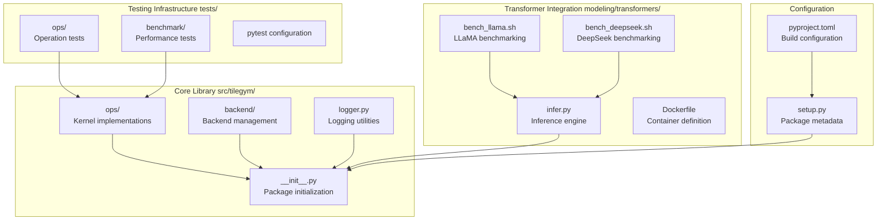
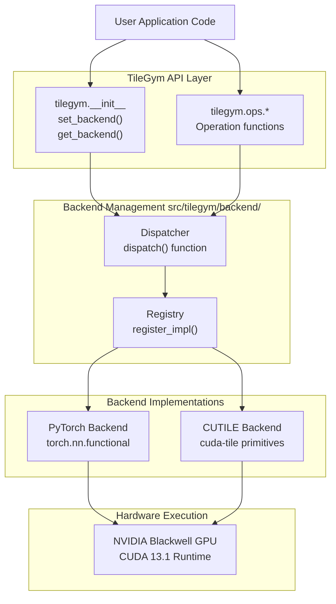
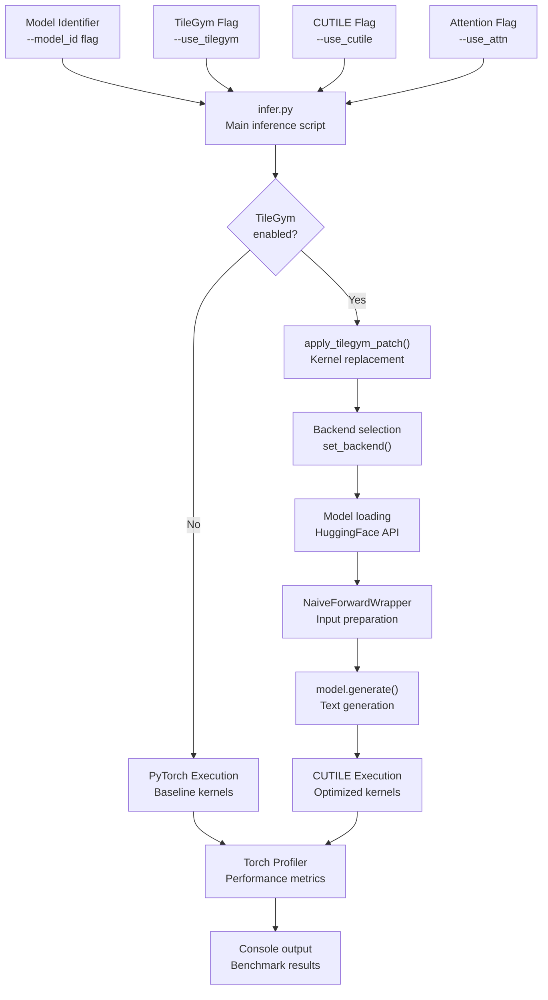
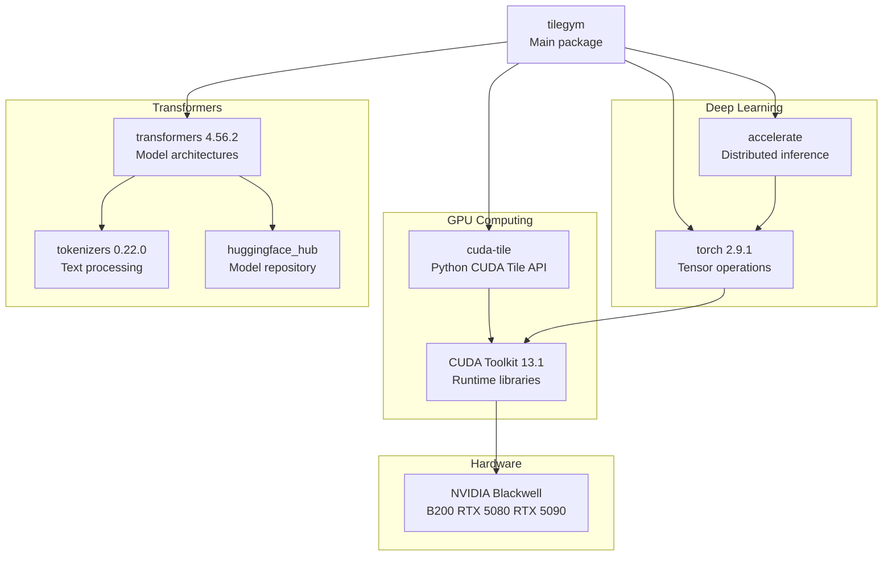

<!-- source: DeepWiki mcp.deepwiki.com · repo NVIDIA/TileGym · page 1 Overview · fetched 2026-10-26 -->

# Overview

<details>
<summary>Relevant source files</summary>

The following files were used as context for generating this wiki page:

- [README.md](README.md)

</details>


## Purpose and Scope

This document provides a high-level introduction to TileGym, explaining its purpose, architecture, and primary use cases. For detailed installation instructions, see [Prerequisites and Installation](#2.1). For hands-on usage guides, see [Quick Start Guide](#2.2). For information about the core library's internal design, see [Core Library](#3).

## What is TileGym?

TileGym is a CUDA Tile kernel library that provides GPU kernel implementations optimized for NVIDIA Blackwell architecture GPUs. The library serves three primary functions:

1. **Kernel Tutorial Platform**: A collection of tile-based GPU programming examples and educational resources
2. **Operations Library**: Production-ready implementations of common deep learning operators using CUDA Tile primitives
3. **Transformer Integration Layer**: End-to-end integration with large language models (LLaMA 3.1, DeepSeek V2) for practical performance evaluation

The library is built on top of the `cuda-tile` Python package and provides a pluggable backend architecture that allows seamless switching between PyTorch baseline implementations and optimized CUTILE kernels.

Sources: [README.md:5-18]()

## Hardware and Software Requirements

TileGym has strict hardware and software requirements due to its use of advanced CUDA Tile features:

| Requirement | Specification |
|------------|---------------|
| **GPU Architecture** | NVIDIA Blackwell (B200, RTX 5080, RTX 5090) |
| **CUDA Version** | 13.1 (Required) |
| **PyTorch Version** | 2.9.1 or compatible |
| **Python Package** | `cuda-tile` (auto-installed) |

> **Note**: CUDA 13.1 is mandatory. TileGym is built and tested exclusively on this version to leverage the latest CUDA Tile optimizations.

Sources: [README.md:29-35]()

## Repository Architecture

The following diagram shows the high-level structure of the TileGym repository, mapping conceptual components to actual file system locations:



**Repository Structure Overview**

Sources: [README.md:1-110]()

## Key Components

### 1. Operations Library

Located in `src/tilegym/ops/`, this module contains CUDA Tile kernel implementations for common deep learning operations. Each operation is implemented as a Python module that can be imported and used directly.

Example operations include:
- Matrix multiplication kernels
- Attention mechanisms
- Normalization layers (RMSNorm)
- Activation functions (SwiGLU)
- Positional encodings (RoPE)

Sources: [README.md:66-68]()

### 2. Backend Management System

The backend system provides a pluggable architecture for switching between different kernel implementations. The two primary backends are:

| Backend | Description | Usage |
|---------|-------------|-------|
| **PyTorch** | Standard PyTorch operations, used as baseline | Default backend |
| **CUTILE** | CUDA Tile optimized kernels | Enabled via `set_backend("cutile")` |

This architecture allows users to run identical code with different backend implementations for performance comparison. For detailed information about the backend system, see [Backend Management System](#3.2).

Sources: Diagram 2 from provided context

### 3. Transformer Integration

The `modeling/transformers/` directory contains scripts for running LLM inference with TileGym optimizations. The main entry point is `infer.py`, which supports:

- Model loading from HuggingFace Hub
- Selective TileGym kernel patching
- Configurable optimization levels (CUTILE backend, attention optimizations)
- Performance profiling and benchmarking

For detailed usage instructions, see [Running Inference](#4.2) and [Benchmarking Performance](#4.3).

Sources: [README.md:81-98]()

## System Architecture Diagram

The following diagram illustrates how user code interacts with TileGym's API and backend system:



**TileGym API and Backend Architecture**

This diagram shows the flow from user code through the TileGym API layer, backend management system, and down to hardware execution. The `dispatch()` function routes operation calls to the appropriate backend implementation based on the current backend setting.

Sources: Diagram 2 from provided context

## Use Cases

TileGym supports three primary usage patterns:

### 1. Kernel Development and Learning

Developers can explore individual kernel implementations in `src/tilegym/ops/` to learn tile-based GPU programming techniques. Each operation provides a self-contained example of CUDA Tile usage.

**Access Pattern**:
```
src/tilegym/ops/<operation_name>/
```

Sources: [README.md:64-68]()

### 2. Performance Benchmarking

Micro-benchmarks in `tests/benchmark/` allow users to evaluate kernel performance in isolation. The benchmarks compare PyTorch baseline implementations against CUTILE optimizations.

**Access Pattern**:
```
tests/benchmark/
bash run_all.sh
```

For complete benchmarking documentation, see [Benchmarking Performance](#4.3).

Sources: [README.md:70-79]()

### 3. End-to-End LLM Inference

The transformer integration layer demonstrates TileGym's practical impact on real-world models. Users can run inference on LLaMA 3.1 or DeepSeek V2 with TileGym optimizations enabled.

**Access Pattern**:
```
modeling/transformers/infer.py --model_id <model> --use_tilegym --use_cutile
```

For detailed usage instructions, see [Running Inference](#4.2).

Sources: [README.md:81-98]()

## Execution Flow Diagram

The following diagram maps the execution flow for LLM inference using TileGym, showing the relationship between configuration, optimization layers, and execution:



**LLM Inference Execution Flow**

This diagram shows the decision points and execution paths when running `infer.py`. The `--use_tilegym` flag determines whether TileGym kernel replacements are applied. When enabled, subsequent flags (`--use_cutile`, `--use_attn`) control which optimizations are activated.

Sources: Diagram 3 from provided context, [README.md:81-98]()

## Key Features Summary

| Feature | Description | Location |
|---------|-------------|----------|
| **Pluggable Backends** | Switch between PyTorch and CUTILE implementations | `src/tilegym/backend/` |
| **Operation Library** | CUDA Tile kernel implementations | `src/tilegym/ops/` |
| **LLM Integration** | LLaMA 3.1 and DeepSeek V2 support | `modeling/transformers/` |
| **Benchmarking Tools** | Performance comparison scripts | `tests/benchmark/`, `modeling/transformers/bench_*.sh` |
| **Docker Support** | Reproducible containerized environment | `modeling/transformers/Dockerfile` |
| **Testing Infrastructure** | Comprehensive test suite | `tests/` |

Sources: [README.md:20-25]()

## Supported Models

TileGym provides tested integration with the following transformer architectures:

### LLaMA 3.1-8B
- **Optimized Operations**: RoPE, SwiGLU, RMSNorm, Attention, Flash Decoding
- **Benchmark Script**: `modeling/transformers/bench_llama.sh`

### DeepSeek V2-Lite
- **Optimized Operations**: RoPE, SwiGLU, RMSNorm, MoE, MLADecoding, Attention
- **Benchmark Script**: `modeling/transformers/bench_deepseek.sh`

For details on running these models, see [Inference System Overview](#4.1) and [Running Inference](#4.2).

Sources: Diagram 6 from provided context

## Dependency Architecture

The following diagram shows TileGym's relationship to external dependencies and the GPU hardware layer:



**TileGym Dependency Graph**

The library has three main dependency stacks: GPU Computing (cuda-tile and CUDA Toolkit 13.1), Deep Learning (PyTorch and accelerate), and Transformers (HuggingFace ecosystem). All execution paths converge at the NVIDIA Blackwell GPU hardware layer.

Sources: Diagram 5 from provided context, [README.md:29-56]()

## Getting Started Roadmap

For new users, the recommended path through the documentation is:

1. **Installation**: [Prerequisites and Installation](#2.1) - Set up CUDA 13.1, PyTorch, and TileGym
2. **First Steps**: [Quick Start Guide](#2.2) - Run your first inference example
3. **Core Concepts**: [Backend Management System](#3.2) - Understand the pluggable architecture
4. **Inference**: [Running Inference](#4.2) - Learn the `infer.py` command-line interface
5. **Performance**: [Benchmarking Performance](#4.3) - Compare PyTorch vs CUTILE implementations

Sources: [README.md:9-14]()

## Project Status and Support

TileGym is currently optimized for NVIDIA Blackwell architecture GPUs. Support for additional GPU architectures is planned for future releases. The project is actively maintained and welcomes community contributions through the process outlined in [Contributing](#7).

For development setup instructions, see [Development Guide](#6). For contribution requirements, including the CLA process, see [Contributor License Agreement](#7.2).

Sources: [README.md:31](), [README.md:100-102]()

## License

TileGym is distributed under the MIT License. For complete licensing information, including third-party attributions, see [Legal and Licensing](#8).

Sources: [README.md:104-109]()

---

