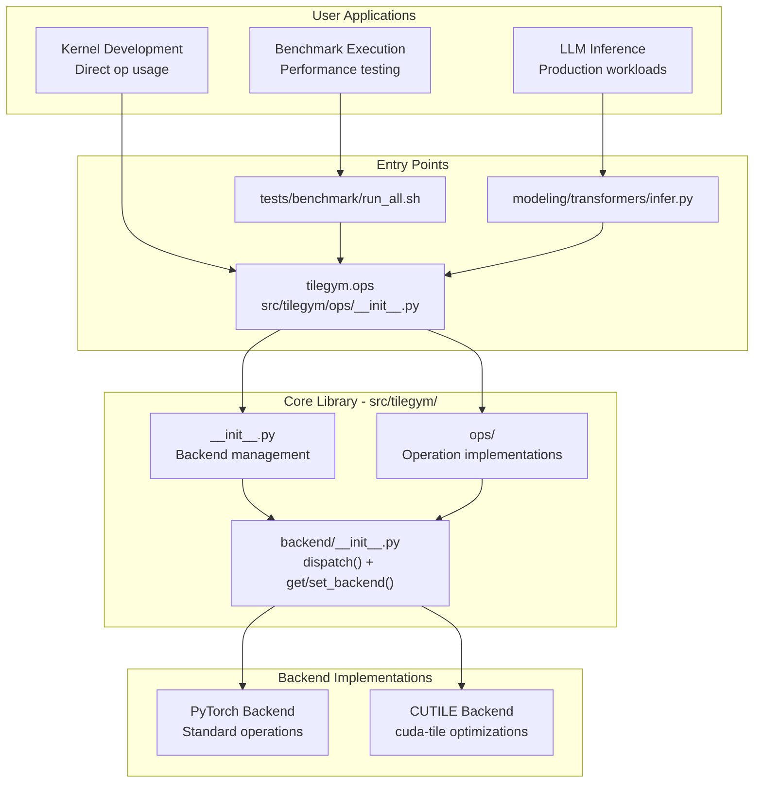
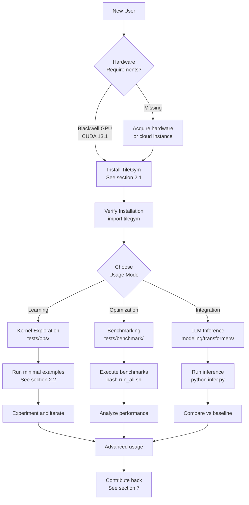
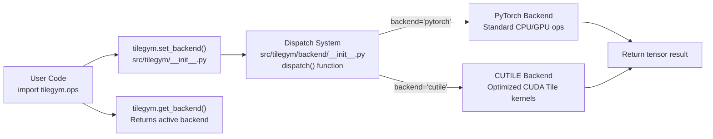

<!-- source: DeepWiki mcp.deepwiki.com · repo NVIDIA/TileGym · page 2 Getting Started · fetched 2026-10-26 -->

# Getting Started

<details>
<summary>Relevant source files</summary>

The following files were used as context for generating this wiki page:

- [README.md](README.md)

</details>


This page provides an overview of TileGym's capabilities and guides you through the initial steps to begin using the library. It introduces the three main usage modes, explains the system architecture from a user perspective, and outlines the learning path for new users.

For detailed installation instructions, see [Prerequisites and Installation](#2.1). For hands-on examples and first steps, see [Quick Start Guide](#2.2). For information about development setup and contributing, see [Development Guide](#6).

## Understanding TileGym

TileGym is organized around three primary usage modes, each targeting different aspects of GPU kernel development and optimization:

| Usage Mode | Purpose | Primary Location | Entry Point |
|------------|---------|-----------------|-------------|
| **Kernel Exploration** | Learn and experiment with individual CUDA Tile operations | [src/tilegym/ops/](src/tilegym/ops/) | Python import: `import tilegym.ops` |
| **Performance Benchmarking** | Evaluate kernel performance with micro-benchmarks | [tests/benchmark/](tests/benchmark/) | Script: `run_all.sh` |
| **Transformer Inference** | Run end-to-end LLM inference with TileGym optimizations | [modeling/transformers/](modeling/transformers/) | Script: `infer.py` |

Each mode builds upon the core TileGym library but serves different use cases. Kernel exploration is ideal for learning tile-based GPU programming, benchmarking helps quantify optimization benefits, and transformer inference demonstrates real-world integration with production LLMs.

**Sources:** [README.md:64-98]()

## System Architecture from User Perspective

The following diagram shows how users interact with TileGym through different entry points and how these relate to the core library components:

**Diagram: User Interaction Model and Code Entry Points**



**Sources:** [README.md:64-98](), Diagram 1, Diagram 2

The architecture separates user-facing entry points from backend implementations. Users interact with three distinct entry points based on their use case, but all paths converge on the core library's backend management system. This design allows consistent operation semantics across different backends while enabling transparent optimization through backend switching.

## Package Structure and Key Modules

Understanding the repository structure helps locate relevant code for each usage mode:

**Diagram: Repository Organization and Code Locations**

```mermaid
graph TB
    subgraph Root["Repository Root"]
        SrcDir["src/tilegym/<br/>Core library package"]
        ModelDir["modeling/transformers/<br/>LLM integration"]
        TestDir["tests/<br/>Testing and benchmarks"]
        SetupFile["setup.py<br/>Package configuration"]
    end
    
    subgraph TileGymPkg["src/tilegym/"]
        InitFile["__init__.py<br/>Package initialization<br/>Backend setup"]
        BackendDir["backend/<br/>Backend system"]
        OpsDir["ops/<br/>Kernel implementations"]
        UtilsFile["utils.py<br/>Logging utilities"]
    end
    
    subgraph OpsStructure["src/tilegym/ops/"]
        OpsInit["__init__.py<br/>Operation exports"]
        RopeOp["rope.py"]
        RmsNormOp["rmsnorm.py"]
        SwigluOp["swiglu.py"]
        AttnOps["attention.py<br/>flash_decoding.py<br/>mla_decoding.py"]
    end
    
    subgraph BackendStructure["src/tilegym/backend/"]
        BackInit["__init__.py<br/>Backend management"]
        Dispatcher["Dispatch logic<br/>register_impl()"]
    end
    
    subgraph ModelingStructure["modeling/transformers/"]
        InferPy["infer.py<br/>Inference engine"]
        PatchPy["tilegym_patch.py<br/>Model patching"]
        BenchScripts["bench_llama.sh<br/>bench_deepseek.sh"]
        DockerFile["Dockerfile<br/>Container setup"]
    end
    
    subgraph TestStructure["tests/"]
        BenchDir["benchmark/<br/>Micro-benchmarks"]
        OpsTestDir["ops/<br/>Operation tests"]
    end
    
    Root --> SrcDir
    Root --> ModelDir
    Root --> TestDir
    Root --> SetupFile
    
    SrcDir --> InitFile
    SrcDir --> BackendDir
    SrcDir --> OpsDir
    SrcDir --> UtilsFile
    
    OpsDir --> OpsInit
    OpsDir --> RopeOp
    OpsDir --> RmsNormOp
    OpsDir --> SwigluOp
    OpsDir --> AttnOps
    
    BackendDir --> BackInit
    BackendDir --> Dispatcher
    
    ModelDir --> InferPy
    ModelDir --> PatchPy
    ModelDir --> BenchScripts
    ModelDir --> DockerFile
    
    TestDir --> BenchDir
    TestDir --> OpsTestDir
```



**Sources:** [README.md:1-110](), Diagram 1

The repository follows a clear separation of concerns:
- `src/tilegym/` contains the core library with backend-agnostic operation definitions
- `modeling/transformers/` provides LLM integration examples and benchmarking infrastructure
- `tests/` includes both unit tests and performance benchmarks

## Getting Started Workflow

The typical workflow for new users follows this progression:

**Diagram: User Onboarding Flow**



**Sources:** [README.md:27-98]()

This workflow accommodates users with different goals. Learners typically start with kernel exploration to understand tile-based programming concepts. Performance engineers begin with benchmarking to quantify optimization opportunities. Production users proceed directly to transformer inference to integrate TileGym into their LLM pipelines.

## Hardware and Software Requirements Overview

Before proceeding with installation, verify your system meets these requirements:

| Requirement | Specification | Verification Command |
|-------------|---------------|---------------------|
| **GPU Architecture** | NVIDIA Blackwell (B200, RTX 5080, RTX 5090) | `nvidia-smi` |
| **CUDA Toolkit** | CUDA 13.1 (required) | `nvcc --version` |
| **Python** | 3.8 or higher | `python --version` |
| **PyTorch** | 2.9.1 or compatible (CUDA 13.0 build) | `python -c "import torch; print(torch.__version__)"` |

> ⚠️ **Critical:** TileGym is currently compatible only with NVIDIA Blackwell architecture GPUs and requires CUDA 13.1. Support for additional GPU architectures is planned for future releases.

The CUDA version requirement is strict because TileGym uses features specific to CUDA 13.1. PyTorch compatibility requires a CUDA 13.0 build, which is compatible with CUDA 13.1 runtime.

**Sources:** [README.md:29-35]()

## Installation Methods

TileGym supports two installation methods depending on your use case:

**Standard Installation** (recommended for most users):
```bash
pip install .
```
This method installs TileGym as a standard Python package. The `setup.py` script [setup.py:1-50]() automatically resolves and installs dependencies including `cuda-tile` from https://github.com/nvidia/cutile-python.

**Editable Installation** (recommended for development):
```bash
pip install -e .
```
Editable mode creates symlinks to the source directory, allowing code changes to take effect immediately without reinstallation. This is essential for kernel development and debugging workflows.

For containerized deployments, Docker provides a reproducible environment with all dependencies pre-configured. See [Docker Deployment](#5) for details.

**Sources:** [README.md:49-60]()

## Backend Selection

TileGym's backend management system allows runtime selection between different operation implementations:

**Diagram: Backend Selection Mechanism**



**Sources:** [README.md:1-110](), Diagram 2

The backend selection mechanism is implemented in [src/tilegym/__init__.py]() and [src/tilegym/backend/__init__.py](). By default, operations use the PyTorch backend for compatibility. Setting `backend='cutile'` activates optimized CUDA Tile implementations. This design enables A/B testing and performance comparison without modifying application code.

## Usage Mode Details

Each usage mode provides different capabilities and learning opportunities:

### Kernel Exploration Mode

Direct operation usage through the `tilegym.ops` module enables experimentation with individual kernels:

```python
import tilegym
import torch

# Set backend
tilegym.set_backend('cutile')

# Use operations
from tilegym.ops import rope, rmsnorm, swiglu

# Example operation call
output = rope(input_tensor, freqs_cos, freqs_sin)
```

All operation implementations reside in [src/tilegym/ops/](). Each operation module (e.g., `rope.py`, `rmsnorm.py`, `swiglu.py`) contains both the operation interface and backend-specific implementations.

**Sources:** [README.md:66-68]()

### Benchmarking Mode

The benchmarking infrastructure in [tests/benchmark/](tests/benchmark/) provides micro-benchmarks for performance evaluation. The [tests/benchmark/run_all.sh]() script orchestrates benchmark execution across all operations.

Benchmarks measure:
- Kernel execution time
- Memory bandwidth utilization
- Performance scaling across input sizes

Results quantify the optimization benefit of CUTILE backend over PyTorch baseline.

**Sources:** [README.md:72-79]()

### Transformer Inference Mode

The [modeling/transformers/infer.py]() script demonstrates end-to-end LLM inference with TileGym optimizations. It supports:

- Model loading from HuggingFace Hub
- Selective operation patching via [modeling/transformers/tilegym_patch.py]()
- Performance profiling with torch profiler
- Comparison against PyTorch baseline

Benchmark scripts [modeling/transformers/bench_llama.sh]() and [modeling/transformers/bench_deepseek.sh]() automate performance comparison for LLaMA and DeepSeek models respectively.

**Sources:** [README.md:82-98]()

## Next Steps

After understanding the TileGym architecture and usage modes:

1. **Install TileGym**: Follow detailed instructions in [Prerequisites and Installation](#2.1) to set up your environment.

2. **Run First Examples**: Work through hands-on tutorials in [Quick Start Guide](#2.2) to verify your installation and understand basic usage patterns.

3. **Explore Operations**: Review individual kernel implementations in [Core Library](#3) to understand available operations and their semantics.

4. **Optimize LLMs**: Learn to integrate TileGym into transformer models in [Transformer Inference](#4).

5. **Contribute**: Once comfortable with TileGym, consider contributing improvements via [Contributing](#7).

The learning path varies based on your goals. Users focused on learning GPU programming should start with kernel exploration. Performance engineers should begin with benchmarking. Production users can proceed directly to transformer inference after verifying installation.

**Sources:** [README.md:1-110]()

---

