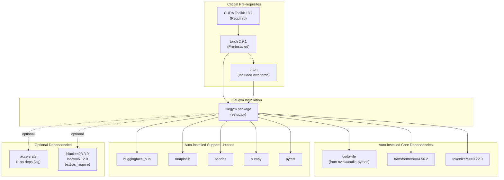
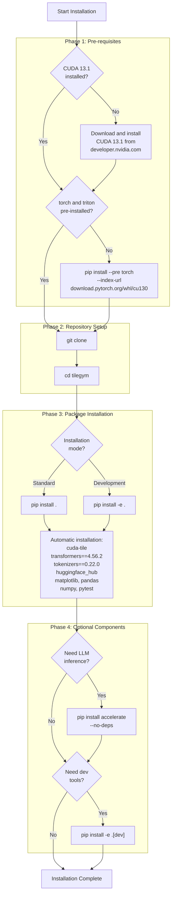
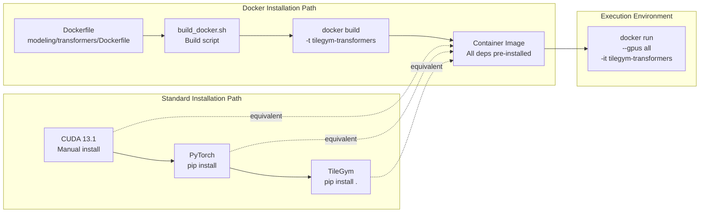
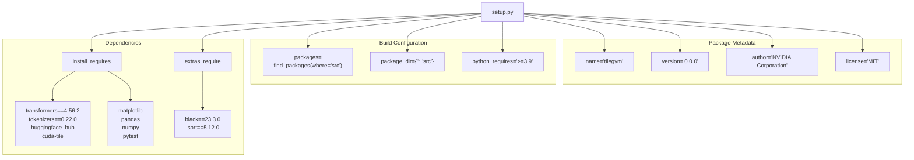
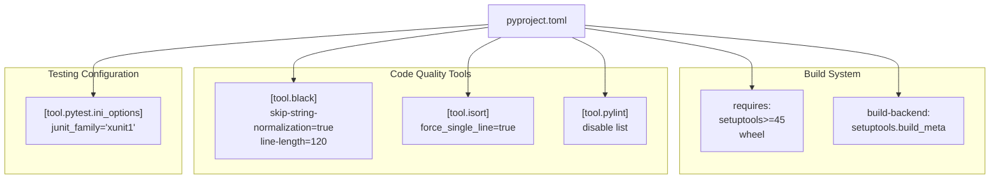

<!-- source: DeepWiki mcp.deepwiki.com · repo NVIDIA/TileGym · page 2.1 Prerequisites and Installation · fetched 2026-10-26 -->

# Prerequisites and Installation

<details>
<summary>Relevant source files</summary>

The following files were used as context for generating this wiki page:

- [README.md](README.md)
- [pyproject.toml](pyproject.toml)
- [setup.py](setup.py)

</details>


This page details the hardware requirements, software dependencies, and installation procedures for TileGym. It covers system prerequisites, dependency resolution, and verification steps. For setting up a development environment with editable installation, see [Development Setup](#6.1). For containerized deployment options, see [Docker Deployment](#5).

## Purpose and Scope

This document provides complete information for installing TileGym on a target system. It specifies mandatory hardware requirements (NVIDIA Blackwell GPUs), software dependencies with exact version constraints, and step-by-step installation procedures for both standard and development use cases.

## Hardware Requirements

TileGym requires specific GPU hardware to function correctly.

### Supported GPU Architectures

| Requirement | Specification |
|------------|---------------|
| **GPU Architecture** | NVIDIA Blackwell architecture only |
| **Supported Models** | B200, RTX 5080, RTX 5090 |
| **CUDA Compute Capability** | Compatible with CUDA 13.1 |
| **Future Support** | Other GPU architectures planned for future releases |

> ⚠️ **Critical Limitation**: TileGym is currently exclusive to NVIDIA Blackwell architecture GPUs. The CUDA Tile optimizations target Blackwell-specific hardware features and will not function on earlier GPU generations (Ampere, Ada Lovelace, Hopper).

**Sources:** [README.md:31-31]()

## Software Dependencies

TileGym has a layered dependency structure with specific version requirements.

### Dependency Architecture



**Sources:** [setup.py:30-48](), [README.md:33-35]()

### Version Requirements Table

| Dependency | Version | Installation Method | Purpose |
|-----------|---------|---------------------|---------|
| **CUDA Toolkit** | 13.1 | Manual download | GPU runtime and compilation |
| **Python** | ≥3.9 | System package manager | Language runtime |
| **torch** | 2.9.1 (verified) | Pre-install via pip | Tensor operations and CUDA 13.0 build |
| **triton** | Bundled with torch | Automatic | GPU kernel compilation |
| **cuda-tile** | Latest | Auto-install from PyPI | CUDA Tile primitives |
| **transformers** | 4.56.2 | Auto-install | Model architectures |
| **tokenizers** | 0.22.0 | Auto-install | Text processing |
| **huggingface_hub** | Latest | Auto-install | Model repository access |
| **matplotlib** | Latest | Auto-install | Visualization |
| **pandas** | Latest | Auto-install | Data structures |
| **numpy** | Latest | Auto-install | Array operations |
| **pytest** | Latest | Auto-install | Testing framework |
| **accelerate** | Latest | Manual (`--no-deps`) | Distributed inference |
| **black** | 23.3.0 | Dev extra | Code formatting |
| **isort** | 5.12.0 | Dev extra | Import sorting |

**Sources:** [setup.py:29-48](), [README.md:33-35](), [README.md:44-44]()

### Critical Version Notes

**CUDA Version Mismatch**: TileGym requires CUDA 13.1 for the toolkit, while PyTorch 2.9.1 is built against CUDA 13.0. This is intentional:
- **CUDA 13.0** provides PyTorch binary compatibility
- **CUDA 13.1** enables latest CUDA Tile optimizations

Both versions coexist without conflict when CUDA 13.1 is installed system-wide.

**Sources:** [README.md:34-34](), [README.md:44-44]()

## Installation Process

### Standard Installation Flow



**Sources:** [README.md:29-60](), [setup.py:30-48]()

### Step-by-Step Installation

#### Phase 1: Install Prerequisites

**1.1 Install CUDA 13.1**

Download CUDA Toolkit 13.1 from [NVIDIA CUDA Downloads](https://developer.nvidia.com/cuda-downloads) and install according to platform-specific instructions. Verify installation:

```bash
nvcc --version
```

Expected output should show CUDA compilation tools release 13.1.

**1.2 Install PyTorch and Triton**

If `torch` and `triton` are not already installed:

```bash
pip install --pre torch --index-url https://download.pytorch.org/whl/cu130
```

This installs PyTorch 2.9.1 (verified working version) built against CUDA 13.0. The `triton` package is automatically included.

Verify installation:

```bash
python -c "import torch; print(torch.__version__); print(torch.cuda.is_available())"
```

Expected output: version `2.9.1` and `True` for CUDA availability.

**Sources:** [README.md:39-47]()

#### Phase 2: Clone Repository

```bash
git clone <tilegym-repository-url>
cd tilegym
```

**Sources:** [README.md:52-53]()

#### Phase 3: Install TileGym Package

**Standard Installation** (for production use):

```bash
pip install .
```

This installs TileGym as a site package. The `setup.py` file [setup.py:30-42]() specifies all dependencies that will be automatically installed:
- `cuda-tile` from https://github.com/nvidia/cutile-python
- `transformers==4.56.2`
- `tokenizers==0.22.0`
- `huggingface_hub`
- `matplotlib`, `pandas`, `numpy`, `pytest`

**Development Installation** (for contributors):

```bash
pip install -e .
```

The `-e` flag enables editable mode, allowing code changes to take effect without reinstalling. This is documented in [README.md:58-58]().

**Sources:** [README.md:54-58](), [setup.py:30-42]()

#### Phase 4: Install Optional Dependencies

**For LLM Inference Support** (required for transformer examples):

```bash
pip install accelerate --no-deps
```

The `--no-deps` flag prevents `accelerate` from reinstalling PyTorch and potentially downgrading to an incompatible version. This is critical to maintain the CUDA 13.0-built PyTorch installation.

**For Development Tools**:

```bash
pip install -e .[dev]
```

This installs additional development dependencies specified in `extras_require` [setup.py:43-47]():
- `black==23.3.0` for code formatting
- `isort==5.12.0` for import sorting

**Sources:** [README.md:88-89](), [setup.py:43-47]()

## Docker Alternative

For users who prefer containerized environments or cannot meet the hardware/software prerequisites, Docker provides a pre-configured environment.

### Docker Installation Mapping



**Quick Docker Setup**:

```bash
docker build -t tilegym-transformers -f modeling/transformers/Dockerfile .
docker run --gpus all -it tilegym-transformers bash
```

For detailed Docker usage, see [Building the Container](#5.1) and [Running in Docker](#5.2).

**Sources:** [README.md:60-60](), [README.md:92-96]()

## Installation Verification

### Verification Checklist

After installation, verify the environment is correctly configured:

| Component | Verification Command | Expected Output |
|-----------|---------------------|-----------------|
| CUDA Toolkit | `nvcc --version` | Release 13.1.x |
| PyTorch | `python -c "import torch; print(torch.__version__)"` | 2.9.1 |
| CUDA availability | `python -c "import torch; print(torch.cuda.is_available())"` | True |
| Triton | `python -c "import triton; print(triton.__version__)"` | Version info displayed |
| TileGym | `python -c "import tilegym; print(tilegym.__version__)"` | 0.0.0 |
| CUDA Tile | `python -c "import cuda.tile"` | No import errors |

### Import Test Script

```python
# test_installation.py
import sys

def verify_installation():
    try:
        import torch
        print(f"✓ torch {torch.__version__}")
        print(f"✓ CUDA available: {torch.cuda.is_available()}")
        
        import triton
        print(f"✓ triton {triton.__version__}")
        
        import tilegym
        print(f"✓ tilegym {tilegym.__version__}")
        
        import cuda.tile
        print("✓ cuda.tile imported successfully")
        
        import transformers
        print(f"✓ transformers {transformers.__version__}")
        
        print("\nAll components verified successfully!")
        return True
        
    except ImportError as e:
        print(f"✗ Import failed: {e}")
        return False

if __name__ == "__main__":
    sys.exit(0 if verify_installation() else 1)
```

Run verification:

```bash
python test_installation.py
```

**Sources:** [setup.py:14-14](), [setup.py:30-42]()

## Troubleshooting Common Issues

### CUDA Version Mismatch

**Symptom**: Error messages about CUDA runtime version mismatches.

**Solution**: Ensure CUDA Toolkit 13.1 is installed system-wide. PyTorch 2.9.1 built with CUDA 13.0 is compatible with CUDA 13.1 runtime.

### Missing cuda-tile Package

**Symptom**: `ImportError: No module named 'cuda.tile'`

**Solution**: The `cuda-tile` package should install automatically via `setup.py` [setup.py:40](). If missing, manually install:

```bash
pip install cuda-tile
```

### Accelerate Dependency Conflicts

**Symptom**: Installing `accelerate` downgrades PyTorch to incompatible version.

**Solution**: Always use the `--no-deps` flag as specified in [README.md:88-89]():

```bash
pip install accelerate --no-deps
```

### GPU Not Detected

**Symptom**: `torch.cuda.is_available()` returns `False`

**Solution**: 
1. Verify GPU is Blackwell architecture (B200, RTX 5080, RTX 5090)
2. Ensure NVIDIA drivers are installed and current
3. Check Docker GPU access with `--gpus all` flag if using containers

**Sources:** [README.md:31-31](), [README.md:88-89](), [setup.py:30-42]()

## Configuration Files

The installation process is controlled by two primary configuration files:

### setup.py Structure



Key elements in [setup.py:12-48]():
- **Package discovery**: Uses `setuptools.find_packages(where='src')` to locate all packages in `src/` directory
- **Version management**: Currently set to `0.0.0` in [setup.py:14]()
- **Dependency locking**: Critical packages like `transformers` and `tokenizers` have exact version pins
- **Development extras**: Accessible via `pip install -e .[dev]`

### pyproject.toml Structure



The [pyproject.toml:1-30]() file configures:
- **Build system**: Uses `setuptools` with PEP 517 compliance [pyproject.toml:5-7]()
- **Formatting tools**: `black` configured for 120-character lines [pyproject.toml:9-11]()
- **Import sorting**: `isort` enforces single-line imports [pyproject.toml:13-15]()
- **Testing**: `pytest` configured for xunit1 output format [pyproject.toml:28-29]()

**Sources:** [setup.py:1-49](), [pyproject.toml:1-30]()

## Next Steps

After successful installation:
1. Follow the [Quick Start Guide](#2.2) for your first inference example
2. Explore the [Package Architecture](#3.1) to understand TileGym's structure
3. Review [Backend Management System](#3.2) to learn about switching between PyTorch and CUTILE backends
4. Run transformer inference examples in [Running Inference](#4.2)

---

